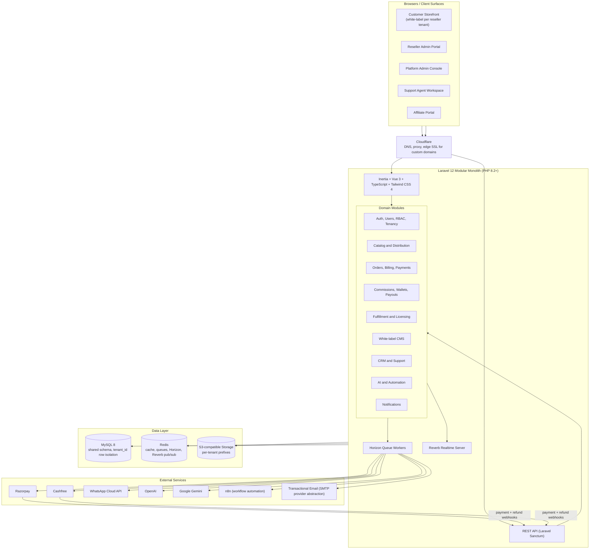

# Frenchies — Product Overview

| Field | Value |
|---|---|
| Document | 00-product-overview.md |
| Version | 1.0 |
| Status | Draft for Review |
| Date | 2026-11-01 |
| Owner | Product & Architecture Team |
| Related documents | index.md, 01-business-requirements.md, 04-multi-tenancy-architecture.md, 05-reseller-hierarchy.md, 23-master-prd.md (full map in §8) |

## Table of Contents

1. [Vision](#1-vision)
2. [Problem Statement](#2-problem-statement)
3. [Why Now](#3-why-now)
4. [Target Personas](#4-target-personas)
5. [Product Principles](#5-product-principles)
6. [Value Proposition per Marketplace Side](#6-value-proposition-per-marketplace-side)
7. [High-Level Architecture](#7-high-level-architecture)
8. [Document Map](#8-document-map)
9. [Scope Summary (MVP vs Full)](#9-scope-summary-mvp-vs-full)
10. [Monetization Overview](#10-monetization-overview)
11. [Glossary](#11-glossary)
12. [Assumptions & Open Questions](#12-assumptions--open-questions)

---

## 1. Vision

Frenchies is a white-label, multi-tenant, multi-level reseller SaaS platform that lets the
platform company ("Central Platform") distribute digital products and services through an
unlimited-depth network of independent resellers, while each reseller runs a fully
branded digital-services business — branding, domain, catalog, pricing, customers,
sub-resellers, affiliates, support, and finances — without building technology themselves.

**One-sentence vision:** any ambitious seller in India can launch a credible, own-brand
digital-products business in under one day, on infrastructure and compliance tooling they
could never build alone, and expand it into a distribution downline of their own.

The platform is a **monolith, modular by domain** (Laravel 12 + PHP 8.2+), with a single
shared MySQL 8 database with `tenant_id` row isolation, Redis-backed caching/queues
(Horizon) and realtime (Reverb), Sanctum auth, and Vue 3 + Inertia + TypeScript +
Tailwind CSS 4 front ends. No microservices. See §7 and `04-multi-tenancy-architecture.md`.

## 2. Problem Statement

Selling digital products and services in India (SaaS tools, licenses, courses, digital
goods, service subscriptions) requires a stack most individual sellers and small agencies
cannot assemble or operate:

1. **Technology cost.** Storefront, catalog, checkout with local gateways (Razorpay,
   Cashfree), GST invoicing, licensing, subscriptions, support desk, CRM, and affiliate
   tracking are 10+ tools and a development team.
2. **Distribution cost.** Product creators have products but no last-mile sales force;
   resellers have relationships and local trust but no products, no invoicing layer, and no
   fulfilment machinery.
3. **Trust and compliance friction.** GST-correct invoicing (CGST/SGST/IGST by place of
   supply), refund expectations, and data-protection duties under the India DPDP Act 2023
   raise the bar for anyone selling online under their own brand.
4. **Multi-level economics are manual today.** Upstream/downstream commission splits
   between a seller, its parent reseller, and the network above it are handled on
   spreadsheets, with disputes and no audit trail.

Frenchies collapses all four problems into one platform: the Central Platform operates the
technology, money collection, ledger, and compliance substrate; resellers own the customer
relationship and the brand.

### 2.4 Competitive alternatives and why Frenchies wins

| Alternative | What it gives the seller | Why it loses to Frenchies for this buyer |
|---|---|---|
| Build in-house (agency/custom dev) | Full control | ₹2–10 lakhs and 2–6 months to first sale; ongoing maintenance; no multi-level commission, no supplier catalog. |
| Generic store builders (Shopify-class) | Fast storefront, app ecosystem | No reseller hierarchy or commission engine; weak India-compliance fit (GST invoicing on resold digital goods, TDS-ready payouts); not designed for white-label resale businesses. |
| Marketplace platforms | Instant demand | Buyer owns the customer relationship; no own brand, no own domain, no own pricing power; policy risk. |
| Distributor spreadsheets + WhatsApp | Zero setup cost | No invoicing, no licenses, no audit trail, no payouts machinery; breaks at network scale. |
| **Frenchies** | White-label store, supply catalog, GST invoicing, commission ledger, sub-reseller network, support/AI tooling on one subscription | — |

**Positioning statement (draft):** "Frenchies is the only India-first platform where a
seller gets both supply (products to sell) and machinery (brand, billing, commissions,
compliance) in one subscription — and can build their own distribution network on top."

## 3. Why Now

- **India's digital-services seller base is expanding** (creator economy, SaaS
  resellers, regional IT service firms) while gateway onboarding (Razorpay, Cashfree) has
  become self-serve — the last hard piece is everything around the gateway.
- **Regulatory tightening raises the compliance bar.** GST e-invoicing/reporting
  expectations, Consumer Protection (e-commerce) rules, and the DPDP Act 2023 (in force,
  with phased enforcement) make ad-hoc spreadsheet reselling risky; a compliant platform is
  a selling point, not overhead.
- **White-label SaaS maturity.** Custom-domain serving with edge TLS (Cloudflare),
  per-tenant theming, and mature Indian gateways make true white-label economically
  viable at small-tenant scale.
- **AI cost collapse.** Provider-integrated AI (OpenAI, Google Gemini) for support
  deflection, catalog copy, and lead qualification is now a marginal-cost feature that a
  multi-tenant platform can amortize across all resellers.
- **Stack timing.** Laravel 12 plus PHP 8.2+ is the owner-approved implementation baseline.
  A later framework-major upgrade may be planned separately after MVP only if its value
  outweighs migration and validation cost.

## 4. Target Personas

Personas use the canonical 12-role model from the authoring charter (§5). Role names below
are canonical and must be used verbatim in every PRD document.

### 4.1 Platform-side personas (Central Platform tenant)

| Persona (canonical role) | Profile | Primary jobs |
|---|---|---|
| **Super Admin** | Platform founder/CTO-level operator. | Configure platform settings and permission catalogue; manage roles; suspend tenants; execute financial overrides; own audit trail. |
| **Platform Admin** | Platform operations employee. | Approve reseller applications; curate central catalog and distribution authorizations; run marketing; monitor activation metrics. |
| **Finance Admin** | Platform finance employee/CA-supported. | Reconcile gateway settlements to the ledger; approve refunds; approve reseller/affiliate payouts; run commissions approval and financial reports. |
| **Product Manager** (central) | Catalog owner. | Create central products, variants, demos, versions; grant/revoke distribution authorizations (`tenant_products`) with per-reseller commission terms. |
| **Support Manager** | Central support lead. | Own ticket queues, SLA policies, escalations, agent workload, CSAT. |
| **Support Agent** (central) | Tier-1/2 agent. | Resolve tickets within granted `support_departments`, for central and (when granted) reseller tenants. |

### 4.2 Reseller-side personas (reseller tenants)

| Persona (canonical role) | Profile | Primary jobs |
|---|---|---|
| **Reseller** | Owner of a reseller business tenant: solo entrepreneur, agency, or IT services firm wanting an own-brand digital store. | Get approved; configure branding/custom domain; select and price products; invite staff; recruit sub-resellers and affiliates; track earnings; request payouts. |
| **Sub-Reseller** | A reseller created by (child of) another reseller; a full tenant with the same capabilities. | Same as Reseller, within own tenant; understands parent gets visibility per hierarchy rules. |
| **Reseller Employee** | Staff invited by a Reseller (catalog manager, ops, bookkeeper). | Operate assigned granular permission subsets (products, orders, tickets) without access to financial settings unless granted. |
| **Sales Agent** | Reseller tenant's CRM-focused person. | Work leads, issue quotations, convert quotations to orders; explicitly cannot change financial settings. |

### 4.3 Network & buyer personas

| Persona (canonical role) | Profile | Primary jobs |
|---|---|---|
| **Affiliate** | Individual/organization outside the reseller hierarchy, attached to one tenant scope (central or a reseller). | Obtain referral links/coupons; track clicks, conversions, and commissions; request payouts. |
| **Customer** | End buyer of a reseller (or of the central platform); per-tenant account. | Browse white-label storefront; purchase; obtain invoice, license/entitlement; manage subscription; open support tickets; access customer portal. |
| **Support Agent** (reseller) | Support person inside a reseller tenant. | Handle the reseller's customers' tickets within granted departments; escalate to central when the product owner is central. |

## 5. Product Principles

Each principle is testable; reviews and acceptance criteria trace back to these.

1. **The ledger is the truth.** Every money movement is a double-entry posting
   (`journal_entries` + `journal_lines`). Wallets are derived projections, never
   hand-edited. Any balance shown in UI must be reconstructible from ledger postings.
2. **Tenant isolation by default.** Every tenant-scoped row carries `tenant_id`; global
   scopes + query middleware enforce isolation. Cross-tenant access exists only via
   explicit, audited grants (platform staff).
3. **White-label means invisible — except where law requires visibility.** Platform
   branding is hidden on reseller surfaces; legally required disclosures (invoice
   "sold by", payment descriptor) remain and are configurable per jurisdiction
   (see OQ-028 in `22-open-questions-and-assumptions.md`).
4. **Configurable over hard-coded.** Commission splits, hold periods, payout thresholds,
   SLAs, and plan entitlements are platform-configurable settings — business numbers are
   never hard-coded in logic.
5. **Idempotency everywhere money or messages are involved.** Gateway webhooks are
   idempotent via `payment_webhook_events` (gateway + event id unique); commission
   generation is idempotent per order+beneficiary+type+cycle; notification sends are
   deduplicated by template + entity + event.
6. **One human, many accounts — no silent merging.** Users are tenant-scoped; a person
   with accounts in multiple tenants logs in per tenant (MVP). Identity merging is
   explicitly out of scope.
7. **MVP scope discipline.** P0/P1 only for MVP (charter §10). Post-MVP features are
   specified at architecture level now so they do not require rework, but are not built.
8. **Measurable quality.** Every performance, availability, or UX claim in the PRD is
   expressed as a numeric target or a testable acceptance criterion
   (see `18-non-functional-requirements.md`).

## 6. Value Proposition per Marketplace Side

| Side | Core promise | Key differentiators |
|---|---|---|
| **Central Platform** | Operate a scalable reseller network with controlled economics and a full audit trail. | Single ledger of record; configurable multi-level commission engine; tenant approval and suspension controls; centralized payment collection under own merchant accounts (no gateway credentials with resellers); audit logs on every sensitive action. |
| **Reseller** | Launch an own-brand digital store in < 1 day without engineers. | White-label storefront on `*.frenchies.com` or verified custom domain; pre-authorized product catalog with own pricing; GST invoicing; wallets and transparent commission statements; sub-reseller and affiliate recruitment tools; support desk included. |
| **Sub-Reseller** | Same as Reseller, plus a supply relationship. | Products and authorizations inherited/authorized by parent; parent visibility (not control) per hierarchy rules; own branding, customers, and finances. |
| **Reseller Employee / Sales Agent** | Do assigned work without owning risk. | Granular permission subsets; Sales Agent gets CRM/leads/quotations focus and is blocked from financial settings by role design. |
| **Affiliate** | Earn by referring, without joining the hierarchy. | Tenant-scoped referral links and coupons; clicks/conversions tracked (`affiliate_links`, `affiliate_clicks`); commissions are a separate pool that never cascades; self-serve payout requests. |
| **Customer** | Buy from a trustworthy local-brand store. | Local payment methods (UPI/netbanking/cards via Razorpay/Cashfree); GST invoice; instant license/entitlement delivery; subscriptions with portal self-service; per-tenant support tickets. |
| **Support Agent (central & reseller)** | Resolve tickets fast with full context. | Department-scoped queues, SLA policies (`sla_policies`), escalation paths, order/license context on ticket view, CSAT capture. |

## 7. High-Level Architecture

Modular monolith; all modules in one Laravel 12 codebase, separated by domain folders.
Detailed designs: `04-multi-tenancy-architecture.md`, `05-reseller-hierarchy.md`,
`13-database-design.md`.

**Money-flow summary (detail in `07-billing-and-financial-architecture.md`):** payments
are always collected by the Central Platform under its Razorpay/Cashfree merchant
accounts; resellers never hold gateway credentials. Captured revenue is posted to the
double-entry ledger, split into platform revenue, reseller payable (commission pool), and
affiliate payable; reseller/affiliate balances live in wallets as ledger-derived
projections; payouts are requested by beneficiaries and approved by the Finance Admin
(manual bank payout in MVP).

## 8. Document Map

The PRD consists of 24 documents plus an index. Filenames are canonical; other documents
cross-reference by filename.

| # | Filename | One-line description |
|---|---|---|
| 00 | `00-product-overview.md` | This document: vision, problem, personas, principles, architecture overview, monetization overview, scope summary, glossary. |
| 01 | `01-business-requirements.md` | Business goals with measurable success metrics, target market, personas with jobs-to-be-done, core business processes, compliance considerations, constraints, dependencies. |
| 02 | `02-user-roles-and-permissions.md` | Canonical 12-role model, RBAC implementation (spatie teams = tenant), permission catalogue, custom reseller-created roles within platform-defined subsets. |
| 03 | `03-functional-requirements.md` | Master functional requirement catalog: FR-AUTH, FR-TENANT, FR-RESELLER, FR-CUSTOMER, FR-ORDER, FR-SUBSCRIPTION, FR-NOTIFY, FR-MARKETING, FR-REPORT, FR-API, FR-ADMIN with acceptance criteria. |
| 04 | `04-multi-tenancy-architecture.md` | Multi-tenancy architecture: tenant resolution (subdomain + custom domain), tenant context container, global-scope isolation matrix, cross-tenant staff access guarantees. |
| 05 | `05-reseller-hierarchy.md` | Reseller hierarchy: closure-table mechanics (`reseller_hierarchy`), effective-status derivation, parent-visibility rules, sub-reseller creation and depth semantics. |
| 06 | `06-product-marketplace.md` | Product catalog: products/variants/packages/addons, demos, distribution authorizations (`tenant_products`), pricing overrides, versions, reviews (FR-PRODUCT, FR-DEMO). |
| 07 | `07-billing-and-financial-architecture.md` | Billing: carts/orders, GST invoicing, payments and webhooks, refunds, wallets, payouts, double-entry ledger integration (FR-BILLING, FR-PAYMENT, FR-WALLET). |
| 08 | `08-affiliate-and-commission-system.md` | Commission engine: hierarchy splits, pending/available lifecycle, hold periods, refund clawback, affiliate links/coupons/payouts (FR-COMMISSION, FR-AFFILIATE). |
| 09 | `09-fulfillment-and-licensing.md` | Fulfillment jobs/events, manual task flows, license keys and activations, one API-driver fulfillment example (FR-FULFILLMENT, FR-LICENSE). |
| 10 | `10-white-label-cms.md` | White-label surfaces: themes, pages, menus, media library, custom domains, branding of emails/invoices/portal (FR-CMS). |
| 11 | `11-ai-and-automation.md` | AI agents, conversations, knowledge sources, provider integrations (OpenAI, Gemini), usage logging and optional usage-based billing, n8n automation (FR-AI). |
| 12 | `12-crm-and-support.md` | Leads, lead activities, quotations, support departments, tickets, SLA policies, escalation, CSAT (FR-CRM, FR-SUPPORT). |
| 13 | `13-database-design.md` | Full schema specification: every canonical table with columns, types, indexes, foreign keys, constraints; framework/supporting tables. |
| 14 | `14-api-specification.md` | REST API specification: resource endpoints, request/response contracts, auth (Sanctum / API keys), error model, versioning across storefront, admin, and integration surfaces. |
| 15 | `15-user-workflows.md` | End-to-end user flows (FLOW-NN) for every persona: reseller onboarding, checkout, payout request, ticket handling, affiliate journey, and more. |
| 16 | `16-ui-ux-specification.md` | Screen inventory (UI-A..F-NN), layout rules, component library, states, design tokens for the Tailwind CSS 4 system. |
| 17 | `17-security-requirements.md` | Security requirements (SEC-NNN): auth hardening, tenancy isolation tests, secrets, audit logging, fraud/abuse controls, secure SDLC gates. |
| 18 | `18-non-functional-requirements.md` | Non-functional requirements (NFR-NNN): performance budgets, availability targets, scalability, observability, backup/RPO/RTO. |
| 19 | `19-testing-and-quality-assurance.md` | Test strategy: unit/integration/E2E, tenancy-isolation regression suite, UAT for reseller onboarding, release quality gates. |
| 20 | `20-development-roadmap.md` | Ten-phase implementation roadmap: tasks, effort, dependencies, deliverables, acceptance criteria, risks, test requirements and decision gates per phase. |
| 21 | `21-risk-register.md` | Canonical `RISK-NNN` register: 43 risks with category, phase exposure, proposed severity/likelihood, treatment controls per phase and cross-cutting standing treatments. |
| 22 | `22-open-questions-and-assumptions.md` | Master open-questions register (OQ-NN) and assumptions ledger (A-NN) with owners, priorities, and recommendations. |
| 23 | `23-master-prd.md` | Consolidated master PRD: executive summary, decision log, requirement index, traceability from goals to FR/NFR IDs. |
| — | `index.md` | PRD library entry point: table of contents, reading order by role, version history. |

## 9. Scope Summary (MVP vs Full)

### 9.1 MVP (P0/P1)

- Auth and users; roles/permissions (canonical 12 roles, spatie teams = tenant).
- Tenancy: subdomain + domain-based resolution, basic custom domain.
- Reseller registration, approval, hierarchy (closure table `reseller_hierarchy`,
  unlimited depth).
- Central product catalog + distribution authorization (`tenant_products`) + reseller
  price overrides; basic product demos.
- Simple white-label: theme colors/logo/subdomain (drag-drop builder is P2).
- Customers (per tenant); cart/checkout; Razorpay + Cashfree; GST invoices (PDF via
  dompdf).
- Commissions: pending/available lifecycle, hold period, refund clawback, manual
  approval; wallets + manual payouts.
- Subscriptions: plans, renewals, grace, suspension (reseller subscription plans; customer
  product subscriptions).
- Basic fulfillment: manual tasks + license keys + one API-driver example.
- Support tickets; notifications (email + in-app; WhatsApp = P1.5).
- Affiliate links/coupons; core reports; audit logs; security baseline.

### 9.2 Post-MVP (P2/P3)

Drag-drop page builder, blog/SEO extras, WhatsApp campaigns, AI chatbot + assistant (full
module spec'd in `11-ai-and-automation.md`, scheduled P2), usage-based AI billing, n8n
integration UI, advanced fraud detection, multi-currency, mobile apps, automated gateway
payouts, multi-language, theme marketplace.

Full prioritized backlog and phase gates: `20-development-roadmap.md`.

## 10. Monetization Overview

Five revenue streams (exact economics where undetermined are registered as OQs in
`22-open-questions-and-assumptions.md` — no platform per-transaction cut is invented in
this PRD):

1. **Central product margins.** Central-created products sold at reseller-visible base
   prices; the spread between base cost and authorized reseller price (and direct central
   sales) is platform revenue.
2. **Reseller subscription plans.** Recurring plans (`subscription_plans`,
   `subscriptions`) gating tenant entitlements (seats, catalog access, custom domain,
   support tier). Tier pricing = OQ-002; feature matrix = OQ-019.
3. **Payment gateway float reconciliation.** Centralized collection under central
   merchant accounts creates settlement-timing float; reconciliation discipline is a
   finance requirement, and any monetization of float is OQ-011-scoped (treat as
   incidental, not a primary revenue line).
4. **Optional AI usage-based billing.** Metered AI usage (`ai_usage_logs`) optionally
   rebilled to resellers with a markup; billing model and token-payer policy = OQ-021,
   OQ-006.
5. **Platform fee on reseller-sold orders (TBD).** Whether the platform takes an
   explicit per-order fee in addition to product margins and subscription plans is the
   single most important open business decision — OQ-001.

## 11. Glossary

Canonical terms (authoring charter §4, §7). These exact terms are used in all PRD
documents, schemas, and UI copy.

| Term | Definition |
|---|---|
| **Tenant** | A business identity on the platform, stored in `tenants`; every tenant-scoped row carries `tenant_id`. Two kinds: Central Platform and Reseller tenants. |
| **Central Platform** | The platform-owned tenant (`tenants.slug = 'central'`, `type = 'platform'`): creates central products, runs operations, collects all payments. |
| **Reseller Tenant** | A tenant of `type = 'reseller'`, one per approved reseller business; a full tenant with its own users, customers, catalog grants, finances. |
| **Reseller** | The owner role of a reseller tenant (canonical role #7); the business profile is the `resellers` record attached 1:1 to the tenant. |
| **Sub-Reseller** | A reseller whose `parent_reseller_id` points to the reseller that created it (canonical role #8); a full tenant. Not a different table or type. |
| **Selling Reseller** | The tenant that made a given sale (the storefront that checked out an order); the order's customer belongs to this tenant. |
| **Reseller Hierarchy** | Closure table `reseller_hierarchy` (ancestor_id, descendant_id, depth) recording all ancestor/descendant pairs; supports unlimited depth. |
| **Distribution Authorization** | A `tenant_products` row granting one reseller tenant the right to sell a product it does not own, with that reseller's price overrides and commission terms. Ownership ≠ distribution. |
| **Product Owner** | The tenant whose `owner_tenant_id` created a product: Central Platform or an individual reseller. |
| **Customer** | End buyer of a specific tenant (reseller or central), stored in `customers` with that `tenant_id`; customer accounts are per-tenant. |
| **Affiliate** | A promoter attached to one tenant scope, outside the reseller hierarchy; earns a separate, non-cascading affiliate commission. |
| **Commission Pool** | The total reseller-side commission percentage configured for a product/order, split across the qualifying levels of the reseller hierarchy plus the selling reseller. |
| **Affiliate Pool** | The separate commission pool for affiliates (flat or %), defined per affiliate; deducted from the same order economics, never cascading. |
| **Commission Hold** | Configurable period (default 7 days, tied to the refund window) during which earned commissions stay `pending` before becoming `available`; fulfillment success may also gate release. |
| **Refund Clawback** | Reversal, pro-rata, of all commissions and wallet credits generated by a refunded order via negative ledger lines; may create a recoverable negative balance (policy = OQ-012). |
| **Wallet** | A per-beneficiary balance view (`wallets` + `wallet_transactions`) that is a derived projection of double-entry ledger postings; states: `available`, `pending`, `commission`. Never hand-edited. |
| **Ledger** | The authoritative double-entry accounting record: `journal_entries` + `journal_lines` for every money movement. |
| **Payout** | Disbursement of wallet balance to a real-world bank/UPI destination, requested by the beneficiary and approved by the Finance Admin (manual in MVP). |
| **White-label** | Reseller storefront served on `*.frenchies.com` subdomain or verified custom domain with reseller logo/favicon/colors/theme/pages/invoices/emails/portal; platform branding hidden except where legally required (invoice "sold by", payment descriptor). |
| **Tenant Domain** | A `tenant_domains` row mapping a hostname (subdomain or verified custom domain) to a tenant for request resolution. |
| **Selling Reseller of an Order** | Synonym check: see **Selling Reseller**; stored on the order row for reporting and commission eligibility. |
| **Subscription Plan** | A `subscription_plans` record defining a reseller plan tier (price, interval, entitlement set); a tenant's active entitlement is its `subscriptions` row. |
| **Fulfillment Job** | A `fulfillment_jobs` record representing the work to deliver an order item (manual task, license issuance, or API-driver call), with progress in `fulfillment_events`. |
| **License** | A `licenses` record issued for an order item, activated via `license_activations` (device/instance activation tracking). |
| **Support Ticket** | A `support_tickets` record in a `support_departments` queue, governed by an `sla_policies` entry, with conversation in `ticket_messages`. |
| **AI Agent** | A configurable AI assistant (`ai_agents`) with knowledge sources (`ai_knowledge_sources`), conversations (`ai_conversations`), and metered usage (`ai_usage_logs`). |
| **Idempotent Webhook** | Gateway event processing guarded by `payment_webhook_events` unique (gateway, event id); duplicate deliveries must not double-apply money effects. |
| **Currency** | Explicit column alongside every `DECIMAL(15,2)` amount; default `INR` in MVP (multi-currency = P2/P3, OQ-004). |

## 12. Assumptions & Open Questions

Local to this document; the authoritative register is
`22-open-questions-and-assumptions.md`.

1. Document titles for `19`, `20`, `21` in §8 were inferred. Filenames 02, 04, 05, 14 are
   confirmed by their already-authored sibling documents in `docs/prd/`; 03, 06–13, 15–18,
   22, 23 are pinned by the authoring charter's FR-ownership table. Lead to confirm the
   remaining three titles when authoring `index.md`.
2. Persona "primary jobs" in §4 are summary-level; full jobs-to-be-done with scenarios
   live in `01-business-requirements.md`.
3. The monetization streams in §10 include an explicitly undecided platform per-order fee
   (OQ-001) — no number is asserted anywhere in this document.
4. Vision metric "own-brand business in under one day" (§1) is a product target pending
   validation against the onboarding flow SLA (see OQ-035); not yet a committed KPI.

## Appendix / References

- Authoring charter (internal, not part of `docs/prd/`): role model §5, domain model §4,
  financial rules §7, MVP scope §10.
- `01-business-requirements.md` — measurable goals derived from this vision.
- `23-master-prd.md` — consolidated executive summary and decision log (lead-owned).
