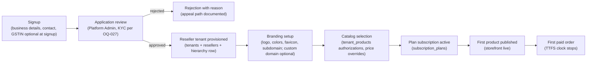

# Frenchies — Business Requirements

| Field | Value |
|---|---|
| Document | 01-business-requirements.md |
| Version | 1.0 |
| Status | Draft for Review |
| Date | 2026-11-01 |
| Owner | Product & Architecture Team |
| Related documents | 00-product-overview.md, 03-functional-requirements.md, 07-billing-and-financial-architecture.md, 08-affiliate-and-commission-system.md, 15-user-workflows.md, 17-security-requirements.md, 22-open-questions-and-assumptions.md, 23-master-prd.md |

## Table of Contents

1. [Business Goals & Success Metrics](#1-business-goals--success-metrics)
2. [Target Market & Buyer](#2-target-market--buyer)
3. [Personas & Jobs-to-Be-Done](#3-personas--jobs-to-be-done)
4. [Core Business Processes](#4-core-business-processes)
5. [Regulatory & Compliance Considerations](#5-regulatory--compliance-considerations)
6. [Constraints](#6-constraints)
7. [External Dependencies](#7-external-dependencies)
8. [Out of Scope for v1](#8-out-of-scope-for-v1)
9. [Business Assumptions](#9-business-assumptions)
10. [Assumptions & Open Questions](#10-assumptions--open-questions)

---

## 1. Business Goals & Success Metrics

Goals are ordered by priority. Every metric is defined so it can be computed from platform
data (`13-database-design.md` tables referenced). Targets are **draft business targets**
pending founder confirmation — see §10 and `22-open-questions-and-assumptions.md`.

### G1 — Prove reseller-channel product-market fit (primary goal)

| # | Metric | Definition (computable) | Draft target (12 months post-MVP GA) |
|---|---|---|---|
| M1.1 | Approved reseller tenants onboarded | Count of `tenants` with `type='reseller'` and status `active`. | ≥ 100 |
| M1.2 | Reseller activation rate | % of active reseller tenants with ≥ 1 paid order (webhook-verified capture) within 30 days of approval. | ≥ 60% |
| M1.3 | Median time-to-first-sale (TTFS) | Median days from reseller tenant approval timestamp to first paid order on that tenant's storefront. | ≤ 14 days |
| M1.4 | Monthly reseller churn | Reseller tenants whose subscription lapses or which are deactivated, ÷ active reseller tenants, per month. | ≤ 5%/month |

### G2 — Grow transaction volume on healthy unit economics

| # | Metric | Definition (computable) | Draft target (12 months post-MVP GA) |
|---|---|---|---|
| M2.1 | GMV | Sum of `orders.total_amount` with status ∈ {paid, processing, fulfilled, partially_refunded} minus refunded amounts, per quarter, in INR. | ≥ ₹5 Cr cumulative |
| M2.2 | Paid-order rate | Paid orders ÷ (paid + cancelled + expired-checkout orders). | ≥ 90% |
| M2.3 | Repeat purchase rate | Customers (per tenant) with ≥ 2 paid orders ÷ customers with ≥ 1 paid order, per quarter. | ≥ 25% |
| M2.4 | Refund rate | Refunded orders ÷ paid orders, per quarter. | ≤ 2% |
| M2.5 | Chargeback rate | Charged-back payments ÷ captured payments, per quarter. | ≤ 0.1% (gateway threshold guard) |

### G3 — Keep the money machinery exact

| # | Metric | Definition (computable) | Draft target |
|---|---|---|---|
| M3.1 | Ledger reconciliation | % of gateway settlements reconciled to `journal_entries` within 2 business days. | 100% |
| M3.2 | Webhook idempotency defects | Count of double-applied money effects traced to webhook replay. | 0 |
| M3.3 | Payout SLA | % of Finance-Admin-approved payouts disbursed within 3 business days of approval. | ≥ 95% |
| M3.4 | Commission accuracy | % of sampled paid orders where recomputed hierarchy split equals recorded `commissions` rows. | ≥ 99.9% |

### G4 — Deliver a supportable product

| # | Metric | Definition (computable) | Draft target |
|---|---|---|---|
| M4.1 | Ticket first-response SLA attainment | % of `support_tickets` with first agent response within the applied `sla_policies` first-response target. | ≥ 90% |
| M4.2 | CSAT | Mean post-resolution CSAT score (1–5) across tickets. | ≥ 4.2 |
| M4.3 | AI deflection (post-MVP AI module) | % of inbound support conversations resolved by `ai_agents` without human handoff. | ≥ 30% (P2 target) |
| M4.4 | Security incidents | Confirmed tenant-data cross-leak incidents. | 0 |

### Goal-to-document mapping

- G1 → reseller lifecycle requirements in `03-functional-requirements.md`
  (FR-RESELLER), flows in `15-user-workflows.md`.
- G2 → FR-ORDER, FR-SUBSCRIPTION, FR-MARKETING; economics in
  `07-billing-and-financial-architecture.md`.
- G3 → `07-billing-and-financial-architecture.md`, `08-affiliate-and-commission-system.md`,
  `17-security-requirements.md`.
- G4 → `12-crm-and-support.md`, `11-ai-and-automation.md`, `18-non-functional-requirements.md`.

## 2. Target Market & Buyer

> **FLAGGED ASSUMPTION (A-01): India-first market.** MVP currency is INR, tax logic is
> GST, gateways are Razorpay + Cashfree. Multi-currency and international tax are P2/P3
> (OQ-004). Every pricing, tax, and payout statement below assumes India.

### 2.1 Beachhead segments (India)

| Segment | Profile | Why they buy |
|---|---|---|
| IT/Software service agencies (tier-2/3 cities) | 5–50 employee agencies wanting to add productized digital offerings (SaaS reselling, licenses, digital goods) without building a store. | Instant storefront + GST invoicing + supply of products. |
| Individual entrepreneurs / consultants | Solo operators with client networks; want recurring margin via subscriptions/licenses. | Zero-code launch; payments and compliance handled. |
| Education / course creators (reseller model) | Creators who resell or bundle third-party digital courses/tools. | Catalog + license delivery + affiliate recruitment. |
| Regional distributors of digital services | Existing offline distributors moving online; want sub-reseller networks. | Multi-level hierarchy with audited commission splits. |

### 2.2 Buyer and buying process

- **Economic buyer:** reseller business owner (Reseller role); decision cycle target
  ≤ 7 days from signup to paid plan.
- **User buyer:** the owner plus invited Reseller Employees / Sales Agents.
- **Trigger events:** losing a deal for lack of online presence; a principal brand opening
  a reseller channel; GST-compliance scare; competitor launching an own-brand store.
- **Churn risks:** first-sale failure (addressed by M1.2/M1.3), perceived commission
  squeeze (addressed by transparent wallet statements), payout friction (addressed by
  M3.3).

### 2.3 Central catalog supply (supply-side requirement)

MVP requires ≥ 10 central products across ≥ 3 categories with complete metadata
(descriptions, media, demo where applicable, base pricing, commission terms) at GA, so a
new reseller can price and publish a catalog on day one. Owner: Platform Admin +
Product Manager (central). Tracked in `06-product-marketplace.md`.

## 3. Personas & Jobs-to-Be-Done

Canonical role names (charter §5). For each persona: JTBD statements (functional,
emotional, social), key frustrations, and success signal.

### 3.1 Platform operator (roles: Super Admin, Platform Admin, Finance Admin)

- **Functional:** "Approve or reject reseller applications in < 10 minutes of review each,
  with KYC evidence on file." "Reconcile gateway settlements to the ledger daily without
  spreadsheets." "Suspend an abusive tenant within 5 minutes of decision."
- **Emotional:** "Sleep well knowing every rupee movement is recorded in a double-entry
  ledger."
- **Frustrations today:** manual commission spreadsheets; no audit trail; fear of
  gateway compliance action against the platform.
- **Success signal:** M3.1, M3.2, tenant approval SLA (OQ-035) met.

### 3.2 Reseller owner (role: Reseller)

- **Functional:** "Get an approved, branded store selling real products within one day."
  "Set my own prices and margins per product." "See exactly what I earned, when it
  unlocks, and when I get paid." "Recruit my own sub-resellers and affiliates."
- **Emotional:** "Look established and credible to my clients under my own brand."
- **Frustrations today:** building a store costs lakhs and months; spreadsheets for
  commissions; no GST-ready invoicing.
- **Success signal:** TTFS ≤ 14 days (M1.3); first payout completed.

### 3.3 Sub-Reseller (role: Sub-Reseller)

- **Functional:** "Start selling under a parent's product supply without negotiating
  supplier contracts myself." "Run my own brand and customers independently."
- **Boundary understanding:** "Know exactly what my parent can and cannot see about my
  business." (Hierarchy gives parent visibility, not control.)
- **Success signal:** first paid order; independent wallet balance.

### 3.4 Reseller employee (role: Reseller Employee)

- **Functional:** "Do my assigned catalog/order/ticket work without access to financial
  settings I shouldn't touch."
- **Frustrations today:** shared logins; over-broad admin access.
- **Success signal:** zero permission-boundary incidents; task completion without owner
  intervention.

### 3.5 Sales agent (role: Sales Agent)

- **Functional:** "Work my leads, send quotations, convert quotations to orders fast."
  "Never be blocked by, or blamed for, financial settings."
- **Success signal:** quotation-to-order conversion rate visible per agent.

### 3.6 Affiliate (role: Affiliate)

- **Functional:** "Get a trackable link/coupon in seconds; see clicks and conversions in
  near-real-time; cash out reliably once I cross the threshold."
- **Emotional:** "Trust that my attribution won't be lost or reassigned."
- **Success signal:** ≥ 1 referred paid order per active affiliate per quarter (goal G1
  supporting metric).

### 3.7 Customer (role: Customer)

- **Functional:** "Buy from a store that looks like a real company; pay with UPI/cards/
  netbanking; get my invoice and license immediately; get help when something breaks."
- **Emotional:** "My money is safe; refunds will be honored per a stated policy."
- **Success signal:** paid-order rate ≥ 90% (M2.2); ticket SLA (M4.1).

### 3.8 Support agent (roles: Support Agent central & reseller, managed by Support Manager)

- **Functional:** "See the customer's orders/licenses next to the ticket; know which SLA
  clock is running; escalate to the product owner when needed."
- **Success signal:** M4.1, M4.2.

## 4. Core Business Processes

Statuses used below are canonical. Order statuses: `pending`, `paid`, `processing`,
`fulfilled`, `partially_refunded`, `refunded`, `cancelled`, `on_hold`.

### 4.1 Order-to-cash

Owner: Finance Admin (money), Platform Admin (ops). Requirements trace to FR-ORDER,
FR-PAYMENT, FR-WALLET (`03-functional-requirements.md`,
`07-billing-and-financial-architecture.md`).

```mermaid
flowchart LR
    A["Cart checkout<br/>(customer of a selling reseller)"] --> B["Order created<br/>(status: pending)"]
    B --> C["Payment initiated<br/>(Razorpay/Cashfree — central merchant)"]
    C --> D["Webhook verified<br/>(payment_webhook_events, idempotent)"]
    D --> E["Order: paid<br/>Ledger postings: capture + gateway fee + platform revenue + reseller payable + affiliate payable"]
    E --> F["Commissions recorded<br/>(pending, per hierarchy split)"]
    F --> G["Fulfillment<br/>(fulfillment_jobs: manual / license / API)"]
    G --> H["Order: fulfilled"]
    H --> I["Commission hold release<br/>(default 7 days, fulfillment-gated where applicable)"]
    I --> J["Wallet: available<br/>Payout request → Finance Admin approval → payout + ledger posting"]
```

**Process requirements:**

1. Checkout must complete without a customer account where guest checkout is enabled
   (configurable per tenant); account creation is offered post-payment.
2. Order state transitions are validated server-side; invalid transitions are rejected and
   logged (`audit_logs`).
3. Webhook verification is signature-checked and idempotent; out-of-order delivery is
   tolerated (reconciliation job re-queries gateway state).
4. Gateway fee is recorded as its own ledger leg (never netted silently).
5. Refund (full or partial) triggers refund clawback: pro-rata reversal of all commissions
   and wallet credits from that order (`08-affiliate-and-commission-system.md`).

**Acceptance Criteria:**

- AC-1: Given a duplicate `payment.captured` webhook delivery, Then the ledger contains
  exactly one capture posting set for that payment.
- AC-2: Given a paid order with a 3-level chain A→B→C (seller C), When commissions are
  computed, Then C/B/A receive the configured split of the commission pool and the split
  configuration used is recorded on the `commissions` rows.
- AC-3: Given a full refund of an order with released commissions, Then negative ledger
  lines reverse those commissions and the beneficiaries' wallets reflect the clawback
  (or a recoverable negative balance per policy, OQ-012).

### 4.2 Reseller onboarding-to-first-sale

Owner: Platform Admin. Requirements trace to FR-RESELLER, FR-TENANT, FR-CMS, FR-PRODUCT.

**Process requirements:**

1. Tenant provisioning is a single transactional workflow: `tenants`, `resellers`,
   `reseller_hierarchy` (parent link when created by a reseller), `wallets`, default
   `tenant_settings`, default theme.
2. A reseller cannot go live (storefront serving products) without an active subscription
   plan covering publication entitlements (entitlement matrix = OQ-019); a grace period
   applies on lapse (renewal/suspend rules in `03-functional-requirements.md`,
   FR-SUBSCRIPTION).
3. A reseller created by another reseller links `parent_reseller_id` and appears in
   `reseller_hierarchy` at the correct depth — mechanics in `05-reseller-hierarchy.md`;
   depth is unlimited; the UI must not assume ≤ 3 levels (3 is only the default
   commission-split example depth).
4. Storefront "go-live" requires: branding set (logo + theme color minimum), ≥ 1
   authorized product with a price ≥ platform floor, and a resolvable hostname.

**Acceptance Criteria:**

- AC-1: Given an approved application, When provisioning completes, Then the reseller can
  log in, sees only their tenant's data, and a closure-table row exists for
  (creator ancestor → new reseller, depth 1) when a parent exists.
- AC-2: Given a reseller with no active subscription, When the grace period expires, Then
  storefront publication is suspended and existing customer access to purchased
  entitlements is preserved (no access revocation for already-paid orders).
- AC-3: Given a sub-reseller 3 levels deep, Then its commission chain resolves correctly
  using `reseller_hierarchy` depth rows, not hard-coded level counting.

### 4.3 Commission settlement (including payouts)

Owner: Finance Admin. Requirements trace to FR-COMMISSION, FR-WALLET
(`08-affiliate-and-commission-system.md`, `07-billing-and-financial-architecture.md`).

1. **Accrual:** commissions computed at webhook-verified capture; recorded as `pending`
   in `commissions`; wallet `pending` projection updated.
2. **Vesting:** `pending → available` after the configurable commission-hold period
   (default 7 days, tied to refund window — OQ-007) AND fulfillment success where the
   product's fulfillment model requires it.
3. **Clawback:** refund reverses pro-rata (§4.1 step 5).
4. **Payout request:** beneficiary (reseller tenant owner or affiliate) requests payout
   with min threshold and bank/UPI details (`payouts`).
5. **Approval:** Finance Admin approves/rejects with reason; approval creates payout
   record + ledger posting; rejection returns funds to `available` with a recorded reason.
6. **Disbursement (MVP):** manual bank/UPI transfer by finance ops; confirmation recorded
   against the payout record. Automated gateway payouts = future (out of scope §8).

**Settlement cycle targets (draft, OQ-008/OQ-036):** payout requests batched weekly;
M3.3 governs post-approval disbursement timing.

**Acceptance Criteria:**

- AC-1: Given a commission in `pending`, When the hold period has not elapsed, Then no
  payout can include it.
- AC-2: Given an approved payout request, Then a `payouts` row and its ledger postings
  exist, wallet `available` decreases exactly once, and the action is audit-logged.
- AC-3: Given a refund after payout, Then the beneficiary's wallet may go negative and a
  recoverable debit is created per configured policy (OQ-012), with the platform able to
  net it against future earnings.

### 4.4 Support case handling (supporting process)

Owner: Support Manager. Ticket lifecycle and SLA clocks: `12-crm-and-support.md`.
Business rule: tickets are department-scoped; tickets for central-owned products sold by a
reseller may require central Support Agent involvement via the hierarchy-aware routing
rules specified in `12-crm-and-support.md`. SLA defaults = OQ-034.

## 5. Regulatory & Compliance Considerations

> Not legal advice; a qualified Indian counsel review is a launch gate (see §10, local
> item 2). This section states the product obligations the PRD designs for.

### 5.1 GST invoicing (assumption A-01, mechanism charter §7.9)

1. Invoices are issued per order (`invoices`, `invoice_items`) as GST-compliant PDFs
   (dompdf), with CGST/SGST or IGST determined by place of supply vs supplier location.
2. `taxes` table holds GST rates (5%/12%/18%/0 per HSN/SAC classification); inclusive vs
   exclusive price handling is a product/pricing setting; invoice shows GSTIN of the
   issuing entity and of the buyer where provided (`customers` GSTIN field).
3. **Who is the "supplier" on the invoice is a legal decision** — the platform collects
   payments centrally; the invoice must carry the reseller identity ("sold by" / invoice
   issuer per OQ-028) with legally required platform disclosure wording.
4. Place-of-supply logic handles B2B (GSTIN-based) and B2C (default central place of
   supply rules) cases; inter-state vs intra-state determination is rule-based on GSTIN
   state codes.

### 5.2 India DPDP Act 2023 (data protection)

1. **Role mapping (OQ-029):** for customer personal data, the selling reseller is likely
   the Data Fiduciary; the Central Platform is a Data Processor (or joint fiduciary — to
   be confirmed by counsel). The product must support: notice/consent capture at
   collection (consent artifacts stored per tenant), purpose limitation flags, data
   principal requests (access, correction, erasure, grievance redressal) routed to the
   owning tenant with platform tooling to execute erasure where technically required.
2. **Breach handling:** platform capability to detect, log (`audit_logs`), and produce
   breach notification content for the Data Protection Board and affected principals
   within statutory timelines; runbook in `20-deployment-and-operations.md`.
3. **Processing agreements:** tenant onboarding includes DPDP-aligned data-processing
   terms between platform and reseller (document generation = P1.5/P2; signature captured
   at onboarding approval in MVP).
4. **Retention & minimization:** per-entity retention settings (e.g., PII field-level
   masking in support views) — specified in `17-security-requirements.md`.

### 5.3 Consumer refund expectations

1. Consumer Protection (E-Commerce) Rules 2020 and general e-commerce norms require a
   stated refund/return policy, displayed on storefronts and on invoices.
2. MVP ships a **platform-defined default refund policy per product type** (digital
   goods, services, subscriptions, license products) with per-tenant display and
   platform-configurable windows (OQ-014). Refund windows interact with the commission
   hold (OQ-007): hold ≥ refund window is the default constraint.
3. Refund decisions in MVP: Finance Admin approves requests; resellers can view/initiate
   recommendations but cannot unilaterally move money (all money moves centrally).

### 5.4 PCI-DSS scope reduction

1. All card data collection happens on gateway-hosted surfaces (Razorpay/Cashfree
   checkout); Frenchies never stores, transmits, or logs PAN or CVV. Server-side handling
   is limited to gateway tokens, masked references, and webhook payloads.
2. Consequence for product design: no "card on file" raw-card features; tokenized
   saved-payment-method features only if the gateway provides a compliant vault API.
3. Scope statement and network/data-flow diagram obligations: see
   `17-security-requirements.md` and `20-deployment-and-operations.md`.

### 5.5 White-label acceptable use & anti-phishing

White-labeling creates abuse surface (bad actors using branded storefronts for fraud).
Controls required for MVP:

1. **KYC before go-live** (identity + business + bank verification; depth = OQ-027).
2. **Acceptable-Use Policy** accepted at onboarding: prohibits phishing, fraud, illegal
   content, trademark abuse, and sale of prohibited categories (enumerated list in
   `17-security-requirements.md`).
3. **Monitoring hooks:** payment anomaly signals (refund ratio, chargeback rate M2.5,
   velocity), storefront content abuse reports, and a one-click tenant suspension by
   Super Admin with storefront takedown.
4. **Enforcement ladder:** warning → feature restriction (publication disabled) → tenant
   suspension → termination with fund-hold capability; every step audit-logged and
   subject to payout hold rules.
5. **Legal disclosure floors:** invoice "sold by" line and payment descriptor remain
   visible even on fully white-labeled surfaces (charter §4; wording per OQ-028).

### 5.6 Other (deferred but registered)

- TDS obligations on commissions/payouts (sections 194H/194J applicability) — OQ-032.
- Intermediary/IT Act 2000 grievance-officer obligations for the platform — assigned to
  counsel; product requirement: publishable grievance contact per jurisdiction (OQ-028).
- Data localization expectations for payment data under RBI rules — gateway compliance
  carries this; platform stores only gateway references (OQ-030 for S3 region choice).

## 6. Constraints

| # | Constraint | Source / note |
|---|---|---|
| C1 | India-first: INR default currency, GST tax logic, Razorpay + Cashfree only in MVP. | Charter §1, §10; OQ-004 for multi-currency. |
| C2 | Single shared MySQL 8 database with `tenant_id` isolation — NOT database-per-tenant; purpose-built lightweight tenancy layer (middleware + global scopes + tenant context container). | Charter §3. |
| C3 | Modular monolith only; no microservices, Kafka, or extra infrastructure. | Charter §3. |
| C4 | Current repo is Laravel 12 with Bootstrap/laravel/ui Blade scaffolding; Phase 1 must upgrade to Laravel 13 + PHP 8.4 and replace scaffolding with Vue 3 + Inertia + TypeScript + Tailwind CSS 4. | Charter §2, §3. |
| C5 | spatie/laravel-permission must move to ^7.0/^8.0 (teams feature, `teams = tenant`). | Charter §3, §5. |
| C6 | All payments collected under central merchant accounts; resellers never hold gateway credentials; payouts manual in MVP. | Charter §4, §7.8. |
| C7 | Double-entry ledger is authoritative; wallet balances derived; amounts `DECIMAL(15,2)` with explicit currency; no floats. | Charter §7.1–7.3, 7.11. |
| C8 | Webhook and commission idempotency guarantees are hard requirements (M3.2 = 0 defects). | Charter §7.10. |
| C9 | White-label must hide platform branding except legally required invoice "sold by" and payment descriptor. | Charter §4; OQ-028. |
| C10 | Users are tenant-scoped; no account merging; cross-tenant platform-staff access only via explicit grants. | Charter §4. |
| C11 | Hierarchy depth unlimited (closure table); product logic must never hard-code level counts. | Charter §4, §7.5. |
| C12 | WhatsApp notifications are P1.5 (after MVP core); email + in-app in MVP. | Charter §10. |
| C13 | AI module fully spec'd now but scheduled P2; provider-integration-based (OpenAI + Google Gemini). | Charter §3, §10. |

## 7. External Dependencies

| Dependency | Purpose in MVP/P2 | Stage | Owner | Risk | Fallback |
|---|---|---|---|---|---|
| Razorpay | Primary payment collection, refunds, settlement reports. | MVP | Finance Admin | Webhook delay/outage; settlement mismatch. | Cashfree as parallel gateway; reconciliation re-query job; manual refund path. |
| Cashfree | Secondary gateway (redundancy, feature parity). | MVP | Finance Admin | Same as above. | Razorpay-only mode; checkout degrades to one gateway. |
| Cloudflare | DNS, proxy, edge SSL for custom domains, DDoS floor. | MVP | Platform Admin (Super Admin for zone control) | Zone misconfig breaks tenant domains. | Subdomain-only white-label remains functional; runbook in `20-deployment-and-operations.md`. |
| S3-compatible storage | Product media, invoices PDFs, tenant assets. | MVP | Platform Admin | Vendor lock-in, cost growth. | Any S3-compatible endpoint; per-tenant prefix strategy (OQ-023). |
| Transactional email provider | Invoice delivery, notifications, auth mails. | MVP | Platform Admin | Deliverability/domain reputation. | Provider abstraction (SMTP driver swap) — OQ-025. |
| WhatsApp Cloud API | Transactional WhatsApp notifications. | P1.5 | Platform Admin | Template approval delays; Meta policy rejections (OQ-033). | Email + in-app fallback; feature-flagged per tenant. |
| OpenAI / Google Gemini | AI module (support deflection, catalog copy, assistants). | P2 (spec'd now) | Product Manager | Model deprecation, cost spikes, data-privacy terms. | Provider abstraction in `11-ai-and-automation.md`; AI off by default per tenant (OQ-021). |
| n8n | Workflow automation for resellers/platform. | P2/P3 | Platform Admin | Hosting ownership ambiguity. | OQ-024 decision; native webhooks (`api_webhooks`) as MVP alternative. |
| Indian banking (bank transfer/UPI) | Manual payout disbursement (NEFT/IMPS/UPI). | MVP | Finance Admin | Manual error risk, ops load. | Payout batching cadence OQ-036; dual-approval for high-value payouts. |

## 8. Out of Scope for v1

Explicitly not built for MVP (P2/P3 unless noted), consistent with charter §10:

1. Drag-drop page builder (MVP: logo/colors/theme/subdomain whitelabel only).
2. Blog and SEO extras beyond basic meta fields.
3. WhatsApp marketing campaigns (transactional WhatsApp = P1.5).
4. AI chatbot/assistant runtime, AI knowledge ingestion UI, usage-based AI billing (module
   spec'd in `11-ai-and-automation.md`, delivered P2).
5. n8n integration UI and hosted workflow templates.
6. Advanced fraud detection/ML scoring (MVP: rule thresholds + manual review).
7. Multi-currency checkout and international tax (OQ-004).
8. Native mobile apps (P3).
9. Automated gateway payouts to resellers/affiliates (P3; MVP is manual).
10. Multi-language UI/storefronts (P3).
11. Theme marketplace for third-party sellers (P3).
12. Customer account merging across tenants, SSO federation (explicit non-goal for MVP).
13. Point-of-sale/offline collection modes.
14. Marketplace-of-resellers discovery (reseller directory) — P3.

## 9. Business Assumptions

Business-level assumptions (technical assumptions live in
`22-open-questions-and-assumptions.md`, A-01…):

1. **Reseller supply exists:** ≥ 10 central products with commercial terms will be ready
   at GA (§2.3). If supply slips, activation metrics M1.2/M1.3 fail first.
2. **Manual operations can carry early load:** at ≤ 100 reseller tenants, manual payout
   approval and reseller review are staffable by ≤ 2 finance/ops FTEs (OQ-036).
3. **7-day default commission hold is acceptable** to resellers and covers the refund
   window (OQ-007).
4. **Subscription plans are the primary reseller monetization** in year 1; per-order
   platform fee may be added later (OQ-001) without repricing existing plans mid-term
   (grandfathering policy = OQ-005).
5. **Resellers price independently:** no MAP (minimum advertised price) enforcement in
   MVP; platform floor price exists only to protect gateway risk (configurable).
6. **Trust transfers:** customers accept buying via a reseller brand whose payments are
   collected by the platform entity (descriptor disclosure, OQ-028).
7. **Support burden:** MVP support is central-run; reseller-run support for their
   customers is available but optional per tenant.
8. **Chargebacks stay rare** (≤ 0.1%, M2.5); no automated representment tooling in MVP —
   manual evidence packs suffice.

## 10. Assumptions & Open Questions

Local to this document; the authoritative register is
`22-open-questions-and-assumptions.md`.

1. All metric targets in §1 are draft placeholders pending founder/finance confirmation;
   they are wired to OQ-001, OQ-002, OQ-007, OQ-008, OQ-034, OQ-035, OQ-036.
2. §5 compliance content is an engineering interpretation of GST/DPDP/Consumer
   Protection requirements and must be validated by qualified Indian counsel before GA;
   tracked as a launch gate in `21-implementation-roadmap.md`.
3. §2.3 assumes ≥ 10 launch catalog products; supply commitments are not yet contracted.
4. §4.3 payout batching ("weekly") is a placeholder pending OQ-036 decision.
5. §4.2 assumes subscription gating of publication entitlements; if the entitlement
   matrix (OQ-019) removes gating, M1.2 definitions must be revisited.

## Appendix / References

- `00-product-overview.md` — vision, personas summary, monetization overview.
- `07-billing-and-financial-architecture.md` — ledger, invoices, payouts mechanics.
- `08-affiliate-and-commission-system.md` — commission engine and splits.
- `15-user-workflows.md` — FLOW-NN versions of the processes in §4.
- `22-open-questions-and-assumptions.md` — OQ/A registers referenced throughout.
