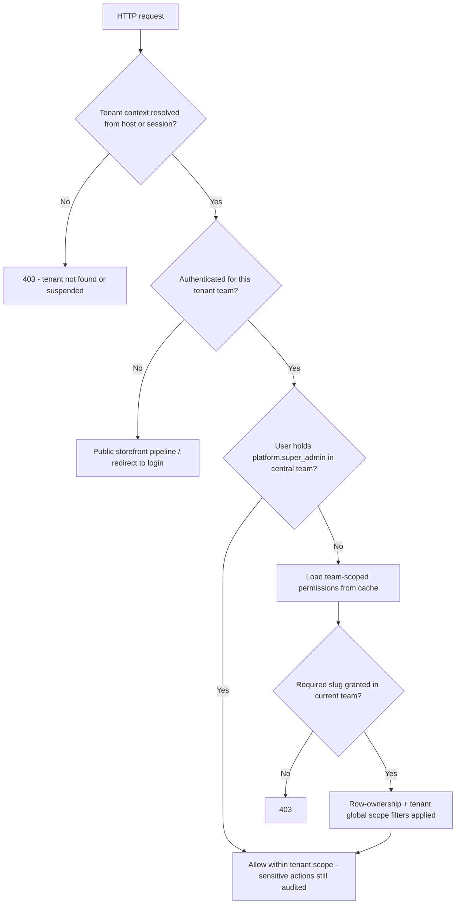

# User Roles & Permissions

| Field | Value |
|---|---|
| Document | 02-user-roles-and-permissions.md |
| Version | 1.0 |
| Status | Draft for Review |
| Date | 2026-11-01 |
| Owner | Product & Architecture Team |
| Related documents | 03-functional-requirements.md, 07-billing-and-financial-architecture.md, 08-affiliate-and-commission-system.md, 12-crm-and-support.md, 13-database-design.md, 15-user-workflows.md, 16-ui-ux-specification.md, 17-security-requirements.md, 22-open-questions-and-assumptions.md |

## Table of Contents

1. Purpose & Scope
2. Authorization Model Overview
3. Permission Slug Vocabulary (canonical catalogue)
4. Permission Levels (matrix legend)
5. Role Specifications (12 canonical roles)
6. Role × Module Permission Matrix
7. Tenant Ownership, Reseller Hierarchy & Cross-Tenant Access
8. Custom Roles & Role Templates
9. spatie/laravel-permission Implementation Notes
10. Invitation System Interplay
11. Acceptance Criteria (authorization rules)
12. Assumptions & Open Questions

---

## 1. Purpose & Scope

This document defines the complete RBAC model for Frenchies: the 12 canonical roles
(charter §5), one canonical permission-slug vocabulary, the role × module permission
matrix, hierarchy/tenancy interaction rules, custom-role governance, and the
spatie/laravel-permission implementation notes that `13-database-design.md`,
`03-functional-requirements.md`, `17-security-requirements.md`, and
`16-ui-ux-specification.md` must stay consistent with.

Out of scope here: per-feature functional behaviour (doc 03), financial approval
workflows as business processes (docs 07/08), and the UI rendering of any screen
(doc 16 references the permission slugs defined here but does not redefine them).

## 2. Authorization Model Overview

### 2.1 Principles

1. **Deny-by-default.** Permissions are allow-list only. A user with no role in the
   current tenant team receives HTTP 403 for every non-public endpoint. There are no
   "deny" rules to override; absence of a grant is denial.
2. **Tenant is the unit of isolation.** Every authenticated user belongs to exactly one
   tenant team per spatie role assignment; all role and permission grants are scoped to
   a team (`tenants.id`). Data rows carry `tenant_id` and are protected both by the
   permission check (module level) and a tenant global scope (row level).
3. **Module check first, ownership check second.** A request must pass (a) the module
   permission slug check for the current tenant team, then (b) row-ownership checks
   (e.g., a Customer may hold `orders.view` in their tenant team but only sees orders
   where `orders.customer_id = own customer record`).
4. **Financial mutation slugs are segregated.** Approval, override, and money-movement
   slugs (`payouts.approve`, `wallets.adjust`, `commissions.adjust`,
   `payments.refund_execute`, `tenants.suspend`, …) are restricted to platform roles;
   resellers, employees, agents, affiliates, and customers can never hold them
   (Section 8.2 lists the blocked set).
5. **Every sensitive grant and mutation is audited** to `audit_logs` (actor, team,
   action, subject, before/after) — see Section 7.4 and doc 17.

### 2.2 Request authorization pipeline

### 2.3 Scopes

| Scope | Meaning | Typical roles |
|---|---|---|
| Central team | `tenants.slug = 'central'`, `type = 'platform'`. Platform staff work here. | Super Admin, Platform Admin, Finance Admin, Product Manager, Support Manager, Support Agent (central) |
| Reseller tenant team | One team per reseller tenant. Reseller staff work only here. | Reseller, Sub-Reseller, Reseller Employee, Sales Agent, Support Agent (reseller), Customer, Affiliate |
| Cross-tenant | Implicit for Super Admin; explicit grant lists for other platform staff (Section 7.4). | Platform staff |
| Outside hierarchy | Affiliates never appear in the reseller closure table; customers never hold reseller-scope permissions. | Affiliate, Customer |

## 3. Permission Slug Vocabulary (canonical catalogue)

### 3.1 Convention

- Format: `<module>.<action>` — exactly two lowercase snake_case segments.
- Where a module governs multiple entity types, the entity is embedded in the action
  segment using `<entity>_<verb>` (e.g., `support.tickets_reply`,
  `crm.leads_manage`, `billing.invoices_manage`).
- No wildcards are ever issued as data; wildcards may appear only in code-level gate
  definitions and never in seeded or custom role assignments.
- **136 slugs across 26 modules** are defined below. This catalogue is the single
  vocabulary: docs 03/16 and all seeders must use these exact strings.

### 3.2 Catalogue by module

**tenants** (platform-only module; 10 slugs)

| Slug | Description |
|---|---|
| `tenants.view` | View tenant records and settings (read). |
| `tenants.create` | Create a tenant (reseller onboarding). |
| `tenants.update` | Update tenant core fields (name, GSTIN, status metadata). |
| `tenants.approve` | Approve a pending tenant (reseller activation). |
| `tenants.suspend` | Suspend a tenant (locks all its users; storefront maintenance). |
| `tenants.resume` | Resume a suspended tenant. |
| `tenants.delete` | Deactivate/delete a tenant (soft). |
| `tenants.impersonate` | Start a time-boxed impersonation session in any tenant (Section 7.4). |
| `tenants.domains_manage` | Add/verify/remove `tenant_domains` (custom domains). |
| `tenants.settings_manage` | Mutate `tenant_settings` rows. |

**resellers** (8 slugs)

| Slug | Description |
|---|---|
| `resellers.view` | View reseller business profiles and hierarchy position. |
| `resellers.create` | Create a reseller record (sub-reseller creation by a parent). |
| `resellers.update` | Update reseller profile fields. |
| `resellers.approve` | Approve a reseller (platform: any; reseller: direct children only). |
| `resellers.suspend` | Suspend a reseller within scope. |
| `resellers.resume` | Resume a suspended reseller within scope. |
| `resellers.hierarchy_view` | View the reseller closure tree and subtree aggregates. |
| `resellers.hierarchy_manage` | Create/move sub-reseller relationships within own subtree. |

**users** (7 slugs)

| Slug | Description |
|---|---|
| `users.view` | View users of the scoped tenant team. |
| `users.invite` | Create invitations (`user_invitations`) for the scoped team. |
| `users.update` | Update user profiles (name, phone, department). |
| `users.deactivate` | Deactivate a user account in scope. |
| `users.roles_assign` | Assign/remove roles and custom roles in scope (Section 8 restrictions apply). |
| `users.impersonate` | Impersonate a user inside the user's own tenant (reseller owner support; central staff). |
| `users.export` | Export user lists (CSV). |

**products** (9 slugs)

| Slug | Description |
|---|---|
| `products.view` | View products the scope allows (owned or distribution-authorized). |
| `products.create` | Create a product owned by the scoped tenant. |
| `products.update` | Update product content, media, documents. |
| `products.delete` | Soft-delete an unpublished product. |
| `products.publish` | Publish/unpublish a product (make sellable). |
| `products.authorize` | Grant/revoke distribution (`tenant_products`) for owned products; request distribution for upstream products. |
| `products.pricing_manage` | Manage `product_pricing`, reseller price overrides, margin rules. |
| `products.variants_manage` | Manage variants, packages, addons. |
| `products.reviews_moderate` | Approve/reject/hide `product_reviews`. |

**demos** (4 slugs)

| Slug | Description |
|---|---|
| `demos.view` | View demo configs for in-scope products. |
| `demos.create` | Create a demo (sandbox, video, download, live preview). |
| `demos.update` | Update a demo. |
| `demos.delete` | Delete a demo. |

**cms** (5 slugs)

| Slug | Description |
|---|---|
| `cms.view` | Read pages, menus, themes, media of the scoped tenant. |
| `cms.pages_manage` | Create/edit/publish `website_pages` (incl. blog/KB articles). |
| `cms.menus_manage` | Manage `website_menus`. |
| `cms.themes_manage` | Manage `website_themes` (brand colors, fonts, logo, layout slots). |
| `cms.media_manage` | Upload/organize `media_library` assets. |

**customers** (5 slugs)

| Slug | Description |
|---|---|
| `customers.view` | View customers of the scoped tenant. |
| `customers.create` | Create a customer record (staff-assisted). |
| `customers.update` | Update a customer record. |
| `customers.delete` | Soft-delete a customer (blocked if orders exist; use archive). |
| `customers.export` | Export customer lists (CSV). |

**crm** (5 slugs)

| Slug | Description |
|---|---|
| `crm.view` | View leads and quotations in scope. |
| `crm.leads_manage` | Create/update leads, log `lead_activities`, change stage. |
| `crm.quotations_view` | View quotations. |
| `crm.quotations_manage` | Create/edit/send quotations (`quotations`, `quotation_items`). |
| `crm.quotations_approve` | Approve quotations above the tenant's auto-approve threshold (doc 12). |

**orders** (6 slugs)

| Slug | Description |
|---|---|
| `orders.view` | View orders in scope (own rows per ownership rules). |
| `orders.create` | Create a manual/back-office order. |
| `orders.update` | Update order operational status (processing, on_hold). |
| `orders.cancel` | Cancel an unpaid order. |
| `orders.refund` | Initiate a refund request (execution requires `payments.refund_execute`). |
| `orders.export` | Export orders (CSV). |

**billing** (5 slugs)

| Slug | Description |
|---|---|
| `billing.view` | View invoices, coupons, tax configuration (read). |
| `billing.invoices_manage` | Create, void, reissue, regenerate PDF invoices. |
| `billing.coupons_manage` | Create/update/expire coupons. |
| `billing.taxes_manage` | Manage `taxes` rows (GST rates, HSN, place-of-supply rules). |
| `billing.export` | Export invoices/finance-adjacent billing data. |

**payments** (4 slugs)

| Slug | Description |
|---|---|
| `payments.view` | View `payments` and `payment_webhook_events` in scope. |
| `payments.reconcile` | Mark gateway settlements reconciled against ledger postings. |
| `payments.refund_execute` | Execute a gateway refund against Razorpay/Cashfree (Finance only). |
| `payments.gateway_manage` | Configure gateway credentials/webhook secrets (Super Admin only). |

**wallets** (4 slugs)

| Slug | Description |
|---|---|
| `wallets.view` | View own-scope wallet balances and `wallet_transactions`. |
| `wallets.view_all` | View all wallets platform-wide (Finance). |
| `wallets.adjust` | Post a manual wallet adjustment (ledger-backed, reason mandatory). |
| `wallets.export` | Export wallet transaction data in scope. |

**payouts** (6 slugs)

| Slug | Description |
|---|---|
| `payouts.view` | View payout records in scope. |
| `payouts.request` | Request a payout (reseller/affiliate; min threshold + bank/UPI details). |
| `payouts.approve` | Approve a pending payout (Finance; never the requester). |
| `payouts.reject` | Reject a pending payout with reason. |
| `payouts.mark_paid` | Mark an approved payout as paid (bank transfer completed). |
| `payouts.bank_details_manage` | Manage own-scope payout bank/UPI details. |

**commissions** (6 slugs)

| Slug | Description |
|---|---|
| `commissions.view` | View own-scope commission records (`commissions`). |
| `commissions.view_all` | View commissions platform-wide (Finance, Platform Admin read). |
| `commissions.approve` | Release pending commissions to available (hold period logic, doc 08). |
| `commissions.adjust` | Post a manual commission adjustment (reason mandatory). |
| `commissions.rules_manage` | Configure hold period, hierarchy split percentages, pool rules. |
| `commissions.export` | Export commission data in scope. |

**affiliates** (6 slugs)

| Slug | Description |
|---|---|
| `affiliates.view` | View affiliates of the scoped tenant (affiliate role: own record only). |
| `affiliates.create` | Create an affiliate. |
| `affiliates.update` | Update affiliate profile/rates. |
| `affiliates.approve` | Approve a pending affiliate application. |
| `affiliates.suspend` | Suspend an affiliate. |
| `affiliates.links_manage` | Create/manage affiliate links and referral coupons (own links for affiliate role). |

**subscriptions** (4 slugs)

| Slug | Description |
|---|---|
| `subscriptions.view` | View subscription plans and subscriptions in scope. |
| `subscriptions.plans_manage` | Create/update platform `subscription_plans` (platform only). |
| `subscriptions.manage` | Operational actions on subscriptions in scope (cancel, pause, resume, force-renew). |
| `subscriptions.export` | Export subscription data. |

**fulfillment** (3 slugs)

| Slug | Description |
|---|---|
| `fulfillment.view` | View `fulfillment_jobs` and `fulfillment_events` in scope. |
| `fulfillment.jobs_manage` | Create/assign/complete fulfillment tasks; trigger API-driver fulfillment. |
| `fulfillment.events_view` | View the raw fulfillment event timeline (debug/audit). |

**licenses** (5 slugs)

| Slug | Description |
|---|---|
| `licenses.view` | View licenses in scope (customer: own licenses). |
| `licenses.issue` | Issue/generate a license key. |
| `licenses.revoke` | Revoke a license. |
| `licenses.activate` | Activate a license on a device/domain (customer action). |
| `licenses.deactivate` | Deactivate a license activation (customer or issuer). |

**support** (10 slugs)

| Slug | Description |
|---|---|
| `support.tickets_view` | View tickets in granted departments and scope. |
| `support.tickets_reply` | Post a public reply visible to the requester. |
| `support.tickets_assign` | Assign/unassign tickets (self or others). |
| `support.tickets_escalate` | Escalate a ticket (priority/department/manager). |
| `support.tickets_close` | Close/reopen a ticket. |
| `support.notes_manage` | Create/edit internal notes on tickets. |
| `support.departments_manage` | Manage `support_departments` and agent membership. |
| `support.sla_manage` | Manage `sla_policies` and SLA assignment. |
| `support.kb_manage` | Create/edit/publish KB articles and canned responses. |
| `support.reports_view` | View support metrics (volume, SLA breach, CSAT, workload). |

**ai** (6 slugs)

| Slug | Description |
|---|---|
| `ai.view` | View AI configuration and summaries in scope. |
| `ai.agents_manage` | Create/update/archive `ai_agents` (persona, model, tools). |
| `ai.conversations_view` | Read `ai_conversations`/`ai_messages` in scope. |
| `ai.knowledge_manage` | Manage `ai_knowledge_sources` (upload/sync/flag sources). |
| `ai.usage_view` | View `ai_usage_logs` and usage-based billing meters. |
| `ai.settings_manage` | Manage provider keys, model defaults, guardrails, auto-charge settings. |

**notifications** (3 slugs)

| Slug | Description |
|---|---|
| `notifications.view` | View own in-app notification feed (granted to all authenticated roles). |
| `notifications.templates_manage` | Edit `notification_templates` (email + in-app) for the scope. |
| `notifications.logs_view` | View `notification_logs` (delivery status, failures). |

**marketing** (3 slugs)

| Slug | Description |
|---|---|
| `marketing.view` | View campaigns and marketing assets in scope. |
| `marketing.campaigns_manage` | Create/launch/stop campaigns (email; WhatsApp = P1.5 per doc 10/12). |
| `marketing.assets_manage` | Manage banners, social assets, promo blocks in the tenant CMS. |

**reports** (3 slugs)

| Slug | Description |
|---|---|
| `reports.view` | View operational reports in scope (sales, orders, products, subtree aggregates). |
| `reports.financial_view` | View financial reports (revenue, margins, payouts, reconciliation). |
| `reports.export` | Export any visible report (CSV/XLSX). |

**api** (3 slugs)

| Slug | Description |
|---|---|
| `api.keys_manage` | Create/revoke `api_keys` for the scoped tenant. |
| `api.webhooks_manage` | Manage `api_webhooks` subscriptions and retry failed `webhook_deliveries`. |
| `api.logs_view` | View API request/webhook delivery logs in scope. |

**settings** (4 slugs)

| Slug | Description |
|---|---|
| `settings.platform_manage` | Mutate `platform_settings` (general: currency, hold period defaults, thresholds). |
| `settings.security_manage` | Mutate security settings (MFA policy, password policy, session lifetime, IP allowlists). |
| `settings.tenant_manage` | Mutate the scoped tenant's own settings/branding preferences. |
| `settings.integrations_manage` | Manage `integration_connections` (WhatsApp, n8n, email provider, storage). |

**audit** (2 slugs)

| Slug | Description |
|---|---|
| `audit.view` | View `audit_logs` in scope (Super Admin: cross-tenant). |
| `audit.export` | Export audit logs in scope. |

### 3.3 Permanently reseller-blocked slugs (custom-role deny set)

The following slugs can NEVER be granted inside a reseller tenant team (they exist only
for central-team roles). Server-side validation rejects any role/permission assignment
attempt in a reseller team containing them:

`tenants.create`, `tenants.update`, `tenants.approve`, `tenants.suspend`,
`tenants.resume`, `tenants.delete`, `tenants.impersonate`, `tenants.domains_manage`,
`tenants.settings_manage`, `payouts.approve`, `payouts.reject`, `payouts.mark_paid`,
`wallets.adjust`, `wallets.view_all`, `commissions.approve`, `commissions.adjust`,
`commissions.rules_manage`, `commissions.view_all`, `payments.refund_execute`,
`payments.reconcile`, `payments.gateway_manage`, `orders.refund`,
`subscriptions.plans_manage`, `settings.platform_manage`, `settings.security_manage`,
`users.impersonate`, `audit.export`.

## 4. Permission Levels (matrix legend)

The matrix in Section 6 uses four levels per module:

| Level | Meaning (exact slug set) |
|---|---|
| **Full** | Every slug in the module, including destructive (`*.delete`), approval (`*.approve`), and override (`*.adjust`, `*.rules_manage`, `*.gateway_manage`) slugs, scoped to the role's tenant/team scope. |
| **Edit** | All `*.view` slugs + `*.create`, `*.update`, `*.manage`, `*.export` and operational verbs of the module — but EXCLUDING `*.delete`, `*.approve`, `*.suspend`, `*.adjust`, `*.refund*`, and any slug listed in §3.3. |
| **View** | Only `*.view`-class slugs of the module (plus `*.events_view` / `*.logs_view` read variants). No mutation of any kind. |
| **None** | No slug of the module is granted. Requests fail with 403 before any query runs. |

**Footnoted exceptions** (the matrix cell carries the footnote marker; the footnote text
is authoritative):

- **(a) orders Edit for Finance Admin** additionally includes `orders.refund`
  (initiation) while `payments.refund_execute` executes the gateway leg.
- **(b) orders Edit for Reseller/Sub-Reseller** EXCLUDES `orders.refund`; refund
  requests are raised as an internal request routed to central Finance (workflow in
  `15-user-workflows.md`).
- **(c) payments Full for Finance Admin** excludes `payments.gateway_manage`
  (credential fields are Super Admin only).
- **(d) tenants Full for Super Admin** only; all other roles are at most View or None.
- **(e) Reseller Employee cells show the DEFAULT seeded template**; the owner may widen
  any cell within §8.2's curated subset.
- **(f) Sub-Reseller row is byte-identical to the Reseller row** (same slugs, own team).
- **(g) Customer "Edit" on customers/subscriptions/support/licenses applies only to the
  caller's own rows** (row-ownership filter; `customers.delete/export` are never granted
  to the customer role).
- **(h) Affiliate "Edit" on affiliates** = `affiliates.links_manage` for own links only;
  `affiliates.create/approve/suspend` remain with the tenant owner.

## 5. Role Specifications

Role slugs (spatie role names) are fixed: `platform.super_admin`, `platform.admin`,
`platform.finance_admin`, `platform.product_manager`, `platform.support_manager`,
`platform.support_agent`, `reseller.owner`, `reseller.sub_reseller`,
`reseller.employee`, `reseller.sales_agent`, `affiliate.partner`, `customer.buyer`.

### 5.1 Super Admin — `platform.super_admin`

| Attribute | Value |
|---|---|
| Scope | Central team + implicit cross-tenant (all teams) |
| One-line | Ultimate platform control: settings, all data, role/permission management, tenant suspension, financial overrides. |

**Onboarding path**
- Provisioned only by the deployment-time seeder (never by invitation); credentials
  stored in a secrets vault, MFA (TOTP) mandatory before the first dashboard render
  (policy enforced per `17-security-requirements.md`).
- Exactly 2 named Super Admins initially; additional ones require an existing Super
  Admin to invite with `users.roles_assign` and an out-of-band identity confirmation.

**Capabilities**
- Holds all 136 slugs; also short-circuits via `Gate::before` for every permission gate
  (used ONLY for this role — see §9.5).
- `tenants.*` including `tenants.suspend/resume/delete/impersonate`;
  `tenants.domains_manage`; `tenants.settings_manage`.
- `users.roles_assign` for every role, including platform role templates and the
  reseller-blocked set (§3.3) when assigning in the central team; may assign platform
  roles into other teams as cross-tenant grants (§7.4).
- `payments.gateway_manage`, `settings.security_manage`, `settings.platform_manage`,
  `wallets.adjust`, `commissions.adjust`, `commissions.rules_manage`.
- `audit.view/export` cross-tenant; can start a 30-minute impersonation session with
  mandatory banner, dual attribution in `audit_logs`, and money-mutation actions
  disabled during impersonation (§7.4).
- User-interface entitlements: every screen of interface A in `16-ui-ux-specification.md`.

**Explicitly denied:** nothing at the permission layer; irreversible actions still
require typed-confirmation modals and are audit-logged (defence in depth, doc 17).

### 5.2 Platform Admin — `platform.admin`

| Attribute | Value |
|---|---|
| Scope | Central team; cross-tenant only via explicit grant (§7.4) |
| One-line | Day-to-day platform operations: tenant approval, product catalog, marketing, reports. |

**Onboarding path**
- Invited by a Super Admin to the central tenant (`users.invite` with role
  `platform.admin`); accepts via invitation link within 168 hours (§10).

**Capabilities**
- Tenancy: `tenants.view/create/update/approve`, `resellers.view/approve/suspend/resume/update`,
  `resellers.hierarchy_view` (NOT `tenants.suspend/resume/delete/impersonate` —
  Super Admin only).
- Catalog: `products.*` (Full incl. `products.authorize`, `products.publish`),
  `demos.*`, `products.pricing_manage`, `products.reviews_moderate`.
- Growth: `marketing.*` (Full), `affiliates.view/create/update/approve/suspend`,
  `notifications.templates_manage`, `cms.*` (platform website), `subscriptions.plans_manage`.
- Operations: `orders` Edit (no refund — see (a)), `fulfillment.jobs_manage`,
  `licenses.issue/revoke`, `support` Full (platform queue), `ai.agents_manage`,
  `ai.settings_manage`, `ai.usage_view`.
- Data: `reports.view/export` (non-financial), `audit.view`, `customers.view`,
  `billing.view`, `payments.view`, `wallets.view`, `commissions.view_all`,
  `settings.platform_manage` (non-security group), `settings.integrations_manage`,
  `users.view/invite/update` for central staff.

**Explicitly denied:** `payouts.approve/reject/mark_paid`, `wallets.adjust`,
`commissions.approve/adjust/rules_manage`, `payments.refund_execute`,
`payments.reconcile`, `orders.refund`, `settings.security_manage`,
`tenants.suspend/resume/delete/impersonate`, `audit.export`.

### 5.3 Finance Admin — `platform.finance_admin`

| Attribute | Value |
|---|---|
| Scope | Central team (platform-wide money operations) |
| One-line | Payments, refunds, reconciliation, wallets, payouts, commissions approval, financial reports. |

**Onboarding path**
- Invited by a Super Admin to the central tenant with role `platform.finance_admin`;
  MFA mandatory; may NOT hold `platform.admin` simultaneously (segregation of duties,
  AC-07).

**Capabilities**
- Payments: `payments.view/reconcile/refund_execute` (Full minus gateway credentials
  (c)), `payment_webhook_events` inspection.
- Orders/billing: `orders.view/cancel/refund/export` (Edit + (a)), `billing.*` (Full:
  invoices, coupons, taxes, export).
- Money: `wallets.*` (Full incl. `wallets.adjust` with mandatory reason),
  `payouts.*` (Full incl. `approve/reject/mark_paid`), `commissions.*` (Full incl.
  `approve/adjust/rules_manage`).
- Read context: `customers.view`, `subscriptions.view/export`, `affiliates.view`,
  `resellers.view`, `tenants.view`, `users.view`, `reports.financial_view/export`,
  `audit.view` (financial scope).

**Explicitly denied:** all catalog/CMS/marketing mutation, `users.roles_assign`,
`tenants.*` mutations, `settings.*` mutation, `support.*`, `ai.*`, `api.*`.

### 5.4 Product Manager — `platform.product_manager`

| Attribute | Value |
|---|---|
| Scope | Central team by default; MAY be delegated to a reseller tenant (owner assigns this role in their team) |
| One-line | Product catalog, demos, distribution authorizations, product versions. |

**Onboarding path**
- Central: invited by Super Admin/Platform Admin. Delegated: reseller owner assigns
  `platform.product_manager` (or the equivalent seeded template) inside their own team
  via `users.roles_assign`; in delegated mode every slug is automatically restricted to
  that team and to products where `products.owner_tenant_id = that tenant`.

**Capabilities**
- `products.*` (Full — create/update/publish/delete/authorize/pricing/variants/reviews),
  `demos.*` (Full), `product_versions`, `product_documents`, `product_media`.
- `resellers.view` + `resellers.hierarchy_view` (to choose authorization targets),
  `subscriptions.view` (plan gating), `fulfillment.view` (fulfillment-model config
  visibility), `reports.view` (product performance), `billing.view` (price/tax reference),
  `commissions.view` (per-product commission terms display).

**Explicitly denied:** any financial mutation, `orders.refund`, CMS/marketing,
`users.*`, `tenants.*`, `settings.*`.

### 5.5 Support Manager — `platform.support_manager`

| Attribute | Value |
|---|---|
| Scope | Central team; sees tickets across tenants through central support departments |
| One-line | Ticket queues, SLAs, escalations, agent workload, CSAT. |

**Onboarding path**
- Invited by Super Admin to the central tenant with role `platform.support_manager`.

**Capabilities**
- `support.*` (Full: departments, SLA policies, assignment, escalation, close/reopen,
  KB, reports incl. CSAT and SLA-breach).
- Read context for triage: `customers.view`, `orders.view`, `billing.view`,
  `subscriptions.view`, `fulfillment.view`, `licenses.view`, `payments.view`,
  `resellers.view`, `tenants.view`, `users.view`, `ai.conversations_view`,
  `ai.knowledge_manage`, `notifications.logs_view`, `reports.view`, `audit.view`.

**Explicitly denied:** financial mutation slugs, `products.*` mutation, `settings.*`,
`users.roles_assign`, `tenants.*`.

### 5.6 Support Agent — `platform.support_agent`

| Attribute | Value |
|---|---|
| Scope | Central team (cross-tenant tickets in granted departments) OR a reseller tenant team (own-tenant tickets only) |
| One-line | Handles tickets within granted departments. |

**Onboarding path**
- Central: invited by Support Manager. Reseller: invited by the Reseller owner with a
  role whose `support.tickets_view/reply` grants are scoped by the department-membership
  record (pivot specified as a `13-database-design.md` addition) — department grants are
  assigned at invite acceptance and are visible in the invite email.

**Capabilities**
- `support.tickets_view`, `support.tickets_reply`, `support.tickets_assign`,
  `support.tickets_close`, `support.notes_manage`, `support.kb_manage`,
  `support.reports_view` (own metrics only in UI).
- Triage context: `customers.view`, `orders.view`, `billing.view`,
  `subscriptions.view`, `fulfillment.view`, `licenses.view`, `payments.view`,
  `products.view`, `resellers.view`, `tenants.view` (central agents only),
  `ai.view`, `ai.conversations_view` (AI draft suggestions).

**Explicitly denied:** `support.departments_manage`, `support.sla_manage`,
`support.tickets_escalate` (manager-only), `orders.refund`, all financial slugs,
`settings.*`, `users.*` mutation.

### 5.7 Reseller — `reseller.owner` (tenant owner)

| Attribute | Value |
|---|---|
| Scope | Own reseller tenant team (full control); subtree visibility per §7.2 |
| One-line | Full control of their business tenant: branding, catalog, pricing, sub-resellers, affiliates, customers, staff, finances (view + payout requests). |

**Onboarding path**
1. Direct application: public reseller signup → `tenants` row `pending` → Platform
   Admin approves (`tenants.approve`, `resellers.approve`) → tenant provisioned
   (queued job) → owner invitation issued for the pre-registered email → acceptance
   activates `reseller.owner` in the new team.
2. Invited sub-reseller: parent creates the sub-reseller (`resellers.create`,
   `resellers.hierarchy_manage`) → tenant provisioned → owner invitation (approval
   gate per §7.2.3).

**Capabilities**
- Team & staff: `users.*` Full for own team EXCEPT `users.impersonate` (§3.3);
  `users.roles_assign` restricted to the curated subset (§8.2).
- Catalog: `products.*` Full (own products) + read/override of authorized products per
  `tenant_products` terms; `demos.*`; `products.authorize` limited to own products and
  own subtree.
- Storefront: `cms.*` Full, `settings.tenant_manage`, `tenants.settings_manage` is NOT
  granted — reseller tenant branding goes through `settings.tenant_manage` +
  `cms.themes_manage`.
- Sales ops: `customers.*` (Full), `crm.*` (Full incl. `crm.quotations_approve`),
  `orders` Edit minus refund (b), `billing` Edit (invoices/coupons; taxes View),
  `payments.view`, `subscriptions` Edit (own plan + own customer subscriptions),
  `fulfillment.jobs_manage`, `licenses.*` (issue/revoke/view; activate for
  hand-delivered keys), `coupons` via `billing.coupons_manage`.
- Money (view + request only): `wallets.view/export`, `payouts.view/request/
  bank_details_manage`, `commissions.view/export`, `reports.financial_view` (own
  tenant), `affiliates.*` (Full incl. approve/suspend of own affiliates),
  `affiliates.links_manage`.
- Growth: `marketing.*`, `notifications.templates_manage`, `ai.*` (own agents),
  `api.*` (own keys/webhooks), `reports.*` Edit incl. subtree aggregates read,
  `resellers.view/create/approve/direct children/update/suspend/hierarchy_*` within
  own subtree, `audit.view` (own tenant).

**Explicitly denied (§3.3):** payout approval, wallet/commission adjustment,
commission rules, refunds, gateway credentials, tenant-level platform settings,
security settings, `tenants.*`, `users.impersonate`, `audit.export`,
`subscriptions.plans_manage`.

### 5.8 Sub-Reseller — `reseller.sub_reseller`

| Attribute | Value |
|---|---|
| Scope | Own (child) reseller tenant team; parent receives visibility only |
| One-line | Same capabilities as Reseller within their own tenant; parent gets visibility (not control) per hierarchy rules. |

**Onboarding path** — created by a parent reseller (`resellers.create`) or by direct
application with a referral to a parent; tenant provisioned; owner invitation issued;
activation gate per §7.2.3.

**Capabilities / denied** — identical slug set to §5.7 (matrix row footnotes (f)). The
only differences are contextual: (i) their tenant is a node in `reseller_hierarchy` with
`depth ≥ 1`; (ii) their parent may read their aggregates (§7.2) but can never mutate
their rows (§7.3); (iii) they may create their own subtree below them with the same
rules recursively.

### 5.9 Reseller Employee — `reseller.employee`

| Attribute | Value |
|---|---|
| Scope | Reseller tenant team of the inviting owner |
| One-line | Staff invited by a reseller; granular permission subsets (e.g., products, orders, tickets). |

**Onboarding path** — owner (or a staff member holding `users.invite`) sends an
invitation choosing either a seeded employee template or a tenant custom role (§8.2);
department grants for support agents chosen at invite time; acceptance activates the
selected grants in that team only.

**Capabilities (default seeded template)**
- `products.view`, `orders.view/update`, `customers.view/update`,
  `crm.view/leads_manage`, `support.tickets_view/reply/notes_manage/close`,
  `subscriptions.view`, `fulfillment.view/jobs_manage`, `licenses.view`,
  `billing.view`, `reports.view`, `notifications.view`, `cms.view`.
- Widening (owner-driven, curated subset only): `products.create/update`,
  `customers.create/export`, `orders.create/cancel`, `crm.quotations_manage`,
  `support.tickets_assign`, `licenses.issue`, `marketing.view`,
  `billing.coupons_manage`, `users.invite/update/view` (never `roles_assign`,
  `deactivate`, `impersonate`).

**Explicitly denied permanently:** §3.3 set; plus `users.roles_assign`,
`users.deactivate`, `users.impersonate`, `payouts.*` approval, `settings.*`.

### 5.10 Sales Agent — `reseller.sales_agent`

| Attribute | Value |
|---|---|
| Scope | Reseller tenant team |
| One-line | CRM/leads/quotations focus; cannot change financial settings. |

**Onboarding path** — owner invites with role `reseller.sales_agent`; optional
commission-plan attributes live on the user/employee profile (doc 08), not as extra
permissions.

**Capabilities**
- `crm.*` Full except `crm.quotations_approve` (quotations above the tenant
  auto-approve threshold route to the owner for approval — doc 12).
- `customers.*` Edit (no `delete/export`), `products.view`, `orders.view`,
  `subscriptions.view`, `billing.view` (price list reference), `support.tickets_view`
  (customers they own), `reports.view` (own pipeline), `notifications.view`,
  `affiliates.links_manage` (share own affiliate links if enrolled).

**Explicitly denied:** all §3.3 slugs, `orders.update/cancel/create`, `pricing`
mutation (`products.pricing_manage`), `cms.*` mutation, `users.*`, `api.*`, `settings.*`.

### 5.11 Affiliate — `affiliate.partner`

| Attribute | Value |
|---|---|
| Scope | Outside the reseller hierarchy; one tenant program scope per affiliate account |
| One-line | Promotes a tenant's storefront via referral links/coupons; earns affiliate commissions. |

**Onboarding path** — self-applies on a storefront affiliate page (or is invited by the
tenant owner); `affiliates` row `pending` → tenant owner approves
(`affiliates.approve`) → user account activated with `affiliate.partner` in that
tenant team → payout bank/UPI details submitted before first payout request.

**Capabilities**
- `affiliates.view` (own record only — enforced by row ownership), `affiliates.links_manage`
  (own links/coupons), `commissions.view` (own), `payouts.view/request/
  bank_details_manage` (own), `orders.view` (referred-order summary: order reference,
  amount, status — no customer contact data), `reports.view` (own clicks/conversions),
  `notifications.view`, `marketing.assets_manage` = None (downloadable assets are read
  via `marketing.view`).

**Explicitly denied:** every other module — including `customers.*`, `crm.*`,
`billing.*`, `wallets.*`, `affiliates.create/approve/suspend` (tenant-owned),
and all §3.3 slugs. Affiliate commissions never cascade (charter §7.6).

### 5.12 Customer — `customer.buyer`

| Attribute | Value |
|---|---|
| Scope | Reseller (or central) tenant team of the selling storefront |
| One-line | Purchases, subscriptions, licenses, invoices, tickets, portal access. |

**Onboarding path** — registers at storefront auth (UI-C-07) or checks out as a new
account; role `customer.buyer` assigned to the storefront's tenant team on registration;
sso via session (Sanctum SPA-style) with email verification required before first
checkout payment step (P0, doc 03).

**Capabilities**
- `products.view` (published, in-scope catalog), `orders.view` (own),
  `payments.view` (own), `billing.view` (own invoices) + `billing.invoices_manage` is
  NOT granted (reissue is staff action), `subscriptions.view/manage` (own: cancel,
  resume; upgrade = checkout flow), `licenses.view/activate/deactivate` (own),
  `fulfillment.view` (own jobs), `support.tickets_view/reply` (own tickets),
  `customers.update` (own profile row only — (g)), `notifications.view`,
  `marketing.view` (public campaigns landing).

**Explicitly denied:** `customers.create/delete/export`, `crm.*`, `orders` mutation of
others' orders, `reports.*`, `api.*`, `affiliates.*` (unless separately enrolled as an
affiliate — a user may hold both roles in the same team, each scoped by row ownership),
all §3.3 slugs.

## 6. Role × Module Permission Matrix

Legend: **F** = Full, **E** = Edit, **V** = View, **—** = None (see §4 for exact slug
semantics; footnote markers reference §4 exceptions). "Reseller Employee" = default
seeded template (e).

### 6.1 Matrix — modules: tenants → payouts

| Role | tenants | resellers | users | products | demos | cms | customers | crm | orders | billing | payments | wallets | payouts |
|---|---|---|---|---|---|---|---|---|---|---|---|---|---|
| Super Admin (d) | F | F | F | F | F | F | F | F | F | F | F | F | F |
| Platform Admin | E | E | E | F | F | E | V | — | E | V | V | V | V |
| Finance Admin | V | V | V | — | — | — | V | — | E (a) | F | F (c) | F | F |
| Product Manager | — | V | — | F | F | — | — | — | V | V | — | — | — |
| Support Manager | V | V | V | V | — | — | V | — | V | V | V | — | — |
| Support Agent | V | V | — | V | — | — | V | — | V | V | V | — | — |
| Reseller | — | E | F | F | F | F | F | F | E (b) | E | V | V | E |
| Sub-Reseller (f) | — | E | F | F | F | F | F | F | E (b) | E | V | V | E |
| Reseller Employee (e) | — | — | — | V | — | V | V | V | V | V | — | — | — |
| Sales Agent | — | — | — | V | — | — | E | E | V | V | — | — | — |
| Affiliate | — | — | — | V | — | — | — | — | V | — | — | — | E |
| Customer (g) | — | — | — | V | V | — | E (g) | — | V | V | V | — | — |

Notes: Reseller `resellers` = E within own subtree only (approve direct children,
hierarchy manage below self). Reseller `users` = F except `users.impersonate` (§3.3).
Affiliate `payouts` = E (request + bank details, own rows only).

### 6.2 Matrix — modules: commissions → audit

| Role | commissions | affiliates | subscriptions | fulfillment | licenses | support | ai | notifications | marketing | reports | api | settings | audit |
|---|---|---|---|---|---|---|---|---|---|---|---|---|---|
| Super Admin | F | F | F | F | F | F | F | F | F | F | F | F | F |
| Platform Admin | V | E | F | E | E | F | E | E | F | E | E | E | V |
| Finance Admin | F | V | V | — | — | — | V | — | — | F | — | — | V |
| Product Manager | V | — | V | V | — | — | — | — | — | V | — | — | — |
| Support Manager | — | — | V | V | V | F | V | V | — | V | — | — | V |
| Support Agent | — | — | V | V | V | E | V | V | — | V | — | — | — |
| Reseller | V | E | E | E | E | E | E | E | E | E | E | E | V |
| Sub-Reseller (f) | V | E | E | E | E | E | E | E | E | E | E | E | V |
| Reseller Employee (e) | — | — | V | V | V | E | — | V | — | V | — | — | — |
| Sales Agent | V | E (i) | V | — | — | V | — | V | — | V | — | — | — |
| Affiliate | V | E (h) | — | — | — | — | — | V | V | V | — | — | — |
| Customer (g) | — | — | E (g) | V | E (g) | E (g) | — | V | — | — | — | — | — |

Additional notes:
- Reseller `commissions` = V + export; `reports` = E includes aggregate subtree read
  (§7.2) but never child PII.
- Finance Admin `reports` = F restricted to financial reports (`reports.financial_view`
  + `reports.export`); operational reports remain V.
- Customer `subscriptions` (g) = manage own subscription (cancel/resume/upgrade entry);
  `subscriptions.plans_manage` is never granted outside central.

## 7. Tenant Ownership, Reseller Hierarchy & Cross-Tenant Access

### 7.1 Tenant context resolution

1. **Storefront/portal requests:** host header → `tenant_domains` lookup
   (`*.frenchies.com` subdomain or verified custom domain) → tenant; unresolvable host
   → platform 404 page; suspended tenant → white-label maintenance page (UI-C rules,
   doc 16 §2.8).
2. **Dashboard requests:** the session's active team (`model_has_roles.tenant_id`)
   is the tenant context; platform staff may switch context only to teams where they
   hold an assignment (§7.4). A team switch writes an `audit_logs` entry.
3. **API requests:** Sanctum token is bound to one tenant team at issue time; the
   token's team is the context (no client-supplied tenant override).
4. Any request whose context team differs from the target row's `tenant_id` fails the
   ownership filter (empty result set or 403 — never data leakage).

### 7.2 Parent → child visibility rules (aggregate read)

1. A reseller holding `resellers.hierarchy_view` + `reports.view` may read, for the
   subtree defined by `reseller_hierarchy` rows where
   `ancestor_id = own reseller id`: child tenant count by status, child order count,
   subtree GMV, subtree commission pool earned (per level), aggregate wallet balance
   summary, and child tenant basic profile (business name, status, created date).
2. **PII and detail boundary:** parents NEVER receive child customers, child customer
   contact data, child users, child order line items, child wallet transactions, child
   payout records, or child invoices. Aggregates are computed server-side; exports via
   `reports.export` contain aggregate rows only.
3. **Activation gate:** a sub-reseller created by a parent starts `pending`. A platform
   setting (default ON) auto-activates it when the creating parent has no suspended
   ancestor and no negative wallet balance; otherwise it queues for Platform Admin
   approval. Platform can always force manual review per subtree.
4. Commission splits down the hierarchy are platform-configured (charter §7.5,
   `commissions.rules_manage`); parents cannot alter split percentages.

### 7.3 Parent → child mutation prohibition

Parents can NEVER, under any role combination:

- mutate child tenant rows (`tenants.*`, `settings.tenant_manage` of the child),
- invite users into, or change roles inside, a child team (`users.*` is team-bound —
  the parent's `users.*` grants live only in the parent's own team),
- modify child pricing, catalog, CMS, coupons, or storefront,
- approve/reject/mark-paid child payouts, adjust child wallets or commissions,
- create orders/subscriptions/fulfillments inside the child tenant,
- read child ticket content (support stays per-tenant unless the child explicitly
  opens a shared central department).

Parent-controlled levers that DO exist, by design: creating/inviting sub-resellers in
own subtree; authorizing own products downward via `tenant_products`
(`products.authorize`, including proposed commission terms for the parent-owned
product); aggregate read (§7.2); communication via platform-mediated channels.

### 7.4 Platform staff cross-tenant access grants

| Mechanism | Who | Rules |
|---|---|---|
| Implicit cross-tenant | `platform.super_admin` only | Every endpoint, every tenant; sensitive actions audited; UI shows tenant switcher. |
| Explicit grant list | Any central-platform user | Super Admin (or a user holding `users.roles_assign` in the central team) assigns a role to the user inside a specific tenant team; the grant appears in the user's assignment list (UI-A-18) with grantor, date, and role; revocable at any time; each grant is an `audit_logs` event. Grants are per-team, never wildcard. |
| Impersonation session | User holding `tenants.impersonate` | 30-minute session, re-auth (MFA) required to start, permanent impersonation banner, dual attribution (actor + impersonated user) in every audit row, session auto-ends at expiry, money-mutation actions (`payouts.approve`, `wallets.adjust`, `commissions.adjust`, refunds) are disabled during impersonation. |
| Central support queue | `platform.support_agent`/`support_manager` | Cross-tenant ticket access through central `support_departments` membership only; no general tenant data access. |

### 7.5 Suspended tenant behaviour

- All users of a suspended tenant receive 403 with the "account suspended" screen on
  every dashboard route; their sessions are invalidated within 60 seconds (queued job).
- Storefront switches to the maintenance page; checkout and portal mutations blocked;
  read-only public catalog hidden if the tenant setting says so (default: hidden).
- Queued jobs tagged for the tenant are paused (Horizon tag); in-flight payment
  webhooks continue to be processed idempotently (charter §7.10) and ledger postings
  complete; commissions stop releasing.
- Resumption (`tenants.resume`) restores queues and sessions on next login.

### 7.6 Segregation of duties (financial)

1. `payouts.approve`/`payouts.reject`/`payouts.mark_paid`: the acting user must not be
   the payout requester (checked server-side, not only by role absence).
2. A user may not hold `platform.admin` and `platform.finance_admin` simultaneously.
3. `wallets.adjust` and `commissions.adjust` require a written reason (min 10 chars)
   and are audit-logged; amounts above the platform threshold require a second
   approver (threshold = OQ, docs 07/08 own the final number).
4. Refund flow: `orders.refund` (initiator) and `payments.refund_execute` (executor)
   must be different users when the finance team has ≥2 eligible members; a lone
   Finance Admin requires Super Admin co-approval.

## 8. Custom Roles & Role Templates

### 8.1 Platform-defined role templates

The 12 seeded roles (§5) are the canonical templates. Platform Admins may clone a
platform role into a custom central role starting in P2; MVP central staff use the
seeded six platform roles. All seeded assignments are re-appliable by deploy-time
seeders (§9.6) without clobbering manual changes (seeders only add missing grants and
report drift).

### 8.2 Reseller-custom roles

1. **Who:** a reseller owner (or staff holding `users.roles_assign` in the owner team)
   may create, edit, and delete custom roles inside their own tenant team only.
2. **Naming:** `reseller.custom.<slug>` — lowercase slug, unique per tenant team;
   display name free-form (≤50 chars).
3. **Curated permission subset:** assignable permissions = all tenant-team-assignable
   slugs MINUS the §3.3 deny set, further filtered by the platform-owned
   `reseller_assignable` flag on `permissions` rows (column owned by
   `13-database-design.md` additions). The platform flips this flag centrally;
   resellers can never set it.
4. **Hard blocks (examples):** resellers cannot create or assign a role containing
   `payouts.approve`, `payouts.mark_paid`, `wallets.adjust`, `commissions.adjust`,
   `commissions.rules_manage`, `payments.refund_execute`, `orders.refund`,
   `tenants.*`, `settings.security_manage` — enforced (a) in the UI (locked rows with
   "Platform restricted" badge), (b) in the role create/update request validation, and
   (c) again at role-assignment time (defence in depth; any attempt returns 422 and an
   `audit_logs` entry).
5. **Capacity caps (abuse guard):** max 10 custom roles per tenant, max 40 assignable
   permissions per custom role (platform settings, defaults here; OQ).
6. **Revocation cascade:** if the platform removes a `reseller_assignable` flag or a
   slug from the catalogue, every custom role using it loses that grant at the next
   cache flush; affected tenant owners are notified in-app (`notifications`).

## 9. spatie/laravel-permission Implementation Notes

1. **Version:** upgrade `spatie/laravel-permission` from ^6.24 to ^7.0 (or ^8.0) at
   Phase 1 per charter §3; the teams feature and the `permissions` extra columns
   (§8.2) must be verified against the upgraded migration set.
2. **Teams feature:** `permission.teams = true`, `teams_key = 'tenant_id'`.
   `model_has_roles` / `model_has_permissions` carry a NOT NULL `tenant_id`. Every
   role/permission assignment in application code MUST pass the team; a missing team
   throws (no silent central fallback). The central tenant id is a bootstrap constant
   set by `CentralTenantSeeder`.
3. **Guards:** all roles and permissions are seeded with `guard_name = 'web'`; the
   `User` model declares `$guard_name = ['web']`. Dashboard sessions and Sanctum
   token-authenticated requests both resolve checks against `web`, so ONE catalogue
   serves both surfaces; no `sanctum`-guard duplicates are created.
4. **Role naming (fixed):** `platform.super_admin`, `platform.admin`,
   `platform.finance_admin`, `platform.product_manager`, `platform.support_manager`,
   `platform.support_agent`, `reseller.owner`, `reseller.sub_reseller`,
   `reseller.employee`, `reseller.sales_agent`, `affiliate.partner`,
   `customer.buyer`; custom: `reseller.custom.<slug>`.
5. **Gates & middleware:** `Gate::before` grants everything ONLY to
   `platform.super_admin`. A route-name → required-slug registry drives an
   `EnsurePermission` middleware (deny-by-default on every non-public route group);
   tenant global scopes on all `tenant_id` tables provide the second layer.
6. **Seeding strategy (ordered, idempotent, deploy-safe):**
   1. `CentralTenantSeeder` — creates `tenants.slug='central'`.
   2. `PermissionCatalogueSeeder` — upserts the 136 slugs with `module`,
      `reseller_assignable`, `description`; keyed by slug; renames go through a
      versioned rename map; unknown legacy permissions are reported, never silently
      deleted.
   3. `PlatformRoleSeeder` — creates the six platform roles and attaches slugs.
   4. `ResellerRoleSeeder` — creates reseller/affiliate/customer templates.
   Seeders run on every deploy; CI includes a catalogue test asserting 136 slugs and a
   role-snapshot test matching Section 6.
7. **Tenant provisioning hook:** creating a reseller tenant queues
   `ProvisionResellerTenant`, which creates the team's role slots and default custom
   role "Support Agent (tickets)" template; the owner role is attached only when the
   invitation is accepted (never before).
8. **Caching:** permission cache on Redis; `forgetCachedPermissions()` invoked on any
   role/permission/custom-role mutation; per-request permission memo per user+team;
   role revocation additionally queues session invalidation for affected users
   (seconds-level propagation, verified by AC-13).
9. **Row-level scoping (not dynamic permissions):** support department membership is a
   pivot (`support_department_agents`, specified as a `13-database-design.md` addition)
   checked by a ticket query scope; customer/affiliate ownership uses query scopes.
   This keeps the slug vocabulary stable at 136.
10. **API tokens:** Sanctum personal access tokens are issued per user+team; the
    token's team is the request context; `api_keys` (tenant app keys) authenticate
    machine integrations and map to a machine role per doc `03-functional-requirements.md`.

## 10. Invitation System Interplay

1. `user_invitations` (table per `13-database-design.md`) stores: email, `tenant_id`,
   requested roles (JSON array of role names), optional support-department grants,
   `invited_by`, hashed token, `expires_at` (168h), `accepted_at`, `revoked_at`.
2. **Creation:** inviter needs `users.invite` AND `users.roles_assign` for every role
   being invited, in the target team. For reseller teams the requested roles and their
   effective slugs are validated against §8.2 at creation time.
3. **Lifecycle:** single-use; resend resets expiry once; revocable until acceptance;
   acceptance requires the exact invited email (case-insensitive match) and an
   authenticated or newly created account.
4. **On acceptance (atomic):** a user row is created for the invited tenant team (or an
   existing user whose email matches joins that team), roles are attached with
   `tenant_id = invited tenant`, department grants are written, the invitation is
   marked accepted, and an `audit_logs` entry records inviter, invitee, roles, team.
5. **Multi-tenant humans:** per charter §4 accounts are separate per tenant; the users
   table is unique on (`email`, `tenant_id`), and login presents a tenant chooser when
   one email maps to multiple accounts (see Assumption 1).
6. **Expiry/revocation UX:** expired or revoked links resolve to a branded error page
   (doc 16 global error pages) with "contact your administrator" and no token echo.
7. Invitation tokens are stored hashed, are compared with `hash_equals`, and never
   appear in logs (doc 17).

## 11. Acceptance Criteria (authorization rules)

**AC-01 · Deny by default**

> Given a user with no role in tenant team T,
> When they request any non-public endpoint scoped to T,
> Then the response is HTTP 403 and no database row of T is returned.

**AC-02 · Super Admin global reach**

> Given a `platform.super_admin` in the central team,
> When they open tenant management and switch to any reseller tenant,
> Then every module of that tenant is accessible and the switch is written to `audit_logs`.

**AC-03 · Explicit cross-tenant grant required**

> Given a Platform Admin without any assignment in reseller tenant R,
> When they request a dashboard endpoint of R,
> Then the response is HTTP 403;
> And after a Super Admin assigns `platform.admin` to them in team R,
> Then the same request succeeds and only team-R rows are visible.

**AC-04 · Parent aggregate-only visibility**

> Given reseller A is an ancestor of reseller C in `reseller_hierarchy`,
> When A opens the subtree view,
> Then A sees C's status, order count, GMV, and commission aggregates,
> And A cannot open any customer, order detail, invoice, or wallet transaction of C
> (HTTP 403 or empty scoped result).

**AC-05 · Parent cannot mutate child**

> Given reseller A is the parent of reseller C,
> When A sends any mutation request against a row whose `tenant_id` = C's tenant,
> Then the response is HTTP 403 and an `audit_logs` denial entry is recorded.

**AC-06 · Custom role cannot include blocked slugs**

> Given a reseller owner creates a custom role containing `payouts.approve`,
> When the form is submitted,
> Then the response is HTTP 422 with the permission field error "Platform restricted",
> And no role row is created;
> And the attempt is audit-logged.

**AC-07 · Payout approval segregation of duties**

> Given a Finance Admin who requested payout P,
> When they attempt to approve P,
> Then the response is HTTP 403 with reason "requester cannot approve own payout",
> And another Finance Admin can approve P.

**AC-08 · Customer row isolation**

> Given customers X (tenant A) and Y (tenant B) both hold `orders.view` in their
> respective teams,
> When X requests the orders endpoint,
> Then only orders of X's customer record in tenant A are returned,
> And no tenant-B identifier appears anywhere in the payload.

**AC-09 · Support department scoping**

> Given a Support Agent granted departments D1 only,
> When they open the ticket queue,
> Then only D1 tickets are listed (across tenants for central agents),
> And a direct URL to a D2 ticket returns HTTP 403.

**AC-10 · Refund permission separation**

> Given a Reseller holding orders Edit (b),
> When they attempt to execute a gateway refund,
> Then the response is HTTP 403,
> And a Finance Admin holding `orders.refund` + `payments.refund_execute` can complete
> the refund, with both actions audit-logged.

**AC-11 · Suspended tenant lockout**

> Given tenant T is suspended,
> When any user of T logs in or has an active session,
> Then the dashboard shows the "account suspended" state with HTTP 403,
> And T's storefront returns the maintenance page,
> And the user's session is invalidated within 60 seconds.

**AC-12 · Invitation assigns roles in the invited team only**

> Given an owner invites `staff@example.com` with roles [reseller.employee] in tenant A,
> When the invitee accepts,
> Then the created user holds `reseller.employee` with `tenant_id = A` only,
> And no permission of any other team resolves for them.

**AC-13 · Permission changes propagate within 60 seconds**

> Given a user's role is revoked while they are logged in,
> When any authenticated request occurs after cache flush + session invalidation job,
> Then the request is denied within 60 seconds of the revocation without requiring a
> redeploy.

**AC-14 · Sales agent financial lockout**

> Given a `reseller.sales_agent`,
> When they attempt to change a price, issue a payout request approval, or open
> wallet/payout approval screens,
> Then every attempt returns HTTP 403 and no pricing mutation occurs.

**AC-15 · Affiliate isolation**

> Given affiliates F1 and F2 in the same tenant program,
> When F1 requests their conversions and payouts,
> Then only F1's rows are returned,
> And F1's payload contains no other affiliate's identifiers and no customer contact
> data.

## 12. Assumptions & Open Questions

1. **Assumption:** `users.email` is unique per (`email`, `tenant_id`) and login shows a
   tenant chooser when one email has multiple accounts — this operationalizes the
   charter's "separate accounts per tenant, no merging" rule; the auth flow itself is
   owned by `03-functional-requirements.md` and `15-user-workflows.md`.
2. **Assumption:** parent-created sub-resellers auto-activate (platform setting,
   default ON) when the parent is in good standing (§7.2.3); platform may force manual
   review per subtree.
3. **OQ:** custom-role capacity caps (10 roles/tenant, 40 permissions/role) — defaults
   stated here, confirm before build.
4. **Assumption:** quotation auto-approve threshold (sales agent without
   `crm.quotations_approve`) defaults to ₹25,000; `12-crm-and-support.md` owns the
   final rule.
5. **OQ:** second-approver threshold for `wallets.adjust`/`commissions.adjust`
   (working assumption: > ₹10,000); docs 07/08 own final numbers.
6. **Assumption:** `support_department_agents` pivot and `permissions` extra columns
   (`module`, `reseller_assignable`, `description`) are added by
   `13-database-design.md` additions section.
7. **Assumption:** impersonation length 30 minutes with MFA re-auth is an MVP constant
   (later configurable via `settings.security_manage`).
8. **Assumption:** affiliates and customers are spatie-roled users of a tenant team; if
   `03-functional-requirements.md` later requires non-user affiliate access, revisit
   §5.11.
9. **OQ:** whether central Product Manager delegation to reseller tenants ships in MVP
   or P2 (mechanism specified; scheduling decision for `22-open-questions-and-assumptions.md`).

