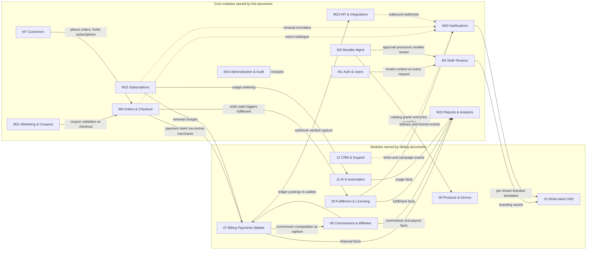
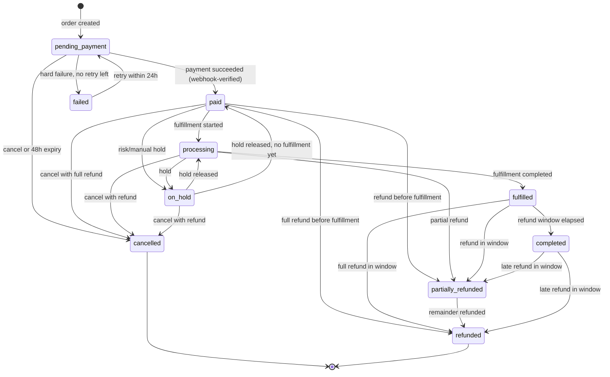
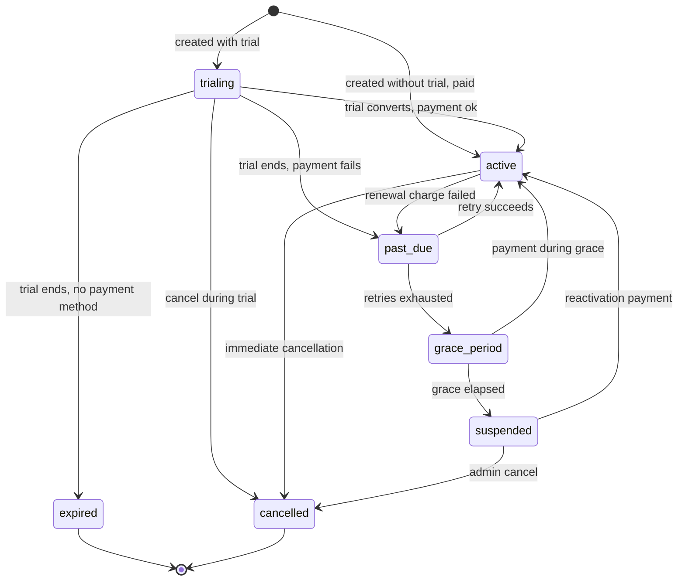

# Functional Requirements Catalog — Frenchies Platform (Core Modules)

| Field | Value |
|---|---|
| Document | 03-functional-requirements.md |
| Version | 1.0 |
| Status | Draft for Review |
| Date | 2026-11-01 |
| Owner | Product & Architecture Team |
| Related documents | 04-multi-tenancy-architecture.md, 05-reseller-hierarchy.md, 06-product-marketplace.md, 07-billing-and-financial-architecture.md, 08-affiliate-and-commission-system.md, 09-fulfillment-and-licensing.md, 10-white-label-cms.md, 11-ai-and-automation.md, 12-crm-and-support.md, 13-database-design.md, 15-user-workflows.md, 16-ui-ux-specification.md, 17-security-requirements.md, 18-non-functional-requirements.md, 22-open-questions-and-assumptions.md |

## Table of Contents

1. [Purpose](#1-purpose)
2. [How to Read This Catalog](#2-how-to-read-this-catalog)
3. [Module Interaction Map](#3-module-interaction-map)
4. [FR Summary Index](#4-fr-summary-index)
5. [Module 1 — Authentication & User Management (FR-AUTH)](#5-module-1--authentication--user-management-fr-auth)
6. [Module 2 — Multi-Tenancy (FR-TENANT)](#6-module-2--multi-tenancy-fr-tenant)
7. [Module 3 — Reseller Management (FR-RESELLER)](#7-module-3--reseller-management-fr-reseller)
8. [Module 7 — Customer Management (FR-CUSTOMER)](#8-module-7--customer-management-fr-customer)
9. [Module 9 — Orders & Checkout (FR-ORDER)](#9-module-9--orders--checkout-fr-order)
10. [Module 15 — Subscriptions (FR-SUBSCRIPTION)](#10-module-15--subscriptions-fr-subscription)
11. [Module 20 — Notifications & Communication (FR-NOTIFY)](#11-module-20--notifications--communication-fr-notify)
12. [Module 21 — Marketing & Coupons (FR-MARKETING)](#12-module-21--marketing--coupons-fr-marketing)
13. [Module 22 — Reports & Analytics (FR-REPORT)](#13-module-22--reports--analytics-fr-report)
14. [Module 23 — API & Integration Management (FR-API)](#14-module-23--api--integration-management-fr-api)
15. [Module 24 — Administration & Audit (FR-ADMIN)](#15-module-24--administration--audit-fr-admin)
16. [Companion Module Overviews (sibling-owned; FR IDs not defined here)](#16-companion-module-overviews)
17. [Assumptions & Open Questions](#17-assumptions--open-questions)

## 1. Purpose

This document is the authoritative functional requirements catalog for the eleven core modules
that this document owns per the authoring charter (§8): **Authentication & User Management (1),
Multi-Tenancy (2), Reseller Management (3), Customer Management (7), Orders & Checkout (9),
Subscriptions (15), Notifications & Communication (20), Marketing & Coupons (21), Reports &
Analytics (22), API & Integration Management (23), and Administration & Audit (24)**.

It defines *what* the platform must do — testable "shall" statements, enumerated statuses,
legal state transitions, edge-case handling, and acceptance criteria — for implementation in
Laravel 13 / PHP 8.4, Vue 3 + Inertia + TypeScript + Tailwind CSS 4, MySQL 8 shared-schema
multi-tenancy, Redis/Horizon/Reverb/Sanctum, and Razorpay/Cashfree. It does **not** define
architecture deep-dives (see `04-multi-tenancy-architecture.md` and `05-reseller-hierarchy.md`),
database column-level design (see `13-database-design.md`), or the functional requirements of
the seven sibling-owned modules — those receive one-page overviews in Section 16 only.

## 2. How to Read This Catalog

- **FR ID format:** `FR-<MODULE>-<NNN>` (zero-padded, 3 digits), where `<MODULE>` is one of
  `AUTH`, `TENANT`, `RESELLER`, `CUSTOMER`, `ORDER`, `SUBSCRIPTION`, `NOTIFY`, `MARKETING`,
  `REPORT`, `API`, `ADMIN`. Numbering restarts at `001` per module and is sequential.
  Per charter §8, only this document *defines* these IDs; other PRD documents may reference
  them but must not redefine them.
- **Acceptance criteria IDs:** `AC-FR-<MODULE>-<NNN>-<n>`. Every P0/P1 FR carries an
  acceptance-criteria block (Gherkin scenarios or numbered checks). P2/P3 FRs are stated
  without AC blocks; their ACs will be written when the item is scheduled for a release.
- **Priorities (charter §8):** `P0` = critical for platform operation (must work end-to-end at
  launch); `P1` = required for MVP; `P2` = important post-MVP enhancement; `P3` = future.
- **Terminology:** roles, tenants, tables, financial rules, and money-handling constraints are
  canonical per charter §4–§7. Amounts are `DECIMAL(15,2)` with explicit `currency` (default
  `INR`). Payments are always collected by the central platform under central merchant
  accounts. Cross-references are made by filename (e.g., "see `07-billing-and-financial-
  architecture.md`").
- **Status enumerations** for every stateful entity are given explicitly, in `snake_case`,
  and are exhaustive: implementations must not invent additional statuses without a PRD
  change.

## 3. Module Interaction Map



Reading the map: solid arrows are synchronous/triggering data flows; dotted arrows are
event-catalogue-driven async flows (see Module 20). Every module writes facts that
Module 22 aggregates, and every module's admin actions are captured by Module 24.

## 4. FR Summary Index

| Module | Prefix | ID range | FRs | P0 | P1 | P2 | P3 |
|---|---|---|---|---|---|---|---|
| 1 — Authentication & User Management | FR-AUTH | FR-AUTH-001 … 033 | 33 | 6 | 18 | 7 | 2 |
| 2 — Multi-Tenancy | FR-TENANT | FR-TENANT-001 … 022 | 22 | 6 | 11 | 4 | 1 |
| 3 — Reseller Management | FR-RESELLER | FR-RESELLER-001 … 026 | 26 | 5 | 16 | 4 | 1 |
| 7 — Customer Management | FR-CUSTOMER | FR-CUSTOMER-001 … 018 | 18 | 2 | 10 | 5 | 1 |
| 9 — Orders & Checkout | FR-ORDER | FR-ORDER-001 … 034 | 34 | 15 | 13 | 4 | 2 |
| 15 — Subscriptions | FR-SUBSCRIPTION | FR-SUBSCRIPTION-001 … 026 | 26 | 8 | 13 | 4 | 1 |
| 20 — Notifications & Communication | FR-NOTIFY | FR-NOTIFY-001 … 022 | 22 | 3 | 10 | 7 | 2 |
| 21 — Marketing & Coupons | FR-MARKETING | FR-MARKETING-001 … 016 | 16 | 3 | 4 | 7 | 2 |
| 22 — Reports & Analytics | FR-REPORT | FR-REPORT-001 … 022 | 22 | 2 | 15 | 4 | 1 |
| 23 — API & Integration Management | FR-API | FR-API-001 … 022 | 22 | 7 | 11 | 4 | 0 |
| 24 — Administration & Audit | FR-ADMIN | FR-ADMIN-001 … 022 | 22 | 3 | 10 | 7 | 2 |
| **Total** | — | — | **263** | **60** | **131** | **57** | **15** |

FR IDs owned by sibling documents (NOT defined here — see Section 16 overviews):
`FR-PRODUCT`, `FR-DEMO` (06), `FR-BILLING`, `FR-PAYMENT`, `FR-WALLET` (07), `FR-COMMISSION`,
`FR-AFFILIATE` (08), `FR-FULFILLMENT`, `FR-LICENSE` (09), `FR-CMS` (10), `FR-AI` (11),
`FR-CRM`, `FR-SUPPORT` (12), `SEC-NNN` (17), `NFR-NNN` (18), `UI-…` (16), `FLOW-NN` (15).

---

## 5. Module 1 — Authentication & User Management (FR-AUTH)

**Purpose:** Identity, credentials, sessions, verification, and role enforcement for all 12
canonical roles across every tenant. **Actors:** all roles; platform staff administer,
reseller owners administer their tenant, customers self-serve. **Key entities/tables:**
`users`, `sessions`, `login_activities`, `user_invitations`, `roles`, `permissions`,
`model_has_roles`, `model_has_permissions`, `role_has_permissions`.

### 5.1 FR catalog

| ID | Priority | Requirement statement |
|---|---|---|
| FR-AUTH-001 | P0 | The platform shall allow self-service reseller registration on the central site collecting email, password, full name, and mobile number, creating a `users` row scoped to the central tenant with a pending-reseller state and a draft reseller application (see FR-RESELLER-001); duplicate email within the central tenant is rejected with a specific error message. |
| FR-AUTH-002 | P0 | The platform shall allow self-service customer registration on any reseller storefront, creating a portal-capable `users` row with role `Customer` scoped to the storefront's tenant and linked 1:1 to a `customers` row; duplicate email within the same tenant is rejected, the same email in another tenant is allowed (charter §4). |
| FR-AUTH-003 | P1 | The system shall let a staff-invitee accept an invitation by opening the emailed single-use link, setting a password, and thereby joining the inviting tenant with the invited role; acceptance after expiry or revocation is refused with a distinct error page. |
| FR-AUTH-004 | P0 | The system shall authenticate users by email + password within the tenant context resolved from the request host (central site for central users); failed attempts increment a counter and lock the account for 15 minutes after 5 consecutive failures (configurable); generic error messages must not reveal whether an email exists. |
| FR-AUTH-005 | P0 | The system shall log out the current session (server-side session destruction) and offer "log out of all devices" which destroys every server session for that user immediately. |
| FR-AUTH-006 | P0 | The system shall require email verification via a signed, single-use link (24-hour expiry) before a user may submit a reseller application or complete a paid checkout; resend is rate-limited to once per 60 seconds and 5 per hour. |
| FR-AUTH-007 | P1 | The system shall support mobile OTP verification: 6-digit code, stored hashed, 5-minute TTL, maximum 3 resends per hour and 5 verification attempts per code; used for reseller registration mobile numbers, payout bank-detail changes, and phone changes on profiles. Delivery uses the WhatsApp transactional channel when available, SMS post-MVP, email as fallback. |
| FR-AUTH-008 | P1 | The system shall provide password recovery via an emailed signed link valid 60 minutes and usable once; on success all other sessions are invalidated and the action is written to `login_activities` and `audit_logs`; responses are identical for unknown emails. |
| FR-AUTH-009 | P1 | The system shall enforce a password policy of minimum 10 characters, not equal to the user's email or name, with password change requiring the current password and revoking all other sessions (with a notification email). |
| FR-AUTH-010 | P1 | The system shall support TOTP two-factor authentication (provisioning secret + otpauth QR, activation by verifying one code, 10 single-use recovery codes) and shall make 2FA mandatory for the roles Super Admin, Platform Admin, Finance Admin, and Reseller (owner). |
| FR-AUTH-011 | P1 | The system shall enforce 2FA: users in mandatory roles receive a 7-day grace period from role assignment; newly created accounts in mandatory roles are enforced immediately; while unenrolled (and past grace) such users are restricted to profile/security-settings pages only; 6 consecutive invalid codes lock 2FA for 15 minutes and raise a security event. |
| FR-AUTH-012 | P0 | The system shall enforce RBAC server-side on every protected route and action using spatie permissions with teams=tenant; role and permission checks must deny by default, return HTTP 403 with a standard error body, and log permission denials (rate-limited) into security events. |
| FR-AUTH-013 | P1 | Reseller owners shall be able to create custom roles inside their tenant from a platform-defined permission catalogue subset gated by their subscription plan; assigning permissions outside the subset, or any role above Reseller, is impossible by construction. |
| FR-AUTH-014 | P1 | The system shall provide a multi-type invitation system (types: `staff`, `sub_reseller`, `affiliate`, `customer`) storing inviter, tenant, type, role/plan, and metadata; tokens are 32-byte random, single-use, default 7-day expiry; each type sends its own branded template. |
| FR-AUTH-015 | P1 | Tenant administrators shall be able to list pending invitations, resend (re-issuing the token and resetting expiry), and revoke; re-inviting a revoked/expired email invalidates the prior token atomically. |
| FR-AUTH-016 | P1 | Users shall be able to update their own profile (name, phone, avatar ≤2 MB jpg/png/webp); phone changes require OTP verification per FR-AUTH-007; every profile change affecting identity fields is audited. |
| FR-AUTH-017 | P1 | The system shall show each user their active sessions (device type, IP, user agent, created, last activity, current-session flag) with the ability to revoke any individual session or all others, taking effect immediately. |
| FR-AUTH-018 | P1 | The system shall record every login attempt (success, password failure, lockout, 2FA failure, logout) in `login_activities` with IP, user agent, method, and result; users see their own last 50 entries; records are retained 12 months. |
| FR-AUTH-019 | P1 | Platform admins shall be able to suspend and unsuspend any user; suspension revokes all sessions, blocks login with a distinct "account suspended" reason, blocks API-token use, and writes an audit record including actor and reason. |
| FR-AUTH-020 | P1 | Super Admin shall be able to grant a platform user cross-tenant access to specific tenants (or all tenants); granted users get an audited tenant switcher, and every request executed under a foreign tenant context is logged with actor and tenant. |
| FR-AUTH-021 | P1 | The system shall rate-limit authentication endpoints: login 5/min per email+IP, OTP send 3/min per phone, OTP verify 5 per 5 min, password reset 3/hour per email, registration 3/hour per IP; responses are HTTP 429 with `Retry-After`. |
| FR-AUTH-022 | P2 | The system shall support configurable idle-session timeouts: 30 minutes for Finance Admin and sensitive admin routes, 8 hours default elsewhere (platform-configurable). |
| FR-AUTH-023 | P1 | Authenticated users shall be able to create Sanctum personal access tokens with a name and abilities limited to a subset of their own permissions; tokens are shown once, track `last_used_at`, are revocable instantly, and are hard-bound to the owning tenant. |
| FR-AUTH-024 | P2 | The system shall offer an opt-in "remember me" login valid 30 days, revocable from the session list. |
| FR-AUTH-025 | P2 | Registration and password changes shall screen passwords against a locally synced breached-password dataset using k-anonymity range queries (no plaintext leaves the server) and block matches with an explanatory message. |
| FR-AUTH-026 | P2 | Super Admin shall be able to trigger an admin-initiated password reset for any user, requiring step-up 2FA, forcing a change at next login, revoking sessions, and writing an audit record. |
| FR-AUTH-027 | P2 | Tenants shall be able to enable Google OAuth login for their storefront/panel; Google-verified emails link to or create a tenant-scoped account; disabled by default. |
| FR-AUTH-028 | P1 | The system shall enforce tenant-scoped identity: `users` unique on (tenant_id, email), `customers` unique on (tenant_id, email); authentication always resolves within a tenant context; the same email may exist in multiple tenants as fully separate accounts (no merging, charter §4). |
| FR-AUTH-029 | P1 | Each tenant shall have a setting `auth.allow_customer_registration` (default true); when false the storefront hides registration and rejects self-registration requests while staff/customer invitations continue to work. |
| FR-AUTH-030 | P2 | Customers shall be able to request account deletion from the portal (re-authentication required); requests create an admin approval task; on approval personal fields are anonymized, financial records are retained per charter retention rules, and portal access is revoked. |
| FR-AUTH-031 | P2 | Users shall be able to set a per-user locale and timezone (default `en-IN` / `Asia/Kolkata`) used for display and notification scheduling inputs. |
| FR-AUTH-032 | P3 | The system shall support WebAuthn passkeys as a second authenticator and as a password replacement. |
| FR-AUTH-033 | P3 | The system shall support phone-number + OTP login as a primary identifier within a tenant. |

### 5.2 Acceptance criteria (P0/P1)

**AC-FR-AUTH-001** — numbered checks:
1. Registering with an email already present in the central tenant returns a field-level error and creates no rows.
2. Successful registration creates exactly one `users` row (central tenant) and one draft reseller application; password is never stored in plaintext.
3. The application cannot be submitted until the email is verified (FR-AUTH-006).

**AC-FR-AUTH-002** — numbered checks:
1. Registering on tenant `acme.frenchies.com` creates a `users` row with `tenant_id` of Acme and role `Customer`, plus a linked `customers` row.
2. Registering the same email on a different tenant succeeds; registering it again on Acme fails with a specific message.
3. A welcome notification is queued per the Module 20 event catalogue.

**AC-FR-AUTH-003** — numbered checks:
1. Accepting a valid `staff` invitation with a compliant password creates the user in the inviting tenant with exactly the invited roles and consumes the token.
2. Re-using the same token a second time fails with "invitation already used".
3. Accepting after the 7-day expiry shows an "expired" page and creates no user.

**AC-FR-AUTH-004** — Gherkin:

```gherkin
Scenario: Successful login on a reseller storefront
  Given a verified user "owner@acme.example" exists in tenant "acme" with the correct password
  When they submit the login form on "acme.frenchies.com" with correct credentials
  Then they are authenticated into a session scoped to tenant "acme"
  And a success row is written to "login_activities"

Scenario: Lockout after repeated failures
  Given a user has 4 consecutive failed login attempts
  When they submit a 5th incorrect password
  Then the account is locked for 15 minutes
  And the 6th attempt within the window is refused with "account temporarily locked"
  And a security event is recorded
```

**AC-FR-AUTH-005** — numbered checks:
1. Logout removes the server session; the same cookie is rejected on the next request.
2. "Log out of all devices" invalidates every session of that user across devices within 2 seconds of the action.

**AC-FR-AUTH-006** — Gherkin:

```gherkin
Scenario: Verification required before checkout payment
  Given a registered but unverified customer on a storefront
  When they reach the payment step of checkout
  Then payment initiation is blocked and they are prompted to verify their email
  And a verification email with a signed 24-hour link is queued

Scenario: Resend throttling
  Given a user who requested a verification email 30 seconds ago
  When they click "resend"
  Then the request is rejected with a 60-second cooldown message and no email is sent
```

**AC-FR-AUTH-007** — numbered checks:
1. Requesting an OTP stores only a hash; the code expires 5 minutes after issuance.
2. The 6th verification attempt against one code invalidates it and requires a resend.
3. A phone change on a profile is only persisted after an OTP sent to the new number is verified.

**AC-FR-AUTH-008** — Gherkin:

```gherkin
Scenario: Password reset completes and invalidates sessions
  Given a user requested a reset link 10 minutes ago
  When they open the link and set a compliant new password
  Then the password is updated, all existing sessions are destroyed
  And an audit record with action "auth.password_reset" is written
  And using the same link again shows "link already used"
```

**AC-FR-AUTH-009** — numbered checks:
1. Passwords shorter than 10 characters are rejected at registration and change.
2. Changing a password without the current password is rejected.
3. After a successful password change, other sessions are invalid and a notification email is sent.

**AC-FR-AUTH-010** — numbered checks:
1. TOTP activation requires verifying one valid code within the setup flow; the secret is stored encrypted.
2. Each of the 10 recovery codes is usable exactly once and is invalidated after use.
3. A user without 2FA in role Finance Admin cannot access any `/admin/finance/*` route (403) once grace has expired.

**AC-FR-AUTH-011** — numbered checks:
1. A user assigned the Reseller role on 2026-11-01 is blocked from business routes on 2026-11-09 if still unenrolled; on 2026-11-05 they can still access business routes with a persistent prompt.
2. A newly created Super Admin account cannot access admin routes until 2FA is enrolled (no grace).
3. Six invalid TOTP codes trigger a 15-minute 2FA lock and a security event row.

**AC-FR-AUTH-012** — Gherkin:

```gherkin
Scenario: Server-side permission denial
  Given a user with role "Reseller Employee" holding only permission "orders.view"
  When they request the endpoint to delete a product
  Then the response is HTTP 403 with the standard error body
  And no data change occurs
  And a permission-denial security event is recorded with actor, tenant, and route

Scenario: Tenant scoping of role checks
  Given a Reseller role held in tenant "acme"
  When the same user's token is used against tenant "globex" resources
  Then all checks resolve as if the user had no roles in "globex" and access is denied
```

**AC-FR-AUTH-013** — numbered checks:
1. A reseller on the base plan cannot create a role containing `settings.finance.edit` (not in their plan's catalogue subset).
2. A reseller-created role can never be assigned a permission that the Reseller owner themselves does not hold.

**AC-FR-AUTH-014** — Gherkin:

```gherkin
Scenario: Staff invitation acceptance
  Given an Acme Reseller owner invites "sales@partner.example" as staff with role "Sales Agent"
  When the invitee opens the emailed link and sets a password
  Then a user is created in tenant "acme" with role "Sales Agent" only
  And the invitation row transitions from "pending" to "accepted"

Scenario: Revoked invitation cannot be used
  Given an invitation was revoked by its inviter
  When the token link is opened
  Then an "invitation revoked" page is shown and no account is created
```

**AC-FR-AUTH-015** — numbered checks:
1. Resend invalidates the previous token: opening the old link after a resend fails.
2. Revoked and expired invitations are excluded from the default "pending" list but remain auditable.

**AC-FR-AUTH-016** — numbered checks:
1. Avatar uploads over 2 MB or of non-allowed types are rejected with a field error.
2. Name-only updates persist without OTP; phone updates require OTP (FR-AUTH-007).
3. Identity-field changes appear in the user's audit trail.

**AC-FR-AUTH-017** — numbered checks:
1. The session list shows ≥ the sessions actually open (server `sessions` rows), flagging the current one.
2. Revoking a session makes that session invalid on its next request within 5 seconds.

**AC-FR-AUTH-018** — numbered checks:
1. Every login attempt (success or failure) creates exactly one `login_activities` row with result and IP.
2. The user-facing view shows at most 50 rows, newest first, and never shows other users' rows.

**AC-FR-AUTH-019** — numbered checks:
1. Suspending a user immediately ends their active sessions and blocks subsequent login with reason "suspended".
2. Unsuspend restores login (2FA still enforced) and both actions appear in `audit_logs` with actor and reason.

**AC-FR-AUTH-020** — numbered checks:
1. A platform user granted access to tenants A and B sees a switcher listing exactly A and B (plus central).
2. Every request under a switched tenant writes an audit row containing actor id, target tenant id, and route.

**AC-FR-AUTH-021** — numbered checks:
1. The 6th login attempt for one email within one minute returns HTTP 429 with `Retry-After`.
2. OTP sends to one phone are refused beyond 3 per minute.

**AC-FR-AUTH-023** — numbered checks:
1. A token created with ability `orders.read` cannot call any write endpoint (403).
2. Revoking a token rejects its next request immediately.
3. Tokens created in tenant A return 404/403 for tenant B resources.

**AC-FR-AUTH-028** — numbered checks:
1. Database constraint tests prove (tenant_id, email) uniqueness for both `users` and `customers`.
2. Login lookups never match across tenants: same email in two tenants authenticates each account only in its own host context.

**AC-FR-AUTH-029** — numbered checks:
1. With `auth.allow_customer_registration=false`, the storefront registration route returns 404/403 and the UI hides the link.
2. Staff and customer invitations still succeed while self-registration is disabled.

**Detailed specification:** login/registration screen flows in `15-user-workflows.md` and
`16-ui-ux-specification.md`; auth security baseline (hashing, throttling, token handling) in
`17-security-requirements.md`; branded auth screens in `10-white-label-cms.md`; support-role
definitions in `12-crm-and-support.md`.

---

## 6. Module 2 — Multi-Tenancy (FR-TENANT)

**Purpose:** Tenant lifecycle, identification, isolation, settings, suspension, and
backup/export guarantees. This document owns the FR *statements*; the architecture deep-dive
(middleware design, global scopes, context container, edge routing with Cloudflare) lives in
`04-multi-tenancy-architecture.md` and must be consistent with these requirements.
**Actors:** platform staff (central tenant), reseller tenants, storefront visitors.
**Key entities/tables:** `tenants`, `tenant_domains`, `tenant_settings`.

### 6.1 Tenant status enumeration

| Status | Meaning |
|---|---|
| `pending` | Row created, provisioning incomplete (or awaiting first reseller approval step). |
| `active` | Fully provisioned; storefront and panel operational. |
| `suspended` | Administratively disabled; storefront shows holding page, logins blocked except platform staff. |
| `terminated` | Frozen for deletion/retention; all access blocked (P2 lifecycle). |

Tenant domain statuses: `pending_verification`, `active`, `failed`.

### 6.2 FR catalog

| ID | Priority | Requirement statement |
|---|---|---|
| FR-TENANT-001 | P0 | The platform shall ship exactly one seeded platform tenant (`tenants.slug='central'`, `type='platform'`); no code path may create a second platform-type tenant or delete the central tenant. |
| FR-TENANT-002 | P0 | Reseller tenant provisioning shall occur atomically at reseller approval (FR-RESELLER-005): create tenant (`type='reseller'`, status `active`), attach the `resellers` row, assign the owner user to the tenant with role Reseller, apply plan defaults, and queue provisioning defaults (FR-TENANT-017); failure at any step rolls back the whole approval. |
| FR-TENANT-003 | P0 | Every HTTP request shall be bound to a tenant context resolved from the host: `*.frenchies.com` subdomains map to `tenants.slug`; a verified custom domain maps via `tenant_domains`; unknown hosts serve the central marketing site; API requests under `/api/v1/...` resolve tenant from the authenticated key/token, not the host. |
| FR-TENANT-004 | P1 | A tenant shall be able to add one custom domain (plan-gated); the domain starts `pending_verification`, requires DNS evidence (CNAME to the edge target, or TXT token for apex), and transitions to `active` only after automated verification succeeds; failed verification sets `failed` with a visible reason. |
| FR-TENANT-005 | P1 | For every `active` custom domain the platform shall automate edge TLS certificate issuance and renewal via Cloudflare and serve the storefront and customer portal on that domain; certificates must never lapse while status is `active`. |
| FR-TENANT-006 | P0 | The system shall guarantee row-level data isolation: every tenant-owned table carries `tenant_id`, every tenant-scoped query passes a mandatory scope/middleware layer, and any query executed without a tenant context on tenant-owned tables must fail loudly (exception) rather than return cross-tenant data; isolation is proven by an automated cross-tenant access test suite run in CI. |
| FR-TENANT-007 | P0 | The system shall propagate tenant context through HTTP requests, queued jobs (job payload carries `tenant_id`, worker rehydrates context before execution), scheduled tasks (per-tenant fan-out), and events/listeners; a job without resolvable tenant context must fail and land in `failed_jobs` with tenant recorded. |
| FR-TENANT-008 | P1 | Cache usage shall be tenant-namespaced (key prefix derived from tenant id) for all tenant data; reads/writes must be provably incapable of returning another tenant's cached value; global/platform caches are explicitly whitelisted. |
| FR-TENANT-009 | P1 | File storage shall be tenant-scoped (per-tenant prefix or bucket, e.g., `tenants/{tenant_id}/...`); all private downloads use signed, expiring URLs validated against the owning tenant; cross-tenant object access must fail with 403/404. |
| FR-TENANT-010 | P1 | Queue processing shall be tenant-aware: Horizon shows per-tenant job counts (tagged by tenant), and a tenant suspension halts that tenant's queued non-critical jobs (notification marketing jobs, exports) while letting financial settlement jobs complete. |
| FR-TENANT-011 | P1 | Tenant settings shall be stored as typed key-value rows in `tenant_settings` with platform defaults inherited when unset; setting writes are validated against a schema registry, cached, and audited; unknown keys are rejected. |
| FR-TENANT-012 | P0 | Tenant suspension (by Super Admin or via reseller suspension FR-RESELLER-016) shall: return a holding page on the storefront, block all tenant-user logins and revoke sessions, stop checkout, pause marketing/campaign sends, halt non-critical queued jobs, and keep invoices, portal read-only financial history, and central administration functional. |
| FR-TENANT-013 | P1 | Super Admin shall be able to restore a suspended tenant to `active` in one action; restoration re-enables storefront, logins, and queued jobs and writes an audit record. |
| FR-TENANT-014 | P2 | Tenant termination shall freeze the tenant (superseding suspension), schedule data purge of non-financial PII after a 90-day quarantine, and permanently retain financial records (orders, payments, invoices, commissions, payouts, ledger) per charter retention rules. |
| FR-TENANT-015 | P1 | Platform admins shall be able to trigger an on-demand tenant data export (async job): all tenant-scoped DB rows exported as JSON/CSV bundles plus a storage manifest; the export is delivered as a signed download link valid 48 hours and is audited. |
| FR-TENANT-016 | P1 | The platform shall run automated nightly full-database backups and monthly per-tenant snapshot exports, retained 30 days (configurable); backup job failures raise an admin alert (Module 24). |
| FR-TENANT-017 | P1 | Tenant provisioning shall create defaults: default theme with reseller logo placeholders, default notification templates (platform fallbacks), starter CMS pages (home/terms/privacy), a default storefront subdomain, and default tenant settings; provisioning is idempotent and re-runnable. |
| FR-TENANT-018 | P2 | Per-tenant quotas derived from the reseller plan (max staff users, max products, max custom domains, max API keys) shall be enforced at creation time with clear upgrade messaging; quota checks must be race-safe. |
| FR-TENANT-019 | P2 | Tenant slugs shall be immutable after creation, and custom domains shall be globally unique; releasing a domain places it in a 30-day cooldown before another tenant can verify it. |
| FR-TENANT-020 | P1 | Platform users with cross-tenant grants (FR-AUTH-020) shall switch tenant context explicitly; the active tenant is always displayed in the UI chrome, and every write under a foreign tenant is audited with actor and tenant. |
| FR-TENANT-021 | P2 | The platform shall apply per-tenant storefront request throttling (default 300 req/min per IP, configurable) to contain abuse, with 429 responses and an edge-level cache for anonymous pages. |
| FR-TENANT-022 | P3 | The platform shall support per-tenant data-residency pinning (region-scoped storage prefix) as a future capability without schema redesign. |

### 6.3 Acceptance criteria (P0/P1)

**AC-FR-TENANT-001** — numbered checks:
1. Seeding creates exactly one `tenants` row with slug `central` and type `platform`.
2. Attempts to create another platform-type tenant are rejected by validation and by DB constraint.

**AC-FR-TENANT-002** — Gherkin:

```gherkin
Scenario: Approval provisions a tenant atomically
  Given an approved reseller application for "Acme Digital"
  When the approval action completes
  Then a tenant with slug "acme-digital", type "reseller" and status "active" exists
  And the applicant user is assigned role "Reseller" inside that tenant
  And the "resellers" row references the new tenant
  And default templates and settings exist for the tenant

Scenario: Partial failure rolls back
  Given tenant provisioning fails while assigning the owner role
  When the approval is retried
  Then no partial tenant, reseller row, or role assignment remains from the failed attempt
```

**AC-FR-TENANT-003** — Gherkin:

```gherkin
Scenario: Host-based resolution
  Given tenants "acme" and "central" exist
  When a request arrives for "acme.frenchies.com/products"
  Then tenant context "acme" is bound before any query executes
  And data returned is filtered to tenant "acme"

Scenario: Unknown host and API resolution
  Given an unknown host "unknown.frenchies.com"
  When a request arrives
  Then the central marketing site is served with no tenant data
  And an API request authenticated by a key of tenant "acme" resolves context from the key regardless of Host header
```

**AC-FR-TENANT-004** — numbered checks:
1. Adding a domain without any DNS evidence leaves it `pending_verification` after automated checks.
2. Providing the correct CNAME target flips status to `active` within one verification cycle (≤15 minutes) and triggers FR-TENANT-005.
3. A TXT mismatch sets `failed` with the observed mismatch reason visible to the tenant admin.

**AC-FR-TENANT-005** — numbered checks:
1. An `active` custom domain serves a valid TLS certificate within 60 minutes of activation.
2. Renewal is automated; synthetic monthly checks confirm certificate validity for all `active` domains.

**AC-FR-TENANT-006** — Gherkin:

```gherkin
Scenario: Cross-tenant read is impossible for tenant-scoped code
  Given orders exist in tenants "acme" and "globex"
  When a reseller of "acme" lists orders through any UI or API surface
  Then only "acme" orders are returned
  And no query path returns a "globex" row (verified by CI isolation suite)

Scenario: Missing tenant context fails closed
  Given a tenant-owned model is queried in a context with no tenant bound
  When the query executes
  Then it raises a TenantContextMissing exception and returns no rows
```

**AC-FR-TENANT-007** — numbered checks:
1. A queued job dispatched inside tenant context executes with the same tenant after a worker restart.
2. A job payload lacking `tenant_id` for a tenant-bound job type lands in `failed_jobs` with the failure reason recorded.

**AC-FR-TENANT-008** — numbered checks:
1. Two tenants caching the same logical key produce distinct Redis keys.
2. An automated test proves tenant A's cached value is never readable via tenant B's context.

**AC-FR-TENANT-009** — numbered checks:
1. An invoice PDF uploaded for tenant A is downloadable only via a signed URL scoped to A's prefix; rewriting the URL to B's object id returns 403/404.
2. All signed URLs expire within the configured window (default 15 minutes for private files).

**AC-FR-TENANT-010** — numbered checks:
1. Horizon tags include tenant id for tenant-bound jobs and provide per-tenant counts.
2. Suspending a tenant stops its marketing-send jobs within one queue poll while its payment-settlement jobs still complete.

**AC-FR-TENANT-011** — numbered checks:
1. Unset tenant keys resolve to platform defaults; setting an override takes effect within 5 seconds (cache invalidation).
2. Writing an unregistered key or an invalid value type fails validation and changes nothing.

**AC-FR-TENANT-012** — Gherkin:

```gherkin
Scenario: Suspension cuts off the tenant but not the platform
  Given tenant "acme" is active with logged-in users and queued marketing jobs
  When a Super Admin suspends "acme"
  Then "acme.frenchies.com" serves the holding page for all storefront routes
  And all "acme" user sessions are revoked and login is refused
  And checkout is impossible while suspension is active
  And tenants "globex" and "central" are unaffected in the same time window
```

**AC-FR-TENANT-013** — numbered checks:
1. Restore returns the tenant to `active` and re-enables storefront, logins, and queued jobs without manual data fixes.
2. Both suspension and restore appear in `audit_logs` with actor, tenant, and reason.

**AC-FR-TENANT-015** — numbered checks:
1. Triggering an export produces, within the async SLA, a bundle containing every tenant-scoped row set and a storage manifest.
2. The download link is single-tenant, signed, expires after 48 hours, and the trigger is audited.

**AC-FR-TENANT-016** — numbered checks:
1. Nightly backup job success is observable; a simulated failure raises an admin alert within 15 minutes.
2. Retention pruning removes snapshots older than 30 days.

**AC-FR-TENANT-017** — numbered checks:
1. A newly provisioned tenant can render a storefront immediately using defaults, with no manual steps.
2. Re-running provisioning creates no duplicates.

**AC-FR-TENANT-020** — numbered checks:
1. A granted platform user sees exactly the granted tenants in the switcher.
2. All cross-tenant writes produce audit rows containing actor and tenant ids.

**Detailed specification:** tenancy middleware/scopes/container design in
`04-multi-tenancy-architecture.md`; white-label assets and themes per tenant in
`10-white-label-cms.md`; tenant catalog grants in `06-product-marketplace.md`; isolation and
availability NFRs in `18-non-functional-requirements.md`.

---

## 7. Module 3 — Reseller Management (FR-RESELLER)

**Purpose:** Reseller onboarding (application, KYC, agreement, approval), hierarchy
management, plan gating, per-reseller catalog/pricing/commission visibility, and lifecycle
(suspension, transfer, termination). Hierarchy architecture (closure table mechanics) is
specified in `05-reseller-hierarchy.md`; this document owns the FR statements.
**Actors:** prospect resellers, Reseller owners, Sub-Resellers, platform admins, Finance Admin.
**Key entities/tables:** `resellers`, `reseller_hierarchy`, `tenants`, `user_invitations`,
`tenant_products`, `subscription_plans`, `subscriptions`.

### 7.1 Reseller status enumeration

| Status | Meaning |
|---|---|
| `draft` | Application started, not submitted. |
| `submitted` | Application submitted, awaiting pick-up. |
| `under_review` | A platform reviewer is actively assessing. |
| `approved` | Approved; tenant provisioning triggered (transitions to `active`). |
| `rejected` | Rejected with reason; terminal for that application. |
| `active` | Operating business with an active tenant and (if applicable) active plan. |
| `suspended` | Administratively disabled (tenant suspended per FR-TENANT-012). |
| `terminated` | Permanently ended; data-retention rules apply. |

### 7.2 FR catalog

| ID | Priority | Requirement statement |
|---|---|---|
| FR-RESELLER-001 | P0 | The platform shall capture a reseller application with business details: legal business name, business type (individual/proprietorship/partnership/private ltd/etc.), PAN, GSTIN (optional at draft), address, country/state (place of supply), website (optional), contact person, and mobile number (OTP-verified per FR-AUTH-007). |
| FR-RESELLER-002 | P0 | The system shall enforce the reseller status lifecycle in §7.1; status transitions are validated server-side (only legal transitions allowed), timestamped, and audited; skipped states (e.g., `draft` → `active`) are impossible. |
| FR-RESELLER-003 | P1 | The platform shall capture KYC data (PAN, GSTIN, bank account holder name, account number, IFSC, cancelled-cheque/proof upload) with encryption at rest, masked display (last-4 only), re-reveal gated by step-up 2FA, and a full-field access audit; automated penny-drop/bank verification is deferred (P2). |
| FR-RESELLER-004 | P1 | Submission of an application shall require explicit acceptance of the current reseller agreement version; the acceptance stores agreement version, timestamp, IP, and user id; re-acceptance is required when a materially new version is published (platform-defined). |
| FR-RESELLER-005 | P0 | A Platform Admin approving an application shall atomically create the reseller tenant and `resellers` row (FR-TENANT-002), move the owner user into the tenant with role Reseller, subscribe the tenant to the selected plan (or trial), and notify the applicant; approval is impossible until application status is `under_review` or later and all required KYC fields exist. |
| FR-RESELLER-006 | P1 | Rejection shall require a reason (template + free text); the applicant is notified by email, the application becomes `rejected`, and the applicant may start a new application after a 30-day cooldown (configurable). |
| FR-RESELLER-007 | P1 | Platform admins shall have a review queue listing applications by status and age (oldest first), with per-application admin notes, status actions (`under_review`, `approve`, `reject`), and an aging alert for items open beyond 3 business days. |
| FR-RESELLER-008 | P0 | Reseller capabilities shall be gated by the tenant's active subscription plan: max staff users, max sellable products, custom domains, branding-removal, sub-reseller limit, affiliate slots, and API tier; every gated entry point checks the plan server-side and blocks with an upgrade prompt when exceeded. |
| FR-RESELLER-009 | P1 | A reseller shall be able to invite a sub-reseller (FR-AUTH-014 type `sub_reseller`) carrying parent linkage; on approval the child becomes a full tenant with `resellers.parent_reseller_id` set and `reseller_hierarchy` closure rows written for every ancestor→descendant pair with correct depth. |
| FR-RESELLER-010 | P1 | Hierarchy visibility shall be read-only upward: every ancestor reseller can view aggregate data (orders, revenue, customer counts, commission earned) of all descendants within its branch, but can never modify descendants' settings, prices, or data; visibility depth is unlimited and enforced by the closure table. |
| FR-RESELLER-011 | P1 | The reseller permission model shall implement: Reseller (full tenant control except platform-restricted actions: commission-rule edits, payout approvals, cross-tenant reads), Sub-Reseller (same as Reseller within own tenant), Reseller Employee (granular subsets), Sales Agent (CRM/leads/quotations only, no financial settings), per charter §5. |
| FR-RESELLER-012 | P1 | Each reseller shall see a per-reseller catalog composed of products granted via `tenant_products` (central products and parent-authorized products), with the ability to hide/unlist (not un-grant) products, set display order, and set storefront visibility; ungranted products are never visible or sellable by that tenant. |
| FR-RESELLER-013 | P1 | Each reseller shall set price overrides on granted products (fixed price or percentage markup on the base price) with a platform-configurable floor (default: override ≥ central base price); all override changes are versioned and audited; the checkout price is always the reseller's effective override. |
| FR-RESELLER-014 | P1 | Resellers shall see their own commission positions — pending (in hold), available, clawed-back, lifetime — with per-order breakdown (order id, product, commission pool, their share per hierarchy split, hold release date); visibility only, never editable. |
| FR-RESELLER-015 | P1 | Every reseller shall have a dashboard with: revenue (own + descendant aggregates per FR-RESELLER-010), orders by status, new customers, subscription status, commission and wallet summary, payout status, and top products, all scoped to their visibility boundary. |
| FR-RESELLER-016 | P0 | Super Admin shall be able to suspend an active reseller; suspension triggers tenant suspension (FR-TENANT-012), blocks new orders, halts the reseller's payout requests, keeps already-issued invoices/ledger intact, notifies the reseller with reason, and is audited. |
| FR-RESELLER-017 | P1 | Super Admin shall be able to restore a suspended reseller to `active`, re-enabling the tenant and storefront and resuming subscriptions per Module 15 rules; restore is audited with actor and reason. |
| FR-RESELLER-018 | P2 | Super Admin shall be able to transfer a sub-reseller (and its whole descendant branch) to a different parent, rebuilding closure-table rows atomically; the transfer is blocked if it would create a cycle; commission effects apply prospectively only; both parents are notified. |
| FR-RESELLER-019 | P2 | Reseller termination shall require Super Admin confirmation, freeze the tenant (FR-TENANT-014), retain all financial records permanently, anonymize PII after quarantine, and keep aggregate anonymized statistics for platform reporting. |
| FR-RESELLER-020 | P1 | Reseller owners shall be able to edit permitted profile fields (business name, address, contact, website, logo via CMS); regulated fields (PAN, GSTIN, bank details) require re-verification workflows and are fully audited with before/after values. |
| FR-RESELLER-021 | P1 | The platform shall configure the hierarchy commission split mechanism per charter §7.5: total reseller commission pool per product, split percentages per level stored in platform settings; resellers see the effective split for their chain; changing splits applies prospectively to new captures only. |
| FR-RESELLER-022 | P1 | Resellers shall have a sub-reseller management screen listing all descendants (depth, status, plan, revenue, last order), with actions invite, resend, deactivate (suspends child tenant), and a network tree visualization. |
| FR-RESELLER-023 | P1 | Staff seat counts shall be enforced against the plan limit at invitation acceptance; exceeding the limit blocks acceptance with an upgrade prompt; pending invitations do not consume seats but expire if unfilled within 30 days. |
| FR-RESELLER-024 | P2 | New approved resellers shall see an onboarding checklist (complete KYC, set branding, add first product pricing, invite staff, create sub-resellers/affiliates, test checkout) with completion state persisted per tenant. |
| FR-RESELLER-025 | P2 | Platform admins shall see a reseller network leaderboard (revenue, orders, growth, plan, health) with drill-down to a reseller's dashboard. |
| FR-RESELLER-026 | P3 | A reseller shall be able to propose its own products for distribution to other resellers (parent-authorized onward grants via `tenant_products`), subject to platform curation approval. |

### 7.3 Acceptance criteria (P0/P1)

**AC-FR-RESELLER-001** — numbered checks:
1. An application cannot be submitted with missing legal name, business type, PAN, address, or unverified mobile.
2. Draft applications persist incrementally (autosave) and are visible only to their author and platform admins.

**AC-FR-RESELLER-002** — Gherkin:

```gherkin
Scenario: Legal transitions only
  Given an application in status "draft"
  When an admin attempts to set status "active" directly
  Then the transition is rejected
  And no tenant is created

Scenario: Happy-path lifecycle
  Given an application in "submitted"
  When an admin moves it to "under_review" and then approves it
  Then it becomes "approved" and then "active" with both transitions audited
```

**AC-FR-RESELLER-003** — numbered checks:
1. Bank account numbers are stored encrypted; list/detail views show only the last 4 characters.
2. Every re-reveal of full KYC fields requires a fresh 2FA step-up and writes an access audit row.

**AC-FR-RESELLER-004** — numbered checks:
1. Submission is blocked until the current agreement version checkbox is accepted.
2. The acceptance record matches the version hash published at acceptance time.

**AC-FR-RESELLER-005** — Gherkin:

```gherkin
Scenario: Approval provisions the reseller end-to-end
  Given an application in "under_review" with complete KYC and accepted agreement
  When a Platform Admin approves it with plan "Growth"
  Then tenant "acme-digital" exists with type "reseller" and status "active"
  And the owner user holds role "Reseller" inside that tenant
  And the tenant has an active "Growth" plan subscription (or trial)
  And the applicant receives the approval notification

Scenario: Approval blocked without KYC
  Given an application missing bank details
  When a Platform Admin attempts approval
  Then the action is refused listing the missing fields
```

**AC-FR-RESELLER-006** — numbered checks:
1. Rejection without a reason is impossible.
2. The applicant receives the templated email and a new application is blocked for 30 days.

**AC-FR-RESELLER-007** — numbered checks:
1. The queue sorts by status then age ascending; filters by status/campaign source work.
2. Applications open >3 business days appear in a daily admin digest.

**AC-FR-RESELLER-008** — Gherkin:

```gherkin
Scenario: Plan limit blocks staff acceptance
  Given a reseller on plan "Starter" with limit max_staff=2 and 2 accepted staff
  When a third invitee accepts an invitation
  Then acceptance is refused with an upgrade prompt
  And no user row is created

Scenario: Plan upgrade lifts the limit immediately
  Given the same reseller upgrades to "Growth" (max_staff=5)
  When the third invitee accepts a fresh invitation
  Then the user is created successfully
```

**AC-FR-RESELLER-009** — Gherkin:

```gherkin
Scenario: Sub-reseller invitation creates hierarchy rows
  Given reseller A (depth 0) invites reseller B, and B later invites reseller C
  When both approvals complete
  Then closure rows exist: A→B (depth 1), B→C (depth 1), A→C (depth 2)
  And each child tenant has parent_reseller_id pointing to its inviter
```

**AC-FR-RESELLER-010** — numbered checks:
1. Reseller A can view aggregate revenue of descendants B and C but cannot read or edit B's settings, prices, or customer PII beyond the fields exposed in the aggregate views.
2. Reseller B never sees any data of its parent A or sibling C.

**AC-FR-RESELLER-011** — numbered checks:
1. A Sales Agent cannot reach any finance settings route (403).
2. A Reseller cannot approve their own payout request (Finance Admin only, `07-billing-and-financial-architecture.md`).

**AC-FR-RESELLER-012** — numbered checks:
1. A product not granted via `tenant_products` never appears in the reseller's catalog UI, import, or storefront queries.
2. Hiding a product removes it from the storefront within one cache TTL (≤60 s) without deleting the grant.

**AC-FR-RESELLER-013** — Gherkin:

```gherkin
Scenario: Override floor enforced
  Given a product with base price INR 1,000.00 and platform floor = base price
  When a reseller tries to set an override of INR 900.00
  Then the save is rejected with a floor-violation error
  And the effective price remains INR 1,000.00

Scenario: Override applies at checkout
  Given reseller Acme set an override of INR 1,299.00 on that product
  When a customer of Acme checks out
  Then the order line uses INR 1,299.00 regardless of the central price
```

**AC-FR-RESELLER-014** — numbered checks:
1. For a paid order in their chain, the reseller's commission detail shows pool amount, their level share, hold release date, and current bucket (pending/available).
2. No UI or API permits editing any commission figure.

**AC-FR-RESELLER-015** — numbered checks:
1. The dashboard renders all listed widgets scoped to the reseller's visibility boundary.
2. Descendant aggregates match the sum of descendant individual values exactly.

**AC-FR-RESELLER-016** — Gherkin:

```gherkin
Scenario: Suspension cascades
  Given an active reseller with an operating storefront
  When a Super Admin suspends the reseller with reason "payment policy violation"
  Then the tenant enters suspension (holding page, logins blocked, checkout stopped)
  And new payout requests are blocked while pending ones are paused
  And the reseller receives the suspension notification
  And an audit record contains actor, reseller, and reason
```

**AC-FR-RESELLER-017** — numbered checks:
1. Restore returns tenant and reseller to active with no manual data repair and is audited.
2. Paused payout requests return to their prior workflow state after restore.

**AC-FR-RESELLER-020** — numbered checks:
1. Changing GSTIN requires re-review flagging and is audited with before/after values.
2. Logo changes reflect on the storefront within one cache TTL.

**AC-FR-RESELLER-021** — numbered checks:
1. Changing level splits from 50/30/20 to 40/40/20 affects only orders captured after the change; historical commission rows are untouched.
2. Each reseller's commission detail displays the split applied to that specific order.

**AC-FR-RESELLER-022** — numbered checks:
1. The descendant list includes every closure-table descendant at any depth, with status and plan.
2. "Deactivate" on a child suspends the child tenant and is blocked from affecting the parent's own tenant.

**AC-FR-RESELLER-023** — numbered checks:
1. With max_staff=2 and 2 seats used, a third acceptance is blocked before user creation.
2. Unfilled invitations expire silently at 30 days with a resend option.

**Detailed specification:** hierarchy closure-table mechanics and queries in
`05-reseller-hierarchy.md`; per-reseller catalog, grants, and product versions in
`06-product-marketplace.md`; commission engine, wallets, and payouts in
`07-billing-and-financial-architecture.md` and `08-affiliate-and-commission-system.md`;
storefront branding in `10-white-label-cms.md`; reseller support queues in
`12-crm-and-support.md`.

---

## 8. Module 7 — Customer Management (FR-CUSTOMER)

**Purpose:** Customer records owned by a selling tenant, portal access, segmentation,
import/export, and lifecycle. **Actors:** Customer (portal), reseller staff (Reseller,
Reseller Employee, Sales Agent, Support Agent), platform staff (cross-tenant per grants).
**Key entities/tables:** `customers`, `customer_groups`, `customer_group_members`, `users`
(portal accounts), `orders`, `subscriptions`.

### 8.1 Customer status enumeration

`active`, `inactive` (no order and no login for 12 months, auto-set by scheduled job),
`blocked` (cannot purchase; portal read-only), `deleted` (soft-deleted; financial records
retained).

### 8.2 FR catalog

| ID | Priority | Requirement statement |
|---|---|---|
| FR-CUSTOMER-001 | P0 | The platform shall support all customer-creation paths: (a) self-registration on a tenant storefront (FR-AUTH-002), (b) manual creation by authorized reseller staff, (c) guest checkout conversion (FR-ORDER-007), (d) CSV import (FR-CUSTOMER-009), (e) customer invitation by staff (FR-CUSTOMER-012); every path produces one `customers` row plus (where portal access applies) one portal `users` row in the owning tenant. |
| FR-CUSTOMER-002 | P0 | Every customer shall belong to exactly one tenant (the selling tenant that created it); email uniqueness is enforced per tenant (unique (tenant_id, email)); the same email in different tenants is fully allowed and must never be linked, merged, or cross-visible (charter §4). |
| FR-CUSTOMER-003 | P1 | The customer profile shall capture: first/last name (or company name), email, phone, company, GSTIN, billing address, shipping addresses (multiple), notes (staff-only), tags, source (self-reg/staff/import/checkout/affiliate/campaign), assigned staff owner, and created/updated timestamps. |
| FR-CUSTOMER-004 | P1 | Authenticated customers shall have a portal showing their own: orders and status, active/past subscriptions with self-service actions (FR-SUBSCRIPTION-017), invoices with PDF download, licenses and activation counts (per `09-fulfillment-and-licensing.md`), support tickets and replies (per `12-crm-and-support.md`), profile and notification preferences; the portal is branded per tenant (white-label). |
| FR-CUSTOMER-005 | P1 | Portal data shall be strictly scoped to the owning tenant and the logged-in customer identity; no portal query may expose another customer's or another tenant's data; object access is checked server-side by ownership, not by client-supplied ids alone. |
| FR-CUSTOMER-006 | P2 | The system shall manage customer statuses per §8.1: `inactive` set automatically by a daily job; `blocked` settable by staff (blocks checkout for that customer with a distinct message) and reversible; `deleted` soft-delete with financial retention. |
| FR-CUSTOMER-007 | P1 | Reseller staff shall be able to create customer groups (name, description, tenant-scoped) and assign members manually; rule-based dynamic groups (conditions on spend, order count, tags, signup window) are P2; groups drive coupon scope (FR-MARKETING-004) and campaign audiences (FR-MARKETING-009). |
| FR-CUSTOMER-008 | P1 | Group membership shall support bulk operations: add/remove N customers via multi-select or "all matching current filter", capped at 1,000 rows per synchronous action and offered as an async job beyond that. |
| FR-CUSTOMER-009 | P1 | The system shall provide CSV import of customers: downloadable template with defined headers, server-side column mapping, row-level validation report (errors per row with reasons), dry-run mode showing the create/update preview, and upsert semantics keyed on email within the tenant; batch limit 5,000 rows; failures never partially commit a row (row-level atomicity). |
| FR-CUSTOMER-010 | P1 | The system shall provide CSV export of customer lists honoring current filters; exports above 10,000 rows run async with a notification link; users without the `customers.export_pii` permission receive phone/GSTIN columns masked; all exports are audited (who, filter, row count). |
| FR-CUSTOMER-011 | P1 | The customer list shall support filters (status, group, tag, spend range, created range, assigned owner), full-text search on name/email/phone, sorting on key columns, pagination, and bulk actions (assign group, block/unblock, export, delete with confirmation). |
| FR-CUSTOMER-012 | P1 | When staff create a customer manually, the system shall send a portal invitation (set-password link, 7-day expiry) if the customer should have portal access; the customer record exists and is usable for orders regardless of invitation acceptance. |
| FR-CUSTOMER-013 | P1 | Field-level access shall restrict Support Agent and Sales Agent roles from viewing/editing GSTIN and bank-related fields, and from exporting PII, unless granted; restricted fields render masked and API responses omit them. |
| FR-CUSTOMER-014 | P2 | The customer detail page shall show a chronological timeline of account events: orders, payments, subscription changes, tickets, notes, logins, and import origin, filterable by type. |
| FR-CUSTOMER-015 | P2 | The system shall validate GSTIN format (15-character Indian GST structure) on entry, capture place of supply (state) for tax computation (FR-ORDER-010), and treat GSTIN-bearing customers as B2B for invoice fields. |
| FR-CUSTOMER-016 | P2 | Deletion of a customer shall be soft: portal access revoked immediately, PII anonymized after the retention quarantine, financial records (orders, invoices, payments) permanently retained and still reachable by admins via the anonymized id. |
| FR-CUSTOMER-017 | P2 | Customer lifecycle notifications (welcome on self-registration, staff-creation invitation, group-change confirmations where applicable) shall be dispatched via the Module 20 event catalogue using tenant-branded templates. |
| FR-CUSTOMER-018 | P3 | The platform shall detect likely duplicates within a tenant (same phone or fuzzy name+email) and offer merge suggestions to admins; merges are manual, audited, and keep the oldest record id. |

### 8.3 Acceptance criteria (P0/P1)

**AC-FR-CUSTOMER-001** — numbered checks:
1. Each of the five creation paths produces exactly one `customers` row with correct `tenant_id` and source value.
2. No creation path can attach a customer to a tenant other than the acting/owning storefront tenant.

**AC-FR-CUSTOMER-002** — Gherkin:

```gherkin
Scenario: Duplicate email within tenant rejected
  Given tenant "acme" has customer "jane@example.com"
  When staff of "acme" create a customer with the same email
  Then a field error is returned and no row is created

Scenario: Same email across tenants allowed
  Given tenant "acme" has customer "jane@example.com"
  When tenant "globex" registers the same email
  Then the "globex" customer is created
  And neither tenant can see the other's customer through any surface
```

**AC-FR-CUSTOMER-003** — numbered checks:
1. All listed fields persist and render in profile UI; notes are never exposed to the customer portal.
2. Multiple shipping addresses can be stored and selected at checkout.

**AC-FR-CUSTOMER-004** — numbered checks:
1. The portal shows only the five listed sections scoped to the logged-in customer.
2. Invoice PDFs download via signed, ownership-checked URLs.

**AC-FR-CUSTOMER-005** — numbered checks:
1. Manipulating object ids in portal URLs to another customer's ids returns 403/404.
2. An automated test proves no portal endpoint returns rows across tenant boundaries.

**AC-FR-CUSTOMER-007** — numbered checks:
1. A group's member count equals the count of its `customer_group_members` rows.
2. Coupon validation against a group scope (FR-MARKETING-002) resolves membership live at checkout time.

**AC-FR-CUSTOMER-008** — numbered checks:
1. Bulk "add 3,000 matching customers" switches to an async job and completes with a result summary.
2. Bulk actions never touch customers outside the acting tenant.

**AC-FR-CUSTOMER-009** — Gherkin:

```gherkin
Scenario: CSV import with row-level errors
  Given a reseller downloads the CSV template and uploads 100 rows with 4 invalid emails
  When the import runs in dry-run mode
  Then a preview shows 96 creates/updates and 4 row errors with reasons
  And nothing is committed

Scenario: Real import upserts by email
  When the reseller confirms the import
  Then 96 rows are applied atomically per row
  And re-importing the same file makes no duplicate customers
```

**AC-FR-CUSTOMER-010** — numbered checks:
1. Export row count matches the filtered list count exactly.
2. Without `customers.export_pii`, phone and GSTIN columns are masked in the CSV; the export is audited.

**AC-FR-CUSTOMER-011** — numbered checks:
1. Each filter and combined filters return correct result sets verified against seeded fixtures.
2. Bulk delete requires typed confirmation and produces an audit record with the affected ids.

**AC-FR-CUSTOMER-012** — numbered checks:
1. Staff-created customer with portal access triggers exactly one invitation email and creates no password until acceptance.
2. The invitation expires after 7 days and can be resent, invalidating the old token.

**AC-FR-CUSTOMER-013** — numbered checks:
1. A Support Agent requesting a customer via API receives a payload with GSTIN omitted.
2. UI renders restricted fields masked for roles without permission.

**Detailed specification:** leads/quotations/ticket linkage in `12-crm-and-support.md`;
purchased products and grants in `06-product-marketplace.md`; licenses shown in portal in
`09-fulfillment-and-licensing.md`; AI-assisted customer operations in `11-ai-and-automation.md`.

---

## 9. Module 9 — Orders & Checkout (FR-ORDER)

**Purpose:** Carts, checkout, coupon and tax application, order/payment state machines,
invoices, refunds, cancellation, and reseller order operations. Payments execution,
wallet movements, ledger postings, and gateway reconciliation are owned by
`07-billing-and-financial-architecture.md`; commissions by
`08-affiliate-and-commission-system.md`; fulfillment by `09-fulfillment-and-licensing.md`.
**Actors:** guest buyers, Customers, reseller staff, Finance Admin, platform staff.
**Key entities/tables:** `carts`, `cart_items`, `coupons`, `orders`, `order_items`, `taxes`,
`invoices`, `invoice_items`, `payments`, `payment_webhook_events`, `refunds`.

### 9.1 Status enumerations

**Order status** (`orders.status`):

| Status | Meaning |
|---|---|
| `pending_payment` | Order created; awaiting full payment (includes partially-paid orders per FR-ORDER-020). |
| `paid` | Payment captured (webhook-verified); fulfillment not yet started. |
| `processing` | Fulfillment in progress. |
| `on_hold` | Manually or risk-held; no fulfillment until released. |
| `fulfilled` | Fulfillment completed; completion/refund window running. |
| `completed` | Terminal success (fulfilled and past the refund window, or manually completed). |
| `cancelled` | Terminal; cancelled before fulfillment with any money returned or credited. |
| `partially_refunded` | One or more partial refunds issued; order otherwise still valid. |
| `refunded` | Terminal; full refund issued. |
| `failed` | Payment definitively failed and order abandoned by the buyer. |

**Legal order transitions** (everything else is forbidden):

| From | To | Trigger |
|---|---|---|
| `pending_payment` | `paid` | Payment succeeded (webhook-verified) covering full amount |
| `pending_payment` | `cancelled` | Buyer/admin cancellation, or 48-hour expiry job |
| `pending_payment` | `failed` | Gateway hard-failure with no retry remaining |
| `failed` | `pending_payment` | Buyer retries payment within 24 hours |
| `paid` | `processing` | Fulfillment started (auto or manual) |
| `paid` | `on_hold` | Risk/manual hold |
| `paid` | `partially_refunded` / `refunded` | Refund executed before fulfillment |
| `paid` | `cancelled` | Cancellation with automatic full refund |
| `processing` | `fulfilled` | Fulfillment completed |
| `processing` | `on_hold` / `cancelled` / `partially_refunded` | Hold, cancel-with-refund, or partial refund |
| `on_hold` | `processing` / `paid` | Hold released (with or without fulfillment resumption) |
| `on_hold` | `cancelled` | Cancelled with refund |
| `fulfilled` | `completed` | Refund window elapsed or admin completion |
| `fulfilled` | `partially_refunded` / `refunded` | Refund within refund window |
| `partially_refunded` | `refunded` | Remaining amount refunded |
| `completed` | `partially_refunded` / `refunded` | Refund within refund window (configurable, default 30 days) |

**Payment status** (`payments.status`): `initiated` → `pending` (handed to gateway) →
`succeeded` | `failed` | `cancelled` (abandoned/expired at gateway); from `succeeded`:
`partially_refunded` → `refunded`. Each retry creates a new `payments` row referencing the
same order; only one row may be `succeeded` per order.

### 9.2 FR catalog

| ID | Priority | Requirement statement |
|---|---|---|
| FR-ORDER-001 | P0 | Guests shall have a session-based cart persisted server-side (cookie-bound, 14-day sliding window) that survives navigation and returns within the same browser session. |
| FR-ORDER-002 | P0 | Authenticated customers shall have one active cart per tenant; on login/registration with a guest cart, guest items merge into the customer cart; price or availability conflicts during merge are resolved by re-pricing to the current effective price and surfacing a per-line notice. |
| FR-ORDER-003 | P0 | A cart shall contain items from exactly one tenant (the storefront's); the API rejects cross-tenant add-to-cart attempts and checkout revalidates tenant single-ownership of every line; violations return a specific error and change nothing. |
| FR-ORDER-004 | P1 | Adding to cart shall validate: product is `active` and grantable to the selling tenant, quantity within product limits (min 1, max per product/tenant setting), variant exists; the line price is the reseller's effective override (FR-RESELLER-013) captured at add time and re-validated at checkout (FR-ORDER-028 pricing rules apply on conflict). |
| FR-ORDER-005 | P2 | Carts inactive for 14 days shall be purged by a scheduled job (line items removed, cart archived); abandoned-cart events may feed marketing (P2) without retaining personal data beyond the cart record. |
| FR-ORDER-006 | P0 | Checkout shall present, in order: contact (email, phone), billing/shipping details and place of supply, coupon entry, order summary with itemized subtotal, discount, CGST/SGST/IGST, grand total in tenant currency, then payment-method selection; all totals are computed server-side and re-rendered before payment initiation. |
| FR-ORDER-007 | P0 | Guest checkout shall be allowed: an order is created linked to a `customers` row resolved/created by email; a "create account" option (default off) sets a password and issues the portal invitation; declined guests retain portal-less order access via emailed invoice/receipt links with signed tokens. |
| FR-ORDER-008 | P0 | Checkout shall accept exactly one coupon per order; validation (FR-MARKETING-002) runs server-side against scope, usage limits, expiry, min-order, and customer/group eligibility; failed validation returns a specific reason and leaves totals unchanged; successful application increments usage atomically at order creation. |
| FR-ORDER-009 | P1 | Coupon discounts shall be allocated to eligible line items proportionally (largest-remainder method) so that tax is computed on discounted line values; non-eligible lines keep full taxable value; allocation rows are stored on `order_items` for invoice and refund math. |
| FR-ORDER-010 | P0 | The system shall compute GST per line from the `taxes` table using the customer's place of supply: intra-state → CGST + SGST (equal halves of the rate unless configured), inter-state → IGST; inclusive vs exclusive pricing is honored per product/tenant setting; tax amounts are stored per `order_items` with rate and type for invoicing. |
| FR-ORDER-011 | P2 | B2B reverse-charge handling: for GSTIN-validated customers with the reverse-charge flag, invoices shall mark "reverse charge applicable", show taxable value without GST, and reports shall include it (jurisdiction specifics flagged as assumption A9). |
| FR-ORDER-012 | P0 | Order creation shall persist `orders` + `order_items` with immutable snapshots (product name, SKU, variant, quantity, unit price, discount allocation, tax rate/type/amount, currency) and a unique, sequential-per-tenant-per-FY order number (format assumption A7, e.g., `ACM-202627-000417`); snapshots never change after creation. |
| FR-ORDER-013 | P0 | All totals shall be computed exclusively server-side from DB state; client-supplied amounts, discounts, taxes, or totals are ignored; grand total = Σ line net − Σ discount + Σ tax, rounded half-up to 2 decimals per line and summed (assumption A8). |
| FR-ORDER-014 | P0 | Payment shall be initiated through central Razorpay/Cashfree merchant accounts via `07-billing-and-financial-architecture.md` mechanisms; resellers never hold gateway credentials; the order transitions to a `payments` row `initiated` with gateway reference before redirect. |
| FR-ORDER-015 | P0 | Payment status shall follow the state machine in §9.1; every transition is server-driven (webhook or verified server query fallback), timestamped, and audited; illegal transitions are rejected and logged as anomalies. |
| FR-ORDER-016 | P0 | Order status shall follow the state machine in §9.1; every transition is server-driven, timestamped, and audited; illegal transitions are rejected and logged as anomalies. |
| FR-ORDER-017 | P0 | On webhook-verified `paid`, the system shall idempotently trigger, in order: order transition, invoice generation (`invoices` + `invoice_items`), fulfillment dispatch (event to Module/doc 09), commission computation (doc 08, idempotent per charter §7.10), and order notifications (Module 20); partial re-execution after a crash must be safe (each step idempotent). |
| FR-ORDER-018 | P0 | Gateway webhook processing shall be idempotent via `payment_webhook_events` unique (gateway, event_id): replays are stored but produce no state change; out-of-order events are reconciled against current payment/order state (e.g., `refunded` arriving before `succeeded` is queued for reconciliation, not applied blindly). |
| FR-ORDER-019 | P1 | Webhooks failing HMAC signature verification shall be stored as `invalid` in `payment_webhook_events` with the failure reason, trigger no state change, and raise a platform security alert (rate-limited); operators may replay verified-later events manually. |
| FR-ORDER-020 | P1 | Where gateway support allows partial capture, and otherwise via Finance Admin manual recording, an order may be partially paid: the order remains `pending_payment` with a `balance_due`; fulfillment is blocked until fully paid; manual payments record method (bank transfer/check/cash), reference, and are audited with the recording Finance Admin. |
| FR-ORDER-021 | P0 | Cancellation shall be allowed only from `pending_payment`, `paid`, `processing` (before fulfillment completion), or `on_hold`; cancelling a paid/processing order queues an automatic full refund; cancellation triggers commission clawback evaluation (doc 08) and customer notification; fulfilled/completed orders cannot be cancelled (refund path only). |
| FR-ORDER-022 | P1 | Customers shall be able to request refunds from the portal (reason required) within the refund window; the selling tenant approves/rejects; approved requests are executed by Finance Admin via gateway (full or partial); status flow `requested → approved → processing → completed | failed` (plus `rejected`) is recorded on `refunds`, and the order follows the refund transitions; each completed refund posts ledger reversal + clawback (docs 07/08). |
| FR-ORDER-023 | P1 | The system shall generate GST-compliant invoices (`invoices`, `invoice_items`) as PDF (dompdf) at first payment: sequential per-tenant per-FY invoice numbers, seller block (reseller GSTIN, "sold by" per white-label legal constraint), buyer block, line-wise HSN/SAC (per product config), CGST/SGST/IGST split, and reverse-charge marking where applicable; issued invoices are immutable — corrections issue credit notes linked to the original. |
| FR-ORDER-024 | P1 | Order history and detail views (portal and reseller dashboard) shall show: number, date, items with snapshots, totals, status, payment records, invoice links, fulfillment status, licenses issued, and a timeline of every status change with actor. |
| FR-ORDER-025 | P1 | The system shall send order notifications per the Module 20 event catalogue: order created (confirmation), payment failed, payment received, refund processed, fulfillment delivered, with per-tenant templates. |
| FR-ORDER-026 | P1 | The reseller order dashboard shall list orders with filters (status, date range, customer, product, payment method, amount range, coupon code), search by order number/email, sortable columns, pagination, bulk actions (export CSV, resend invoices, mark on_hold/release for authorized roles), and exact tenant scoping. |
| FR-ORDER-027 | P1 | Authorized reseller staff shall be able to create manual orders (offline/phone sales) for existing or new customers, add lines at admin-set prices, and record offline payments (method, reference, date) pending Finance Admin confirmation before the order becomes `paid`; manual orders and payments are audited and produce commissions identically to online orders. |
| FR-ORDER-028 | P1 | A `pending_payment` order shall allow payment retry for 24 hours (new `payments` row; pricing frozen at order snapshot); after 48 hours unpaid the order auto-cancels via scheduled job; a coupon that expired or hit its limit between creation and payment attempt blocks payment completion with a distinct message (assumption A10). |
| FR-ORDER-029 | P1 | Order search shall be tenant-scoped for reseller roles and platform-wide for central roles with cross-tenant grants; every platform-wide search execution is audited; results never exceed the actor's visibility boundary. |
| FR-ORDER-030 | P1 | Invoices and payment receipts shall be delivered digitally: attached/emailed on issuance (FR-NOTIFY-016), downloadable from portal and dashboard via signed URLs, and always matching the immutable invoice record (PDF regenerated deterministically from invoice rows). |
| FR-ORDER-031 | P2 | Basic risk controls shall place suspicious orders on `on_hold` using configurable rules (e.g., >3 failed attempts on one email in 1 hour, single IP across >5 distinct cards in 24 h, order amount above tenant threshold); release is manual with audit; holds never auto-cancel. |
| FR-ORDER-032 | P2 | Service-type products shall support checkout requirement capture: per-product question sets (text, file upload ≤10 MB) answered at checkout, stored with the order, visible to fulfillment staff; unanswered mandatory questions block payment. |
| FR-ORDER-033 | P3 | Checkout shall support multi-currency display and payment where gateway support exists (charter: multi-currency is P2/P3), with FX captured at order time and reporting converted to platform currency. |
| FR-ORDER-034 | P3 | B2B customers shall be able to pay by purchase order with platform-granted net terms (e.g., Net 15), creating the order in `pending_payment` with a due date and dunning until paid or written off by Finance Admin. |

### 9.3 State machine diagram



### 9.4 Acceptance criteria (P0/P1)

**AC-FR-ORDER-001** — numbered checks:
1. A guest adds items, closes the browser tab, returns within the session on the same device/browser, and sees the cart unchanged.
2. Cart contents are server-side only; manipulating client state cannot alter prices or quantities.

**AC-FR-ORDER-002** — numbered checks:
1. Logging in with a guest cart of 3 items into an empty customer cart yields 3 lines at current effective prices with any re-priced lines flagged.
2. Merging never imports items from a different tenant's guest cart.

**AC-FR-ORDER-003** — Gherkin:

```gherkin
Scenario: Cross-tenant add rejected
  Given a storefront of tenant "acme"
  When the API receives add-to-cart with a product owned by tenant "globex" and not granted to "acme"
  Then HTTP 400 with code "cart.tenant_mismatch" is returned
  And the cart is unchanged

Scenario: Checkout revalidation
  Given a cart somehow containing mixed-tenant lines
  When checkout is initiated
  Then checkout is blocked listing the offending lines
  And no order or payment is created
```

**AC-FR-ORDER-004** — numbered checks:
1. Inactive/deleted products cannot be added; the error names the line.
2. A line added at reseller override price X is charged at X even if the central base price changes before checkout (unless floor rule raises it — then the higher legal price applies with notice, per FR-RESELLER-013).

**AC-FR-ORDER-006** — numbered checks:
1. For a seeded cart, the server-rendered totals exactly equal independently computed expected values (subtotal, discount, each tax component, grand total).
2. Changing the place of supply from intra-state to inter-state switches CGST+SGST to IGST with equal total tax when rates are identical.

**AC-FR-ORDER-007** — Gherkin:

```gherkin
Scenario: Guest checkout with optional account creation
  Given a guest with a valid cart and "create account" checked
  When checkout completes and payment succeeds
  Then an order and a "customers" row exist for the selling tenant
  And a portal user exists with a set-password invitation
  And the order is linked to that customer

Scenario: Guest declines account
  Given a guest who leaves "create account" unchecked
  When payment succeeds
  Then the customer record is created (email-keyed) without portal access
  And a signed receipt link is emailed
```

**AC-FR-ORDER-008** — numbered checks:
1. Applying a coupon exceeding its usage limit fails with reason "usage limit reached" and leaves totals unchanged.
2. Two coupons cannot be applied simultaneously (second application replaces or is rejected per FR-MARKETING-003, default non-stackable).
3. Concurrent checkouts using the last remaining redemption of a coupon result in exactly one success (atomic decrement).

**AC-FR-ORDER-009** — numbered checks:
1. A 10% coupon over two eligible lines of INR 999.00 and INR 1.00 allocates discount summing exactly to the coupon value with per-line rounding differences absorbed by the largest-remainder rule.
2. Ineligible lines receive zero allocation and are taxed at full value.

**AC-FR-ORDER-010** — Gherkin:

```gherkin
Scenario: Intra-state GST split
  Given seller state = Karnataka and customer place of supply = Karnataka with 18% tax on a INR 1,000.00 exclusive line
  When the order is created
  Then CGST = INR 90.00 and SGST = INR 90.00 are stored on the order item

Scenario: Inter-state IGST
  Given the same line with place of supply = Maharashtra
  When the order is created
  Then IGST = INR 180.00 is stored and no CGST/SGST lines exist
```

**AC-FR-ORDER-012** — numbered checks:
1. Two orders created in the same tenant and FY receive strictly sequential distinct order numbers; numbers never reuse after cancellation.
2. Snapshot fields on `order_items` are unchanged after any later product/price edit.

**AC-FR-ORDER-013** — numbered checks:
1. Submitting a crafted checkout payload with manipulated prices/taxes yields an order computed from DB state only.
2. Σ line totals equals grand total within 0.01 rounding tolerance by construction tests.

**AC-FR-ORDER-014** — numbered checks:
1. No tenant-scoped configuration surface exposes gateway secret keys.
2. Payment initiation creates a `payments` row `initiated` with gateway reference before redirect; abandonment leaves it `cancelled` after gateway timeout (configurable, default 2 h).

**AC-FR-ORDER-015** — Gherkin:

```gherkin
Scenario: Success path
  Given a payment in "pending"
  When a verified "payment.captured" webhook arrives
  Then the payment becomes "succeeded"
  And the order becomes "paid"
  And duplicate delivery of the same event changes nothing

Scenario: Illegal transition blocked
  Given a payment already "refunded"
  When a late "payment.failed" webhook arrives
  Then it is not applied; the event is flagged for reconciliation
  And an anomaly log entry is written
```

**AC-FR-ORDER-016** — numbered checks:
1. Attempting any transition outside the §9.1 table through any code path fails and writes an anomaly entry.
2. Every transition row records actor (system job id or user id), timestamp, and reason.

**AC-FR-ORDER-017** — Gherkin:

```gherkin
Scenario: Order-paid side effects run exactly once
  Given an order whose payment capture webhook is delivered 3 times
  When all three deliveries are processed
  Then exactly one invoice with one number exists
  And exactly one commission computation set exists for the order
  And each notification type was queued exactly once
```

**AC-FR-ORDER-018** — numbered checks:
1. Replaying any stored `payment_webhook_events` row produces zero state changes (verified by diffing order/payment before and after).
2. An out-of-order `refunded` before `succeeded` is queued for reconciliation and never applied blindly.

**AC-FR-ORDER-019** — numbered checks:
1. A webhook with invalid signature is stored as `invalid` with reason and triggers no transitions.
2. A security alert appears in Module 24 within 5 minutes (rate-limited to one per source per hour).

**AC-FR-ORDER-020** — numbered checks:
1. A Finance Admin records a manual partial payment of INR 500.00 on a INR 1,200.00 order: `balance_due` = INR 700.00, order stays `pending_payment`, fulfillment is blocked.
2. After the balance is captured, the order becomes `paid` and fulfillment dispatches.

**AC-FR-ORDER-021** — Gherkin:

```gherkin
Scenario: Cancellation before fulfillment
  Given an order in "paid" with no fulfillment started
  When the customer cancels within policy
  Then the order becomes "cancelled"
  And a full refund of the captured amount is queued exactly once
  And commission clawback evaluation is enqueued (doc 08)

Scenario: Cancellation blocked after fulfillment
  Given an order in "fulfilled"
  When cancellation is attempted
  Then it is refused with "use refund flow"
```

**AC-FR-ORDER-022** — numbered checks:
1. A refund request outside the refund window is rejected at submission.
2. Completed refunds show on the order as `partially_refunded`/`refunded`, reverse ledger entries exist (doc 07), and clawback rows exist (doc 08).
3. Only Finance Admin can execute gateway refund actions (403 for others).

**AC-FR-ORDER-023** — numbered checks:
1. Generated invoice PDF matches stored invoice rows exactly (line values, tax split, totals, numbers).
2. Issuing a correction creates a credit note with its own sequential number linked to the original invoice; the original PDF is byte-identical thereafter.

**AC-FR-ORDER-024** — numbered checks:
1. The detail timeline shows every transition from §9.1 that occurred, in order, with actor.
2. Portal detail omits internal risk notes and staff-only fields.

**AC-FR-ORDER-026** — numbered checks:
1. Every listed filter and sort returns the correct subset on a seeded dataset of ≥1,000 orders.
2. Bulk export honors the current filter exactly and is audited.

**AC-FR-ORDER-027** — numbered checks:
1. A manual order cannot reach `paid` until a Finance Admin confirms the recorded offline payment.
2. Confirmed manual orders generate invoice and commissions identically to online orders and are flagged `source=manual` in reports.

**AC-FR-ORDER-028** — numbered checks:
1. Retry within 24 h creates a new `payments` row at the frozen snapshot total; retry after 24 h is refused.
2. The 48-hour expiry job cancels unpaid orders in bulk with a per-order audit entry and customer notification.

**AC-FR-ORDER-029** — numbered checks:
1. A reseller searching an order number belonging to another tenant receives zero results.
2. Platform-wide searches by central roles write audit rows with actor, filter, and result count.

**AC-FR-ORDER-030** — numbered checks:
1. Regenerating a PDF for the same invoice produces identical totals and number.
2. The emailed attachment and portal download reference the same immutable invoice record.

**Detailed specification:** gateway integration, payment capture, ledger, wallets, and payout
mechanics in `07-billing-and-financial-architecture.md`; commissions and clawback in
`08-affiliate-and-commission-system.md`; fulfillment jobs and licenses triggered by
`paid`/`fulfilled` in `09-fulfillment-and-licensing.md`; storefront and product data in
`06-product-marketplace.md` and `10-white-label-cms.md`; order-linked tickets in
`12-crm-and-support.md`.

---

## 10. Module 15 — Subscriptions (FR-SUBSCRIPTION)

**Purpose:** Recurring billing for two subscription families: (a) **reseller plans** — the
SaaS plan a reseller tenant subscribes to (capability gating, FR-RESELLER-008), and
(b) **customer subscriptions** — recurring product/service subscriptions sold by the central
platform or a reseller tenant to its customers. Payment execution and invoicing mechanics
live in `07-billing-and-financial-architecture.md`; this document owns the FR statements.
**Actors:** Reseller owners, Customers, reseller staff, Finance Admin, platform ops.
**Key entities/tables:** `subscription_plans`, `subscriptions`, `subscription_events`,
`orders`/`invoices` (billing artifacts), `payments`.

### 10.1 Status enumeration & state machine

| Status | Meaning |
|---|---|
| `trialing` | Active trial window; converts automatically at trial end. |
| `active` | Paid and current (includes successively renewed periods). |
| `past_due` | Renewal charge failed; retry schedule running (dunning). |
| `grace_period` | Retries exhausted; access retained for the grace window. |
| `suspended` | Access revoked after grace expiry; reactivatable by payment. |
| `cancelled` | Terminated before period end (immediate cancel); terminal. |
| `expired` | Ended at period end following at-period-end cancellation, or trial ended without payment method; terminal. |

Separate boolean `cancel_at_period_end` marks a scheduled end while status stays `active`.
Legal transitions: `trialing → active | past_due | cancelled | expired`;
`active → active (renewal) | past_due | cancelled`; `past_due → active | grace_period`;
`grace_period → active | suspended`; `suspended → active | cancelled`;
`expired`, `cancelled` are terminal (re-subscription creates a NEW `subscriptions` row).



### 10.2 FR catalog

| ID | Priority | Requirement statement |
|---|---|---|
| FR-SUBSCRIPTION-001 | P0 | The platform shall maintain two plan families in `subscription_plans`: platform-defined reseller plans (name, price per cycle, staff/product/domain/API quotas, features) and tenant-defined product subscription plans attached to sellable products (name, prices per supported cycle, trial days, feature/quotas JSON); plans are versioned so existing subscriptions keep their snapshot. |
| FR-SUBSCRIPTION-002 | P0 | The system shall support billing cycles: `monthly`, `quarterly`, `annual`, `lifetime` (single payment, never renews), and `usage-based` (base fee charged per cycle in advance; metered usage recorded via usage records and invoiced in arrears at cycle end at per-unit prices — the mechanism, per charter scope note). |
| FR-SUBSCRIPTION-003 | P0 | Subscriptions shall be created via: storefront checkout (order lines carrying a plan create the subscription on first successful payment), staff manual creation (with optional comp/0-amount start and admin-set period), and reseller-plan assignment at tenant approval or plan purchase; every creation writes a `subscription_events` row and snapshots plan + price. |
| FR-SUBSCRIPTION-004 | P0 | All subscription lifecycle changes shall follow the §10.1 state machine; transitions are validated server-side, timestamped, and audited; illegal transitions are rejected and logged. |
| FR-SUBSCRIPTION-005 | P0 | The system shall auto-renew subscriptions at period end by charging the stored payment instrument where gateway mandate support exists (assumption A3), else by issuing a payment link with dunning emails; successful renewal extends the period, issues the invoice, emits `renewal.succeeded`, and (for usage-based) invoices metered usage for the closing cycle. |
| FR-SUBSCRIPTION-006 | P1 | Trials shall run for the plan's trial days, require a payment instrument at start (assumption A11), convert automatically to `active` on first charge, and end in `expired` (no instrument) or `past_due` (charge failed) at trial end; one trial per customer per plan (enforced). |
| FR-SUBSCRIPTION-007 | P0 | Failed renewals shall enter a retry schedule of D+1, D+3, D+5, D+7 days (configurable in platform settings); each attempt emits `renewal.payment_failed` with attempt number and next retry date; after the final failure the subscription enters `grace_period`. |
| FR-SUBSCRIPTION-008 | P0 | Grace period (default 7 days, configurable) shall retain full access; reminders are sent daily; successful payment during grace returns the subscription to `active`; grace expiry moves it to `suspended`. |
| FR-SUBSCRIPTION-009 | P0 | Suspension shall revoke the entitled access: for customer subscriptions the product/service entitlement and license activations stop (per `09-fulfillment-and-licensing.md`); for reseller plans the tenant is suspended per FR-TENANT-012 with plan-level downgrade handling; reactivation payment restores access within 60 seconds of the webhook. |
| FR-SUBSCRIPTION-010 | P1 | Cancellation shall offer two modes: at-period-end (default; `cancel_at_period_end=true`, access until period end, then `expired`) and immediate (`cancelled` now, no automatic refund by default; a pro-rata refund requires Finance Admin approval); both write events and notify the customer. |
| FR-SUBSCRIPTION-011 | P1 | Upgrades shall take effect immediately: unused time on the current period is credited at full remaining value against the new plan's price; the customer pays the difference (a new order/invoice); the cycle restarts immediately; proration math (credit, charge, new next-billing date) is shown before confirmation. |
| FR-SUBSCRIPTION-012 | P1 | Downgrades shall take effect at the next renewal date with no proration refund in MVP; the pending change is visible to the customer and staff and is cancellable before it applies. |
| FR-SUBSCRIPTION-013 | P1 | Usage-based subscriptions shall accept usage records (subscription id, metric, units, timestamp) via authenticated API or staff entry; records are idempotent (unique client reference), cumulative per cycle; at cycle end the invoice shows base fee + per-unit overage beyond included quota; current-cycle usage is visible to the customer in the portal. |
| FR-SUBSCRIPTION-014 | P1 | Reseller-plan gating shall read live subscription status: only `trialing`/`active` grant full capability; `past_due`/`grace_period` grant full access with persistent warnings; `suspended` suspends the tenant (FR-TENANT-012); `cancelled`/`expired` downgrade the tenant to a read-only holding mode with data-export access for 90 days. |
| FR-SUBSCRIPTION-015 | P1 | Every lifecycle change shall append to `subscription_events`: `created`, `trial_started`, `trial_converted`, `activated`, `renewal_attempted`, `renewal_succeeded`, `renewal_failed`, `grace_started`, `suspended`, `resumed`, `upgrade_scheduled`/`upgraded`, `downgrade_scheduled`, `pause_started`/`resumed`, `cancelled`, `expired`, each with actor and payload snapshot. |
| FR-SUBSCRIPTION-016 | P1 | The system shall send subscription notifications per Module 20: renewal reminder T-3 days and T-1 day, renewal receipt, payment failed (per attempt), grace started, suspension warning (T-1 day before), suspension, upcoming at-period-end cancellation. |
| FR-SUBSCRIPTION-017 | P1 | The customer portal shall list subscriptions with status, plan, cycle, price, next billing date, payment method (masked), current usage (usage-based), and invoices; self-service actions: upgrade, downgrade, cancel (both modes), update payment method; every action revalidates entitlement server-side. |
| FR-SUBSCRIPTION-018 | P1 | Tenant and platform staff shall have subscription management screens: list with filters (status, plan, cycle, date ranges, customer, overdue amount), detail with full event timeline and invoices, and actions: manual retry, send payment link, extend (comp period, audited), cancel, suspend, resume. |
| FR-SUBSCRIPTION-019 | P1 | A dunning management view shall list all `past_due` and `grace_period` subscriptions with retry-schedule state, amount due, days overdue, contactability, and actions (retry now, resend link, mark manual payment, force-suspend); sortable by overdue amount and age. |
| FR-SUBSCRIPTION-020 | P1 | Renewal processing shall be idempotent per (subscription, period start): a unique constraint prevents double billing if retry jobs overlap; a crash between charge and status write must not produce two charges for one period; every renewal references its invoice and payment ids. |
| FR-SUBSCRIPTION-021 | P1 | Reactivation of a `suspended` subscription shall require payment of all outstanding invoices (or Finance Admin waiving with audit); on success the subscription returns to `active` and (for reseller plans) the tenant restores per FR-TENANT-013. |
| FR-SUBSCRIPTION-022 | P2 | Subscriptions shall support pause (up to 2 consecutive months, plan-configurable): billing stops, access degrades to read-only, auto-resume at end of pause; one pause per 12 months. |
| FR-SUBSCRIPTION-023 | P2 | Coupons may apply to the first subscription invoice only (scope `subscription_first_cycle`, per FR-MARKETING-004); renewal invoices ignore coupons unless explicitly configured. |
| FR-SUBSCRIPTION-024 | P2 | Tenant product plans may offer multiple upgrade/downgrade target plans; switching follows FR-SUBSCRIPTION-011/012 rules using the price delta between the two plans. |
| FR-SUBSCRIPTION-025 | P2 | A scheduled job shall expire `cancelled`-at-period-end subscriptions at their period end (status → `expired`, events written, notifications sent) exactly once. |
| FR-SUBSCRIPTION-026 | P3 | Lifetime plans shall never renew, grant permanent entitlement, are non-refundable after 14 days, and transfer only via support-mediated ownership change (audited). |

### 10.3 Acceptance criteria (P0/P1)

**AC-FR-SUBSCRIPTION-001** — numbered checks:
1. Editing a plan (price, quotas) creates a new plan version; existing subscriptions continue on their snapshotted version.
2. Reseller-plan quotas drive enforcement in FR-RESELLER-008 without additional configuration.

**AC-FR-SUBSCRIPTION-002** — numbered checks:
1. Each cycle computes correct next billing dates: monthly +1 month (calendar, end-of-month clamp), quarterly +3 months, annual +1 year.
2. `lifetime` produces no renewal job entries after creation.
3. `usage-based` invoices base fee in advance and overage in arrears, never double-charging the base fee.

**AC-FR-SUBSCRIPTION-003** — Gherkin:

```gherkin
Scenario: Checkout creates subscription on payment
  Given a customer buys a product subscription plan (monthly, INR 499.00)
  When the first payment succeeds (webhook-verified)
  Then a subscription exists with status "active", snapshotted price INR 499.00, and next_billing_date = today +1 month
  And a "created" and an "activated" event are appended
  And exactly one subscription exists for that order line (idempotent replay-safe)

Scenario: Manual comp creation
  Given staff create a manual subscription with 30-day comp period
  When saved
  Then status is "active" with amount 0.00 for the current period and renewal scheduled at period end
  And the action is audited with the staff actor
```

**AC-FR-SUBSCRIPTION-004** — numbered checks:
1. Any attempt to transition outside the §10.1 table fails at the domain layer and writes an anomaly entry.
2. Event rows exist for every historical transition, enabling full reconstruction of state at any past timestamp.

**AC-FR-SUBSCRIPTION-005** — Gherkin:

```gherkin
Scenario: Successful monthly renewal
  Given an active subscription with next_billing_date 2026-11-05 and a valid mandate
  When the renewal job runs at 2026-11-05 00:05 UTC
  Then exactly one charge for INR 499.00 is attempted
  And on webhook success the period extends to 2026-12-05, an invoice is issued, and renewal_succeeded is logged
  And a duplicate concurrent renewal job for the same period is a no-op

Scenario: Renewal with mandate failure
  When the charge fails
  Then status becomes "past_due", renewal_failed (attempt 1, next retry D+1) is logged, and the failure notification is queued
```

**AC-FR-SUBSCRIPTION-006** — numbered checks:
1. A second trial for the same customer+plan is refused even if the first was cancelled.
2. Trial end with no instrument produces `expired` and a final notification; with a failed charge it produces `past_due` with retry D+1.

**AC-FR-SUBSCRIPTION-007** — numbered checks:
1. Retry attempts occur exactly at D+1, D+3, D+5, D+7 with each attempt logged and the customer notified with attempt number.
2. After the final failure the status is `grace_period`, never directly `suspended` (unless grace is configured to 0).

**AC-FR-SUBSCRIPTION-008** — numbered checks:
1. During grace, entitlement checks pass identically to `active` (feature access and API both).
2. Grace expiry scheduled job moves the subscription to `suspended` and enqueues suspension notifications once.

**AC-FR-SUBSCRIPTION-009** — numbered checks:
1. A suspended reseller-plan tenant serves the holding page while its financial history stays accessible to platform Finance Admin.
2. A webhook-verified reactivation payment restores a suspended customer subscription within 60 seconds and resumes license entitlement.

**AC-FR-SUBSCRIPTION-010** — Gherkin:

```gherkin
Scenario: Cancel at period end
  Given an active subscription billed to 2026-12-05
  When the customer cancels on 2026-11-10 choosing "at period end"
  Then status stays "active" with cancel_at_period_end = true
  And access continues to 2026-12-05
  And at period end the subscription becomes "expired" with no further charges

Scenario: Immediate cancellation with approved pro-rata refund
  Given an active subscription paid INR 1,197.00 for a quarter on 2026-11-01
  When it is cancelled immediately on 2026-11-16 and Finance Admin approves a pro-rata refund
  Then the refund of INR 798.00 (30/45 unused days, rounded half-up) is processed
  And the subscription status is "cancelled" with the refund referenced in events
```

**AC-FR-SUBSCRIPTION-011** — numbered checks:
1. Upgrade proration preview equals server-computed values (remaining credit, new charge) within rounding tolerance and matches the issued invoice.
2. The new plan applies immediately; the next billing date resets to the upgrade date +1 cycle of the new plan.

**AC-FR-SUBSCRIPTION-012** — numbered checks:
1. A scheduled downgrade cannot apply before the current period end and produces no refund.
2. The customer can cancel the pending downgrade before it applies; after it applies, the new price is charged at renewal.

**AC-FR-SUBSCRIPTION-013** — numbered checks:
1. Duplicate usage records (same client reference) are ignored; distinct records sum per cycle.
2. Cycle-end invoice = base fee + max(0, total units − included quota) × per-unit price, verified against seeded usage.
3. Usage visible in the portal matches billed usage exactly.

**AC-FR-SUBSCRIPTION-014** — numbered checks:
1. A reseller in `grace_period` keeps full capability with a warning banner; the same reseller in `suspended` serves the holding page.
2. An `expired` reseller plan yields read-only access plus export for 90 days, then blocks login.

**AC-FR-SUBSCRIPTION-015** — numbered checks:
1. The event list for a subscription contains every status change observed in §10.1 with no gaps.
2. Events are append-only (no updates/deletes) and carry actor ids.

**AC-FR-SUBSCRIPTION-016** — numbered checks:
1. T-3 and T-1 reminders send at the configured local times relative to next billing date, exactly once each per cycle.
2. Each dunning failure email states attempt number, amount, and next retry date.

**AC-FR-SUBSCRIPTION-017** — numbered checks:
1. Portal upgrade/cancel actions revalidate permissions server-side (another customer's subscription id is unreachable).
2. Cancel in the portal always presents both modes with the financial consequence of each.

**AC-FR-SUBSCRIPTION-018** — numbered checks:
1. "Manual retry" runs the same charge path as scheduled retries and is idempotent per period.
2. "Extend (comp)" adds the configured days, writes an event with actor, and appears in audit logs.

**AC-FR-SUBSCRIPTION-019** — numbered checks:
1. The dunning view lists 100% of `past_due` + `grace_period` subscriptions (reconciled against a DB count in tests).
2. "Mark manual payment" requires Finance Admin and creates the corresponding payment + ledger rows (doc 07).

**AC-FR-SUBSCRIPTION-020** — numbered checks:
1. Firing the renewal job 10× concurrently for one subscription/period produces exactly one payment and one invoice.
2. A crash after charge success but before status write is repaired by reconciliation without a second charge.

**AC-FR-SUBSCRIPTION-021** — numbered checks:
1. Reactivation requires all outstanding invoices paid or an audited waiver.
2. Restoration timing (60 s after webhook) is measured in an automated test.

**Detailed specification:** recurring charge execution, mandates, invoicing, and refunds in
`07-billing-and-financial-architecture.md`; entitlement and license lifecycle on suspend in
`09-fulfillment-and-licensing.md`; reseller-plan capability catalogue in
`06-product-marketplace.md` and `05-reseller-hierarchy.md`; AI usage-based subscriptions in
`11-ai-and-automation.md`.

---

## 11. Module 20 — Notifications & Communication (FR-NOTIFY)

**Purpose:** Multi-channel, per-tenant-branded delivery of transactional and system
notifications with logging, preferences, and quiet hours. Marketing campaigns (email/WhatsApp
blasts) are owned by Module 21 but execute through this module's channel infrastructure.
**Actors:** platform ops, reseller admins, staff, customers, affiliates.
**Key entities/tables:** `notification_templates`, `notification_logs`, plus channel
integrations (email provider, WhatsApp Cloud API, SMS provider P2, Reverb for in-app).

### 11.1 Channels and notification statuses

Channels: `email` (P0), `in_app` (P0, Reverb-realtime), `whatsapp` (P1 transactional),
`sms` (P2). `notification_logs.status` values: `queued`, `deferred` (quiet hours),
`sending`, `sent`, `delivered`, `failed`, `bounced`, `complained`, `suppressed`.

### 11.2 Event catalogue (default routing)

| Event key | Audience | email | in_app | whatsapp | sms |
|---|---|---|---|---|---|
| `auth.invitation_created` (staff/sub_reseller/affiliate/customer) | invitee | yes | no | yes (P1) | P2 |
| `auth.verification_email` / `auth.password_reset` | user | yes | no | no | no |
| `order.created` / `order.payment_received` | customer | yes | yes | yes (P1) | no |
| `order.payment_failed` / `order.refund_processed` | customer | yes | yes | yes (P1) | no |
| `order.placed_notify_tenant` | selling tenant staff | yes | yes | no | no |
| `fulfillment.delivered` | customer | yes | yes | yes (P1) | no |
| `license.expiring` (T-7/T-1) / `license.expired` | customer | yes | yes | no | no |
| `subscription.renewal_reminder_t3` / `_t1` | customer | yes | yes | yes (P1) | no |
| `subscription.payment_failed` / `grace_started` / `suspended` | customer | yes | yes | yes (P1) | no |
| `support.ticket_reply` / `ticket_assigned` | requester + agent | yes | yes | no | no |
| `commission.credited` / `commission.released` | reseller/affiliate | yes | yes | no | no |
| `payout.requested` / `payout.approved` / `payout.paid` / `payout.rejected` | payee + Finance Admin | yes | yes | no | no |
| `reseller.application_approved` / `_rejected` / `suspended` | reseller owner | yes | yes | yes (P1) | no |
| `tenant.suspended` / `tenant.restored` | tenant owner | yes | yes | no | no |
| `security.alert` (platform) | platform admins | yes | yes | no | no |
| `marketing.campaign` (Module 21) | group members | yes | no | P2 | P2 |

The catalogue is extensible; new events must declare audience, channels, and default
template before use (enforced by a registration test).

### 11.3 FR catalog

| ID | Priority | Requirement statement |
|---|---|---|
| FR-NOTIFY-001 | P0 | The system shall provide a channel-abstraction layer where every notification is addressed to recipients (user or customer) and dispatched to enabled channels per the event catalogue; providers (SMTP/transactional email service, WhatsApp Cloud API, SMS provider, Reverb) are swappable per tenant without code changes to callers. |
| FR-NOTIFY-002 | P0 | The system shall register the event catalogue of §11.2 as the authoritative mapping of events to audiences and default channels; emitting an unregistered event key fails fast in non-production and logs a platform error in production. |
| FR-NOTIFY-003 | P0 | Templates (`notification_templates`) shall be tenant-scoped with fallback to the platform default version when a tenant has none; templates support subject, body (HTML + text), declared variables (validated against a per-event schema at save time), and per-tenant branding (logo, colors, footer including legally required "sold by" attribution). |
| FR-NOTIFY-004 | P1 | Template management UI shall let platform admins edit platform defaults and override any tenant; reseller admins edit only their tenant's templates within the catalogue; features: variable palette, live preview with sample data, test send to a chosen address, draft/publish states, and version history (rollback). |
| FR-NOTIFY-005 | P1 | Every dispatch attempt shall write a `notification_logs` row with event key, recipient, channel, template id + version, status per §11.1, provider message id, provider response snippet, and timestamps; logs are tenant-scoped, filterable, and retained 24 months. |
| FR-NOTIFY-006 | P1 | Sending shall be queue-based (Horizon) with per-recipient retry: 3 attempts, exponential backoff (1 m, 5 m, 30 m); after exhausting retries the log is `failed` and a manual resend action is available to authorized staff; permanent failures (hard bounce) transition to `suppressed` for that recipient+channel. |
| FR-NOTIFY-007 | P1 | The platform shall provide an in-app notification centre: per-user inbox (tenant-scoped), unread count updated in realtime via Reverb, mark-as-read (single/bulk), and deep links to the relevant entity; in-app entries are also written to `notification_logs` with channel `in_app`. |
| FR-NOTIFY-008 | P1 | Recipient preferences shall distinguish categories: transactional (cannot be disabled) vs informational/digest vs marketing (opt-in/opt-out per channel); preferences are per user/customer and honored at dispatch time. |
| FR-NOTIFY-009 | P1 | Quiet hours shall be configurable per tenant (default 21:00–08:00 in the tenant timezone): non-critical notifications are deferred (`deferred`) to window start; security, payment, and suspension notifications are exempt and marked critical. |
| FR-NOTIFY-010 | P1 | WhatsApp Cloud API shall deliver P1 transactional events using Meta pre-approved templates; opt-in state is stored per recipient (no send without opt-in, per channel rules); on failure the system falls back to email and records both attempts; WhatsApp is gated by tenant plan. |
| FR-NOTIFY-011 | P2 | SMS shall be available as a channel for OTP and select transactional events via a provider abstraction with DLT-registered sender IDs (India, assumption A5); gated by tenant plan and country support. |
| FR-NOTIFY-012 | P2 | Email provider webhooks (bounce/complaint) shall update `notification_logs`, mark the recipient suppressed for the affected channel, and notify the tenant admin; suppressions are listed and manually clearable with audit. |
| FR-NOTIFY-013 | P1 | Email sending identity shall use tenant brand as the display name with a platform-controlled subdomain sender (e.g., notifications@mail.frenchies.com) and per-tenant return-path; per-tenant custom sender domains (DNS-verified) are P2; SPF/DKIM/DMARC alignment for platform domains is a launch requirement. |
| FR-NOTIFY-014 | P1 | The system shall apply per-tenant send throttling and fair queueing (default 60 messages/minute/tenant for bulk, transactional priority queue first) so one tenant's campaign cannot starve another's transactional sends; Horizon tags expose per-tenant send metrics. |
| FR-NOTIFY-015 | P2 | Templates shall support per-locale variants (default `en-IN`; additional locales P3); dispatch selects locale from recipient/tenant preference with fallback to default. |
| FR-NOTIFY-016 | P2 | Email dispatch shall support attachments (e.g., invoice PDFs per FR-ORDER-030) up to 5 MB total, generated at send time from authoritative records. |
| FR-NOTIFY-017 | P2 | Users shall have a per-category, per-channel preference matrix (email/in_app/whatsapp) editable in the portal/panel; changes take effect on the next dispatch. |
| FR-NOTIFY-018 | P2 | The system shall meter notification volume per tenant per channel (daily counts) for cost attribution and plan enforcement; counts feed Module 22 usage reporting. |
| FR-NOTIFY-019 | P2 | A tenant-scoped test/dry-run mode (restricted to non-production tenancies) shall render and log sends without external delivery, for template validation. |
| FR-NOTIFY-020 | P1 | Security-category notifications (2FA changes, password changes, role grants, API key created/revoked, suspension notices) shall be non-disableable by any tenant or user preference. |
| FR-NOTIFY-021 | P3 | The platform shall support web-push and mobile push channels for staff users. |
| FR-NOTIFY-022 | P3 | The platform shall support proactive voice-call alerts for critical financial events (payout failures) as a future channel. |

### 11.4 Acceptance criteria (P0/P1)

**AC-FR-NOTIFY-001** — numbered checks:
1. Swapping the email provider configuration changes the delivery transport without modifying any caller code or template.
2. Disabling a channel for a tenant suppresses that channel at dispatch (logged as `suppressed`), not silently.

**AC-FR-NOTIFY-002** — numbered checks:
1. Emitting `order.paid_unknown` (unregistered) fails a CI registration test.
2. Every catalogue row maps to at least one channel and one default template key.

**AC-FR-NOTIFY-003** — Gherkin:

```gherkin
Scenario: Tenant template fallback
  Given tenant "acme" has no template for "order.payment_received"
  When that event fires for an Acme customer
  Then the platform default template renders with Acme branding variables filled

Scenario: Invalid variable rejected at save
  When an admin saves a template using undeclared variable {{ order.unknown_field }}
  Then validation fails naming the variable and the template is not published
```

**AC-FR-NOTIFY-004** — numbered checks:
1. A reseller admin cannot open another tenant's template (direct id access returns 404/403).
2. Rollback restores the previous version exactly and is audited.
3. Test send produces a real message marked as test in `notification_logs`.

**AC-FR-NOTIFY-005** — numbered checks:
1. Every send attempt (any status outcome) has exactly one `notification_logs` row with the template version used.
2. Filters by event, recipient, channel, status, and date return correct subsets.

**AC-FR-NOTIFY-006** — numbered checks:
1. A transient provider failure retries 3 times with the specified backoff, then marks `failed`.
2. Manual resend creates a new attempt linked to the original log row.

**AC-FR-NOTIFY-007** — numbered checks:
1. A new notification appears in the inbox of the addressed user within 2 seconds (Reverb push) without page reload.
2. Unread counts reconcile exactly with unread rows; cross-tenant inbox leakage is impossible (automated test).

**AC-FR-NOTIFY-008** — numbered checks:
1. Opting out of marketing email stops only marketing sends; transactional emails continue.
2. Preference changes are stored per recipient and applied at dispatch (verified with a seeded send).

**AC-FR-NOTIFY-009** — numbered checks:
1. A notification queued at 22:30 tenant time with quiet hours 21:00–08:00 is sent at 08:00 with status history showing `deferred → sent`.
2. A `security.alert` queued at 22:30 sends immediately and is marked critical.

**AC-FR-NOTIFY-010** — numbered checks:
1. No WhatsApp message is sent to a recipient without stored opt-in (attempt logged `suppressed`).
2. Failed WhatsApp sends (template rejected/unreachable) produce an email fallback attempt logged with the parent correlation id.

**AC-FR-NOTIFY-013** — numbered checks:
1. All platform-domain senders pass SPF/DKIM/DMARC alignment checks in a pre-launch audit.
2. Display name on delivered emails equals the tenant brand name configured in tenant settings.

**AC-FR-NOTIFY-014** — numbered checks:
1. During a 10,000-recipient campaign, transactional sends for the same tenant still deliver within their normal latency SLA (priority queue).
2. Bulk sends never exceed the configured per-tenant rate over any 60-second window (measured).

**AC-FR-NOTIFY-020** — numbered checks:
1. No preference UI or setting can disable security-category notifications.
2. Disabling all marketing channels still delivers `security.alert` and `tenant.suspended`.

**Detailed specification:** per-tenant branding assets in `10-white-label-cms.md`; ticket
events from `12-crm-and-support.md`; AI-related notifications from `11-ai-and-automation.md`;
message throughput and latency NFRs in `18-non-functional-requirements.md`.

---

## 12. Module 21 — Marketing & Coupons (FR-MARKETING)

**Purpose:** Coupon engine (the discount authority used by checkout), simple campaigns,
banners, and marketing analytics. **Actors:** platform marketers (Platform Admin),
reseller owners, affiliates (coupon holders), customers (redeem).
**Key entities/tables:** `coupons`, `customer_groups` (audience, Module 7),
`affiliate_links`/`affiliates` (doc 08), banner/page storage via CMS (`10-white-label-cms.md`
or a table added by `13-database-design.md` — assumption A12).

### 12.1 Coupon status enumeration

`draft`, `scheduled` (dates set, start in future), `active`, `expired` (end date passed),
`disabled` (manual). Computed validity additionally requires usage limits not exhausted.

### 12.2 FR catalog

| ID | Priority | Requirement statement |
|---|---|---|
| FR-MARKETING-001 | P0 | The platform shall support coupon entities with: unique code (unique per scope+owner tenant), type (`percentage`, `fixed_amount`, `free_shipping`), scope (`platform`, `tenant`, `product`, `customer_group`), value, optional min order amount, optional max discount cap, total usage limit, per-customer usage limit, start/end timestamps, status per §12.1, and creator (platform or tenant) audit. |
| FR-MARKETING-002 | P0 | Checkout shall validate coupons through a single server-side engine returning enumerated failure reasons: `expired`, `not_started`, `usage_limit_reached`, `customer_limit_reached`, `min_order_not_met`, `scope_mismatch` (wrong tenant/product/group), `disabled`, `stacking_violation`; validation and the usage increment at order creation must be atomic (row lock/unique counter) so concurrent redemptions cannot exceed limits. |
| FR-MARKETING-003 | P0 | Stacking rules shall default to non-stackable: exactly one coupon per order; a platform coupon and a tenant coupon cannot combine unless a platform setting explicitly allows it (default deny, per plan); `subscription_first_cycle` coupons (FR-SUBSCRIPTION-023) count as the single coupon for the first invoice only. |
| FR-MARKETING-004 | P1 | Scope semantics shall be: `platform` — valid on every tenant storefront unless a tenant opts out; `tenant` — valid only in the creating tenant's storefront and manual orders; `product` — discount applies only to matching product/variant lines (allocation per FR-ORDER-009); `customer_group` — only members of the specified group of the creating tenant. |
| FR-MARKETING-005 | P1 | Coupon creation rights: platform admins create any scope; reseller owners create `tenant`/`product`/`customer_group` coupons only for products they may sell, with maximum discount percentage capped by their plan; system-enforced — reseller UI/API cannot exceed caps. |
| FR-MARKETING-006 | P1 | The system shall report per coupon: redemptions count, gross revenue attributed, discount given, net revenue, unique customers, redemption timeline, and a drill-down list of orders using it; platform view aggregates across tenants; reseller view is tenant-scoped. |
| FR-MARKETING-007 | P1 | A coupon may be bound to an affiliate (`affiliates.affiliate_code`): redemptions attribute the order to that affiliate for commission purposes per doc 08; attribution is stored on the order and never double-counts with referral-link attribution (last-touch wins, one affiliate credit per order — assumption A13). |
| FR-MARKETING-008 | P2 | Platform admins shall be able to bulk-generate coupon codes (N codes, prefix, pattern, shared constraints) for campaigns/affiliates, with a generation report and CSV download of codes. |
| FR-MARKETING-009 | P2 | The system shall support simple campaigns: name, channel (`email`, `whatsapp` P2), audience (customer group or filter), attached coupon (optional), message template, schedule, and statuses `draft → scheduled → running → completed` (+`paused`); execution delegates to Module 20 infrastructure with marketing classification and opt-out honoring. |
| FR-MARKETING-010 | P2 | Campaign analytics shall report per campaign: sent, delivered, failed, opened, clicked (unique), unsubscribed, orders converted (attribution window 7 days post-send), revenue attributed; conversion uses coupon code or tracked link. |
| FR-MARKETING-011 | P2 | Tenants shall be able to manage banners: named slots (home hero, strip, footer), image + destination URL, active window, priority ordering, and enable/disable; rendering is via CMS theme slots (`10-white-label-cms.md`); only enabled banners within their window render. |
| FR-MARKETING-012 | P2 | A marketing analytics dashboard shall present: coupon ROI (discount vs attributed revenue), campaign performance table, funnel (storefront visits → carts started → checkouts started → orders, from Module 9 events + `affiliate_clicks`), top coupons, and expiry forecast (coupons expiring in 30 days with remaining usage). |
| FR-MARKETING-013 | P2 | Landing pages shall be deliverable from CMS pages with a pre-applied coupon code in URL parameters, shareable, and tracked in marketing analytics. |
| FR-MARKETING-014 | P3 | The platform shall support A/B testing of coupon values and campaign subjects with statistical readouts (min 100 conversions per variant before significance claims). |
| FR-MARKETING-015 | P2 | Coupon fraud controls shall block: users of the creating tenant (staff/owner accounts) redeeming their own tenant's coupons, more than N redemptions per customer per coupon (default 1), and velocity spikes (same IP >10 redemptions/hour across distinct accounts → flagged for review, not auto-blocked). |
| FR-MARKETING-016 | P3 | Coupons and storefront pages shall offer shareable referral widgets/links (UTM-tagged, affiliate-attributed per doc 08) with click tracking. |

### 12.3 Acceptance criteria (P0/P1)

**AC-FR-MARKETING-001** — numbered checks:
1. Creating two coupons with the same code in the same scope is rejected.
2. All listed fields persist; status transitions to `scheduled`/`active`/`expired` follow dates automatically and `disabled` is manual and immediate.

**AC-FR-MARKETING-002** — Gherkin:

```gherkin
Scenario: Atomic usage limit under concurrency
  Given a coupon with total usage limit 1 and two simultaneous checkouts applying it
  When both orders attempt creation
  Then exactly one order captures the coupon
  And the other receives failure reason "usage_limit_reached"
  And the coupon's redemption count is exactly 1

Scenario: Enumerated reasons surfaced
  Given an active tenant coupon with min order INR 500.00
  When applied to an INR 300.00 cart
  Then the response is failure reason "min_order_not_met" with the threshold in the message
  And totals are unchanged
```

**AC-FR-MARKETING-003** — numbered checks:
1. Applying a second coupon while one is active replaces it (single active coupon state) or is refused per UI contract; totals never reflect two coupons.
2. With stacking disallowed (default), a platform coupon cannot be combined with a tenant coupon; enabling the platform setting allows exactly that pair and nothing else.

**AC-FR-MARKETING-004** — numbered checks:
1. A `product`-scope coupon on cart lines [eligible, ineligible] discounts only eligible lines (allocation per FR-ORDER-009).
2. A `customer_group` coupon is refused for a non-member and accepted for a member resolved live at checkout.

**AC-FR-MARKETING-005** — numbered checks:
1. A reseller on a plan capping discounts at 20% cannot create a 25% coupon via UI or API.
2. A reseller cannot create a coupon scoped to a product not granted to their tenant.

**AC-FR-MARKETING-006** — numbered checks:
1. Coupon totals (redemptions, revenue) exactly match the drill-down order list.
2. A reseller sees only their tenant's redemption rows; platform sees all.

**AC-FR-MARKETING-007** — numbered checks:
1. An order placed with an affiliate-bound coupon records the affiliate id on the order exactly once.
2. The same order reached via a different affiliate's link still credits only one affiliate (last-touch per A13).

**Detailed specification:** campaign delivery via Module 20 (`03-functional-requirements.md`
Section 11); affiliate commission effects in `08-affiliate-and-commission-system.md`; banner
and landing-page rendering in `10-white-label-cms.md`; product eligibility in
`06-product-marketplace.md`; CRM-sourced segments in `12-crm-and-support.md`.

---

## 13. Module 22 — Reports & Analytics (FR-REPORT)

**Purpose:** The reporting framework plus the named reports required for platform, reseller,
finance, and operations stakeholders. All figures derive from authoritative sources
(ledger per charter §7.1, order/subscription rows, event logs) — never from editable
projections. **Actors:** Super Admin, Platform Admin, Finance Admin, Reseller/Sub-Reseller,
Support Manager (ops subset). **Key entities/tables:** read-only across `orders`,
`payments`, `invoices`, `refunds`, `journal_entries`/`journal_lines`, `commissions`,
`payouts`, `wallet_transactions`, `subscriptions`, `fulfillment_jobs`, `ai_usage_logs`,
`affiliates`, `affiliate_clicks`, `tenants`, `customers`.

### 13.1 FR catalog

| ID | Priority | Requirement statement |
|---|---|---|
| FR-REPORT-001 | P0 | The platform shall provide a reporting framework with: standard dimensions available to all reports (date range with presets, tenant/selling reseller, product, category, payment method, status), server-computed aggregates from authoritative tables, consistent currency handling (INR default, explicit currency column), and report definitions registered so access control and exports apply uniformly. |
| FR-REPORT-002 | P1 | A platform revenue report shall show: gross collected, refunds, chargebacks (manual entries), gateway fees (doc 07), net revenue, platform revenue share, and tax collected, by day/period with dimension breakdowns; totals reconcile to ledger `journal_lines` within rounding tolerance. |
| FR-REPORT-003 | P1 | A reseller revenue report shall show per selling tenant: order count, gross, discounts, net, refunds; platform view lists all tenants; each reseller sees only their own tenant (and descendants per hierarchy visibility). |
| FR-REPORT-004 | P1 | A product sales report shall show per product/variant/category: units sold, gross/net revenue, refunds, top movers, by tenant and category filters, with date-range presets. |
| FR-REPORT-005 | P1 | A customer growth report shall show: new customers per period, active customers (ordered in last 90 days), churned/inactive counts, by tenant, group, and source; cohort retention for the last 6 cohorts (P2 detail). |
| FR-REPORT-006 | P1 | An affiliate performance report shall show per affiliate (within tenant scope): clicks, unique visitors, conversions, conversion rate, attributed revenue, affiliate commission earned/paid, by period. |
| FR-REPORT-007 | P1 | A commissions report shall show: accrued, pending (hold), released, clawed-back, by reseller, hierarchy level, product, and period; per-level splits visible; totals reconcile to `commissions` rows and ledger postings. |
| FR-REPORT-008 | P1 | A payouts report shall show: requested, approved, rejected, paid counts and amounts by period, pending aging buckets (0-7/8-30/30+ days), and per-payee history; Finance Admin actions link to payout records (doc 07). |
| FR-REPORT-009 | P1 | A subscription analytics report shall show: active/trialing/past_due/suspended counts by plan, MRR (sum of normalized monthly active subscription value), new/cancelled/expired per period, churn rate (cancelled ÷ opening active), and ARPU; reseller-plan and product-subscription families reported separately. |
| FR-REPORT-010 | P1 | A fulfillment operations report shall show: jobs by status, median and p90 fulfillment time, SLA breaches vs promise, backlog by age bucket, per product and tenant (data source doc 09). |
| FR-REPORT-011 | P1 | An AI usage report shall show per tenant/agent: requests, input/output tokens, estimated cost, and billable usage (feeds usage-based billing per doc 11) by period. |
| FR-REPORT-012 | P0 | A GST/tax report shall show per period: taxable value, CGST/SGST/IGST collected, invoice count, place-of-supply breakdown (state-wise), B2B (GSTIN) vs B2C split, reverse-charge totals (P2), and export aligned to invoice records for filing support (format assumption A9); the report must reconcile exactly to `invoices`/`invoice_items`. |
| FR-REPORT-013 | P1 | A platform P&L report shall show monthly: net revenue, cost of goods (N/A or manual for digital, assumption A14), gateway fees, commission expense (reseller + affiliate), AI costs, payout outflows, and net margin; sources are ledger postings; editable adjustments require Finance Admin + audit. |
| FR-REPORT-014 | P1 | A reseller network performance report shall show: total resellers by status/plan/depth, revenue by branch, top 10 resellers, inactive resellers (no order in 60 days), and network growth over time (closure-table derived). |
| FR-REPORT-015 | P1 | Every report shall support CSV export of the current view (filters applied); exports exceeding 100,000 rows run async and deliver via Module 20 notification with a signed link (48 h validity); exports are audited (actor, report, filters, rows). |
| FR-REPORT-016 | P1 | Report access control shall be enforced per report registration: central roles see platform-scope data; resellers see own tenant; ancestors see descendant aggregates only (FR-RESELLER-010); no report may widen the actor's data boundary (tested with cross-tenant fixtures). |
| FR-REPORT-017 | P1 | Dashboard aggregates shall be at most 5 minutes stale: near-real-time figures use cached aggregate jobs refreshed on a ≤5-minute schedule or on-write invalidation; the UI displays the data-as-of timestamp. |
| FR-REPORT-018 | P2 | Reports and dashboards shall support scheduled email delivery (daily/weekly CSV) to platform and reseller admins per subscription preferences. |
| FR-REPORT-019 | P2 | The platform shall provide role-based KPI dashboards: Super Admin (revenue, tenants, signups, dunning, queue health), Finance Admin (collections, refunds, payouts pending), Reseller (own revenue, orders, commissions, customers), Support Manager (tickets, SLA, CSAT — data from doc 12). |
| FR-REPORT-020 | P2 | Aggregate figures shall drill down to the underlying record lists (e.g., "refunds INR 42,000 → refund rows → orders") respecting the same access control. |
| FR-REPORT-021 | P2 | A gateway reconciliation report shall compare gateway settlement exports (Razorpay/Cashfree) against captured payments and ledger postings per settlement batch, listing matched, unmatched, and discrepancy rows with resolution status. |
| FR-REPORT-022 | P3 | The platform shall expose a read-only reporting API (scoped, rate-limited per Module 23) or read-only replica credentials for external BI tools. |

### 13.2 Acceptance criteria (P0/P1)

**AC-FR-REPORT-001** — numbered checks:
1. All reports accept the standard dimension set and reject unknown dimension params.
2. Aggregates are computed from authoritative tables; a test proves figures match direct SQL on seeded fixtures within 0.01 rounding tolerance.

**AC-FR-REPORT-002** — numbered checks:
1. For a seeded month, report gross equals Σ successful payments; net equals gross − refunds − gateway fees.
2. Breakdown by payment method sums exactly to the total row.

**AC-FR-REPORT-003** — numbered checks:
1. A reseller running the report sees only own-tenant rows; the platform view's per-tenant sums equal the concatenation of individual reseller views.
2. Descendant-inclusive views match the aggregate computed from descendant rows.

**AC-FR-REPORT-006** — numbered checks:
1. Conversions counted here equal orders attributed to the affiliate in Module 9/21 records for the same period.
2. A tenant-scoped report never includes affiliates of other tenants.

**AC-FR-REPORT-007** — numbered checks:
1. Accrued = pending + released + clawed-back for any period (identity check in tests).
2. Drill rows match `commissions` table rows exactly for the filter set.

**AC-FR-REPORT-009** — numbered checks:
1. MRR equals the sum of monthly-normalized values of `active` subscriptions only (trials excluded); the definition is displayed in the UI tooltip.
2. Churn rate matches manual computation on seeded fixtures for the period.

**AC-FR-REPORT-011** — numbered checks:
1. Token totals per tenant equal Σ `ai_usage_logs` rows for the period.
2. Billable usage matches what doc 11 billing consumes (single shared calculation source).

**AC-FR-REPORT-012** — Gherkin:

```gherkin
Scenario: GST report reconciles to invoices
  Given a month with 120 invoiced orders across two states
  When the GST report runs for that period
  Then taxable value, CGST, SGST, and IGST totals equal the sums over invoice_items exactly
  And the place-of-supply breakdown sums to the overall totals

Scenario: Scope separation
  Given B2B orders with reverse charge and B2C orders in the period
  Then B2B and B2C splits are reported separately with correct taxable values
```

**AC-FR-REPORT-012** additional checks: report period boundaries use the tenant's FY setting (default April–March, assumption A9); export CSV columns match the on-screen table exactly.

**AC-FR-REPORT-013** — numbered checks:
1. Every P&L line item traces to identified ledger account codes (doc 07).
2. Manual adjustments require Finance Admin permission, are audited, and appear as separate lines (never overwrite source data).

**AC-FR-REPORT-014** — numbered checks:
1. Branch revenue for a root reseller equals the sum of all descendants' revenue.
2. "Inactive reseller" matches the stated rule (no order in 60 days) exactly on seeded data.

**AC-FR-REPORT-015** — numbered checks:
1. CSV row count equals the report's visible aggregate row set (not the screen pagination).
2. An async export completes and the signed link expires after 48 hours; the export is audited.

**AC-FR-REPORT-016** — numbered checks:
1. Cross-tenant fixture tests: every registered report returns zero out-of-boundary rows for reseller-scoped actors.
2. A report newly registered without an access rule fails a CI access-registration test.

**AC-FR-REPORT-017** — numbered checks:
1. A payment captured at T is reflected on dashboards by T+5 minutes at the latest (measured in an integration test with the refresh schedule).
2. The UI always displays the data-as-of timestamp.

**Detailed specification:** ledger and gateway-fee sources in
`07-billing-and-financial-architecture.md`; commission/payout sources in
`08-affiliate-and-commission-system.md`; fulfillment SLA sources in
`09-fulfillment-and-licensing.md`; AI usage sources in `11-ai-and-automation.md`; product
dimension sources in `06-product-marketplace.md`; support KPIs in `12-crm-and-support.md`.

---

## 14. Module 23 — API & Integration Management (FR-API)

**Purpose:** Public REST API authentication (API keys with scopes/tiers), inbound gateway
webhook consumption, outbound webhooks with signed deliveries, integration status, and
developer-experience requirements. Gateway webhook *processing effects* live in Module 9 /
doc 07; this document owns the API surface FRs. **Actors:** platform admins, reseller owners
(key owners), external integrators, gateway providers, n8n.
**Key entities/tables:** `api_keys`, `api_webhooks`, `webhook_deliveries`,
`integration_connections`, `payment_webhook_events` (doc 07 consumer), `sessions`/tokens
(Sanctum).

### 14.1 Status enumerations

`api_keys.status`: `active`, `revoked` (immediate effect). Outbound webhook
`webhook_deliveries.status`: `pending`, `success`, `failed` (retrying), `dead` (retries
exhausted). `integration_connections.status`: `connected`, `degraded`, `disconnected`,
`error`.

### 14.2 FR catalog

| ID | Priority | Requirement statement |
|---|---|---|
| FR-API-001 | P0 | The platform shall provide API keys (`api_keys`): created by platform admins (for any tenant/integration) or by reseller owners (own tenant, plan-gated by API tier); fields: name, prefix-visible secret (shown exactly once at creation), owner tenant, created-by, scopes, rate-limit tier, status, `last_used_at`; key format allows visual identification of the owning tenant without revealing the secret. |
| FR-API-002 | P0 | API access shall be scope-enforced: scopes map to permission-catalogue subsets (e.g., `orders.read`, `orders.write`, `customers.read`, `products.read`, `subscriptions.read`, `webhooks.manage`); a key can never exceed the permissions of its creating/owning principal; requests lacking the required scope return 403 with the missing scope named. |
| FR-API-003 | P0 | Key rotation shall be supported: the owner generates a new secret for the same key record; an overlap window (configurable, default 24 hours) accepts both secrets; after expiry the old secret returns 401; rotation events are audited and the new secret shown once. |
| FR-API-004 | P0 | Key revocation shall take effect immediately: any request with a revoked key returns 401; revocation is audited and cannot be undone (a new key must be created). |
| FR-API-005 | P1 | Rate-limit tiers shall map to reseller plans: `basic` 60 req/min, `pro` 300 req/min, `enterprise` 1,000 req/min per key (configurable in platform settings); limits enforced with Redis counters per key; exceeding returns HTTP 429 with `Retry-After` and `X-RateLimit-*` headers on every response. |
| FR-API-006 | P1 | The platform shall record API request logs: timestamp, key id (or user token id), tenant, method, path, status code, duration ms, and IP; retained 90 days; searchable in the tenant's developer console (own keys only) and by platform admins (all). |
| FR-API-007 | P0 | The platform shall centrally consume gateway webhooks (Razorpay, Cashfree): endpoints registered under central control, HMAC/signature verification per gateway specs, events persisted to `payment_webhook_events` with raw payload, and handed to the idempotent processor (FR-ORDER-018); resellers have no gateway configuration surface. |
| FR-API-008 | P0 | Tenants shall be able to register outbound webhooks (`api_webhooks`): endpoint URL (HTTPS only), subscribed event keys from a published catalogue (at minimum: `order.created`, `order.paid`, `order.cancelled`, `order.refunded`, `subscription.created`, `subscription.renewed`, `subscription.payment_failed`, `subscription.suspended`, `fulfillment.delivered`, `license.issued`, `license.expiring`, `customer.created`, `commission.credited`, `payout.paid`, `tenant.suspended`), active flag, and secret (rotatable); endpoint ownership verification (challenge ping) required before activation. |
| FR-API-009 | P0 | Every outbound delivery shall be signed HMAC-SHA256 over `timestamp.payload` with the endpoint secret, sent as `X-Frenchies-Signature: t=<unix>,v1=<hex>`; a tolerance of ±5 minutes on the timestamp prevents replay; docs shall include a verification reference implementation; deliveries failing verification at the consumer's 410 response are deactivated after 10 consecutive rejections (configurable). |
| FR-API-010 | P1 | Failed deliveries shall retry with exponential backoff at 1 m, 5 m, 30 m, 2 h, 6 h (5 attempts) then transition to `dead`; authorized users may manually redeliver any `failed`/`dead` delivery (creating a new attempt); consumers are documented as needing idempotency (at-least-once semantics). |
| FR-API-011 | P1 | Deliveries to one endpoint shall be processed FIFO per endpoint (single worker lane per webhook subscription) so that events for the same entity are delivered in emission order; cross-endpoint ordering is not guaranteed and is documented. |
| FR-API-012 | P1 | Every delivery attempt shall be logged in `webhook_deliveries`: event key, payload hash, status, attempt number, response code, response body snippet (≤1 KB), latency, and timestamps; retained 90 days; filterable by endpoint, event, and status. |
| FR-API-013 | P1 | Each tenant shall have an integration status page listing configured integrations (payment gateways — read-only central status, WhatsApp, email, OpenAI, Gemini, n8n) sourced from `integration_connections`, with status per §14.1, last successful operation, last error message, and a "test connection" action for supported integrations. |
| FR-API-014 | P1 | The platform shall publish versioned developer documentation (generated from an OpenAPI 3 spec kept in sync via CI contract tests): authentication (API keys + Sanctum), pagination/filter conventions, error catalogue, rate limits, webhook event reference with payload schemas and signature verification guide, and sandbox instructions; docs are publicly reachable per tenant branding rules (central branding). |
| FR-API-015 | P1 | The API shall be versioned under `/api/v1`; breaking changes require a new version path; deprecations publish a `Sunset` header and docs notice with ≥6 months overlap; non-breaking additions are allowed within a version and documented in a changelog. |
| FR-API-016 | P1 | All API errors shall use a uniform JSON body: `code` (stable machine string), `message` (human), `details` (field errors array), `request_id`; 4xx for client errors, 5xx for server errors; `request_id` appears in logs and error pages for correlation. |
| FR-API-017 | P1 | List endpoints shall support `page`/`per_page` (default 20, max 100), stable `sort` parameter, documented filter parameters, and a standard meta block (total, page, per_page, last_page); responses are JSON with snake_case fields matching DB semantics. |
| FR-API-018 | P2 | The platform shall provide an n8n integration wizard: select trigger events, generate scoped key + webhook with one action, copyable n8n workflow JSON templates for the top 5 automations (order → sheet, ticket → slack, etc.); n8n itself is invoked via the same public API/webhooks (no special protocol). |
| FR-API-019 | P2 | A sandbox/test mode shall be available: test-mode API keys (distinct prefix), test gateway mode, and a `sandbox` tenant flag that isolates test data from production reports and commissions; test events are visibly tagged in webhooks and logs. |
| FR-API-020 | P1 | Webhook subscriptions shall be manageable via API and UI: list, create, update, rotate secret, test-fire (sends a synthetic event), pause/resume, delete; all mutations audited. |
| FR-API-021 | P2 | API keys shall support optional IP allowlists (CIDR list); requests from non-listed IPs return 403 even with a valid key. |
| FR-API-022 | P2 | The developer console shall show per-key request volume charts (daily, 30 days), error-rate, p95 latency, and last-used timestamp. |

### 14.3 Acceptance criteria (P0/P1)

**AC-FR-API-001** — numbered checks:
1. The secret is displayed once at creation; subsequent views show only prefix/suffix.
2. A reseller owner can create keys only for their own tenant and only up to their plan's key limit.

**AC-FR-API-002** — Gherkin:

```gherkin
Scenario: Scope enforcement
  Given a key with scopes ["orders.read"]
  When it calls POST /api/v1/customers
  Then the response is 403 with code "api.missing_scope" naming "customers.write"
  And no data is written

Scenario: Scope cannot exceed owner permissions
  When a reseller owner attempts to create a key with platform-only scopes
  Then the request is rejected at validation
```

**AC-FR-API-003** — numbered checks:
1. During the overlap window both secrets authenticate; after expiry only the new one works.
2. Rotation writes an audit record with actor and key id (never the secret).

**AC-FR-API-004** — numbered checks:
1. A revoked key's next request (any endpoint) returns 401 with code `api.key_revoked`.
2. Revocation is instantly effective (<1 s after cache invalidation).

**AC-FR-API-005** — numbered checks:
1. Request 61 in one minute on a `basic` key returns 429 with `Retry-After` ≤60.
2. `X-RateLimit-Remaining` decrements per request and resets on the window boundary.

**AC-FR-API-006** — numbered checks:
1. Every API request (success or error) produces exactly one request-log row with the key id.
2. A tenant admin sees only their own keys' logs; platform admins see all.

**AC-FR-API-007** — numbered checks:
1. A gateway webhook with a valid signature is stored in `payment_webhook_events` and processed idempotently (FR-ORDER-018).
2. An invalid-signature gateway webhook is stored as `invalid` and never processed (FR-ORDER-019).

**AC-FR-API-008** — numbered checks:
1. Activation is blocked until the endpoint answers the verification challenge ping.
2. Subscribing to an unknown event key is rejected with the catalogue of valid keys.

**AC-FR-API-009** — Gherkin:

```gherkin
Scenario: Signature verification contract
  Given endpoint secret "s3cret" and payload {"a":1} at timestamp 1793500800
  When the delivery is generated
  Then header X-Frenchies-Signature equals "t=1793500800,v1=<HMAC-SHA256(s3cret, '1793500800.{"a":1}')>"
  And a consumer recomputing the MAC with ±4 minute skew accepts it
  And a consumer with 6 minute skew rejects it

Scenario: Replay protection
  Given a captured signed delivery replayed after 10 minutes
  Then a compliant consumer rejects it (documented behavior test)
```

**AC-FR-API-010** — numbered checks:
1. A permanently failing endpoint transitions `pending → failed ×5 attempts → dead` on the documented schedule.
2. Manual redelivery of a `dead` delivery creates a new attempt without re-emitting the business event.

**AC-FR-API-011** — numbered checks:
1. Three sequential events for one order arrive at the subscribed endpoint in emission order (integration test with a delaying consumer).
2. A slow first event delays the second for the same endpoint (proving lane serialization).

**AC-FR-API-012** — numbered checks:
1. Each attempt row records response code and snippet; filter by status returns correct sets.
2. Test-fire deliveries are distinguishable (event key suffix or flag) and audited.

**AC-FR-API-013** — numbered checks:
1. Status reflects reality: disconnecting WhatsApp (simulated) moves it to `error` with the last error message within 5 minutes.
2. "Test connection" for email performs a real probe and records the result.

**AC-FR-API-014** — numbered checks:
1. CI contract tests fail the build when routes and OpenAPI spec diverge.
2. Every error `code` used in the codebase appears in the published error catalogue.

**AC-FR-API-015** — numbered checks:
1. Deprecated endpoints emit `Sunset` headers on the announced date.
2. `/api/v1` responses never change shape in a breaking way within the version (contract tests).

**AC-FR-API-016** — numbered checks:
1. All 4xx/5xx responses match the uniform error schema (schema test over the route catalogue).
2. `request_id` correlates API responses with server logs in a traced request.

**AC-FR-API-017** — numbered checks:
1. `per_page=1000` is clamped/rejected per documented behavior; `per_page=101` rejected.
2. Sorting and pagination on a stable dataset are deterministic across repeated calls.

**AC-FR-API-020** — numbered checks:
1. Test-fire delivers a synthetic event marked as test to the endpoint.
2. Rotating the webhook secret affects only subsequent deliveries.

**Detailed specification:** gateway integration and inbound event effects in
`07-billing-and-financial-architecture.md`; fulfillment/license event semantics in
`09-fulfillment-and-licensing.md`; AI provider connections in `11-ai-and-automation.md`;
support-system events in `12-crm-and-support.md`; API security baseline in
`17-security-requirements.md`.

---

## 15. Module 24 — Administration & Audit (FR-ADMIN)

**Purpose:** Platform settings, security/monitoring surfaces, platform user administration,
and the audit-log system that all modules depend on. **Actors:** Super Admin, Platform
Admin, Finance Admin (finance-scoped settings), auditors (read-only via exports).
**Key entities/tables:** `platform_settings`, `audit_logs`, `login_activities`,
`tenants`, Horizon/Redis/DB monitoring.

### 15.1 FR catalog

| ID | Priority | Requirement statement |
|---|---|---|
| FR-ADMIN-001 | P0 | The platform shall store all global configuration in `platform_settings` grouped as: **general** (site name, legal entity, support email, logo), **currency** (platform default `INR`; multi-currency P2), **tax** (GST registration fields, default tax-inclusive mode, place-of-supply rules, HSN/SAC defaults), **language** (`en-IN` default), **timezone** (`Asia/Kolkata` default, drives tenant defaults), **email/SMTP** (provider, credentials encrypted, from-address, per-tenant override hook), **storage** (S3-compatible endpoint/bucket/prefix), **payments** (gateway mode live/test, credential references), **commission** (hold period default 7 days, level split per charter §7.5), **subscriptions** (retry schedule, grace days), **feature flags** (FR-ADMIN-013); each setting is typed, validated, and editable only by Super Admin, with finance-group settings additionally editable by Finance Admin. |
| FR-ADMIN-002 | P1 | Every settings change shall be audited (before/after diff, actor, timestamp) and shall invalidate relevant caches such that new values are effective within 5 seconds; secret-type settings (SMTP passwords, gateway keys) are write-only in UI (masked, never re-displayed) and excluded from diffs. |
| FR-ADMIN-003 | P1 | The platform shall provide a security events view aggregating: failed logins (threshold breaches), account lockouts, 2FA failures/locks, permission-denial spikes, webhook signature failures, API 401/403 bursts, and admin impersonation starts; each entry shows type, actor/subject, tenant, IP, count, and time; threshold rules are configurable and alert via `security.alert` notifications. |
| FR-ADMIN-004 | P1 | The platform shall provide a user activity view: per-user feed merging `audit_logs` and `login_activities` (logins, role changes, financial actions, exports), filterable by user, tenant, action type, and date; entry points from tenant and user lists. |
| FR-ADMIN-005 | P1 | The admin console shall deep-link to operational monitoring: Horizon dashboard (auth-gated to Super Admin/Platform Admin), scheduler run history, queue depths (per tenant tags per FR-TENANT-010), cache/DB health indicators, and daily job success summary; links never expose raw credentials. |
| FR-ADMIN-006 | P0 | The audit system (`audit_logs`) shall record for every audited action: actor (user id, role, or `system:<job>`), tenant id (or `platform`), action string (catalogue per FR-ADMIN-007), entity type + entity id, before/after JSON diff (sensitive fields redacted by allowlist), IP, user agent, timestamp (ms precision), and `request_id` correlating to logs; rows are append-only (no application update/delete path) and retained ≥7 years for financial/administrative actions (assumption A15). |
| FR-ADMIN-007 | P0 | The audited-action catalogue shall at minimum cover: login success/failure/lockout/logout, 2FA enroll/disable/fail, role & permission changes, settings changes, tenant suspend/restore/terminate, reseller approve/reject/suspend/restore/terminate/transfer, KYC field views, pricing override changes, coupon create/disable, manual order create, order status manual change, refund execute, payout request/approve/reject/mark-paid, commission adjustment, API key create/rotate/revoke, webhook create/rotate/delete, template publish, data exports (CSV/tenant bundle), impersonation start/end. |
| FR-ADMIN-008 | P1 | The audit log UI shall support filters (actor, tenant, action category, entity type, entity id, date range), full-text on action/entity id, pagination, and CSV export of filtered results; access is limited to Super Admin and a dedicated read-only Auditor capability (P2 role); every audit-view export is itself audited. |
| FR-ADMIN-009 | P1 | Platform admins shall manage central-tenant users: invite (role staff), assign/edit roles from the platform catalogue, suspend/unsuspend, force password reset, and revoke sessions; every mutation is audited; reseller-tenant users are managed per Module 1/3 flows, not here. |
| FR-ADMIN-010 | P1 | Super Admin shall manage the permission catalogue and platform roles: view all roles/permissions with assigned counts, create platform custom roles from the catalogue, and edit the reseller-assignable subset (FR-AUTH-013); deleting a role with assignees is blocked until reassigned. |
| FR-ADMIN-011 | P1 | The admin console shall list all tenants with status, plan, domains, owner, health indicators (last order, active subscriptions, failed jobs 24 h) and actions: view-as (audited), suspend, restore, export (FR-TENANT-015), open settings; searchable and filterable. |
| FR-ADMIN-012 | P1 | Sensitive admin actions — refund execution, payout approval/mark-paid, finance-group settings, KYC reveal, commission adjustment — shall require step-up 2FA re-authentication (fresh code within the last 5 minutes) even when the session is authenticated; failed step-up is a security event. |
| FR-ADMIN-013 | P1 | Feature flags shall support global on/off plus per-tenant overrides from `platform_settings`, evaluated at runtime (≤5 s propagation); high-risk flags (e.g., payments in test mode for a tenant, new checkout path) must have a kill switch usable within 60 seconds platform-wide. |
| FR-ADMIN-014 | P2 | Super Admin shall be able to impersonate ("view as") a user of any tenant for support purposes: a persistent banner shows active impersonation, every action is audited under both actor and subject, sessions are time-limited (30 minutes), financial approvals are blocked while impersonating, and exit restores the original session. |
| FR-ADMIN-015 | P2 | A global maintenance mode toggle shall serve a branded maintenance page to non-staff traffic (platform staff bypass), with estimated-resume text, while queues pause gracefully (in-flight jobs complete). |
| FR-ADMIN-016 | P2 | A data-export requester flow shall let platform admins generate a single-subject bundle (one user or one customer: profile, orders, invoices, tickets, notifications) as a signed download (48 h), audited, for privacy requests. |
| FR-ADMIN-017 | P2 | The admin console shall provide failed-job triage: list `failed_jobs` (with tenant tag), inspect payload/exception, retry, and bulk-discard with confirmation; actions audited; Horizon is the deep-link for advanced needs. |
| FR-ADMIN-018 | P2 | Platform admins shall be able to publish platform announcements (banner to all tenants or a selected set, with start/end window and severity); announcements render on tenant dashboards and are CMS-renderable. |
| FR-ADMIN-019 | P2 | The admin console shall provide manual backup trigger (per FR-TENANT-016 infrastructure), last-backup status, and links to the operational runbooks (restore, tenant export, gateway reconciliation). |
| FR-ADMIN-020 | P2 | The admin home screen shall show: KPI cards (revenue today, new tenants/applications, pending payouts/refunds, dunning count, failed jobs 24 h, queue health) and a pending-action queue (reseller applications, payout approvals, refund executions, risk holds, failed webhooks) with one-click navigation. |
| FR-ADMIN-021 | P3 | A legal-hold flag shall freeze deletion/anonymization for a tenant/user/entity while preserving normal operations, settable only by Super Admin with reason, audited. |
| FR-ADMIN-022 | P3 | The admin panel shall support an IP allowlist (CIDR) for platform-staff access, with break-glass procedure documented. |

### 15.2 Acceptance criteria (P0/P1)

**AC-FR-ADMIN-001** — numbered checks:
1. All listed setting groups exist with typed, validated values and documented defaults; invalid values are rejected with field errors.
2. A Finance Admin can edit the `commission` and `payments` groups but gets 403 on `general`.

**AC-FR-ADMIN-002** — numbered checks:
1. Changing the commission hold period writes an audit diff and is effective for new computations within 5 seconds.
2. SMTP password writes never echo the stored value in any UI or diff.

**AC-FR-ADMIN-003** — Gherkin:

```gherkin
Scenario: Threshold alerting
  Given the failed-login threshold is 10 per 5 minutes per tenant
  When 11 failures occur in the window
  Then a security event entry appears in the console
  And a "security.alert" notification is queued to platform admins (rate-limited)
```

**AC-FR-ADMIN-004** — numbered checks:
1. A user's activity feed contains their audited actions and logins in correct time order with no cross-user rows.
2. Filters by action type and date return correct subsets.

**AC-FR-ADMIN-005** — numbered checks:
1. Horizon link is reachable only for Super Admin/Platform Admin (403 for Finance Admin by default config).
2. Queue-depth widgets match Horizon numbers within one refresh interval.

**AC-FR-ADMIN-006** — Gherkin:

```gherkin
Scenario: Audit record completeness
  Given a Finance Admin executes a refund of INR 2,500.00 on order ACM-202627-000101
  When the refund is confirmed
  Then an audit row exists with actor = that admin, tenant = ACME, action = "refund.executed",
    entity = refund id, diff containing amount before/after, IP, user agent, ms timestamp, and request id
  And no application path can update or delete that row

Scenario: Redaction
  Given a KYC field reveal action
  Then the diff stores only masked values and a reveal marker, never the full bank account number
```

**AC-FR-ADMIN-007** — numbered checks:
1. A CI test enumerates all audited actions emitted in code and asserts membership in the FR-ADMIN-007 catalogue (no orphan actions).
2. Each catalogue action produces exactly one audit row per occurrence (no duplicates under retries).

**AC-FR-ADMIN-008** — numbered checks:
1. Filters combine correctly (actor + action + date) on a ≥10,000-row seeded log.
2. CSV export of the filtered set matches row-for-row and the export itself appears in the audit log.

**AC-FR-ADMIN-009** — numbered checks:
1. Inviting a central user requires selecting a platform role; direct API role injection outside the catalogue fails.
2. Suspending a central user revokes their sessions immediately (FR-AUTH-019 behavior).

**AC-FR-ADMIN-010** — numbered checks:
1. A role with assignees cannot be deleted; the UI/API returns the assignee count.
2. Editing the reseller-assignable subset immediately constrains reseller role creation (FR-AUTH-013).

**AC-FR-ADMIN-011** — numbered checks:
1. The tenant list health columns match underlying data (last order date, subscription status) on seeded fixtures.
2. "Suspend" from this screen is the same audited action as FR-TENANT-012 with confirmation.

**AC-FR-ADMIN-012** — Gherkin:

```gherkin
Scenario: Step-up required for payout approval
  Given a Finance Admin with an active session but no recent 2FA code
  When they attempt to approve a payout
  Then a step-up prompt demands a TOTP code
  And the action executes only after a valid code within the last 5 minutes
  And a skipped/failed step-up logs a security event
```

**AC-FR-ADMIN-013** — numbered checks:
1. A per-tenant flag override affects only that tenant within 5 seconds.
2. Flipping the payments kill switch stops new payment initiations platform-wide within 60 seconds (measured) while webhooks continue processing.

**Detailed specification:** financial action mechanics audited here in
`07-billing-and-financial-architecture.md`; security-event rules and thresholds baseline in
`17-security-requirements.md`; monitoring/uptime NFRs in `18-non-functional-requirements.md`;
CMS-rendered announcements in `10-white-label-cms.md`; product-admin actions in
`06-product-marketplace.md`.

---

## 16. Companion Module Overviews

The following seven modules are **owned by sibling PRD documents**. Their FR IDs
(`FR-PRODUCT`, `FR-DEMO`, `FR-BILLING`, `FR-PAYMENT`, `FR-WALLET`, `FR-COMMISSION`,
`FR-AFFILIATE`, `FR-FULFILLMENT`, `FR-LICENSE`, `FR-CMS`, `FR-AI`, `FR-CRM`, `FR-SUPPORT`)
are reserved to those documents and are deliberately **not defined here**. Each overview
below is a one-page orientation for implementers and for cross-module consistency.

### 16.1 Product & Demos Marketplace — `06-product-marketplace.md`

| Aspect | Summary |
|---|---|
| Purpose | Central and reseller product catalog: categories, products, variants, media, packages, add-ons, pricing, distribution grants (`tenant_products`), demos, versions, reviews, documents. |
| Actors | Product Manager (central, delegable), Reseller (own catalog + pricing overrides), Customer (browsing/purchasing), Platform Admin. |
| Key entities | `categories`, `products`, `product_variants`, `product_media`, `product_packages`, `package_items`, `product_addons`, `product_addon_links`, `product_pricing`, `tenant_products`, `product_demos`, `product_versions`, `product_reviews`, `product_documents`. |
| MVP scope | Central catalog + reseller-created products; distribution authorization to resellers with price overrides and floors (consumed by FR-RESELLER-012/013); basic demos (upload/link, P0/P1); product versions for subscription renewals; reviews deferred P2. |
| Owns / interacts | Defines `FR-PRODUCT-*`, `FR-DEMO-*`. Feeds catalog eligibility into Module 9 checkout validation and Module 21 coupon product scope. |

### 16.2 Billing, Payments & Wallets — `07-billing-and-financial-architecture.md`

| Aspect | Summary |
|---|---|
| Purpose | Payment execution (Razorpay/Cashfree under central merchant accounts), gateway webhook processing effects, double-entry ledger (`journal_entries`/`journal_lines`), wallet subledgers, payouts, refunds execution, reconciliation. |
| Actors | Finance Admin, platform ops, Reseller (wallet view + payout request), Affiliate (payout request), Customer (payer). |
| Key entities | `payments`, `payment_webhook_events`, `refunds`, `invoices`, `invoice_items`, `wallets`, `wallet_transactions`, `journal_entries`, `journal_lines`, `payouts`. |
| MVP scope | Razorpay + Cashfree checkout; idempotent capture (charter §7.10); ledger postings for every money movement; wallet balances derived (charter §7.2); manual payouts with min threshold and Finance Admin approval (charter §7.8); refund execution with clawback hooks; gateway reconciliation feeds Module 22. |
| Owns / interacts | Defines `FR-BILLING-*`, `FR-PAYMENT-*`, `FR-WALLET-*`. Consumes FR-ORDER-014…022 triggers; produces payment facts for reports and notifications. |

### 16.3 Commissions & Affiliates — `08-affiliate-and-commission-system.md`

| Aspect | Summary |
|---|---|
| Purpose | Reseller hierarchical commissions (multi-level splits per charter §7.5, hold period, release, refund clawback) and the separate affiliate program (links, clicks, flat/% commissions, never cascading). |
| Actors | Finance Admin (approval), Reseller/Sub-Reseller (earners), Affiliate (earner), platform ops (configuration). |
| Key entities | `commissions`, `affiliates`, `affiliate_links`, `affiliate_clicks`, plus reads of `orders`, `refunds`, `wallets`. |
| MVP scope | Commission computation at webhook-verified capture (idempotent per order+beneficiary); pending → available after hold (default 7 days) and fulfillment gate; hierarchy split mechanism configurable; manual commission approval; affiliate link/click tracking and per-affiliate rates; full clawback on refunds (charter §7.7). |
| Owns / interacts | Defines `FR-COMMISSION-*`, `FR-AFFILIATE-*`. Consumes FR-ORDER-017 capture events, FR-MARKETING-007 coupon attribution, FR-RESELLER-021 split configuration; feeds Module 20/22. |

### 16.4 Fulfillment & Licensing — `09-fulfillment-and-licensing.md`

| Aspect | Summary |
|---|---|
| Purpose | Turning paid orders into delivered outcomes: fulfillment jobs (manual tasks + API-driver automation), fulfillment events, software/license key issuance and activation management, SLA promises. |
| Actors | Fulfillment staff (Reseller Employee/Support Agent), Reseller (manual delivery), platform ops, Customer (recipient, activation). |
| Key entities | `fulfillment_jobs`, `fulfillment_events`, `licenses`, `license_activations`. |
| MVP scope | Manual fulfillment task queue with status timeline; license key pools per product with activation limits; one API-driver fulfillment example (e.g., provisioning callout); delivery events → Module 20; fulfillment success gates commission release where configured; license expiring notifications. |
| Owns / interacts | Defines `FR-FULFILLMENT-*`, `FR-LICENSE-*`. Triggered by FR-ORDER-017; reports facts to FR-REPORT-010; portal views per FR-CUSTOMER-004. |

### 16.5 White-label CMS — `10-white-label-cms.md`

| Aspect | Summary |
|---|---|
| Purpose | Per-tenant storefront branding and content: themes (logo, favicon, colors, fonts), pages, menus, media library, branded invoices/emails/portal chrome, and (P2) drag-drop page builder. |
| Actors | Reseller (own tenant only), Platform Admin (defaults + overrides), Customer (viewer). |
| Key entities | `website_themes`, `website_pages`, `website_menus`, `media_library` (+ banner storage per assumption A12). |
| MVP scope | Theme colors/logo/favicon per tenant; subdomain serving with platform branding hidden except legally required attribution (charter §4); starter pages (home/terms/privacy) from FR-TENANT-017; media per tenant storage (FR-TENANT-009); drag-drop builder and blog = P2/P3. |
| Owns / interacts | Defines `FR-CMS-*`. Consumes tenant identity from Module 2; provides branding to auth screens, invoices, and notification templates (FR-NOTIFY-003). |

### 16.6 AI & Automation — `11-ai-and-automation.md`

| Aspect | Summary |
|---|---|
| Purpose | Provider-integrated AI (OpenAI + Google Gemini): AI agents, conversations/messages, knowledge sources, usage logging and optional usage-based billing; n8n automation hooks. |
| Actors | Reseller (configures AI for their storefront/support), platform ops (providers, budgets), Customer (end user of AI chat), Support Agent (AI-assisted replies). |
| Key entities | `ai_agents`, `ai_conversations`, `ai_messages`, `ai_usage_logs`, `ai_knowledge_sources`. |
| MVP scope | Module fully specified but scheduled post-MVP (P2): AI support chatbot + assistant scoped per tenant; usage metering feeding FR-REPORT-011 and usage-based subscription billing (FR-SUBSCRIPTION-002); token/cost budgets and kill switches; n8n via Module 23 primitives. |
| Owns / interacts | Defines `FR-AI-*`. Consumes Module 23 API/webhook primitives; emits usage facts and notifications. |

### 16.7 CRM & Support — `12-crm-and-support.md`

| Aspect | Summary |
|---|---|
| Purpose | Sales pipeline (leads, lead activities, quotations, quotation items) and customer support (SLA policies, departments, tickets, messages, CSAT) for central and reseller tenants. |
| Actors | Sales Agent (CRM focus), Support Manager/Support Agent, Reseller owner (visibility), Customer (requester). |
| Key entities | `leads`, `lead_activities`, `quotations`, `quotation_items`, `sla_policies`, `support_departments`, `support_tickets`, `ticket_messages`. |
| MVP scope | Support tickets with departments and SLA timers; quotation → order conversion (creates Module 9 orders); lead tracking basics; CSAT after ticket close; AI-assisted replies land with the AI module (P2). |
| Owns / interacts | Defines `FR-CRM-*`, `FR-SUPPORT-*`. Customer records from Module 7; ticket notifications via Module 20; KPIs to FR-REPORT-019. |

---

## 17. Assumptions & Open Questions

Local assumptions and open questions raised while authoring this catalog (the master list
lives in `22-open-questions-and-assumptions.md`; these entries must be merged there by the
lead). Numbered A1–A16 are referenced inline in the FR statements above.

1. **(A1) Pending-reseller users live in the central tenant.** Before approval, a registering
   reseller's `users` row is scoped to the central tenant with a pending-reseller state; on
   approval it is moved into the new tenant (FR-TENANT-002). This is an interpretation of
   charter §4 ("users belong to exactly one tenant"); alternative: a dedicated
   `pre-tenant` scope. Flag for review.
2. **(A2) Portal accounts model.** Customers get portal access via `users` rows (role
   Customer, tenant-scoped) linked 1:1 to `customers`. Alternative: portal auth directly on
   `customers`. Chosen for RBAC/2FA/session uniformity; confirm with architecture.
3. **(A3) Automatic renewal charging** assumes gateway recurring-mandate support (Razorpay
   eNACH/cards-on-file mandates, Cashfree subscriptions) is available and legally usable for
   the India-first scope; the documented fallback is payment-link dunning. If mandate
   coverage is insufficient at launch, dunning-link mode becomes the default for affected
   plans.
4. **(A4) Commission hold and refund window defaults**: hold 7 days (charter §7.4), refund
   window 30 days — the "fulfilled → completed" trigger and late-refund eligibility use this
   default; both configurable.
5. **(A5) WhatsApp/SMS compliance**: WhatsApp Cloud API requires Meta template approval and
   stored opt-in; SMS (P2) requires DLT-registered sender IDs in India. Deliverability
   timelines are operational risks, not engineering blockers.
6. **(A6) Bank verification (penny-drop)** for reseller KYC is deferred to P2; MVP relies on
   document upload + manual review.
7. **(A7) Numbering formats**: order numbers `{TENANT_CODE}-{FY}-{seq}` per tenant per FY
   (e.g., `ACM-202627-000417`) and invoice numbers sequential per tenant per FY; FY default
   April–March. Exact format is a configurable implementation detail.
8. **(A8) Rounding**: half-up to 2 decimals at line level; totals are sums of rounded line
   values; coupon allocation uses largest-remainder. Financial review recommended.
9. **(A9) GST specifics**: CGST/SGST/IGST split by place of supply, HSN/SAC per product, and
   reverse-charge handling follow standard Indian practice; exact report export formats
   (GSTR-compatible) are an open question with finance stakeholders.
10. **(A10) Price-change-at-checkout conflict policy**: the order snapshot price always
    wins; floor-rule increases (FR-RESELLER-013) are the only case where a higher price can
    apply post-add, with an explicit line notice. Confirm acceptable UX.
11. **(A11) Trials require a payment instrument** at start to guarantee conversion; a
    no-instrument trial variant would change FR-SUBSCRIPTION-006 retry semantics.
12. **(A12) Banner storage**: no `banners` table exists in charter §6's canonical inventory;
    banners either render from CMS page blocks or require a supporting table added by
    `13-database-design.md`. Decision needed before FR-MARKETING-011 implementation.
13. **(A13) Affiliate attribution**: one affiliate credit per order, last-touch between
    coupon-bound and link-bound attribution. Confirm with the commission model in doc 08.
14. **(A14) P&L cost lines**: digital goods imply COGS ≈ gateway fees + AI costs +
    commissions; any manual cost lines (support payroll, etc.) are out of MVP scope.
15. **(A15) Audit retention ≥ 7 years** for financial/administrative actions assumes Indian
    statutory practice; verify with legal counsel; storage cost planning needed.
16. **(A16) stancl/tenancy alternative**: charter §3 leaves stancl/tenancy as an evaluated
    alternative to the purpose-built tenancy layer; FR-TENANT-006/007/008/009 are written to
    be package-agnostic so the decision (doc 04) does not change these requirements.

## Appendix — Consolidated Status Enumeration Reference

| Entity (table) | Statuses | Section |
|---|---|---|
| Tenant (`tenants`) | pending, active, suspended, terminated | §6.1 |
| Tenant domain (`tenant_domains`) | pending_verification, active, failed | §6.1 |
| Reseller (`resellers`) | draft, submitted, under_review, approved, rejected, active, suspended, terminated | §7.1 |
| Customer (`customers`) | active, inactive, blocked, deleted | §8.1 |
| Order (`orders`) | pending_payment, paid, processing, on_hold, fulfilled, completed, cancelled, partially_refunded, refunded, failed | §9.1 |
| Payment (`payments`) | initiated, pending, succeeded, failed, cancelled, partially_refunded, refunded | §9.1 |
| Refund (`refunds`) | requested, approved, rejected, processing, completed, failed | FR-ORDER-022 |
| Subscription (`subscriptions`) | trialing, active, past_due, grace_period, suspended, cancelled, expired (+ cancel_at_period_end flag) | §10.1 |
| Coupon (`coupons`) | draft, scheduled, active, expired, disabled | §12.1 |
| Invitation (`user_invitations`) | pending, accepted, revoked, expired | FR-AUTH-014/015 |
| Notification log (`notification_logs`) | queued, deferred, sending, sent, delivered, failed, bounced, complained, suppressed | §11.1 |
| API key (`api_keys`) | active, revoked | §14.1 |
| Webhook delivery (`webhook_deliveries`) | pending, success, failed, dead | §14.1 |
| Integration (`integration_connections`) | connected, degraded, disconnected, error | §14.1 |
| Campaign (Module 21) | draft, scheduled, running, paused, completed | FR-MARKETING-009 |

*End of document — `03-functional-requirements.md` v1.0 (Draft for Review).*
