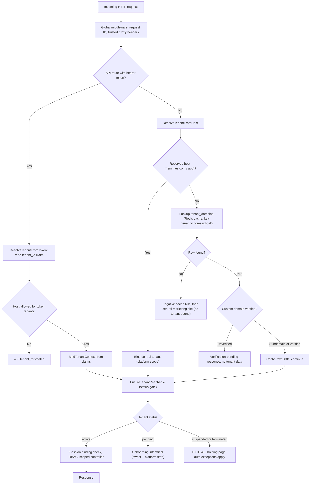
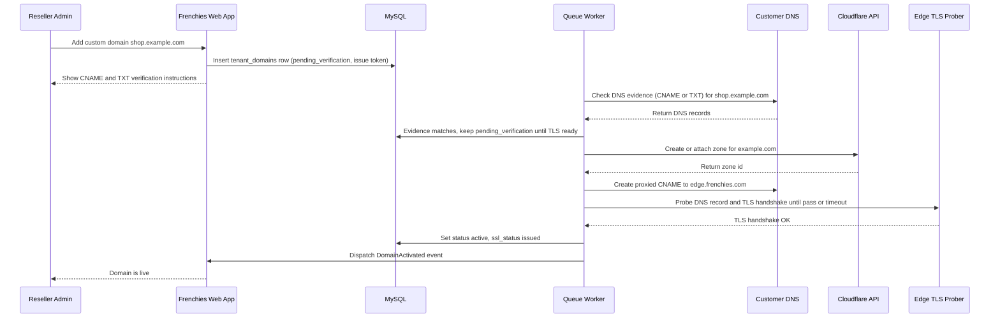

# Multi-Tenancy Architecture

| Field | Value |
|---|---|
| Document | 04-multi-tenancy-architecture.md |
| Version | 1.0 |
| Status | Draft for Review |
| Date | 2026-11-01 |
| Owner | Product & Architecture Team |
| Related documents | 03-functional-requirements.md, 05-reseller-hierarchy.md, 07-billing-and-financial-architecture.md, 08-affiliate-and-commission-system.md, 13-database-design.md, 15-user-workflows.md, 17-security-requirements.md, 18-non-functional-requirements.md, 22-open-questions-and-assumptions.md |

## Table of Contents

1. Purpose & Scope
2. Tenancy Model Rationale
3. Data Classification: Global vs Tenant-Owned vs Shared-Read
4. Tenant Identification & Resolution
5. TenantContext Container
6. Enforcement Layer
7. Tenant Lifecycle
8. Custom Domain Verification & SSL
9. Queue, Cache & Storage per Tenant
10. Migration, Export & Backup
11. Failure-Mode Analysis
12. Acceptance Criteria
13. Requirement Traceability
14. Assumptions & Open Questions
15. Appendix / References

---

## 1. Purpose & Scope

This document specifies the **architecture** of tenancy in Frenchies: how a tenant is identified,
bound, enforced, provisioned, suspended, and purged. It is the authoritative architectural
companion to the tenant *requirements* (FR-TENANT-* family) defined in `03-functional-requirements.md`;
requirement statements are not redefined here (see §13 for the traceability map).

In scope: tenancy model rationale, full data classification, request resolution, context
propagation (HTTP, queue, events), enforcement mechanisms, tenant lifecycle (create / suspend /
restore / delete), custom-domain verification and SSL, per-tenant queue/cache/storage behavior,
migration, export, backup, and failure-mode analysis.

Out of scope: reseller hierarchy mechanics (see `05-reseller-hierarchy.md`), money movement and
ledger (`07-billing-and-financial-architecture.md`), commission computation
(`08-affiliate-and-commission-system.md`), retention policy details
(`17-security-requirements.md`), and measurable NFR targets (`18-non-functional-requirements.md`).

---

## 2. Tenancy Model Rationale

### 2.1 What "tenant" means

Per charter §4, a **tenant is a business identity on the platform**. Exactly two kinds exist:

1. **The Central Platform tenant** — `tenants.slug = 'central'`, `tenants.type = 'platform'`.
   Owned by the platform company; creates central products; runs all operations; hosts all
   platform staff users (Super Admin, Platform Admin, Finance Admin, and central-only roles).
2. **Reseller tenants** — `tenants.type = 'reseller'`. One per approved reseller business,
   including every sub-reseller (sub-resellers are FULL tenants, not lightweight child records).

A tenant owns its users, customers, orders, storefront, branding, support data, wallets, and
integrations. A **human** may hold accounts in multiple tenants, but these are separate accounts
with no merging in MVP; a **user** belongs to exactly one tenant.

### 2.2 Chosen model: shared database + shared schema, row-level isolation

Frenchies runs a **single MySQL 8 database with a single shared schema**. Every tenant-scoped
table carries a `tenant_id` column, and isolation is enforced at the application layer via:

- a **mandatory `BelongsToTenant` trait** that attaches a global scope to every tenant-owned
  Eloquent model (§6.1),
- a **per-request `TenantContext` container** bound by middleware (§5),
- **enforced conventions** for cache keys, storage prefixes, sessions, queue payloads, and
  Reverb channels (§6, §9).

### 2.3 Why not database-per-tenant

| Consideration | Database-per-tenant | Shared schema (chosen) |
|---|---|---|
| Cross-tenant platform operations | Every report, reconciliation, or support view must fan out across N connections/databases | Single query path; platform staff use audited cross-tenant services |
| Operational overhead | N schemas to migrate, back up, monitor, and restore; cost grows linearly per reseller sign-up | One schema; one migration run; one backup stream |
| Resellers-as-tenants scale | Thousands of reseller tenants make per-tenant databases operationally infeasible for this team | Tenant count is a row-count, not an infrastructure unit |
| Isolation strength | Strongest physical isolation | Application-level isolation (weaker, mitigated by enforcement layer + tests, §11) |
| Cross-tenant joins (hierarchy rollups, ledger) | Impossible or via federation | Native (closure-table and ledger queries, `05` / `07`) |

The decision accepts a weaker isolation boundary in exchange for operational simplicity and
cross-tenant product behavior (hierarchy rollups, centralized finance) that the business model
requires. The mitigations for the weaker boundary are the core of §6 and §11.

### 2.4 Why not stancl-style strict domain tenancy as the primary model

`stancl/tenancy` (strict domain-based tenancy, typically with per-tenant database/data-disk
units and tenant-scoped config) was evaluated and rejected as the default because:

1. **Platform staff must cross tenants.** Finance Admin, Support Manager, and Super Admin
   workflows (reconciliation, ticket queues, tenant approval) span many tenants per screen.
   Strict domain tenancy optimizes for "one tenant per request" and makes cross-tenant views
   second-class; our model makes them explicit, permissioned, and audited services.
2. **Resellers are tenants at high cardinality.** Every sub-reseller is a full tenant
   (charter §4). Strict tenancy packages usually assume a modest tenant count with heavy
   per-tenant provisioning; our design provisions a tenant as rows, not infrastructure.
3. **Single-ops overhead.** The charter mandates a monolith with no extra services. A
   purpose-built lightweight layer (middleware + global scopes + context container) is a few
   hundred lines of framework code, no package lock-in, and keeps tenant config in our own
   tables (`tenants`, `tenant_settings`) where white-label fields already live.
4. **Hybrid access patterns.** Storefront traffic is strictly domain-scoped, but machine access
   (API tokens) is token-scoped, and platform tooling is permission-scoped. A hand-rolled
   resolution pipeline (§4) can express all three precedence rules directly; stancl's pipeline
   is domain-first.

`stancl/tenancy` remains a candidate only if the enforcement layer fails its security
acceptance gates at scale — tracked as a local open question (§14), not a default.

### 2.5 Consequences accepted

- Row-level isolation is only as strong as the enforcement layer; every tenant-owned model MUST
  use `BelongsToTenant` and CI/static checks back this (§6).
- Large-tenant table growth affects all tenants (shared indexes, shared buffer pool); mitigated
  by ordinary MySQL operations plus expand-contract migrations (§10).
- A leaked `where tenant_id = ?` omission is a P0-class defect; §11 lists this vector family
  explicitly with detection controls.

---

## 3. Data Classification: Global vs Tenant-Owned vs Shared-Read

Every canonical table from charter §6 is classified below. The database document
`13-database-design.md` is authoritative for columns/types/indexes; this classification is
authoritative for **isolation semantics**.

**Legend (classification marks):**

- **global** — no row-level tenant isolation; platform-managed; single row or shared rows.
- **tenant-owned** — `tenant_id` isolation mandatory; `BelongsToTenant` global scope applied;
  reads/writes constrained to the bound tenant.
- **shared-read** — global or central-owned rows exposed read-only to tenants; tenants can
  never mutate them.
- Composite marks (`global (ownership)`, `tenant-owned + central`, …) are allowed and defined
  inline in the Notes column.

### 3.1 Framework / identity

| Table | Classification | Isolation key / rule | Notes |
|---|---|---|---|
| `users` | tenant-owned | `users.tenant_id` | Platform staff users belong to the central tenant; may be granted cross-tenant access (§4.6). |
| `sessions` | tenant-owned | session payload carries `tenant_id` | Database session driver rows tagged; Redis session store used in production carries the same binding (§6.6). |
| `login_activities` | tenant-owned | `tenant_id` | Login audit per tenant. |
| `user_invitations` | tenant-owned | `tenant_id` | Invitation scoped to inviting tenant; RBAC teams = tenant. |
| `roles` | tenant-owned (team-scoped) | spatie teams feature, `teams = tenant` | Roles created per tenant within the platform permission catalogue subset. |
| `permissions` | global / shared-read | none | Platform-defined permission catalogue; tenants read, never write. |
| `model_has_roles` | tenant-owned (team-scoped) | `team_id` = tenant id | Role assignment never crosses tenants. |
| `model_has_permissions` | tenant-owned (team-scoped) | `team_id` = tenant id | Direct permission grants, same rule. |
| `role_has_permissions` | tenant-owned (via role's team) | via parent role's team | Permission grants of a team-scoped role. |
| `cache` | global (infrastructure) | key prefix convention (§6.5) | No `tenant_id` column; isolation is by key namespace. |
| `jobs` | global (infrastructure) | payload carries `tenant_id` (§5.3) | Queue transport table. |
| `failed_jobs` | global (infrastructure) | payload retains `tenant_id` | Failed job records keep tenant attribution for purge/resume. |

### 3.2 Tenancy & reseller

| Table | Classification | Isolation key / rule | Notes |
|---|---|---|---|
| `tenants` | global | n/a (self-referencing registry) | Readable by resolution layer; mutations are lifecycle operations (§7). |
| `tenant_domains` | global (platform-managed registry) | host lookup | Tenants propose domains; only platform-side verification flags make them resolvable (§8). |
| `tenant_settings` | tenant-owned | `tenant_id` | White-label settings, currency, locale, feature flags. |
| `resellers` | tenant-owned | `tenant_id` (1:1 with reseller tenant) | Business profile; hierarchy adjacency mirror `parent_reseller_id` (`05`). |
| `reseller_hierarchy` | global (cross-tenant structure) | both endpoints are tenant-owned resellers | Visibility governed by hierarchy rules in `05-reseller-hierarchy.md`; not readable by ordinary tenant scopes. |

### 3.3 Catalog

| Table | Classification | Isolation key / rule | Notes |
|---|---|---|---|
| `categories` | global / shared-read | none | Platform taxonomy; tenants read for browse/filter. |
| `products` | global (ownership) | `owner_tenant_id` | Central OR reseller owned; ownership ≠ distribution. Visibility to a selling reseller requires a `tenant_products` grant. |
| `product_variants` | global (ownership via product) | via `products.owner_tenant_id` | Owned rows follow the parent product. |
| `product_media` | global (ownership via product) | via parent product | Media objects on S3 under the owner tenant's prefix. |
| `product_packages` | global (ownership via product) | via parent product | Bundle definitions. |
| `package_items` | global (ownership via product) | via parent product | Bundle line items. |
| `product_addons` | global (ownership via product) | via parent product | Addon definitions. |
| `product_addon_links` | global (ownership via product) | via parent product | Product ↔ addon grants. |
| `product_pricing` | global (base) | via parent product | Base price list; reseller price overrides live in `tenant_products`. |
| `tenant_products` | tenant-owned (join) | `tenant_id` | Grants one reseller tenant the right to sell one product, with its own overrides and commission terms. |
| `product_demos` | global (ownership via product) | via parent product | Demo instances tied to product ownership. |
| `product_versions` | global (ownership via product) | via parent product | Versioned releases of a product. |
| `product_reviews` | tenant-owned (author) + shared-read (owner/platform) | `tenant_id` = reviewer's tenant | Product owner and platform can read reviews of their products across granting tenants; authors never leave their tenant. |
| `product_documents` | global (ownership via product) | via parent product | Docs/attachments per product. |

### 3.4 Customers & CRM

| Table | Classification | Isolation key / rule | Notes |
|---|---|---|---|
| `customers` | tenant-owned | `tenant_id` | End-buyers belong to the selling tenant (charter §4). |
| `customer_groups` | tenant-owned | `tenant_id` | Segment groups per tenant. |
| `customer_group_members` | tenant-owned | `tenant_id` | Membership rows. |
| `leads` | tenant-owned | `tenant_id` | CRM leads per tenant. |
| `lead_activities` | tenant-owned | `tenant_id` | Lead timeline. |
| `quotations` | tenant-owned | `tenant_id` | Quotes issued by the tenant. |
| `quotation_items` | tenant-owned | `tenant_id` | Quote line items. |

### 3.5 Orders & billing

| Table | Classification | Isolation key / rule | Notes |
|---|---|---|---|
| `carts` | tenant-owned | `tenant_id` | Cart belongs to the storefront tenant. |
| `cart_items` | tenant-owned | `tenant_id` | Cart line items. |
| `coupons` | tenant-owned | `tenant_id` | Central-issued platform coupons are rows of the central tenant. |
| `orders` | tenant-owned | `tenant_id` = selling tenant | Selling reseller per charter §4. |
| `order_items` | tenant-owned | `tenant_id` | Order lines. |
| `taxes` | global / shared-read | none | Platform-configured GST tax definitions; tenants read. |
| `invoices` | tenant-owned (+ central) | `tenant_id` | Central platform sales are central-tenant rows; white-label PDFs generated per tenant. |
| `invoice_items` | tenant-owned (+ central) | `tenant_id` | Invoice lines. |
| `payments` | tenant-owned (gateway attributes central) | `tenant_id` via order | Collected under central merchant accounts (charter §4); rows are attributed to the ordering tenant. |
| `payment_webhook_events` | global (gateway events, linked to tenant payment) | gateway + event id unique | Idempotency ledger (charter §7.10); platform-wide table, never tenant-filtered on ingest. |
| `refunds` | tenant-owned | `tenant_id` | Refund requests/postings per ordering tenant. |

### 3.6 Money

| Table | Classification | Isolation key / rule | Notes |
|---|---|---|---|
| `wallets` | tenant-owned | `tenant_id` | Reseller wallets; affiliate wallets are tagged with their tenant scope. |
| `wallet_transactions` | tenant-owned | `tenant_id` | Projection of ledger postings (charter §7.1–7.2); never hand-edited. |
| `journal_entries` | tenant-owned + central | `tenant_id` (central rows for platform postings) | Double-entry ledger is authoritative (charter §7.1). |
| `journal_lines` | tenant-owned + central | `tenant_id` | Ledger lines; balance checks are global integrity jobs. |
| `payouts` | tenant-owned | `tenant_id` | Reseller/affiliate payout requests; Finance Admin approval (central scope). |
| `commissions` | tenant-owned | `tenant_id` of beneficiary | Computation mechanics owned by `08-affiliate-and-commission-system.md`. |

### 3.7 Affiliate, subscription, fulfillment, support

| Table | Classification | Isolation key / rule | Notes |
|---|---|---|---|
| `affiliates` | tenant-owned | `tenant_id` | Affiliates are tenant-scoped and OUTSIDE the reseller hierarchy (charter §4). |
| `affiliate_links` | tenant-owned | `tenant_id` | Referral links/coupons. |
| `affiliate_clicks` | tenant-owned | `tenant_id` | Click tracking. |
| `subscription_plans` | global / shared-read | none | Platform-defined plans (incl. reseller plan limits, `05` §4.2); tenants read. |
| `subscriptions` | tenant-owned | `tenant_id` | A tenant's subscription to a plan. |
| `subscription_events` | tenant-owned | `tenant_id` | Lifecycle events (renew, grace, suspend). |
| `fulfillment_jobs` | tenant-owned | `tenant_id` via order | Fulfillment tasks per ordering tenant. |
| `fulfillment_events` | tenant-owned | `tenant_id` | Fulfillment timeline. |
| `licenses` | tenant-owned | `tenant_id` | License keys issued to tenant customers. |
| `license_activations` | tenant-owned | `tenant_id` | Activation records. |
| `sla_policies` | global (defaults) + tenant-owned (overrides) | `tenant_id` nullable | Platform defaults shared-read; tenant-specific overrides are tenant-owned rows. |
| `support_departments` | tenant-owned + central | `tenant_id` | Each tenant defines departments; central support runs its own. |
| `support_tickets` | tenant-owned | `tenant_id` | Tickets of the tenant's customers/staff. |
| `ticket_messages` | tenant-owned | `tenant_id` | Ticket threads. |

### 3.8 AI, communication, CMS, admin/API/integration

| Table | Classification | Isolation key / rule | Notes |
|---|---|---|---|
| `ai_agents` | tenant-owned | `tenant_id` | Per-tenant agents; usage billed to the tenant. |
| `ai_conversations` | tenant-owned | `tenant_id` | Conversations. |
| `ai_messages` | tenant-owned | `tenant_id` | Messages. |
| `ai_usage_logs` | tenant-owned | `tenant_id` | Usage metering for usage-based billing (P2). |
| `ai_knowledge_sources` | tenant-owned | `tenant_id` | Tenant knowledge bases; central-published shared sources = P2 extension. |
| `notification_templates` | tenant-owned + central (defaults) | `tenant_id` (central defaults cloned on provisioning, §7.2) | White-label emails/SMS per tenant. |
| `notification_logs` | tenant-owned | `tenant_id` | Outbound message log. |
| `website_themes` | tenant-owned + central (system themes, shared-read) | `tenant_id` nullable for system themes | Tenants customize a clone of a system theme. |
| `website_pages` | tenant-owned | `tenant_id` | Storefront pages. |
| `website_menus` | tenant-owned | `tenant_id` | Storefront menus. |
| `media_library` | tenant-owned | `tenant_id` | Object keys under the tenant storage prefix (§6.4). |
| `platform_settings` | global | none | Single-row platform configuration. |
| `audit_logs` | global (tenant-tagged rows) | `tenant_id` present; platform reads all, tenant admins read own | Impersonation and bypass events mandatory here (§4.6, §6.2). |
| `api_keys` | tenant-owned | `tenant_id` | Keys issued by a tenant for its integrations; central keys are central rows. |
| `api_webhooks` | tenant-owned | `tenant_id` | Outbound webhook subscriptions. |
| `webhook_deliveries` | tenant-owned | `tenant_id` | Delivery attempts/logs. |
| `integration_connections` | tenant-owned | `tenant_id` | n8n, WhatsApp, gateway credentials references (secrets in env/vault, never DB plaintext). |

**Global rules derived from this classification:**

- R1: Any NEW table added by `13-database-design.md` MUST be classified here or in doc 13's
  additions section before implementation.
- R2: Global/shared-read tables are exposed to tenants through read-only endpoints; no tenant
  role (including Reseller owner) may mutate them.
- R3: Mixed tables (`tenant-owned + central`) are always queried with an explicit `tenant_id`
  predicate — including for central rows (`tenant_id = central`) — never "no where clause".

---

## 4. Tenant Identification & Resolution

### 4.1 Hosts and domain types

| Host pattern | Tenant | Resolution |
|---|---|---|
| `frenchies.com`, `www.frenchies.com` | central (platform marketing + central storefront) | Reserved host table (config), never tenant DNS lookup |
| `app.frenchies.com` | central | Platform console (staff + reseller dashboards entry) |
| `api.frenchies.com` | from token claims (§4.5) | API host; host never implies tenant by itself |
| `<slug>.frenchies.com` | wildcard subdomain tenant | `tenants.slug` = first label, auto-mirrored in `tenant_domains` |
| Verified custom domain (e.g., `shop.example.com`) | owning reseller tenant | `tenant_domains` exact-host lookup, `is_verified = 1` |

### 4.2 Middleware pipeline (deterministic order)

| # | Middleware | Responsibility |
|---|---|---|
| 1 | Global HTTP kernel | Request ID, trusted proxies (Cloudflare), config bootstrapping |
| 2 | `ResolveTenantFromToken` (API routes only) | If a Sanctum bearer token is present, resolve `tenant_id` from token claims; host must then match the token tenant's domains or the API host, else 403 `tenant_mismatch` |
| 3 | `ResolveTenantFromHost` (all other routes) | Normalize host (lowercase, strip port); reserved hosts → central; otherwise `tenant_domains` exact lookup with Redis cache; subdomain fallback by `tenants.slug`; custom domains honored ONLY when status is `active` (verified); not found → the request falls
through to the central marketing site with NO tenant context bound (FR-TENANT-003); tenant
paths on unknown hosts render the marketing site's 404 |
| 4 | `EnsureTenantReachable` | Status gate (§7.1): `active` → pass; `pending` → onboarding interstitial (owner + platform staff only); `suspended` → HTTP 410 holding page, ALL tenant logins blocked with sessions revoked (FR-TENANT-012) with exactly two exceptions — the owner may access the read-only financial-history portal and platform staff may impersonate (§4.6); `terminated` → all access blocked; API → 403 `tenant_suspended` |
| 5 | `BindTenantContext` | Instantiate `TenantContext` in the container (§5), set request attributes, warm tenant settings cache |
| 6 | `ValidateSessionTenantBinding` | Session payload `tenant_id` must equal the resolved tenant; mismatch → session invalidated, re-login required (multi-account humans get separate sessions, charter §4) |
| 7 | Route middleware (`auth`, `can`, RBAC teams) | spatie roles with `teams = tenant`; permission checks against the bound tenant team |
| 8 | Controller / service layer | All queries flow through `BelongsToTenant` models or audited platform services (§6) |

**Resolution precedence (strict):** token claims (machine API) > host resolution (browser).
A browser session never inherits a tenant from a token, and an API request never silently falls
back to host-derived tenancy when a token is present.

### 4.3 HTTP request lifecycle



### 4.4 Caching of resolution

- Positive lookups cached in Redis as `tenancy:domain:{host}` → JSON `{tenant_id, status,
  domain_type, slug}`, TTL 300 s.
- Negative lookups cached as `tenancy:domain:none:{host}` → TTL 60 s (limits DNS-probe noise
  and host-header scanning).
- All lifecycle events (verify, suspend, restore, purge) invalidate the affected host keys
  synchronously before the status change is visible (§7).

### 4.5 Machine access (API tokens)

- Inbound API authentication is Laravel Sanctum personal access tokens, minted **inside a
  tenant context**, and carry a `tenant_id` claim (custom ability payload).
- Token scope is read/write plus granular abilities; a token can never elevate to cross-tenant.
- Cross-tenant machine access (central automation) uses service-account tokens bound to the
  central tenant plus the audited platform services of §6.2.
- `api_keys` (table §3.8) is for keys a tenant issues to ITS integrations; inbound platform
  API access is Sanctum-only in MVP.

### 4.6 Tenant impersonation (platform staff)

Purpose: Super Admin, Platform Admin, Support Manager (with grant) investigate tenant-scoped
issues by temporarily operating inside a tenant's context. This is the architectural
implementation of FR-TENANT-020 (explicit cross-tenant context switch, active tenant always
displayed in the UI chrome, foreign-tenant writes audited with actor and tenant).

**Rules:**

1. Permission `platform.tenant.impersonate` (central team) is required; Support Agents never
   hold it by default.
2. Starting impersonation REQUIRES a free-text reason (minimum 10 characters) captured from
   the operator.
3. Start writes `audit_logs` row `impersonation.started` (actor user id, tenant id, reason,
   IP, request id) BEFORE the context switch is applied; if the audit write fails, the
   impersonation is refused (fail-closed).
4. `TenantContext` is switched to the impersonated tenant; the session stores an
   `impersonator` flag; the UI renders a persistent banner with tenant name and a
   "Stop impersonating" action. Only one level of impersonation is ever active.
5. All writes performed while impersonating are logged with BOTH `actor_user_id` and
   `impersonator_user_id` in `audit_logs`.
6. Forbidden while impersonating: financial override actions (refunds beyond threshold,
   payout approvals, ledger adjustments), role/permission grants to the impersonator's own
   account, tenant deletion. These require the real (non-impersonated) central session.
7. Stop writes `impersonation.ended` and restores the central context; idle expiry after
   30 minutes forcibly stops with the same audit event (assumption, §14).
8. Revoke-all: Super Admin can invalidate all active impersonation sessions platform-wide.

---

## 5. TenantContext Container

### 5.1 Contract

`TenantContext` is a request/job-scoped container instance (never a static global) exposing:

| Member | Semantics |
|---|---|
| `get(): ?TenantInfo` | Immutable snapshot (id, slug, type, status, default currency, plan id) or `null` in platform scope |
| `id(): int` | Tenant id; **throws `TenantContextMissingException` when absent** (forbidden state — see §5.2) |
| `isPlatform(): bool` | True only for explicit central-platform scope |
| `assertActive(): void` | Throws if status is not `active`; used by write paths |
| `is(int $tenantId): bool` | Comparison helper for authorization checks |

`TenantInfo` is a read-only value object. It is hydrated once per request/job from the
resolution step and refreshed only by lifecycle transitions in the same process.

### 5.2 Safe defaults and forbidden state

- **Safe default:** anything that legitimately runs without a tenant (marketing pages, auth
  routes, platform console) uses `get()` and must handle `null`. Models with
  `BelongsToTenant` return **zero rows** when no context is bound (scope matches nothing) —
  the default is "see nothing", never "see everything".
- **Forbidden state:** code that REQUIRES a tenant (storefront controllers, tenant-scoped
  services, tenant jobs) calls `id()` / `assertActive()` and fails fast with a 500-class
  `TenantContextMissingException` (mapped to a 404 storefront error page in production).
  Silent fall-through to central tenancy is a defect.
- There is no "default tenant" for ambiguous calls. A missing context is an error, not central.

### 5.3 Queued jobs: serialization rules

Every job that operates on tenant data MUST:

1. Implement `ShouldQueue` (as all queued jobs do) **and** carry an explicit `tenant_id`
   property serialized into the queue payload at dispatch time (captured from the dispatching
   context; platform jobs set it to `null` explicitly via a `withoutTenant()` dispatch API).
2. Apply the `TenantQueueMiddleware`, which on **processing**:
   - loads the tenant by id; if missing (purged) → fail the job with reason `tenant_gone`
     (lands in `failed_jobs`, excluded from retry),
   - if found but not `active` → NON-CRITICAL jobs are parked per FR-TENANT-010:
     `release` with a 300 s delay up to 24 releases, then park as
     `tenant_suspended_parked`; jobs classified CRITICAL for financial settlement (ledger
     posting, commission capture, payment reconciliation, refund posting) still execute after
     an active-tenant check; a restore-triggered reconciliation job re-dispatches parked
     jobs (§7.4, assumption §14),
   - binds `TenantContext` before `handle()` and clears it after.
3. Never capture the ambient context implicitly in constructors of other services; the
   middleware-established context is the only runtime context inside `handle()`.
4. Tag every job with `tenant:{id}` for Horizon visibility (§9.1).

### 5.4 Events and listeners

- Domain events that concern one tenant implement a `HasTenantContext` payload contract
  carrying `tenant_id` (e.g., `OrderPaid`, `TicketCreated`).
- **Synchronous listeners** inherit the ambient context of the dispatching process.
- **Queued listeners** behave exactly like tenant jobs (§5.3): payload carries `tenant_id`,
  middleware restores context.
- Platform-wide events (e.g., `PlanChanged`, `PlatformSettingUpdated`) carry `tenant_id = null`;
  listeners MUST handle `null` by fanning out per tenant via queued jobs, never by assuming a
  bound context.
- Context never propagates through cache values, serialized sessions, or HTTP payloads; only
  ids travel.

---

## 6. Enforcement Layer

### 6.1 `BelongsToTenant` global scope (mandatory)

- Every model mapped to a **tenant-owned** table (§3) MUST use the `BelongsToTenant` trait,
  which is the mechanism implementing the isolation guarantee and fail-loudly rule of
  FR-TENANT-006 (proven by the automated cross-tenant CI suite):
  - boots a `TenantScope` global scope: `where tenant_id = TenantContext::id()` (or the
    central id when the platform tenant is explicitly bound); with no context bound the
    scope matches nothing;
  - sets `tenant_id` automatically on `creating` from the bound context;
  - REJECTS (throws) attempts to set `tenant_id` to a value different from the bound context —
    cross-tenant writes require the platform service path of §6.2.
- Models on **global** tables MUST NOT use the trait (a scope on `tenants` or `products`
  would break resolution); classification §3 is the allow/deny list for the trait.
- Acceptance test suite asserts, per model class, that the trait is present/absent per §3
  (a reflection-based test; fails CI on drift).

### 6.2 Soft-scope bypass policy

Global scopes may be removed ONLY through the audited bypass helper, and ONLY from
`app/Services/Platform/` classes holding permission `platform.cross_tenant_read`:

- The helper requires a reason string and writes an `audit_logs` row
  (`scope.bypass`, query hash, table, reason, actor) for every invocation.
- Call sites carry an inline marker comment `TENANCY-BYPASS: <reason> <ticket-id>`.
- Code review policy: any `withoutGlobalScope` / `withoutGlobalScopes` outside the helper is
  a **blocking review finding**; the same applies to `DB::table(...)` on tenant-owned tables.
- Cross-tenant AGGREGATE reporting (Finance, Platform Admin dashboards) goes through dedicated
  report services that select explicit columns and never expose row-level PII across tenants.

### 6.3 Query-builder guardrails

- Raw DB access to tenant-owned tables must use the `TenantQuery` wrapper, which demands
  either a bound context or an explicit `forTenant(id)` call inside platform services.
- CI grep gate: `DB::table(` occurrences are flagged; only files on a reviewed allowlist
  (framework internals) pass.
- P2 hardening: a custom PHPStan rule enforces trait presence on models and detects raw
  queries on tenant tables (assumption §14).

### 6.4 Storage scoping (S3-compatible)

- All tenant objects live under `tenants/{tenant_id}/...` prefixes on the tenant disk; central
  assets under `platform/...`. `media_library` rows store the full object key.
- Presigned URLs are generated only by a helper that requires a bound context and validates
  the key prefix against it; direct key manipulation in controllers is a review blocker.
- Bucket versioning + lifecycle per prefix is described in §10.3.

### 6.5 Cache key prefixes

- Tenant cache keys MUST be built as `t:{tenant_id}:{domain}:{key}` via the cache helper;
  global keys as `g:{domain}:{key}` (optionally versioned: `g:{domain}:v{n}:{key}`).
- Storing any tenant-derived value under an unprefixed key is a P0 review blocker.
- Sensitive values (PII, tokens) are never cached; cache holds derived/serializable data only.

### 6.6 Session scoping

- The session payload records `tenant_id` at login (charter §4: one account per tenant).
- `ValidateSessionTenantBinding` (§4.2 #6) rejects sessions whose tenant differs from the
  host-resolved tenant; switching tenants requires a fresh login in MVP (no account merging).
- Logout clears the session server-side; suspension invalidates all sessions of that tenant
  via a version bump key checked by the binding middleware.

### 6.7 Reverb channel authorization

| Channel pattern | Who may subscribe | Check |
|---|---|---|
| `tenant.{id}.user.{userId}` | That user, same tenant | Session/token tenant == channel tenant AND user id match |
| `tenant.{id}.storefront` | Anonymous storefront visitors of that tenant | Request host resolves to the channel tenant |
| `tenant.{id}.support.{ticketId}` | Ticket participant in that tenant | Tenant match + ticket membership |
| `platform.staff` | Central staff with `platform.dashboard` | Central team role check |

Cross-tenant subscriptions are rejected at authorization time; no wildcard patterns are
granted to tenant channels. Channel authorization writes nothing to logs beyond rejections
rate-limited per connection.

---

## 7. Tenant Lifecycle

### 7.1 States

`tenants.status` uses the canonical enumeration from `03-functional-requirements.md` §6.1:

| Status | Meaning | Storefront | Login | Queues |
|---|---|---|---|---|
| `pending` | Row created; provisioning incomplete (or awaiting first reseller approval step) | Onboarding interstitial | Owner + platform staff only | Provisioning jobs run |
| `active` | Fully provisioned; storefront and panel operational | Live | Normal | Running |
| `suspended` | Administratively disabled (FR-TENANT-012) | HTTP 410 branded holding page | All tenant logins blocked + sessions revoked; owner read-only financial-history portal; platform staff via impersonation (§4.6) | Non-critical jobs parked; financial settlement completes (FR-TENANT-010) |
| `terminated` | Frozen for deletion/retention (FR-TENANT-014; P2 lifecycle) | HTTP 410 branded holding page | Platform staff only | Non-critical jobs stopped; cancelled at purge |

Lifecycle transitions: `pending → active`, `active ↔ suspended`,
`suspended|active → terminated` (freeze superseding suspension), then terminal purge after
the 90-day quarantine (§7.5). Every transition writes an `audit_logs` row
(`tenant.suspended`, `tenant.restored`, `tenant.terminated`, `tenant.purged`) with actor and
reason.

### 7.2 Create / provision

Provisioning is a two-phase operation (transactional core + post-commit side effects), driven
by a queued `ProvisionTenant` job so it is retryable and observable:

**Phase 1 — DB transaction (all-or-nothing):**

1. `tenants` row (slug, type `reseller` or `platform`, status `pending` or `active`).
2. `resellers` business profile row (reseller tenants) + `reseller_hierarchy` self row and
   ancestor path rows when created under a parent (see `05-reseller-hierarchy.md` §3.3).
3. Owner user + initial credentials workflow (invite email, no default passwords) + `Reseller`
   role via spatie teams (`team = tenant`), plus role assignments.
4. `tenant_settings` defaults: currency `INR`, timezone `Asia/Kolkata`, GST flags, feature
   flags per plan.
5. `tenant_domains` row for `{slug}.frenchies.com` (auto-verified wildcard subdomain).
6. Storefront skeleton: clone of the system default `website_themes` + starter `website_pages`
   and `website_menus` rows.
7. Default `notification_templates` cloned from central defaults (white-label headers).
8. Default wallets (`available` / `pending` / `commission` breakdowns per `07`).
9. `subscription` seeded per plan if the reseller flow requires it (see
   `03-functional-requirements.md`).

**Phase 2 — post-commit side effects (queued, idempotent):**

- Create the `tenants/{id}/` storage prefix (marker object), warm Redis domain cache, dispatch
  `TenantProvisioned` event (welcome email, onboarding tasks). A failed side effect retries
  via the queue; the tenant stays `pending` until provisioning completion is confirmed.

### 7.3 Suspend — effects table

| Surface | Effect on the suspended tenant | Effect on its hierarchy subtree (reseller tenants) |
|---|---|---|
| Storefront | HTTP 410 with branded holding page (FR-TENANT-012); checkout stopped; CDN cache purged for the tenant's hosts | Subtree storefronts become suspended via effective-status derivation (`05` §6) |
| Custom domains | Same 410 behavior; domain records retained | Same |
| Login | ALL tenant-user logins blocked and sessions revoked (FR-TENANT-012); exceptions: the owner may access the read-only financial-history portal, and platform staff act via impersonation (§4.6) | Child logins blocked read-only via effective status |
| API tokens | 403 `tenant_suspended` | Same for subtree |
| Queue jobs | Non-critical jobs (marketing, notifications, exports) parked (§5.3); financial settlement jobs (ledger, commissions, reconciliation) complete per FR-TENANT-010; reconciliation re-dispatches parked jobs on restore | Same |
| Notifications | Outbound sends suppressed (templates retained) | Same |
| Support | Existing tickets read-only; new tickets blocked at storefront portal | Same |
| Invitations / new sub-resellers | Blocked | Blocked for subtree |
| Reverb | New channel subscriptions rejected; existing connections closed | Same |

### 7.4 Restore

Restore sets `status = active`, invalidates host/domain caches, re-runs the custom-domain
verification job (in case DNS changed during suspension), re-dispatches parked jobs via the
reconciliation job, and reopens sessions/invitations. For hierarchy members, restore is
symmetric: when an ancestor is restored, members whose OWN status is `active` return to
effective-active (see effective-status derivation in `05` §6); members individually suspended
stay suspended.

### 7.5 Termination & purge

1. **Termination request** (Super Admin confirmation required per FR-RESELLER-019; a reseller
   owner may open a request that routes to platform review): status → `terminated` (freeze
   superseding suspension, FR-TENANT-014). Immediate: storefront 410, all logins blocked
   (platform staff only), non-critical jobs stopped, outbound sends stopped.
2. **90-day quarantine** (FR-TENANT-014): the tenant may export data (§10.2) and is restored
   by setting status back to `active` (same symmetric rules as §7.4) until quarantine ends.
   Exports remain available throughout.
3. **Purge** (queued, idempotent, resumable, chunked):
   - Cancel pending/parked jobs (`tenant_gone` reason).
   - Delete S3 objects under `tenants/{id}/`.
   - Anonymize PII: users, customers, CRM rows, ticket messages, AI conversations; `api_*`
     secrets revoked.
   - **Financial data is retained permanently in anonymized form** (orders, invoices,
     payments, commissions, payouts, ledger per FR-TENANT-014 / FR-RESELLER-019; counterparty
     PII stripped; tenant identity replaced by a stable anonymized reference; aggregate
     anonymized statistics kept for platform reporting). Retention windows and legal basis
     are owned by `17-security-requirements.md` — this document only guarantees the mechanism
     (rows are marked anonymized, never re-linkable to PII).
   - Delete `tenant_domains` rows; the host enters a **30-day cooldown** (FR-TENANT-019)
     before another tenant may verify it.
   - Delete/anonymize remaining tenant-owned rows per the retention matrix in
     `17-security-requirements.md`; write `tenant.purged` audit row.
4. **Verification:** a post-purge checklist job verifies zero remaining non-retained rows for
   the tenant id, zero S3 objects under the prefix, and reports failures to platform ops.

---

## 8. Custom Domain Verification & SSL

### 8.1 Verification method

Per FR-TENANT-004 a tenant may add **one custom domain** (plan-gated). The row starts
`pending_verification` and requires DNS evidence before `active`:

- **Subdomain hosts** (e.g., `shop.example.com`): CNAME to the edge target
  (`edge.frenchies.com`).
- **Apex domains**: TXT record at `_frenchies-verify.{domain}` with value
  `frenchies-domain-verification={token}` (256-bit token issued at add time).
- **HTML fallback** (re-verification of an already-pointing domain):
  `https://{domain}/.well-known/frenchies-verification.html` containing the token.

A queued `VerifyDomain` job performs the check (DNS resolution against 1.1.1.1 and 8.8.8.8
with retries; HTML via HTTPS GET through the edge). Evidence matches → the domain proceeds to
SSL readiness (§8.2) and then flips to `active`; evidence not found after the attempt window
→ `failed` with a visible reason in the reseller UI. Verification attempts are also
rate-limited to prevent the platform from being used as a DNS-probe oracle.

### 8.2 Cloudflare workflow for SSL

1. Cloudflare API token (env/vault) allows zone management for the platform account.
2. On verification: ensure a zone exists for the domain (created via API if absent; if the
   customer's domain is already on their own Cloudflare account, instruct the CNAME-setup
   path instead), add the record pointing the host to the edge (`edge.frenchies.com` CNAME,
   proxied).
3. Edge terminates TLS with Universal SSL; origin TLS uses a platform-managed origin
   certificate on Nginx (SSL mode Full (strict)).
4. The app never handles private keys of customer domains; the reseller only changes DNS.

### 8.3 Propagation checks and re-checks

- Post-setup job probes DNS (expected record present) and TLS (handshake succeeds) with
  exponential backoff for up to 24 hours; a CNAME-based domain flips to `active` within one
  verification cycle, target ≤ 15 minutes (AC-FR-TENANT-004).
- A **weekly re-check job** re-resolves every `active` custom domain, re-validates the
  verification evidence still exists (ownership continuity), and confirms TLS is healthy —
  together with automatic renewal monitoring this guarantees certificates never lapse while
  a domain is `active` (FR-TENANT-005). Failures flip state per §8.4 and notify the owner +
  platform ops.
- Propagation status is visible in the reseller UI (`Domain status` card).

### 8.4 States and failure handling

`tenant_domains.status` uses the canonical enumeration from `03-functional-requirements.md`
§6.1 (`pending_verification`, `active`, `failed`); SSL readiness is tracked separately in an
`ssl_status` sub-column so the three canonical statuses stay authoritative:

| Status / sub-state | Set when | Platform behavior |
|---|---|---|
| `pending_verification` | Row created; instructions shown | Host not resolvable; DNS instructions in the reseller UI |
| `pending_verification` (checking) | `VerifyDomain` job probing | Transient; verification cycle ≤ 15 min |
| `active`, `ssl_status = issued` | DNS evidence matched AND edge TLS handshake passes | Normal storefront serving |
| `failed` (reason: `evidence_not_found`) | Evidence not found after 72 h | Visible reason in UI; owner notified; retry resets to `pending_verification` |
| `failed` (reason: `ssl_failed`) | TLS probe failing > 48 h on an `active` domain → domain demoted to `failed` | Ops alert; edge error page served; re-run after fix |
| `failed` (reason: `reverification_failed`) | Weekly re-check lost the evidence for > 14 days | Domain demoted, resellers notified, ops alert |
| released (row removed) | Removed by owner/platform | 30-day cooldown (FR-TENANT-019) before another tenant may verify the host |

### 8.5 Custom domain connect flow (sequence)



Failure exits: token mismatch retries up to 72 h → `failed_verification`; TLS probe timeout
24 h → `ssl_failed`; every exit writes an ops notification and a UI status.

---

## 9. Queue, Cache & Storage per Tenant

### 9.1 Horizon tagging and dedicated queues

- Every tenant job is tagged `tenant:{id}` (plus module tag) via the queue middleware — Horizon
  dashboard filters throughput/failures per tenant; alerts fire on per-tag failure rate.
- **Noisy-neighbor control (MVP):** global queues are partitioned by module
  (`orders`, `notifications`, `tenancy`, `exports`); per-tenant rate limiting at dispatch
  (configurable max jobs/min/tenant, default 600) prevents one tenant flooding workers;
  per-tenant storefront request throttling (FR-TENANT-021) applies at the app/edge layer.
- **Dedicated high-volume tenant queue (P2):** tenants flagged `queue_mode = dedicated`
  (plan feature / admin flag) dispatch to `tenant-{id}` queues with their own Horizon
  supervision group and bounded worker count; promotion/demotion between shared and dedicated
  mode is an admin action with audit.

### 9.2 Cache invalidation blast radius

- R1: tenant events invalidate only `t:{tenant_id}:*` keys.
- R2: global changes (plans, permission catalogue, platform settings) bump a global version
  segment; keys embed the version. `Cache::flush()` is forbidden in application code.
- R3: suspension/deletion flushes `t:{id}:*` via a bounded SCAN + DELETE (never FLUSHDB);
  Redis DBs are strictly per-environment.
- R4: a unit test per feature asserts that a cache value written in tenant A's request is
  never read in tenant B's request (key-prefix regression net).

### 9.3 Storage economics

- Per-tenant prefixes (not per-tenant buckets in MVP) with S3 versioning and lifecycle rules
  on the bucket; cross-tenant object ACLs are impossible by construction (prefix enforced in
  the upload helper, §6.4). Bucket-per-tenant remains an enterprise option (OQ in §14).

---

## 10. Migration, Export & Backup

### 10.1 Migrations (single schema)

- All tenants share one schema; Laravel migrations run ONCE per environment (never per tenant).
- Zero-downtime discipline: expand-contract for column renames/type changes; large-table
  changes use online DDL where MySQL 8 supports it; backfills run as chunked, resumable
  tenant-aware jobs (iterate tenant ids, process N rows/batch with throttling).
- A migration touching tenant isolation semantics (new `tenant_id` column, new global scope)
  requires: classification row added to §3, trait added in the same PR, and a data backfill
  plan; merge is blocked on the reflection test (§6.1) passing.

### 10.2 Per-tenant data export (GDPR / DPDP)

- Platform admins trigger a full on-demand export for any tenant (FR-TENANT-015); a
  reseller-owner self-service request routed through the same job is an open question (§14).
- A queued `TenantExportJob` gathers entity groups (identity, catalog, CRM, orders, invoices,
  money ledger projection, support, AI conversations, CMS) into JSON + CSV files with a
  manifest (row counts, checksums, export id) zipped to
  `tenants/{id}/exports/{yyyy-mm-dd}/{export_id}.zip` (S3 versioning on).
- Download via signed URL (48 h validity per FR-TENANT-015), single-use, audited in
  `audit_logs` (`tenant.export_downloaded`). Retention of the export artifact: 30 days then
  lifecycle delete (assumption §14).
- Deletion requests (§7.5) must offer export first; the right-to-erasure flow is the purge
  pipeline with the financial-retention carve-out (§7.5, `17-security-requirements.md`).

### 10.3 Backup strategy

| Layer | Mechanism | Frequency | Retention |
|---|---|---|---|
| Full logical DB backup | Consistent dump (single-schema, all tenants) | Daily 02:00 IST | 30 days |
| Binary logs (binlog) | Point-in-time recovery via binlog shipping to S3 | Continuous, ship every 5 min | 14 days |
| Object storage | Bucket versioning + lifecycle | Continuous | Versioning: 90 days noncurrent |
| Per-tenant snapshot export | Tenant-filtered logical dump (FR-TENANT-016) | Monthly, automated | 30 days |

- Backups are platform-global (single schema); per-tenant restore is NOT provided in MVP —
  restore is whole-database PITR (assumption §14).
- Backup files land in a separate `platform/backups/` S3 prefix with separate credentials and
  object-lock (immutable) for the retention window.

### 10.4 Restore runbook (summary)

1. Declare incident; enable maintenance mode (writes blocked).
2. Choose PITR target (≤ 5 min RPO from binlog cadence — target NFRs in
   `18-non-functional-requirements.md`).
3. Restore DB snapshot to a staging instance; apply binlogs to target time; integrity checks
   (ledger balance invariants per `07`, closure-table integrity per `05`, tenant count).
4. Promote: swap, flush Redis (cache/queue/sessions), rebuild resolution cache lazily (it
   repopulates on first request), restart Horizon and Reverb.
5. Validate: smoke suite (resolution, login, checkout sandbox, queue drain), then disable
   maintenance mode; write `platform.restore` audit row; post-incident review.
6. Target: RTO ≤ 60 min for full restore (NFR owner: `18-non-functional-requirements.md`).

---

## 11. Failure-Mode Analysis

| # | Failure mode | Vector / impact | Mitigation | Detection |
|---|---|---|---|---|
| F1 | Orphaned tenant context in jobs | Tenant purged while jobs pending; job runs with stale context → wrong-tenant writes | `TenantQueueMiddleware` re-validates tenant existence/status per attempt; `tenant_gone` fails to `failed_jobs`; purge cancels queued jobs first (§7.5) | Parked/failed job counters by reason; purge checklist job |
| F2 | Cross-tenant read via missing scope | Model without `BelongsToTenant` or raw `DB::table` leaking rows | Mandatory trait + reflection test in CI; `TenantQuery` wrapper; code-review blocker on bypass | CI reflection test; review checklist; canary test that seeds two tenants and asserts isolation per module |
| F3 | Cross-tenant leakage in reports | Aggregate queries forgetting `tenant_id` on mixed tables | R3 rule (§3): always explicit predicate incl. central rows; audited bypass helper only | Report service tests assert no foreign-tenant ids in fixtures |
| F4 | Domain takeover after tenant deletion | Old custom domain still points at platform; a different tenant claims it and serves content on the victim's domain | 30-day domain cooldown after termination/purge (FR-TENANT-019); DNS evidence re-verification required for claimants; ownership re-check weekly (§8.3) | Cooldown violation test; re-check job alerts |
| F5 | Cache poisoning / key collision | Tenant data cached under unprefixed key; served to another tenant | Key helpers enforce prefixes; `Cache::flush()` forbidden; R1–R4 blast-radius rules (§9.2) | Per-feature cache isolation unit tests; code review |
| F6 | Session tenant mismatch | Human with accounts in two tenants reuses session cookie across hosts | Session carries `tenant_id`; binding middleware invalidates mismatched sessions (§6.6) | Integration test with two tenants, one browser profile |
| F7 | Reverb channel leakage | Subscriber listens to another tenant's notifications | Channel authorization rules (§6.7); no wildcards to tenant channels | Broadcast auth tests per channel pattern |
| F8 | Impersonation without audit / abuse | Staff reads or mutates tenant data untracked | Fail-closed audit on start; dual attribution on writes; forbidden-actions list; idle expiry (§4.6) | Audit completeness report; alert on impersonation events |
| F9 | Noisy neighbor on queues | One tenant floods shared queues → global latency | Dispatch rate limits per tenant; Horizon per-tag alerts; dedicated queues P2 (§9.1) | Horizon dashboards per tag; queue latency SLO alerts |
| F10 | Host-header injection | Forged Host header resolves to a tenant → content spoofing / cache poisoning | Exact-match host lookup only; reserved hosts; trusted-proxy config pinned to Cloudflare ranges; no fuzzy matching | Pentest case; negative-cache behavior tests |
| F11 | Partial purge (data left behind) | GDPR/DPDP violation; deleted tenant's data resurrects | Idempotent resumable purge steps; post-purge verification job; anonymized-retention carve-out explicit and audited | Purge checklist report; failed-step ops alert |
| F12 | Global-scope drift on new feature | New model ships without trait or with wrong classification | Classification table (§3) + reflection test (§6.1) gate CI | CI failure on drift |
| F13 | Resolution cache serving stale status | Suspended tenant still serving from cached domain row | Lifecycle events invalidate host keys synchronously BEFORE status visibility (§4.4) | Suspension e2e test asserts immediate 410 on all hosts |

---

## 12. Acceptance Criteria

```gherkin
Feature: Subdomain tenant resolution
  Scenario: Known subdomain resolves to its tenant
    Given a reseller tenant with slug "alpha" and status "active"
    When a GET request arrives for "alpha.frenchies.com/"
    Then the response is the alpha storefront
    And no data of any other tenant is present in the response
  Scenario: Unknown host serves only the central marketing site
    Given no tenant_domains row exists for "ghost.example"
    When a GET request arrives for "ghost.example/"
    Then the central marketing site is served with no tenant context bound
    And no data of any tenant is present in the response
    And the miss is negatively cached for 60 seconds
```

```gherkin
Feature: Suspended tenant containment
  Scenario: Storefront and jobs are contained
    Given tenant "beta" is active with pending queue jobs
    When the platform suspends "beta"
    Then every storefront host of "beta" returns HTTP 410 with the branded holding page
    And all tenant-user logins are blocked and sessions revoked
    And the owner may access the read-only financial-history portal
    And new API requests return 403 "tenant_suspended"
    And non-critical queued jobs for "beta" are parked
    And financial settlement jobs for "beta" still complete
    And an audit row "tenant.suspended" exists with actor and reason
  Scenario: Restore is symmetric
    Given tenant "beta" is suspended with parked jobs
    When the platform restores "beta"
    Then storefronts serve normally within 60 seconds
    And parked jobs are re-dispatched by the reconciliation job
```

```gherkin
Feature: Global scope isolation
  Scenario: Cross-tenant rows are invisible by default
    Given tenants "a" and "b" each have 3 customers
    And a request is bound to tenant "a"
    When the customers listing endpoint is called
    Then exactly 3 customers are returned, all belonging to "a"
```

```gherkin
Feature: Queued job context integrity
  Scenario: Job never leaks or loses tenant context
    Given a job was dispatched in tenant "a" context
    When it is processed by any worker
    Then TenantContext inside handle() is tenant "a"
    And on completion the context is cleared
    And if tenant "a" was purged, the job fails with reason "tenant_gone"
```

```gherkin
Feature: Impersonation audit trail
  Scenario: Impersonation is always attributable
    Given a platform admin with permission "platform.tenant.impersonate"
    When they start impersonating tenant "beta" with a reason
    Then an "impersonation.started" audit row exists before any tenant data is shown
    And the UI banner shows the impersonated tenant
    And every write during the session records both actor and impersonator
    And stopping the session writes "impersonation.ended"
```

```gherkin
Feature: Custom domain lifecycle
  Scenario: Unverified custom domain serves no tenant data
    Given reseller "gamma" adds domain "shop.example.com" without DNS records
    When a request arrives for "shop.example.com"
    Then the response contains no tenant content
  Scenario: Verified domain activates after DNS evidence and TLS
    Given the DNS evidence exists (CNAME to the edge target, or TXT token for apex)
    And the edge TLS handshake succeeds
    When the VerifyDomain job runs
    Then tenant_domains.status becomes "active"
    And the storefront serves over HTTPS
```

```gherkin
Feature: Termination grace and purge
  Scenario: Purge retains anonymized financial data only
    Given tenant "delta" is terminated (freeze)
    And the 90-day quarantine has elapsed
    When the purge job runs
    Then PII tables contain no rows for "delta"
    And orders, invoices, commissions, payouts and ledger entries exist in anonymized form
    And S3 objects under tenants/delta/ are deleted
    And the custom domain enters a 30-day cooldown
```

---

## 13. Requirement Traceability

FR-TENANT-* requirement statements are **owned by `03-functional-requirements.md`** (§6.2
catalog, FR-TENANT-001 … 022) and are not redefined here. This table maps the real IDs to
the architecture sections implementing them.

| FR ID (defined in doc 03) | Requirement topic (doc 03 is authoritative) | Architecture section |
|---|---|---|
| FR-TENANT-001 | Single seeded platform tenant | §2.1, §4.1 |
| FR-TENANT-002 | Atomic reseller-tenant provisioning at approval | §7.2 |
| FR-TENANT-003 | Host/token-based tenant resolution | §4 |
| FR-TENANT-004 | Custom domain add & DNS verification | §8.1, §8.4 |
| FR-TENANT-005 | Edge TLS automation, no cert lapse | §8.2, §8.3 |
| FR-TENANT-006 | Row-level isolation, fail-loudly, CI suite | §6.1, §12 |
| FR-TENANT-007 | Context propagation (HTTP, jobs, scheduled, events) | §5 |
| FR-TENANT-008 | Tenant-namespaced cache | §6.5, §9.2 |
| FR-TENANT-009 | Tenant-scoped storage, signed URLs | §6.4 |
| FR-TENANT-010 | Horizon tags; suspension halts non-critical jobs only | §9.1, §5.3, §7.3 |
| FR-TENANT-011 | Typed `tenant_settings` with schema registry | §3, §7.2 |
| FR-TENANT-012 | Suspension behavior | §7.3, §4.2 |
| FR-TENANT-013 | Restore | §7.4 |
| FR-TENANT-014 | Termination, 90-day quarantine, financial retention | §7.5 |
| FR-TENANT-015 | On-demand data export | §10.2 |
| FR-TENANT-016 | Nightly backups + monthly per-tenant snapshots | §10.3 |
| FR-TENANT-017 | Provisioning defaults, idempotent | §7.2 |
| FR-TENANT-019 | Slug immutability, domain cooldown | §7.5, §8.4 |
| FR-TENANT-020 | Explicit cross-tenant context switch, audited | §4.6, §6.2 |
| FR-TENANT-021 | Per-tenant storefront throttling | §9.1 |
| FR-RESELLER-016/017/019 | Reseller suspend/restore/terminate entry points | §7.3–§7.5 |
| FR-ADMIN (module in doc 03) | Platform operations & oversight | §4.6, §6.2 |

---

## 14. Assumptions & Open Questions

1. Status enums are now aligned with `03-functional-requirements.md` §6.1 (`pending`,
   `active`, `suspended`, `terminated` for tenants; `pending_verification`, `active`,
   `failed` for domains) plus a separate `ssl_status` sub-column — doc 13 finalizes columns.
2. Parked-job resume after restore: 24 releases at 300 s then park, resumed by a
   reconciliation job — numbers are defaults pending NFR tuning (doc 18). The
   critical/non-critical job classification list is agreed with `07-billing-and-financial-architecture.md`.
3. Impersonation idle expiry (30 min) and audit-before-context-switch ordering are defaults
   pending security review (doc 17).
4. The owner's read-only financial-history portal during suspension is this doc's
   architectural interpretation of FR-TENANT-012's "portal read-only financial history"
   carve-out; wording to be confirmed with doc 03/17.
5. Export artifact retention (30 days) is a default pending doc 17; reseller-owner
   SELF-service export (vs. platform-admin triggered per FR-TENANT-015) is an open question
   for doc 22.
6. RPO ≤ 5 min / RTO ≤ 60 min assumed from binlog cadence; NFR owner is doc 18.
7. Per-tenant logical restore is out of MVP; whole-DB PITR only — confirm with finance/doc 17.
8. Whether `stancl/tenancy` should be formally re-evaluated as a fallback is parked in doc 22.
9. `subscription_plans` carrying the sub-reseller limit attribute is coordinated with
   `05-reseller-hierarchy.md` §4.2 and `13-database-design.md`.

---

## 15. Appendix / References

- Charter: FRENCHIES PRD Authoring Charter v1.0 (§4 tenancy definition, §6 table inventory).
- `03-functional-requirements.md` — FR-TENANT-* statements (authoritative).
- `05-reseller-hierarchy.md` — closure table, effective-status derivation, visibility rules.
- `07-billing-and-financial-architecture.md` — ledger invariants referenced by restore checks.
- `13-database-design.md` — columns, indexes, FKs for all tables classified in §3.
- `17-security-requirements.md` — retention, impersonation security review, incident policy.
- `18-non-functional-requirements.md` — RPO/RTO, latency budgets for resolution path.

## Ratified P0 decisions (2026-11-20)

Decisions below are ratified in `22-open-questions-and-assumptions.md` §5; see that
section for ratifier, date and launch-gate caveats.

| OQ-020 | Custom domains use CNAME to platform edge + HTTP token ownership check + Cloudflare proxied edge SSL; nameserver transfer is an assisted upgrade; ACME DNS-01 deferred. `tenant_domains` stays provider-agnostic; §8 is now the ratified flow. |
