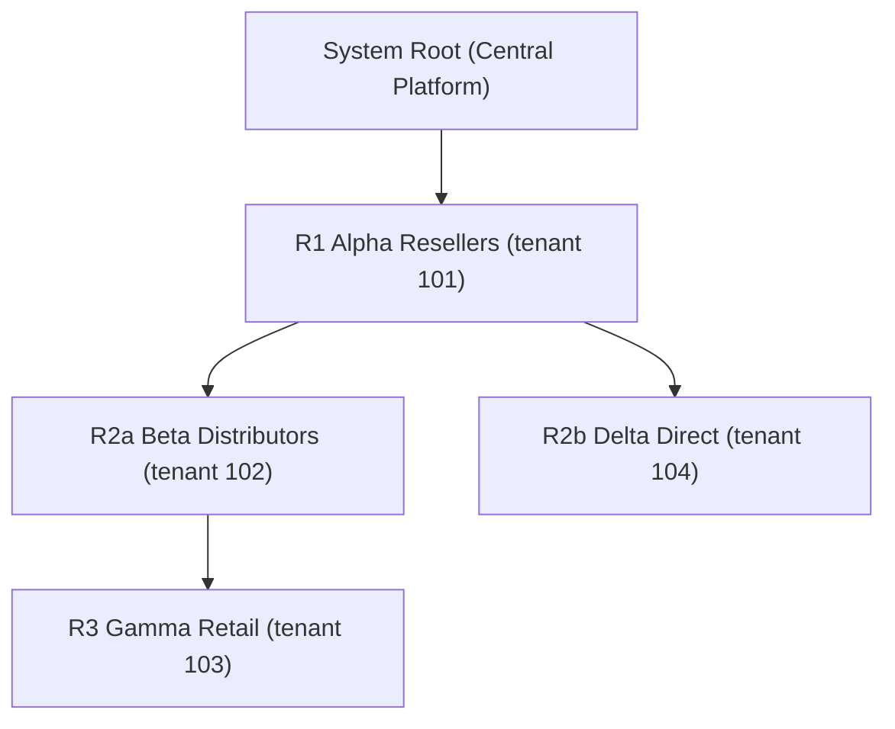

# Reseller Hierarchy Architecture

| Field | Value |
|---|---|
| Document | 05-reseller-hierarchy.md |
| Version | 1.0 |
| Status | Draft for Review |
| Date | 2026-11-01 |
| Owner | Product & Architecture Team |
| Related documents | 03-functional-requirements.md, 04-multi-tenancy-architecture.md, 07-billing-and-financial-architecture.md, 08-affiliate-and-commission-system.md, 13-database-design.md, 16-ui-ux-specification.md, 17-security-requirements.md, 22-open-questions-and-assumptions.md |

## Table of Contents

1. Purpose & Scope
2. Hierarchy Model
3. Closure Table Design
4. Creation & Invitation Flows
5. Visibility Rules Matrix
6. Suspension Cascades
7. Reparenting / Transfer
8. Deletion
9. Commission Interaction Summary
10. Performance Notes
11. Acceptance Criteria
12. Requirement Traceability
13. Assumptions & Open Questions
14. Appendix / References

---

## 1. Purpose & Scope

This document specifies the **architecture** of the multi-level reseller hierarchy: the data
structure (closure table), its invariants, write patterns, query recipes, visibility and
mutation rules between levels, suspension cascades, reparenting, deletion, and its
interaction with the commission engine. Reseller *requirements* (FR-RESELLER-* family) are
owned by `03-functional-requirements.md` and are referenced, not redefined (§12).
Commission computation details are owned by `08-affiliate-and-commission-system.md` (§9).

---

## 2. Hierarchy Model

### 2.1 Definitions

| Term | Definition (charter §4 + this doc) |
|---|---|
| Reseller | A business profile in `resellers`, attached 1:1 to a **reseller tenant** (`tenants.type = 'reseller'`). Every reseller, at any depth, is a FULL tenant with its own users, customers, storefront, catalog, wallets, and support. |
| Sub-reseller | A reseller whose `resellers.parent_reseller_id` points to the reseller that created/approved it. Sub-resellers are full tenants — the hierarchy is a *business* tree, not a data-containment tree. |
| Depth | Number of edges from the hierarchy root to the reseller. Root-level resellers created by the platform have depth 1 in business terms (see closure `depth = 0` self convention below; depth-1 children of the system root have closure depth 1). |
| System root | The Central Platform's participation in the tree: a system `resellers` row bound to the central tenant (`type = root`, non-loginable, immutable). It anchors the tree so every reseller has a complete ancestor path (assumption §13). |
| Ancestor / Descendant | Given closure rows, A is an ancestor of D if `(A, D, depth)` exists in `reseller_hierarchy` with `depth > 0`; A is the PARENT of D if that row has `depth = 1`. |

**Core rules:**

- Hierarchy depth is **unlimited** (schema- and business-wise); a UI soft-warning appears
  beyond 5 levels (§10).
- The tree has exactly one root (the system root). Resellers created directly by the platform
  hang off the root.
- A reseller's `tenant_id` never changes when it moves in the tree; reparenting changes only
  hierarchy pointers (§7).

### 2.2 Four-level example



Example closure rows (`reseller_hierarchy`) for this tree — R3 sits at business level 4:

| ancestor_reseller_id | descendant_reseller_id | depth | Meaning |
|---|---|---|---|
| CR | CR | 0 | Self |
| CR | R1 | 1 | R1 is child of root |
| CR | R2a | 2 | R2a is grandchild of root |
| CR | R3 | 3 | R3 is great-grandchild of root |
| CR | R2b | 2 | R2b is grandchild of root |
| R1 | R1 | 0 | Self |
| R1 | R2a | 1 | Direct child |
| R1 | R3 | 2 | Descendant via R2a |
| R2a | R2a | 0 | Self |
| R2a | R3 | 1 | Direct child |
| R3 | R3 | 0 | Self |
| R2b | R2b | 0 | Self |

### 2.3 Invariants

- I1: Every reseller has exactly one self row `(x, x, 0)`.
- I2: For every ancestor pair, exactly one row exists (uniqueness by PK).
- I3: Depth consistency: if `(A, D, d)` exists and `(D, X, e)` exists, then `(A, X, d + e)`
  exists. A periodic reconciliation job verifies sampled paths (§3.3).
- I4: `resellers.parent_reseller_id` (adjacency mirror) always agrees with closure
  `depth = 1` rows; both are written in the same transaction.
- I5: The system root has no parent; no reseller may be reparented onto a node in its own
  subtree (cycle prevention, §4.3).

---

## 3. Closure Table Design

### 3.1 Schema shape

`reseller_hierarchy(ancestor_reseller_id, descendant_reseller_id, depth)` — one row per
(ancestor, descendant) pair including self rows at `depth = 0`. Columns are unsigned BIGINT
FKs to `resellers(id)`; `depth` is an unsigned SMALLINT. Full column/index/FK specification
lives in `13-database-design.md` (this doc fixes the semantics). Charter §6 abbreviates the
columns as ancestor_id / descendant_id / depth — the fully-qualified names above are used
throughout this document (flagged §13).

### 3.2 Why a closure table (alternatives comparison)

| Criterion | Adjacency list (parent_id only) | Nested sets | Materialized path | Closure table (chosen) |
|---|---|---|---|---|
| Subtree members query | Recursive CTE per query | Cheap but range scans | `LIKE 'path%'` prefix scan | 1 indexed equality lookup + join |
| Depth / level query | Recursive CTE | Computed from set bounds | Path segment count | Read `depth` column |
| Path / breadcrumb | Recursive CTE | Tree walk | String parse | Ordered closure join |
| Aggregated rollups per ancestor | CTE per ancestor | Range per ancestor | Prefix per ancestor | Grouped join over closure |
| Insert of new leaf | O(1) | O(n) row rewrites, lock-heavy | O(subtree) path rewrite | O(depth) inserts |
| Reparent of a subtree | O(1) | O(n) rewrites | O(subtree) rewrite | Delete + reinsert O(ancestors x subtree), chunked |
| Unlimited depth | Yes | Yes but expensive | Yes | Yes |

Frenchies workloads are **read-heavy** (dashboards, rollups, commission chain lookups at
order capture) and **write-light** (reseller creation and reparenting are rare, administrative
events). The closure table optimizes exactly that profile; nested-set rewrites and per-query
recursive CTEs are rejected. Materialized paths remain the documented fallback if closure
write volume ever grows (OQ §13), but lose on multi-ancestor rollups.

### 3.3 Write patterns

**Create (new child N under parent P)** — single transaction:

1. Lock the parent row (`SELECT ... FOR UPDATE`) to serialize concurrent children creation.
2. Insert the `resellers` row with `parent_reseller_id = P` (I4).
3. Insert closure rows: `(N, N, 0)` plus `(a, N, depth(a, P) + 1)` for every ancestor `a` of
   P including P itself (one multi-VALUES INSERT of depth + 1 rows; bounded by tree depth,
   typically < 50 rows even at extreme depth).
4. Increment the parent's child counter atomically (plan-limit guard, §4.2).

**Reparent (move subtree of N under new parent T)** — single transaction, platform-admin only
(§7):

1. Ordered advisory locks on N and T (`GET_LOCK` in ascending id order — deadlock-safe).
2. Re-validate cycle condition and target status inside the transaction (§7.3).
3. Delete all rows where `descendant_reseller_id IN (subtree(N))` AND
   `ancestor_reseller_id NOT IN (subtree(N))` (i.e., every path that left the subtree via N).
4. Reinsert for every `a ∈ {ancestors(T) ∪ T}` and every `d ∈ subtree(N)`:
   `(a, d, depth(a, T) + 1 + depth(N, d))`. Inserted in chunked multi-VALUES batches
   (≈ 500 rows/batch) inside the same transaction to keep statements lock-bounded.
5. Update `resellers.parent_reseller_id` of N to T (I4) and adjust child counters of old/new
   parents.
6. Write `audit_logs` row with before/after materialized paths of N (§7.4).

**Reconciliation job (weekly):** samples random resellers and re-verifies I3 by recomputing
depths along the path; any mismatch raises an ops alert with the offending rows.

### 3.4 Indexes and constraints

| Object | Definition | Serves |
|---|---|---|
| PK | `(ancestor_reseller_id, descendant_reseller_id)` | Uniqueness (I2), direct-pair lookups, self-row existence |
| Index `reseller_hierarchy_descendant_idx` | `(descendant_reseller_id)` | Path/breadcrumb queries ("all ancestors of X") |
| Index `reseller_hierarchy_depth_idx` | `(ancestor_reseller_id, depth)` | Children-only (`depth = 1`) and level queries |
| FK | `ancestor_reseller_id → resellers(id)` | Referential integrity; RESTRICT on delete (purge removes closure rows explicitly, §8) |
| FK | `descendant_reseller_id → resellers(id)` | Same |
| Check | `depth >= 0` | Sanity |

Cycle prevention cannot be expressed as a DB constraint on a closure table; it is enforced by
service-layer validation inside the locking transaction plus the weekly reconciliation job
(§4.3, §7.3).

### 3.5 Query recipes (SQL sketches — documentation only)

Subtree members with depth (ordered):

```sql
SELECT r.*, h.depth
FROM reseller_hierarchy h
JOIN resellers r ON r.id = h.descendant_reseller_id
WHERE h.ancestor_reseller_id = :node
ORDER BY h.depth, r.id;
```

Direct children only:

```sql
SELECT r.*
FROM reseller_hierarchy h
JOIN resellers r ON r.id = h.descendant_reseller_id
WHERE h.ancestor_reseller_id = :node AND h.depth = 1;
```

Depth of a node under an ancestor:

```sql
SELECT depth FROM reseller_hierarchy
WHERE ancestor_reseller_id = :ancestor AND descendant_reseller_id = :node;
```

Path / breadcrumb (root → node):

```sql
SELECT a.id, a.name, h.depth
FROM reseller_hierarchy h
JOIN resellers a ON a.id = h.ancestor_reseller_id
WHERE h.descendant_reseller_id = :node
ORDER BY h.depth DESC;
```

Aggregated subtree rollup (orders count + GMV per ancestor — platform/parent dashboards,
read-only):

```sql
SELECT h.ancestor_reseller_id, COUNT(o.id) AS order_count, SUM(o.total_amount) AS gmv
FROM reseller_hierarchy h
JOIN orders o ON o.tenant_id = h.descendant_reseller_id AND o.status <> 'cancelled'
WHERE h.ancestor_reseller_id IN (:ancestor_a, :ancestor_b)
GROUP BY h.ancestor_reseller_id;
```

All sketches assume query-level tenant permissions are enforced by the caller's authorization
layer (platform services or the parent's read-only rollup service, §5); the closure table
itself is not exposed through any tenant-owned model scope (`04` §3.2).

---

## 4. Creation & Invitation Flows

FR-RESELLER-* statements (registration, invitation, approval UX) are owned by
`03-functional-requirements.md`; this section fixes the architectural mechanics.

### 4.1 Flow steps

1. **Invite** — a reseller owner (or platform staff) sends a sub-reseller invitation
   (`user_invitations` row, tenant = inviter) containing a signed, single-use, expiring link.
2. **Registration** — the invitee registers a user account; the account is created in the
   INVITER's tenant scope only as an invitation token — on acceptance, a NEW tenant +
   reseller record is provisioned for the invitee (Phase-1/Phase-2 provisioning per
   `04` §7.2), never a user inside the inviter's tenant.
3. **Plan-limit gate at invite time** — invitation is refused if the inviter is at their
   plan's `max_sub_resellers` limit (§4.2).
4. **Approval** — status `pending`; approval authority: the PARENT reseller can approve
   children (within plan limits), and the platform can always approve/override (audit-logged).
5. **Activation** — on approval: tenant status → `active`, closure rows already inserted at
   creation are live, subdomain assigned, storefront onboarding starts (§2.3 I4 holds
   throughout; closure insertion happens inside the provisioning transaction, `04` §7.2).
6. **Platform-created resellers** — platform staff may create resellers directly under the
   root or any reseller, same gates minus the parent approval step.

### 4.2 Approval gating by reseller subscription plan (mechanism)

- `subscription_plans` carries a plan limit attribute `max_sub_resellers` (0 = none,
  N = limit; column finalization in `13-database-design.md`, §13).
- `SubscriptionPlanService::planLimitFor(reseller)` resolves the ACTIVE subscription of the
  reseller's tenant → limit.
- Enforcement is atomic and TOCTOU-safe: the child-creation transaction performs a
  conditional atomic increment of `resellers.child_count` (guarded UPDATE
  `SET child_count = child_count + 1 WHERE id = :parent AND child_count < :limit`); zero
  affected rows → abort with `sub_reseller_limit_reached` (HTTP 422). The counter is
  reconciled nightly against the closure (`depth = 1` count).
- Platform Super Admin may exceed a plan limit via an override flag with mandatory
  `audit_logs` reason (over-limit children count against the platform's override metric).
- Downgrades below current child count block NEW creation but never cascade-delete children.

### 4.3 Duplicate & cycle prevention

| Rule | Enforcement |
|---|---|
| A reseller cannot become a child of itself or of any of its own descendants (cycle) | Service validation: reject when target parent T is in subtree(N) — closure lookup `(ancestor=N, descendant=T)`; re-validated INSIDE the reparent transaction after acquiring locks (§7.2); reconciliation job detects drift (§3.3) |
| One `resellers` row per tenant | DB unique constraint `resellers.tenant_id` unique |
| One invitation per email/token | Single-use hashed token; unique constraint on active token; resend invalidates previous |
| Duplicate business creation via re-invite | Invite flow checks existing reseller by owner-email + name match and routes to the existing record instead of creating a second tenant |
| Concurrent moves of the same node | Ordered advisory locks on both endpoints serialize moves; second transaction re-validates after locking (§7.3) |

---

## 5. Visibility Rules Matrix

**Governing principle: the hierarchy confers VISIBILITY, never MUTATION. There are NO parent
mutation rights over child tenants** — no parent may edit a child's settings, pricing,
customers, roles, or finances; no parent may suspend, restore, reparent, or delete a child.
The only parent-initiated action that affects a child is the CREATION (invitation) of a new
child, subject to plan limits (§4.2).

| Capability | Parent reseller (any ancestor) | Descendant reseller | Platform staff (central) |
|---|---|---|---|
| Subtree aggregate dashboards (order counts, GMV, active customers count) | Yes, read-only | Own tenant only | Yes, all |
| Subtree order list without customer PII (order id, product, amount, status) | Yes, read-only (P1) | Own tenant only | Yes, all |
| Child customer PII (names, emails, phones, addresses) | No by default; P2 opt-in per child grant | n/a | Yes, audited (impersonation or cross-tenant service, `04` §4.6/§6.2) |
| Commission rollups earned from subtree sales | Yes, read-only, own earned amounts only | Own amounts only | Yes, full ledger |
| Child wallets, payouts, bank details | No | Own tenant only | Yes (Finance Admin) |
| Child catalog, pricing, branding, settings | No (published products visible only via normal marketplace/tenant_products visibility) | Own tenant only | Yes |
| Child support tickets | No | Own tenant only | Yes |
| Invite / create a child reseller | Yes, within plan limits | Yes, within own plan limits | Yes, any, with override |
| Reparent an existing child | No | No | Yes (§7) |
| Suspend / restore a child | No | No | Yes (§6) |
| Delete a child | No | No | Yes (§8) |
| View hierarchy tree shape (names, levels) of own subtree | Yes | Own subtree only | Yes, full tree |

- Parent dashboards consume the **rollup service** (§3.5 aggregated sketch + Redis-cached
  rollups, §10); they never query child tenant tables directly.
- The P2 "child customer PII opt-in" is a per-child explicit grant recorded on the child
  tenant's settings, revocable, and audited on every read; not in MVP (§13).
- Support Agents and Sales Agents never receive hierarchy visibility beyond their own tenant.

---

## 6. Suspension Cascades

### 6.1 Effective status derivation

Each reseller tenant stores its own `tenants.status` (`04` §7.1). For storefront/auth/queue
behavior, the **effective status** is derived:

> effective_status(tenant) = own status, unless own status is `active`, in which case
> `suspended_ancestor` if ANY ancestor reseller tenant is `suspended` (or deeper-purged),
> else `active`.

The derived value is materialized in cache (`t:{id}:effective_status`) and recomputed for the
affected subtree whenever a suspend/restore/purge event fires (single indexed closure query +
cache write, O(subtree)). An optional stored column is proposed to `13-database-design.md`
(§13) to make the derivation DB-visible; cache remains authoritative for the 60-second
freshness target of `04` F13.

### 6.2 Behavior table

| Event | Self | Direct children | Whole subtree | Child logins | Child queues | New child invitations |
|---|---|---|---|---|---|---|
| R suspended | Suspended (410, jobs parked, auth rules per `04` §7.3) | Effective `suspended_ancestor` | Effective `suspended_ancestor` | Read-only | Parked | Blocked (all levels) |
| Ancestor of R suspended | Effective `suspended_ancestor` (own status stays `active`) | Same | Same | Read-only | Parked | Blocked |
| R individually suspended while ancestors active | Suspended | Unaffected | Unaffected | Unaffected | Unaffected | Unaffected |
| Ancestor restored | Effective returns to `active` if own status is `active` | Same | Same | Normal | Re-dispatched | Allowed if own status active |
| R restored while an ancestor is still suspended | Stays effective `suspended_ancestor` until ancestor restores | — | — | Read-only | Parked | Blocked |
| R purge_scheduled | Purge flow (`04` §7.5) | Effective `suspended_ancestor` | Effective `suspended_ancestor` | Blocked (platform staff only) | Cancelled | Blocked |

Notes:

- Suspension is performed ONLY by platform staff (§5: no parent mutation rights).
- Individually suspended members stay suspended after an ancestor restore (restore is
  symmetric per `04` §7.4 — it only clears effective-suspension, not own status).
- Custom domains of subtree members serve the same 410 page; host caches are invalidated
  synchronously (`04` F13).

---

## 7. Reparenting / Transfer

### 7.1 Rules

- **Who:** platform-admin operation only (Super Admin, or Platform Admin with permission
  `hierarchy.transfer`). Never available to reseller users of any level.
- **Atomicity:** the entire subtree moves in one transaction (§3.3 reparent pattern); there
  is no intermediate state visible to readers (single-schema MVCC read consistency).
- **Identity:** the moved reseller keeps its `tenant_id`, tenant data, users, customers,
  orders, and domain — only hierarchy pointers change.
- **Commission continuity:** commissions already earned are immutable historical records
  (computed at payment capture from the chain valid at that moment, `08`); the move affects
  only FUTURE orders' chain resolution. No recomputation of past commissions occurs (§9).
- **Audit:** mandatory `audit_logs` row `hierarchy.reparented` with actor, reason, node,
  old parent, new parent, old path, new path, subtree size.

### 7.2 Procedure

1. Preflight (outside transaction): validate permissions, target exists, cycle check,
   target-active check; show operator a confirmation preview (subtree size, new path).
2. Open transaction; acquire ordered advisory locks on node N and target T.
3. Re-validate inside the lock: T still exists, T not in subtree(N), T's effective status
   allows hosting (own status `active`), N's tenant not `purge_scheduled`/`deleted`.
4. Execute closure delete + chunked reinsert (§3.3), update adjacency mirror and counters.
5. Commit; then post-commit effects: recompute `effective_status` cache for subtree(N),
   invalidate parent rollup caches (§10), dispatch `ResellerReparented` event (audited).

### 7.3 Constraints & edge cases

| Case | Behavior |
|---|---|
| Target is inside N's subtree | Rejected `cycle_prevention` (checked twice: preflight + in-lock) |
| Target suspended or purge_scheduled | Rejected `target_unavailable`; effective-status check uses in-lock re-read |
| Target deleted between preflight and commit | FK RESTRICT + in-lock re-validation → transaction aborts cleanly, operator retries |
| Moving the system root | Forbidden (root is immutable) |
| Move to root (top-level) | Allowed: T = system root; N becomes a top-level reseller |
| Moving a suspended node | Allowed (platform op); its effective status unchanged (own status still governs) |
| Node with very large subtree | Single transaction with chunked inserts; expected closure rows = depth x subtree — alert if > 50k rows and require confirmation (async move = P2, §13) |
| Concurrent moves of N or T | Serialized by ordered advisory locks; the loser re-validates and typically aborts with `concurrent_modification` |
| Self-reparent (N under N) | Rejected as cycle (trivial case) |
| Target is N's current parent | No-op rejected with `already_parent` (avoids audit noise) |

### 7.4 Audit content

`audit_logs` row `hierarchy.reparented`: `{actor_user_id, reason, node_reseller_id,
old_parent_id, new_parent_id, old_path: [ids], new_path: [ids], subtree_size,
closure_rows_deleted, closure_rows_inserted, request_id}`. Paths are computed from the closure
before/after the change inside the transaction.

---

## 8. Deletion

- **Leaf-first requirement:** a reseller with children CANNOT be deleted. The delete flow
  (platform-only) is **blocked until the node is moved or its children are deleted/reparented
  first** — orphan promotion to the grandparent is deliberately NOT automatic, because it
  would silently change commission chains and business relationships (explicit-choice design).
- The delete UI/API returns the current children list and offers per-child actions:
  reparent (§7) or delete child (recursively leaf-first).
- Tenant-level purge behavior (grace period, PII anonymization, financial retention,
  domain quarantine) is identical to `04` §7.5; this section adds only the hierarchy steps:
  1. Delete all closure rows where the node is ancestor or descendant (in the purge
     transaction set; FKs are RESTRICT, so cleanup is explicit).
  2. Clear `parent_reseller_id` of nothing (no children exist — invariant at delete time).
  3. Decrement former parent's `child_count`.
  4. Remove/expire cached rollup entries that included the node (§10).
- **Data retention:** same carve-out as `04` §7.5 — anonymized financial records (including
  historical commission rows of descendants' past chains) are retained; retention windows are
  owned by `17-security-requirements.md`.

---

## 9. Commission Interaction Summary

Mechanism detail and FR-COMMISSION-* IDs are owned by
`08-affiliate-and-commission-system.md`; this section only states how the hierarchy drives it:

- At webhook-verified payment capture, the selling reseller tenant's **ancestor path** is
  resolved from the closure table (path query, §3.5) at that moment in time.
- The commission pool for the order's product is split across the chain levels using the
  platform-configurable split mechanism (charter §7.5: canonical example 20% total pool,
  50%/30%/20% seller/mid/root for a 3-level chain; 100% to seller at depth 1; exact default
  tiers are an open question owned by doc 22 / doc 08).
- Commissions record the chain snapshot (per-level beneficiary + depth) so historical rows
  are stable under later reparenting (§7.1).
- Hold periods, fulfillment gating, availability transitions, and refund clawback follow
  charter §7.4/§7.7 and are specified in `08-affiliate-and-commission-system.md`.
- Affiliate commissions are a SEPARATE pool outside the hierarchy and never cascade
  (charter §4/§7.6).
- Suspend/purge states of a beneficiary affect payout availability per `07`/`08`; the
  hierarchy itself does not gate payouts.

---

## 10. Performance Notes

- **Depth soft-warning:** UI shows a non-blocking warning when a reseller's depth exceeds 5
  levels ("deep hierarchies may reduce commission visibility clarity and dashboard load");
  creation/reparenting is never blocked by depth (unlimited-depth rule, §2.1).
- **Rollup pre-aggregation:** parent subtree dashboards (order counts, GMV, commission
  rollups) are served from Redis pre-aggregation (`t:{ancestor}:rollup:...` keys), refreshed
  by queued jobs on a 15-minute cadence plus invalidation on order-paid and reparent events.
  On-demand closure-joined aggregation (§3.5) is the fallback path for exports. An optional
  persistent rollup table may be added in `13-database-design.md`'s additions section if
  Redis-side aggregation proves insufficient (P2, §13).
- **Cached tree paths:** breadcrumb/path queries are memoized per reseller
  (`t:{id}:path`, TTL 1 h) and invalidated on any ancestor repath (reparent/delete events).
  The closure query itself is a single indexed lookup and remains the source of truth.
- **Hot-path cost at order capture:** ancestor path resolution is one indexed select of ≤
  depth rows; measured budget and NFR thresholds are owned by
  `18-non-functional-requirements.md`.
- **Closure size guard:** subtree moves above 50k closure rows require operator confirmation
  (§7.3); the reconciliation job samples rather than full-scans.

---

## 11. Acceptance Criteria

```gherkin
Feature: Cycle prevention
  Scenario: A reseller cannot be moved under its own descendant
    Given the hierarchy "R1 -> R2a -> R3" exists
    When a platform admin attempts to reparent R1 under R3
    Then the operation is rejected with "cycle_prevention"
    And the closure table is unchanged
    And no hierarchy.reparented audit row is written
  Scenario: A reseller cannot be its own parent
    When a platform admin attempts to reparent R2a under R2a
    Then the operation is rejected with "cycle_prevention"
```

```gherkin
Feature: Atomic subtree reparent
  Scenario: Moving a node moves its entire subtree atomically
    Given the hierarchy "R1 -> R2a -> R3" and target "R2b" exists
    When a platform admin reparents R2a under R2b
    Then within one transaction all closure rows of R2a's subtree are re-rooted under R2b
    And R3 remains a descendant of R2a at depth 1 and of the system root at depth 4
    And R2a.parent_reseller_id equals R2b
    And an audit row "hierarchy.reparented" records old and new paths
    And no reader observes a partially moved subtree
  Scenario: Concurrent move loses safely
    Given two platform admins reparent the same node concurrently
    Then exactly one transaction commits
    And the other aborts with "concurrent_modification"
```

```gherkin
Feature: Suspension cascade
  Scenario: Suspending a reseller suspends its subtree storefronts and read-only logins
    Given reseller R2a and descendants R3 exist, all active
    When the platform suspends R2a
    Then R2a and R3 storefronts return HTTP 410
    And logins of R2a and R3 users are read-only
    And queues of both tenants are parked
    And R1 remains fully active
  Scenario: Restore is symmetric
    Given R2a is suspended and R3's own status is active
    When the platform restores R2a
    Then both R2a and R3 become effective-active
    And a member that was individually suspended stays suspended
```

```gherkin
Feature: Closure integrity after operations
  Scenario: Invariants hold after create, reparent and delete
    Given any sequence of create, reparent and leaf-delete operations
    When the weekly reconciliation job samples 100 resellers
    Then every self row (x, x, 0) exists
    And every ancestor pair has exactly one row
    And recomputed depths equal stored depths on all sampled paths
    And adjacency mirrors agree with depth-1 closure rows
```

```gherkin
Feature: Unlimited depth creation
  Scenario: Depth is never a hard block
    Given an existing chain of 6 levels under the system root
    When a platform admin creates a reseller at level 7
    Then the tenant is provisioned successfully
    And closure rows exist with correct depths for all 8 ancestors including self
    And the UI shows a non-blocking depth soft-warning
    And the plan-limit gate still applies to the inviting parent
```

---

## 12. Requirement Traceability

FR-RESELLER-* requirement statements are **owned by `03-functional-requirements.md`** and are
not redefined here. IDs below are referenced provisionally for traceability; doc 03 is
authoritative for numbering and wording.

| Referenced ID (provisional) | Requirement topic (doc 03 owns the statement) | Architecture section |
|---|---|---|
| FR-RESELLER-001 | Reseller registration & invitation | §4.1 |
| FR-RESELLER-002 | Reseller approval & plan gating | §4.1–§4.2 |
| FR-RESELLER-003 | Hierarchy management (create/move) | §2, §3, §7 |
| FR-RESELLER-004 | Hierarchy visibility rules | §5 |
| FR-RESELLER-005 | Suspension & restore (incl. cascade) | §6 |
| FR-RESELLER-006 | Reseller deletion | §8 |
| FR-COMMISSION (doc 08 owns) | Hierarchical commission split | §9 (summary only) |

---

## 13. Assumptions & Open Questions

1. **System root row:** a non-loginable `resellers` root row bound to the central tenant is
   proposed so every reseller has a complete ancestor path; doc 13 decides the exact shape
   (column defaults / `type = root`).
2. Column naming: this doc uses `ancestor_reseller_id` / `descendant_reseller_id` per the
   architecture brief; charter §6 abbreviates them — doc 13 is authoritative.
3. `subscription_plans.max_sub_resellers` limit attribute and `resellers.child_count`
   counter are proposed to doc 13; reconciliation job guards drift.
4. Stored `effective_status` column vs cache-only derivation — cache-first is specified;
   a stored column is optional pending doc 13 / perf validation (doc 18).
5. Async (queued) subtree move for >50k closure rows is P2; MVP is synchronous with
   confirmation gate.
6. Materialized-path fallback if closure write volume ever grows — parked in doc 22.
7. P2 "child customer PII opt-in" grant mechanism (per-child, revocable, audited) requires
   a settings flag + audit schema agreed with doc 17.
8. Depth soft-warning threshold (5) is a UX default; UI copy owned by
   `16-ui-ux-specification.md`.

---

## 14. Appendix / References

- Charter: FRENCHIES PRD Authoring Charter v1.0 (§4 reseller/tenant definitions, §6 table
  inventory, §7.5 commission model).
- `03-functional-requirements.md` — FR-RESELLER-* statements (authoritative).
- `04-multi-tenancy-architecture.md` — tenant provisioning, suspension, purge mechanics
  referenced by §4, §6, §8.
- `08-affiliate-and-commission-system.md` — commission mechanism (authoritative for
  FR-COMMISSION-*).
- `13-database-design.md` — final columns/indexes/FKs for `resellers` and
  `reseller_hierarchy`.
- `17-security-requirements.md` — retention windows, impersonation/audit policy, PII opt-in.

## Ratified P0 decisions (2026-11-20)

Decisions below are ratified in `22-open-questions-and-assumptions.md` §5; see that
section for ratifier, date and launch-gate caveats.

| OQ-013 | Default commission participation covers depths 1–3 at 50/30/20 of the pool (single-level sale = 100% to seller); deeper ancestors are recorded but earn 0% by default. Split table is configurable to arbitrary depth without code changes; percentages confirmed before GA. |
