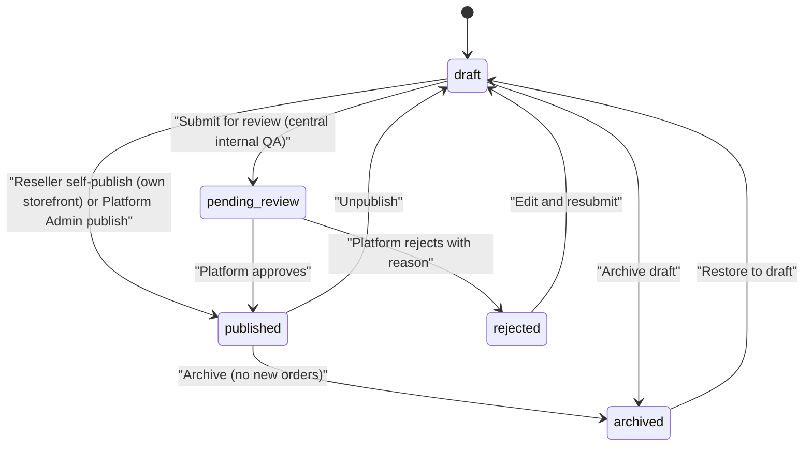
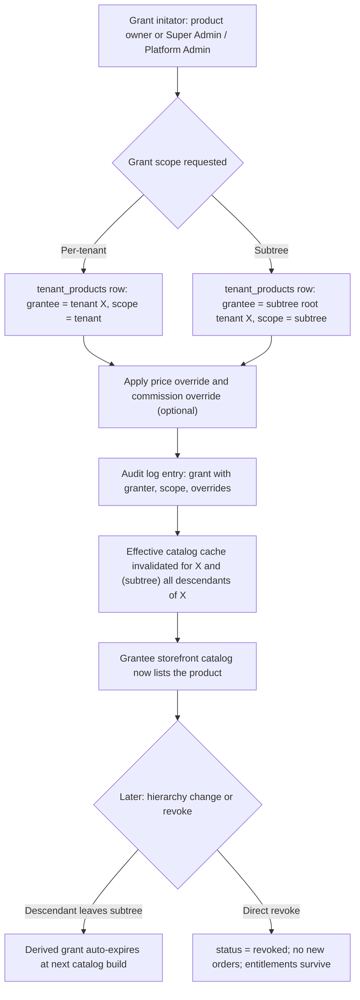

# Product Marketplace & Distribution

| Field | Value |
|---|---|
| Document | 06-product-marketplace.md |
| Version | 1.0 |
| Status | Draft for Review |
| Date | 2026-11-01 |
| Owner | Product & Architecture Team |
| Related documents | 03-functional-requirements.md, 04-multi-tenancy-architecture.md, 07-billing-and-financial-architecture.md, 08-affiliate-and-commission-system.md, 09-fulfillment-and-licensing.md, 11-ai-and-automation.md, 12-crm-and-support.md, 13-database-design.md, 16-ui-ux-specification.md, 17-security-requirements.md |

## Table of Contents

1. Purpose & Scope
2. Domain Concepts — Ownership vs Distribution
3. Product Types & Fulfillment Models
4. Product Content Model
5. Product Status Lifecycle & Marketplace Listing
6. Distribution Authorization
7. Pricing, Floor Protection, Variants, Bundles, Add-ons
8. Product Versioning
9. Product Reviews
10. Product Demos (Module 5)
11. Marketplace Discovery & Catalog Access
12. Assumptions & Open Questions

---

## 1. Purpose & Scope

This document specifies the Frenchies product catalog and marketplace: how products are
created, who owns them, how resellers are authorized to distribute them, how pricing and
minimum selling price (floor) protection work, product versioning, reviews, and the product
demo module (Module 5). It defines requirement IDs `FR-PRODUCT-001`–`FR-PRODUCT-057` and
`FR-DEMO-001`–`FR-DEMO-015` (owned exclusively by this document per charter §8).

Out of scope here (owned elsewhere): order/checkout mechanics (`03-functional-requirements.md`),
payment capture and ledger postings (`07-billing-and-financial-architecture.md`), commission
math (`08-affiliate-and-commission-system.md`), fulfillment execution and license issuance
(`09-fulfillment-and-licensing.md`), CRM lead management (`12-crm-and-support.md`), exact
column DDL (`13-database-design.md`).

Canonical tables used by this document (charter §6): `products`, `product_variants`,
`product_media`, `product_packages`, `package_items`, `product_addons`, `product_addon_links`,
`product_pricing`, `tenant_products`, `product_demos`, `product_versions`, `product_reviews`,
`product_documents`, `categories`. Referenced (owned elsewhere): `tenants`, `reseller_hierarchy`,
`subscriptions`, `orders`, `order_items`, `leads`, `licenses`, `fulfillment_jobs`, `coupons`.

## 2. Domain Concepts — Ownership vs Distribution

- **Ownership** is recorded on `products.owner_tenant_id`. The Central Platform tenant
  (`tenants.slug = 'central'`) owns central products; a reseller tenant owns its own products.
  Ownership determines who edits content, sets base pricing bounds, and moderates reviews.
- **Distribution authorization** is a SEPARATE concept, materialized in `tenant_products`.
  A row in `tenant_products` grants one reseller tenant ("grantee") the right to sell a
  product the grantee does not own, with optional per-tenant pricing and commission
  overrides. Owning a product never implies the right to sell it; being granted a product
  never transfers ownership.
- **Authorization granters** (the only actors who may create/modify a `tenant_products` row):
  the product owner's users with catalog-management permission (Reseller owner, Reseller
  Employee with products permission, or central Product Manager), plus Super Admin and
  Platform Admin (central). Granters can only grant within their authority: a reseller may
  grant only products `owner_tenant_id = ` their own tenant.
- **Effective catalog** of a reseller = owned products (published to own storefront) +
  directly granted products + subtree-derived grants (Section 6). It is resolved at catalog
  build time and cached per tenant.

## 3. Product Types & Fulfillment Models

Every product has exactly one `product_type` which binds a fulfillment model. Fulfillment
execution itself is specified in `09-fulfillment-and-licensing.md`; this section defines the
catalog-side binding rules.

| product_type | Fulfillment model | Catalog-side binding |
|---|---|---|
| `saas_subscription` | Recurring subscription | Must reference a `subscription_plans` row (plan defines cycle, trial, features). |
| `license_software` | License key delivery | Must define license issuance parameters (issue count, activation limit, validity) consumed by `licenses`. |
| `digital_service` (one-time) | Manual/API fulfillment job | Must define a `fulfillment_jobs` task template (deliverables, SLA days). |
| `managed_service` | Recurring service delivery | Must define service cycle (e.g., monthly deliverable set) producing recurring fulfillment jobs. |
| `ai_agent_deployment` | Deployed agent + usage metering | Must bind an AI agent template and usage-metering configuration (cross-ref `11-ai-and-automation.md`). |
| `bundle` | Composite | Must reference a `product_packages` definition whose `package_items` point to non-bundle products. |

### Requirements — Product Types

| ID | Requirement | Priority |
|---|---|---|
| FR-PRODUCT-001 | Product type enumeration: products must declare one of the six enumerated types above; type is immutable after first sale, changeable otherwise with audit log. | P0 |
| FR-PRODUCT-002 | Type→fulfillment validation: saving a product missing its type-specific binding (plan, license params, task template, cycle, agent template, package) is rejected with a field-level error. | P0 |
| FR-PRODUCT-003 | SaaS subscription products bind to `subscription_plans`; the storefront displays cycle and trial from the plan. | P0 |
| FR-PRODUCT-004 | License software products carry license issuance parameters (activation limit, validity period) consumed by `09-fulfillment-and-licensing.md` flows. | P0 |
| FR-PRODUCT-005 | One-time digital service products define a fulfillment task template (deliverables list, SLA days) that instantiates `fulfillment_jobs` rows on purchase. | P0 |
| FR-PRODUCT-006 | Managed service products define a recurring service cycle producing one fulfillment job per cycle per active subscriber. | P1 |
| FR-PRODUCT-007 | AI agent deployment products bind an AI agent template and usage-metering config; usage charges are billed per `11-ai-and-automation.md`. | P1 |
| FR-PRODUCT-008 | Bundle products: fixed bundle price, component list via `product_packages` + `package_items`, and single-line purchase fanning out to one fulfillment per component. Bundles cannot contain bundles (max depth 1). | P1 |

**AC-FR-PRODUCT-001-1**
```gherkin
Given a Platform Admin creates a product without selecting a product type
When we attempt to save the product
Then the save is rejected with error "product_type is required"
And the product remains in draft
```

**AC-FR-PRODUCT-002-1**
```gherkin
Given a product of type "saas_subscription" with no linked subscription plan
When the Platform Admin attempts to move it to "published"
Then the transition is blocked with a field-level error on the plan selector
```

**AC-FR-PRODUCT-008-1**
```gherkin
Given a bundle "Starter Pack" priced at INR 49,999 containing components A (base INR 29,999) and B (base INR 24,999)
When a customer purchases the bundle
Then one order item for the bundle is created at INR 49,999
And fulfillment jobs are created for component A and component B independently
```

## 4. Product Content Model

Core fields: `name`, `slug` (URL-safe, unique per `owner_tenant_id`; storefront routes resolve
as `{domain}/{locale?}/products/{slug}`), `description` (rich text, sanitized HTML subset —
same allowlist as custom HTML sections, cross-ref `17-security-requirements.md`), status
(Section 5), `product_type`, `owner_tenant_id`, `category_id` (primary), media, SEO, tags,
attributes.

- **Categories** (`categories`): a single global multi-level tree, seeded with the 15 canonical
  categories (Appendix A), admin-extensible (Platform Admin may add/rename/archive nodes).
  A product has one primary category (required) and up to 5 secondary categories. Category
  nodes have slugs, descriptions, and display order for marketplace navigation.
- **Attributes (EAV-lite):** admins define named attribute sets (e.g., "SaaS Features",
  "Deployment") each containing typed attributes (text, number, boolean, select). Products
  carry attribute values in a JSON column validated against their attribute set. Attribute
  sets are platform-defined (central); reseller products may only use published sets.
  P1: attribute values participate in marketplace filtering.
- **Media** (`product_media`): ordered gallery of images (upload to central S3 media prefix;
  alt text required) plus zero or one video (external URL e.g. YouTube/Vimeo, or direct
  upload). Each media row has `sort_order` and `is_primary` (exactly one primary image).
- **SEO fields:** meta title (≤60 chars), meta description (≤160 chars), OG image reference.
  Defaults derived from name/description when empty.
- **Tags:** free-form, slug-normalized, per-product multi-tag list; used for filtering and
  storefront tag pages (P2). Reserved tags cannot collide with category slugs.
- **Documents** (`product_documents`): downloadable/linked attachments — PDF or DOCX uploads,
  or external links (URL + title). Attached documents are shown on product detail and
  delivered post-purchase per visibility (`public` | `purchased_only`).
- **Variants** (`product_variants`): optional per-product variant matrix (e.g., seats:
  1/5/10; tier: Standard/Pro). Each variant has SKU-ish code, display name, attribute
  overrides, its own base price row in `product_pricing`, and its own license/plan overrides.
  Products without variants carry a single implicit default variant.
- **Add-ons** (`product_addons` + `product_addon_links`): standalone attachable items with
  independent price and independent fulfillment; linkable to any product via
  `product_addon_links` (many-to-many). Add-ons appear on product detail and cart as
  optional attachments.

### Requirements — Content Model

| ID | Requirement | Priority |
|---|---|---|
| FR-PRODUCT-009 | Core fields with slug uniqueness per owner and rich-text description stored as sanitized HTML. | P0 |
| FR-PRODUCT-010 | Category tree with the 15 canonical seeded categories; Platform Admin can add/rename/archive nodes; products require one primary category. | P0 |
| FR-PRODUCT-011 | Admin-defined attribute sets and JSON attribute values validated against the set; marketplace attribute filtering. | P1 |
| FR-PRODUCT-012 | Ordered media gallery, exactly one primary image, alt text required on all images, single optional video (URL or upload). | P0 |
| FR-PRODUCT-013 | Per-product SEO fields with length validation and derived defaults. | P1 |
| FR-PRODUCT-014 | Tags with slug normalization and reserved-word collision checks. | P1 |
| FR-PRODUCT-015 | Product documents: PDF/DOCX upload or external link, with `public`/`purchased_only` visibility. | P1 |
| FR-PRODUCT-016 | Variants with per-variant pricing and parameter overrides; products function without variants via a default variant. | P0 |
| FR-PRODUCT-017 | Add-ons linkable to any product with independent price and fulfillment. | P1 |

**AC-FR-PRODUCT-009-1**
```gherkin
Given a reseller creates a product with slug "whatsapp-agent" inside their tenant
When another reseller creates a product with the same slug in their own tenant
Then both saves succeed (slugs are unique per owner_tenant_id, not globally)
And storefront URLs never collide because each resolves under its tenant domain
```

**AC-FR-PRODUCT-010-1**
```gherkin
Given the platform seeds the 15 canonical categories
When a Platform Admin archives "Real Estate Software"
Then existing products keep their category assignment but new selection is impossible
And archived categories are hidden from storefront navigation and marketplace filters
```

**AC-FR-PRODUCT-012-1**
```gherkin
Given a product with 3 images and no primary flagged
When the product is saved
Then the save is rejected with error "exactly one primary image is required"
```

**AC-FR-PRODUCT-016-1**
```gherkin
Given a product with variants "5 seats" (INR 9,999) and "10 seats" (INR 17,999)
When a reseller with a +20% pricing override views the storefront
Then "5 seats" shows INR 11,998.80 and "10 seats" shows INR 21,588.80
And each variant is independently orderable
```

## 5. Product Status Lifecycle & Marketplace Listing

`products.status` governs storefront publication. `products.marketplace_status` is an ORTHOGONAL
ladder (reseller-owned products only) governing visibility to other resellers in the central
marketplace. Central products are always marketplace-listed when published.



Marketplace ladder for reseller-owned products (`marketplace_status`): `unlisted` →
`pending_review` → `approved` | `rejected` (rejected returns to `unlisted` with reason).
Rules:

- A reseller-owned product publishes to the reseller's OWN storefront immediately on
  `draft → published` (no platform involvement).
- Appearing in the CENTRAL MARKETPLACE (visible to other resellers as an acquireable product)
  requires submitting the published product to marketplace review; Platform Admin approval
  moves it to `approved`.
- Revoking `approved` (back to `unlisted`) hides the product from marketplace browsing but
  does NOT affect existing `tenant_products` grants (those are revoked separately, Section 6).
- Visibility scopes on `products.visibility`: `marketplace` (browsable by all resellers),
  `granted_only` (only tenants with a `tenant_products` row see it), `private` (owner
  storefront only, never distributed).

### Requirements — Lifecycle & Listing

| ID | Requirement | Priority |
|---|---|---|
| FR-PRODUCT-018 | Status enum (`draft`, `pending_review`, `published`, `archived`, `rejected`) with the transition table above; every transition writes an audit log entry. | P0 |
| FR-PRODUCT-019 | Reseller self-publish: owner-role users publish their products to their own storefront without platform approval. | P0 |
| FR-PRODUCT-020 | Central marketplace approval workflow: reseller products require Platform Admin approval of `marketplace_status` before appearing to other resellers. | P1 |
| FR-PRODUCT-021 | Visibility scopes (`marketplace`, `granted_only`, `private`) enforced at catalog build and at API level. | P0 |
| FR-PRODUCT-022 | Archived products: hidden from all storefronts and marketplace, not orderable, existing entitlements (orders/subscriptions/licenses) unaffected. | P1 |
| FR-PRODUCT-023 | Rejection carries a mandatory reason visible to the submitter; resubmission resets ladder to `pending_review`. | P1 |
| FR-PRODUCT-024 | Product duplication: "duplicate as draft" copies content/media/variants but never grants, sales data, or marketplace approval. | P2 |

**AC-FR-PRODUCT-018-1**
```gherkin
Given a published reseller product
When the owner clicks "Unpublish"
Then status returns to "draft"
And all granted tenants lose storefront visibility of that product
And existing customer entitlements remain intact
```

**AC-FR-PRODUCT-019-1**
```gherkin
Given a reseller-owned product in status "draft"
When its owner clicks "Publish"
Then status becomes "published" within the same request
And the product appears on the reseller's own storefront
And marketplace_status remains "unlisted"
```

**AC-FR-PRODUCT-020-1**
```gherkin
Given a published reseller product with marketplace_status "pending_review"
When a Platform Admin approves it
Then marketplace_status becomes "approved"
And the product appears in the central marketplace browse for other resellers
And the owning reseller's storefront listing is unchanged
```

**AC-FR-PRODUCT-022-1**
```gherkin
Given a granted product with active customer subscriptions
When a Platform Admin archives the product
Then no new carts or orders may include it
And renewals of existing subscriptions continue per their pinned terms
```

## 6. Distribution Authorization

Authorization is materialized as `tenant_products` rows. Key fields (exact DDL owned by
`13-database-design.md`): grantee `tenant_id`, `product_id`, `grant_scope`
(`tenant` | `subtree`), `subtree_root_tenant_id`, price override, commission override,
`status` (`active` | `suspended` | `revoked`), `granted_by` (user id), `granted_at`,
`expires_at` (optional).



Rules:

1. **Default grant is per-tenant** (`grant_scope = tenant`).
2. **Subtree cascade (optional flag):** `grant_scope = subtree` with
   `subtree_root_tenant_id = X` grants every current and future descendant of X (via
   `reseller_hierarchy` closure table). Subtree grants are resolved at catalog build time —
   no rows are materialized per descendant. Direct (per-tenant) grants always take precedence
   over derived grants for the same product/tenant: a direct `revoked` or `suspended` row
   blocks the subtree-derived grant (explicit deny wins).
3. **Auto-revocation on leaving the subtree:** if a descendant is re-parented so that
   `subtree_root_tenant_id` X is no longer among its ancestors, the derived grant disappears
   at the next catalog build (cache invalidation is triggered by hierarchy changes).
4. **Re-authorization on hierarchy moves:** a tenant MOVING INTO a new subtree does NOT
   inherit that subtree's existing grants — the new root's granter must explicitly grant
   again (per-tenant or new subtree row). Hierarchy move events emit notifications to
   affected granters (P2) and always write audit log entries.
5. **Revocation semantics:** `revoked` blocks new orders immediately; existing orders,
   subscriptions, licenses, and fulfillment obligations survive (grandfathered). `suspended`
   is a temporary block (billing dispute, fraud review) with identical order-blocking effect
   but reversible to `active`.
6. **Optional expiry:** `expires_at` on a grant auto-transitions it to `revoked` at expiry
   via scheduled job (P1).
7. **Commission override:** the grant row may override the product-level reseller commission
   percentage for this grantee (bounded by platform minimums owned by
   `08-affiliate-and-commission-system.md`).

### Requirements — Authorization

| ID | Requirement | Priority |
|---|---|---|
| FR-PRODUCT-025 | `tenant_products` grant record with grantee, product, scope, overrides, status, granter, timestamps. | P0 |
| FR-PRODUCT-026 | Only product-owner catalog managers, Super Admin, and Platform Admin may grant; a reseller granter can grant only their own products. | P0 |
| FR-PRODUCT-027 | Per-tenant default grant creates one `tenant_products` row for exactly one grantee. | P0 |
| FR-PRODUCT-028 | Subtree cascade flag grants all current and future descendants of the root tenant without materializing rows per descendant. | P1 |
| FR-PRODUCT-029 | Subtree grants are resolved at catalog build time via `reseller_hierarchy`; direct deny (revoked/suspended row) wins over derived grant. | P1 |
| FR-PRODUCT-030 | Descendant leaving the subtree auto-loses derived grants at next catalog build; hierarchy changes invalidate affected tenant catalogs. | P1 |
| FR-PRODUCT-031 | Tenants moving INTO a subtree require explicit re-authorization; moves never silently grant. | P1 |
| FR-PRODUCT-032 | Authorization statuses (`active`, `suspended`, `revoked`) with revocation blocking new orders only; grandfathered entitlements survive. | P0 |
| FR-PRODUCT-033 | Per-grant commission override, bounded by platform minimums, versioned in audit log. | P1 |
| FR-PRODUCT-034 | Effective catalog resolution (owned + direct grants + subtree-derived minus denies) with cache invalidation on grant, product, or hierarchy change. | P0 |
| FR-PRODUCT-035 | Every grant/suspend/revoke/override writes an audit log entry with actor, timestamp, before/after values. | P0 |
| FR-PRODUCT-036 | Reseller access-request flow: reseller requests a marketplace product; owner approves or declines (replaces manual coordination). | P2 |
| FR-PRODUCT-037 | Grant expiry: scheduled job revokes grants at `expires_at` and notifies grantee and granter. | P1 |

**AC-FR-PRODUCT-026-1**
```gherkin
Given a reseller owner who owns product P
When they attempt to grant product Q (owned by the platform) to a sub-reseller
Then the action is rejected with "grant not permitted for product Q"
And an audit log entry records the denied attempt
```

**AC-FR-PRODUCT-029-1**
```gherkin
Given a subtree grant from root X covering product P
And a direct revoked row for descendant D and product P
When D's effective catalog is built
Then product P does NOT appear for D (explicit deny wins)
And any other descendant of X without a deny row still receives P
```

**AC-FR-PRODUCT-030-1**
```gherkin
Given descendant D under subtree root X with a derived grant of product P
When an admin re-parents D under a different root Y
Then D's catalog no longer contains P (D left X's subtree)
And D does not gain Y's subtree grants without an explicit new grant (FR-PRODUCT-031)
And the hierarchy change is written to the audit log
```

**AC-FR-PRODUCT-032-1**
```gherkin
Given a granted tenant with an active grant
When the granter revokes the grant
Then the product disappears from the grantee's sellable catalog within one cache invalidation cycle
And new orders containing the product are rejected server-side
And existing subscriptions continue renewing per their pinned terms
```

**AC-FR-PRODUCT-034-1**
```gherkin
Given a subtree grant is created for root X
When any descendant's storefront requests its catalog
Then the response includes subtree-granted products without per-descendant row writes
And adding a NEW descendant under X makes the products visible without manual re-granting
```

## 7. Pricing, Floor Protection, Variants, Bundles, Add-ons

- **Base price** lives in `product_pricing`: per product, per variant, per currency
  (default `INR`), effective-dated rows (price changes append a new row with `valid_from`;
  prior rows are closed with `valid_to` — no destructive overwrites).
- **Per-tenant overrides** live on `tenant_products` (selling price for that grantee). When
  absent, the grantee sells at base price + platform-defined markup policy (default: base).
- **Minimum selling price (floor):** platform-set per product/variant, one of
  `floor_type = fixed` (absolute INR amount) or `floor_type = percent` (percent of the
  variant's current base price). Effective floor computed at validation time. Default
  `floor_type = fixed`.
- **Floor enforcement and coupon rule (exact, normative):**
  1. *Set-time validation:* any reseller selling-price value (catalog or override) below the
     effective floor is rejected with a field error showing the floor.
  2. *Checkout-time validation:* each order item's GROSS line price (pre-coupon) is
     re-validated against the floor server-side at cart→order conversion (protects stale
     caches and legacy overrides).
  3. *Coupons are applied AFTER gross validation.* A coupon may reduce the customer's NET
     paid amount below the floor. The floor protects the listed selling price, not
     promotional nets.
  4. *Commissions and ledger postings are computed on the NET PAID amount* (charter §7).
     A coupon proportionally reduces the commission base; the catalog floor logic never
     exempts this.
  5. *Who absorbs a coupon's discount* (platform / reseller / product owner) is configured
     on the coupon (mechanics owned by `03-functional-requirements.md` FR-MARKETING and
     `07-billing-and-financial-architecture.md`). If the reseller bears it, their effective
     margin can fall to zero; the platform floor does not prevent this by design (see OQ-3).
- **Tax display:** each product/variant carries `price_display = tax_inclusive | tax_exclusive`;
  storefront shows accordingly; GST computation is owned by `07-billing-and-financial-architecture.md`.
- **Price changes vs active subscriptions (exact, normative):** active subscriptions are
  GRANDFATHERED — they keep the renewal price snapshotted at purchase. When a price change is
  published, the publisher may set `apply_to_active_subscriptions = true` (default `false`).
  If true, affected subscriptions update their renewal price effective the next renewal cycle
  AFTER customer notice of at least 14 days (configurable; notice via notification templates,
  cross-ref `03-functional-requirements.md` FR-NOTIFY). A `force` variant (legal/tax change)
  skips the notice window, requires Super Admin, and writes an audit log entry.
- **Variants** each carry their own base price, floor, and overrides; storefront and cart
  always operate on a concrete variant.
- **Bundles:** the bundle's single price is authoritative; component prices are used only for
  component-level floor validation at bundle-authoring time (sum of component floors ≤ bundle
  price, else reject) and for display "valued at" merchandising. Fulfillment fans out per
  component (FR-PRODUCT-008).
- **Add-ons:** independent price rows in `product_pricing`, own floor, own fulfillment;
  bundle-discount interplay with add-ons is P3.

### Requirements — Pricing

| ID | Requirement | Priority |
|---|---|---|
| FR-PRODUCT-038 | Effective-dated base price rows per product/variant/currency in `product_pricing`; INR default. | P0 |
| FR-PRODUCT-039 | Per-tenant selling-price override on `tenant_products`, validated against floor at set time. | P0 |
| FR-PRODUCT-040 | Platform-set floor per product/variant (`fixed` or `percent` of base), single active floor per variant. | P0 |
| FR-PRODUCT-041 | Floor enforcement: set-time + checkout-time gross validation; coupons applied after; commissions on net paid (normative rule set, Section 7). | P0 |
| FR-PRODUCT-042 | Tax-inclusive/exclusive display setting per variant with storefront rendering to match. | P1 |
| FR-PRODUCT-043 | Price-change grandfathering for active subscriptions with opt-in bulk re-price, 14-day notice, force variant under Super Admin. | P1 |
| FR-PRODUCT-044 | Bundle fixed price with component floor sanity check at authoring (sum of component floors ≤ bundle price). | P1 |
| FR-PRODUCT-045 | Add-on pricing independent of parent product, own floor, own fulfillment. | P1 |
| FR-PRODUCT-046 | Multi-currency price rows (schema-ready in MVP; non-INR currencies P2 with FX policy owned by `07-billing-and-financial-architecture.md`). | P2 |

**AC-FR-PRODUCT-041-1**
```gherkin
Given a variant with base INR 10,000 and floor_type = percent at 70% (floor INR 7,000)
When a reseller sets a selling price of INR 6,500
Then the save is rejected with "selling price below minimum INR 7,000"
```

**AC-FR-PRODUCT-041-2**
```gherkin
Given a grantee selling price of INR 8,000 (above the INR 7,000 floor)
When a customer applies a 20% coupon at checkout
Then the order line gross of INR 8,000 passes floor validation
And the net paid amount of INR 6,400 is recorded
And all commissions for the order are computed on INR 6,400 per charter section 7
```

**AC-FR-PRODUCT-041-3**
```gherkin
Given a stale storefront cache showing INR 6,500 (below floor) for a variant
When checkout is attempted with that gross price
Then order creation is rejected server-side with the floor error
And the cache is invalidated and the storefront re-renders the corrected price
```

**AC-FR-PRODUCT-043-1**
```gherkin
Given 500 active subscriptions at renewal price INR 1,000
When the product owner publishes a new price of INR 1,500 with apply_to_active_subscriptions = false
Then all 500 subscriptions renew at INR 1,000
And new purchases occur at INR 1,500
```

**AC-FR-PRODUCT-043-2**
```gherkin
Given the same scenario with apply_to_active_subscriptions = true
When the change is published by a Platform Admin
Then each affected subscription schedules the new renewal price for its next cycle
And a notice email is queued to each customer with at least 14 days lead time
And an audit log entry records the bulk re-price with actor and affected count
```

**AC-FR-PRODUCT-044-1**
```gherkin
Given components with floors INR 6,000 and INR 4,000
When an owner attempts to save a bundle priced at INR 9,500
Then the save is rejected with "bundle price below sum of component floors (INR 10,000)"
```

## 8. Product Versioning

`product_versions` records major.minor versions with changelog; `products.active_version_id`
points new purchases at the current version; customers are PINNED to the version in their
`order_items` (cross-ref `07-billing-and-financial-architecture.md` for order storage).
Version rules:

- Version numbering: `MAJOR.MINOR` (e.g., 2.1). Minor = backward-compatible; major =
  breaking/feature-generation. Immutable once created; edits to content go to a new version.
- Each version stores changelog (rich text), released_at, and a content snapshot pointer
  (spec deltas owned by `13-database-design.md`).
- New purchases always use the active version; the active pointer moves only via an explicit
  publish-version action (audit-logged).
- Entitlement policy per fulfillment model: SaaS subscriptions receive the active version at
  each renewal (service is inherently current); license software and digital service
  entitlements are pinned to the purchased version unless the license policy states
  "updates included" (cross-ref `09-fulfillment-and-licensing.md`).

### Requirements — Versioning

| ID | Requirement | Priority |
|---|---|---|
| FR-PRODUCT-047 | Major/minor versions with changelog and an explicit, audit-logged active-version pointer. | P1 |
| FR-PRODUCT-048 | Customer version pinning on `order_items` for license/software entitlements; SaaS follows active version per renewal. | P1 |
| FR-PRODUCT-049 | Upgrade path: entitlement holders see upgrade offers (price = difference) when the owner enables upgrades for the product. | P2 |

**AC-FR-PRODUCT-047-1**
```gherkin
Given an active version 1.2 of a license product
When the owner creates version 2.0 and marks it active
Then new orders reference version 2.0
And an existing customer's entitlement still references version 1.2
```

**AC-FR-PRODUCT-048-1**
```gherkin
Given a customer pinned to version 1.2 with "updates not included"
When they open their portal entitlement
Then they see version 1.2 and no automatic upgrade is granted
And an upgrade offer (P2) or repurchase path is shown instead
```

## 9. Product Reviews

- **Eligibility (verified purchaser):** only a customer with a FULFILLED order containing the
  product, placed through the reviewing tenant's storefront, may review; one review per
  customer per product per tenant. Reviews are tied to the product (not the reseller), and
  the storefront renders tenant-scoped verified badges.
- **Content:** integer rating 1–5 plus text (10–2,000 characters), optional title. Sanitized
  plain text (no HTML).
- **Moderation queue:** every review enters `pending`. Products `owner_tenant_id = central`
  are moderated by central (Platform Admin / Product Manager); reseller-owned products are
  moderated by the owning reseller in their tenant panel. Statuses: `pending`, `approved`,
  `rejected`, `flagged`.
- **Publish rules:** only `approved` reviews render publicly and count toward aggregates
  (average + count). Platform setting `auto_publish_reviews` (default `false`) may
  auto-approve on submission; it never auto-approves reviews flagged by the abuse heuristics
  (profanity list, burst patterns).
- **Refund coupling:** a full refund of the originating order auto-unpublishes the review
  (status → `pending` re-verification) per clawback philosophy (charter §7.7).
- **Edit window:** authors may edit rating/text within 14 days of approval; edits re-enter
  moderation when auto-publish is off.

### Requirements — Reviews

| ID | Requirement | Priority |
|---|---|---|
| FR-PRODUCT-050 | Verified-purchaser eligibility check against fulfilled orders, one review per customer/product/tenant. | P1 |
| FR-PRODUCT-051 | Rating 1–5 + text with length bounds, plain-text sanitization, 14-day edit window. | P1 |
| FR-PRODUCT-052 | Moderation queue ownership: reseller moderates own tenant products; platform moderates central products. | P1 |
| FR-PRODUCT-053 | Publish rules: only approved reviews render; aggregates computed from approved only; configurable auto-publish with abuse-exempt defaults. | P1 |
| FR-PRODUCT-054 | Full refund auto-unpublishes reviews tied to the refunded order. | P1 |
| FR-PRODUCT-055 | Review abuse reporting: customers/resellers flag reviews; flagged reviews hide pending re-moderation. | P2 |

**AC-FR-PRODUCT-050-1**
```gherkin
Given a customer whose order for product P is status "paid" but not yet fulfilled
When they attempt to submit a review for P
Then submission is rejected with "only verified purchasers may review"
```

**AC-FR-PRODUCT-052-1**
```gherkin
Given a reseller-owned product with 3 pending reviews
When the owning reseller approves one and rejects one
Then only the approved review renders on the storefront
And rejected reviews remain visible in the tenant moderation queue with reason
```

**AC-FR-PRODUCT-054-1**
```gherkin
Given an approved 5-star review linked to order O
When order O is fully refunded
Then the review status becomes "pending"
And the product aggregate drops by that review immediately
```

## 10. Product Demos (Module 5 — FR-DEMO)

`product_demos` rows attach demos to products (any owner; multiple demos per product allowed,
e.g., a live environment + a video). Demo capabilities:

- **Live URL demo:** demo environment URL plus credentials. Credentials are stored ENCRYPTED
  (Laravel encrypted casts; never plaintext at rest, never logged). Storefront reveal is
  MASKED (first 2 characters + mask); full reveal requires a dedicated catalogue permission
  (Reseller owner, central Product Manager) and writes an audit log entry.
- **Demo video:** external URL (YouTube/Vimeo) or direct upload to the tenant S3 prefix.
- **Screenshots:** ordered gallery reusing the `product_media` pattern scoped to the demo.
- **Access model:** `access_type = open` (any visitor) or `lead_gate` (visitor submits a lead
  form first). Lead-gated demos issue a time-boxed ACCESS GRANT (default 24 hours,
  per-demo configurable) after submission.
- **Unique demo links:** each visitor receives a unique demo token rendered at
  `{storefront-domain}/d/{token}` (host resolution per `04-multi-tenancy-architecture.md`).
  Tokens are stored in a supporting token store whose exact name/schema is owned by
  `13-database-design.md` (database-design additions section); this document fixes the
  behavior only. Token states: `active`, `expired`, `revoked`.
- **Reseller-branded demo pages:** the demo access page (gate form, credential reveal,
  screenshots) renders with the SELLING reseller's branding (logo, colors, fonts from the
  tenant theme tokens, cross-ref `10-white-label-cms.md`). Demo links reached from a
  reseller storefront are branded to that reseller; central-origin links use central
  branding.
- **Visitor tracking:** per-token events — view, duration heartbeat (15-second pings while
  the demo tab is focused), credential_revealed, cta_click, form_submit. Aggregates per demo:
  unique views, avg duration, conversions.
- **Lead capture:** the gate form (name, email, phone, optional custom fields) creates a
  `leads` row with `source = 'demo'`, the owning selling tenant, product id, and demo-token
  attribution. Lead management (assignment, pipeline) is owned by `12-crm-and-support.md`.
- **Conversion attribution:** the demo token persists in session/cookie (default 90 days)
  and is stamped on the order at checkout; an order is a conversion of the demo when a paid
  order references the token within the attribution window (default 30 days after first
  view; configurable). Demo reports show view → lead → paid order funnels.
- **Reset & credential rotation:** manual "rotate credentials" action per demo (re-encrypt,
  audit log) plus a SCHEDULED daily job flagging demos whose environment age exceeds the
  configured TTL (`needs_reset` status) and notifying the product owner. Automated
  environment reset via webhook/n8n hooks is P2 (cross-ref `11-ai-and-automation.md`).

### Requirements — Demos

| ID | Requirement | Priority |
|---|---|---|
| FR-DEMO-001 | `product_demos` record per product with type flags (live URL, video, screenshots), attachable by product owner. | P0 |
| FR-DEMO-002 | Live URL demo with credentials; multiple demos per product allowed. | P0 |
| FR-DEMO-003 | Encrypted credential storage, masked reveal, permission-gated full reveal with audit logging. | P0 |
| FR-DEMO-004 | Demo expiry: time-boxed access grants (lead-gate default 24h, configurable per demo) and token expiry. | P1 |
| FR-DEMO-005 | Access restrictions: `open` vs `lead_gate`; gate blocks credential/screenshot access until submission. | P0 |
| FR-DEMO-006 | Unique per-visitor demo links with token states (active/expired/revoked). | P1 |
| FR-DEMO-007 | Reseller-branded demo access pages using the selling tenant's theme tokens. | P1 |
| FR-DEMO-008 | Visitor tracking: views, duration heartbeat, per-token event stream, per-demo aggregates. | P1 |
| FR-DEMO-009 | Lead capture form creates `leads` rows with source = 'demo' plus product and token attribution. | P0 |
| FR-DEMO-010 | Demo-to-order conversion attribution via persisted token stamped on orders within a configurable window. | P1 |
| FR-DEMO-011 | Credential rotation (manual) + scheduled daily `needs_reset` flagging with owner notification. | P1 |
| FR-DEMO-012 | Demo scheduling windows: demos active only in configured date/time windows (e.g., business hours). | P2 |
| FR-DEMO-013 | Automated environment reset via webhook hook on `needs_reset` (n8n/HTTP), owner-configured. | P2 |
| FR-DEMO-014 | Demo analytics report per product: unique views, avg duration, leads, paid conversions, conversion rate. | P1 |
| FR-DEMO-015 | Video demo (URL or upload) and ordered screenshot gallery rendered on the demo page and product detail. | P0 |

**AC-FR-DEMO-003-1**
```gherkin
Given a live demo with stored credentials
When an anonymous visitor opens the demo access page
Then credentials render masked (e.g., "de•••••@demo.com", "••••••••")
And when the reseller owner with permission clicks "Reveal"
Then the full credentials render and an audit log entry records the reveal
```

**AC-FR-DEMO-005-1**
```gherkin
Given a lead_gate demo
When a visitor opens /d/{token} without submitting the form
Then the gate form is the only rendered content
When the visitor submits valid lead details
Then a leads row is created with source = "demo" and the token id
And access is granted for 24 hours and credentials become visible (masked per FR-DEMO-003)
```

**AC-FR-DEMO-007-1**
```gherkin
Given reseller R with primary color #FF5722 and logo L reaches a demo from R's storefront
When the demo access page renders
Then the page shows logo L and R's primary color on the gate and reveal components
And no Frenchies platform branding is visible (cross-ref 10-white-label-cms.md)
```

**AC-FR-DEMO-010-1**
```gherkin
Given a visitor with active demo token T who viewed a demo 10 days ago
When the visitor completes checkout through the same storefront session
Then the paid order stores attribution to token T
And the demo report counts one paid conversion within the 30-day window
```

**AC-FR-DEMO-011-1**
```gherkin
Given a demo whose environment age exceeds the configured TTL
When the daily scheduled job runs
Then the demo status becomes "needs_reset"
And the product owner receives an in-app and email notification
When the owner rotates credentials manually
Then new credentials are stored encrypted, the status returns to "active", and an audit entry is written
```

## 11. Marketplace Discovery & Catalog Access

- **Reseller catalog (tenant panel):** browse/search of the effective catalog — owned,
  granted, and subtree-granted products; filters: category, type, status, granted-vs-owned;
  sort by name/recently granted.
- **Central marketplace:** a dedicated browse surface listing `marketplace_status = approved`
  products (central + approved reseller products) with category navigation, search, and
  "available to request" vs "granted" badges.

| ID | Requirement | Priority |
|---|---|---|
| FR-PRODUCT-056 | Reseller catalog search/filter/sort over the effective catalog with granted/owned indicators. | P1 |
| FR-PRODUCT-057 | Central marketplace browse with categories, search, and grant-status badges. | P1 |

**AC-FR-PRODUCT-056-1**
```gherkin
Given a reseller with 4 owned and 11 granted products
When they filter by category "AI Agents" and status "granted"
Then only granted AI-agent products render, with the granter shown per row
```

## 12. Assumptions & Open Questions

1. **Assumption:** the 15 canonical categories (Appendix A) are seeded as a single-level
   initial tree; deeper sub-category nesting is admin-created later. Category slugs are
   global (single category table shared by central and reseller products).
2. **Assumption:** attribute sets are platform-defined only in MVP; reseller-defined
   attribute sets are a P2 consideration.
3. **OQ:** should a "hard net-of-coupon floor" mode exist (blocking coupons that take the
   net below floor)? Default design: NO hard block (promotional flexibility wins); the
   financial impact is bounded by coupon bearer configuration. Product/Finance decision.
4. **OQ:** whether reseller-authored products entering the central marketplace share revenue
   with the platform (marketplace listing fee, revenue share) — economics owned by
   `08-affiliate-and-commission-system.md`; mechanism here is approval-only.
5. **Assumption:** subtree grants are limited to products owned by the central platform OR
   by the subtree root reseller (a reseller can cascade-distribute only what it owns).
   Cross-tenant cascade of third-party-owned products is not supported.
6. **Assumption:** demo token store and demo-attribution columns on `orders`/`leads` are
   implemented by `13-database-design.md` additions; names used here (`token`, `demo_id`)
   are descriptive, not canonical.

## Appendix A — Canonical Seed Categories (15)

AI Agents; WhatsApp AI Agents; Voice AI Agents; CRM Software; ERP Software; POS Software;
Restaurant Management; Clinic Management; Real Estate Software; E-commerce Software;
Website Development; SaaS Applications; Automation Services; Digital Marketing;
Custom Software Development.

## Appendix B — Review of Enumerated Statuses (normative summary)

- `products.status`: `draft`, `pending_review`, `published`, `archived`, `rejected`.
- `products.marketplace_status` (reseller-owned only): `unlisted`, `pending_review`,
  `approved`, `rejected`.
- `tenant_products.status`: `active`, `suspended`, `revoked`.
- Demo token states: `active`, `expired`, `revoked`. Demo statuses: `active`,
  `needs_reset`, `expired`.
- `product_reviews.status`: `pending`, `approved`, `rejected`, `flagged`.

## Ratified P0 decisions (2026-11-20)

Decisions below are ratified in `22-open-questions-and-assumptions.md` §5; see that
section for ratifier, date and launch-gate caveats.

| OQ-014 | Per-type refund windows with per-product override: digital goods 7d from payment (void if consumed), services 14d from fulfillment, subscriptions 7d from renewal charge, licenses 7d if activations < 1, packages strictest constituent. Display on storefront footer and invoice. |
| OQ-007 | Commission hold must be >= the applicable refund window (`hold_days >= refund_window_days`); product-type enum drives both. |
