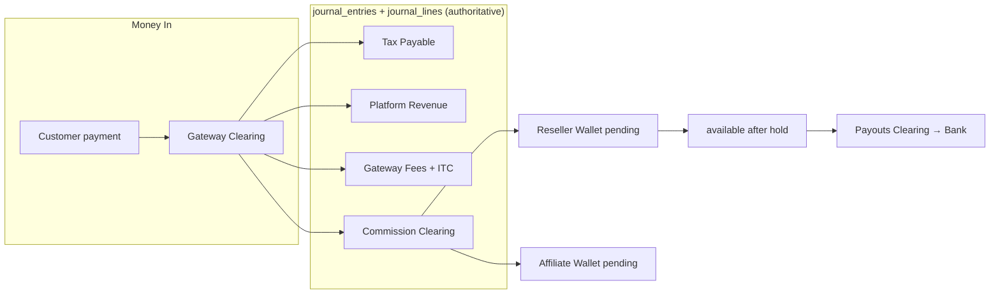
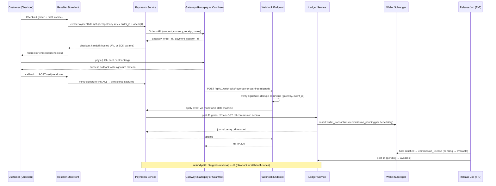

# Billing & Financial Architecture (Invoicing, Payments, Ledger, Wallets)

| Field | Value |
|---|---|
| Document | 07-billing-and-financial-architecture.md |
| Version | 1.0 |
| Status | Draft for Review |
| Date | 2026-11-01 |
| Owner | Product & Architecture Team |
| Related documents | 03-functional-requirements.md, 06-product-marketplace.md, 08-affiliate-and-commission-system.md, 09-fulfillment-and-licensing.md, 13-database-design.md, 17-security-requirements.md, 18-non-functional-requirements.md |

## Table of Contents

1. Scope & Financial Architecture Overview
2. Domain Entities Used by This Document
3. FR-BILLING — Invoicing & Financial Reporting
   3.1 GST invoice model · 3.2 Gapless numbering (concurrency) · 3.3 PDF & branding · 3.4 Receipts, credit notes, refunds · 3.5 Recurring invoices, reminders, receivables · 3.6 Reseller financial statements · FR table · ACs
4. FR-PAYMENT — Payments & Gateway Integration
   4.1 Integration contract · 4.2 Checkout handoff & signature verification · 4.3 Webhooks: idempotency & ordering · 4.4 Status model, failures, partials · 4.5 Manual payments · 4.6 Refunds · 4.7 Gateway fees & settlement reconciliation · 4.8 Transaction logs & fraud basics · FR table · ACs
5. FR-WALLET — Double-Entry Ledger, Wallets & Payouts
   5.1 Account plan · 5.2 Journal posting rules · 5.3 Immutability & corrections · 5.4 Wallet subledger & derivation · 5.5 Payouts · 5.6 Statements & audit · FR table · ACs
6. End-to-End Sequence (Mermaid)
7. Worked Numeric Example (₹10,000 order → refund clawback)
8. Assumptions & Open Questions

---

## 1. Scope & Financial Architecture Overview

This document defines the money layer of Frenchies: invoicing (GST-aware), payment collection through centrally-held gateways, the authoritative double-entry ledger, per-beneficiary wallet subledgers, and manual payout operations. Commission *rules and attribution* are specified in `08-affiliate-and-commission-system.md`; this document owns how every commission, refund, fee, and payout movement is posted and reconciled.

Fixed architectural rules (charter §7):

1. **The double-entry ledger (`journal_entries` + `journal_lines`) is authoritative.** Every financial event posts balanced journal lines. `wallets` / `wallet_transactions` are a per-beneficiary *projection* (subledger) of ledger postings — never an editable balance.
2. **Payments are always collected by the central platform** under central Razorpay/Cashfree merchant credentials. Resellers never hold gateway credentials; resellers earn wallet balances; money exits the system only via Finance Admin-approved payouts.
3. **Wallet balances are derived** (`SUM(credit) − SUM(debit)` of posted `wallet_transactions`); any cached balance column is written transactionally and reconciled nightly against both the recomputed subledger and the ledger account balances. Hand-editing is prohibited.
4. **Amounts** are `DECIMAL(15,2)`, `currency` defaults to `INR`, rounding half-up to 2 decimals; no floats anywhere in money paths.
5. **Idempotency**: gateway webhook processing is idempotent via `payment_webhook_events` (unique `gateway + event_id`); commission generation is idempotent via the unique key on `commissions` (see doc 08).
6. **Tenancy**: every row in this document's tables carries `tenant_id` (platform operations rows use `tenants.slug = 'central'`); platform staff may cross tenants, reseller users are scoped by global scopes/middleware.



## 2. Domain Entities Used by This Document

Canonical tables referenced (full schema owned by `13-database-design.md`): `invoices`, `invoice_items`, `payments`, `payment_webhook_events`, `refunds`, `wallets`, `wallet_transactions`, `journal_entries`, `journal_lines`, `payouts`, `commissions`, `platform_settings`, `tenant_settings`, `audit_logs`, `orders`, `order_items`, `subscriptions`, `taxes`.

Tables **required by this document but not yet in the canonical inventory** — these are proposed additions that `13-database-design.md` must own and name finally (local assumptions §8):

| Proposed table | Purpose | Owner |
|---|---|---|
| `ledger_accounts` | chart-of-accounts-light account plan (FR-WALLET-001) | doc 13 |
| `gateway_settlements` | daily settlement rows imported/fetched from gateways (FR-PAYMENT-020) | doc 13 |
| `risk_blocklist` | payment fraud blocklist entries (FR-PAYMENT-027) | doc 13 |

Invoice sequence state does **not** need a new table: it is stored as a structured row in `tenant_settings` (key `invoice_sequence`) and allocated under a row lock (§3.2).

Stateful entities and their enumerations (canonical for this PRD):

| Entity | Status enum |
|---|---|
| `invoices.status` | `draft`, `issued`, `void`, `paid`, `partially_paid`, `overdue` |
| `payments.status` | `pending`, `authorized`, `captured`, `partially_refunded`, `refunded`, `failed`, `cancelled`, `expired`, `manual_submitted`, `manual_approved`, `manual_rejected` |
| `payment_webhook_events.processing` | `received`, `verified`, `applied`, `deferred`, `ignored_duplicate`, `rejected_signature`, `failed` |
| `refunds.status` | `initiated`, `processing`, `completed`, `failed` |
| `payouts.status` | `requested`, `approved`, `paid`, `rejected`, `cancelled` |

---

## 3. FR-BILLING — Invoicing & Financial Reporting

### 3.1 GST invoice model

- One `invoices` row per order (`type = order`) and per subscription charge (`type = subscription`), created when the payment reaches `captured`/`manual_approved` (immediately as `draft` for preview, transitioned to `issued` on finalization — FR-BILLING-009).
- **Tax determination:** for each line, tax rate is resolved from the `taxes` table (product + category + tenant overrides; default GST 18% — assumption §8). Place of supply = customer billing state (B2C) or customer GSTIN state (B2B). If seller GSTIN state == place of supply state → **CGST + SGST** (rate split equally); otherwise → **IGST** at the full rate.
- **GSTIN fields:** `tenants.gstin` (seller, mandatory before `issued` for GST-registered tenants) and `customers.gstin` + legal name + address (B2B buyer). Missing buyer GSTIN ⇒ B2C invoice (buyer name optional per GST rules — assumption).
- **Tax-inclusive pricing:** `product_pricing`/order amounts may be tax-inclusive; invoice always prints taxable value, rate, and tax components that sum exactly to the charged tax (rounding half-up, residual ₹0.01 absorbed by the tax line of the largest line item — documented penny rule).
- Line fields: description, HSN/SAC (from product, editable per line at draft), quantity, unit price, discount (line + order/coupon allocation), taxable value, rate, CGST/SGST/IGST amounts, line total.

### 3.2 Invoice numbering — configurable prefix + date segment + gapless sequence

- Format template per tenant, configurable in `tenant_settings` (`invoice.format`), default: `{PREFIX}-{FY}-{SEQ6}` → e.g. `FRS-2026-27-000042` where `PREFIX` is the tenant's configured 2–8 char prefix and `FY` the Indian financial year segment (alternative `YYYYMM` segment supported by template tokens `{YYYYMM}`, `{FY}`, `{SEQ4|6|8}`).
- One independent sequence per tenant (MVP: one GSTIN per tenant — assumption §8).
- **Allocation algorithm (concurrency approach):**
  1. Invoice rows are created as `draft` **without** a number.
  2. On transition `draft → issued`, inside ONE database transaction: `SELECT ... FOR UPDATE` on the tenant's `invoice_sequence` row in `tenant_settings`, increment `next_seq`, build the number, `INSERT` the invoice-line update with the number — then COMMIT. Counter commit and invoice update are atomic ⇒ **no gaps and no reuse** (a rolled-back transaction rolls back both).
  3. Lock scope is per tenant ⇒ tenants never contend with each other; within a tenant, issuance is serialized. Lock wait timeout / deadlock ⇒ retry up to 3 attempts with 50 ms, 150 ms, 450 ms backoff; after 3 failures the request fails with a retryable error (no number burned).
  4. Numbers are never reused after `void`; a voided issued invoice keeps its number (audit), and `void` is only allowed from `issued` (FR-BILLING-026).
  5. A nightly job asserts `MAX(sequence)` equals the count of issued invoices for the period and reports any anomaly (should always hold under this design).

### 3.3 PDF generation & branding

- PDF via `barryvdh/laravel-dompdf` (already installed), rendered from Blade templates: invoice, receipt, credit note.
- Tenant branding applied from tenant profile: logo, brand color, legal name, address, GSTIN, HSN/SAC defaults, footer text, custom domain. Platform branding is hidden except the legally-required payment descriptor / "collected by" line on receipts (charter §4 white-label constraint).
- PDFs are rendered on demand and cached by content hash in S3-compatible object storage under the tenant prefix; regeneration required after branding change (cache key includes branding version).

### 3.4 Receipts, credit notes, refunds

- **Receipt** (`RCPT` series): generated per applied payment; shows invoice number(s) paid, method, gateway reference, amount, date. Downloadable by customer and reseller.
- **Credit note** (`CN` series): linked to exactly one original invoice (`credit_notes.original_invoice_id` → proposed doc-13 column on `invoice_items`/`refunds` linkage — see §8), mandatory GST fields: original invoice number/date, reason, taxable value reversed, tax components reversed, total. Generated automatically for (a) full refund, (b) partial refund, (c) Finance Admin corrections to an issued invoice (with re-issued invoice referencing the credit note). Original invoice is never edited after `issued` (FR-BILLING-019).
- **Refund records** (`refunds`): one row per gateway refund attempt, linked to `payments`, `orders`, `invoices`, and the credit note; carries amount, status, gateway refund id, reason, actor, timestamps. Refund lifecycle is defined in §4.6; the credit note is emitted when the refund reaches `completed`.

### 3.5 Recurring invoices, reminders, receivables

- **Recurring invoices:** every successful subscription renewal payment auto-generates a `type = subscription` invoice for that cycle (same series, date segment = issue date). Proration on mid-cycle plan change = P2 (invoice line `proration` flag).
- **Payment reminders:** scheduled via queue (Horizon) at **T+1, T+7, T+15** after `due_date` (offsets configurable per tenant in `tenant_settings`; channels: email + in-app, WhatsApp P1.5). Each reminder send is recorded in `notification_logs`; reminders stop when invoice reaches `paid`.
- **Overdue:** nightly job flips `issued`/`partially_paid` invoices with `amount_due > 0` and `due_date < today` to `overdue` (status only; number/lines untouched) and feeds the receivables view.
- **Outstanding receivables view:** all `issued|partially_paid|overdue` invoices with `amount_due > 0`, grouped by customer with aging buckets `0-7 / 8-15 / 16-30 / 31-60 / 60+` days (bucket edges configurable), CSV export, reseller sees own tenant, Finance Admin sees all tenants.

### 3.6 Reseller financial statements

Per reseller tenant, per period (custom range + calendar month preset), one statement joining:

- **Revenue** (order + subscription invoices issued, net of tax),
- **Commissions earned** (from `commissions`, split pending/available/reversed — cross-ref doc 08),
- **Payouts** (requested/approved/paid/rejected),
- **Refunds & clawbacks**,
- **Net payable** = available wallet balance + approved-unpaid payouts − pending obligations.

Export CSV and PDF (dompdf). Finance Admin can generate platform-wide consolidated statements (all tenants) — FR-WALLET-028.

### FR-BILLING Requirements

| ID | Requirement | Priority |
|---|---|---|
| FR-BILLING-001 | Generate a GST invoice automatically for every order whose payment reaches `captured` (or `manual_approved`), containing seller GSTIN, buyer fields, place of supply, tax split, and totals matching the charged amount. | P0 |
| FR-BILLING-002 | Generate a GST invoice for every subscription renewal charge using the same series and tax rules as order invoices. | P0 |
| FR-BILLING-003 | Determine tax type automatically: CGST+SGST when place-of-supply state equals seller GSTIN state, IGST otherwise, using the rate from `taxes`. | P0 |
| FR-BILLING-004 | Store seller GSTIN on the tenant record and block `issued` transition when the tenant is GST-registered but GSTIN is missing. | P0 |
| FR-BILLING-005 | Capture B2B buyer fields (GSTIN, legal name, address, place of supply) on the customer; B2B/B2C flag printed on the invoice. | P1 |
| FR-BILLING-006 | Support a per-tenant configurable number template `{PREFIX}-{date segment}-{zero-padded sequence}` with default FY segment. | P0 |
| FR-BILLING-007 | Allocate invoice numbers gaplessly and retry-safely: per-tenant row lock in the same transaction as the `draft→issued` update, 3 retries with backoff, no number burned on failure. | P0 |
| FR-BILLING-008 | Build invoice lines from `order_items`/subscription charge lines including HSN/SAC, discounts (line, order, coupon allocation), taxable value, rate, and CGST/SGST/IGST per line. | P0 |
| FR-BILLING-009 | Enforce the invoice status lifecycle `draft → issued → (paid | partially_paid | overdue | void)` with `void` only from `issued` and automatic `paid`/`partially_paid` on payment application. | P0 |
| FR-BILLING-010 | Render invoice/receipt/credit-note PDFs via `barryvdh/laravel-dompdf` with tenant branding (logo, colors, legal entity, GSTIN) and platform-brand suppression except legally-required descriptor. | P0 |
| FR-BILLING-011 | Deliver invoices by email and make them downloadable from the customer portal; support resend with audit entry. | P1 |
| FR-BILLING-012 | Issue a receipt in a separate `RCPT` series for each applied payment, showing gateway/method/reference and linked invoice numbers. | P0 |
| FR-BILLING-013 | Issue GST-compliant credit notes in a `CN` series linked to the original invoice, reversing the correct taxable value and tax components. | P1 |
| FR-BILLING-014 | Record every refund attempt in `refunds` linked to payment, order, invoice, and credit note, with status and gateway refund id. | P0 |
| FR-BILLING-015 | Auto-generate a recurring invoice for each successful subscription renewal in the same series. | P1 |
| FR-BILLING-016 | Send payment reminders at T+1/T+7/T+15 after due date, offsets configurable per tenant, recorded in `notification_logs`, stopped on payment. | P1 |
| FR-BILLING-017 | Provide an outstanding-receivables view with configurable aging buckets and CSV export, scoped per tenant for resellers and cross-tenant for Finance Admin. | P1 |
| FR-BILLING-018 | Produce a per-reseller financial statement per period containing revenue, commissions, payouts, refunds/clawbacks, and net payable, exportable as CSV/PDF. | P1 |
| FR-BILLING-019 | Treat issued invoices as immutable: any correction requires a credit note plus a newly issued invoice; direct field edits after `issued` are rejected by the service layer. | P1 |
| FR-BILLING-020 | Apply multiple payments to one invoice (partial payments), maintaining `amount_paid`, `amount_due`, and derived status `partially_paid`/`paid`; overpayment beyond invoice total is rejected. | P1 |
| FR-BILLING-021 | When a manual payment is approved (§4.5), apply it to the invoice and issue receipt + invoice payment status in the same transaction. | P1 |
| FR-BILLING-022 | Compute all invoice amounts in INR with half-up rounding to 2 decimals; printed tax components and line totals must sum exactly to the invoice total (residual assigned to the largest tax line). | P1 |
| FR-BILLING-023 | Expose a customer-portal invoice list and PDF download restricted to the authenticated customer's own tenant invoices. | P1 |
| FR-BILLING-024 | Provide a reseller invoice list with filters (status, date range, customer, amount range) and CSV export. | P1 |
| FR-BILLING-025 | On white-label invoices the selling reseller is the "seller"; the receipt/invoice footer carries the platform legal entity line and payment descriptor only where legally required. | P0 |
| FR-BILLING-026 | Require a reason and an audit log entry to void an invoice; voided numbers are never reused or reissued. | P2 |
| FR-BILLING-027 | Provide a period tax summary for Finance Admin: output GST collected, input tax credit (gateway fee GST), and net tax payable by tenant. | P2 |
| FR-BILLING-028 | Support bulk invoice CSV export (accountant pack) for a date range across selected tenants. | P2 |
| FR-BILLING-029 | Transition overdue invoices automatically by nightly job and feed the overdue set into reminders and receivables. | P1 |
| FR-BILLING-030 | Support a reverse-charge flag on B2B invoices for notified cases (printed, excluded from output tax). | P2 |
| FR-BILLING-031 | Provide a draft-invoice preview (HTML + PDF) before issuance for Finance Admin review. | P2 |
| FR-BILLING-032 | Enforce tenant scoping on every invoice/receipt/credit-note endpoint: cross-tenant reads return 404 for reseller-scoped principals. | P1 |

### FR-BILLING Acceptance Criteria (P0/P1)

- **AC-FR-BILLING-001-1** `Given` an intra-state order of ₹10,000 tax-inclusive at 18% whose payment is captured, `When` the invoice is issued, `Then` taxable value = ₹8,474.58, CGST ₹762.71 + SGST ₹762.71, total = ₹10,000.00.
- **AC-FR-BILLING-002-1** `Given` a subscription renewal payment captured on 2026-11-05, `When` renewal processing completes, `Then` a `type = subscription` invoice exists in the tenant's series dated 2026-11-05 with the renewal line items.
- **AC-FR-BILLING-003-1** `Given` seller GSTIN state = Maharashtra and customer place of supply = Karnataka, `When` tax is computed, `Then` the line shows IGST at the full rate and no CGST/SGST lines exist.
- **AC-FR-BILLING-004-1** `Given` a GST-registered tenant with empty GSTIN, `When` draft→issued is attempted, `Then` the transition is rejected with a validation error naming the missing field.
- **AC-FR-BILLING-005-1** `Given` a customer with GSTIN 27AAAAA0000A1Z5, `When` the invoice renders, `Then` the buyer block shows GSTIN, legal name, and a B2B flag.
- **AC-FR-BILLING-006-1** `Given` tenant prefix `FRS` and default template, `When` the 42nd invoice of FY 2026-27 is issued, `Then` the number is exactly `FRS-2026-27-000042`.
- **AC-FR-BILLING-007-1** `Given` 10 concurrent issuance requests for one tenant, `When` they complete, `Then` 10 distinct contiguous numbers are assigned with no duplicates, no gaps, and each request either succeeded or failed after retries with no number consumed.
- **AC-FR-BILLING-007-2** `Given` a transaction that allocated number N rolls back, `When` the rollback completes, `Then` the sequence counter is also rolled back and N is never visible as issued.
- **AC-FR-BILLING-008-1** `Given` an order with a ₹500 coupon over two lines, `When` invoice lines are built, `Then` coupon discount is allocated proportionally to line taxable values and Σ line totals = invoice total.
- **AC-FR-BILLING-009-1** `Given` an `issued` invoice, `When` a partial payment of ₹4,000 is applied to an ₹10,000 invoice, `Then` status = `partially_paid`, `amount_paid` = 4,000.00, `amount_due` = 6,000.00.
- **AC-FR-BILLING-010-1** `Given` a tenant with logo and brand color set, `When` the invoice PDF is generated, `Then` the PDF contains the tenant logo, brand color header, tenant GSTIN, and no platform logo.
- **AC-FR-BILLING-011-1** `Given` an issued invoice, `When` the customer opens the portal, `Then` the invoice PDF is downloadable and the email delivery is recorded in `notification_logs`.
- **AC-FR-BILLING-012-1** `Given` a captured payment, `When` the receipt is issued, `Then` it has a `RCPT`-series number, shows gateway reference and linked invoice numbers, and is unique per applied payment.
- **AC-FR-BILLING-013-1** `Given` a full refund of an issued invoice, `When` the credit note is generated, `Then` it references the original invoice number/date and reverses the exact taxable value and tax components.
- **AC-FR-BILLING-014-1** `Given` a refund of ₹2,500 against a ₹10,000 payment, `When` the refund row is created, `Then` it links payment + invoice and status progresses `initiated → processing → completed` via gateway webhook.
- **AC-FR-BILLING-015-1** `Given` an active subscription, `When` renewal N succeeds, `Then` invoice N+1 (same series) exists with the renewal amount and no duplicate invoice is created on webhook replay.
- **AC-FR-BILLING-016-1** `Given` an unpaid invoice due 2026-11-01 with default offsets, `When` the scheduler runs on 2026-11-02/08/16, `Then` reminders are sent at T+1, T+7, T+15 exactly once each and stop after payment.
- **AC-FR-BILLING-017-1** `Given` three unpaid invoices aged 3, 20, and 45 days, `When` the receivables view loads, `Then` they appear in buckets `0-7`, `16-30`, `31-60` with summed amounts matching Σ `amount_due`.
- **AC-FR-BILLING-018-1** `Given` a tenant month with ₹1,00,000 revenue, ₹12,000 commissions, ₹5,000 payouts, ₹2,000 refunds, `When` the statement is generated, `Then` net payable = ₹5,500 and CSV/PDF exports contain identical figures.
- **AC-FR-BILLING-019-1** `Given` an `issued` invoice, `When` an API call tries to change its line amount, `Then` the request is rejected and an audit log entry records the attempt.
- **AC-FR-BILLING-020-1** `Given` an ₹10,000 invoice paid ₹6,000 then ₹4,000, `When` both payments are applied, `Then` status = `paid` and a third payment of ₹1 is rejected as exceeding invoice total.
- **AC-FR-BILLING-021-1** `Given` an approved manual payment, `When` approval commits, `Then` invoice status, receipt, payment status, and ledger postings (FR-WALLET-013) all exist in one transaction.
- **AC-FR-BILLING-022-1** `Given` lines with taxable values 333.33 and 333.33 at 18%, `When` tax is rounded, `Then` the invoice total equals line totals + tax exactly with no ₹0.01 drift.
- **AC-FR-BILLING-023-1** `Given` a customer of tenant A, `When` they request an invoice of tenant B, `Then` the response is 404.
- **AC-FR-BILLING-024-1** `Given` 50 invoices with mixed statuses, `When` filters status=overdue + date range are applied, `Then` only overdue in-range rows return and CSV export matches the filtered set.
- **AC-FR-BILLING-025-1** `Given` a white-label reseller invoice, `When` rendered, `Then` seller = reseller legal entity and the footer contains the platform descriptor line only.
- **AC-FR-BILLING-029-1** `Given` an issued invoice past due date, `When` the nightly job runs, `Then` status becomes `overdue` once (idempotent) and the reminder scheduler picks it up.
- **AC-FR-BILLING-032-1** `Given` a reseller-scoped token, `When` it calls another tenant's invoice endpoint, `Then` 404 is returned and the attempt is not logged as data access.

---

## 4. FR-PAYMENT — Payments & Gateway Integration

### 4.1 Integration contract (Razorpay / Cashfree)

Both gateways are accessed through a per-gateway **adapter** with a common interface (contract level only — no code in this PRD): `createOrder`, `verifyCheckoutCallback`, `verifyWebhookSignature`, `normalizeEvent`, `initiateRefund`, `fetchSettlements`. All credentials live in platform configuration (`platform_settings` / environment) — never in tenant records.

**Razorpay Orders API**

- `POST https://api.razorpay.com/v1/orders`, HTTP Basic auth `key_id:key_secret`.
- Request: `amount` (integer **paise**, e.g. 1000000 = ₹10,000.00), `currency: "INR"`, `receipt` (= invoice/order reference), `notes` (`tenant_id`, `order_id`, `invoice_id`), `partial_payment: false`.
- Response persisted on `payments`: `gateway = razorpay`, `gateway_order_id` (`order_...`), `amount`, `currency`, `status = pending`.
- Server-side verification of checkout callback: HMAC-SHA256 of the string `"{order_id}|{payment_id}"` computed with `key_secret`, compared with `hash_equals` against `razorpay_signature`.
- Refunds: `POST /v1/payments/{payment_id}/refund` with amount in paise (absent amount = full refund).
- Settlements: settlement/report fetch for a date range (API or CSV import fallback).

**Cashfree Orders API**

- `POST https://api.cashfree.com/pg/v1/orders`, headers `x-client-id`, `x-client-secret`, `x-api-version`.
- Request: `order_id` (self-generated, unique per attempt), `order_amount` (decimal), `order_currency: "INR"`, mandatory `customer_details` (`customer_id`, `email`, `phone`), `order_note`, `return_url`.
- Response persisted: `gateway = cashfree`, `gateway_order_id` (= our order id), `payment_session_id` used for checkout.
- Webhook signature: HMAC-SHA256 verified against the gateway's signature header over the documented payload scheme (raw body; some versions prefix a timestamp) — verified with constant-time comparison and a ±5 minute timestamp tolerance. Exact header/scheme pinned against Cashfree docs at integration time (assumption §8).
- Refunds: `POST /api/pg/v1/refunds` with `refund_amount`, `refund_id` = our `refunds.id` (gateway-side idempotency), `payment_id`.
- Settlements: settlement fetch API or daily CSV import.

**Common adapter guarantees:** raw request body retained before parsing; constant-time signature comparison; all outbound amounts converted `DECIMAL(15,2) → integer paise` with explicit rounding; adapter errors mapped to typed failures (`signature_invalid`, `gateway_timeout`, `gateway_rejected`) — never generic strings.

### 4.2 Checkout handoff & signature verification

1. Frontend requests a payment session for an order/invoice → server creates the gateway order (idempotency key = `order_id + attempt`), returns either a hosted-page URL or SDK parameters (`key_id` + `order_id` for Razorpay; `payment_session_id` for Cashfree).
2. Customer pays on the gateway-hosted page/SDK (3DS handled by gateway — out of scope for card data; Frenchies never touches PAN/CVV ⇒ PCI DSS SAQ-A scope, cross-ref `17-security-requirements.md`).
3. Success callback returns signature material to the browser → frontend POSTs to our verify endpoint → server verifies (HMAC as in §4.1) → payment moves to `captured` (provisional). **The webhook remains the authority** for ledger posting (a forged callback without a matching verified webhook/gateway status never posts to the ledger).
4. Failure/expiry paths return to the order payment page with retry affordance (§4.4).

### 4.3 Webhooks: endpoints, idempotency, ordering

- Endpoints: **`POST /api/v1/webhooks/razorpay`** and **`POST /api/v1/webhooks/cashfree`** (public, signature-authenticated, no session auth; rate-limited; raw body read before JSON parsing).
- Flow per delivery:
  1. Verify signature → on failure record `payment_webhook_events.processing = rejected_signature` (headers + IP retained) and return 401; no state change.
  2. `INSERT IGNORE` into `payment_webhook_events` with unique `(gateway, event_id)` (fall back to payload hash when a gateway event id is absent) → duplicate ⇒ return 200 immediately (**idempotent dedupe**).
  3. Mark `verified`, normalize to canonical event (`payment_captured`, `payment_failed`, `order_paid`, `refund_processed`, ...), enqueue processing job.
  4. Apply through the payment state machine; mark `applied` / `ignored_duplicate` / `deferred` / `failed`.
- **Out-of-order handling:** a monotonic transition map defines legal moves (`pending → authorized → captured → partially_refunded → refunded`; `pending → failed/cancelled/expired`). Events that would not advance the state (e.g. `order.paid` arriving *after* `payment.captured`, or `payment.captured` arriving after `refund_processed`) are persisted as `ignored_duplicate` or `deferred` and re-evaluated by a sweep job (30 s, 5 min, 30 min backoff). Example required by spec: `payment.captured` before `order.paid` → capture applied first; the later `order.paid` is a no-op marked `ignored_duplicate` (money already reflected), both events retained for audit.
- Failed deliveries are retried by the queue with exponential backoff (max 6 attempts) and surfaced in a dead-letter admin view (P2 replay tool — FR-PAYMENT-030).
- A periodic **gateway status reconciliation sweep** (FR-PAYMENT-029) queries the gateway for payments stuck in `pending/authorized` > 10 minutes and applies the fetched status through the same state machine (self-healing when webhooks are lost).

### 4.4 Status model, failures, partial payments

Canonical `payments.status` ↔ gateway mapping (adapter owns the mapping table):

| Canonical | Razorpay | Cashfree |
|---|---|---|
| `pending` | `created` | `ACTIVE`/`PENDING` |
| `authorized` | `authorized` | `AUTHORIZED` |
| `captured` | `captured` | `CHARGED` |
| `failed` | `failed` | `FAILED` |
| `expired` | `expired` | `EXPIRED` |
| `cancelled` | `cancelled` | `CANCELLED` |
| `partially_refunded` / `refunded` | refund fields | refund fields |
| `manual_*` | n/a (offline) | n/a (offline) |

- **Failed payments:** status `failed` + failure reason stored (`payment_failed` webhook). The order stays `pending`/`on_hold` and the invoice stays `issued` with `amount_due` unchanged; a **new payment attempt** creates a NEW `payments` row + NEW gateway order (never reused), linked to the same order/invoice. Old failed rows are retained for logs and velocity metrics.
- **Abandoned-cart nudges (P2):** order still unpaid after configurable offsets (default 24 h / 48 h) triggers a notification with a fresh payment link; suppressed if paid/cancelled.
- **Partial payments:** supported by applying multiple `payments` rows to one invoice (gateways capture full amount in MVP; partials arise from top-ups, manual entries, or admin splits). Each `payments` row carries `amount_applied` to the invoice. Where a gateway cannot split, Finance Admin records an admin-defined partial (also via manual payment flow §4.5).

### 4.5 Manual payment verification (two-step, NEFT/IMPS/UPI)

1. **Submit** by reseller or customer: bank name, transaction reference, amount, transaction date, remarks, and screenshot upload (S3, tenant-prefixed, access-restricted). Payment row created with `status = manual_submitted`, `method = manual`, `verification_submitted_by/at`.
2. **Decide** by **Finance Admin only** (central role; separation of duties — submitter can never approve): `manual_approved` (with note) or `manual_rejected` (with mandatory note). Approval requires: reference exists, amount matches invoice `amount_due` (or ≤), date within 15 days — then applies to the invoice, issues receipt, and posts ledger entries (FR-WALLET-013) in one transaction. Rejection notifies the submitter; resubmission allowed.
3. Every decision writes `audit_logs` (actor, note, before/after, attachment hash).

### 4.6 Refunds

- Initiated by Finance Admin (reseller/customer may *request* via support; execution is Finance Admin-only) for full or partial amounts ≤ refundable balance (`captured − Σ prior refunds`).
- States: `initiated → processing → completed | failed`. Gateway calls use our `refunds.id` as idempotency key; settlement of the refund is confirmed by gateway webhook (`refund.processed` → `completed`), which also triggers commission clawback (doc 08) and credit-note generation (§3.4).
- **Multi-refund cap:** Σ(refunds per payment) ≤ captured amount — enforced in the service layer inside the same transaction that inserts the refund row (no over-refund possible even under concurrency).
- Refund destination = original payment instrument (gateway default); speed flag (`optimum`/`normal` for Razorpay) is platform-configured.

### 4.7 Gateway fees & settlement reconciliation

- **Fee configuration** in `platform_settings`, per gateway, effective-dated versions: `percent_of_gross` (default 2.00), `fixed` (default 0.00), `gst_rate` (default 18.00), optional per-transaction cap. Config changes apply prospectively; each `payments` row **snapshots** `gateway_fee`, `gateway_fee_gst`, `fee_config_version` at capture for reproducibility.
- **Fee computation & posting** at capture: `fee = round(gross × percent) + fixed`, `fee_gst = round(fee × gst_rate)` → ledger lines (FR-WALLET-006).
- **Settlement reconciliation (daily, Horizon scheduled):**
  1. Fetch/import yesterday's settlements into `gateway_settlements` (proposed doc-13 table) — one row per settlement credit with gateway settlement id, gross, fee, GST, net, value date.
  2. Match rows to `payments`/`refunds` by gateway settlement reference, falling back to (value date, amount) matching.
  3. Produce a **mismatch report** with categories: `unmatched_settlement`, `missing_settlement`, `amount_mismatch`, `fee_mismatch`, `refund_mismatch`; each row actionable.
  4. Finance Admin actions: **adjust** (link/reclassify a settlement row against a specific payment, with note) or **write-off** (journal entry moving the variance to `Gateway Fees` or a variance account, with note + threshold); both audited.
  5. Unresolved mismatches older than 3 days escalate to the Finance Admin dashboard (Reverb notification).

### 4.8 Transaction logs & fraud prevention basics

- **Transaction log:** `payments` list (all gateways) with filters — tenant, gateway, status, method, date, amount range, customer — plus a detail view containing gateway ids, attempts, webhook events (raw payload viewer, signature result), fee snapshot, refund history, and CSV export. Resellers see only their tenant's rows; Finance Admin sees all.
- **Velocity:** max N payment attempts per hour per `customer_id` and per device/IP hash (default 10/hour, platform-configured, tenant-overridable down) → excess attempts blocked with a rate-limit error and a `risk_review_required` flag.
- **Amount ceilings:** per-tenant maximum single-order amount and per-day gross (platform-configured) → orders above ceiling require manual review before payment session creation.
- **Manual review flag:** payments/orders flagged `risk_review_required` (velocity hit, ceiling hit, mismatched payer name heuristic P2, high-value first order) are held: no ledger posting until Finance Admin releases or cancels.
- **Blocklist:** `risk_blocklist` entries (email, phone, device hash, IP hash, VPA) block checkout and manual payment submission; entries created by Finance Admin with reason + expiry; match evaluation at payment-session creation.

### FR-PAYMENT Requirements

| ID | Requirement | Priority |
|---|---|---|
| FR-PAYMENT-001 | Create a Razorpay order per payment attempt via Orders API (paise amounts, receipt, notes carrying tenant/order/invoice ids) and persist `gateway_order_id`. | P0 |
| FR-PAYMENT-002 | Create a Cashfree order per payment attempt via Orders API (decimal amounts, mandatory customer details, return_url) and persist `payment_session_id`. | P0 |
| FR-PAYMENT-003 | Hand off checkout via hosted page or SDK (Razorpay `key_id`+`order_id`; Cashfree `paymentSessionId`) and handle return/cancel URLs back to the order payment page. | P0 |
| FR-PAYMENT-004 | Verify Razorpay checkout callbacks with HMAC-SHA256 of `order_id|payment_id` against `key_secret` using constant-time comparison; reject mismatches. | P0 |
| FR-PAYMENT-005 | Verify webhook signatures through a per-gateway adapter (constant-time compare, timestamp tolerance where the scheme requires it); Cashfree scheme pinned at integration time. | P0 |
| FR-PAYMENT-006 | Expose `POST /api/v1/webhooks/razorpay` accepting only signature-verified payloads, retaining raw body and headers. | P0 |
| FR-PAYMENT-007 | Expose `POST /api/v1/webhooks/cashfree` accepting only signature-verified payloads, retaining raw body and headers. | P0 |
| FR-PAYMENT-008 | Dedupe webhook deliveries idempotently on unique `(gateway, event_id)` in `payment_webhook_events`; duplicates return 200 with zero state change. | P0 |
| FR-PAYMENT-009 | Apply events through a monotonic state machine handling out-of-order delivery (e.g. `payment.captured` before `order.paid`), deferring non-advancing events to a backoff sweep. | P0 |
| FR-PAYMENT-010 | Maintain the canonical `payments.status` model and a per-gateway status mapping table owned by each adapter. | P0 |
| FR-PAYMENT-011 | Handle failed payments: store reason, keep order/invoice unpaid, allow unlimited retries as new payment attempts with new gateway orders. | P1 |
| FR-PAYMENT-012 | Send abandoned-cart nudges at configurable offsets (default 24 h/48 h) for unpaid orders, suppressed on payment/cancellation. | P2 |
| FR-PAYMENT-013 | Support partial payments: multiple `payments` rows applied to one invoice with running `amount_paid`/`amount_due`; admin-recorded partials where the gateway cannot split. | P1 |
| FR-PAYMENT-014 | Allow reseller/customer manual payment submission (bank, reference, amount, date, screenshot) creating a `manual_submitted` payment. | P1 |
| FR-PAYMENT-015 | Restrict manual payment approval to Finance Admin with mandatory note; reject if reference/amount/date checks fail; approval applies to invoice + receipt + ledger atomically. | P1 |
| FR-PAYMENT-016 | Initiate full or partial refunds through gateway APIs using our refund id as idempotency key; Finance Admin only. | P0 |
| FR-PAYMENT-017 | Enforce refund states `initiated→processing→completed|failed` and the invariant Σ refunds ≤ captured amount inside one transaction. | P0 |
| FR-PAYMENT-018 | Versioned per-gateway fee configuration (percent, fixed, GST rate, effective date) snapshotted onto each payment at capture. | P0 |
| FR-PAYMENT-019 | Post fee lines (expense + input GST credit) to the ledger at capture using the snapshot (FR-WALLET-006). | P0 |
| FR-PAYMENT-020 | Run a daily settlement reconciliation job fetching/importing gateway settlements into `gateway_settlements` and matching them to payments/refunds. | P1 |
| FR-PAYMENT-021 | Produce a mismatch report with categories `unmatched_settlement`, `missing_settlement`, `amount_mismatch`, `fee_mismatch`, `refund_mismatch`, aging past 3 days. | P1 |
| FR-PAYMENT-022 | Provide audited Finance Admin actions to adjust (reclassify) or write-off (journal-backed) reconciliation variances. | P1 |
| FR-PAYMENT-023 | Provide a transaction log with filters, raw webhook viewer, and CSV export, tenant-scoped for resellers and cross-tenant for Finance Admin. | P0 |
| FR-PAYMENT-024 | Enforce velocity limits (max payment attempts per hour per customer and per device/IP hash) with configurable defaults and risk flagging. | P1 |
| FR-PAYMENT-025 | Enforce per-tenant amount ceilings (per order and per day) at payment-session creation. | P1 |
| FR-PAYMENT-026 | Hold flagged payments/orders behind `risk_review_required` until Finance Admin release or cancel; no ledger posting while held. | P1 |
| FR-PAYMENT-027 | Maintain `risk_blocklist` (email, phone, device hash, IP hash, VPA) blocking checkout and manual submission, with reason and expiry. | P1 |
| FR-PAYMENT-028 | Reject unsigned/invalid webhook deliveries with 401, no state change, retained evidence (headers, IP, raw body) and alerting on signature failures. | P0 |
| FR-PAYMENT-029 | Reconcile stuck payments: sweep payments in `pending/authorized` > 10 minutes against gateway status and apply via the state machine. | P1 |
| FR-PAYMENT-030 | Provide an admin webhook replay/backfill tool re-delivering a stored event into the same idempotent pipeline. | P2 |
| FR-PAYMENT-031 | Store non-sensitive payment method metadata only (method type, bank, VPA mask, last 4 where returned) — never PAN/CVV. | P1 |

### FR-PAYMENT Acceptance Criteria (P0/P1)

- **AC-FR-PAYMENT-001-1** `Given` an ₹10,000 order, `When` the Razorpay order is created, `Then` the request amount = `1000000` paise, receipt = invoice reference, and `payments.gateway_order_id` starts with `order_`.
- **AC-FR-PAYMENT-002-1** `Given` an ₹8,474.58 order, `When` the Cashfree order is created, `Then` `order_amount = 8474.58`, `order_currency = INR`, and customer email/phone are present or the call fails validation.
- **AC-FR-PAYMENT-003-1** `Given` a created payment session, `When` the customer completes checkout, `Then` the browser returns to the order payment page and the payment shows `captured` after verification (or `failed` with reason).
- **AC-FR-PAYMENT-004-1** `Given` a callback with signature S over `order_1|pay_1` and correct `key_secret`, `When` verified, `Then` it passes; flipping one character of S fails with `hash_equals` = false and no status change.
- **AC-FR-PAYMENT-005-1** `Given` a webhook whose signature does not match, `When` processed, `Then` it is stored as `rejected_signature`, HTTP 401 returned, and no payment state change occurs.
- **AC-FR-PAYMENT-006-1** `Given` a valid signed Razorpay `payment.captured` payload, `When` posted to `/api/v1/webhooks/razorpay`, `Then` HTTP 200 is returned only after durable persistence of `payment_webhook_events`.
- **AC-FR-PAYMENT-007-1** `Given` a valid signed Cashfree `PAYMENT_SUCCESS` payload, `When` posted to `/api/v1/webhooks/cashfree`, `Then` the payment and its invoice are updated exactly once.
- **AC-FR-PAYMENT-008-1** `Given` the same `(gateway, event_id)` delivered 5 times, `When` processed, `Then` exactly 1 row exists in `payment_webhook_events` with `applied`, and 4 responses of 200 with no further state change.
- **AC-FR-PAYMENT-009-1** `Given` `payment.captured` applied before `order.paid` arrives, `When` `order.paid` is processed, `Then` it is marked `ignored_duplicate`, the payment remains `captured`, and no duplicate ledger entries exist.
- **AC-FR-PAYMENT-009-2** `Given` a `payment.captured` event arriving after `refund_processed` for the same payment, `When` processed, `Then` it is `deferred`, re-evaluated by the sweep, and never regresses status to `captured`.
- **AC-FR-PAYMENT-010-1** `Given` a Cashfree `CHARGED` status, `When` mapped, `Then` canonical status = `captured` and the mapping used is recorded on the payment row.
- **AC-FR-PAYMENT-011-1** `Given` a failed attempt, `When` the customer retries, `Then` a new `payments` row + new `gateway_order_id` is created, the old row stays `failed`, and invoice `amount_due` is unchanged.
- **AC-FR-PAYMENT-013-1** `Given` a ₹10,000 invoice with a ₹6,000 payment applied, `When` a ₹4,000 payment is applied, `Then` status = `paid`; a further attempt is rejected.
- **AC-FR-PAYMENT-014-1** `Given` a customer submitting NEFT details + screenshot, `When` submitted, `Then` payment = `manual_submitted`, attachment is stored tenant-prefixed, and Finance Admin is notified.
- **AC-FR-PAYMENT-015-1** `Given` a `manual_submitted` payment, `When` the submitting user tries to approve it, `Then` permission is denied; Finance Admin approval requires a note and commits invoice application + receipt + ledger postings atomically; rejection stores the note and notifies the submitter.
- **AC-FR-PAYMENT-016-1** `Given` a captured payment of ₹10,000 with ₹0 refunded, `When` Finance Admin initiates a ₹2,500 refund, `Then` the gateway call uses `refunds.id` as idempotency key and status = `initiated`.
- **AC-FR-PAYMENT-017-1** `Given` refunds of ₹6,000 + ₹4,000 on a ₹10,000 payment, `When` a ₹0.01 further refund is attempted, `Then` it is rejected before any gateway call; concurrency-safe.
- **AC-FR-PAYMENT-017-2** `Given` a refund webhook `refund.processed`, `When` applied, `Then` status = `completed`, credit note generated, and clawback job enqueued exactly once.
- **AC-FR-PAYMENT-018-1** `Given` fee config 2% + 18% GST, `When` a ₹10,000 payment is captured, `Then` snapshot = fee ₹200.00, GST ₹36.00, version id stored; later config change does not alter this payment.
- **AC-FR-PAYMENT-019-1** `Given` the fee snapshot, `When` ledger postings run, `Then` `Gateway Fees` debited ₹200.00, `Tax Payable` debited ₹36.00, `Gateway Clearing` credited ₹236.00.
- **AC-FR-PAYMENT-020-1** `Given` yesterday's settlements, `When` the daily job runs, `Then` every settlement row is imported once (unique gateway settlement id) and matched or reported as mismatch.
- **AC-FR-PAYMENT-021-1** `Given` a settlement of ₹9,764.00 against matched payments totalling ₹9,764.00, `When` the report runs, `Then` zero mismatches; changing one payment amount yields exactly one `amount_mismatch` row.
- **AC-FR-PAYMENT-022-1** `Given` a ₹0.50 fee variance, `When` Finance Admin writes it off with a note, `Then` a journal entry records the variance, the mismatch closes, and `audit_logs` shows actor/note/amount.
- **AC-FR-PAYMENT-023-1** `Given` mixed payments across 3 tenants, `When` a reseller opens the log, `Then` only their tenant's rows are visible; Finance Admin sees all with export matching the filter.
- **AC-FR-PAYMENT-024-1** `Given` a limit of 10 attempts/hour for one customer, `When` an 11th attempt starts within the hour, `Then` it is blocked, flagged `risk_review_required`, and counted for the next window.
- **AC-FR-PAYMENT-025-1** `Given` a tenant ceiling of ₹50,000, `When` a ₹60,000 order attempts payment session creation, `Then` it is refused pending manual review release.
- **AC-FR-PAYMENT-026-1** `Given` a flagged payment, `When` the webhook arrives, `Then` status may update but no journal entry is posted until Finance Admin releases it; release posts exactly once.
- **AC-FR-PAYMENT-027-1** `Given` a blocked email in `risk_blocklist`, `When` checkout is attempted with that email, `Then` checkout is refused with a generic error and the block match is logged.
- **AC-FR-PAYMENT-028-1** `Given` 100 rejected-signature deliveries in an hour, `When` processed, `Then` zero state changes occur and an alert is raised to Finance Admin/Security.
- **AC-FR-PAYMENT-029-1** `Given` a payment stuck `pending` for 15 minutes while the gateway shows `captured`, `When` the sweep runs, `Then` it becomes `captured` and posts ledger entries exactly once.
- **AC-FR-PAYMENT-031-1** `Given` a payment record, `When` inspected, `Then` it contains method/bank/VPA-mask/last-4 at most and never PAN or CVV.

---

## 5. FR-WALLET — Double-Entry Ledger, Wallets & Payouts

### 5.1 Account plan (chart-of-accounts-light)

One `ledger_accounts` table (proposed doc-13 addition, §8) with fields: `code`, `name`, `type` (`asset|liability|revenue|expense|equity`), `normal_side` (`debit|credit`), `scope` (`global|tenant|affiliate`), `scope_id`, `state` (`pending|available|payout_hold` — wallet-state instances only), `system_defined` (true ⇒ not editable/deletable), `active`. Seeded minimum chart:

| Code | Account | Type / normal side | Notes |
|---|---|---|---|
| 1000 | Gateway Clearing | asset / debit | money held by Razorpay/Cashfree pending settlement |
| 1100 | Bank Account (settlement) | asset / debit | platform operating bank; manual payments land here |
| 1200 | Payouts Clearing | asset / debit | funds earmarked/committed to payouts |
| 2000 | Platform Revenue | revenue / credit | net product/service revenue (ex-tax) |
| 2100 | Platform Commission Receivable/Payable | contra / debit-normal | commission accrual & clawback counter-account; residual balance reclassified to receivable when a wallet is overdrawn |
| 2200 | Reseller Payable (per tenant) | liability / credit | instances per tenant × state (`pending`, `available`, `payout_hold`) |
| 2300 | Affiliate Payable (per affiliate) | liability / credit | instances per affiliate × state |
| 2400 | Suspense Payable | liability / credit | held shares for suspended ancestors (doc 08) |
| 3000 | Refunds Expense | expense / debit | taxable value refunded (revenue reversal presented as expense) |
| 5000 | Tax Payable | liability / credit | output GST; debited for input tax credit (gateway fee GST) |
| 6000 | Gateway Fees | expense / debit | fee excl. GST |
| 9000 | Commission Rounding / Variance | revenue / credit | penny differences + reconciliation write-offs |

Account instances for `2200`/`2300` are created automatically with each wallet (one row per state) so every wallet-state movement is a balanced ledger posting.

### 5.2 Journal posting rules (every financial event → double-entry)

All entries: `tenant_id` of the selling tenant (platform-wide events use `central`), `currency = INR`, `reference` polymorphic (`reference_type`/`reference_id` → order, payment, refund, payout, commission batch, invoice), lines exactly balanced. Canonical postings:

| # | Event | Debit | Credit | Wallet tx |
|---|---|---|---|---|
| J1 | Payment captured (gross) | Gateway Clearing (gross) | Tax Payable (output GST) + Platform Revenue (net taxable) | — |
| J2 | Gateway fee at capture | Gateway Fees (fee) + Tax Payable (input GST) | Gateway Clearing (fee + GST) | — |
| J3 | Commission accrual (reseller chain, pending) | Platform Commission Receivable/Payable | Reseller Payable tenant × pending (one line per beneficiary) | `commission_pending` per beneficiary |
| J3b | Affiliate accrual (separate pool, pending) | Platform Commission Receivable/Payable | Affiliate Payable affiliate × pending | `commission_pending` |
| J4 | Commission release (hold satisfied) | Reseller Payable × pending (resp. Affiliate Payable) | Reseller Payable × available | `commission_release` |
| J5 | Suspense hold (suspended ancestor) | Platform Commission Receivable/Payable | Suspense Payable | — (wallet untouched) |
| J5b | Suspense restore (ancestor reactivated) | Suspense Payable | Reseller Payable × pending | `adjustment` |
| J6 | Refund completed (gross) | Refunds Expense (net taxable) + Tax Payable (output GST reversal) | Gateway Clearing (refunded gross) | — |
| J7 | Commission clawback (refund) | Reseller Payable × available (resp. pending/Affiliate Payable) | Platform Commission Receivable/Payable | `refund_clawback` |
| J8 | Payout request (hold) | Reseller/Affiliate Payable × available | Reseller/Affiliate Payable × payout_hold | `payout_hold` |
| J9 | Payout marked paid (bank transfer confirmed) | Reseller/Affiliate Payable × payout_hold | Payouts Clearing | `payout_paid` |
| J9b | Payout bank confirmation | Payouts Clearing | Bank Account | — |
| J10 | Payout rejected | Reseller/Affiliate Payable × payout_hold | Reseller/Affiliate Payable × available | `payout_rejected_release` |
| J11 | Manual payment approved | Bank Account (amount) | Tax Payable + Platform Revenue | — (then J3/J3b) |
| J12 | Subscription renewal captured | as J1–J3 with `reference = subscription` | as J1–J3 | `commission_pending` (cycle n) |
| J13 | AI usage billed to reseller (P2) | Reseller Payable × available (or Usage Receivable if overdrawn beyond limit) | Platform Revenue | `ai_usage_charge` |
| J14 | Negative-wallet write-off (below threshold) | Refunds Expense | Reseller/Affiliate Payable × available | `adjustment` |
| J15 | Finance Admin wallet adjustment |/reverse of above | paired lines, mandatory note | `adjustment` |

Notes: J2's input GST debits `Tax Payable` only if the platform is GST-registered and the fee GST is claimable (assumption §8); otherwise `Gateway Fees` includes the GST. Refund of gateway fee: gateways typically retain the fee — no J2 reversal (assumption §8).

### 5.3 Immutability & corrections

- `journal_entries`/`journal_lines` are **insert-only**: no `UPDATE`/`DELETE` at the application layer, and the DB account used for posting has no update/delete grants on these tables (cross-ref `13-database-design.md`, `17-security-requirements.md`).
- Corrections are **reversing entries**: a new entry with `reverses_entry_id` pointing at the original, same amount, opposite sides, plus a correcting entry — both retained; no line is ever mutated.
- A nightly integrity job re-verifies: every entry Σdebit = Σcredit, no orphan lines, hash chain of entries per day (optional P2), and wallet-vs-ledger agreement (§5.4).
- Period close (P2): Finance Admin locks posting to a closed accounting period; later corrections post to the current period.

### 5.4 Wallet subledger, states & derivation

- `wallets` rows: one per reseller tenant (`owner_type = tenant`), one per affiliate (`owner_type = affiliate`), plus platform wallet for top-ups/adjustments. Created automatically on tenant/affiliate activation with payout destination fields (bank/UPI, encrypted — §5.5).
- `wallet_transactions` is the subledger projection. **Fixed `type` enum (canonical):** `commission_pending`, `commission_release`, `commission_reversal`, `payout_hold`, `payout_paid`, `payout_rejected_release`, `adjustment`, `refund_clawback`, `ai_usage_charge`, `topup`.
- Every wallet row carries `journal_entry_id` (the posting it projects), `amount` (signed), `state_after` (`pending|available|payout_hold`), `beneficiary` and reference.
- **Balance derivation:** `balance = Σ credit − Σ debit` over posted rows; **state breakdown**: `pending` = Σ of rows with `state_after = pending`; `available` = Σ rows with `state_after = available` minus `payout_hold` rows still open (held amount reported separately as "on hold for payout"); `commission` = informational cumulative counter of commission-sourced credits net of clawbacks (tag on rows), used in statements — not added to the balance. This maps to charter §7.3 states via transaction types (charter explicitly allows "breakdown columns or transaction types").
- Cached counters on `wallets` (`balance_total`, `balance_pending`, `balance_available`, `lifetime_commission`) are updated inside the same transaction as the subledger insert; they are **never hand-edited** — corrections happen by inserting `adjustment` rows.
- **Nightly reconciliation job:** recomputes each wallet's balances from `wallet_transactions`, compares with cached counters AND with the sum of `journal_lines` for the wallet's account instances; any drift > ₹0.00 raises an alert (Reverb notification + `audit_logs`) listing wallet, expected, actual, and candidate entry ids. No automatic correction — Finance Admin resolves via adjustment (FR-WALLET-022).

### 5.5 Payouts (manual MVP)

1. **Request** (Reseller or Affiliate role): amount ≤ `available` (excluding open holds), ≥ minimum threshold (configurable `payout.min_amount`, default ₹1,000 — assumption §8), destination pre-stored on the wallet. Creates `payouts.status = requested` + J8 hold.
2. **Destination storage:** bank account number, IFSC, account holder name, or UPI VPA — encrypted at rest (Laravel encrypted casts / AES-256-GCM), masked in UI (`XXXX1234`), changes require re-entry of full details and are audited.
3. **Finance Admin decision:** `approved` (with note) → proceeds to transfer; `rejected` (mandatory note) → J10 release + notification. Approval screen shows: payee, amount, wallet history, tax deduction preview.
4. **Payment execution:** Finance Admin performs bank/UPI transfer outside the platform, then marks `paid` with transfer reference + evidence screenshot → J9 + J9b. Evidence stored in object storage, linked to the payout, access-restricted.
5. **TDS/tax deduction (P2):** `payouts.tds_amount` + `tds_section` fields; net transfer = amount − TDS; posting: debit wallet full amount, credit Payouts Clearing (net) and Tax Payable (TDS). Certificate generation is P3.
6. Payout cancellation before `paid` by Finance Admin = J10 equivalent; after `paid` = new recovery/adjustment flow.

### 5.6 Financial statements & audit

- Statements (CSV + PDF): platform P&L-lite (Platform Revenue, Gateway Fees, Refunds Expense, Commission expense, Net margin), balance-sheet-lite (Gateway Clearing, Bank, Payouts Clearing, wallet payables, Suspense, Tax Payable), and per-tenant statements (FR-BILLING-018). Figures are read from `journal_lines` only — never from cached counters.
- **Every admin financial action** writes `audit_logs`: manual payment decisions, refunds, payout approve/reject/mark-paid, wallet adjustments, write-offs, fee-config changes, invoice voids — actor id, role, tenant, action, entity, before/after JSON, note, IP, timestamp.

### FR-WALLET Requirements

| ID | Requirement | Priority |
|---|---|---|
| FR-WALLET-001 | Maintain a system-defined account plan (`ledger_accounts`) seeded with the minimum chart of §5.1; system accounts cannot be edited or deleted. | P0 |
| FR-WALLET-002 | Record every financial event as a `journal_entries` header with balanced `journal_lines` carrying tenant, currency, and polymorphic reference. | P0 |
| FR-WALLET-003 | Enforce Σ debit = Σ credit per entry in the posting service inside the transaction; a nightly job verifies all entries balance and alerts on any violation. | P0 |
| FR-WALLET-004 | Make journal tables immutable (no update/delete paths); corrections only via reversing entries linked by `reverses_entry_id`. | P0 |
| FR-WALLET-005 | Post J1 on webhook-verified capture: debit Gateway Clearing, credit Tax Payable (output GST) and Platform Revenue (net). | P0 |
| FR-WALLET-006 | Post J2 fee lines at capture from the fee snapshot: debit Gateway Fees + Tax Payable (input GST), credit Gateway Clearing. | P0 |
| FR-WALLET-007 | Post J3/J3b commission accruals (reseller chain + affiliate pool) at capture, crediting each beneficiary's pending wallet state. | P0 |
| FR-WALLET-008 | Post J4 on release: move amounts from pending to available wallet states with matching subledger rows. | P0 |
| FR-WALLET-009 | Post J6 (refund) and J7 (clawback) on refund completion, clawing back pending/available balances of all beneficiaries. | P0 |
| FR-WALLET-010 | Post J8 on payout request: debit available, credit payout_hold, creating the wallet `payout_hold` row. | P0 |
| FR-WALLET-011 | Post J9/J9b on payout payment: debit payout_hold, credit Payouts Clearing, then credit Bank Account on transfer confirmation. | P0 |
| FR-WALLET-012 | Post J10 on payout rejection: restore payout_hold to available with a `payout_rejected_release` row. | P0 |
| FR-WALLET-013 | Post J11 on manual payment approval (no gateway fee) plus J3/J3b accruals, atomically with invoice application. | P1 |
| FR-WALLET-014 | Post J12 for subscription renewals referencing the subscription and cycle number. | P1 |
| FR-WALLET-015 | Post J13 for AI usage charges (P2): debit reseller wallet available, credit Platform Revenue. | P2 |
| FR-WALLET-016 | Post J5/J5b for suspended-ancestor suspense holds and restores (cross-ref doc 08 FR-COMMISSION-010). | P1 |
| FR-WALLET-017 | Create wallets automatically on reseller-tenant and affiliate activation, with account instances for each state. | P0 |
| FR-WALLET-018 | Restrict `wallet_transactions.type` to the fixed ten-value enum; reject any other type at write time. | P0 |
| FR-WALLET-019 | Derive wallet balances exclusively as Σ credit − Σ debit of posted subledger rows, with the pending/available/commission breakdown of §5.4. | P0 |
| FR-WALLET-020 | Update cached wallet counters transactionally with subledger inserts; expose no code path that edits counters directly. | P0 |
| FR-WALLET-021 | Run a nightly reconciliation comparing cached counters vs recomputed subledger vs journal account sums; alert on any drift > ₹0.00. | P0 |
| FR-WALLET-022 | Provide a Finance Admin wallet-adjustment action that inserts a paired journal entry + `adjustment` subledger row with mandatory note. | P1 |
| FR-WALLET-023 | Validate payout requests: amount ≤ available minus open holds, ≥ configurable minimum threshold, active payout destination. | P0 |
| FR-WALLET-024 | Encrypt bank/UPI payout destinations at rest, mask them in all UIs/APIs, audit every change. | P0 |
| FR-WALLET-025 | Allow only Finance Admin to approve/reject payouts with mandatory note; approval screen shows payee, amount, history, tax preview. | P0 |
| FR-WALLET-026 | Enforce payout lifecycle `requested → approved → paid | rejected | cancelled` with evidence (transfer reference + screenshot) required to reach `paid`. | P0 |
| FR-WALLET-027 | Record TDS/tax deduction fields on payouts and post the split (net to Payouts Clearing, deduction to Tax Payable). | P2 |
| FR-WALLET-028 | Generate financial statements (platform P&L-lite, balance-sheet-lite, per-tenant) as CSV/PDF sourced only from `journal_lines`. | P1 |
| FR-WALLET-029 | Write `audit_logs` entries for every admin financial action listed in §5.6 with actor, note, and before/after values. | P0 |
| FR-WALLET-030 | Support negative wallet balances after clawbacks with a recovery queue (overdue-by-N-days list) and configurable write-off threshold below ₹100 (P2). | P1 |
| FR-WALLET-031 | Support accounting-period close (lock) so closed periods reject new postings; corrections then post to the open period. | P2 |

### FR-WALLET Acceptance Criteria (P0/P1)

- **AC-FR-WALLET-001-1** `Given` a fresh install, `When` the account plan seeds, `Then` all §5.1 accounts exist with `system_defined = true` and cannot be deleted via API.
- **AC-FR-WALLET-002-1** `Given` a capture event, `When` J1 posts, `Then` one entry exists with ≥2 lines, tenant = selling tenant, `reference_type = payment`, and Σdebit = Σcredit = ₹10,000.00.
- **AC-FR-WALLET-003-1** `Given` any posted entry, `When` the nightly integrity job runs, `Then` every entry balances to ₹0.00; an injected imbalance triggers an alert naming the entry.
- **AC-FR-WALLET-004-1** `Given` a posted entry, `When` an UPDATE/DELETE is attempted (service or direct SQL as app user), `Then` it fails; a correction creates a reversing entry linked via `reverses_entry_id`.
- **AC-FR-WALLET-005-1** `Given` the ₹10,000 example (§7), `When` J1 posts, `Then` Gateway Clearing +₹10,000.00, Tax Payable +₹1,525.42, Platform Revenue +₹8,474.58.
- **AC-FR-WALLET-006-1** `Given` fee snapshot 2% + 18%, `When` J2 posts, `Then` Gateway Fees +₹200.00, Tax Payable −₹36.00, Gateway Clearing −₹236.00.
- **AC-FR-WALLET-007-1** `Given` the 3-level chain of §7, `When` J3 posts, `Then` three pending lines exist (₹847.46 / ₹508.48 / ₹338.98) and each beneficiary's `wallet_transactions` gains a `commission_pending` row referencing the entry.
- **AC-FR-WALLET-008-1** `Given` pending balances after 7 days, `When` the release job runs, `Then` pending becomes ₹0.00, available increases by the same total, and ledger pending/available accounts move correspondingly.
- **AC-FR-WALLET-009-1** `Given` released balances of ₹1,694.92 across 3 wallets, `When` a full refund completes, `Then` J7 debits each wallet by its share, `refund_clawback` rows exist, and `Platform Commission Receivable/Payable` nets to ₹0.00.
- **AC-FR-WALLET-010-1** `Given` an available balance of ₹5,000, `When` a ₹3,000 payout is requested, `Then` available = ₹2,000, payout_hold = ₹3,000, `payouts.status = requested`.
- **AC-FR-WALLET-011-1** `Given` an approved payout, `When` Finance Admin marks it paid with evidence, `Then` payout_hold → ₹0, Payouts Clearing nets to ₹0 after bank confirmation, and `payout_paid` row exists.
- **AC-FR-WALLET-012-1** `Given` a requested payout, `When` Finance Admin rejects with a note, `Then` available is restored exactly, `payout_rejected_release` exists, and the payee is notified.
- **AC-FR-WALLET-013-1** `Given` an approved NEFT payment, `When` approval commits, `Then` Bank Account is debited, revenue/tax credited, J3 accruals exist, invoice = `paid`, receipt issued — all in one transaction.
- **AC-FR-WALLET-014-1** `Given` renewal cycle 3 of a subscription, `When` renewal captures, `Then` J12 references `subscription` + cycle 3 and no duplicate accrual exists on webhook replay.
- **AC-FR-WALLET-016-1** `Given` a suspended ancestor's share of ₹338.98, `When` accrual runs, `Then` Suspense Payable holds ₹338.98, the ancestor's wallet is untouched, and on restore J5b credits their pending wallet.
- **AC-FR-WALLET-017-1** `Given` a new approved reseller, `When` activation completes, `Then` a wallet row + state account instances exist before the first sale.
- **AC-FR-WALLET-018-1** `Given` a write attempt with type `bonus`, `When` submitted, `Then` it is rejected against the enum.
- **AC-FR-WALLET-019-1** `Given` a wallet with mixed rows, `When` balance is read, `Then` it equals Σcredit − Σdebit and matches the sum of its ledger account instances exactly.
- **AC-FR-WALLET-020-1** `Given` a failed transaction after counter update attempt, `When` rollback occurs, `Then` cached counters are unchanged (same transaction).
- **AC-FR-WALLET-021-1** `Given` a manually perturbed cached counter, `When` the nightly job runs, `Then` drift is detected, an alert names wallet/expected/actual, and no automatic write occurs.
- **AC-FR-WALLET-022-1** `Given` a Finance Admin adjustment of +₹50 with note, `When` saved, `Then` a balanced journal entry + `adjustment` row exist and `audit_logs` captures actor, note, and before/after.
- **AC-FR-WALLET-023-1** `Given` available ₹800 and threshold ₹1,000, `When` a payout is requested, `Then` it is rejected with the threshold named; available ₹1,500 with ₹600 on hold ⇒ max requestable = ₹900.
- **AC-FR-WALLET-024-1** `Given` stored bank details, `When` read via API/UI, `Then` only the masked form is returned; raw values are retrievable only by decryption with the app key, and changes are audited.
- **AC-FR-WALLET-025-1** `Given` a payout in `requested`, `When` a non-Finance Admin attempts approval, `Then` it fails; Finance Admin approval with note succeeds and is audited.
- **AC-FR-WALLET-026-1** `Given` an approved payout, `When` marked paid without transfer reference/evidence, `Then` it is rejected; with evidence it transitions to `paid` and posts J9.
- **AC-FR-WALLET-028-1** `Given` a closed month, `When` statements generate, `Then` CSV and PDF contain identical figures and every figure traces to `journal_lines` (drill-down ids provided).
- **AC-FR-WALLET-029-1** `Given` any §5.6 action, `When` executed, `Then` an `audit_logs` row exists with actor, role, tenant, entity, before/after, note, IP, timestamp.
- **AC-FR-WALLET-030-1** `Given` a clawback larger than the wallet balance, `When` posted, `Then` the wallet shows a negative available balance, the entry appears in the recovery queue, and (P2) amounts < ₹100 can be auto-written-off per configuration via J14.

---

## 6. End-to-End Sequence — checkout → gateway → webhook → ledger → wallet



---

## 7. Worked Numeric Example — ₹10,000 order → refund clawback

**Inputs (all configurable):** order gross charged to customer **₹10,000.00** (tax-inclusive), GST 18% intra-state (CGST 9% + SGST 9%), total reseller commission **20%**, 3-level chain **A (root) → B → C (seller)** with split weights **50/30/20** (C/B/A), gateway fee **2% + 18% GST on fee**, refund in full at T+10 (after the 7-day hold, before any payout).

**Step 1 — tax split:** taxable base = 10,000 ÷ 1.18 = **₹8,474.58**; GST = **₹1,525.42** (CGST ₹762.71 + SGST ₹762.71).

**Step 2 — commission pool:** base × 20% = 1,694.916 → **₹1,694.92** (half-up).
Split: C = 50% = **₹847.46**; B = 30% = 508.476 → **₹508.48**; A = 20% = 338.984 → **₹338.98**. Σ = ₹1,694.92 ✓ (no penny residual; if weights were 1/3 each: 564.97×3 = 1,694.91, residual **+₹0.01 posted to the Commission Rounding/Variance platform line** — FR-COMMISSION-014 in doc 08).

**Step 3 — gateway fee:** 2% × 10,000 = ₹200.00 + GST 18% = ₹36.00 → total deducted **₹236.00**; net settled to platform = **₹9,764.00**.

**Step 4 — postings at capture (T+0):**

```
J1  Dr Gateway Clearing              10,000.00
        Cr Tax Payable                1,525.42
        Cr Platform Revenue           8,474.58
J2  Dr Gateway Fees                    200.00
    Dr Tax Payable (input GST)          36.00
        Cr Gateway Clearing            236.00
J3  Dr Platform Commission Rec/Pay   1,694.92
        Cr Reseller Payable C · pending   847.46   (+ wallet commission_pending)
        Cr Reseller Payable B · pending   508.48   (+ wallet commission_pending)
        Cr Reseller Payable A · pending   338.98   (+ wallet commission_pending)
```

**Step 5 — release at T+7 (J4):** pending → available for all three (₹847.46 / ₹508.48 / ₹338.98); wallet `commission_release` rows reference the J4 entry.

**Step 6 — full refund at T+10** (assume gateway retains the ₹236 fee — assumption §8):

```
J6  Dr Refunds Expense              8,474.58
    Dr Tax Payable (output reversal) 1,525.42
        Cr Gateway Clearing         10,000.00
J7  Dr Reseller Payable C · available   847.46   (- wallet refund_clawback)
    Dr Reseller Payable B · available   508.48   (- wallet refund_clawback)
    Dr Reseller Payable A · available   338.98   (- wallet refund_clawback)
        Cr Platform Commission Rec/Pay  1,694.92
```

**Step 7 — reconciliation to ₹ (post-refund):**

| Position | Amount |
|---|---|
| Gateway Clearing: +10,000 − 236 (fee) − 10,000 (refund) | **−₹236.00** (fee lost — platform absorbs) |
| Tax Payable: +1,525.42 − 36.00 − 1,525.42 | **−₹36.00** (input GST on a now-refunded sale — recovery/reversal flagged §8) |
| Commission Rec/Pay: +1,694.92 − 1,694.92 | **₹0.00** |
| Wallets A/B/C: net | **₹0.00** |
| Platform Revenue: +8,474.58, Refunds Expense: −8,474.58 | **₹0.00** |
| **Net platform loss on refunded order** | **₹236.00** (gateway fee), or more if clawbacks hit already-withdrawn balances → recovery receivable (FR-WALLET-030) |

**Variant — refund before release (T+3):** J7 debits the `pending` state instead of `available`; wallets never became withdrawable, so clawback is always fully absorbed (no negative balances).

**Variant — refund after payout:** wallet goes negative (e.g. C already withdrew ₹847.46 ⇒ C's available = −₹847.46), the shortfall is reclassified from `2100` to a **Commission Receivable** asset, and the payee appears in the recovery queue until repaid or written off (J14, threshold-configurable).

---

## 8. Assumptions & Open Questions

1. **Default GST rate 18%** and the `taxes` table resolution order (product → category → tenant → default) are assumed; zero-rated/exported services (LUT) are out of MVP scope.
2. **One GSTIN per tenant in MVP**; multi-GSTIN invoicing requires one sequence series per GSTIN — deferred (P2), flagged for `22-open-questions-and-assumptions.md`.
3. **Place of supply** for digital services assumed = customer billing state (B2C) / customer GSTIN state (B2B); jurisdiction specifics need a tax advisor review before launch.
4. **Gateway fee model** assumed percent-of-gross + fixed + GST with fee retained on refunds (Razorpay/Cashfree behaviour); exact per-gateway commercials are an OQ (charter §1 — no platform cut invented; `Gateway Fees` is a cost, not revenue).
5. **Settlement sources:** API fetch preferred, CSV import fallback for gateways/accounts where API access is delayed; `gateway_settlements` table is a proposed doc-13 addition (exact name owned by `13-database-design.md`).
6. **Cashfree webhook signature scheme** (header name, timestamp prefix) to be pinned against current Cashfree documentation at integration time; the adapter contract is fixed regardless.
7. **Account plan names/codes** (§5.1) are the proposed minimal seed; final chart with Finance Admin sign-off owned by `13-database-design.md`.
8. **Payout minimum threshold default ₹1,000** and payout evidence requirements are configurable defaults pending Finance Admin confirmation.
9. **`ledger_accounts` and `risk_blocklist`** are proposed doc-13 table additions (not in charter §6 canonical inventory); `invoice_sequence` deliberately uses `tenant_settings` to avoid a new table.
10. **Input GST on gateway fees** assumed claimable (debited to `Tax Payable`); if the platform's filing treatment differs, J2 posts GST to `Gateway Fees` instead — one-line configuration change, decided at tax review.
11. **Negative wallet balances** are permitted by design (recovery queue) — confirm with Finance that `2200/2300` may show debit balances in statements.
12. Platform fee/revenue-share model for reseller-owned products (what portion of the sale beyond commissions belongs to the platform) remains the charter's OQ; this document's postings assume **central-platform-owned products** where residual ex-tax revenue is Platform Revenue.

## Appendix / References

- Charter: `frenchies-prd-charter.md` §6 (canonical tables), §7 (financial model), §8 (FR ownership).
- Owning FR prefixes: `FR-BILLING-001…032`, `FR-PAYMENT-001…031`, `FR-WALLET-001…031`.
- Cross-document: commission rules/attribution → `08-affiliate-and-commission-system.md`; fulfillment gating of commission release → `09-fulfillment-and-licensing.md`; schema/columns → `13-database-design.md`; payment security/PCI scope → `17-security-requirements.md`.

