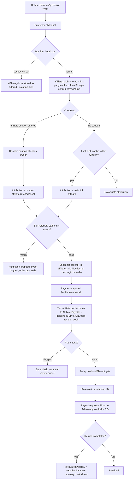

# Affiliate & Commission System

| Field | Value |
|---|---|
| Document | 08-affiliate-and-commission-system.md |
| Version | 1.0 |
| Status | Draft for Review |
| Date | 2026-11-01 |
| Owner | Product & Architecture Team |
| Related documents | 03-functional-requirements.md, 06-product-marketplace.md, 07-billing-and-financial-architecture.md, 09-fulfillment-and-licensing.md, 13-database-design.md, 17-security-requirements.md |

## Table of Contents

1. Scope & Two-Pool Economics
2. Commission Engine
   2.1 Rule resolution precedence · 2.2 Commission base (decision) · 2.3 Types · 2.4 Recurring renewals
3. Hierarchical Split Mechanism (charter §7.5)
   3.1 Weights & algorithm · 3.2 Worked examples · 3.3 Edge cases (depth truncation, suspense, missing ancestor, mixed chains)
4. Commission Lifecycle, Idempotency & Rounding
5. Reversals & Refund Clawback
6. Commission Statements & Reports
7. Affiliates (outside the hierarchy)
   7.1 Registration & scope · 7.2 Links, codes, coupons · 7.3 Attribution model & click tracking · 7.4 Conflict & self-referral rules · 7.5 Dashboard, payouts, fraud
8. Attribution Lifecycle (Mermaid flowchart)
9. Combined Worked Example — reseller chain + affiliate on one order
10. FR-COMMISSION Requirements + ACs
11. FR-AFFILIATE Requirements + ACs
12. Assumptions & Open Questions

---

## 1. Scope & Two-Pool Economics

This document defines **how much** is earned, **by whom**, and **when** it becomes withdrawable:

- **Pool 1 — Reseller hierarchical commission:** one platform-configurable pool per order, split across the selling chain (charter §7.5).
- **Pool 2 — Affiliate commission:** a **separate** pool, defined per affiliate, paid only to affiliates (outside the hierarchy), never cascading, never shared with the reseller chain.

**Economics rule (canonical):** the affiliate pool is an **additional cost borne by the platform** — it is deducted from the same order economics (the platform's residual ex-tax revenue) and is *never* subtracted from the reseller commission pool, never added to the customer's price, and never netted against payouts to resellers. Worked math in §9.

Money movements reference the ledger postings of `07-billing-and-financial-architecture.md` §5.2 (J3/J3b/J4/J5/J5b/J7/J14). All amounts `DECIMAL(15,2)`, currency `INR`, rounding half-up.

---

## 2. Commission Engine

### 2.1 Rule resolution precedence

Rules are resolved **per order line, at webhook-verified capture**, in strict precedence order — the first source that yields a non-null rule wins; the winning source code is snapshotted on the `commissions` row (`rule_source`):

| # | Source | Where configured |
|---|---|---|
| 1 | **Per-order override** | explicit commission override stored on the order line (admin-created orders / negotiated deals) |
| 2 | **Per-affiliate-product override** | `tenant_products.commission_override` (the reseller's terms for that product) |
| 3 | **Product default** | `products.commission_pct` / `products.commission_fixed` (owner tenant's setting) |
| 4 | **Category default** | `categories.commission_pct` (product's category) |
| 5 | **Tenant plan default** | reseller tenant's subscription-plan commission default (`tenant_settings` key) |
| 6 | **Platform default** | `platform_settings.commission.default_pct` |

- Resolution runs once per `(order_item, beneficiary)` generation attempt and the resolved values (type, value, source, base amount) are **snapshotted**; later catalog edits never retroactively change accrued commissions.
- A resolved value of `0` is a valid rule (explicit zero ⇒ no commission for that source's beneficiaries) — resolution stops at the first non-null source.

### 2.2 Commission base — DECISION

> **Commission base = the order's net product/service amount after coupon discounts, EXCLUDING taxes (GST) and EXCLUDING gateway fees.**

Formula per order line:

```
line_base = line_gross − line_discounts (line-level + allocated order/coupon discount)
order_base = Σ line_base            (tax-exclusive, fee-exclusive)
```

- `order_base` equals the invoice taxable value (doc 07 §3.1) — this keeps commissions, invoices, and ledger postings reconcilable to the same number.
- **Not** in the base: GST/output tax, gateway fee + fee GST, delivery/handling (none in MVP digital catalog), refunds (handled by clawback, not re-computation).
- The base is computed at capture, snapshotted on each `commissions` row, and never recomputed except by reversal + re-accrual.

### 2.3 Commission types

- **Percentage** — `value % × line_base`, per beneficiary level where applicable (split weights applied to the *pool*, see §3).
- **Fixed** — flat amount per order line (or per unit, P2), same currency as the order.
- Both are configured through the precedence chain of §2.1; fixed and percentage never stack from different sources for the same line (first source wins wholesale).

### 2.4 Recurring commissions on subscription renewals

- Each renewal cycle can earn commission if the resolved rule sets `renewal_cycles = N` (e.g. first **12** renewals; `0` = no renewal commission, `null` = platform default).
- Cycle numbering starts at **1 for the first renewal** (initial purchase is cycle 0 / `commission_type = initial`).
- The unique idempotency key includes `cycle_number` (§4), so replays cannot double-accrue a cycle.
- If the rule's chain weights or product terms change between renewals, each cycle uses the rule resolved at *that cycle's* capture (snapshot semantics).

---

## 3. Hierarchical Split Mechanism (charter §7.5)

### 3.1 Weights & algorithm

- **Weights table** `W = [w1, w2, … wn]` stored in `platform_settings` (`commission.hierarchy_split_weights`), ordered **from the seller outward**: `w1` = seller, `w2` = seller's parent, … Default example: **`[50, 30, 20]`** for up to **3 paying levels**. Validation: each `wi ≥ 0`, `Σwi = 100`, `n ≤ 10` (mechanism is configurable; exact default tiers remain an OQ per charter §7.5).
- The paying chain `L` = the seller and its paying ancestors up the closure table (`reseller_hierarchy`), `d = |L|`.
- **Algorithm (canonical):**
  1. `d = 1` → **seller receives 100% of the pool** (single-level case).
  2. `1 < d ≤ n` → assign `w1…wd` to `L[0…d−1]`; the **remainder `R = 100 − Σ(w1…wd)` is credited to the nearest existing ancestor** (the deepest level present, i.e. `L[d−1]`; for `d = 1` that is the seller — consistent with rule 1). With defaults: `d = 2` → seller 50, parent 30 + 20 remainder = **50** (50/50).
  3. `d > n` → assign `w1…wn` to the nearest `n` levels; **levels deeper than the weights table (n+1 … d) receive 0%** — the platform pays at most the configured depth. Defaults ⇒ seller 50, parent 30, grandparent 20, great-grandparent 0, root 0.
  4. Any level that is **ineligible (suspended)** does *not* get redistributed (§3.3) — its share goes to `Suspense Payable` (ledger `2400`) and no wallet credit is created.
  5. Eligible level = reseller active, tenant not suspended, wallet exists; otherwise the suspense/missing-ancestor rules apply before weight assignment is finalized.
- Shares are computed from the pool with **half-up 2-dp rounding**; the residual between the pool and Σ shares is posted to the platform's **Commission Rounding / Variance line (`9000`)** (§4).

### 3.2 Worked examples (pool = ₹1,694.92 from `07-…` §7)

| Chain | Split |
|---|---|
| C alone (depth 1) | C **₹1,694.92** (100%) |
| B → C (depth 2) | C 50% = **₹847.46**, B 30%+20% = **₹847.46** |
| A → B → C (depth 3) | C **₹847.46**, B **₹508.48**, A **₹338.98** (Σ = ₹1,694.92) |
| X → A → B → C (depth 4, defaults) | C ₹847.46, B ₹508.48, A ₹338.98, X **₹0.00** |

### 3.3 Edge cases

- **Seller at depth 5 (truncation rule):** with defaults, only the nearest 3 levels are paid (§3.1 rule 3); ancestors at depth 4–5 receive ₹0.00 and their `commissions` rows are recorded with status `not_eligible_depth` for transparency (no money moves).
- **Suspended ancestor → HELD (decision):** if a beneficiary is suspended at accrual time, their computed share is credited to **`Suspense Payable`** (J5) — *held*, not redistributed to other ancestors and not forfeited. On restoration: J5b credits their wallet `pending` (`adjustment` row); the hold clock is measured from original capture, so if the 7-day hold already elapsed, the release job releases it on the next run. If suspension persists > 90 days (configurable), Finance Admin may decide forfeit-to-platform via an audited adjustment (P2).
- **Missing ancestor (deleted):** prevented by hierarchy rules (doc 03/FR-RESELLER: a reseller with closure-table descendants cannot be deleted — soft-suspend only). Defensive fallback: if resolution still finds a dangling ancestor id, the share goes to the **nearest existing ancestor**, plus a data-integrity alert; if no ancestor exists at all, the share goes to `Suspense Payable`.
- **Mixed chains:** (a) eligibility differs per level (active/suspended/missing) — handled by rules above per level, never by re-normalizing other beneficiaries' shares (a healthy beneficiary's share is always exactly its weight share); (b) ancestors belonging to different tenants with different plans — the split weights are **platform-level**, applied uniformly regardless of the ancestors' plan; (c) the same reseller appears once per chain (closure table guarantees no cycles).

---

## 4. Commission Lifecycle, Idempotency & Rounding

**States (`commissions.status`):** `pending → held → released → (reversed | written_off)`; plus terminal `not_eligible_depth`.

1. **Accrue (`pending`)** — at webhook-verified capture (J3/J3b): rows created with `order_item_id`, beneficiary, type, cycle, base snapshot, share, `hold_until = captured_at + hold_days`.
2. **Hold** — default **7 days** (`platform_settings.commission.hold_days`, tenant-plan override), **AND** fulfillment success where the product's fulfillment model requires gating (`09-fulfillment-and-licensing.md`; gate flag on the product). Status `held` while a gate is unmet even after 7 days.
3. **Release (`released`)** — nightly auto-release job moves rows where `hold_until ≤ now` AND fulfillment gate satisfied (or not required) → J4 pending→available. **Manual-approval mode** (per tenant plan, default off): rows wait in `held` until a Finance Admin bulk-approves.
4. **Withdrawable** = available balance (doc 07 §5.5 payout request flow).

**Idempotency (canonical):** unique constraint on `commissions` = **`(order_item_id, beneficiary_type, beneficiary_id, commission_type, cycle_number)`**. Webhook replay/reprocessing hits the constraint and creates nothing (insert-or-ignore + verification). Ledger postings carry the same reference so J3 cannot double-post.

**Rounding:** every share = `round_half_up(pool × weight, 2)`. `Σ shares` may differ from the pool by a few paise → the difference posts to **`9000 Commission Rounding / Variance`** (platform absorbs: credit if Σshares < pool, debit if Σshares > pool). Customer/invoice amounts are never affected.

---

## 5. Reversals & Refund Clawback

- Trigger: refund reaches `completed` (gateway webhook, doc 07 §4.6) → clawback job enqueued **once** (idempotent on `refunds.id`).
- **Pro-rata across ALL beneficiaries of that order** (reseller chain *and* affiliate pool): for each beneficiary, `clawback = round_half_up(their original share × refunded_base / original_base, 2)`; full refund ⇒ full share. Partial refunds use the ratio; residual paise absorb to the platform line (`9000`).
- Postings: **J7** — negative wallet movement (`refund_clawback` rows), status → `reversed`. Pending balances are clawed from `pending`; released balances from `available`.
- **Already withdrawn → negative balance + recovery queue** (doc 07 FR-WALLET-030): wallet goes negative, shortfall reclassified to Commission Receivable, payee appears in the recovery list (netted against future earnings automatically).
- **Write-off threshold:** |negative| below configurable threshold (default ₹100, Finance Admin config) may be written off via J14 with audit; above threshold requires manual recovery decision.
- Refund after the beneficiary's release but before payout is the common case — clawback debits `available`, so a payout request that would exceed the post-clawback balance is blocked (FR-WALLET-023).

---

## 6. Commission Statements & Reports

- **Per beneficiary, per period** (month preset or custom range), downloadable CSV + PDF: gross earned, by type (initial/renewal/affiliate), released, reversed, clawed back, written off, net movement, ending pending/available balances; invoice/order references per row.
- **Tax-relevant fields:** beneficiary legal name, GSTIN (resellers), PAN (P2), commission type, gross/net amounts, TDS deducted (P2, when payout TDS enabled), period — sufficient for the beneficiary's books.
- Reports: pending release forecast (next 7/30 days), hold-blocked list (unfulfilled gates), clawback liability, per-tenant commission expense (Finance Admin), affiliate performance by program (§7.5).
- Scope: reseller sees own + (visibility per hierarchy rules, doc 03) sub-chain statements; affiliates see only their own; Finance Admin sees all.

---

## 7. Affiliates (Outside the Hierarchy)

### 7.1 Registration & scope

- An affiliate belongs to exactly one **tenant scope**: central platform program or a reseller's program (`affiliates.tenant_id`). Affiliates are never resellers, never appear in `reseller_hierarchy`, never earn pool-1 commission, and their earnings never cascade.
- Flow: apply (name, email, phone, channel description, payout destination) → tenant admin (reseller) or Platform Admin (central) **approve/reject** → active. States: `applied → active | rejected`, `active → suspended | paused` (suspension freezes new attributions; existing pending commissions follow §7.5 hold rules).

### 7.2 Links, codes, coupons

- **Affiliate code:** unique per affiliate (e.g. `ALPHA9`), shown in dashboard.
- **Referral links:** `/r/{code}` (and `/r/{code}/{product-slug}`) resolving to the tenant storefront with attribution cookie set; also `?ref={code}` accepted on any storefront URL (P0 both).
- **Affiliate links table** (`affiliate_links`): per-URL short links with campaign label; each click records `affiliate_link_id`.
- **Coupon attribution:** each active affiliate gets an **auto-generated coupon** (`coupons.code = AFF{code}` style, tenant-scoped, own discount rules or zero-discount tracking coupon) linked to `coupons.affiliate_id`; coupon codes may also be created manually and attached to an affiliate.

### 7.3 Attribution model & click tracking

- **Model: last click wins**, first-party **cookie window default 30 days** (configurable 1–90 days per tenant program), **first-party cookie (`__fc_aff`) with `localStorage` fallback**, refreshed on each qualifying click.
- **Click tracking** (`affiliate_clicks`): `affiliate_id`, `affiliate_link_id`, `click_id`, **IP hash** (HMAC with app key — no raw IP), `user_agent`, device class, landing URL, `referer`, `timestamp`, bot-filter outcome.
- **Bot filtering heuristics (P1):** known bot UA signatures, empty/JS-disabled fingerprint, click→conversion time < 3 s, IP-hash click velocity > threshold ⇒ mark `filtered` (kept for audit, not eligible for attribution).
- **Conversion attribution stored on `orders`:** `affiliate_id`, `affiliate_link_id`, `click_id`, `coupon_id` — snapshotted at order creation and immutable afterwards.
- **Attribution precedence (canonical):** explicit **coupon code wins** over cookie click (deterministic, survives cookie loss); if no coupon, last-click within window applies; if neither → no affiliate attribution.

### 7.4 Conflict & self-referral rules

- **Conflict rule (documented):** an order placed **with an affiliate coupon but without any tracked click** still attributes to the coupon's affiliate (coupon is explicit intent; click tracking can fail). Reverse case (click but coupon of a *different* affiliate) → coupon's affiliate wins per precedence.
- **Self-referral (P1):** block attribution when the buyer email matches the affiliate's own email **or any user email in the affiliate's tenant** (owner/staff list from `users`) ⇒ attribution dropped, order proceeds normally, event logged.
- **Paying-instrument match (P2):** heuristic flag when a new customer's payment instrument hash matches a prior customer of the same affiliate beyond N conversions ⇒ `risk_review` (manual review, commissions held).

### 7.5 Dashboard, payouts, fraud

- **Dashboard:** clicks, conversions, conversion rate, earnings (pending/available/reversed), active links, coupon code, payout history — tenant-scoped.
- **Payouts:** reuse the payout flow of `07-billing-and-financial-architecture.md` §5.5 unchanged (threshold, encrypted bank/UPI, Finance Admin approve/reject, evidence, J8/J9/J10 postings against `2300 Affiliate Payable`).
- **Fraud detection:** (a) click velocity per affiliate (clicks/hour bursts), (b) **conversion-rate anomaly** (> 3σ above program baseline or > 90% — configurable), (c) bot-filter ratio, (d) self-referral hits → severity-scored flags in a **manual review queue**; while flagged, that affiliate's new commissions go to `held` (not released) and new attributions continue to be recorded. Finance Admin/tenant admin resolves: release, reverse, or suspend.
- Affiliate commission accrues from the **separate pool**: J3b → `commission_pending` → hold (same 7-day default, fulfillment gate applies) → `commission_release` → available → payout.

---

## 8. Attribution Lifecycle



---

## 9. Combined Worked Example — reseller chain + affiliate on the SAME order

**Same inputs as `07-billing-and-financial-architecture.md` §7**, plus an affiliate referred the buyer: affiliate program rate **8%** (flat %, separate pool).

| Line | Computation | Amount |
|---|---|---|
| Customer pays (GST-inclusive 18%) | — | **₹10,000.00** |
| Commission base (ex-GST, ex-fee) | 10,000 ÷ 1.18 | **₹8,474.58** |
| Output GST (CGST+SGST) | 10,000 − 8,474.58 | **₹1,525.42** |
| Reseller pool 20% | 8,474.58 × 20% | **₹1,694.92** → C ₹847.46 / B ₹508.48 / A ₹338.98 |
| **Affiliate pool 8% (separate)** | 8,474.58 × 8% = 677.9664 | **₹677.97** (half-up) |
| Gateway fee 2% + 18% GST | 200.00 + 36.00 | **₹236.00** |
| Net settled to platform | 10,000 − 236 | **₹9,764.00** |
| Platform residual | 8,474.58 − 1,694.92 − 677.97 − 200.00 | **₹5,901.69** |

**Reconciliation to ₹ (at capture, before refund):**

```
Net settled 9,764.00 = Tax Payable net (1,525.42 − 36.00 ITC = 1,489.42)
                     + Reseller chain        1,694.92
                     + Affiliate pool          677.97
                     + Platform residual     5,901.69   → Σ = 9,764.00 ✓
```

**Platform margin:** ₹5,901.69 = **69.64% of the commission base** (77.64% before the affiliate pool; 69.64% after). The affiliate's ₹677.97 is paid from this residual — the platform absorbs it; neither C's ₹847.46 nor B's/A's shares change versus the no-affiliate case in `07-…` §7.

**Full refund at T+10:** clawback ₹1,694.92 (chain) + ₹677.97 (affiliate) = **₹2,372.89** returned to the platform's commission clearing; wallets A/B/C and the affiliate net to ₹0.00 (or go negative if withdrawn → recovery queue). Platform's net loss on the refunded order = **₹236.00** retained gateway fee (+ any un-recoverable negative balances).

---

## 10. FR-COMMISSION Requirements

| ID | Requirement | Priority |
|---|---|---|
| FR-COMMISSION-001 | Resolve commission rules per order line by strict precedence: per-order override → `tenant_products.commission_override` → product default → category default → tenant plan default → platform default; snapshot the winning source on each commission row. | P0 |
| FR-COMMISSION-002 | Define commission base = order net product/service amount after coupon discounts, excluding taxes and gateway fees; snapshot base per line at capture. | P0 |
| FR-COMMISSION-003 | Support percentage-type commission computed as `base × pct`, half-up to 2 dp. | P0 |
| FR-COMMISSION-004 | Support fixed-amount commission per order line (per-unit variant P2). | P1 |
| FR-COMMISSION-005 | Support recurring commission on renewals with configurable `renewal_cycles` (e.g. first 12), cycle_numbered and separately idempotent. | P1 |
| FR-COMMISSION-006 | Implement platform-configurable hierarchy split weights (default `[50,30,20]` seller-outward, Σ=100, `n ≤ 10`) applied to the reseller commission pool. | P0 |
| FR-COMMISSION-007 | Pay 100% of the pool to the seller when the chain depth is 1. | P0 |
| FR-COMMISSION-008 | When chain depth ≤ weights length, assign the weights to existing levels and credit the remainder (100 − Σ assigned) to the nearest existing ancestor (seller when depth 1). | P0 |
| FR-COMMISSION-009 | When chain depth exceeds the weights length, pay only the nearest `n` levels; deeper ancestors receive 0% recorded as `not_eligible_depth`. | P0 |
| FR-COMMISSION-010 | Hold a suspended beneficiary's share in `Suspense Payable` (no redistribution), restoring to their pending wallet on reactivation with original hold-clock semantics. | P0 |
| FR-COMMISSION-011 | Prevent missing-ancestor chains via hierarchy deletion rules; defensively reassign a dangling share to the nearest existing ancestor (or suspense) with an integrity alert. | P0 |
| FR-COMMISSION-012 | Support mixed chains: per-level eligibility handled independently; healthy beneficiaries always receive exactly their weight share; weights are platform-level regardless of ancestors' plans. | P1 |
| FR-COMMISSION-013 | Accrue commissions as `pending` only at webhook-verified capture, posting J3/J3b exactly once. | P0 |
| FR-COMMISSION-014 | Round shares half-up to 2 dp; post any pool-vs-sum residual to the platform Commission Rounding/Variance line (`9000`). | P0 |
| FR-COMMISSION-015 | Apply a configurable hold (default 7 days, tenant-plan overridable) before release; status `pending → held → released`. | P0 |
| FR-COMMISSION-016 | Gate release on fulfillment success for products whose fulfillment model requires it (cross-ref `09-fulfillment-and-licensing.md`). | P1 |
| FR-COMMISSION-017 | Run an auto-release nightly job moving eligible rows pending→available with J4 postings. | P0 |
| FR-COMMISSION-018 | Support per-tenant-plan manual-approval mode where releases wait for Finance Admin bulk approval. | P1 |
| FR-COMMISSION-019 | Claw back commissions pro-rata across ALL beneficiaries (reseller chain + affiliate) on completed refunds, with negative wallet movement (`refund_clawback`, J7). | P0 |
| FR-COMMISSION-020 | Create negative balances + recovery-queue entries when clawback exceeds remaining balance after withdrawal; auto-net against future earnings. | P1 |
| FR-COMMISSION-021 | Enforce idempotency via unique `(order_item_id, beneficiary_type, beneficiary_id, commission_type, cycle_number)` — webhook replays create no rows and no postings. | P0 |
| FR-COMMISSION-022 | Write the reversal (clawback) exactly once per refund id, even when multiple refund webhooks arrive. | P0 |
| FR-COMMISSION-023 | Produce per-beneficiary, per-period commission statements (CSV + PDF) with gross/released/reversed/net and order references. | P1 |
| FR-COMMISSION-024 | Include tax-relevant fields on statements: legal name, GSTIN, commission type, gross/net, TDS deducted (P2). | P1 |
| FR-COMMISSION-025 | Provide Finance Admin manual commission adjustment (postive/negative) with mandatory note and ledger+subledger pair. | P1 |
| FR-COMMISSION-026 | Expose pending-release forecast and hold-blocked (unfulfilled) lists to Finance Admin. | P2 |
| FR-COMMISSION-027 | Record `not_eligible_depth` rows for depth-truncated ancestors without moving money. | P2 |
| FR-COMMISSION-028 | Support explicit zero commission (`0%`) as a valid resolved rule that stops precedence further down. | P2 |
| FR-COMMISSION-029 | Scope commission visibility: reseller sees own chain (per hierarchy visibility rules), affiliate sees own, Finance Admin sees all. | P1 |
| FR-COMMISSION-030 | Forfeit a >90-day suspended ancestor's suspense balance to platform only via audited Finance Admin decision (default: keep held). | P2 |

## 11. FR-AFFILIATE Requirements

| ID | Requirement | Priority |
|---|---|---|
| FR-AFFILIATE-001 | Support affiliate registration with tenant scope (central program or reseller program) and admin approve/reject with states `applied → active | rejected | suspended | paused`. | P0 |
| FR-AFFILIATE-002 | Issue a unique affiliate code per affiliate, visible in the dashboard. | P0 |
| FR-AFFILIATE-003 | Resolve `/r/{code}` (and `/r/{code}/{product}`) to the tenant storefront with attribution set. | P0 |
| FR-AFFILIATE-004 | Accept `?ref={code}` on any storefront URL as an attribution source. | P0 |
| FR-AFFILIATE-005 | Auto-generate a tenant-scoped coupon per active affiliate linked via `coupons.affiliate_id`, revocable on suspension. | P1 |
| FR-AFFILIATE-006 | Attribute conversions by **last click** model; coupon attribution takes precedence over cookie click when both exist. | P0 |
| FR-AFFILIATE-007 | Enforce a configurable cookie window (default 30 days, allowed range 1–90) per tenant program. | P0 |
| FR-AFFILIATE-008 | Persist attribution with first-party cookie and `localStorage` fallback, refreshed on each qualifying click. | P0 |
| FR-AFFILIATE-009 | Record every click in `affiliate_clicks` (IP hash, UA, device, landing, referer, timestamp, link id, click id). | P0 |
| FR-AFFILIATE-010 | Filter suspected bot clicks via heuristics (bot UA, sub-3-second conversion, velocity) marking them `filtered` and ineligible. | P1 |
| FR-AFFILIATE-011 | Snapshot `affiliate_id`, `affiliate_link_id`, `click_id`, `coupon_id` on the order at creation; immutable afterwards. | P0 |
| FR-AFFILIATE-012 | Apply the conflict rule: coupon-attributed orders without a tracked click still attribute to the coupon's affiliate. | P0 |
| FR-AFFILIATE-013 | Block self-referral: buyer email matching the affiliate's or any same-tenant user email drops attribution, logs the event, order proceeds. | P1 |
| FR-AFFILIATE-014 | Flag paying-instrument matches (same affiliate, N+ conversions) for manual review (P2 heuristic). | P2 |
| FR-AFFILIATE-015 | Pay affiliate commissions exclusively from the separate affiliate pool (J3b) — never from, nor netted against, the reseller hierarchical pool. | P0 |
| FR-AFFILIATE-016 | Document and enforce that the affiliate pool is an additional platform cost absorbed in platform residual revenue. | P0 |
| FR-AFFILIATE-017 | Provide an affiliate dashboard: clicks, conversions, conversion rate, pending/available/reversed earnings, links, coupon, payout history. | P1 |
| FR-AFFILIATE-018 | Route affiliate payout requests through the doc-07 payout flow (threshold, encrypted destination, Finance Admin approval, J8/J9/J10 on `2300`). | P1 |
| FR-AFFILIATE-019 | Score fraud signals (click velocity, conversion-rate anomaly, bot ratio, self-referral hits) into a manual review queue. | P2 |
| FR-AFFILIATE-020 | Hold flagged affiliates' new commissions in `held` until review resolution (release / reverse / suspend). | P1 |
| FR-AFFILIATE-021 | Freeze new attributions on suspended affiliates while leaving pending commissions to normal lifecycle/clawback rules. | P1 |
| FR-AFFILIATE-022 | Configure per-affiliate commission as percentage of base or flat amount (program default overridable per affiliate). | P0 |
| FR-AFFILIATE-023 | Isolate attribution per tenant: an affiliate of tenant A can never attribute to tenant B's orders. | P0 |
| FR-AFFILIATE-024 | Produce click-to-conversion reporting per affiliate/link/campaign (clicks, filtered, conversions, EPC). | P1 |
| FR-AFFILIATE-025 | Notify affiliates on approval, suspension, commission accrual, release, clawback, and payout status changes (in-app + email). | P1 |
| FR-AFFILIATE-026 | Require affiliate terms acceptance (including fraud/clawback policy) at registration, stored with timestamp. | P1 |
| FR-AFFILIATE-027 | Support multiple tracked links per affiliate with campaign labels and per-link stats. | P2 |
| FR-AFFILIATE-028 | Disclose/obtain consent for first-party tracking cookies per tenant legal settings (banner hook, P2). | P2 |
| FR-AFFILIATE-029 | Enforce tenant scoping on all affiliate endpoints (affiliate sees own data; reseller admin sees own program). | P1 |
| FR-AFFILIATE-030 | Auto-revoke an affiliate's coupon codes and disable links on suspension within one job cycle. | P1 |

### FR-COMMISSION Acceptance Criteria (P0/P1)

- **AC-FR-COMMISSION-001-1** `Given` a product with `products.commission_pct = 25` and `tenant_products.commission_override = 15`, `When` a line resolves, `Then` 15% wins and `rule_source = tenant_products`.
- **AC-FR-COMMISSION-001-2** `Given` a per-order override of 10% on the line, `When` resolution runs, `Then` 10% wins over all other sources and is snapshotted.
- **AC-FR-COMMISSION-002-1** `Given` a ₹10,000 tax-inclusive order with ₹500 coupon and 18% GST, `When` the base computes, `Then` base = (10,000 − 500) ÷ 1.18 = ₹8,050.85 — taxes and the ₹200 gateway fee excluded.
- **AC-FR-COMMISSION-003-1** `Given` base ₹8,474.58 and 20%, `When` accrued, `Then` share = ₹1,694.92 (half-up) on the commission row.
- **AC-FR-COMMISSION-004-1** `Given` a fixed rule of ₹500 on a line with base ₹8,474.58, `When` accrued, `Then` the share = ₹500.00 flat (percentage rule ignored) and the resolved type is snapshotted.
- **AC-FR-COMMISSION-005-1** `Given` `renewal_cycles = 12` and renewal 12 succeeds, `When` accrual runs, `Then` cycle 12 accrues; renewal 13 creates no row.
- **AC-FR-COMMISSION-006-1** `Given` default weights `[50,30,20]`, `When` platform changes them to `[60,40]`, `Then` subsequent accruals use the new weights; accrued rows are unaffected.
- **AC-FR-COMMISSION-007-1** `Given` a depth-1 chain and pool ₹1,694.92, `When` split runs, `Then` seller receives ₹1,694.92 (100%).
- **AC-FR-COMMISSION-008-1** `Given` depth 2 with defaults, `When` split runs, `Then` seller ₹847.46 and parent ₹847.46 (30% + 20% remainder), Σ = pool.
- **AC-FR-COMMISSION-009-1** `Given` depth 5 with defaults, `When` split runs, `Then` C/B/A receive 50/30/20 shares and the two deepest ancestors receive rows with `not_eligible_depth` and ₹0.00.
- **AC-FR-COMMISSION-010-1** `Given` ancestor A suspended at capture, `When` accrual runs, `Then` A's ₹338.98 credits `Suspense Payable`, A's wallet is untouched, B/C receive full normal shares; after A's reactivation J5b credits A's pending wallet and release follows the hold clock.
- **AC-FR-COMMISSION-011-1** `Given` a dangling ancestor id (data defect), `When` resolution runs, `Then` the share goes to the nearest existing ancestor (or suspense if none), an integrity alert fires, and no beneficiary loses money.
- **AC-FR-COMMISSION-012-1** `Given` a chain where the parent is suspended but seller and grandparent are active, `When` split runs, `Then` seller and grandparent receive exactly their weight shares (50% / 20% of pool as configured) — no re-normalization — and the parent's share sits in suspense.
- **AC-FR-COMMISSION-013-1** `Given` a webhook marked `deferred` before capture applied, `When` reprocessed, `Then` accrual happens exactly once, at capture time, with J3 reference.
- **AC-FR-COMMISSION-014-1** `Given` pool ₹100.00 split three ways equally, `When` rounded, `Then` shares are ₹33.33/₹33.33/₹33.34 (or equivalent half-up) and the ₹0.00 residual posts to `9000`; Σ shares + residual = pool exactly.
- **AC-FR-COMMISSION-015-1** `Given` capture at 2026-11-01 with hold 7 days, `When` the release job runs on 2026-11-07 before 16:00 UTC+5:30 boundary, `Then` nothing releases; after `hold_until`, it releases exactly once.
- **AC-FR-COMMISSION-016-1** `Given` a product with fulfillment gate and an unfulfilled job, `When` the release job runs past hold_until, `Then` the row stays `held`; after fulfillment success it releases on the next run.
- **AC-FR-COMMISSION-017-1** `Given` 500 eligible rows, `When` the nightly job runs, `Then` all move to `released`, J4 posts once per beneficiary batch, and a re-run changes nothing.
- **AC-FR-COMMISSION-018-1** `Given` a tenant plan with manual approval, `When` hold expires, `Then` rows wait in `held` until Finance Admin bulk-approves, which releases them atomically per batch.
- **AC-FR-COMMISSION-019-1** `Given` beneficiaries with ₹847.46/₹508.48/₹338.98 and affiliate ₹677.97, `When` a full refund completes, `Then` all four are clawed back pro-rata (Σ ₹2,372.89) via J7 with `refund_clawback` rows.
- **AC-FR-COMMISSION-019-2** `Given` a 50% refund of the base, `When` clawback runs, `Then` each beneficiary is reversed `round_half_up(share × 0.5, 2)` and Σ reversals = round_half_up(pool × 0.5) ± paise absorbed to `9000`.
- **AC-FR-COMMISSION-020-1** `Given` beneficiary C already withdrew ₹847.46, `When` full-refund clawback runs, `Then` C's available = −₹847.46, C appears in the recovery queue, and future commissions auto-net.
- **AC-FR-COMMISSION-021-1** `Given` the same capture webhook replayed 5 times, `When` processed, `Then` `commissions` contains exactly one row per (item, beneficiary, type, cycle) and J3 exists exactly once.
- **AC-FR-COMMISSION-022-1** `Given` two `refund.processed` webhooks for one refund id, `When` processed, `Then` clawback executes once (second is `ignored_duplicate`).
- **AC-FR-COMMISSION-023-1** `Given` a beneficiary month with accruals/releases/reversals, `When` the statement exports, `Then` CSV and PDF totals match and each row links to its order/invoice.
- **AC-FR-COMMISSION-024-1** `Given` a GSTIN-registered reseller, `When` the statement renders, `Then` it includes legal name, GSTIN, gross, net, and (P2) TDS fields.
- **AC-FR-COMMISSION-025-1** `Given` a Finance Admin adjustment of −₹25 with note, `When` saved, `Then` a balanced journal entry + `adjustment` wallet row exist and audit captures actor/note.
- **AC-FR-COMMISSION-029-1** `Given` reseller B, `When` B requests a statement, `Then` B sees B + C rows only; A's rows are invisible; Finance Admin sees all three.

### FR-AFFILIATE Acceptance Criteria (P0/P1)

- **AC-FR-AFFILIATE-001-1** `Given` an application from tenant X, `When` X's admin approves, `Then` status = `active`, code issued, and the affiliate appears only in X's program.
- **AC-FR-AFFILIATE-002-1** `Given` an approved affiliate, `When` the code is issued, `Then` it is unique across the platform, URL-safe, and shown in the dashboard; duplicate generation on re-approval returns the existing code.
- **AC-FR-AFFILIATE-003-1** `Given` a visitor opening `/r/ALPHA9`, `When` resolved, `Then` they land on the tenant storefront, the first-party cookie is set to `ALPHA9`, and an `affiliate_clicks` row exists.
- **AC-FR-AFFILIATE-004-1** `Given` a visitor opening `/product?ref=ALPHA9`, `When` resolved, `Then` attribution equals the `/r/ALPHA9` path.
- **AC-FR-AFFILIATE-005-1** `Given` an active affiliate, `When` activation completes, `Then` a linked coupon exists with `coupons.affiliate_id` set; on suspension the coupon is revoked within one job cycle.
- **AC-FR-AFFILIATE-006-1** `Given` a click from affiliate X at day 0 and a click from affiliate Y at day 3, `When` purchase occurs at day 4, `Then` Y (last click) is attributed.
- **AC-FR-AFFILIATE-007-1** `Given` window 30 days and a click at day 0, `When` purchase occurs at day 31, `Then` no click attribution applies; at day 29 it applies.
- **AC-FR-AFFILIATE-008-1** `Given` cookies blocked but `localStorage` available, `When` the visitor returns within window, `Then` attribution still resolves from the stored click id.
- **AC-FR-AFFILIATE-009-1** `Given` a qualifying click, `When` recorded, `Then` `affiliate_clicks` contains IP hash (no raw IP), UA, device class, landing URL, referer, timestamp, `affiliate_link_id`, and a generated `click_id`; filtered clicks are retained with outcome.
- **AC-FR-AFFILIATE-010-1** `Given` a click with bot UA and a conversion 1 second later, `When` filtering runs, `Then` the click is `filtered`, unattributable, and counted separately in reports.
- **AC-FR-AFFILIATE-011-1** `Given` an attributed order, `When` created, `Then` `affiliate_id`, `affiliate_link_id`, `click_id`, `coupon_id` are stored and later edits cannot change them.
- **AC-FR-AFFILIATE-012-1** `Given` an order with affiliate coupon `AFFALPHA9` and no tracked click, `When` attribution resolves, `Then` the coupon's affiliate is credited.
- **AC-FR-AFFILIATE-013-1** `Given` buyer email = affiliate's own email, `When` attribution resolves, `Then` attribution is dropped, the event is logged, and the order completes normally.
- **AC-FR-AFFILIATE-015-1** `Given` an order earning chain ₹1,694.92 and affiliate ₹677.97, `When` postings run, `Then` J3 credits `2200` wallets and J3b credits `2300` independently — no line mixes the pools.
- **AC-FR-AFFILIATE-016-1** `Given` the combined example of §9, `When` platform residual computes, `Then` it equals ₹5,901.69 and the affiliate cost reduced only the platform residual, not any reseller share.
- **AC-FR-AFFILIATE-017-1** `Given` an affiliate with 100 clicks / 4 conversions / ₹800 released, `When` the dashboard loads, `Then` it shows those figures plus pending and reversed amounts consistent with `commissions`.
- **AC-FR-AFFILIATE-018-1** `Given` an affiliate with ₹5,000 available and threshold ₹1,000, `When` they request ₹4,000, `Then` the payout flow of doc 07 applies unchanged (hold → approval → evidence → J8/J9).
- **AC-FR-AFFILIATE-020-1** `Given` an affiliate flagged for conversion-rate anomaly, `When` new commissions accrue, `Then` they are `held` (not released by the job) and appear in the review queue.
- **AC-FR-AFFILIATE-021-1** `Given` a suspended affiliate, `When` a new order uses their coupon, `Then` no new attribution is recorded (coupon already revoked), while pending commissions follow normal hold/clawback rules.
- **AC-FR-AFFILIATE-022-1** `Given` program default 8% and affiliate override 5%, `When` a conversion attributes, `Then` 5% of base is accrued for that affiliate.
- **AC-FR-AFFILIATE-023-1** `Given` an affiliate of tenant A clicking a tenant B storefront link, `When` a B order converts, `Then` no affiliate attribution or commission exists for that order.
- **AC-FR-AFFILIATE-024-1** `Given` an affiliate with 100 clicks (15 filtered), 4 conversions, ₹800 released, `When` the click-to-conversion report runs, `Then` it shows clicks 100, filtered 15, conversions 4, conversion rate 4.00% on unfiltered clicks, and EPC = ₹8.00 — matching the underlying tables.
- **AC-FR-AFFILIATE-025-1** `Given` accrual/release/clawback/payout events, `When` they occur, `Then` the affiliate receives the matching in-app + email notification once each.
- **AC-FR-AFFILIATE-026-1** `Given` registration without terms acceptance, `When` submitted, `Then` it is rejected; acceptance timestamp is stored with the application.
- **AC-FR-AFFILIATE-029-1** `Given` an affiliate token, `When` it requests another affiliate's stats, `Then` 404 is returned.
- **AC-FR-AFFILIATE-030-1** `Given` a suspended affiliate, `When` the next job cycle runs, `Then` their coupon is revoked, links disabled, and a suspension notification sent.

---

## 12. Assumptions & Open Questions

1. **Default split weights `[50,30,20]`** are the charter's example; exact production tiers are an OQ (charter §7.5) — the mechanism (configurable, Σ=100, seller-outward) is fixed.
2. **Depth-truncation interpretation:** chains deeper than the weights table pay only the nearest `n` levels (deeper ancestors = 0%); short chains give the remainder to the nearest existing ancestor. Flagged for business confirmation.
3. **Suspense forfeiture after 90 days** (P2) is opt-in and audited; default behaviour is hold-until-restore.
4. **Affiliate program default rate** (8% in §9) is illustrative; per-program configuration lives in `platform_settings`/`tenant_settings`.
5. **Bot/anomaly thresholds** (velocity, 3σ, >90% conversion) are configurable defaults pending tuning post-launch.
6. **Paying-instrument matching (P2)** requires gateway-provided instrument tokens; if unavailable, the heuristic degrades to device/IP-hash matching.
7. **First-party tracking consent** (P2) assumes Indian regulations permit first-party attribution cookies with disclosure; legal review pending.
8. **Coupon-attribution-without-click** deliberately favors merchant-verifiable intent over click data — documented conflict rule; chargeback/fraud disputes handled by the manual review queue.
9. `commissions.rule_source`, `hold_until`, `status` and order attribution columns are doc-13 column additions to canonical tables (`commissions`, `orders`, `coupons`, `tenant_products`, `products`, `categories`).

## Appendix / References

- Charter: `frenchies-prd-charter.md` §7.5 (hierarchy split), §7.6 (separate affiliate pool), §7.7 (clawback), §7.10 (idempotency).
- Owning FR prefixes: `FR-COMMISSION-001…030`, `FR-AFFILIATE-001…030`.
- Ledger postings, payout flow, and the no-affiliate numeric baseline: `07-billing-and-financial-architecture.md` (§5.2, §5.5, §7).
