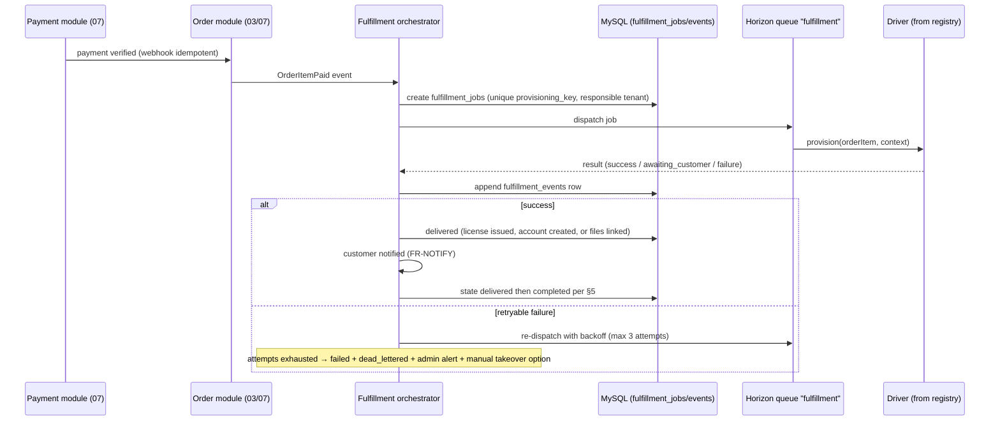
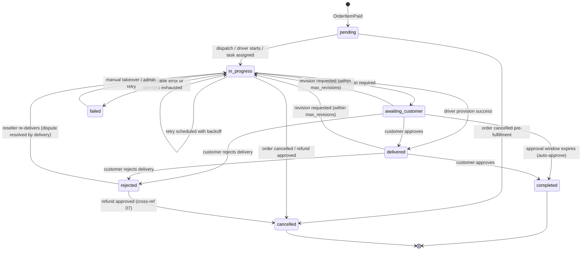
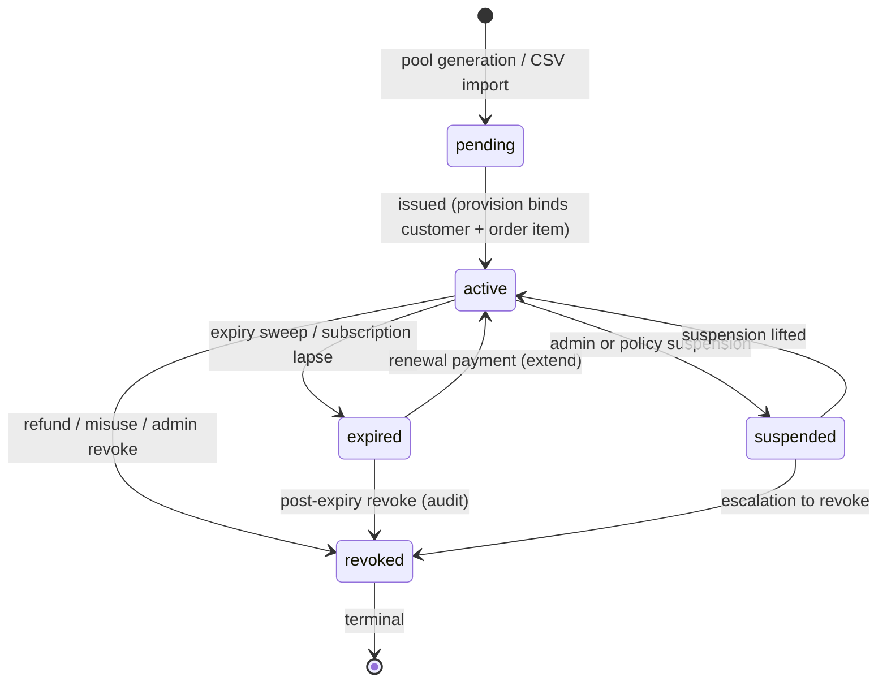

# 09 — Fulfillment & Licensing

| Field | Value |
|---|---|
| Document | 09-fulfillment-and-licensing.md |
| Version | 1.0 |
| Status | Draft for Review |
| Date | 2026-11-01 |
| Owner | Product & Architecture Team |
| Related documents | `03-functional-requirements.md` (FR-ORDER, FR-CUSTOMER, FR-NOTIFY), `06-product-marketplace.md` (FR-PRODUCT), `07-billing-and-financial-architecture.md` (payments, refunds, offline orders), `11-ai-and-automation.md` (n8n automation), `13-database-design.md` (column definitions), `15-user-workflows.md`, `16-ui-ux-specification.md`, `17-security-requirements.md`, `18-non-functional-requirements.md` |

## Table of contents

1. Purpose & Scope
2. Domain Concepts & Terminology
3. Fulfillment Provider Architecture
   - 3.1 Provider contract
   - 3.2 Driver registry & per-product configuration
   - 3.3 Built-in MVP drivers
   - 3.4 P2/P3 drivers (roadmap)
   - 3.5 Extensibility: adding a driver + driver contract test suite
4. Automatic Fulfillment Flow
5. Fulfillment State Machine
6. SLA & Deadline Tracking
7. Manual Fulfillment Flow (tasks, assignment, approvals, revisions, disputes)
8. Multi-item Orders, Bundles & Subscription Renewals
9. Fulfillment Responsibility Matrix (central vs reseller)
10. Licensing Module
    - 10.1 License record & key format
    - 10.2 License states & lifecycle
    - 10.3 Issuance paths (pool, on-demand, bulk, CSV import)
    - 10.4 Activation/deactivation, limits, device/domain binding
    - 10.5 Public license validation API
    - 10.6 Expiration, renewal & notifications
    - 10.7 Revocation & suspension effects
    - 10.8 Usage logs, portal & administration
11. FR Summary Tables
12. Detailed Requirements & Acceptance Criteria (FR-FULFILLMENT)
13. Detailed Requirements & Acceptance Criteria (FR-LICENSE)
14. Data Requirements Deferred to `13-database-design.md`
15. Assumptions & Open Questions

---

## 1. Purpose & Scope

This document specifies the **Fulfillment** domain (delivery of purchased digital products and
services) and the **Licensing** domain (issuement, validation, activation and lifecycle
management of software license keys) for Frenchies.

In scope:

- A pluggable fulfillment driver architecture (`FulfillmentProviderInterface`) with five
  built-in MVP drivers and a documented extension path.
- Automatic (queued) fulfillment triggered by verified payment capture, with idempotency,
  retries, dead-letter handling and manual takeover.
- Manual (human) fulfillment: tasks, assignment, internal notes, deliverable uploads,
  customer approval windows, revisions, rejection/dispute hand-off.
- Multi-item orders, bundles, subscription-renewal re-fulfillment, and the
  central-vs-reseller fulfillment responsibility rules.
- License records and key format, pool and on-demand issuance, activation limits,
  device/domain binding, a public validation API, expiration/renewal, revocation, and
  usage logging.

Out of scope (defined elsewhere): payment capture and webhook verification
(`07-billing-and-financial-architecture.md`), refund execution (`07`), commission release
gating on fulfillment success (`08-affiliate-and-commission-system.md`), notification
channel mechanics (FR-NOTIFY in `03-functional-requirements.md`), and invoice generation.
This document consumes the `OrderItemPaid` semantic defined in `03`/`07` and never
redefines payment processing.

Target stack context (charter §3): Laravel 12 / PHP 8.2+ monolith, Redis + Horizon queues,
Laravel Reverb for realtime events, MySQL 8 shared-schema multi-tenancy with `tenant_id`
row isolation. Fulfillment jobs run on a dedicated Horizon queue `fulfillment`.

## 2. Domain Concepts & Terminology

| Term | Definition |
|---|---|
| **Fulfillment model** | A product-level setting: `automatic` (driver delivers without human action) or `manual` (human fulfils via task). Manual services use `ManualTaskDriver` by default. |
| **Driver (provider)** | A class implementing `FulfillmentProviderInterface`, bound to a stable driver key (e.g., `manual_task`, `license_key`, `generic_api`, `file_delivery`, `webhook`). |
| **Product fulfillment config** | Per-product JSON configuration for the selected driver (endpoints, pool selection, file references, secrets). Secret fields are encrypted at rest. |
| **Fulfillment job** | One row in `fulfillment_jobs`: the unit of work for delivering one order item (or one bundle component). Owns state, assignment, attempts, SLA dates. |
| **Provisioning key** | Deterministic idempotency key per job (see §4.3). Guarantees at most one automatic provisioning attempt chain per order item per billing cycle. |
| **Fulfillment event** | Append-only audit row in `fulfillment_events` (state transitions, driver output, actor). Never updated or deleted. |
| **Fulfillment task** | The human-facing projection of a `fulfillment_jobs` row in external/manual mode (assignee, notes, deliverables, delivery submission). Modeled on `fulfillment_jobs` itself — no separate table (see §14). |
| **License** | Row in `licenses`: an opaque issued key bound to product + customer (+ order item / subscription), with state, activation limit and expiry. |
| **License activation** | Row in `license_activations`: one activation/deactivation/validation/heartbeat/blocked event with IP, hostname, domain, device fingerprint, timestamp. |
| **Pool** | Set of licenses for a product in state `pending` with no customer binding, consumed FIFO on provision. |
| **Validation API** | Public unauthenticated endpoint `POST /api/v1/licenses/validate` used by external software to check a key at runtime. |

## 3. Fulfillment Provider Architecture

### 3.1 Provider contract

Every driver implements the **`FulfillmentProviderInterface`** contract. The contract is the
only coupling point between the fulfillment orchestrator and delivery mechanics; the
orchestrator never branches on driver identity.

| Method | Input | Output | Semantics |
|---|---|---|---|
| `validateConfig` | product fulfillment config array; `mode: save \| test` | validation result (ok + error list, field-keyed) | Pure structural validation (required fields, types, enum values). In `test` mode may optionally perform a connectivity probe. Must not mutate external state. |
| `provision` | `orderItem`, fulfillment context (tenant, order, product, decrypted config, provisioning key, attempt number, locale, contact) | provision result: `success \| failure \| awaiting_customer`, delivered reference(s), customer-visible payload (e.g., key, URL, credentials), machine message, retryable flag | Perform the delivery side effect. MUST be idempotent for the same provisioning key (§4.3). MUST NOT throw across the boundary — failures are returned as result objects. |
| `revoke` | delivered reference(s), reason, context | revoke result | Undo/terminate the delivery (deactivate license, invalidate download link, call vendor revoke API). Drivers without revoke support return `unsupported`. |
| `checkStatus` | delivered reference(s), context | status result: `unknown \| pending \| active \| failed` + raw snapshot | Poll external system state (e.g., vendor provisioning status). Optional; `unsupported` when the driver cannot poll. |
| `capabilities` | none (static metadata) | capability flags: `supportsRevoke`, `supportsStatusPoll`, `supportsRenewalMode`, `isExternalFulfillment` (human-driven), `requiresSecrets`, `renewalMode: extend \| reprovision \| none` | Drives orchestrator behavior (e.g., renewal handling, UI affordances) without conditionals on driver class names. |

Contract rules (normative):

1. `provision` executes inside a queue worker with a decrypted config snapshot; decrypted
   secrets exist only in memory for the job duration and are never written to
   `fulfillment_events` payloads (event payloads store a redacted config hash).
2. All driver I/O is bounded by the job timeout (default 120 s wall clock per attempt,
   configurable per product); a driver exceeding the timeout is killed by the worker and
   the attempt is recorded as a retryable failure.
3. Drivers are stateless between calls; all state lives in `fulfillment_jobs`,
   `fulfillment_events`, `licenses`/`license_activations`, or the external system keyed by
   the delivered reference.

### 3.2 Driver registry & per-product configuration

- A **driver registry** (service container binding, config-driven) maps driver keys to
  driver classes, display labels, and a **JSON Schema** describing the driver's config
  form. The admin UI renders product fulfillment settings dynamically from this schema —
  no per-driver UI code.
- Each product (`products`, see `06-product-marketplace.md` / `13-database-design.md`)
  stores: `fulfillment_model` (`automatic` \| `manual`), `fulfillment_driver` (driver key),
  `fulfillment_config` (JSON; columns required from doc 13 listed in §14),
  `promised_delivery_days`, `max_revisions`.
- **Secret fields** (API keys, mTLS key material references, webhook secrets) are declared
  in the JSON Schema with `"secret": true`; the platform encrypts them at rest (Laravel
  encrypted cast) and displays them masked forever after save (write-only in UI).
- Changing a product's driver after orders exist is permitted but never rewrites existing
  jobs: in-flight/complete jobs keep their original driver snapshot (driver key + config
  version hash stored on the job).
- Default binding: service-category products default to `manual_task`; software/license
  products default to `license_key`; the setting is editable by Product Manager (role 4)
  and Reseller (role 7, own products only).

### 3.3 Built-in MVP drivers

#### (1) `manual_task_driver` — ManualTaskDriver (P0; default for services)

- `capabilities`: `isExternalFulfillment = true`, `supportsRevoke = false`,
  `supportsStatusPoll = false`, `renewalMode = none`.
- `provision` returns `awaiting_customer`-eligible `pending` result immediately and the
  orchestrator materializes a fulfillment task (see §7) under the responsible tenant.
  No external calls. This is the default driver for all service products.

#### (2) `license_key_driver` — LicenseKeyDriver (P0)

- `capabilities`: `supportsRevoke = true`, `supportsStatusPoll = false`,
  `renewalMode = extend`.
- Config: pool vs on-demand generation, validity days, max activations, auto-renew flag.
- `provision`: claims one license from the product's pool (state `pending` → `active`,
  bound to customer/order item; FIFO with row-level locking for concurrency) or generates
  a key on demand (§10.3). Returns the key in the customer-visible payload (portal +
  email per FR-NOTIFY).
- `revoke`: sets license state `revoked` (§10.7). Delegates entirely to the Licensing
  module (§10) — the driver contains no license state logic of its own.

#### (3) `generic_api_driver` — GenericApiProvisioningDriver (P1)

- Purpose: connect any vendor SaaS/API that can create an account or entitlement.
- `capabilities`: `supportsRevoke = true`, `supportsStatusPoll = true`,
  `renewalMode = extend`.
- Config (JSON Schema driven):
  - `endpoint_url` (HTTPS required), `method` (POST default).
  - `auth`: `none | hmac_sha256 | api_key_header | mtls`. HMAC signs
    `timestamp + '.' + body` into header `X-Frenchies-Signature`; API key header stores the
    key encrypted; mTLS references an uploaded client certificate/key pair stored in
    per-tenant S3 prefix with path references in config (private material never in DB rows).
  - `payload_template`: JSON template with documented placeholders
    (`{{order.number}}`, `{{order_item.id}}`, `{{customer.email}}`, `{{customer.name}}`,
    `{{product.sku}}`, `{{provisioning_key}}`, `{{tenant.slug}}`).
  - `response_map`: JSON-path mappings to the delivered reference, status URL, and
    customer credentials fields (username/password or panel URL).
  - `revoke_endpoint` / `revoke_payload_template` (optional), `timeout_seconds`
    (default 30).
- Retry/backoff is owned by the orchestrator (§4.2), not the driver; `retryable` is
  derived from HTTP status (5xx/timeouts = retryable; 4xx = non-retryable failure).

#### (4) `file_delivery_driver` — FileDeliveryDriver (P1)

- Purpose: digital downloads (ebooks, templates, media, license certificates).
- `capabilities`: `supportsRevoke = true` (invalidates issued links), `renewalMode = extend`.
- Config: media references (media library / S3 objects), link expiry hours (default 72),
  download limit (default 5), optional per-download watermark note (P3, not MVP).
- `provision` issues per-order-item signed URLs (expiring) and records them as the
  delivered reference; the customer accesses them from the portal and via the delivery
  email. Exhausting the download limit or revoking marks links dead and requires
  re-issue via re-fulfillment.

#### (5) `webhook_driver` — WebhookDriver (P1) — universal escape hatch

- Purpose: fire an n8n workflow (or any HTTPS receiver) with the full normalized payload;
  the external system performs delivery (possibly itself calling back).
- `capabilities`: `supportsRevoke = false`, `supportsStatusPoll = false`,
  `renewalMode = reprovision`.
- Config: `webhook_url`, `signing_secret` (encrypted), `mode`: `fire_and_forget` (job
  completes on 2xx) or `callback` (job stays `in_progress`; an authenticated platform
  callback endpoint `POST /api/v1/fulfillment/callback` — HMAC-signed with the same
  secret — completes or fails the job; timeout to manual takeover = 24 h default).
- Cross-ref: n8n workflow design guidance belongs to `11-ai-and-automation.md`; this doc
  defines only the trigger contract.

### 3.4 P2/P3 drivers (roadmap, not MVP)

P2 (spec each before build): SaaS control-panel integrations (named vendor panels —
selection driven by demand), cPanel/WHM hosting account provisioning, domain registrar
APIs (register/transfer/renew), WhatsApp BSP onboarding provisioning. P3: reseller-defined
HTTP templates beyond `generic_api` (low-code mapping builder), gRPC/other transports
(not required).

### 3.5 Extensibility: adding a driver

Adding a core driver is a platform engineering task (resellers and sub-resellers CANNOT
register drivers; third parties extend the platform via `webhook_driver` only). Required
procedure:

1. Implement `FulfillmentProviderInterface` under `app/Fulfillment/Drivers/` (domain
   folder per charter §3 monolith-modular rule).
2. Register in the driver registry with a unique driver key and JSON Schema.
3. **Extend the shared driver contract test suite** (`DriverContractTestSuite`, an abstract
   test case every driver must subclass). Mandatory cases:
   - `validateConfig` rejects each required field missing and each type violation.
   - `provision` twice with the same provisioning key produces exactly one external
     side effect (asserted against a fake server / spy) and identical delivered reference.
   - `revoke` on the delivered reference returns success, or `unsupported` iff
     `capabilities.supportsRevoke = false`.
   - `checkStatus` returns a well-formed status or `unsupported` per capabilities.
   - Driver never writes decrypted secrets into returned payloads or events.
   - Driver result objects are serializable (queue-safe) and carry no live DB models.
4. Contract-test failure blocks merge (CI gate); drivers shipped without a passing
   contract-test subclass are rejected in code review.
5. Ship a driver-authoring guide (developer docs) with the registry and schema examples —
   the guide is a P2 deliverable (FR-FULFILLMENT-010).

## 4. Automatic Fulfillment Flow

### 4.1 Trigger

On verified payment capture (webhook-verified per `07-billing-and-financial-architecture.md`;
also on manual payment verification approval for offline orders), the order module emits
`OrderItemPaid`. The fulfillment orchestrator (event subscriber, synchronous, sub-second)
creates **one `fulfillment_jobs` row per paid order item** (fan-out for bundles: §8),
carrying the tenant context of the **responsible tenant** determined by the responsibility
matrix (§9) — not necessarily the selling tenant.

### 4.2 Queueing, retries, dead letter

- Jobs are dispatched to Horizon queue **`fulfillment`** (dedicated pool, separate from
  mail/notifications) so fulfillment load cannot starve or be starved by other queues.
- Retry policy: **max 3 attempts** default (per-product configurable 1–10), **exponential
  backoff 1 min / 5 min / 15 min** (attempt schedule configurable at platform level).
- An attempt fails when the driver returns `failure` with `retryable = true`, or the
  worker times out. `retryable = false` failures (e.g., vendor 4xx validation error,
  invalid config) skip retries and go straight to `failed`.
- Attempts exhausted → job state `failed` with `dead_lettered = true`:
  1. Notify responsible-tenant ops users (role permission `fulfillment.manage`) and
     platform ops (central queue) — via FR-NOTIFY (`03`).
  2. Job appears in the Fulfillment Operations console "Failed" queue (§ FR-038).
  3. **Manual takeover**: an authorized user converts the job to a manual task
     (state returns to `in_progress`, driver marked `taken_over`, task assigned); the
     driver's automatic behavior is never re-attempted after takeover.

### 4.3 Idempotency (provisioning keys)

- Each job carries a deterministic `provisioning_key`:
  - Initial fulfillment: `order:{order_item_id}:cycle:1`.
  - Subscription re-fulfillment: `order:{order_item_id}:cycle:{n}` (n = billing cycle
    sequence from `subscriptions` — cross-ref `03`).
- `fulfillment_jobs` has a **unique index on `provisioning_key`**. Gateway webhook
  replays, double `OrderItemPaid` events, and queue-level at-least-once delivery therefore
  cannot create duplicate jobs or double-provision: a second event is a no-op, and a
  retried queue delivery re-enters the SAME job (attempt counter), not a new one.
- Drivers must additionally treat repeated `provision` calls with the same key as
  no-ops (enforced by the contract test suite, §3.5).

### 4.4 Flow diagram



## 5. Fulfillment State Machine

States on `fulfillment_jobs.state` (enum, enforced server-side; illegal transitions raise
and are logged as a `fulfillment_events` anomaly row):

| State | Meaning |
|---|---|
| `pending` | Job created, not yet dispatched/dispatched but driver not started. |
| `in_progress` | Driver executing, or manual task assigned & open. Includes retry-wait between attempts. |
| `awaiting_customer` | Delivered pending customer action (e.g., manual flow submitted for approval; API flow awaiting customer credentials confirmation). |
| `delivered` | Delivery artifact exists (key/URL/account/deliverable) and is awaiting formal completion (approval window running or auto-complete). |
| `completed` | Terminal success. Commissions requiring fulfillment (charter §7.4) may release. |
| `failed` | Terminal for automation; retryable via retry or manual takeover (`dead_lettered` flag when attempts exhausted). |
| `rejected` | Customer rejected the delivery within the approval window → dispute path (§7.5). |
| `cancelled` | Order cancelled (or refunded pre-delivery) before completion; driver `revoke` invoked where supported. |



Every transition writes a `fulfillment_events` row: `(job, event, from_state, to_state,
actor_type, actor_id, message, payload_snapshot_redacted, created_at)`.

## 6. SLA & Deadline Tracking

- `promised_delivery_date` = payment verified time + `products.promised_delivery_days`
  (per product; business-day calendars = P2). Stored on the job; surfaced in
  Fulfillment Ops console and customer portal ("expected by").
- **At-risk**: elapsed ≥ 50% of promised window without `delivered` → warning badge in
  ops console + assignee notification.
- **Breached**: `promised_delivery_date` passed without `completed`/`delivered` →
  `sla_breached_at` set, red badge, notification to responsible-tenant ops and central
  platform ops; breach count feeds fulfillment reliability reporting (cross-ref
  `03` FR-REPORT).
- Manual tasks additionally carry `due_at` = min(promised_delivery_date, assignment time +
  task SLA days, default 2).

## 7. Manual Fulfillment Flow

Applies to `fulfillment_model = manual` products and to any job converted to manual
takeover.

1. **Task creation on payment** (FR-FULFILLMENT-020): job is created in `pending`; a task
   projection is created in the responsible tenant's fulfillment queue, unassigned.
2. **Assignment**: (a) auto round-robin among users of the responsible tenant holding a
   role with permission `fulfillment.assign` and enabled in the product's fulfillment
   group (default: all such users) — rotation tracks last-assignment order per tenant;
   (b) manual assign/reassign by Reseller (7), Reseller Employee (9) or Platform Admin (2)
   with the permission. Every assignment writes a `fulfillment_events` row.
3. **Internal notes**: timestamped, author-attributed notes on the task, visible only to
   tenant staff and platform staff with cross-tenant access; never surfaced to the
   customer portal or any customer notification (same visibility rule as internal ticket
   notes — FR-SUPPORT-019).
4. **Deliverable uploads**: assignee uploads files (size/type limits per tenant settings);
   stored under the tenant's S3 prefix; the delivery exposes **expiring signed URLs**
   (default 72 h); a malware-scan hook runs on upload (cross-ref `17-security-requirements.md`);
   failed-scan files are quarantined and block delivery submission.
5. **Delivery submission**: assignee submits delivery (message + optional files + optional
   external links) → state `delivered`, customer notified (email + in-app; WhatsApp per
   charter §10 sequencing), approval window starts.
6. **Customer approval window**: default **7 days** (product-configurable 1–30):
   - Customer approves → `completed`.
   - Window expires with no response → **auto-approve** → `completed` (+ notification).
   - Customer requests revision → `in_progress`, revision counter decremented (see 7.2).
   - Customer rejects → `rejected` → dispute path (7.3).
7. **Dispute path**: rejection opens a dispute on the job with the customer's reason;
   resolution options for the reseller: re-deliver (revision regardless of remaining
   count) or concede → **refund request routed to the refund flow in
   `07-billing-and-financial-architecture.md`** (this doc does not redefine refunds;
   clawback/commission reversal per `07`/`08`). If the reseller takes no action within
   the dispute SLA (default 7 days), the ticket escalates to platform ops and, if
   unresolved, the customer's refund request is honored per `07` policy.

### 7.1 Notifications in the manual flow

All via FR-NOTIFY (`03`): assignment → assignee; submission → customer; auto-approve →
customer + assignee; revision/reject → assignee; dispute escalate → ops.

### 7.2 Revision limits

`products.max_revisions` (default 2, 0–10). Each customer-initiated revision decrements
the remaining count; at 0, further revision requests require assignee override (logged)
or route the customer to the dispute path.

## 8. Multi-item Orders, Bundles & Subscription Renewals

- **Multi-item orders**: one independent job per order item (§4.1). Items fulfill in
  parallel; each has its own state, driver, SLA and assignee.
- **Bundles** (`product_packages`/`package_items`, see `06`): a bundle order item creates
  a **parent job**; the orchestrator fans out **component jobs** (one per package item,
  driver/config taken from each component product) linked via `fulfillment_jobs.parent_job_id`
  (column requirement flagged in §14). Parent state derives from components: all
  `completed` → parent `completed`; any `failed`/`rejected` → parent stays `in_progress`
  with a partial flag; parent may complete only when every component is `completed` or
  `cancelled`.
- **Partial fulfillment visibility**: customer portal shows per-item status; the order
  reaches the platform order state `fulfilled` only when all its items are
  `completed`/`cancelled` (order status enum owned by `03`/`07` — this doc defines only the
  fulfillment completion signal).
- **Subscription renewals**: each successful renewal payment triggers re-fulfillment with
  cycle key `cycle:{n}` (§4.3). Behavior per driver `renewalMode`:
  - `extend` (license_key, generic_api with extend endpoint): extend existing
    entitlement/`expires_at` by the renewal period (§10.6). No duplicate artifact.
  - `reprovision` (webhook_driver default): full new provisioning for the cycle.
  - `none` (manual_task): no new task unless the product is marked "re-deliverable on
    renewal" (product flag, e.g., monthly service retainer).
- **Post-refund revocation hook**: when a refund is approved in `07`, an event triggers
  driver `revoke` on completed jobs of the refunded items (license revoke, link
  invalidation) and records events; jobs not yet delivered are cancelled (§5).

## 9. Fulfillment Responsibility Matrix

Default rule: **`products.owner_tenant_id` determines the responsible (executing) tenant.**
The selling reseller is always the sales and first-line support layer, never the default
executor of another tenant's product.

| Product type | Selling tenant | Responsible tenant (executes fulfillment) | Notes |
|---|---|---|---|
| Central-owned automated product (license/software/files/API) | Any reseller | **Central platform** | Driver runs under central tenant context; reseller sees status via linkage. |
| Central-owned manual service (e.g., platform-delivered design/SEO service) | Any reseller | **Central platform** (central ops staff assignees) | Reseller = sales + customer comms wrapper. |
| Reseller-owned product (any model) | That reseller | **Selling reseller** (the owning tenant) | Includes reseller's own services and reseller-procured licenses. |
| Reseller-owned product sold by sub-reseller | Sub-reseller | **Owning reseller** (parent) if parent grants fulfillment; else sub-reseller | Grant stored on distribution authorization (`tenant_products`, see `06`): `fulfillment_mode: central \| owner \| seller` — P2 refinement; MVP default `owner` for reseller-owned, `central` for central-owned. |
| Bundle with mixed ownership | Any | Per component (fan-out) | Parent job runs under selling tenant for orchestration only. |

Invoicing, taxation, and commission flows are unaffected by responsibility: money flows
are defined in `07`/`08`. Central staff may always act on any tenant's jobs
(cross-tenant granted access, charter §4); reseller staff never see other tenants' jobs.

## 10. Licensing Module

### 10.1 License record & key format

- `licenses` (canonical table, columns finalized in `13`): `tenant_id` (issuing tenant),
  `key` (unique), `product_id`, `customer_id` (null until assigned), `order_item_id`,
  `subscription_id`, `state`, `max_activations`, `expires_at`, `revoked_at`,
  `revoked_reason`, `source` (`pool` \| `generated` \| `import` \| `api`), `external_reference`
  (vendor ref for `generic_api`), `meta` (JSON: domain allowlist, bound device
  fingerprints), timestamps.
- **Key format**: opaque, high-entropy, human-transcribable —
  `XXXXX-XXXXX-XXXXX-XXXXX` (4 groups × 5 chars). Alphabet: uppercase `A–Z` and digits
  `2–9`, excluding ambiguous `I`, `O`, `0`, `1` (32 symbols) → **100 bits of entropy**
  (20 chars × 5 bits). No embedded meaning (no product/tenant/date encoding).
- `key` has a **global unique index** (cross-tenant uniqueness; random generation makes
  collisions negligible, imports are rejected on collision — §10.3).

### 10.2 License states & lifecycle

| State | Meaning | Validation API result |
|---|---|---|
| `pending` | In pool / imported, not yet issued to a customer | 401 `not_issued` |
| `active` | Issued and valid | 200 valid |
| `expired` | Past `expires_at` without renewal | 401 `expired` |
| `suspended` | Temporarily blocked (non-payment review, fraud review) — reversible | 401 `suspended` |
| `revoked` | Permanently blocked (refund, misuse, admin action) — terminal | 401 `revoked` |



### 10.3 Issuance paths

1. **Pool (pre-generated)**: bulk generation (admin UI: count, product, validity days,
   optional expiry date) or CSV import (columns: `key`, `expires_at?`, `external_reference?`;
   per-row validation report: bad format, duplicate key (global), invalid date;
   import is idempotent — duplicate keys skipped with row-level error, never partial-duplicate
   rows). Pooled licenses sit in `pending` bound to product + issuing tenant.
2. **On-demand**: `license_key_driver` generates at provision time when the pool is empty
   (or product is configured `generation: on_demand`), using the same format/entropy.
3. **Pool consumption** must be concurrency-safe: claim uses a row lock
   (`SELECT ... FOR UPDATE SKIP LOCKED` semantics) so two parallel jobs never claim the
   same key; FIFO by `created_at`.
4. On claim/generation: `pending` → `active`, `customer_id`/`order_item_id`/
   `subscription_id` bound, `expires_at` = now + product validity (or subscription
   period when auto-renew), activation counters zeroed, `fulfillment_events` row
   `license_issued` recorded, key shown in portal + delivery notification.

### 10.4 Activation, limits, device/domain binding

- **Activation** = explicit `activate` action (from licensed software calling the API, or
  customer portal action): increments used count, creates a `license_activations` row
  (`action: activate`, IP, hostname, domain, device fingerprint, user agent, timestamp).
- **Deactivation**: explicit `deactivate` frees a slot (customer self-service in portal,
  admin action, or software uninstall call). Admin deactivation is logged with actor.
- **Activation limit**: `max_activations` per license (product default, per-license
  override by admin). Attempt beyond limit → 401 `activation_limit` (unless
  auto-activation on validation replaces the oldest — config off by default).
- **Device fingerprint binding** (P1): optional fingerprint stored per activation;
  re-validation with a different fingerprint on a limit-full license → 401
  `device_mismatch`.
- **Domain allowlist binding** (P1): licenses may carry a domain allowlist in `meta`;
  validation with `domain` not on the list → 401 `domain_not_allowed`. A **daily re-check
  job** re-validates active domain-bound licenses against current DNS/hosting state where
  checkable and flags drift to the issuing tenant ops (flag only; blocking happens at
  validation time, not by DNS polling failure).

### 10.5 Public license validation API

- `POST /api/v1/licenses/validate` — public, **no Sanctum token**: the key itself is the
  credential (entropy §10.1; enumeration is infeasible; rate limiting required).
- Request JSON: `key` (required), `product_code` (required — prevents cross-product key
  reuse), `domain` (optional), `device_fingerprint` (optional), `app_version` (optional),
  `action` (`validate` default \| `activate` \| `deactivate`).
- **200** (valid): `{valid: true, state, expires_at, activations: {used, max},
  entitlements: {...product-provided}}`. **401** (invalid, with machine reason):
  `not_found` \| `not_issued` \| `invalid_product` \| `expired` \| `suspended` \| `revoked`
  \| `activation_limit` \| `device_mismatch` \| `domain_not_allowed`. **429** rate limited.
  **422** malformed body.
- Semantics: `validate` is side-effect-free except logging a `validation` activation row
  (configurable sampling to bound volume, default: log every call, P2: sampled). With
  `action: activate` on a valid license below limit → activation as §10.4.
- **Rate limiting**: per-IP token bucket (platform-configurable; default 60 req/min) →
  429 with `Retry-After`; abuse patterns (distributed enumeration) feed the fraud signals
  reviewed in `17-security-requirements.md`.
- **Heartbeat/lease (P2, FR-LICENSE-016)**: optional periodic heartbeat with
  `lease_seconds`; offline grace period (default 72 h) allows cached validity when the API
  is unreachable; heartbeats appear in `license_activations` (`action: heartbeat`).

### 10.6 Expiration, renewal & notifications

- **Expiry sweep** (daily scheduled job): `active` licenses with `expires_at` < now →
  `expired`; active activations are invalidated on next validation automatically.
- **Notifications** (FR-NOTIFY): T-7, T-1, T-0 (expiry day) to the customer, plus a
  digest to the issuing tenant ops. Template keys defined in `notification_templates`.
- **Auto-renew**: license linked to a subscription with auto-renew — on successful
  renewal payment, `expires_at` += subscription period (never overlapping-capping below
  current expiry when payment processing lags: extension applies from max(now, expires_at)).
  On subscription suspension/lapse, the license simply expires on schedule; no early
  termination in MVP (grace periods follow subscription rules in `03`).
- **Manual renewal** (offline/manual payment per `07`): verification approval triggers
  the same extension path.

### 10.7 Revocation & suspension effects

- `revoked`: immediate effect — the next validation returns 401 `revoked`; existing
  activations are marked blocked; where the license came from `generic_api` with revoke
  support, driver `revoke` is called (queued, with the same retry policy). Customer is
  notified with reason; all state changes recorded with actor + reason (audit trail, and
  `audit_logs` per `03` FR-ADMIN).
- `suspended`: same blocking behavior, reversible; notification states the lift condition.
- Batch revoke/regenerate = P2 (FR-LICENSE-024).

### 10.8 Usage logs, portal & administration

- `license_activations` records every `activate` \| `deactivate` \| `validate` \| `heartbeat`
  \| `blocked` event with IP, hostname, domain, device fingerprint, user agent, timestamp.
- **Customer portal**: customer sees their licenses (key, state, expiry, activations
  used/max, activation timeline), can deactivate own activations, and (for file products)
  access download links.
- **Reseller admin**: manage licenses of customers in own tenant (revoke, suspend,
  regenerate key for a specific license, extend expiry, adjust activation limit) with
  permission `licenses.manage`; **central platform** has cross-tenant oversight (charter
  §4) and can do everything plus bulk operations (P2).
- Regenerating a key invalidates the old key immediately (revoked, reason `replaced`) and
  issues a new one bound to the same order item — logged in `fulfillment_events`.

## 11. FR Summary Tables

### FR-FULFILLMENT (38 entries)

| FR ID | Title | Priority |
|---|---|---|
| FR-FULFILLMENT-001 | `FulfillmentProviderInterface` contract (validateConfig, provision, revoke, checkStatus, capabilities) | P0 |
| FR-FULFILLMENT-002 | Driver registry with stable keys + JSON config schema (schema-driven admin forms) | P0 |
| FR-FULFILLMENT-003 | Per-product driver selection + fulfillment model + encrypted secret config | P0 |
| FR-FULFILLMENT-004 | `manual_task_driver` (default for service products) | P0 |
| FR-FULFILLMENT-005 | `license_key_driver` (pool or on-demand; delegates to §10) | P0 |
| FR-FULFILLMENT-006 | `generic_api_driver` (signed POST, payload/response mapping, HMAC/API-key/mTLS auth, timeout) | P1 |
| FR-FULFILLMENT-007 | `file_delivery_driver` (expiring signed URLs, download limits) | P1 |
| FR-FULFILLMENT-008 | `webhook_driver` (n8n fire-and-forget / callback modes) | P1 |
| FR-FULFILLMENT-009 | Driver contract test suite (mandatory for all core drivers) | P1 |
| FR-FULFILLMENT-010 | Driver-authoring guide + documented extension point | P2 |
| FR-FULFILLMENT-011 | P2 driver roadmap: SaaS panels, cPanel/WHM, registrars, WhatsApp BSP | P2 |
| FR-FULFILLMENT-012 | Automatic job creation on verified payment, per order item, tenant-aware | P0 |
| FR-FULFILLMENT-013 | Dedicated `fulfillment` queue; exponential backoff; max 3 attempts | P0 |
| FR-FULFILLMENT-014 | Idempotent provisioning keys (webhook replay safe; cycle-aware for renewals) | P0 |
| FR-FULFILLMENT-015 | `fulfillment_events` append-only audit log for every transition | P0 |
| FR-FULFILLMENT-016 | Dead-letter handling: alerts + manual takeover conversion to task | P0 |
| FR-FULFILLMENT-017 | Server-enforced fulfillment state machine (§5) | P0 |
| FR-FULFILLMENT-018 | Promised delivery date + at-risk (50%) and breach (100%) flags | P1 |
| FR-FULFILLMENT-019 | SLA notifications + central ops visibility of breaches | P1 |
| FR-FULFILLMENT-020 | Manual task auto-creation on payment (manual model / takeover) | P0 |
| FR-FULFILLMENT-021 | Round-robin assignment among permitted fulfillers (per tenant) | P1 |
| FR-FULFILLMENT-022 | Manual assign/reassign with permission checks + event log | P1 |
| FR-FULFILLMENT-023 | Internal notes (staff-only visibility) on tasks | P1 |
| FR-FULFILLMENT-024 | Deliverable uploads → expiring signed links (default 72 h) + scan hook | P1 |
| FR-FULFILLMENT-025 | Delivery submission → `delivered` + customer notification | P1 |
| FR-FULFILLMENT-026 | Customer approval window (default 7 days) with auto-approve on expiry | P1 |
| FR-FULFILLMENT-027 | Revision requests bounded by `max_revisions` (default 2) | P1 |
| FR-FULFILLMENT-028 | Customer rejection → dispute path; refund hand-off to `07` | P1 |
| FR-FULFILLMENT-029 | Multi-item order fan-out (one independent job per item) | P0 |
| FR-FULFILLMENT-030 | Bundle fan-out with parent job + component jobs (parent completion rule) | P0 |
| FR-FULFILLMENT-031 | Partial fulfillment visibility; order `fulfilled` only when all items complete | P0 |
| FR-FULFILLMENT-032 | Subscription renewal re-fulfillment per driver renewalMode (extend/reprovision/none) | P1 |
| FR-FULFILLMENT-033 | Fulfillment responsibility matrix (owner/central/seller rules, §9) | P0 |
| FR-FULFILLMENT-034 | Cancellation of pending/in-progress jobs on order cancellation | P1 |
| FR-FULFILLMENT-035 | Refund-triggered revocation hook (driver revoke / link invalidation) | P1 |
| FR-FULFILLMENT-036 | Customer portal fulfillment status + deliverable access | P1 |
| FR-FULFILLMENT-037 | `awaiting_customer` timeout handling (auto-return to fulfiller, default 7 days) | P1 |
| FR-FULFILLMENT-038 | Fulfillment Operations console (unassigned / active / at-risk / failed queues) | P1 |

### FR-LICENSE (29 entries)

| FR ID | Title | Priority |
|---|---|---|
| FR-LICENSE-001 | License record + opaque key format (`XXXXX-XXXXX-XXXXX-XXXXX`, ≥100-bit entropy, global unique index) | P0 |
| FR-LICENSE-002 | License state lifecycle (pending/active/expired/suspended/revoked) | P0 |
| FR-LICENSE-003 | Pool issuance: FIFO claim with row locking (concurrency-safe) | P0 |
| FR-LICENSE-004 | On-demand key generation at provision time | P0 |
| FR-LICENSE-005 | Product license policy config (validity, max_activations, pool vs on-demand, auto-renew) | P0 |
| FR-LICENSE-006 | Bulk license generation | P1 |
| FR-LICENSE-007 | CSV import of pre-seeded keys with per-row validation report (idempotent) | P1 |
| FR-LICENSE-008 | Activation flow + activation limit enforcement | P0 |
| FR-LICENSE-009 | Deactivation flow (customer self-service + admin) | P0 |
| FR-LICENSE-010 | Device fingerprint binding + `device_mismatch` rejection | P1 |
| FR-LICENSE-011 | Domain allowlist binding + daily re-check job | P1 |
| FR-LICENSE-012 | Public `POST /api/v1/licenses/validate` (key + product + optional domain/fingerprint; actions validate/activate/deactivate) | P0 |
| FR-LICENSE-013 | Validation response contract: 200 valid payload; 401 reason codes per state | P0 |
| FR-LICENSE-014 | First-validation auto-activation option (default off) | P1 |
| FR-LICENSE-015 | Validation API rate limiting (default 60/min/IP → 429) | P1 |
| FR-LICENSE-016 | Heartbeat/lease model with offline grace (P2) | P2 |
| FR-LICENSE-017 | Daily expiry sweep (active → expired) | P0 |
| FR-LICENSE-018 | Expiry notifications T-7 / T-1 / T-0 (customer + tenant ops) | P1 |
| FR-LICENSE-019 | Auto-renewal extension via linked subscription payment | P1 |
| FR-LICENSE-020 | Renewal extension semantics (extend from max(now, expires_at) + period) | P1 |
| FR-LICENSE-021 | Usage logs in `license_activations` (IP, hostname, domain, fingerprint, action, timestamp) | P0 |
| FR-LICENSE-022 | Revocation effects: immediate API block + customer notification + reason audit | P0 |
| FR-LICENSE-023 | Suspension effects (reversible temporary block) | P1 |
| FR-LICENSE-024 | Batch revoke / batch regenerate (P2) | P2 |
| FR-LICENSE-025 | Customer portal license view + self deactivation | P1 |
| FR-LICENSE-026 | Reseller license management + central cross-tenant oversight | P1 |
| FR-LICENSE-027 | License ↔ order item / subscription linkage + full audit trail | P0 |
| FR-LICENSE-028 | License key security controls (encrypted volume storage, masked display, enumeration protection) | P1 |
| FR-LICENSE-029 | Admin license listing (filters: product, customer, state, expiry) + activation timeline | P1 |

## 12. Detailed Requirements & Acceptance Criteria (FR-FULFILLMENT)

### Architecture (FR-FULFILLMENT-001 … 011)

**FR-FULFILLMENT-001 — Provider contract (P0)**
The orchestrator interacts with drivers only through the five-method contract of §3.1.

```gherkin
Scenario: Orchestrator executes a driver without driver-specific branches
  Given a product configured with any registered driver
  And a paid order item for that product
  When the fulfillment job runs
  Then the orchestrator calls validateConfig, provision, and capabilities only via the FulfillmentProviderInterface
  And no orchestrator code path references a concrete driver class name
```

**FR-FULFILLMENT-002 — Driver registry (P0)**

```gherkin
Scenario: Registry renders the product config form from schema
  Given the registry contains driver keys "manual_task", "license_key", "generic_api", "file_delivery", and "webhook"
  When a Product Manager selects a driver on the product fulfillment settings screen
  Then the configuration form fields are generated from that driver's JSON Schema
  And fields marked secret are write-only and masked after save
```

**FR-FULFILLMENT-003 — Per-product selection + encrypted secrets (P0)**

```gherkin
Scenario: Secrets are encrypted at rest and never returned to clients
  Given a product using "generic_api" with an API key configured
  When the product config is read from the database by any admin API response
  Then the API key value is never present, only a masked indicator
  And the decrypted value is available only in-memory during job execution
```

```gherkin
Scenario: Driver change does not rewrite history
  Given an order item fulfilled with driver "license_key"
  When the product driver is changed to "generic_api"
  Then the existing fulfillment job retains driver "license_key" and its config version hash
```

**FR-FULFILLMENT-004 — ManualTaskDriver (P0)** — default for service products; creating a
service product with no explicit driver binds `manual_task` (verified by
FR-FULFILLMENT-020 AC). **FR-FULFILLMENT-005 — LicenseKeyDriver (P0)** — see license ACs
§13 (FR-LICENSE-003/004).

**FR-FULFILLMENT-006 — GenericApiProvisioningDriver (P1)**

```gherkin
Scenario: Signed provisioning call with payload mapping
  Given a product using "generic_api" with HMAC auth, a payload template, and a response map
  And a paid order item
  When the fulfillment job runs
  Then an HTTPS POST is sent to the configured endpoint with the rendered payload template
  And the X-Frenchies-Signature header verifies as HMAC-SHA256 of "timestamp.body" with the signing secret
  And the delivered reference is stored from the mapped response field
```

```gherkin
Scenario: Retryable vs non-retryable failures
  Given the vendor endpoint returns HTTP 503 on the first attempt and 200 on the second
  Then the job succeeds on attempt 2
  Given the vendor endpoint returns HTTP 422
  Then the job fails immediately as non-retryable without consuming further attempts
```

**FR-FULFILLMENT-007 — FileDeliveryDriver (P1)**

```gherkin
Scenario: Expiring download with limit
  Given a product using "file_delivery" with expiry 72 hours and download limit 5
  When the job completes
  Then the customer receives signed URLs valid for 72 hours
  And the 6th download attempt returns an expired-link error
```

**FR-FULFILLMENT-008 — WebhookDriver (P1)**

```gherkin
Scenario: n8n callback completes the job
  Given a product using "webhook_driver" in "callback" mode
  And a paid order item
  When the webhook is fired and the signed callback reports success within 24 hours
  Then the job transitions to delivered
  Given no callback arrives within 24 hours
  Then the job is flagged failed-dead-letter and routed to manual takeover
```

**FR-FULFILLMENT-009 — Contract test suite (P1)**

```gherkin
Scenario: Driver without contract tests is rejected
  Given a pull request adds or modifies a fulfillment driver
  When CI runs
  Then the shared DriverContractTestSuite cases execute against the driver
  And the build fails if any mandatory case fails or is not implemented
```

**FR-FULFILLMENT-010 (P2)** / **FR-FULFILLMENT-011 (P2)**: numbered checks — (010)
developer guide published listing the contract, registry steps, and a worked example;
(011) each P2 driver has a written spec (vendor API mapping, config schema, contract-test
notes) before implementation begins.

### Automatic flow (FR-FULFILLMENT-012 … 019, 029 … 031)

**FR-FULFILLMENT-012 — Job creation (P0)**

```gherkin
Scenario: One job per paid order item under the responsible tenant
  Given a paid order with 3 items sold by reseller tenant R
  And item A is a central-owned license product, items B and C are R-owned services
  When the OrderItemPaid event is processed
  Then 3 fulfillment_jobs exist, each with state pending
  And the responsible tenant of item A is the central platform tenant
  And the responsible tenant of items B and C is R
```

**FR-FULFILLMENT-013 — Queue + retries (P0)**

```gherkin
Scenario: Exponential backoff then dead letter
  Given a job whose driver returns retryable failures
  When attempts 1, 2, and 3 fail
  Then the job waits approximately 1, 5, and 15 minutes between attempts
  And after attempt 3 the job state is failed with dead_lettered true
  And no fourth attempt is dispatched
```

**FR-FULFILLMENT-014 — Idempotency (P0)**

```gherkin
Scenario: Gateway webhook replay does not double-provision
  Given the same payment webhook event is delivered 3 times
  When the OrderItemPaid event is emitted each time
  Then exactly one fulfillment_jobs row exists for the order item
  And exactly one provision side effect occurs for cycle 1
```

```gherkin
Scenario: Renewal creates a distinct cycle job
  Given an order item on a subscription
  When renewal payment for cycle 2 is verified
  Then a second job is created with provisioning key "order:{id}:cycle:2"
  And cycle 1 is unaffected
```

**FR-FULFILLMENT-015 — Event log (P0)**

```gherkin
Scenario: Every transition is auditable
  Given a job that goes pending → in_progress → delivered → completed
  When the flow finishes
  Then fulfillment_events contains at least one row per transition with actor and timestamps
  And no fulfillment_events row is updated or deleted afterward
```

**FR-FULFILLMENT-016 — Dead letter + takeover (P0)**

```gherkin
Scenario: Manual takeover converts an automated job
  Given a dead-lettered job for a customer order
  When the responsible-tenant ops user with fulfillment.manage clicks "Take over manually"
  Then the job state becomes in_progress with driver mode taken_over
  And a fulfillment task is created and assigned
  And automatic retries are permanently disabled for that job
```

**FR-FULFILLMENT-017 — State machine (P0)**

```gherkin
Scenario: Illegal transition is rejected
  Given a job in state pending
  When a completed transition is requested
  Then the transition is rejected
  And an anomaly event is recorded
```

**FR-FULFILLMENT-018 / 019 — SLA (P1)**

```gherkin
Scenario: Breach flagging and alerting
  Given a product with promised_delivery_days = 2
  And a job paid at Monday 10:00
  When Wednesday 10:00 passes without delivered state
  Then sla_breached_at is set on the job
  And responsible-tenant ops and central platform ops receive a notification
  And the job appears first in the operations console "Breached" queue
```

**FR-FULFILLMENT-029 — Multi-item fan-out (P0)**, **FR-FULFILLMENT-030 — Bundles (P0)**

```gherkin
Scenario: Bundle completion requires all components
  Given a bundle order item containing components X (license) and Y (manual service)
  When X completes and Y is still in_progress
  Then the parent job is not completed and shows partial progress
  When Y completes
  Then the parent job transitions to completed
```

**FR-FULFILLMENT-031 — Order roll-up (P0)**

```gherkin
Scenario: Partial fulfillment does not mark the order fulfilled
  Given an order with items J1 (completed) and J2 (in_progress)
  Then the order fulfillment flag remains partially fulfilled
  When J2 completes
  Then the order becomes eligible for order state fulfilled (per 03/07)
```

### Manual flow (FR-FULFILLMENT-020 … 028, 034 … 038)

**FR-FULFILLMENT-020 — Task creation (P0)**

```gherkin
Scenario: Manual product creates an assignable task on payment
  Given a product with fulfillment_model manual
  And a paid order item
  When the fulfillment job is created
  Then a task appears in the responsible tenant queue with state pending
  And the customer portal shows status "in production" once the task is assigned
```

**FR-FULFILLMENT-021 / 022 — Assignment (P1)**

```gherkin
Scenario: Round-robin distribution
  Given users U1, U2, U3 hold permission fulfillment.assign in tenant R
  And 6 new tasks arrive
  When auto-assignment runs
  Then each of U1, U2, U3 receives exactly 2 tasks in interleaved order
```

```gherkin
Scenario: Reassignment requires permission
  Given a Reseller Employee without fulfillment.assign
  When they attempt to reassign a task
  Then the action is denied and no fulfillment_events assignment row is written
```

**FR-FULFILLMENT-023 — Internal notes (P1)**

```gherkin
Scenario: Internal note is never customer-visible
  Given an assignee adds an internal note on the task
  Then the note appears in the staff task view
  And it does not appear in the customer portal, delivery email, or any customer notification
```

**FR-FULFILLMENT-024 — Deliverables (P1)**

```gherkin
Scenario: Signed delivery links expire
  Given an assignee uploads a deliverable and submits delivery
  When the customer opens the download link 80 hours later (expiry 72 h)
  Then access is denied
  And the assignee can re-issue fresh links without resubmitting the delivery
```

**FR-FULFILLMENT-025 / 026 — Delivery + approval window (P1)**

```gherkin
Scenario: Auto-approve after the window
  Given a delivery submitted with a 7-day approval window
  And the customer takes no action for 7 days
  Then the job transitions to completed
  And both customer and assignee receive the completion notification
```

```gherkin
Scenario: Customer approval completes immediately
  Given a delivered job
  When the customer clicks Approve in the portal
  Then the job transitions to completed within the same request
```

**FR-FULFILLMENT-027 — Revisions (P1)**

```gherkin
Scenario: Revision limit enforced
  Given a product with max_revisions 2
  And a customer who requested 2 revisions already
  When the customer requests a third revision
  Then the request requires an assignee override which is recorded as a fulfillment_events row
```

**FR-FULFILLMENT-028 — Rejection → dispute (P1)**

```gherkin
Scenario: Rejection opens a dispute and refund path
  Given a delivered job
  When the customer rejects with a reason within the approval window
  Then the job state becomes rejected and a dispute record with the reason is stored
  And the assignee is notified with options to re-deliver or concede to refund
  When the assignee concedes
  Then a refund request is created in the refund flow defined in 07-billing-and-financial-architecture.md
```

**FR-FULFILLMENT-032 — Renewals (P1)**

```gherkin
Scenario: License renewal extends instead of reissuing
  Given a subscription product fulfilled with license_key (renewalMode extend)
  When renewal payment is verified
  Then the existing license expiry is extended by the renewal period
  And no new license key is generated
```

**FR-FULFILLMENT-033 — Responsibility matrix (P0)**

```gherkin
Scenario: Central product fulfilled centrally, reseller keeps visibility
  Given a central-owned automatic product sold by reseller R
  When the job runs
  Then the job executes under the central tenant
  And reseller R can view the job status and the customer sees the delivery
  And reseller R staff cannot edit or take over the central job
```

**FR-FULFILLMENT-034 / 035 — Cancellation & refund hooks (P1)**

```gherkin
Scenario: Pre-delivery cancellation stops fulfillment
  Given a pending or in_progress job
  When the order item is cancelled or refunded per 07
  Then the job transitions to cancelled
  And for completed jobs with a revocable artifact, driver revoke is dispatched and logged
```

**FR-FULFILLMENT-036 — Portal visibility (P1)**

```gherkin
Scenario: Customer tracks fulfillment
  Given a customer order with mixed item states
  When the customer opens the order in the portal
  Then each item shows its fulfillment state, promised date, and available deliverables/keys
```

**FR-FULFILLMENT-037 — awaiting_customer timeout (P1)**

```gherkin
Scenario: Stalled awaiting_customer returns to the fulfiller
  Given a job in awaiting_customer for 7 days with no customer response
  Then the job returns to in_progress and the assignee is notified
```

**FR-FULFILLMENT-038 — Operations console (P1)** — numbered checks: queues for
unassigned, active, at-risk, breached, failed(dead-lettered) jobs; filters by tenant,
product, assignee; bulk assign; takeover action; every action audited via
`fulfillment_events`. UI screen IDs belong to `16-ui-ux-specification.md`.

## 13. Detailed Requirements & Acceptance Criteria (FR-LICENSE)

**FR-LICENSE-001 — Record + key format (P0)**

```gherkin
Scenario: Generated keys are format-compliant and unique
  Given 10,000 keys are generated for a product
  Then every key matches regex ^[A-Z2-9]{5}-[A-Z2-9]{5}-[A-Z2-9]{5}-[A-Z2-9]{5}$
  And no key contains the characters I, O, 0, or 1
  And all 10,000 keys are distinct and satisfy the global unique index
```

**FR-LICENSE-002 — State lifecycle (P0)**

```gherkin
Scenario: Illegal license transition is rejected
  Given a license in state revoked
  When an activation is attempted
  Then the transition to active is rejected and validation returns 401 revoked
```

**FR-LICENSE-003 — Pool claim (P0)**

```gherkin
Scenario: Concurrent jobs never claim the same key
  Given a pool with 2 pending licenses and 4 concurrent fulfillment jobs
  When all 4 jobs attempt to claim
  Then exactly 2 jobs receive distinct keys
  And 2 jobs fall back to on-demand generation or fail per configuration
  And no key is issued twice
```

**FR-LICENSE-004 — On-demand (P0)**

```gherkin
Scenario: Empty pool falls back to generation
  Given a product configured generation "pool_with_fallback"
  And an empty pool
  When a job provisions
  Then a new key is generated, bound to the customer and order item, state active
  And a fulfillment_events row records license_issued
```

**FR-LICENSE-005 — Product policy (P0)**

```gherkin
Scenario: Policy drives issuance defaults
  Given a product license policy of validity 365 days and max_activations 3
  When a license is issued
  Then expires_at equals issue time plus 365 days
  And the license allows at most 3 concurrent activations
```

**FR-LICENSE-006 / 007 — Bulk + import (P1)**

```gherkin
Scenario: CSV import reports row-level errors without partial writes
  Given a CSV with 100 rows where 3 keys duplicate existing keys and 1 has an invalid format
  When an admin imports the file
  Then 96 licenses are created in state pending
  And the import report lists the 4 rejected rows with reasons
  And re-importing the same file creates no duplicates (idempotent)
```

**FR-LICENSE-008 / 009 — Activation & deactivation (P0)**

```gherkin
Scenario: Activation limit enforced via the API
  Given a license with max_activations 1 and one active activation
  When a second activate request arrives with a new device fingerprint
  Then the response is 401 with reason activation_limit
  When the first device deactivates
  Then a subsequent activate succeeds and the activation counter remains within the limit
```

**FR-LICENSE-010 / 011 — Device & domain binding (P1)**

```gherkin
Scenario: Domain allowlist rejection
  Given a license whose meta domain allowlist contains "example.com"
  When validation arrives with domain "evil.test"
  Then the response is 401 domain_not_allowed
  And a blocked row is recorded in license_activations
```

**FR-LICENSE-012 / 013 — Validation API (P0)**

```gherkin
Scenario: Valid key returns entitlement payload
  Given an active license for product SKU "SEO-PRO" with 140 days remaining
  When POST /api/v1/licenses/validate is called with the key, product_code "SEO-PRO"
  Then the response is 200 with valid true, the expiry date, and activations used/max
```

```gherkin
Scenario: Wrong product rejected
  Given the same license
  When validation is called with product_code "CRM-BASIC"
  Then the response is 401 with reason invalid_product
```

```gherkin
Scenario: Every failure mode has a distinct reason code
  Given licenses in states pending, expired, suspended, and revoked
  When each key is validated against its product
  Then the responses are 401 with reasons not_issued, expired, suspended, and revoked respectively
```

**FR-LICENSE-014 — Auto-activation option (P1)**

```gherkin
Scenario: First validation activates when enabled
  Given a product with auto_activate_on_first_validation enabled
  And a pending-issue license in state active with 0 activations
  When the first validate call arrives with a device fingerprint
  Then the call returns 200 and one activation row exists
  And subsequent validations do not create additional activations
```

**FR-LICENSE-015 — Rate limiting (P1)**

```gherkin
Scenario: Enumeration attempt is throttled
  Given the default limit of 60 requests per minute per IP
  When an IP sends 100 validate requests in one minute
  Then requests beyond the limit return 429 with Retry-After
  And the attempt is logged for fraud review per 17-security-requirements.md
```

**FR-LICENSE-016 (P2)** — numbered checks: heartbeat endpoint records `heartbeat`
activations; offline grace window (default 72 h) documented for client SDKs; lease
expiry transitions tracked. Not MVP.

**FR-LICENSE-017 — Expiry sweep (P0)**

```gherkin
Scenario: Midnight sweep expires licenses
  Given active licenses with expires_at yesterday and today
  When the daily sweep runs
  Then all licenses with expires_at in the past transition to expired
  And subsequent validations return 401 expired
```

**FR-LICENSE-018 — Expiry notifications (P1)**

```gherkin
Scenario: T-7, T-1, T-0 reminders
  Given an active license expiring in 8 days
  When the daily notification job runs on each of T-7, T-1, and T-0
  Then the customer receives exactly one expiry notification per threshold
  And the issuing tenant ops receive the expiry digest
```

**FR-LICENSE-019 / 020 — Renewal (P1)**

```gherkin
Scenario: Subscription renewal extends expiry
  Given a license with expires_at 2027-01-10 linked to a monthly subscription
  And a successful renewal payment verified on 2027-01-05
  Then expires_at becomes 2027-02-10
  Given the renewal payment instead verified on 2027-01-15 (after expiry)
  Then expires_at becomes 2027-02-15 (extension from max(now, previous expiry))
  And the license returns to active
```

**FR-LICENSE-021 — Usage logs (P0)**

```gherkin
Scenario: Activation trail is complete
  Given a license activated, validated twice, and deactivated on one device
  Then license_activations contains rows for activate, validate, validate, and deactivate
  And each row records IP, hostname, action, and timestamp
```

**FR-LICENSE-022 — Revocation (P0)**

```gherkin
Scenario: Revocation takes effect immediately
  Given an active license used by installed software
  When an admin revokes it with reason "chargeback refund"
  Then the next validation returns 401 revoked
  And the customer receives the revocation notification with the reason
  And the audit trail records actor, reason, and timestamp
```

**FR-LICENSE-023 — Suspension (P1)**

```gherkin
Scenario: Suspension is reversible
  Given a suspended license
  When validation arrives it returns 401 suspended
  When an admin lifts the suspension
  Then validations return 200 without re-issuance
```

**FR-LICENSE-024 (P2)** — numbered checks: select N licenses by filter → batch revoke with
one reason; batch regenerate produces new keys and revokes old as `replaced`; both are
audited and notification-batched.

**FR-LICENSE-025 — Portal (P1)**

```gherkin
Scenario: Customer self-service deactivation
  Given a customer with a license at activation limit
  When they deactivate a device in the portal
  Then the activation slot frees immediately and the action appears in the activation timeline
```

**FR-LICENSE-026 — Management scopes (P1)**

```gherkin
Scenario: Reseller cannot manage another tenant's licenses
  Given reseller R staff with licenses.manage
  When they attempt to revoke a license belonging to reseller S's customer
  Then the action is denied and invisible in their listing
```

**FR-LICENSE-027 — Linkage & audit (P0)**

```gherkin
Scenario: Full chain from payment to license
  Given a license issued for an order item
  When an auditor opens the license record
  Then the order item, order, payment, subscription (if any), fulfillment job, and all state-change events are traversable by ID references
```

**FR-LICENSE-028 — Security controls (P1)** — numbered checks: keys stored on encrypted
storage volumes; admin UI displays full key only to permission `licenses.manage` and logs
each display in `audit_logs`; validation API exposes no key-existence oracle beyond the
fixed 401 reason set (constant-shape responses, identical timing class); cross-ref
`17-security-requirements.md`.

**FR-LICENSE-029 — Admin listing (P1)** — numbered checks: filter by product, customer,
state, expiry range, source; sort by expiry; activation timeline drill-down per license;
export P2.

## 14. Data Requirements Deferred to `13-database-design.md`

This doc defines semantic requirements only; the canonical table/column definitions are
owned by `13-database-design.md`. Requirements to honor:

1. `fulfillment_jobs`: unique index on `provisioning_key`; nullable `parent_job_id`
   (bundle fan-out); columns for state, attempts, dead-letter flag, taken-over flag,
   responsible `tenant_id`, selling tenant reference, driver key + config version hash,
   assignee, `promised_delivery_date`, `due_at`, `sla_breached_at`, approval-window
   fields, revision counter, dispute fields.
2. `fulfillment_events`: append-only (no UPDATE/DELETE grants at app level); indexed by
   job + created_at.
3. `licenses`: global unique index on `key`; indexed by (tenant, product), (customer),
   (state, expires_at) for sweeps and portal queries.
4. `license_activations`: indexed by license + created_at; `action` enum as §10.8.
5. `products` (catalog — owned by doc 13 additions for doc 06): `fulfillment_model`,
   `fulfillment_driver`, `fulfillment_config` (encrypted-cast secret fields),
   `promised_delivery_days`, `max_revisions`, license policy fields (validity,
   max_activations, pool vs on-demand, auto-renew flag), `re_deliverable_on_renewal`.
6. No new top-level tables are introduced by this document; manual tasks are rows of
   `fulfillment_jobs`.

## 15. Assumptions & Open Questions

1. **Assumption:** `OrderItemPaid` is emitted exactly once per verified payment cycle by
   the order module (`03`/`07`); this doc defends against replays via provisioning-key
   idempotency regardless.
2. **Assumption:** mTLS client certificate material for `generic_api_driver` is uploaded
   by platform staff (central) in MVP; reseller-uploaded certificates = P2, gated by
   `17-security-requirements.md`.
3. **Open question (local):** default `promised_delivery_days` and approval-window
   defaults (7 days) — confirm with operations whether business-day (excl. weekends)
   counting is required for MVP; calendar support is specced as P2.
4. **Open question (local):** whether resellers should be allowed to mark their own
   products "seller-fulfilled" for sub-reseller sales (`tenant_products.fulfillment_mode`)
   in MVP or P2 — responsibility matrix currently assumes MVP default `owner`.
5. **Assumption:** license keys are stored in plaintext (not hashed) because customers
   must retrieve them and the validation API authenticates by key; protection relies on
   ≥100-bit entropy, rate limiting, encrypted storage volumes and audit — to be confirmed
   in `17-security-requirements.md`.
6. **Open question (local):** whether platform staff should be able to re-run a
   dead-lettered job automatically after fixing config, or takeover-only (currently
   takeover-only).
