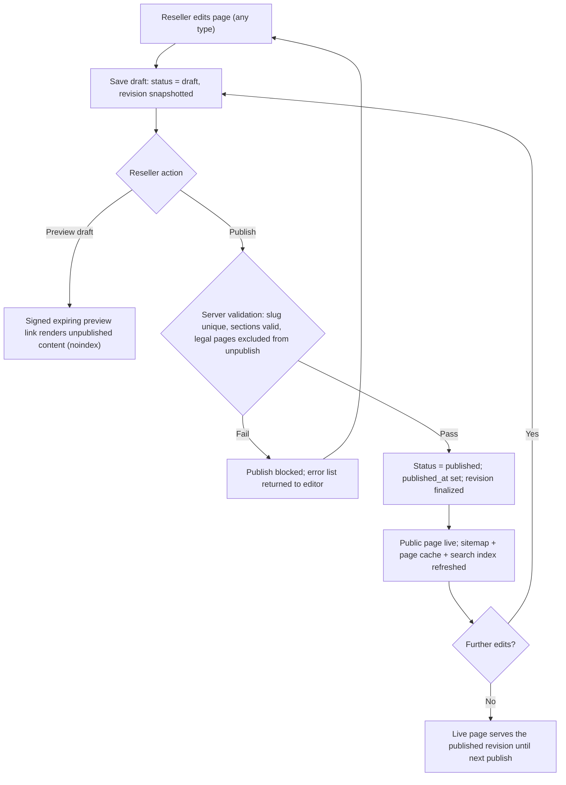

# White-Label CMS & Storefront

| Field | Value |
|---|---|
| Document | 10-white-label-cms.md |
| Version | 1.0 |
| Status | Draft for Review |
| Date | 2026-11-01 |
| Owner | Product & Architecture Team |
| Related documents | 03-functional-requirements.md, 04-multi-tenancy-architecture.md, 06-product-marketplace.md, 07-billing-and-financial-architecture.md, 13-database-design.md, 16-ui-ux-specification.md, 17-security-requirements.md, 18-non-functional-requirements.md |

## Table of Contents

1. Purpose & Scope
2. Storefront Provisioning & Custom Domains
3. Themes & Branding
4. Page Builder
5. Page Types & Draft/Preview/Publish Workflow
6. Navigation Menus
7. Media Library
8. SEO & Discoverability
9. Custom CSS/JS Injection Policies
10. Responsive Behavior & Preview Modes
11. White-Label Completeness
12. Assumptions & Open Questions

---

## 1. Purpose & Scope

This document specifies the white-label CMS every reseller tenant uses to run its storefront:
domain settings, themes, a template-driven page builder, page types and publishing workflow,
navigation menus, the media library, SEO, and custom-code policies. It defines requirement
IDs `FR-CMS-001`–`FR-CMS-059` (owned exclusively by this document per charter §8).

Out of scope: tenant/domain resolution mechanics (`04-multi-tenancy-architecture.md` — this
document only specs the CMS-side settings UI and states), product data and pricing logic
(`06-product-marketplace.md`), checkout and invoicing (`07-billing-and-financial-architecture.md`),
email template bodies (`03-functional-requirements.md` FR-NOTIFY).

Canonical tables used (charter §6): `website_themes`, `website_pages`, `website_menus`,
`media_library`, `tenant_domains`, `tenant_settings`. Referenced: `products`, `categories`,
`tenants`. Supporting storage (page revisions) is owned by `13-database-design.md` additions;
this document fixes behavior only.

## 2. Storefront Provisioning & Custom Domains

- **Auto-provisioning:** every approved reseller tenant is provisioned with a storefront at
  `{tenant.slug}.frenchies.com` at tenant creation — a default theme, seeded legal pages
  (privacy, terms — placeholder content), the standard page set (Section 5), and default
  menus. The storefront is live (with a "coming soon" homepage template) immediately; the
  reseller builds pages before launching.
- **Subdomain rules:** slug is lowercase alphanumeric + hyphens, 3–40 chars, reserved-word
  checked (admin, api, www, app, mail, central, demo, d, legal…), immutable after first
  provisioning (changing it is a support-assisted P2 flow, since it breaks URLs and custom
  domain references).
- **Custom domains** (CMS side; DNS/edge mechanics per `04-multi-tenancy-architecture.md`):
  the reseller adds a domain in **Settings → Domains**, selects verification method
  (DNS TXT record preferred, CNAME alternative), and the UI shows live verification status.
  Domain state machine:

| State | Meaning |
|---|---|
| `pending_dns` | Domain added; instructions (record name/value) shown; waiting for DNS. |
| `verifying` | Verification check running (scheduled + manual "Check now"). |
| `verified` | Ownership proven; awaiting SSL/edge provisioning. |
| `provisioning_ssl` | Cloudflare edge/certificate provisioning in progress. |
| `active` | Serving storefront traffic on the custom domain. |
| `failed_dns_mismatch` | Record found but value mismatch — instructions re-shown. |
| `failed_ssl` | Certificate provisioning failed after 3 attempts — retry action + support flag. |
| `disabled` | Domain removed/suspended by tenant admin or platform. |

- One domain per tenant may be `active` as the PRIMARY domain; other verified domains
  redirect (301) to the primary. Verification attempts are rate-limited (max 5 domains per
  tenant, max 10 verification checks/hour) to prevent abuse.

### Requirements — Provisioning & Domains

| ID | Requirement | Priority |
|---|---|---|
| FR-CMS-001 | Storefront auto-provisioned at tenant creation: default theme, seeded legal pages, standard page set, default menus, "coming soon" homepage. | P0 |
| FR-CMS-002 | Subdomain slug rules: charset/length/reserved-word validation; slug immutable after provisioning in MVP. | P0 |
| FR-CMS-003 | Custom domain add flow with DNS TXT/CNAME instructions, live status, manual "Check now", CMS-side rendering of the state machine above. | P0 |
| FR-CMS-004 | Domain state transitions with failure states, retry actions, and support-flag escalation after 3 failed SSL attempts. | P1 |
| FR-CMS-005 | SSL/edge activation confirmation shown in UI (thumbnail screenshot ping + HTTP health check once `active`). | P1 |
| FR-CMS-006 | Primary domain selection; non-primary verified domains 301-redirect to primary; subdomain always resolves as fallback. | P1 |
| FR-CMS-007 | Domain removal constraints: cannot remove the last serving domain; removal writes audit log and invalidates edge config. | P1 |

**AC-FR-CMS-001-1**
```gherkin
Given an approved reseller tenant with slug "bright-agency"
When the tenant is provisioned
Then https://bright-agency.frenchies.com serves a storefront with the default theme
And pages exist: home (coming soon template), privacy, terms, 404
And primary + footer menus exist with the legal pages linked
```

**AC-FR-CMS-003-1**
```gherkin
Given a reseller adding the domain "shop.brightagency.in"
When the UI displays TXT verification instructions and the reseller adds the DNS record
And clicks "Check now" (or the scheduled check runs)
Then the state moves pending_dns -> verifying -> verified -> provisioning_ssl -> active
And the domain detail panel shows the current state with timestamps for every transition
```

**AC-FR-CMS-003-2**
```gherkin
Given a domain in failed_dns_mismatch
When the reseller fixes the DNS record and clicks "Check now"
Then the state returns to verifying and completes to active on success
```

**AC-FR-CMS-006-1**
```gherkin
Given a tenant with active subdomain and active custom primary domain
When a visitor opens the subdomain
Then they are 301-redirected to the custom primary domain
```

## 3. Themes & Branding

- **Starter gallery (6 named themes)** shipped at MVP; each theme is a Blade/Vue layout
  package with layout variants and default section styles:

| Theme | Character |
|---|---|
| "SaaS Modern" | Card-heavy gradients, bold CTAs, product-led sections — for SaaS/AI resellers. |
| "Agency Bold" | Large type, dark mode default, portfolio-forward — for digital agencies. |
| "Minimal Studio" | Whitespace-first, serif/sans pairing, gallery emphasis. |
| "Vertical Industry" | Trust-signals-forward (stats, certifications, testimonials) — for POS/clinic/restaurant verticals. |
| "Commerce Pro" | Catalog-dense, filter-friendly, promo strips — for product-heavy storefronts. |
| "Startup Launch" | Compact hero + pricing table + FAQ focus — for early-stage offers. |

- **Theme selection & customization:** reseller picks a starter theme (one active theme per
  tenant, stored in `website_themes`; per-tenant customizations stored in the theme row
  and/or `tenant_settings`). Customization tokens: logo (light + dark variants), favicon,
  primary/secondary/accent colors (hex, contrast-checked against text color), font pair
  (from a curated Google-Fonts-allowed list of 8 pairs; self-hosted subsets to avoid
  third-party runtime calls — P2 self-hosting, MVP loads via allowed CDN), radius preset
  (none/sm/md/lg), shadow preset (none/subtle/elevated).
- **Live preview:** customization changes apply to a STAGED draft; "Preview" renders the
  whole storefront with staged values for the editing session only; "Publish" makes them
  live site-wide in one action (atomic token swap, no per-page partial states).

### Requirements — Themes

| ID | Requirement | Priority |
|---|---|---|
| FR-CMS-008 | Starter gallery with the 6 named themes, browsable with preview screenshots in the tenant panel. | P0 |
| FR-CMS-009 | One active theme per tenant; switching themes preserves content (pages/sections) and remaps tokens; layout-specific sections fall back to defaults with a warning list. | P0 |
| FR-CMS-010 | Branding tokens: logo (light/dark), favicon, primary/secondary/accent colors with contrast validation warnings. | P0 |
| FR-CMS-011 | Font pair selection from 8 curated pairs with per-pair font-size scale. | P1 |
| FR-CMS-012 | Radius and shadow presets applied globally to cards, buttons, and inputs. | P1 |
| FR-CMS-013 | Staged live preview: unsaved customization visible in preview session, invisible to visitors until Publish. | P1 |
| FR-CMS-014 | Reset to template defaults (per-token reset and full reset), audit-logged. | P1 |
| FR-CMS-015 | Theme state persistence in `website_themes` + `tenant_settings` with cache invalidation on publish. | P1 |

**AC-FR-CMS-009-1**
```gherkin
Given a tenant on "SaaS Modern" with 8 content pages
When the reseller switches to "Agency Bold"
Then all 8 pages keep their sections and copy
And section layout warnings list any component falling back to the new theme's default
```

**AC-FR-CMS-013-1**
```gherkin
Given a reseller changing the accent color in the customizer
When they click "Preview" but never "Publish"
Then visitors continue seeing the previous live accent color
And the editing session preview renders the new accent color
```

## 4. Page Builder

**MVP (P0/P1):** template-driven pages composed of TYPED SECTIONS. A page holds an ordered
section list; each section type has a fixed typed field schema (validated server-side),
rendered by the active theme. Editing is form-driven per section with live component
preview; reorder via drag handles (HTML5 drag or up/down buttons — both provided for
accessibility).

**P2:** free-form drag-and-drop layout (multi-column/row grid, arbitrary stacking, per-section
width/offset) plus a header/footer builder with draggable widgets (search, cart, language,
social icons, newsletter, custom menu).

### Requirements — Page Builder

| ID | Requirement | Priority |
|---|---|---|
| FR-CMS-016 | Template-driven pages composed of typed sections with typed, validated field schemas per section type. | P0 |
| FR-CMS-017 | Section type catalog (MVP, 10 types): hero, feature_grid, pricing_table, testimonials, faq_accordion, cta, contact_form, blog_list, media, custom_html. | P0 |
| FR-CMS-018 | Per-section field editing with per-field validation, duplicate/delete, and live component preview. | P0 |
| FR-CMS-019 | Section reorder via drag handles AND accessible up/down buttons; order persisted and reflected on render. | P0 |
| FR-CMS-020 | custom_html section content sanitized through the HTML allowlist sanitizer (same policy as product descriptions, cross-ref 17-security-requirements.md). | P1 |
| FR-CMS-021 | P2 free drag-and-drop grid builder with per-section column spans and stacking rules. | P2 |
| FR-CMS-022 | P2 header/footer builder with draggable widgets (search, cart, social, newsletter, menu, custom code block). | P2 |

**AC-FR-CMS-017-1**
```gherkin
Given the section catalog of 10 types
When a reseller adds a "pricing_table" section
Then it offers selectable products from the tenant's published catalog (cross-ref 06-product-marketplace.md)
And renders each selected variant's effective storefront price and floor-compliant display
```

**AC-FR-CMS-019-1**
```gherkin
Given a page with sections [hero, features, testimonials, cta]
When the reseller drags testimonials above features
Then the saved order becomes [hero, testimonials, features, cta]
And the rendered page reflects the new order on next request (cache invalidated)
```

**AC-FR-CMS-020-1**
```gherkin
Given a custom_html section containing "<script>fetch('https://evil.example')</script><p>Ok</p>"
When the section is saved
Then the script tag is stripped by the sanitizer
And the stored content is "<p>Ok</p>"
And a save warning lists the removed elements
```

## 5. Page Types & Draft/Preview/Publish Workflow

`website_pages` field contract (columns owned by `13-database-design.md`): tenant_id, type,
title, slug (unique per tenant, reserved slugs blocked: products, cart, checkout, account,
portal, d, admin, api), sections (JSON), SEO fields, status, published_at, template_key.

**Page types (MVP):** `homepage`, `product_listing`, `product_detail`, `pricing`, `about`,
`contact`, `blog_list`, `blog_post`, `faq`, `testimonials`, `portfolio`, `legal` (privacy/
terms), `not_found` (404). Legal and 404 pages are singleton system pages.

**System-generated pages:** `product_listing` and `product_detail` are system-routed —
product data (media, variants, effective prices, reviews, documents) renders from
`06-product-marketplace.md` entities; resellers append custom sections ABOVE/BELOW the system
product block. Product detail slugs are fixed to `products/{slug}` and cannot be renamed.



**Revision history:** every save and publish snapshots a revision; the last 10 revisions are
kept per page; "Restore" copies revision content into a NEW draft revision (non-destructive).
Preview links are signed, expire in 7 days, and render with `X-Robots-Tag: noindex`.

### Requirements — Pages & Workflow

| ID | Requirement | Priority |
|---|---|---|
| FR-CMS-023 | Page type enumeration (13 types above); type immutable after creation. | P0 |
| FR-CMS-024 | `website_pages` field contract with per-tenant slug uniqueness and reserved-slug blocking. | P0 |
| FR-CMS-025 | Draft → preview → publish workflow per the diagram, with server-side publish validation. | P0 |
| FR-CMS-026 | System `product_listing` page: auto-renders published, granted-visible products with category filtering; custom sections allowed above/below. | P0 |
| FR-CMS-027 | System `product_detail` page: renders product data (media, variants, effective price, reviews, documents, demos cross-ref 06) with fixed `products/{slug}` routing and custom sections above/below. | P0 |
| FR-CMS-028 | Draft preview: signed expiring (7-day) noindex links rendering unpublished content. | P1 |
| FR-CMS-029 | Revision history: last 10 revisions per page, non-destructive restore. | P1 |
| FR-CMS-030 | Legal pages (privacy, terms) seeded at provisioning, required, cannot be unpublished or deleted; content editable. | P1 |
| FR-CMS-031 | Blog list + post pages with WYSIWYG sanitized post content, publish dates, and SEO fields. | P1 |
| FR-CMS-032 | Starter templates for about, contact (form → leads cross-ref 12-crm-and-support.md), FAQ, testimonials, portfolio. | P1 |
| FR-CMS-033 | Custom 404 page with editable content, served for all unknown storefront routes. | P1 |
| FR-CMS-034 | Pricing page auto-rendering the tenant's published/granted products with effective prices (cross-ref 06-product-marketplace.md), customizable hero/FAQ sections. | P1 |
| FR-CMS-035 | Page archiving: archived pages 404 for visitors, excluded from menus/sitemap, restorable. | P2 |

**AC-FR-CMS-025-1**
```gherkin
Given a draft page with an invalid section field (hero without a headline value)
When the reseller clicks "Publish"
Then publishing is blocked with the exact failing section and field listed
And the page status remains "draft"
```

**AC-FR-CMS-027-1**
```gherkin
Given a published product "WhatsApp AI Agent" for tenant T
When a visitor opens https://t-domain/products/whatsapp-agent
Then the page renders the system product block from live product data
And the tenant's custom sections render above and below it
And unpublished product changes never appear (published product data only)
```

**AC-FR-CMS-028-1**
```gherkin
Given a reseller sharing a draft preview link with a client
When the client opens the signed link within 7 days
Then the unpublished version renders with reseller branding
And the response carries X-Robots-Tag: noindex
And after 7 days the link returns 404
```

**AC-FR-CMS-030-1**
```gherkin
Given seeded legal pages privacy and terms
When the reseller attempts to unpublish the terms page
Then the action is blocked with "legal pages are required"
And only the content remains editable
```

## 6. Navigation Menus

`website_menus` supports named areas per tenant: `primary` (header) and `footer` (MVP);
`legal_footer` (P2). Menu items nest: internal page links, external URLs (HTTPS only,
`rel="noopener"`), product category links (resolves to the product_listing page filtered by
category), and plain-text dividers (P2). The data model allows arbitrary depth; the MVP
editing UI supports 2 levels (top-level + one dropdown level); deeper nesting is P2.
Items have label, order, target (`_self`|`_blank`), and per-item visibility toggle.

### Requirements — Menus

| ID | Requirement | Priority |
|---|---|---|
| FR-CMS-036 | Menu areas `primary` and `footer` per tenant, seeded at provisioning with legal links. | P0 |
| FR-CMS-037 | Menu item types: internal page, external URL (HTTPS-only validation), product category link; 2-level nesting in MVP UI. | P0 |
| FR-CMS-038 | Menu item add/edit/delete/reorder (drag + accessible buttons) with live header/footer preview. | P1 |
| FR-CMS-039 | Auto-menu generation from categories (insert all published categories as a submenu) — P2 convenience action. | P2 |

**AC-FR-CMS-037-1**
```gherkin
Given a primary menu with items Home, Products, Services (dropdown: Web, AI), Contact
When the header renders
Then Services shows a keyboard-accessible dropdown with its 2 children
And an external item "http://insecure.example" is rejected at save time with "HTTPS required"
```

## 7. Media Library

`media_library` rows: tenant-scoped file records stored under the tenant S3 prefix
(mechanics per `04-multi-tenancy-architecture.md`), with filename, MIME (validated against
an allowlist: jpg, png, webp, svg, gif, mp4, pdf), size cap (25 MB/file, 2 GB/tenant with
quota warnings at 80%), dimensions, alt text, and usage references. Images require alt text
before insertion into a page section (accessibility gate). Reuse: any media item can be
inserted into any page/section of the same tenant; deletion is blocked while referenced
(breaks reuse integrity), with a "referenced by N pages" counter.

### Requirements — Media

| ID | Requirement | Priority |
|---|---|---|
| FR-CMS-040 | Uploads to the tenant S3 prefix with MIME allowlist, per-file and per-tenant size quotas. | P0 |
| FR-CMS-041 | Alt text required for images before insertion into sections; SVG uploads sanitized (strip scripts/external refs). | P0 |
| FR-CMS-042 | Cross-page reuse with usage-reference counting; deletion blocked while referenced. | P1 |
| FR-CMS-043 | Folders/collections for organization with drag-to-move. | P2 |

**AC-FR-CMS-040-1**
```gherkin
Given a reseller uploading "logo.svg" containing an embedded <script> element
When the upload is processed
Then the script is stripped by the SVG sanitizer
And the stored object is served with Content-Disposition and CSP-safe headers per 17-security-requirements.md
```

**AC-FR-CMS-042-1**
```gherkin
Given an image used by 3 pages
When the reseller attempts to delete it
Then deletion is blocked with "referenced by 3 pages"
And the list of referencing pages is shown
```

## 8. SEO & Discoverability

- Per-page SEO fields: meta title (≤60 chars), meta description (≤160 chars), canonical URL
  (auto-derived; overridable to an external URL), OG image (defaults to hero/primary media).
- **sitemap.xml:** auto-generated per tenant domain from published pages + published products
  + published blog posts; regenerated on publish events and at most hourly otherwise;
  served at `/sitemap.xml`.
- **robots.txt:** generated per domain — allow public storefront, disallow `/account`,
  `/portal`, `/cart`, `/checkout`, `/admin`, `/api`, `/d/` (demo tokens), and any
  `noindex` draft-preview paths; custom rules are P2 (additive only, cannot un-disallow).
- **Structured data (JSON-LD):** Organization (name, logo, contactPoint) sitewide;
  Product + Offer on product detail pages with effective price, currency, availability, and
  seller = tenant display name (cross-ref 06-product-marketplace.md and
  07-billing-and-financial-architecture.md for tax-inclusive display).
- **Redirect manager (P2):** 301 redirects for changed page slugs, with auto-suggestion on
  slug edit.

### Requirements — SEO

| ID | Requirement | Priority |
|---|---|---|
| FR-CMS-044 | Per-page title/description/canonical fields with length validation and auto-derivation defaults. | P0 |
| FR-CMS-045 | OG image + social share preview card rendered in the editor. | P1 |
| FR-CMS-046 | Auto-generated `/sitemap.xml` per domain from published content, event-driven regeneration. | P0 |
| FR-CMS-047 | Generated `robots.txt` with the fixed disallow list; P2 additive custom rules. | P1 |
| FR-CMS-048 | JSON-LD structured data: Organization sitewide, Product+Offer on product detail with effective pricing. | P1 |
| FR-CMS-049 | 301 redirect manager with auto-suggestion on slug change. | P2 |

**AC-FR-CMS-046-1**
```gherkin
Given a tenant with 12 published pages and 30 published products
When a page is published
Then /sitemap.xml regenerates within 60 seconds including the new URL with lastmod
And draft/archived pages never appear in the sitemap
```

**AC-FR-CMS-048-1**
```gherkin
Given a product detail page with variant priced INR 9,999 tax_inclusive
When the page renders
Then the Product JSON-LD Offer contains price 9999, priceCurrency INR, availability InStock
And the seller name is the tenant display name — not the platform's
```

## 9. Custom CSS/JS Injection Policies

Security-sensitive; hard cross-reference to `17-security-requirements.md`.

- **Custom code injection (head/body):** tenant-ROLE-ADMIN only (Reseller owner; employees
  need an explicit platform-granted permission). Content passes an HTML sanitizer allowlist
  before STORE and again before RENDER (defense in depth).
- **Custom CSS:** single textarea per tenant, size cap **50 KB**; sanitizer allowlist
  permits CSS properties from a curated list (layout, color, typography, spacing) and
  FORBIDS: `@import`, `expression()`, `-moz-binding`, `behavior`, `url()` referencing
  external hosts (only `data:` images and same-origin `/media/...` paths allowed),
  `position: fixed` overlay rules on checkout routes (anti-phishing).
- **Custom JS:** **P2**, restricted to a vendor-allowlist pattern — analytics/measurement
  IDs (Google Analytics, Google Tag Manager, Meta Pixel) rendered by the platform from
  configuration values; arbitrary script injection is NEVER supported.
- All custom-code writes and renders are audit-logged (who, when, hash of content).

### Requirements — Custom Code

| ID | Requirement | Priority |
|---|---|---|
| FR-CMS-050 | Head/body code injection, role-admin-only, sanitized on store and render, audit-logged. | P1 |
| FR-CMS-051 | Custom CSS with 50 KB cap and sanitizer allowlist (forbid @import, expression(), external url()). | P1 |
| FR-CMS-052 | Custom JS as vendor-allowlist configuration only (analytics IDs); arbitrary JS never supported. | P2 |
| FR-CMS-053 | Sanitizer policy shared with product descriptions and custom_html sections; policy versioned; violations logged (cross-ref 17-security-requirements.md, SEC sanitizer requirements). | P1 |

**AC-FR-CMS-051-1**
```gherkin
Given custom CSS containing "@import url('https://evil.example/x.css'); .a{background:url('https://evil.example/b.png')}"
When saved
Then the @import rule and the external url() value are stripped
And a save warning lists both removals
And the stored CSS is under the 50 KB cap or rejected
```

**AC-FR-CMS-050-1**
```gherkin
Given a Reseller Employee without the custom-code permission
When they open Settings → Custom Code
Then the section renders read-only with the audit history visible
And a direct API attempt returns 403
```

## 10. Responsive Behavior & Preview Modes

All 6 themes are mobile-first: breakpoints 360/640/768/1024/1280+; section field schemas
include mobile-specific overrides only where essential (hero image stacking, grid column
collapse). The page editor and customizer provide preview modes Desktop (1280), Tablet
(768), Mobile (390) rendered in an iframe with the staged or draft content. Lighthouse
mobile performance ≥ 60 for seeded pages is an NFR (cross-ref `18-non-functional-requirements.md`).

| ID | Requirement | Priority |
|---|---|---|
| FR-CMS-054 | Mobile-first responsive rendering across all themes with the fixed breakpoint set; no horizontal overflow at 360px on seeded pages. | P1 |
| FR-CMS-055 | Editor preview modes: desktop/tablet/mobile iframes for draft and staged content. | P1 |

**AC-FR-CMS-054-1**
```gherkin
Given a seeded homepage on any starter theme
When rendered at 360px width
Then no element causes horizontal scrolling
And tap targets are ≥ 44x44 CSS px
```

## 11. White-Label Completeness

- **Storefront:** zero platform branding — no "Powered by Frenchies", no platform logo, no
  platform name in HTML title/meta/footer/domains beyond the `*.frenchies.com` subdomain
  itself (custom domains remove even that).
- **Customer portal & emails:** portal header/footer use reseller branding; transactional
  emails use the selling tenant's from-name, from-email (via configured sending domain),
  logo, and colors (template mechanics cross-ref `03-functional-requirements.md` FR-NOTIFY).
- **LEGAL CONSTRAINT (normative, not negotiable):** invoices and payment descriptors MUST
  display the legally required selling-entity information — the platform's payment
  descriptor (gateway-mandated card/RUPI statements text) and the invoice "sold by" +
  platform GSTIN footer where the platform is the merchant of record (payments are collected
  by central, charter §4). These elements are exempt from white-labeling; the reseller's own
  business identity appears as the brand/"sold by reseller" line above the mandatory footer.

### Requirements — White Label

| ID | Requirement | Priority |
|---|---|---|
| FR-CMS-056 | Zero platform branding on the storefront (HTML source, assets, meta); enforced by a branding audit check in the tenant panel. | P0 |
| FR-CMS-057 | White-labeled customer portal and transactional emails using tenant branding tokens. | P1 |
| FR-CMS-058 | Invoice white-labeling with the mandatory legal footer + payment descriptor exception, clearly marked in the invoice template settings. | P1 |
| FR-CMS-059 | Multi-language storefront (per-page translated slugs/content) — post-MVP. | P2 |

**AC-FR-CMS-056-1**
```gherkin
Given a fully configured tenant storefront on a custom domain
When the branding audit check runs
Then no occurrence of platform brand strings or platform-owned asset URLs is found in rendered HTML
And the check result (pass/fail with evidence) is shown in the tenant panel
```

**AC-FR-CMS-058-1**
```gherkin
Given a reseller-branded invoice
When generated for a paid order
Then the header shows the reseller's logo and business name
And the footer shows the legally required selling entity line, GSTIN, and payment descriptor
And the invoice settings UI labels these footer elements as non-removable (legal)
```

## 12. Assumptions & Open Questions

1. **Assumption:** custom-domain DNS verification uses Cloudflare as the DNS/edge provider
   (charter §3); alternative providers are out of scope. TXT-record verification is the
   default; CNAME is the fallback for resellers who cannot add TXT records.
2. **Assumption:** page section content is stored as JSON on `website_pages` (one JSON
   document per page); if `13-database-design.md` normalizes sections into rows, behavior
   in this document is unchanged.
3. **OQ:** font loading strategy — MVP via an allowed CDN with a curated pair list vs
   self-hosted font subsets from day one (affects GDPR/privacy posture for non-IN markets).
   Default: allowed CDN in MVP, self-hosting P2.
4. **OQ:** whether the pricing_table/product_listing sections may show products granted but
   not yet published to the storefront (default: published + granted-visible only, per
   `06-product-marketplace.md` visibility scopes).
5. **Assumption:** page revision storage (last 10) is implemented via a supporting table
   specified in `13-database-design.md` additions; this document fixes count and behavior.
6. **Assumption:** "coming soon" homepage is a system template blocking visitor access with
   an optional lead-capture email-forwarding field (anti feature creep: no built-in waitlist
   DB in MVP).

## Appendix — Enumerated Statuses (normative summary)

- `tenant_domains.status`: `pending_dns`, `verifying`, `verified`, `provisioning_ssl`,
  `active`, `failed_dns_mismatch`, `failed_ssl`, `disabled`.
- `website_pages.status`: `draft`, `published`, `archived` (legal pages: `draft`/`published`
  only; `archived`/delete forbidden).
- Theme state: `active` theme per tenant + staged draft (not a persisted status; staged
  values live in an editor session until Publish).
- Demo tokens (`/d/` routes): states owned by `06-product-marketplace.md` Section 10.

## Ratified P0 decisions (2026-11-20)

Decisions below are ratified in `22-open-questions-and-assumptions.md` §5; see that
section for ratifier, date and launch-gate caveats.

| OQ-014 | Auto-render refund policy per product type on storefront footer and invoice from the ratified window table. |
| OQ-020 | Custom-domain flow: CNAME + HTTP token verification + Cloudflare proxied edge SSL; assisted nameserver transfer upgrade. |
| OQ-028 | Legal/disclosure wording is platform-owned, jurisdiction-parameterized and non-editable by resellers; reseller identity in defined slots. |
| OQ-029 | Consent notices rendered per tenant branding; data-principal requests routed to owning tenant; platform executes technically. |
| OQ-031 | Publish abuse-report channel in footer; automated content flags and enforcement ladder apply to new storefronts. |
