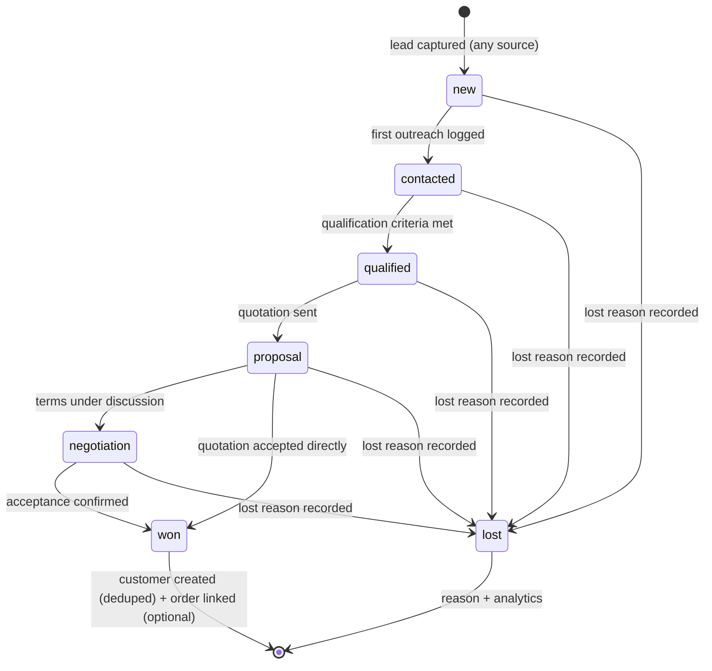
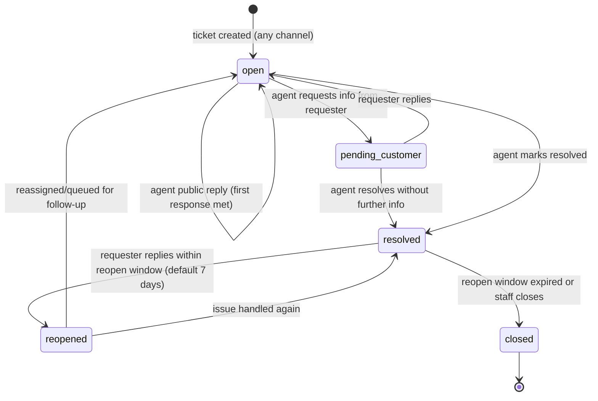

# 12 — CRM & Support

| Field | Value |
|---|---|
| Document | 12-crm-and-support.md |
| Version | 1.0 |
| Status | Draft for Review |
| Date | 2026-11-01 |
| Owner | Product & Architecture Team |
| Related documents | `03-functional-requirements.md` (FR-CUSTOMER, FR-NOTIFY, FR-ADMIN, FR-REPORT), `06-product-marketplace.md` (FR-PRODUCT, FR-DEMO), `07-billing-and-financial-architecture.md` (offline orders, refunds, minimum selling price), `09-fulfillment-and-licensing.md` (FR-FULFILLMENT, FR-LICENSE), `10-white-label-cms.md` (FR-CMS; storefront/KB pages), `11-ai-and-automation.md` (FR-AI; chatbot handoff), `13-database-design.md` (column definitions), `15-user-workflows.md`, `16-ui-ux-specification.md`, `17-security-requirements.md` |

## Table of contents

1. Purpose & Scope
2. CRM Domain Concepts
3. Lead Capture
4. Lead Record, Assignment & Pipeline
5. Follow-ups, Timeline & Activity Logging
6. Quotations
7. Lead Conversion & Dedupe
8. Sales Reporting
9. Lead Lifecycle Diagram
10. Support Domain Concepts
11. Multi-level Support Model & Departments
12. Ticket Creation Channels & Fields
13. SLA Policies, Clocks & Breach Handling
14. Assignment, Replies, Notes & Attachments
15. Escalation Path Matrix
16. Ticket Lifecycle Diagram & Escalation Sequence
17. CSAT
18. Knowledge Base
19. FR Summary Tables
20. Detailed Requirements & Acceptance Criteria (FR-CRM)
21. Detailed Requirements & Acceptance Criteria (FR-SUPPORT)
22. Data Requirements Deferred to `13-database-design.md`
23. Assumptions & Open Questions

---

## 1. Purpose & Scope

This document specifies the **CRM** domain (lead capture, pipeline, quotations, sales
reporting) and the **Support** domain (multi-level helpdesk: departments, tickets, SLA,
escalation, CSAT, knowledge base) for Frenchies.

In scope: leads (`leads`, `lead_activities`), quotations (`quotations`,
`quotation_items`), the customer conversion boundary, support departments
(`support_departments`), SLA policies (`sla_policies`), tickets (`support_tickets`,
`ticket_messages`), escalation semantics across the reseller hierarchy and to the central
platform, CSAT, and the knowledge base.

Out of scope: customer account CRUD and the storefront contact form mechanics defined in
`03-functional-requirements.md` / `10-white-label-cms.md` (this doc defines what happens
to the submission — a lead), payment verification for quotation-converted orders
(`07-billing-and-financial-architecture.md`), notification channel mechanics (FR-NOTIFY
in `03`), AI chatbot internals (`11-ai-and-automation.md`), and demo rendering
(`06-product-marketplace.md`).

Role scope (charter §5): Sales Agent (10) is CRM-focused; Support Agent (6) and Support
Manager (5) run queues; Reseller (7)/Sub-Reseller (8) own their tenant's CRM and
first-line support; central staff (1–6) operate central queues with cross-tenant access
where granted.

## 2. CRM Domain Concepts

| Term | Definition |
|---|---|
| **Lead** | Tenant-owned prospect record (`leads`) created from any capture source; progresses through a status pipeline; converts to a `customers` row when won. |
| **Lead activity** | Append-only interaction row (`lead_activities`): calls, meetings, notes, status changes, emails, WhatsApp entries, demo views. |
| **Pipeline** | The ordered status enum with per-stage definitions (§4.3). One pipeline per tenant in MVP (multi-pipeline = P3). |
| **Follow-up** | Required next action + due date stored on the lead (`next_action`, `follow_up_at`); drives reminders and the "Today" worklist. |
| **Quotation** | Customer-facing price proposal (`quotations` + `quotation_items`) generated from the catalog with controlled price overrides; converts to an offline order on acceptance. |
| **Minimum selling price (MSP) floor** | Per-tenant price floor for a product from distribution terms (`tenant_products`, see `06`/`07`); quotation overrides may not go below it. |

## 3. Lead Capture

Sources (`leads.source` enum, extensible): `contact_form`, `demo_request`, `manual`,
`csv_import`, `api_webhook`, `affiliate`, `chatbot`.

- **Storefront contact form** (`03`/`10` own the form): submission creates a lead in the
  storefront's tenant with source `contact_form`; the submitter is not yet a customer.
- **Demo request** (`06` owns demo UX): creates a lead with source `demo_request` and a
  `product_interest` link to the demoed product.
- **Manual entry**: Sales Agent/Reseller creates a lead directly (source `manual`).
- **CSV import** (P1): column mapping UI (name, email, phone, company, source label,
  product interest, notes); row-level validation (required email or phone; duplicate
  handling per §7.4); import summary report; tenant-scoped — imported leads never cross
  tenants.
- **API/webhook** (P2): authenticated per-tenant inbound endpoint (Sanctum `api_keys`,
  see `03` FR-API) with the same dedupe rules; throttled per tenant.
- **Affiliate referral** (P1): clicks on affiliate links set a referral cookie
  (`03`/`08`); a contact-form or demo-request submission attributed to an affiliate
  stores `affiliate_id` on the lead for source analytics (attribution window default 30
  days, last-touch).
- **AI chatbot handoff** (P2, cross-ref `11`): chatbot captures name/email/phone in
  conversation and hands off to create a lead (source `chatbot`) with the transcript
  linked on the timeline.

## 4. Lead Record, Assignment & Pipeline

### 4.1 Record (FR-CRM-008)

`leads` fields (semantic; columns in `13`): `tenant_id`, `name`, `email`, `phone`,
`company`, `source`, `affiliate_id`, `product_interest_id`, `notes`, `status`,
`assigned_to` (user of the tenant, nullable), `next_action`, `follow_up_at`,
`lost_reason_id`/`lost_reason_note`, `won_at`, `converted_customer_id`,
`demo_attribution`, timestamps. Custom fields = P2 (FR-CRM-021), stored as JSON with a
tenant-defined schema registry (P2).

### 4.2 Assignment

- **Manual** (P0): assign/reassign by Reseller, Reseller Employee with `crm.manage`, and
  Sales Agent on unassigned leads (self-claim).
- **Round-robin** (P1): tenant setting; distributes new leads evenly (least-recently-
  assigned rotation) among users holding a role with the `sales` capability (Sales Agent,
  or any tenant user granted `crm.assignable`). Rotation is per tenant; deterministic and
  logged on the lead.
- **Territory/product rules** (P2): ordered rule list (match on country/region or product
  interest → assignee/queue).

### 4.3 Pipeline stages (normative enum + definitions)

| Stage | Definition | Exit requirements |
|---|---|---|
| `new` | Captured, no outreach logged yet. | First outreach logged → `contacted`. |
| `contacted` | At least one meaningful outbound interaction logged (call/email/WhatsApp). | Qualification judgment → `qualified`, or `lost`. |
| `qualified` | Need, budget and authority confirmed per tenant's criteria. | Quotation sent → `proposal`. |
| `proposal` | A quotation has been sent to the lead. | Customer engages on terms → `negotiation`; accepts → `won`; declines → `lost`. |
| `negotiation` | Terms/price under active discussion (revised quotation may exist). | Accept → `won`; abandon → `lost`. |
| `won` | Terminal success; conversion executed (§7). | — |
| `lost` | Terminal failure; `lost_reason` required. | — |

Rules: every non-terminal lead MUST have `next_action` (short text) and `follow_up_at`
set (enforced on transition out of `new`); backward transitions are allowed between
non-terminal stages and are audited; `won`/`lost` are terminal (a re-engaged prospect is
a new lead linked by dedupe history).

### 4.4 Views

- **Kanban board** (P1): one column per stage; drag-and-drop stage change (audited);
  cards show name, assigned agent, product interest, follow-up badge (overdue red).
- **List view** (P1): filters (status, assignee, source, product interest, follow-up
  range), sort, column selection, CSV export (tenant data only, permission `crm.export`).

## 5. Follow-ups, Timeline & Activity Logging

- Follow-up reminders (P1): at `follow_up_at` (tenant timezone), the assignee receives an
  in-app + email reminder (FR-NOTIFY in `03`); overdue leads surface in the "Today"
  worklist with an overdue badge and daily digest (one per assignee per day).
- **Interaction timeline** (P0 for manual logging): every lead has a chronological,
  author-attributed timeline of `lead_activities`: notes, calls (direction, duration,
  summary), meetings, status changes, assignments, quotation events, demo views, and
  email/WhatsApp entries.
- **WhatsApp history** (P1): agents log WhatsApp interactions manually (activity type
  `whatsapp`); automated WhatsApp history sync = P2 on top of the WhatsApp integration
  (charter §10 sequencing).
- **Email history** (P2): where the platform sent notification emails to the lead's
  address (notification_logs, see `03` FR-NOTIFY), a read-only email feed appears on the
  timeline; inbound email sync is out of scope for MVP.
- **Demo tracking** (P1, cross-ref `06` FR-DEMO): demo views of a product by a known
  lead email are appended to the timeline; demo → lead conversion rate is reported in
  sales analytics (source `demo_request` plus demo-view attribution).

## 6. Quotations

- **Creation** (P0): Sales Agent/Reseller builds a quotation from the tenant's catalog
  (`tenant_products` with the tenant's price overrides) and/or custom (ad-hoc) line
  items; per-line **price override** is allowed but **may not go below the MSP floor**
  for that tenant/product — the save is rejected with a field-level error (MSP defined by
  distribution terms in `06`/`07`).
- **Tax & totals** (P0): line subtotals, GST display (CGST/SGST/IGST logic per place of
  supply) and grand total computed by the tax engine owned by `07-billing-and-financial-architecture.md`
  (reference only — this doc does not redefine tax rules).
- **PDF** (P0): branded white-label PDF (dompdf; tenant logo/colors per `10-white-label-cms.md`),
  containing quotation number, validity date, lines, taxes, terms text, and accept/reject
  instructions with a unique secure link.
- **Validity** (P0): `valid_days` per quotation (default 14); expiry sweep marks
  `expired` and notifies the owner (customer notification on expiry = optional setting).
- **Status machine** (P0): `draft → sent → viewed → accepted / rejected → converted`,
  with branches `expired` (from `sent`/`viewed`) and `declined_after_acceptance` (P2, not
  MVP — accepted quotations are binding; corrections = new quotation).
  - `sent`: email dispatched with secure link (signed, single-tenant token).
  - `viewed`: first open of the secure link tracked (timestamp).
  - `accepted`: customer clicks Accept (optionally with a confirmation step); rejection
    optionally records a reason.
  - `converted`: an **offline order** is created for the accepted quotation (payment
    method `offline`; verification follows the manual/offline payment path defined in
    `07-billing-and-financial-architecture.md` — reference, not redefinition). Order
    creation snapshots quotation line prices.
- **Duplicate/revision** (P2): duplicate as new draft; revisions create a new quotation
  superseding the previous (link stored, previous stays `negotiation`-associated).

## 7. Lead Conversion & Dedupe

- **Conversion** (P0): marking a lead `won` runs conversion: create (or link existing)
  customer in `customers` for the lead's tenant; optionally link the accepted quotation's
  order; store `converted_customer_id`, `won_at`; write timeline entries. Conversion is
  performed by the assignee or `crm.manage` holders.
- **Dedupe** (P1): on capture, a lead is a duplicate when, within the same tenant, an
  existing non-terminal lead matches on normalized email (case-insensitive) OR normalized
  phone (E.164). Duplicate submission: append a `lead_activities` row to the existing
  lead, notify the assignee, do not create a second lead. Terminal (`won`/`lost`) matches
  do not block creation (repeat interest = new lead, flagged `repeat_contact`).
- **Customer dedupe on conversion** (P0): if a `customers` row with the same email/phone
  exists in the tenant, link it instead of creating a new customer (no duplicates).

## 8. Sales Reporting

- **Per-agent performance** (P1): leads assigned, leads won, revenue (sum of converted
  order totals; quotations accepted), average cycle time (new → won), win rate; period
  filters; tenant-scoped.
- **Conversion funnel** (P1): counts and conversion % between consecutive stages for a
  period, with drop-off highlights.
- **Source analytics** (P2): leads and wins per source and per product interest; **source
  ROI** (P2) additionally requires manual ad-spend input per source per period.
- Reports respect tenant isolation; platform-wide CRM analytics across tenants = central
  only, P2.

## 9. Lead Lifecycle Diagram



## 10. Support Domain Concepts

| Term | Definition |
|---|---|
| **Support tenant scope** | Every ticket belongs to exactly one tenant's queue (`support_tickets.tenant_id`): the reseller tenant that owes first-line support, or the central platform tenant for platform queues and escalations. |
| **Requester** | Polymorphic: a `customers` row (end-customer), a `users` row (reseller/sub-reseller staff), or an `affiliates` row. |
| **Department** | Routing + permission unit (`support_departments`): e.g., "Technical", "Billing", "Sales", platform-configurable defaults plus per-tenant departments. |
| **SLA policy** | First-response and resolution targets per priority (`sla_policies`), per tenant (platform default policy as fallback). |
| **Escalation** | Within-tenant (agent → support manager) or cross-level (reseller → central platform) raise, per the escalation matrix (§15). |
| **Guidance channel** | P2 parent→child operational Q&A (reseller ↔ sub-reseller), modeled as tickets in a dedicated guidance department, never visible to end-customers. |
| **CSAT** | Post-resolution survey (1–5 + optional comment), one response per ticket. |

## 11. Multi-level Support Model & Departments

Two operational levels (P0) plus a P2 guidance channel:

1. **Reseller-level** (first line): each reseller tenant runs queues for its customers.
   Customer tickets default to the customer's owning reseller tenant queue.
2. **Central platform** (second/third line): central tenant queues serve (a) resellers
   as requesters (their staff submit platform tickets), and (b) escalated end-customer
   tickets from resellers via linked cross-tenant escalation (§15/§16).
3. **Parent→child guidance** (P2): a reseller questions its sub-resellers (or vice versa
   per permission) in a guidance department; visibility restricted to the two tenants
   involved; excluded from CSAT and customer-facing surfaces.

**Departments** (`support_departments`): platform ships defaults ("Technical", "Billing",
"Account", "Sales", "Platform Operations", "Guidance"); each tenant may create/rename/
disable its own departments and map them to platform defaults for escalation routing.
Departments carry: name, slug, tenant scope (central|reseller), notification routing,
auto-assignment on/off, member agents (department-scoped Support Agents).

**Permissions:** Support Agents act only within granted departments (FR-SUPPORT-038);
Support Manager sees all queues of their tenant; central staff with cross-tenant grant
see all tenant queues (charter §4).

## 12. Ticket Creation Channels & Fields

Channels (`support_tickets.channel`): `portal`, `email`, `whatsapp`, `chatbot`.

- **Portal** (P0): customer portal "New ticket" (category/department, subject,
  description, priority self-select capped at `high` — customers cannot self-mark
  `urgent`); reseller staff portal likewise within their tenant.
- **Inbound email** (P1): a per-department inbound address (platform domain + per-tenant
  domain per `10`) parses new mail into tickets (subject → subject, body → description,
  sender matched to requester by verified email; unmatched senders create a guest
  requester pending verification) and appends replies to existing tickets via
  reply-to threading tokens.
- **WhatsApp** (P1): inbound WhatsApp messages (WhatsApp Cloud API, per charter §10
  sequencing as "P1.5" — deliver after core MVP items, before P2) map to tickets for
  the tenant's configured WhatsApp number; threading per customer phone number +
  24-hour session rules of the provider; outbound ticket replies may use WhatsApp when
  the requester came from that channel and templates/routing permit (FR-NOTIFY owns
  channel mechanics in `03`).
- **Chatbot handoff** (P2, cross-ref `11`): unresolved chatbot conversations create a
  ticket carrying the transcript as the opening message.
- **Fields** (P0): `tenant_id`, requester morph, `subject` (5–200 chars), `description`
  (rich text), `priority` (`low|normal|high|urgent`), `status`
  (`open|pending_customer|resolved|closed|reopened`), `channel`, `department_id`,
  `assigned_to`, SLA timestamps/flags, linkage fields (escalation parent/child,
  merged-into P3), CSAT fields (§17).

## 13. SLA Policies, Clocks & Breach Handling

- **Policy** (`sla_policies`): per tenant + priority: `first_response_minutes`,
  `resolution_minutes`; platform default policy applies when a tenant has none. Suggested
  defaults (platform-configurable, not hard-coded): urgent 60/240, high 240/1440, normal
  480/2880, low 1440/5760 (minutes, MVP counts wall-clock minutes).
- **Clock semantics** (P0): first-response clock starts at ticket creation and stops at
  the first public agent reply; resolution clock starts at creation and stops at
  `resolved`; **resolution clock pauses while status = `pending_customer`** (P0 pause
  semantics; the clock resumes on requester reply or agent action). First-response clock
  does not pause.
- **At-risk** (P1): ≥ 75% of the target elapsed without stop → `sla_at_risk_at` set,
  amber badge, assignee warning.
- **Breach** (P1): target elapsed without stop → `first_response_breached_at` /
  `resolution_breached_at` set, red badge, breach counter incremented, escalation
  notification per §15. Breaches are immutable facts (never cleared) and feed SLA
  reporting per agent/department/tenant (cross-ref `03` FR-REPORT).
- **Business-hours calendars** (P2): tenant-configurable business hours + holidays shift
  targets into business time; MVP is wall-clock only.

## 14. Assignment, Replies, Notes & Attachments

- **Auto-assignment** (P0): new tickets round-robin across online (or all, per setting)
  Support Agents of the ticket's department within the tenant; tenants with auto-
  assignment off leave tickets unassigned in the department queue.
- **Manual reassign** (P1): Support Manager any ticket in-tenant; agents may reassign
  within own department per permission `support.reassign`. All changes audited.
- **Claim** (P1): an agent picks an unassigned ticket from the queue (atomic claim;
  concurrent claims cannot both win).
- **Public replies** (P0): visible to the requester on all surfaces (portal, email,
  WhatsApp per channel); trigger requester notification (§ below).
- **Internal notes** (P0): staff-only; **never rendered to the requester in any channel or
  portal, and never included in any customer notification payload** (hard rule, security-
  tested; cross-ref `17-security-requirements.md`). Platform-internal cross-tenant notes
  on escalated tickets follow the same rule toward the reseller requester unless the
  agent explicitly marks the note "share with reseller" (P2 field).
- **Attachments** (P0): stored in per-tenant S3 prefix; requester and staff access via
  expiring signed URLs (default 24 h); upload runs the malware-scan hook (cross-ref
  `17`); positive-scan files are quarantined and the uploader notified.
- **Audit trail** (P0): every status, priority, assignment, department, and channel
  change is recorded on the ticket (`ticket_messages` system rows or ticket audit
  projection per `13`) with actor and timestamp; requester-visible history shows status
  changes only.
- **Notifications** (cross-ref FR-NOTIFY, `03`): requester notified on public reply and
  status changes (resolved/closed) via email + in-app realtime (Laravel Reverb); WhatsApp
  per channel + charter sequencing; agents notified on assignment, requester reply, and
  SLA at-risk/breach. Templates live in `notification_templates` (`03`).
- **Canned responses** (P2): per-tenant saved replies with variable placeholders,
  searchable insert in the reply box.

## 15. Escalation Path Matrix

| From | Trigger | To | Mechanism |
|---|---|---|---|
| Support Agent (reseller or central) | Complexity/permission gap, or SLA at-risk | Support Manager (same tenant) | In-tenant escalation flag + notification; ticket stays in queue. |
| Support Manager (reseller tenant) | Cannot resolve (platform bug, billing, infra) or resolution SLA breached | Central platform support | **Linked cross-tenant escalation ticket** in central queue (§16); original ticket stays with the reseller for customer comms; internal updates sync both ways on the link. |
| Reseller (as requester) | Platform issue | Central "Platform Operations" department | Ordinary central ticket (requester = reseller user). |
| Reseller (owner) | Guidance question to parent | Parent reseller ops contact (**opt-in**, P2) | Guidance department ticket, visibility = the two tenants. |
| Sub-reseller | Platform-level question | Parent first (per hierarchy visibility), then central | Guidance → central escalation; parent gets visibility, not control. |
| Support Manager | Unresolved after escalation SLA | Platform Admin (central) | Second-hop escalation on the central ticket; Support Manager (5) role already central — this hop targets Platform Admin (2) intervention for account/billing/infra decisions. |

Escalation linkage: `support_tickets` carries nullable escalation references
(`escalated_from_ticket_id`, `escalated_to_ticket_id` — column requirement flagged in
§22). Resolving the central ticket posts an internal update onto the linked reseller
ticket; the reseller then replies publicly to the customer and resolves. End-customers
never see central tickets or internal escalation chatter.

## 16. Ticket Lifecycle Diagram & Escalation Sequence



Notes: `reopened` is a distinct status for reporting (reopen rate per agent/department);
after the reopen window (default 7 days, tenant-configurable) requester replies create a
**new linked ticket** instead of reopening; `pending_customer` pauses the resolution SLA
clock (§13).

```mermaid
sequenceDiagram
    participant C as Customer (reseller tenant)
    participant RA as Reseller Support Agent
    participant SM as Support Manager
    participant CA as Central Platform Support Agent
    C->>RA: Opens "portal" ticket (department: Technical)
    Note over RA: Auto-assignment round-robin claims ticket
    RA->>RA: First public reply (first-response SLA stops)
    Note over RA: SLA at-risk flag at 75% of resolution target
    RA->>SM: Escalate (cannot resolve; platform bug suspected)
    SM->>CA: Create linked central escalation ticket (billing/infra queue)
    CA->>CA: Central round-robin assignment; resolution worked
    CA-->>SM: Internal update syncs to linked reseller ticket
    RA->>C: Public reply with resolution summary
    C->>RA: No objection in reopen window
    RA->>RA: Resolve ticket → CSAT survey sent to customer
    C-->>RA: CSAT 5 + comment stored per agent/department
```

## 17. CSAT

- On transition to `resolved` (and on `closed`), a CSAT survey is sent to requesters of
  type customer (and reseller-user requesters for central tickets, opt-out per tenant
  setting): secure anonymous link + email + portal banner.
- Scale 1–5 (integer) + optional comment; **one response per ticket** (token invalidated
  after use); responses stored in `csat_responses` (supporting table, §22).
- Reporting: average CSAT and response rate per agent, per department, per tenant, with
  period filters; comments searchable by tenant admins. Manipulation guard: agents cannot
  submit on behalf of requesters; survey tokens are single-use random (see
  `17-security-requirements.md`).

## 18. Knowledge Base

- **Scopes** (P1): **central articles** (platform knowledge, visible to reseller staff
  portals; optionally publishable to reseller storefronts) and **tenant articles** (own
  storefront/portal). Articles: title, slug, body (rich text), category, tags,
  visibility (`public_storefront` \| `authenticated_portal` \| `internal`), status
  (`draft|published|archived`), tenant scope.
- **Categories** (P1): per-scope category tree (one nesting level in MVP).
- **Public storefront pages** (P1): KB index + article pages rendered in the white-label
  storefront (cross-ref `10-white-label-cms.md`), SEO-permalinked, theme-styled.
- **Authenticated search** (P1): full-text search over published articles within the
  requester's visibility scope (portal + staff area); no cross-tenant results.
- **Basic versioning** (P2): each publish snapshots the previous content into an
  article revision list (restore = republish snapshot).
- **"Was this helpful?" votes** (P2): anonymous per-view up/down on published articles;
  aggregated helpfulness per article.
- Ticket → KB suggestion: agents can link an article to a reply (P2); chatbot answers
  from KB = owned by `11-ai-and-automation.md`.

## 19. FR Summary Tables

### FR-CRM (35 entries)

| FR ID | Title | Priority |
|---|---|---|
| FR-CRM-001 | Lead capture: storefront contact form → tenant lead | P0 |
| FR-CRM-002 | Lead capture: demo request form with product interest | P0 |
| FR-CRM-003 | Lead capture: manual entry by sales/reseller staff | P0 |
| FR-CRM-004 | Lead capture: CSV import with mapping + row-level report | P1 |
| FR-CRM-005 | Lead capture: authenticated API/webhook endpoint (per tenant) | P2 |
| FR-CRM-006 | Lead capture: affiliate referral attribution (cookie, 30-day last-touch) | P1 |
| FR-CRM-007 | Lead capture: AI chatbot handoff with transcript (cross-ref `11`) | P2 |
| FR-CRM-008 | Lead record core fields + tenant ownership | P0 |
| FR-CRM-009 | Lead dedupe on capture (email/phone, per tenant, non-terminal only) | P1 |
| FR-CRM-010 | Manual assignment, self-claim, reassignment with `crm.manage` | P0 |
| FR-CRM-011 | Round-robin assignment among sales-capable users (per tenant) | P1 |
| FR-CRM-012 | Territory/product-based assignment rules | P2 |
| FR-CRM-013 | Status pipeline enum + stage definitions + transition rules | P0 |
| FR-CRM-014 | Required next action + follow-up date on non-terminal stages | P0 |
| FR-CRM-015 | Pipeline Kanban board view (drag-and-drop, audited) | P1 |
| FR-CRM-016 | List view: filters, sort, CSV export (`crm.export`) | P1 |
| FR-CRM-017 | Follow-up reminders (in-app + email) + overdue Today worklist + daily digest | P1 |
| FR-CRM-018 | Interaction timeline: manual notes/calls/meetings (P0) | P0 |
| FR-CRM-019 | WhatsApp interaction logging (manual; auto-sync P2) | P1 |
| FR-CRM-020 | Email history feed from notification logs (read-only) | P2 |
| FR-CRM-021 | Lead custom fields (tenant-defined schema) | P2 |
| FR-CRM-022 | Demo view tracking on timeline + demo conversion attribution | P1 |
| FR-CRM-023 | Quotation creation from catalog + ad-hoc lines; MSP floor enforced | P0 |
| FR-CRM-024 | Quotation line items, GST display, totals (engine per `07`) | P0 |
| FR-CRM-025 | Branded white-label quotation PDF (dompdf) | P0 |
| FR-CRM-026 | Quotation validity (default 14 days) + expiry sweep | P0 |
| FR-CRM-027 | Quotation status machine with viewed tracking + secure links | P0 |
| FR-CRM-028 | Accepted quotation → offline order (manual verification path per `07`) | P0 |
| FR-CRM-029 | Lost/rejection reasons + lost-reason analytics | P1 |
| FR-CRM-030 | Lead conversion → customer creation with customer dedupe | P0 |
| FR-CRM-031 | Order/subscription/quotation linkage on lead + conversion | P1 |
| FR-CRM-032 | Sales performance report per agent (leads, won, revenue, cycle, win rate) | P1 |
| FR-CRM-033 | Conversion funnel report (stage counts + drop-off) | P1 |
| FR-CRM-034 | Lead source analytics; source ROI with manual spend input | P2 |
| FR-CRM-035 | Quotation duplicate/revision with supersede link | P2 |

### FR-SUPPORT (38 entries)

| FR ID | Title | Priority |
|---|---|---|
| FR-SUPPORT-001 | Multi-level support model: reseller first-line + central platform queues, tenant-scoped | P0 |
| FR-SUPPORT-002 | Departments: platform defaults + per-tenant CRUD + default mapping | P0 |
| FR-SUPPORT-003 | Ticket creation via customer/staff portal | P0 |
| FR-SUPPORT-004 | Ticket creation + threading via inbound email | P1 |
| FR-SUPPORT-005 | Ticket creation via WhatsApp channel (charter §10 "P1.5" sequencing) | P1 |
| FR-SUPPORT-006 | Ticket creation via AI chatbot handoff (cross-ref `11`) | P2 |
| FR-SUPPORT-007 | Requester polymorphism (customer / reseller user / affiliate) | P0 |
| FR-SUPPORT-008 | Ticket core fields + enums (priority, status, channel) | P0 |
| FR-SUPPORT-009 | Priority definitions; customers capped below `urgent` | P0 |
| FR-SUPPORT-010 | SLA policies per tenant+priority (first response + resolution) with platform defaults | P0 |
| FR-SUPPORT-011 | SLA clock semantics (FR stop at first reply; resolution pauses in pending_customer) | P0 |
| FR-SUPPORT-012 | At-risk (75%) warning + breach (100%) flags, immutable breach records | P1 |
| FR-SUPPORT-013 | Breach escalation notification to Support Manager | P1 |
| FR-SUPPORT-014 | Business-hours SLA calendars | P2 |
| FR-SUPPORT-015 | Auto-assignment by department round-robin | P0 |
| FR-SUPPORT-016 | Manual reassign with permission matrix + audit | P1 |
| FR-SUPPORT-017 | Atomic claim of unassigned tickets | P1 |
| FR-SUPPORT-018 | Public replies to requester | P0 |
| FR-SUPPORT-019 | Internal notes never visible to requester (hard rule) | P0 |
| FR-SUPPORT-020 | Attachments via S3 signed URLs (24 h) + malware scan hook | P0 |
| FR-SUPPORT-021 | Ticket audit trail (status/priority/assignment/department changes) | P0 |
| FR-SUPPORT-022 | Requester notifications on reply/status change (email + in-app Reverb; per FR-NOTIFY `03`) | P0 |
| FR-SUPPORT-023 | Agent notifications (assignment, requester reply, SLA risk/breach) | P1 |
| FR-SUPPORT-024 | WhatsApp outbound ticket notifications/replies (channel rules per `03`) | P1 |
| FR-SUPPORT-025 | Escalation path matrix (agent → manager → platform admin; reseller → parent opt-in → central) | P0 |
| FR-SUPPORT-026 | Cross-tenant escalation via linked central ticket with bidirectional internal updates | P1 |
| FR-SUPPORT-027 | Parent→child guidance channel (two-tenant visibility) | P2 |
| FR-SUPPORT-028 | Ticket merging (survivor + merged thread) | P3 |
| FR-SUPPORT-029 | Customer-visible platform status page (cross-ref `03`/`10`) | P2 |
| FR-SUPPORT-030 | Canned responses with placeholders | P2 |
| FR-SUPPORT-031 | CSAT survey on resolve/close (1–5 + comment, single response) | P1 |
| FR-SUPPORT-032 | CSAT reporting per agent/department/tenant + response rate | P1 |
| FR-SUPPORT-033 | Knowledge base: central + tenant articles with categories | P1 |
| FR-SUPPORT-034 | KB public storefront pages (white-label, cross-ref `10`) | P1 |
| FR-SUPPORT-035 | KB authenticated search scoped by visibility/tenant | P1 |
| FR-SUPPORT-036 | KB basic versioning (publish snapshots + restore) | P2 |
| FR-SUPPORT-037 | KB "was this helpful?" votes | P2 |
| FR-SUPPORT-038 | Department-scoped agent permissions (agents act only in granted departments) | P0 |

## 20. Detailed Requirements & Acceptance Criteria (FR-CRM)

### Capture & record (FR-CRM-001 … 009)

**FR-CRM-001 — Contact form (P0)**

```gherkin
Scenario: Storefront form submission becomes a lead
  Given a visitor submits the contact form on reseller R's storefront with name, email, and message
  When the submission is accepted (honeypot/rate limits per 03/17 pass)
  Then a lead exists in tenant R with source contact_form, status new, and the submitted fields
  And the tenant's CRM dashboard shows the new lead immediately
```

**FR-CRM-002 — Demo request (P0)**

```gherkin
Scenario: Demo request links product interest
  Given a visitor submits the demo request form on product "SEO-PRO"
  Then a lead is created with source demo_request and product_interest_id of "SEO-PRO"
```

**FR-CRM-003 — Manual entry (P0)**

```gherkin
Scenario: Sales agent creates and claims a lead
  Given a Sales Agent with crm.create in tenant R
  When they save a new lead with phone only (no email)
  Then the lead is created with source manual and assigned to themselves
  And a lead_activities row records the creation actor
```

**FR-CRM-004 — CSV import (P1)**

```gherkin
Scenario: Import with validation report
  Given a CSV of 500 rows with 20 missing both email and phone
  When an admin with crm.import maps columns and imports
  Then 480 leads are created with the chosen source label
  And the report lists the 20 rejected rows with line numbers and reasons
```

**FR-CRM-005 (P2)**, **FR-CRM-007 (P2)** — numbered checks: (005) per-tenant API key
auth, 429 on abuse, same dedupe as portal capture; (007) chatbot handoff creates one lead
per conversation with transcript activity attached.

**FR-CRM-006 — Affiliate attribution (P1)**

```gherkin
Scenario: Referral cookie attributes the lead
  Given a visitor clicks affiliate A's link and submits a contact form 10 days later
  When the cookie remains valid (30-day window)
  Then the lead stores affiliate_id of A
  Given the submission occurs 45 days after the click
  Then no affiliate attribution is stored
```

**FR-CRM-009 — Dedupe (P1)**

```gherkin
Scenario: Duplicate submission extends the existing lead
  Given an open lead for email "a@b.com" assigned to agent X in tenant R
  When the same email submits the contact form again
  Then no second lead is created
  And a lead_activities row notes the repeat contact and agent X is notified
  Given instead a won lead for "a@b.com"
  Then a new lead is created flagged repeat_contact
```

### Pipeline, assignment, follow-ups (FR-CRM-010 … 019)

**FR-CRM-013 — Pipeline rules (P0)**

```gherkin
Scenario: Terminal states are final and lost requires a reason
  Given a lead in status won
  When a transition to contacted is requested
  Then it is rejected
  Given a lead moves to lost without a reason
  Then the transition is rejected with a field error on lost_reason
```

**FR-CRM-014 — Follow-up requirement (P0)**

```gherkin
Scenario: Stage change without next action is blocked
  Given a lead in status new with no follow_up_at
  When the agent moves it to contacted
  Then the transition is rejected until next_action and follow_up_at are provided
```

**FR-CRM-011 — Round-robin (P1)**

```gherkin
Scenario: Even distribution
  Given agents S1 and S2 are sales-capable in tenant R with round-robin enabled
  When 4 contact-form leads arrive
  Then S1 and S2 each receive exactly 2 leads in rotation order
```

**FR-CRM-015 / 016 — Views (P1)** — numbered checks: Kanban columns match the 7 stages;
drag-drop persists status + audit row; list filters compose (AND); CSV export respects
tenant rows only and requires `crm.export`.

**FR-CRM-017 — Reminders (P1)**

```gherkin
Scenario: Overdue follow-up surfaces
  Given a lead with follow_up_at yesterday assigned to agent X
  When today's jobs run
  Then agent X received exactly one reminder for that lead at the scheduled time
  And the lead appears in X's Today worklist with an overdue badge
  And X's daily digest includes it while overdue
```

**FR-CRM-018 / 019 — Timeline (P0/P1)**

```gherkin
Scenario: Call log lands on the timeline
  Given an agent logs a 10-minute discovery call with summary
  Then the activity appears chronologically on the lead timeline with author and timestamp
  And WhatsApp activities follow the same manual logging pattern
```

### Quotations (FR-CRM-023 … 028, 035)

**FR-CRM-023 — MSP floor (P0)**

```gherkin
Scenario: Override below floor is blocked
  Given product P with MSP floor 800 INR for tenant R
  When a Sales Agent saves a quotation line for P at 700 INR
  Then the save is rejected with a field error stating the minimum price
  When they save at 850 INR
  Then the quotation saves with the overridden price
```

**FR-CRM-024 — Totals (P0)**

```gherkin
Scenario: GST breakdown matches the billing engine
  Given a quotation with an IGST-applicable line per place-of-supply rules in 07
  When totals are computed
  Then line taxes and the grand total equal the values produced by the tax engine of 07-billing-and-financial-architecture.md
```

**FR-CRM-025 — PDF (P0)**

```gherkin
Scenario: White-label PDF generation
  Given reseller R's branding (logo, colors, legal name per 10-white-label-cms.md)
  When the quotation PDF is generated
  Then it renders R's branding, quotation number, validity date, line items, taxes, total, and the acceptance link
  And no Frenchies platform branding appears except where legally required per charter §4
```

**FR-CRM-026 / 027 — Validity & statuses (P0)**

```gherkin
Scenario: Viewed tracking and expiry
  Given a quotation sent with 14-day validity
  When the customer opens the secure link
  Then status becomes viewed with a timestamp
  When 14 days pass without acceptance
  Then the expiry sweep sets status expired and notifies the owner
```

```gherkin
Scenario: Secure link is tenant-bound and single-purpose
  Given the acceptance link of tenant R's quotation
  When it is opened while the storefront domain resolves to tenant S
  Then the link does not render acceptance controls for S and the mismatch is logged
```

**FR-CRM-028 — Acceptance → offline order (P0)**

```gherkin
Scenario: Accepted quotation creates a pending offline order
  Given an accepted quotation QT-100 with 3 lines
  When conversion runs
  Then an order exists with payment_method offline, status pending payment verification, and the snapshot line prices of QT-100
  And QT-100 status becomes converted with the order ID linked
  And payment verification follows the offline path defined in 07-billing-and-financial-architecture.md
```

**FR-CRM-029 — Lost reasons (P1)**

```gherkin
Scenario: Reason taxonomy drives analytics
  Given tenant-defined lost reasons "price", "timing", "competitor", "no response"
  When leads are lost with reasons over a quarter
  Then the lost-reason report groups counts and percentages by reason for the period
```

### Conversion & reporting (FR-CRM-030 … 034)

**FR-CRM-030 — Conversion with dedupe (P0)**

```gherkin
Scenario: Won lead links an existing customer
  Given a lead marked won whose email matches an existing customer in tenant R
  When conversion runs
  Then the existing customer is linked via converted_customer_id
  And no duplicate customers row is created
  And a timeline entry records the conversion actor and time
```

**FR-CRM-032 / 033 — Reports (P1)**

```gherkin
Scenario: Per-agent metrics for a period
  Given agent X with 40 leads assigned, 10 won, linked order totals 120,000 INR, cycle times 3–20 days
  When the performance report runs for the period
  Then X shows 40 assigned, 10 won, 25% win rate, 120,000 INR revenue, and the arithmetic mean cycle time
```

```gherkin
Scenario: Funnel drop-off
  Given a period with 100 new, 60 contacted, 30 qualified, 20 proposal, 8 won
  Then the funnel renders per-stage counts and stage-to-stage conversion percentages
```

**FR-CRM-021 (P2)**, **FR-CRM-034 (P2)**, **FR-CRM-035 (P2)** — numbered checks: (021)
tenant defines custom field name/type/required; values validate and appear in list
columns; (034) per-source leads/wins/conversion; ROI tab computes win-value ÷ manually
entered spend per source-period; (035) duplicate creates a new draft linked
`supersedes`; originals immutable.

## 21. Detailed Requirements & Acceptance Criteria (FR-SUPPORT)

### Model, channels, fields (FR-SUPPORT-001 … 009, 038)

**FR-SUPPORT-001 — Multi-level model (P0)**

```gherkin
Scenario: Customer ticket lands in their reseller's queue
  Given customer C belongs to reseller R
  When C creates a ticket from the portal
  Then the ticket's tenant is R and it appears only in R's (and granted central) queues
```

```gherkin
Scenario: Reseller staff file platform tickets with central
  Given a reseller user in tenant R
  When they create a ticket in the central "Platform Operations" department
  Then the ticket belongs to the central tenant with requester = that reseller user
  And R's staff see it in their "my platform tickets" view
```

**FR-SUPPORT-002 — Departments (P0)**

```gherkin
Scenario: Tenant department CRUD with default mapping
  Given tenant R with platform defaults
  When R's Reseller creates department "Hosting"
  Then only R's staff see "Hosting"
  And R can map "Hosting" to the platform default "Technical" for escalation routing
```

**FR-SUPPORT-003 — Portal creation (P0)**

```gherkin
Scenario: Customer opens a ticket
  Given authenticated customer C
  When they submit subject (10 chars), description (30 chars), priority high, department Billing
  Then a ticket exists in open status with channel portal and requester = C
  And department agents receive the assignment flow of FR-SUPPORT-015
```

**FR-SUPPORT-004 — Email channel (P1)**

```gherkin
Scenario: Inbound mail threads onto the existing ticket
  Given a ticket with reply-to token TT-9f3
  When the requester emails that address
  Then a public message is appended to the ticket with channel email
  And a new email from an unknown sender on that address creates a new guest-requester ticket instead
```

**FR-SUPPORT-005 — WhatsApp (P1)** — numbered checks (charter §10 sequences WhatsApp as
"P1.5"; delivered after core MVP, before P2): inbound message from a known customer phone
creates/threads a ticket in that customer's tenant queue; template/routing rules for
outbound replies follow FR-NOTIFY (`03`); provider 24-hour session limits surfaced to
agents in the composer.

**FR-CRM-007 chatbot handoff counterpart** → **FR-SUPPORT-006 (P2)** — numbered checks:
handoff creates one ticket with the transcript as first message; agent replies continue
over the chatbot's channel per `11`.

**FR-SUPPORT-007 — Requester polymorphism (P0)**

```gherkin
Scenario: All three requester types are valid
  Given tickets requested by a customers row, a reseller users row, and an affiliates row
  Each ticket renders the requester with type-appropriate identity and portal context
  And none can read tickets of other requesters
```

**FR-SUPPORT-009 — Priority rules (P0)**

```gherkin
Scenario: Customer cannot self-escalate to urgent
  Given a customer submitting via portal
  When they attempt to set priority urgent
  Then the value is capped at high
  And an agent may subsequently raise it to urgent (audited)
```

**FR-SUPPORT-038 — Department permissions (P0)**

```gherkin
Scenario: Agent outside the department is blocked
  Given Support Agent A granted only department Billing
  When A attempts to reply on a Technical ticket
  Then the action is denied
  And Technical tickets are not listed in A's queues
```

### SLA (FR-SUPPORT-010 … 014)

**FR-SUPPORT-010 / 011 — Policies & clocks (P0)**

```gherkin
Scenario: First response and resolution clocks
  Given tenant default SLA: normal 480 minutes first response, 2880 minutes resolution
  And a normal ticket created at 09:00
  When an agent replies publicly at 11:00
  Then first_response_met is true with 120 minutes elapsed
  When the agent sets pending_customer at 12:00 and the requester replies at 18:00
  Then the resolution clock paused for 6 hours and resumed on reply
```

**FR-SUPPORT-012 / 013 — Risk & breach (P1)**

```gherkin
Scenario: Breach flags are immutable and escalate
  Given an unassigned urgent ticket past its resolution target
  Then resolution_breached_at is set once and never cleared
  And the Support Manager receives the breach escalation notification
  And the breach counts in the department SLA report
```

**FR-SUPPORT-014 (P2)** — numbered checks: tenant business-hours + holiday calendar;
targets computed in business minutes; MVP wall-clock behavior unchanged.

### Assignment & messaging (FR-SUPPORT-015 … 024)

**FR-SUPPORT-015 — Auto-assignment (P0)**

```gherkin
Scenario: Department round-robin
  Given department Technical with agents A1, A2, A3 and auto-assignment on
  When 3 new Technical tickets arrive
  Then each agent is assigned exactly one ticket
  And concurrent creations cannot assign the same ticket twice
```

**FR-SUPPORT-016 / 017 — Reassign & claim (P1)** — numbered checks: reassignment audited
with actor/reason; agents denied outside permission matrix; claim is atomic under
concurrency (second claim receives "already claimed").

**FR-SUPPORT-018 / 019 — Replies & internal notes (P0)**

```gherkin
Scenario: Internal note never leaks
  Given an agent adds an internal note containing "vendor escalation ticket #4711"
  When the requester views the portal, opens the email reply, or reads WhatsApp history
  Then the note content is absent from all requester surfaces and payloads
  And the API serving the requester omits internal messages entirely (not just hidden by UI)
```

**FR-SUPPORT-020 — Attachments (P0)**

```gherkin
Scenario: Signed URLs expire and malware hook gates delivery
  Given an attachment uploaded to a ticket
  When the requester opens the signed URL 25 hours later (24 h expiry)
  Then access is denied and a fresh link can be issued by staff
  Given the scan hook reports a positive detection
  Then the file is quarantined and the uploader is notified; the message posts without the file
```

**FR-SUPPORT-021 — Audit trail (P0)**

```gherkin
Scenario: Changes are traceable
  Given a ticket whose priority changes normal → urgent and assignee changes A1 → A2
  Then the audit trail records both changes with actor and timestamp
  And the requester-visible history shows only status changes
```

**FR-SUPPORT-022 / 023 / 024 — Notifications (P0/P1/P1)**

```gherkin
Scenario: Requester and agent notifications
  Given a portal ticket with public agent reply
  Then the requester receives email + in-app realtime (Reverb) notification per FR-NOTIFY in 03-functional-requirements.md
  And the assignee is notified on requester replies and SLA at-risk/breach
  And WhatsApp delivery applies only when the requester channel/rules permit
```

### Escalation (FR-SUPPORT-025 … 027)

**FR-SUPPORT-025 — Escalation matrix (P0)**

```gherkin
Scenario: In-tenant escalation to the manager
  Given a reseller agent who cannot resolve a technical ticket
  When they escalate to Support Manager
  Then the manager is notified, the ticket stays in tenant R, and the escalation is audited
```

**FR-SUPPORT-026 — Cross-tenant escalation (P1)**

```gherkin
Scenario: Linked central ticket with two-way internal updates
  Given a reseller ticket escalated to central
  When Support Manager confirms escalation
  Then a central-tenant ticket exists linked via escalated_from/escalated_to references
  And central internal updates appear on the reseller ticket as internal notes
  And the end-customer sees only the reseller's public replies
  When the central ticket is resolved
  Then the reseller ticket is flagged "fix available" for the agent to communicate and resolve
```

**FR-SUPPORT-027 — Guidance channel (P2)** — numbered checks: guidance tickets visible
only to the two involved tenants; excluded from CSAT and storefront surfaces; parent
ops-contact opt-in setting on the child's hierarchy edge; central staff can view.

**FR-SUPPORT-028 (P3)** — numbered checks: merge moves messages of a closed-as-duplicate
ticket onto the survivor, redirects requester links, preserves both audit trails, and
never merges across tenants.

**FR-SUPPORT-029 (P2)** — numbered checks: central status page lists incident banners +
per-department degraded/open incident states; maintained by Support Manager; rendered
white-label per `10` for resellers opting in.

**FR-SUPPORT-030 (P2)** — numbered checks: agent-defined templates with `{{placeholders}}`
(ticket fields, requester name); searchable insert; usage tracked per template.

### CSAT & KB (FR-SUPPORT-031 … 037)

**FR-SUPPORT-031 — Survey (P1)**

```gherkin
Scenario: One survey per resolved ticket
  Given a ticket resolved at 14:00
  When the CSAT job runs
  Then the customer receives a survey link with a single-use token
  When the token is used to submit 4 + comment
  Then the response is stored with the ticket, agent, and department
  And a second submission with the same token is rejected
```

**FR-SUPPORT-032 — CSAT reporting (P1)**

```gherkin
Scenario: Per-agent CSAT for a period
  Given agents with 10 and 0 responses respectively in the period
  Then the report shows average score and response rate per agent, per department, and per tenant
  And agents with zero responses show N/A, not 0
```

**FR-SUPPORT-033 / 034 / 035 — Knowledge base (P1)**

```gherkin
Scenario: Scoped publication and search
  Given a central article published with visibility public_storefront
  Then it renders on reseller storefront KB pages that opted in
  Given a tenant-internal article for tenant R
  Then it is searchable in R's authenticated portal only and never appears in S's results or public pages
```

**FR-SUPPORT-036 / 037 (P2)** — numbered checks: (036) publish snapshots prior content;
restore republishes a snapshot as a new version; (037) anonymous helpful votes aggregate
per article; one vote per browser token per article.

## 22. Data Requirements Deferred to `13-database-design.md`

Canonical tables owned by `13` with requirements from this doc:

1. `leads`: unique-ish dedupe handled in application logic (no DB unique — repeat leads
   allowed with flag); indexes on (tenant, status), (tenant, assigned_to, follow_up_at),
   (tenant, source).
2. `lead_activities`: append-only, indexed by lead + created_at, `type` enum per §5.
3. `quotations`: index on (tenant, status, expires_at) for the expiry sweep; secure-link
   token column with unique index; `tenant_id`.
4. `quotation_items`: FK to quotation; price snapshot columns (original catalog price,
   overridden price, MSP floor at time of quote, tax lines per `07`).
5. `support_departments`, `sla_policies`: tenant-scoped rows + platform defaults.
6. `support_tickets`: indexes on (tenant, status, priority), (tenant, assigned_to),
   (tenant, department, status), SLA flag columns, escalation link columns
   (`escalated_from_ticket_id`, `escalated_to_ticket_id`), requester morph
   (`requester_type`, `requester_id`), `merged_into_ticket_id` (P3).
7. `ticket_messages`: visibility enum (`public|internal`), attachment references,
   indexed by ticket + created_at.

**Supporting tables required (NOT in canonical inventory — to be added by
`13-database-design.md` in its additions section):**

- `csat_responses` (ticket FK, score, comment, token, agent/department snapshot).
- `kb_articles`, `kb_categories`, `kb_article_revisions`, `kb_article_votes`.
- `canned_responses` (P2).
- `support_calendars` + holidays (P2 business hours).
- `lead_lost_reasons` (tenant-defined taxonomy) — or a `lost_reasons` lookup + column on
  `leads`, per `13`'s choice.

## 23. Assumptions & Open Questions

1. **Assumption:** one sales pipeline per tenant in MVP (multi-pipeline P3); tenants
   customize stage definitions' helper text, not the enum itself.
2. **Assumption:** WhatsApp features inherit the charter §10 "P1.5" sequencing (after
   core MVP items, before P2); priorities here are marked P1 with that dependency on the
   WhatsApp Cloud API integration and FR-NOTIFY (`03`).
3. **Open question (local):** SLA clocks count wall-clock minutes in MVP — confirm
   whether any launch-market customer requires business-hours SLAs at MVP (currently P2).
4. **Open question (local):** whether end-customers should be able to self-select
   `urgent` under any paid plan tier (currently capped at `high` for all customers).
5. **Assumption:** MSP floor values come from distribution terms in `06`/`07`; this doc
   enforces the floor but does not define how floors are set.
6. **Open question (local):** reopen window default (7 days) and whether reopened
   tickets restart SLA clocks (currently: fresh first-response target on reopen,
   resolution clock continues) — confirm with support operations.
7. **Assumption:** quotation acceptance links are single-tenant-bound tokens rendered on
   the accepting customer's storefront domain; domain-agnostic link security hardening
   belongs to `17-security-requirements.md`.
8. **Open question (local):** central CSAT inclusion for reseller-as-requester tickets on
   platform tickets (currently: included, tenant-opt-out setting available).
