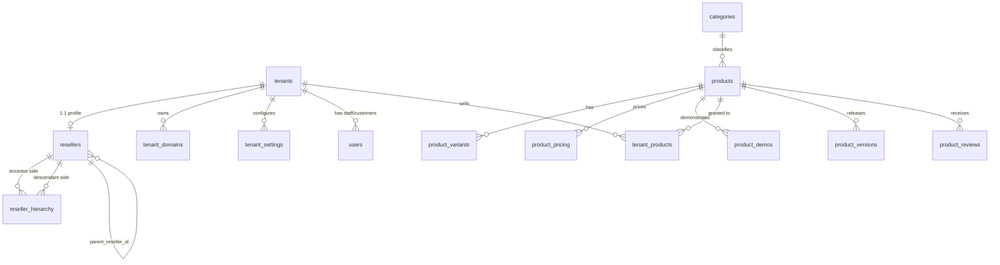
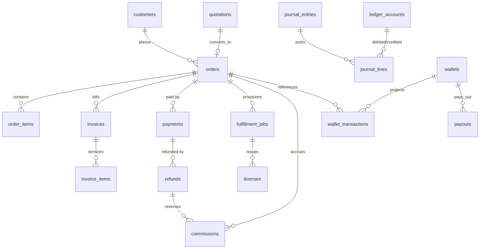
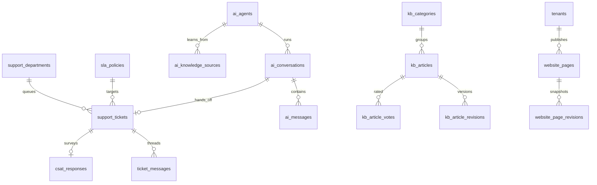

# Database Design — Schema Specification

| Field | Value |
|---|---|
| Document | 13-database-design.md |
| Version | 1.0 |
| Status | Draft for Review |
| Date | 2026-11-20 |
| Owner | Product & Architecture Team |
| Related documents | frenchies-prd-charter.md (internal, not in this repo — §6 canonical inventory, §7 financial rules), 02-user-roles-and-permissions.md, 03-functional-requirements.md, 04-multi-tenancy-architecture.md, 05-reseller-hierarchy.md, 06-product-marketplace.md, 07-billing-and-financial-architecture.md, 08-affiliate-and-commission-system.md, 09-fulfillment-and-licensing.md, 10-white-label-cms.md, 11-ai-and-automation.md, 12-crm-and-support.md, 14-api-specification.md, 17-security-requirements.md, 18-non-functional-requirements.md |

## Table of Contents

1. [Purpose & Scope](#1-purpose--scope)
2. [Global Conventions](#2-global-conventions)
   - 2.1 [Engine, charset, collation](#21-engine-charset-collation)
   - 2.2 [Primary keys & public identifiers](#22-primary-keys--public-identifiers)
   - 2.3 [Money & currency](#23-money--currency)
   - 2.4 [Timestamps & time zones](#24-timestamps--time-zones)
   - 2.5 [Status columns & enum discipline](#25-status-columns--enum-discipline)
   - 2.6 [Soft deletes](#26-soft-deletes)
   - 2.7 [JSON columns](#27-json-columns)
   - 2.8 [Foreign keys & on-delete policy](#28-foreign-keys--on-delete-policy)
   - 2.9 [Index strategy](#29-index-strategy)
   - 2.10 [Polymorphic (morph) convention](#210-polymorphic-morph-convention)
   - 2.11 [Database users & least privilege](#211-database-users--least-privilege)
3. [Data Dictionary Summary](#3-data-dictionary-summary)
4. [Per-Table Specifications](#4-per-table-specifications)
   - 4.1 [Framework / identity](#41-framework--identity)
   - 4.2 [Tenancy](#42-tenancy)
   - 4.3 [Reseller hierarchy](#43-reseller-hierarchy)
   - 4.4 [Catalog & demos](#44-catalog--demos)
   - 4.5 [Customers & CRM](#45-customers--crm)
   - 4.6 [Orders & billing](#46-orders--billing)
   - 4.7 [Money, ledger & payouts](#47-money-ledger--payouts)
   - 4.8 [Affiliate](#48-affiliate)
   - 4.9 [Subscription](#49-subscription)
   - 4.10 [Fulfillment & licensing](#410-fulfillment--licensing)
   - 4.11 [Support, CSAT & knowledge base](#411-support-csat--knowledge-base)
   - 4.12 [AI](#412-ai)
   - 4.13 [Communication](#413-communication)
   - 4.14 [CMS & media](#414-cms--media)
   - 4.15 [Admin, API & integrations](#415-admin-api--integrations)
5. [Key Design Callouts](#5-key-design-callouts)
   - 5.1 [Hierarchy: closure table + resellers path/counter columns](#51-hierarchy-closure-table--resellers-pathcounter-columns)
   - 5.2 [Per-tenant gapless numbering](#52-per-tenant-gapless-numbering)
   - 5.3 [Webhook idempotency](#53-payment_webhook_events-idempotency)
   - 5.4 [Commission duplicate prevention](#54-commissions-duplicate-prevention)
   - 5.5 [Double-entry balance invariant & append-only ledger](#55-double-entry-balance-invariant--append-only-ledger)
   - 5.6 [Tenant-scoped query index strategy](#56-tenant-scoped-query-index-strategy)
   - 5.7 [Retention & partitioning for high-volume tables](#57-retention--partitioning-for-high-volume-tables)
   - 5.8 [Time zone & currency columns](#58-time-zone--currency-columns)
6. [ER Diagrams](#6-er-diagrams)
7. [Seed Data Requirements](#7-seed-data-requirements)
8. [Migration Strategy (documentation only)](#8-migration-strategy-documentation-only)
9. [Assumptions & Open Questions](#9-assumptions--open-questions)
10. [Appendix / References](#10-appendix--references)

---

## 1. Purpose & Scope

This document is the authoritative schema specification for the Frenchies platform. It fully
defines columns, types, defaults, keys, indexes, constraints, and relationships for:

- all **86 canonical tables** fixed by the internal `frenchies-prd-charter.md` §6 (not
  in this repo; names are FINAL; no sibling document may invent alternatives for the
  same concept);
- the **deferred additions** demanded by sibling documents (`07` → `ledger_accounts`,
  `gateway_settlements`, `risk_blocklist`; `02` → `support_department_agents` + extended
  `permissions` columns; `12` → `csat_responses`, `kb_categories`, `kb_articles`,
  `kb_article_revisions`, `kb_article_votes`, `canned_responses`, `support_calendars`,
  `support_calendar_holidays`, `lead_lost_reasons`; `06` → demo-token store,
  order/lead demo-attribution columns; `10` → page-revision storage);
- a small number of **"Added by doc 13"** supporting tables that are genuinely required to
  implement requirements defined elsewhere (`api_request_logs`, `personal_access_tokens`,
  `demo_token_events`) — every such table is explicitly marked and classified per
  `04-multi-tenancy-architecture.md` §3 rule R1.

Stack constraints (charter §3): MySQL 8, **single shared database, shared schema**, row-level
tenant isolation via `tenant_id` columns + global scopes; Laravel 12 / PHP 8.2+; Redis for
cache/queues (Horizon) with framework DB tables retained for `failed_jobs` and driver
fallback. **Documentation only — this document defines no migrations and no code.**

Isolation semantics (global / tenant-owned / shared-read per row) are authoritative in
`04-multi-tenancy-architecture.md` §3; the summary in §3 below repeats them for
convenience and adds classification for every doc-13 addition.

---

## 2. Global Conventions

### 2.1 Engine, charset, collation

- Storage engine: **InnoDB** (row-level locking, FK enforcement) for every table.
- Charset: `utf8mb4`, collation: **`utf8mb4_0900_ai_ci`** (MySQL 8 default) at database,
  table, and column level. Case-insensitive matching is required by design for slugs,
  email-per-tenant, codes and status strings (normalization to lowercase happens in the
  application before write).
- No `MyISAM`, no `MEMORY` tables, no stored procedures/triggers for business logic —
  business rules live in the application layer; the schema provides constraints only.

### 2.2 Primary keys & public identifiers

- Every table: **`id BIGINT UNSIGNED NOT NULL AUTO_INCREMENT PRIMARY KEY`** except the
  composite-key framework/pivot tables documented below (`reseller_hierarchy`,
  `role_has_permissions`, `cache`, `sessions`, spatie pivots) which follow their natural
  or package-defined key shape.
- **`public_id`** — externally exposed entities carry a second, public identifier:
  `public_id CHAR(26) NOT NULL UNIQUE`, a ULID generated application-side
  (`Str::ulid()`, monotonic; never DB-generated, never sequential-guessable). Scope:
  `tenants`, `resellers`, `products`, `customers`, `orders`, `invoices`, `payments`,
  `refunds`, `payouts`, `licenses`, `support_tickets`, `subscriptions`, `quotations`,
  `leads`, `ai_conversations`.
- All API path resources identify rows by `public_id`; `id` never appears in URLs or
  webhook payloads. Internal joins use `id`.
- Declarative partitioned tables (§5.7) are the **only** exception to single-column PKs
  among domain tables: their PK becomes `(id, created_at)` because MySQL 8 requires every
  unique key to include the partition column.

### 2.3 Money & currency

- All monetary amounts: **`DECIMAL(15,2) NOT NULL`** — never `FLOAT`/`DOUBLE` (charter §7.11).
- Every amount-bearing table carries **`currency CHAR(3) NOT NULL DEFAULT 'INR'`**
  (ISO-4217). Multi-currency is P2/P3 (charter §1); the column exists from day one so no
  migration is needed later.
- Rates/percentages: `DECIMAL(5,2)` (0–100) for percentages, `DECIMAL(6,3)` for tax rates.
  Token-cost estimates use `DECIMAL(10,4)`.
- Rounding rule (doc 07 §3.1): half-up; residual ₹0.01 absorbed by the largest tax line —
  enforced in application code, not the DB.

### 2.4 Timestamps & time zones

- All timestamps stored **UTC** as `TIMESTAMP` where the value is an event time and
  `DATETIME` where the value is business-dated (issue dates, periods, expiry dates use
  `DATE`). Sub-second precision is not required: `DATETIME(0)`/`TIMESTAMP` (second
  precision) throughout.
- `created_at` and `updated_at` (`DATETIME NOT NULL`) exist on **all domain tables**.
  On append-only tables (§5.5, §5.7) `updated_at` is set at insert and never modified.
- Framework-owned tables retain their package schema (`cache` and `jobs` have no
  timestamp pair; spatie pivots follow the package migration) — documented exception.
- **Display:** every tenant has `tenants.timezone` (default `Asia/Kolkata`) and
  `tenants.locale` (default `en-IN`); the UI renders UTC values in tenant time zone.
  Business-dated columns (`issue_date`, `expires_at` as DATE, `follow_up_at` scheduling)
  are computed against tenant time zone before persistence (§5.8).

### 2.5 Status columns & enum discipline

- Stateful columns are `VARCHAR(32) NOT NULL` (never MySQL `ENUM` type — app-level backed
  PHP enums so values can be extended without DDL; `ENUM` shown below means the PHP-backed
  value set). **Every status/enum column's value set is listed inline in its column table**
  in §4 and in the consolidated lists of sibling documents.
- State transitions are validated server-side; illegal transitions raise and are audited.
- Boolean flags use `TINYINT(1) NOT NULL DEFAULT 0/1`.
- Canonical status columns and values (single source compiled here; per-table repetition
  in §4 marks the owning document):

| Column | Values | Owner doc |
|---|---|---|
| `tenants.status` | `pending`, `active`, `suspended`, `terminated` | 03 §6.1 |
| `tenant_domains.status` | `pending_dns`, `verifying`, `verified`, `provisioning_ssl`, `active`, `failed_dns_mismatch`, `failed_ssl`, `disabled` | 10 appendix (finalized here — see §9) |
| `users.status` | `active`, `suspended`, `disabled` | 13 |
| `user_invitations.status` | `pending`, `accepted`, `revoked`, `expired` | 02 §10 |
| `products.status` | `draft`, `pending_review`, `published`, `archived`, `rejected` | 06 App. B |
| `products.marketplace_status` | `unlisted`, `pending_review`, `approved`, `rejected` | 06 App. B |
| `tenant_products.status` | `active`, `suspended`, `revoked` | 06 App. B |
| `product_reviews.status` | `pending`, `approved`, `rejected`, `flagged` | 06 App. B |
| `product_demos.status` | `active`, `needs_reset`, `expired` | 06 App. B |
| demo token `state` | `active`, `expired`, `revoked` | 06 §10 |
| `orders.status` | `pending_payment`, `paid`, `processing`, `on_hold`, `fulfilled`, `completed`, `cancelled`, `partially_refunded`, `refunded`, `failed` | 03 §9.1 |
| `invoices.status` | `draft`, `issued`, `void`, `paid`, `partially_paid`, `overdue` | 07 §2 |
| `payments.status` | `pending`, `authorized`, `captured`, `partially_refunded`, `refunded`, `failed`, `cancelled`, `expired`, `manual_submitted`, `manual_approved`, `manual_rejected` | 07 §2 |
| `payment_webhook_events.processing` | `received`, `verified`, `applied`, `deferred`, `ignored_duplicate`, `rejected_signature`, `failed` | 07 §2 |
| `refunds.status` | `initiated`, `processing`, `completed`, `failed` | 07 §2 |
| `payouts.status` | `requested`, `approved`, `paid`, `rejected`, `cancelled` | 07 §2 |
| `commissions.status` | `pending`, `held`, `released`, `reversed`, `written_off`, `not_eligible_depth` | 08 §4 |
| `wallet_transactions.type` | `commission_pending`, `commission_release`, `commission_reversal`, `payout_hold`, `payout_paid`, `payout_rejected_release`, `adjustment`, `refund_clawback`, `ai_usage_charge`, `topup` | 07 §5.4 |
| wallet state buckets | `available`, `pending`, `commission` | charter §7.3 |
| `subscriptions.status` | `trialing`, `active`, `past_due`, `grace_period`, `suspended`, `cancelled`, `expired` | 03 §10.1 |
| `fulfillment_jobs.state` | `pending`, `in_progress`, `awaiting_customer`, `delivered`, `completed`, `failed`, `rejected`, `cancelled` | 09 §5 |
| `licenses.state` | `pending`, `active`, `expired`, `suspended`, `revoked` | 09 §10.2 |
| `license_activations.action` | `activate`, `deactivate`, `validate`, `heartbeat` | 09 §10.8 |
| `leads.status` | `new`, `contacted`, `qualified`, `proposal`, `negotiation`, `won`, `lost` | 12 §4.3 |
| `leads.source` | `contact_form`, `demo_request`, `manual`, `csv_import`, `api_webhook`, `affiliate`, `chatbot` | 12 §3 |
| `quotations.status` | `draft`, `sent`, `viewed`, `accepted`, `rejected`, `converted`, `expired` (+ `declined_after_acceptance`, P2) | 12 §6 |
| `support_tickets.status` | `open`, `pending_customer`, `resolved`, `closed`, `reopened` | 12 §12 |
| `support_tickets.priority` | `low`, `normal`, `high`, `urgent` | 12 §12 |
| `support_tickets.channel` | `portal`, `email`, `whatsapp`, `chatbot` | 12 §12 |
| `ticket_messages.visibility` | `public`, `internal` | 12 §22.7 |
| `ai_agents.status` | `draft`, `active`, `disabled` | 11 §6.1 |
| `ai_conversations.status` | `open`, `closed_by_limit`, `closed_by_handoff`, `purged` | 11 §11 |
| `ai_messages.role` | `user`, `assistant`, `tool`, `system` | 11 §11 |
| `api_keys.status` | `active`, `revoked` | 03 §14.1 |
| `webhook_deliveries.status` | `pending`, `success`, `failed`, `dead` | 03 §14.1 |
| `integration_connections.status` | `connected`, `degraded`, `disconnected`, `error` | 03 §14.1 (finalized over 11 §6.2 — see §9) |
| `website_pages.status` | `draft`, `published`, `archived` (system legal pages: `draft`/`published` only) | 10 appendix |
| `refunds`→coupons: `coupons.status` | `draft`, `active`, `paused`, `expired`, `exhausted` | 13 |
| `affiliates.status` | `applied`, `active`, `rejected`, `suspended`, `paused` | 08 §6 |

### 2.6 Soft deletes

Soft delete = `deleted_at TIMESTAMP NULL DEFAULT NULL` + `SoftDeletes` on the model
(`WHERE deleted_at IS NULL` added by the global scope). Policy:

- **Yes** — user-editable content entities whose deletion is a "trash" action and must be
  restorable: `users`, `products`, `product_variants`, `product_media`, `product_packages`,
  `package_items`, `product_addons`, `product_addon_links`, `product_demos`,
  `product_documents`, `customer_groups`, `quotations`, `coupons`, `support_departments`,
  `sla_policies` (tenant rows), `canned_responses`, `ai_agents`, `ai_knowledge_sources`,
  `website_themes`, `website_pages`, `website_menus`, `media_library`,
  `notification_templates`, `api_webhooks`, `integration_connections`.
- **No** — everything else, for these explicit reasons:
  - append-only / audit / financial & legal records (never deleted at app layer):
    `orders`, `order_items`, `invoices`, `invoice_items`, `payments`, `refunds`,
    `wallet_transactions`, `journal_entries`, `journal_lines`, `payouts`, `commissions`,
    `audit_logs`, `fulfillment_events`, `lead_activities`, `subscription_events`,
    `notification_logs`, `login_activities`, `affiliate_clicks`, `ai_messages`,
    `ai_usage_logs`, `license_activations`, `api_request_logs`, `webhook_deliveries`
    (rows are removed only by retention/partition jobs — §5.7);
  - lifecycle-managed entities that use status, not trash: `tenants`, `resellers`,
    `customers`, `affiliates`, `subscriptions`, `subscription_plans`, `licenses`,
    `support_tickets`, `leads`, `kb_articles`, `kb_categories`, `roles`, `permissions`,
    `api_keys`, `taxes`, `categories`;
  - infrastructure/framework tables (`sessions`, `cache`, `jobs`, `failed_jobs`, spatie
    pivots, `personal_access_tokens`) keep package schema;
  - rows purged during tenant termination are deleted by the explicit purge job
    (`04` §7.5) which bypasses soft deletes deliberately.

### 2.7 JSON columns

JSON columns are used only for genuinely flexible configuration; every one is documented
here with its expected shape (application validates against a schema registry before
write; unknown keys rejected — FR-TENANT-011):

| Table.column | Shape (documented schema) |
|---|---|
| `tenant_settings.value` | typed scalar/array per registered key (e.g., `invoice_sequence = {"prefix":"FRS","fy":"2026-27","next_seq":42,"format":"{PREFIX}-{FY}-{SEQ6}"}`) |
| `platform_settings.value` | scalar/array per registered key; secrets stored via encrypted cast |
| `products.fulfillment_config` | driver config: `{driver, template:{deliverables[], sla_days}, credentials:{…encrypted}, version_hash}` |
| `products.license_policy` | `{validity_days, max_activations, issuance:"pool"\|"on_demand", auto_renew, updates_included}` |
| `tenant_products` (none) | structured columns only |
| `ai_agents.tools` | allowlist array: `["catalog_lookup","lead_capture","kb_search","order_status","ticket_create"]` |
| `ai_agents.widget_settings` | `{widget_key, display_name, avatar, color, greeting, position, max_turns, fallback_message, availability_windows}` |
| `ai_messages.tool_calls` / `moderation` | array of `{name, args, result_digest, duration_ms}` / `{verdict, categories}` |
| `ai_knowledge_sources.config` | per-type fetch config (URL crawl depth, file parse options) |
| `orders`/`invoices` (none) | structured columns; snapshots in dedicated columns |
| `website_pages.sections` | ordered array: `[{type, settings:{…}}]` (§10 field contract; one document per page) |
| `website_pages.seo` | `{meta_title, meta_description, og_image, canonical, robots}` |
| `website_themes.tokens` | design tokens: `{colors, typography, radii, spacing, shadows}` - fixed key set, no free-form nesting |
| `support_calendars.week_json` | business windows per day: `{mon:[["09:00","18:00"]], ...}` |
| `api_webhooks.events` / `webhook_deliveries.payload` | subscribed event keys array / exact signed body sent to the receiver |
| `integration_connections.config` | non-secret provider settings (mode, region, sender id); credentials live in the encrypted column |
| `website_menus.structure` | nested array: `[{label, target_type:"page"\|"url"\|"category", target, children[]}]` |
| `api_keys.scopes` / `ip_allowlist` | scope strings array / CIDR strings array |
| `api_webhooks.events` | subscribed event keys array (catalogue per 03 FR-API-008) |
| `user_invitations.roles` / `department_grants` | requested role-name array / `[{department_id, permissions[]}]` |
| `notification_templates` (body column) | `TEXT` with `{{placeholder}}` tokens (not JSON) |
| `subscription_plans.features` / `quotas` | plan feature flags / `{max_users, max_products, max_domains, max_api_keys, max_sub_resellers, ai_token_cap}` |
| `licenses.meta` | `{domain_allowlist[], device_fingerprints[], notes}` |
| `ticket_messages.attachments` | array of `{disk_key, filename, mime, size, scan_status}` |
| `audit_logs.metadata` | `{before:{…}, after:{…}, reason, request_id}` (secrets redacted) |
| `payment_webhook_events.payload` / `headers` | raw gateway body (redacted of PAN/CVV) / selected headers |
| `gateway_settlements.raw_payload` | raw API/CSV row as received |

### 2.8 Foreign keys & on-delete policy

Default rule, applied unless a table's spec states otherwise:

| Policy | When used | Examples |
|---|---|---|
| **`RESTRICT`** (default) | financial/legal references, parent entities, anything whose loss breaks an invariant | `orders.customer_id→customers`, `order_items.product_id→products`, `payments.order_id→orders`, `commissions.order_item_id→order_items`, `journal_lines.journal_entry_id→journal_entries`, `tenant_id→tenants` on tenant-owned tables, both closure endpoints |
| **`CASCADE`** | pure dependent children with no independent meaning | `invoice_items→invoices`, `cart_items→carts`, `journal_lines→journal_entries` (child of entry), `package_items→product_packages`, `model_has_roles→roles`, `webhook_deliveries→api_webhooks`, `ticket_messages→support_tickets` (hard purge only) |
| **`SET NULL`** | optional references (who performed / which user / nullable link) | `created_by`, `assigned_to`, `updated_by`, `requested_by`, `approved_by`, `affiliates.user_id`, `refunds.credit_note_invoice_id` |

- `tenant_id` FKs are **`RESTRICT`** on tenant-owned tables: a tenant can only be removed
  by the explicit purge job after its rows are deleted — no accidental cascade of financial
  history (04 §7.5).
- Self-references (`resellers.parent_reseller_id`, `fulfillment_jobs.parent_job_id`,
  `invoices.original_invoice_id`, `journal_entries.reverses_entry_id`) are `RESTRICT`.
- Every FK column is indexed (InnoDB requires an index on the referencing column; we make
  it explicit and lead with `tenant_id` where both exist — §2.9).

### 2.9 Index strategy

- **Every tenant-owned table** carries at least one composite index **leading with
  `tenant_id`** — this is the mandatory pattern that makes the global scope cheap:
  `(tenant_id, <most-selective-filter>, <sort>)`.
- Column order inside a composite: equality columns first (`tenant_id`, `status`,
  `tenant_id, status`), then range/sort columns (`created_at`, `due_at`).
- Low-cardinality columns (`status`) are never indexed alone on small tables — only as a
  composite leading after `tenant_id`.
- Foreign keys always indexed; polymorphic pairs indexed as `(type, id)`.
- Business-unique keys use `UNIQUE` indexes (see per-table specs): tenant slug, domain
  host, per-tenant `order_number` / `invoice_number` / `quotation_number`, license `key`,
  affiliate `affiliate_code`, `coupons.code_key`, `users(email, tenant_id)`,
  `(tenant_id, key)` for settings, webhook `(gateway, gateway_event_id)`, commission
  5-column idempotency key (§5.4).
- Target: ≤ 6 secondary indexes on write-hot tables (`orders`, `audit_logs`,
  `notification_logs`, `ai_messages`, `affiliate_clicks`) — every index costs on ingest.
- Expression indexes (`IFNULL(col, 0)`) are used where NULL must participate in a unique
  key (documented per table).
- Covering-index checks for the hottest lists are recorded in the per-table `Indexes`
  line (e.g., `orders (tenant_id, status, created_at)` serves the default admin list).

### 2.10 Polymorphic (morph) convention

- Shape: **`<name>_type VARCHAR(32) NOT NULL` + `<name>_id BIGINT UNSIGNED NOT NULL`**
  (nullable only where the reference itself is optional). Both columns always indexed as
  `(<name>_type, <name>_id)`.
- `<name>_type` stores the **morph-map key**, never a PHP FQCN
  (`Model::morphMap([...])`), so table/class renames never corrupt stored data. Canonical
  morph map (single registry in the application):

| Map key | Target | Used by |
|---|---|---|
| `tenant` | `Tenant` | `wallets.owner_type`, `ledger_accounts.scope_id` companion |
| `affiliate` | `Affiliate` | `wallets.owner_type`, `commissions.beneficiary_type` |
| `customer` / `user` / `guest` | `Customer`, `User`, — | `orders.owner_type`, `carts.owner_type`, `support_tickets.requester_type` |
| `order`, `payment`, `refund`, `payout`, `invoice`, `commission` | billing entities | `journal_entries.reference_type`, `wallet_transactions.reference_type` |
| `user`, `system`, `job` | actor kinds | `audit_logs.actor_type` |
| any subject entity | polymorphic subject | `audit_logs.subject_type` (`product`, `tenant`, `lead`, `ticket`, …) |
| `system`, `driver`, `user`, `customer` | fulfillment actors | `fulfillment_events.actor_type` |
| `user`, `customer`, `system`, `ai` | message authors | `ticket_messages.author_type` |
| `user`, `customer` | recipients | `notification_logs.recipient_type` |
| `user`, `system` | lead authors | `lead_activities.author_type` |

- Concrete morph columns in the schema (checked against sibling requirements):
  **orders `owner_type/owner_id`** (who placed/owns the order for access scoping;
  commercial counterparty stays `customer_id`), **`support_tickets.requester_type/
  requester_id`** (`customer|user|affiliate` per 12 §10), **`commissions.beneficiary_type/
  beneficiary_id`** (`tenant|affiliate` per 08 §4), **`audit_logs.subject_type/subject_id`
  and `actor_type/actor_id`**, **`fulfillment_events.actor_type/actor_id`** (the
  fulfillment actor/"owner" of each transition), plus `wallets.owner_*`,
  `journal_entries.reference_*`, `wallet_transactions.reference_*`, `carts.owner_*`,
  `ticket_messages.author_*`, `notification_logs.recipient_*`,
  `lead_activities.author_*`, `personal_access_tokens.tokenable_*` (package-defined).

### 2.11 Database users & least privilege

- **`app_rw`** (Laravel runtime): `SELECT, INSERT, UPDATE, DELETE` + `ALTER, CREATE,
  INDEX` only during migrations (separate `app_migrate` grant revoked after deploy).
  **No `DROP`, no `GRANT OPTION`.**
- **`app_ledger`** (posting path for `07` §5.3): `INSERT, SELECT` on `journal_entries`
  and `journal_lines` **only — no UPDATE/DELETE grants** on those tables, ever. Same
  insert-only treatment for `fulfillment_events` (09 §14.2).
- **`app_readonly`** (reporting/exports): `SELECT` only.
- Nightly integrity jobs (ledger balance, closure reconciliation, sequence anomaly check)
  run under `app_readonly` + a narrow stored maintenance role; retention/partition
  maintenance uses `app_ops` (`ALTER TABLE ... DROP PARTITION` only).
- Cross-check: `17-security-requirements.md` owns the security review of these grants;
  this document fixes which tables must be insert-only: `journal_entries`,
  `journal_lines`, `fulfillment_events`.

---

## 3. Data Dictionary Summary

One row per table. **Classification** follows `04-multi-tenancy-architecture.md` §3:
`tenant-owned` = `tenant_id` isolation + `BelongsToTenant` scope; `tenant + central` =
mixed, always queried with explicit `tenant_id` (incl. central rows); `central/global` =
platform-managed, no tenant filter; `shared-read` = tenants read, never mutate.
**Volume tiers:** `S` < 100k rows/3y · `M` < 10M · `L` < 500M · `XL` ≥ 500M or unbounded.

### 3.1 Canonical tables (charter §6 — 86)

| # | Table | Purpose | Classification | Soft delete | Vol |
|---|---|---|---|---|---|
| 1 | `users` | Tenant-scoped login accounts (staff, customers, affiliates, platform) | tenant-owned | yes | M |
| 2 | `sessions` | HTTP session rows (DB driver fallback; Redis in production) | tenant-owned | no | M |
| 3 | `login_activities` | Login attempt audit per tenant | tenant-owned | no | L |
| 4 | `user_invitations` | Pending invitations with roles + department grants | tenant-owned | no | S |
| 5 | `roles` | spatie team-scoped roles (`teams_key = tenant_id`) | tenant-owned (team) | no | M |
| 6 | `permissions` | Platform permission catalogue (136 slugs) + doc-13 columns | global / shared-read | no | S |
| 7 | `model_has_roles` | User ↔ role assignments bound to a tenant team | tenant-owned (team) | no | M |
| 8 | `model_has_permissions` | Direct permission grants bound to a tenant team | tenant-owned (team) | no | M |
| 9 | `role_has_permissions` | Role → permission grants (via role's team) | tenant-owned (via role) | no | M |
| 10 | `cache` | Database cache driver rows (Redis in production) | global (infra) | no | S |
| 11 | `jobs` | Queue transport rows (Redis/Horizon in production) | global (infra) | no | S |
| 12 | `failed_jobs` | Failed jobs; payload retains tenant attribution | global (infra) | no | M |
| 13 | `tenants` | Business identities: central platform + reseller tenants | global | no | M |
| 14 | `tenant_domains` | Subdomain/custom-domain registry + verification/SSL state | global | no | M |
| 15 | `tenant_settings` | Typed per-tenant settings incl. invoice/order sequences | tenant-owned | no | L |
| 16 | `resellers` | Reseller business profile: parent link, path, counters | tenant-owned | no | M |
| 17 | `reseller_hierarchy` | Closure table: every ancestor → descendant pair + depth | global structure | no | M |
| 18 | `categories` | Global product taxonomy (15 seeded categories) | shared-read | no | S |
| 19 | `products` | Catalog entries: ownership, type, fulfillment + license config | central/global (ownership) | yes | L |
| 20 | `product_variants` | Product variants (options, price scope) | global (via product) | yes | M |
| 21 | `product_media` | Ordered product/demo images & videos (S3 keys) | global (via product) | yes | M |
| 22 | `product_packages` | Bundle definitions | global (via product) | yes | S |
| 23 | `package_items` | Bundle component lines (bundle depth = 1) | global (via product) | yes | S |
| 24 | `product_addons` | Standalone add-on definitions | global (via product) | yes | S |
| 25 | `product_addon_links` | Product ↔ add-on attachment rows | global (via product) | yes | S |
| 26 | `product_pricing` | Effective-dated base prices + floor (product/variant/addon) | global (base) | no | M |
| 27 | `tenant_products` | Per-tenant sell grants + price/commission overrides | tenant-owned | no | L |
| 28 | `product_demos` | Demo instances (live URL / video / screenshots) | global (via product) | yes | M |
| 29 | `product_versions` | Immutable major.minor releases + changelog | global (via product) | no | M |
| 30 | `product_reviews` | Moderated verified-purchaser reviews | tenant-owned (author) + shared-read | no | M |
| 31 | `product_documents` | Product attachments / manuals | global (via product) | yes | S |
| 32 | `customers` | End-buyer profiles (GST, portal user link) | tenant-owned | no | L |
| 33 | `customer_groups` | Named customer segments | tenant-owned | yes | S |
| 34 | `customer_group_members` | Group membership rows | tenant-owned | no | M |
| 35 | `leads` | CRM prospects: pipeline status, assignment, demo attribution | tenant-owned | no | L |
| 36 | `lead_activities` | Append-only lead timeline | tenant-owned | no | L |
| 37 | `quotations` | Quotes: secure link, status machine, expiry sweep | tenant-owned | yes | M |
| 38 | `quotation_items` | Quote lines with price/MSP/tax snapshots | tenant-owned | no | M |
| 39 | `carts` | Guest + authenticated carts per storefront | tenant-owned | no | M |
| 40 | `cart_items` | Cart lines with price snapshots | tenant-owned | no | M |
| 41 | `coupons` | Discount codes: platform / tenant / affiliate scope | tenant-owned | yes | M |
| 42 | `orders` | Sales orders (selling reseller = `tenant_id`) | tenant-owned | no | L |
| 43 | `order_items` | Order lines: version pinning, tax + floor snapshots | tenant-owned | no | L |
| 44 | `taxes` | Scoped GST rate definitions (global/product/category/tenant) | shared-read | no | M |
| 45 | `invoices` | GST invoices, credit notes, receipts + per-tenant sequence | tenant-owned + central | no | L |
| 46 | `invoice_items` | Invoice lines with CGST/SGST/IGST split | tenant-owned + central | no | L |
| 47 | `payments` | Gateway/manual payment attempts (central merchant accounts) | tenant-owned (gateway central) | no | L |
| 48 | `payment_webhook_events` | Inbound gateway webhook idempotency ledger | central/global | no | L |
| 49 | `refunds` | Refund attempts + clawback/credit-note linkage | tenant-owned | no | M |
| 50 | `wallets` | Owner wallets (tenant/affiliate/platform) + payout destination | tenant-owned | no | M |
| 51 | `wallet_transactions` | Append-only wallet subledger projection | tenant-owned | no | L |
| 52 | `journal_entries` | Double-entry postings (append-only, authoritative) | tenant-owned + central | no | L |
| 53 | `journal_lines` | Balanced debit/credit lines (append-only) | tenant-owned + central | no | L |
| 54 | `payouts` | Payout requests, Finance Admin approval, ledger posting link | tenant-owned | no | M |
| 55 | `commissions` | Per-line beneficiary commissions (idempotent accrual) | tenant-owned (beneficiary) | no | L |
| 56 | `affiliates` | Affiliate program members (code, status, terms) | tenant-owned | no | M |
| 57 | `affiliate_links` | Short referral links with campaign labels | tenant-owned | no | M |
| 58 | `affiliate_clicks` | Click/attribution event log (30-day cookie source) | tenant-owned | no | XL |
| 59 | `subscription_plans` | Reseller plans (platform) + product plans (tenant), versioned | shared-read (platform) + tenant-owned (product) | no | M |
| 60 | `subscriptions` | Subscriber plan instances + lifecycle state machine | tenant-owned | no | L |
| 61 | `subscription_events` | Append-only subscription lifecycle log | tenant-owned | no | L |
| 62 | `fulfillment_jobs` | Provisioning/manual jobs: SLA, approvals, disputes, retries | tenant-owned | no | L |
| 63 | `fulfillment_events` | Append-only job timeline | tenant-owned | no | L |
| 64 | `licenses` | License keys & states (globally unique key) | tenant-owned | no | M |
| 65 | `license_activations` | activate/deactivate/validate/heartbeat log | tenant-owned | no | L |
| 66 | `sla_policies` | First-response/resolution targets: defaults + overrides | shared-read defaults + tenant-owned overrides | yes | S |
| 67 | `support_departments` | Per-tenant queues + platform default mapping | tenant-owned + central | yes | S |
| 68 | `support_tickets` | Support threads: requester morph, SLA, escalation links | tenant-owned | no | M |
| 69 | `ticket_messages` | Public/internal replies with attachments | tenant-owned | no | L |
| 70 | `ai_agents` | Chatbot/assistant configuration + widget settings | tenant-owned | yes | S |
| 71 | `ai_conversations` | Conversation headers (handoff, lead, ticket links) | tenant-owned | no | M |
| 72 | `ai_messages` | Messages + tool traces + token counts | tenant-owned | no | XL |
| 73 | `ai_usage_logs` | Per-invocation token/cost metering | tenant-owned | no | L |
| 74 | `ai_knowledge_sources` | URL/file/text sources for retrieval | tenant-owned | yes | S |
| 75 | `notification_templates` | Per-tenant cloned message templates | tenant-owned + central | yes | M |
| 76 | `notification_logs` | Outbound message log (email/in-app/WhatsApp) | tenant-owned | no | XL |
| 77 | `website_themes` | Theme tokens; system themes are shared-read | tenant-owned + central (system) | yes | M |
| 78 | `website_pages` | Storefront pages: type, sections JSON, SEO, workflow | tenant-owned | yes | M |
| 79 | `website_menus` | Menu structures (header/footer/mobile) | tenant-owned | yes | S |
| 80 | `media_library` | Tenant-prefixed object storage index | tenant-owned | yes | M |
| 81 | `platform_settings` | Global platform configuration (secret-aware) | central/global | no | S |
| 82 | `audit_logs` | Append-only actor/subject audit trail | central/global (tenant-tagged) | no | XL |
| 83 | `api_keys` | Tenant API keys: scopes, rotation, revocation | tenant-owned | no | M |
| 84 | `api_webhooks` | Outbound event subscriptions + signing secret | tenant-owned | yes | M |
| 85 | `webhook_deliveries` | Delivery attempts, retries, dead-letter state | tenant-owned | no | L |
| 86 | `integration_connections` | Gateway/provider/channel credential references | tenant-owned + central | yes | M |

### 3.2 Additions (deferred by siblings + "Added by doc 13" — 18)

| # | Table | Purpose | Source / reason | Classification | Soft delete | Vol |
|---|---|---|---|---|---|---|
| A1 | `ledger_accounts` | Chart-of-accounts-light incl. per-wallet-state instances | 07 §5.1 (deferred) | central/global + tenant/affiliate instances | no | M |
| A2 | `gateway_settlements` | Daily gateway settlement rows for reconciliation | 07 (deferred) | central/global | no | M |
| A3 | `risk_blocklist` | Payment fraud blocklist entries | 07 (deferred) | global + tenant-scoped rows | no | S |
| A4 | `support_department_agents` | Support Agent ↔ department membership pivot | 02 (deferred) | tenant-owned | no | M |
| A5 | `csat_responses` | One CSAT response per resolved ticket | 12 (deferred) | tenant-owned | no | M |
| A6 | `kb_categories` | KB category tree (platform + tenant scopes) | 12 (deferred) | tenant-owned + shared-read | no | S |
| A7 | `kb_articles` | KB articles with visibility scopes | 12 (deferred) | tenant-owned + shared-read | no | M |
| A8 | `kb_article_revisions` | KB publish snapshots (restore) | 12 (deferred) | tenant-owned | no | M |
| A9 | `kb_article_votes` | Anonymous helpfulness votes | 12 (deferred) | tenant-owned | no | M |
| A10 | `canned_responses` | Agent reply templates (P2) | 12 (deferred) | tenant-owned | yes | S |
| A11 | `support_calendars` | Business-hours calendars (P2) | 12 (deferred) | tenant-owned | yes | S |
| A12 | `support_calendar_holidays` | Holiday rows of a calendar (P2) | 12 (deferred "…+ holidays") | tenant-owned | no | S |
| A13 | `lead_lost_reasons` | Tenant-defined lost-reason taxonomy | 12 (deferred; table form chosen — §9) | tenant-owned | no | S |
| A14 | `demo_access_tokens` | Unique per-visitor demo links (`/d/{token}`) + attribution | 06 (deferred demo-token store) | tenant-owned | no | L |
| A15 | `demo_token_events` | Per-token view/heartbeat/CTA event stream | 06 FR-DEMO-008 (tracking needs a store) | tenant-owned | no | XL |
| A16 | `website_page_revisions` | Last-10 page snapshots + non-destructive restore | 10 (deferred) | tenant-owned | no | M |
| A17 | `api_request_logs` | API request metrics log, 90-day retention | 03 FR-API-006 (no canonical table existed) | tenant-owned | no | XL |
| A18 | `personal_access_tokens` | Sanctum tokens with team (tenant) context | 02 §9.10 (package table) | tenant-owned | no | M |

**Totals: 104 tables = 86 canonical + 18 additions.** Not added, deliberately
(decisions recorded in §9): persistent reseller rollup table (Redis-first per 05 §10),
`notifications` in-app table (in-app rows live in `notification_logs`), `credit_notes`
table (realized as `invoices.type = 'credit_note'`), `invoice_sequence` table (lives in
`tenant_settings` per 07 §2).

---

## 4. Per-Table Specifications

Legend repeated per table: *Class* = isolation class (§3), *Vol* = volume tier.
Column tables list PK/FK targets **with on-delete** and inline enum values; the trailing
line lists indexes (`IDX`), unique business keys (`UNQ`), Eloquent-style relations
(`Rel`), and soft-delete state. `TS` = `created_at`/`updated_at` pair.

### 4.1 Framework / identity

#### 4.1.1 `users`
*Purpose:* tenant-scoped accounts (staff, customers, affiliates, platform staff). · *Class:* tenant-owned · *Soft delete:* yes · *Vol:* M

| Column | Type | Null | Default | Keys / notes |
|---|---|---|---|---|
| id | BIGINT UNSIGNED | no | auto_increment | PK |
| tenant_id | BIGINT UNSIGNED | no | — | FK tenants(id) RESTRICT; every user belongs to exactly one tenant (charter §4) |
| name | VARCHAR(100) | no | — | display name |
| email | VARCHAR(255) | no | — | normalized lowercase before write |
| email_verified_at | DATETIME | yes | NULL | |
| password | VARCHAR(255) | no | — | hashed; portal customers may set later (FR-ORDER-007) |
| status | VARCHAR(32) | no | 'active' | Enum: active, suspended, disabled |
| phone | VARCHAR(32) | yes | NULL | |
| locale | CHAR(5) | no | 'en-IN' | |
| timezone | VARCHAR(64) | no | 'Asia/Kolkata' | display fallback before tenant default applies |
| last_login_at | DATETIME | yes | NULL | |
| remember_token | VARCHAR(100) | yes | NULL | |
| created_at / updated_at | DATETIME | no | — | TS |
| deleted_at | TIMESTAMP | yes | NULL | SoftDeletes |

**Indexes:** IDX(tenant_id, status), IDX(email). **Unique:** UNQ(email, tenant_id) — one
account per human per tenant (02 §10.5); login shows a tenant chooser on multi-match.
**Relations:** `belongsTo(tenant)`; `hasMany(orders owner, support_tickets requester,
leads assigned)`. **Soft delete:** yes.

#### 4.1.2 `sessions`
*Purpose:* DB-driver session rows (tagged with tenant; Redis session store is the
production driver — charter §3). · *Class:* tenant-owned (payload carries tenant) · *Soft delete:* no · *Vol:* M

| Column | Type | Null | Default | Keys / notes |
|---|---|---|---|---|
| id | CHAR(41) | no | — | PK (Laravel session string id) |
| user_id | BIGINT UNSIGNED | yes | NULL | FK users(id) CASCADE |
| tenant_id | BIGINT UNSIGNED | yes | NULL | FK tenants(id) CASCADE; tenant binding per 04 §3.1 |
| ip_address | VARCHAR(45) | yes | NULL | |
| user_agent | TEXT | yes | NULL | |
| payload | TEXT | no | — | serialized; contains tenant context |
| last_activity | INT UNSIGNED | no | — | unix seconds; IDX(last_activity) for sweeps |

**Indexes:** IDX(user_id), IDX(last_activity). **Unique:** none. **Relations:**
`belongsTo(user, tenant)`. **Soft delete:** no (framework schema).

#### 4.1.3 `login_activities`
*Purpose:* append-only login attempt audit per tenant. · *Class:* tenant-owned · *Soft delete:* no · *Vol:* L (partition candidate §5.7)

| Column | Type | Null | Default | Keys / notes |
|---|---|---|---|---|
| id | BIGINT UNSIGNED | no | auto_increment | PK |
| tenant_id | BIGINT UNSIGNED | no | — | FK tenants(id) RESTRICT |
| user_id | BIGINT UNSIGNED | yes | NULL | FK users(id) SET NULL (unknown email ⇒ NULL) |
| email | VARCHAR(255) | no | — | attempted identifier |
| success | TINYINT(1) | no | 0 | |
| failure_reason | VARCHAR(64) | yes | NULL | Enum: invalid_credentials, unknown_email, suspended, tenant_suspended, expired_session, rate_limited |
| ip_address | VARCHAR(45) | yes | NULL | |
| user_agent | VARCHAR(512) | yes | NULL | |
| created_at / updated_at | DATETIME | no | — | TS; append-only (updated_at frozen) |

**Indexes:** IDX(tenant_id, created_at), IDX(user_id, created_at), IDX(email, created_at).
**Unique:** none (repeat attempts are data). **Relations:** `belongsTo(tenant, user)`.
**Soft delete:** no.

#### 4.1.4 `user_invitations`
*Purpose:* pending invitations carrying roles and optional department grants (02 §10). · *Class:* tenant-owned · *Soft delete:* no · *Vol:* S

| Column | Type | Null | Default | Keys / notes |
|---|---|---|---|---|
| id | BIGINT UNSIGNED | no | auto_increment | PK |
| tenant_id | BIGINT UNSIGNED | no | — | FK tenants(id) RESTRICT |
| email | VARCHAR(255) | no | — | matched case-insensitively at acceptance |
| roles | JSON | no | — | array of role names (e.g., `["reseller.custom.support"]`) |
| department_grants | JSON | yes | NULL | `[{department_id, permissions[]}]` (02 §10.1) |
| invited_by | BIGINT UNSIGNED | yes | NULL | FK users(id) SET NULL |
| token_hash | CHAR(64) | no | — | SHA-256 of the mailed token; token never stored/logged (17) |
| status | VARCHAR(32) | no | 'pending' | Enum: pending, accepted, revoked, expired |
| expires_at | DATETIME | no | created_at + 168h | single-use; resend resets expiry once |
| accepted_at | DATETIME | yes | NULL | acceptance writes roles + dept grants atomically |
| revoked_at | DATETIME | yes | NULL | revocable until acceptance |
| created_at / updated_at | DATETIME | no | — | TS |

**Indexes:** IDX(tenant_id, status, expires_at), IDX(tenant_id, email).
**Unique:** UNQ(token_hash) (global). **Relations:** `belongsTo(tenant, invitedBy)`.
**Soft delete:** no (status-driven).

#### 4.1.5 `roles` (spatie + teams)
*Purpose:* team-scoped roles; `teams_key = tenant_id` (02 §9.2). · *Class:* tenant-owned (team) · *Soft delete:* no · *Vol:* M

| Column | Type | Null | Default | Keys / notes |
|---|---|---|---|---|
| id | BIGINT UNSIGNED | no | auto_increment | PK |
| name | VARCHAR(191) | no | — | fixed 12 template names (02 §9.3) + `reseller.custom.<slug>` |
| tenant_id | BIGINT UNSIGNED | no | — | spatie teams key (config `teams_key = 'tenant_id'`); FK tenants(id) RESTRICT; missing team throws (02 §9.2) |
| guard_name | VARCHAR(255) | no | 'web' | one catalogue serves web + Sanctum (02 §9.3) |
| created_at / updated_at | DATETIME | no | — | TS |

**Indexes:** IDX(tenant_id). **Unique:** UNQ(name, tenant_id, guard_name).
**Relations:** `belongsTo(tenant)`, `belongsToMany(users, model_has_roles)` (pivot carries
team). **Soft delete:** no.

#### 4.1.6 `permissions`
*Purpose:* platform permission catalogue (136 slugs / 26 modules) with doc-13 extension
columns. · *Class:* global / shared-read · *Soft delete:* no · *Vol:* S

| Column | Type | Null | Default | Keys / notes |
|---|---|---|---|---|
| id | BIGINT UNSIGNED | no | auto_increment | PK |
| name | VARCHAR(191) | no | — | slug `<module>.<action>` (02 §3.1) |
| guard_name | VARCHAR(255) | no | 'web' | |
| module | VARCHAR(32) | no | — | **doc-13 extension (02 §A6)**: one of the 26 module keys, e.g. `orders` |
| reseller_assignable | TINYINT(1) | no | 0 | **doc-13 extension**: platform-flipped flag gating custom roles (02 §8.2.3) |
| description | VARCHAR(255) | yes | NULL | **doc-13 extension**: human text for role editor |
| created_at / updated_at | DATETIME | no | — | TS |

**Indexes:** IDX(module). **Unique:** UNQ(name, guard_name).
**Relations:** `belongsToMany(roles)`, `belongsToMany(users)`. **Soft delete:** no —
catalogue rows are renamed via versioned rename map, never deleted (02 §9.6).

#### 4.1.7 `model_has_roles`
*Purpose:* user ↔ role assignments bound to a tenant team. · *Class:* tenant-owned (team) · *Soft delete:* no · *Vol:* M

| Column | Type | Null | Default | Keys / notes |
|---|---|---|---|---|
| model_type | VARCHAR(255) | no | — | morph key `user` (morph map, §2.10) |
| model_id | BIGINT UNSIGNED | no | — | users.id |
| role_id | BIGINT UNSIGNED | no | — | FK roles(id) CASCADE |
| tenant_id | BIGINT UNSIGNED | no | — | spatie teams key; FK tenants(id) CASCADE; assignment never crosses tenants (04 §3.1) |

**Indexes:** IDX(role_id), IDX(tenant_id), IDX(model_id). **Unique:** UNQ(model_type,
model_id, role_id, tenant_id). **Relations:** `belongsTo(role, tenant)`.
**Soft delete:** no (package pivot, no timestamps per package schema).

#### 4.1.8 `model_has_permissions`
*Purpose:* direct permission grants bound to a tenant team. · *Class:* tenant-owned (team) · *Soft delete:* no · *Vol:* M

| Column | Type | Null | Default | Keys / notes |
|---|---|---|---|---|
| model_type | VARCHAR(255) | no | — | morph key `user` |
| model_id | BIGINT UNSIGNED | no | — | users.id |
| permission_id | BIGINT UNSIGNED | no | — | FK permissions(id) CASCADE |
| tenant_id | BIGINT UNSIGNED | no | — | FK tenants(id) CASCADE (teams key) |

**Indexes:** IDX(permission_id), IDX(tenant_id), IDX(model_id).
**Unique:** UNQ(model_type, model_id, permission_id, tenant_id).
**Relations:** `belongsTo(permission, tenant)`. **Soft delete:** no.

#### 4.1.9 `role_has_permissions`
*Purpose:* role → permission grants (tenant scope via the parent role's team). · *Class:* tenant-owned (via role) · *Soft delete:* no · *Vol:* M

| Column | Type | Null | Default | Keys / notes |
|---|---|---|---|---|
| permission_id | BIGINT UNSIGNED | no | — | part of PK; FK permissions(id) CASCADE |
| role_id | BIGINT UNSIGNED | no | — | part of PK; FK roles(id) CASCADE |

**Indexes:** IDX(role_id). **Unique:** PK(permission_id, role_id).
**Relations:** `belongsTo(role, permission)`. **Soft delete:** no (package pivot).

#### 4.1.10 `cache`
*Purpose:* database cache driver rows (production uses Redis; table retained for driver
fallback and tests). · *Class:* global (infra) · *Soft delete:* no · *Vol:* S

| Column | Type | Null | Default | Keys / notes |
|---|---|---|---|---|
| key | VARCHAR(255) | no | — | PK; tenant-namespaced keys per 04 §6.5 |
| value | MEDIUMTEXT | no | — | |
| expiration | INT | no | — | unix seconds; IDX(expiration) |

**Indexes:** IDX(expiration). **Unique:** PK(key). **Relations:** none.
**Soft delete:** no (framework schema).

#### 4.1.11 `jobs`
*Purpose:* database queue transport (production: Redis/Horizon — charter §3; table kept
for `database` driver parity). · *Class:* global (infra) · *Soft delete:* no · *Vol:* S

| Column | Type | Null | Default | Keys / notes |
|---|---|---|---|---|
| id | BIGINT UNSIGNED | no | auto_increment | PK |
| queue | VARCHAR(255) | no | — | IDX(queue) |
| payload | LONGTEXT | no | — | serialized; carries `tenant_id` (04 §5.3) |
| attempts | TINYINT UNSIGNED | no | 0 | |
| reserved_at | INT UNSIGNED | yes | NULL | unix seconds |
| available_at | INT UNSIGNED | no | — | unix seconds |
| created_at | INT UNSIGNED | no | — | unix seconds (framework schema) |

**Indexes:** IDX(queue, reserved_at). **Unique:** none. **Relations:** none.
**Soft delete:** no.

#### 4.1.12 `failed_jobs`
*Purpose:* failed job records retaining tenant attribution for purge/resume (04 §3.1). · *Class:* global (infra) · *Soft delete:* no · *Vol:* M

| Column | Type | Null | Default | Keys / notes |
|---|---|---|---|---|
| id | BIGINT UNSIGNED | no | auto_increment | PK |
| uuid | VARCHAR(255) | no | — | UNQ(uuid) |
| connection / queue | TEXT | yes | NULL | |
| payload | LONGTEXT | no | — | JSON payload retains `tenant_id` |
| exception | LONGTEXT | no | — | |
| failed_at | TIMESTAMP | no | CURRENT_TIMESTAMP | |

**Indexes:** IDX(failed_at). **Unique:** UNQ(uuid). **Relations:** none.
**Soft delete:** no.

---

### 4.2 Tenancy

#### 4.2.1 `tenants`
*Purpose:* business identities — exactly one platform tenant + one per reseller. · *Class:* global (registry) · *Soft delete:* no · *Vol:* M

| Column | Type | Null | Default | Keys / notes |
|---|---|---|---|---|
| id | BIGINT UNSIGNED | no | auto_increment | PK |
| public_id | CHAR(26) | no | — | ULID; UNQ(public_id) |
| slug | VARCHAR(63) | no | — | lowercase `[a-z0-9-]`; **UNQ(slug)**; first label of `*.frenchies.com`; immutable after creation (FR-TENANT-019) |
| name | VARCHAR(191) | no | — | display name |
| legal_name | VARCHAR(191) | yes | NULL | invoice header (B2B) |
| type | VARCHAR(32) | no | 'reseller' | Enum: platform, reseller; DB CHECK: only one `platform` row (FR-TENANT-001) |
| status | VARCHAR(32) | no | 'pending' | Enum: pending, active, suspended, terminated (03 §6.1) |
| gstin | VARCHAR(15) | yes | NULL | seller GSTIN; mandatory before first `issued` invoice (07 §3.1) |
| currency | CHAR(3) | no | 'INR' | ISO-4217; default billing currency (§2.3) |
| timezone | VARCHAR(64) | no | 'Asia/Kolkata' | display/scheduling zone (§5.8) |
| locale | CHAR(5) | no | 'en-IN' | |
| logo_path | VARCHAR(512) | yes | NULL | S3 key under tenant prefix (panel + invoice PDF) |
| favicon_path | VARCHAR(512) | yes | NULL | |
| provisioned_at | DATETIME | yes | NULL | set by `ProvisionResellerTenant` |
| suspended_at / terminated_at | DATETIME | yes | NULL | lifecycle audit stamps |
| created_at / updated_at | DATETIME | no | — | TS |

**Indexes:** IDX(type, status). **Unique:** UNQ(slug), UNQ(public_id).
**Relations:** `hasOne(reseller)` (central tenant → root row, §4.3), `hasMany(users,
tenant_domains, tenant_settings, orders)`. **Soft delete:** no — lifecycle only; purge is
an explicit job (04 §7.5).

#### 4.2.2 `tenant_domains`
*Purpose:* subdomain + custom-domain registry with verification/SSL lifecycle. · *Class:* global (platform-managed) · *Soft delete:* no · *Vol:* M

| Column | Type | Null | Default | Keys / notes |
|---|---|---|---|---|
| id | BIGINT UNSIGNED | no | auto_increment | PK |
| tenant_id | BIGINT UNSIGNED | no | — | FK tenants(id) RESTRICT |
| host | VARCHAR(255) | no | — | normalized lowercase; **UNQ(host)** (globally unique, FR-TENANT-019) |
| type | VARCHAR(16) | no | 'custom' | Enum: subdomain, custom |
| status | VARCHAR(32) | no | 'pending_dns' | Enum: pending_dns, verifying, verified, provisioning_ssl, active, failed_dns_mismatch, failed_ssl, disabled (10 appendix — finalized here, §9.1) |
| verification_token | VARCHAR(64) | yes | NULL | TXT/CNAME evidence token |
| verified_at | DATETIME | yes | NULL | |
| ssl_expires_at | DATE | yes | NULL | Cloudflare-managed cert; renewal watchdog |
| released_at | DATETIME | yes | NULL | released domains: 30-day cooldown before reuse (FR-TENANT-019) |
| created_at / updated_at | DATETIME | no | — | TS |

**Indexes:** IDX(tenant_id, type). **Unique:** UNQ(host) — serves the exact-host
resolution lookup; the resolver predicate is `status = 'active'` (04 §4.1 `is_verified`
maps to `status='active'` — §9.1). **Relations:** `belongsTo(tenant)`.
**Soft delete:** no (status-driven).

#### 4.2.3 `tenant_settings`
*Purpose:* typed key-value settings with schema-registry validation (FR-TENANT-011);
also holds sequence state (§5.2). · *Class:* tenant-owned · *Soft delete:* no · *Vol:* L

| Column | Type | Null | Default | Keys / notes |
|---|---|---|---|---|
| id | BIGINT UNSIGNED | no | auto_increment | PK |
| tenant_id | BIGINT UNSIGNED | no | — | FK tenants(id) RESTRICT |
| key | VARCHAR(128) | no | — | registered key, e.g. `invoice_sequence`, `order_sequence`, `invoice.format`, `payout.min_amount` overrides, `ai_retention_days`, custom 403/404/500 text (16 A8) |
| value | JSON | no | — | typed scalar/array (§2.7); secrets via encrypted cast |
| type | VARCHAR(16) | no | 'json' | Enum: string, int, bool, json, encrypted |
| updated_by | BIGINT UNSIGNED | yes | NULL | FK users(id) SET NULL |
| created_at / updated_at | DATETIME | no | — | TS |

**Indexes:** IDX(tenant_id, key) (from UNQ). **Unique:** UNQ(tenant_id, key).
**Relations:** `belongsTo(tenant, updatedBy)`. **Soft delete:** no — keys are upserted.
`invoice_sequence` rows are locked with `SELECT … FOR UPDATE` (§5.2).

---

### 4.3 Reseller hierarchy

#### 4.3.1 `resellers`
*Purpose:* business profile 1:1 with a reseller tenant + hierarchy adjacency mirror. · *Class:* tenant-owned · *Soft delete:* no · *Vol:* M

| Column | Type | Null | Default | Keys / notes |
|---|---|---|---|---|
| id | BIGINT UNSIGNED | no | auto_increment | PK |
| public_id | CHAR(26) | no | — | ULID; UNQ(public_id) |
| tenant_id | BIGINT UNSIGNED | no | — | FK tenants(id) RESTRICT; **UNQ(tenant_id)** — one profile per tenant |
| type | VARCHAR(16) | no | 'standard' | Enum: standard, root — `root` is the single non-loginable system row bound to the central tenant (05 §A1; decided here) |
| parent_reseller_id | BIGINT UNSIGNED | yes | NULL | self FK resellers(id) RESTRICT; adjacency mirror (05 §3.3 I4); NULL only for `root` |
| name | VARCHAR(191) | no | — | business/brand name |
| legal_name | VARCHAR(191) | yes | NULL | |
| gstin | VARCHAR(15) | yes | NULL | reseller GSTIN for its own B2B documents |
| email / phone | VARCHAR(255) / VARCHAR(32) | yes | NULL | contact |
| path | VARCHAR(1024) | no | '/' | materialized ancestor path, slash-delimited reseller ids incl. self, e.g. `/1/12/45/` — updated atomically on reparent (05 §A1/A2; closure remains source of truth) |
| child_count | INT UNSIGNED | no | 0 | direct-children counter for plan-limit guard (05 §A3); incremented in the create/reparent transaction; weekly reconciliation guards drift |
| effective_status | VARCHAR(32) | no | 'active' | Enum: active, suspended, suspended_ancestor, terminated — DB-visible derivation of 05 §6.1; **cache remains authoritative** for the 60 s freshness target; maintained by the cascade job |
| created_at / updated_at | DATETIME | no | — | TS |

**Indexes:** IDX(parent_reseller_id), IDX(tenant_id) (from UNQ).
**Unique:** UNQ(tenant_id), UNQ(public_id).
**Relations:** `belongsTo(tenant)`, `selfbelongsTo(parent)`,
`belongsToMany(descendants, reseller_hierarchy)`.
**Soft delete:** no — deletion is the explicit purge flow that removes closure rows first
(05 §8).

#### 4.3.2 `reseller_hierarchy`
*Purpose:* closure table — one row per (ancestor, descendant) pair including self at
depth 0 (05 §3). · *Class:* global (cross-tenant structure) · *Soft delete:* no · *Vol:* M

| Column | Type | Null | Default | Keys / notes |
|---|---|---|---|---|
| ancestor_reseller_id | BIGINT UNSIGNED | no | — | part of PK; FK resellers(id) RESTRICT (purge removes rows explicitly) |
| descendant_reseller_id | BIGINT UNSIGNED | no | — | part of PK; FK resellers(id) RESTRICT |
| depth | SMALLINT UNSIGNED | no | — | 0 = self row; CHECK(depth >= 0) |
| created_at / updated_at | DATETIME | no | — | TS; updated_at frozen (rows are rewritten on reparent, never edited) |

**Indexes:** PK(ancestor_reseller_id, descendant_reseller_id);
`reseller_hierarchy_descendant_idx` IDX(descendant_reseller_id) — "all ancestors of X";
`reseller_hierarchy_depth_idx` IDX(ancestor_reseller_id, depth) — children-only/level
queries (05 §3.4). **Unique:** PK. **Relations:** `belongsTo(ancestorReseller)`,
`belongsTo(descendantReseller)`. **Soft delete:** no.
Column naming: fully-qualified names adopted per 05 §A2 (charter §6 abbreviates — §9.5).

---

### 4.4 Catalog & demos

#### 4.4.1 `categories`
*Purpose:* global product taxonomy (15 seeded roots; slugs global). · *Class:* shared-read · *Soft delete:* no · *Vol:* S

| Column | Type | Null | Default | Keys / notes |
|---|---|---|---|---|
| id | BIGINT UNSIGNED | no | auto_increment | PK |
| name | VARCHAR(191) | no | — | |
| slug | VARCHAR(191) | no | — | **UNQ(slug)** — global across tenants (06 A1) |
| parent_id | BIGINT UNSIGNED | yes | NULL | self FK categories(id) RESTRICT; single seeded level, deeper nesting admin-created |
| description | VARCHAR(500) | yes | NULL | |
| position | INT | no | 0 | IDX(parent_id, position) |
| is_active | TINYINT(1) | no | 1 | |
| created_at / updated_at | DATETIME | no | — | TS |

**Indexes:** IDX(is_active, position). **Unique:** UNQ(slug).
**Relations:** `selfBelongsTo(parent)`, `hasMany(products)`. **Soft delete:** no
(deactivation only).

#### 4.4.2 `products`
*Purpose:* catalog entries with ownership, type binding, fulfillment + license
configuration. · *Class:* central/global (ownership via owner_tenant_id) · *Soft delete:* yes · *Vol:* L

| Column | Type | Null | Default | Keys / notes |
|---|---|---|---|---|
| id | BIGINT UNSIGNED | no | auto_increment | PK |
| public_id | CHAR(26) | no | — | ULID; UNQ(public_id) |
| owner_tenant_id | BIGINT UNSIGNED | no | — | FK tenants(id) RESTRICT; central OR reseller owner (06 §2) |
| category_id | BIGINT UNSIGNED | no | — | FK categories(id) RESTRICT |
| product_type | VARCHAR(32) | no | — | Enum: saas_subscription, license_software, digital_service, managed_service, ai_agent_deployment, bundle — immutable after first sale (06 FR-PRODUCT-001) |
| name | VARCHAR(191) | no | — | |
| slug | VARCHAR(191) | no | — | UNQ(owner_tenant_id, slug); storefront route `products/{slug}` (10 §5); on visibility collision with a granted product, own product wins (note) |
| short_description | VARCHAR(500) | yes | NULL | |
| description | MEDIUMTEXT | yes | NULL | sanitized rich text |
| status | VARCHAR(32) | no | 'draft' | Enum: draft, pending_review, published, archived, rejected (06 App. B) |
| marketplace_status | VARCHAR(32) | no | 'unlisted' | Enum: unlisted, pending_review, approved, rejected — reseller-owned products only (06 App. B) |
| price_type | VARCHAR(16) | no | 'fixed' | Enum: fixed, custom (custom ⇒ storefront refuses to quote — 06 FR-PRODUCT-012) |
| fulfillment_model | VARCHAR(32) | no | — | **09 §14.5**; Enum: subscription, license, manual, api, service, metered, composite (bound by product_type, 06 §3) |
| fulfillment_driver | VARCHAR(64) | yes | NULL | **09 §14.5**: driver key, e.g. `manual_default`, `license_key_driver`, `generic_api_driver` |
| fulfillment_config | JSON | yes | NULL | **09 §14.5**: driver config w/ encrypted secret fields (§2.7) |
| promised_delivery_days | SMALLINT UNSIGNED | no | 5 | **09 §14.5**; drives `fulfillment_jobs.promised_delivery_date` (§9 default) |
| max_revisions | SMALLINT UNSIGNED | no | 2 | **09 §14.5**; range 0–10 |
| license_policy | JSON | yes | NULL | **09 §14.5**: `{validity_days, max_activations, issuance: pool or on_demand, auto_renew}` (§2.7) |
| re_deliverable_on_renewal | TINYINT(1) | no | 1 | **09 §14.5** |
| subscription_plan_id | BIGINT UNSIGNED | yes | NULL | FK subscription_plans(id) SET NULL — saas_subscription binding (06 FR-PRODUCT-003) |
| active_version_id | BIGINT UNSIGNED | yes | NULL | FK product_versions(id) SET NULL — current pointer (06 §8); nullable circular FK, updated by publish action |
| rating_avg | DECIMAL(3,2) | no | 0.00 | cached aggregate of approved reviews |
| rating_count | INT | no | 0 | |
| created_at / updated_at | DATETIME | no | — | TS |
| deleted_at | TIMESTAMP | yes | NULL | SoftDeletes (archive is `status=archived`; delete = trash) |

**Indexes:** IDX(owner_tenant_id, status, created_at), IDX(category_id, status),
IDX(marketplace_status, status), IDX(subscription_plan_id).
**Unique:** UNQ(owner_tenant_id, slug), UNQ(public_id).
**Relations:** `belongsTo(ownerTenant, category, activeVersion)`,
`hasMany(variants, media, pricing, demos, versions, reviews, documents)`,
`belongsToMany(sellingTenants, tenant_products)`. **Soft delete:** yes.

#### 4.4.3 `product_variants`
*Purpose:* sellable variants (option sets) with independent price/floor scope. · *Class:* global (via product) · *Soft delete:* yes · *Vol:* M

| Column | Type | Null | Default | Keys / notes |
|---|---|---|---|---|
| id | BIGINT UNSIGNED | no | auto_increment | PK |
| product_id | BIGINT UNSIGNED | no | — | FK products(id) CASCADE |
| name | VARCHAR(191) | no | — | e.g. "5 seats" |
| sku | VARCHAR(64) | yes | NULL | UNQ(product_id, sku) |
| options | JSON | no | `{}` | `{"Color":"Red","Seats":"5"}` (§2.7) |
| position | SMALLINT | no | 0 | |
| is_active | TINYINT(1) | no | 1 | |
| created_at / updated_at | DATETIME | no | — | TS |
| deleted_at | TIMESTAMP | yes | NULL | SoftDeletes |

**Indexes:** IDX(product_id, position). **Unique:** UNQ(product_id, sku).
**Relations:** `belongsTo(product)`, `hasOne(product_pricing scope)`.
**Soft delete:** yes.

#### 4.4.4 `product_media`
*Purpose:* ordered product gallery (and demo screenshot galleries — 06 §10). · *Class:* global (via product) · *Soft delete:* yes · *Vol:* M

| Column | Type | Null | Default | Keys / notes |
|---|---|---|---|---|
| id | BIGINT UNSIGNED | no | auto_increment | PK |
| product_id | BIGINT UNSIGNED | no | — | FK products(id) CASCADE |
| product_demo_id | BIGINT UNSIGNED | yes | NULL | FK product_demos(id) SET NULL — non-NULL ⇒ row belongs to that demo's screenshot gallery (06 §10); exclusive with plain gallery |
| product_variant_id | BIGINT UNSIGNED | yes | NULL | FK product_variants(id) SET NULL |
| type | VARCHAR(16) | no | 'image' | Enum: image, video |
| path | VARCHAR(512) | no | — | S3 key under owner-tenant prefix (04 §6.4) |
| url | VARCHAR(512) | yes | NULL | external video URL (YouTube/Vimeo) |
| alt | VARCHAR(255) | yes | NULL | |
| position | SMALLINT | no | 0 | ordered gallery |
| created_at / updated_at | DATETIME | no | — | TS |
| deleted_at | TIMESTAMP | yes | NULL | SoftDeletes |

**Indexes:** IDX(product_id, position), IDX(product_demo_id, position).
**Unique:** none. **Relations:** `belongsTo(product, demo, variant)`.
**Soft delete:** yes.

#### 4.4.5 `product_packages`
*Purpose:* bundle definitions (bundle depth = 1 — 06 FR-PRODUCT-008). · *Class:* global (via product) · *Soft delete:* yes · *Vol:* S

| Column | Type | Null | Default | Keys / notes |
|---|---|---|---|---|
| id | BIGINT UNSIGNED | no | auto_increment | PK |
| product_id | BIGINT UNSIGNED | no | — | FK products(id) CASCADE (the bundle product) |
| name | VARCHAR(191) | no | — | |
| description | VARCHAR(500) | yes | NULL | |
| position | SMALLINT | no | 0 | |
| created_at / updated_at | DATETIME | no | — | TS |
| deleted_at | TIMESTAMP | yes | NULL | SoftDeletes |

**Indexes:** IDX(product_id). **Unique:** none (one package per bundle, app rule).
**Relations:** `belongsTo(product)`, `hasMany(packageItems)`. **Soft delete:** yes.

#### 4.4.6 `package_items`
*Purpose:* bundle component lines pointing at non-bundle products. · *Class:* global (via product) · *Soft delete:* yes · *Vol:* S

| Column | Type | Null | Default | Keys / notes |
|---|---|---|---|---|
| id | BIGINT UNSIGNED | no | auto_increment | PK |
| product_package_id | BIGINT UNSIGNED | no | — | FK product_packages(id) CASCADE |
| item_product_id | BIGINT UNSIGNED | no | — | FK products(id) RESTRICT; app validation rejects bundle-in-bundle |
| quantity | SMALLINT UNSIGNED | no | 1 | |
| position | SMALLINT | no | 0 | |
| created_at / updated_at | DATETIME | no | — | TS |
| deleted_at | TIMESTAMP | yes | NULL | SoftDeletes |

**Indexes:** IDX(product_package_id). **Unique:** UNQ(product_package_id, item_product_id).
**Relations:** `belongsTo(package)`, `belongsTo(itemProduct)`. **Soft delete:** yes.
Floor sanity at authoring: Σ component floors ≤ bundle price (06 FR-PRODUCT-044).

#### 4.4.7 `product_addons`
*Purpose:* standalone add-on definitions with own price, floor, fulfillment (06 §7.3). · *Class:* global (via owner tenant) · *Soft delete:* yes · *Vol:* S

| Column | Type | Null | Default | Keys / notes |
|---|---|---|---|---|
| id | BIGINT UNSIGNED | no | auto_increment | PK |
| owner_tenant_id | BIGINT UNSIGNED | no | — | FK tenants(id) RESTRICT |
| name | VARCHAR(191) | no | — | |
| slug | VARCHAR(191) | no | — | UNQ(owner_tenant_id, slug) |
| description | TEXT | yes | NULL | |
| product_type | VARCHAR(32) | no | 'digital_service' | same 6-value enum as `products.product_type` (ad-hoc/one-time types only in MVP) |
| fulfillment_driver | VARCHAR(64) | yes | NULL | add-on's own fulfillment (06 FR-PRODUCT-045) |
| fulfillment_config | JSON | yes | NULL | §2.7 shape |
| is_active | TINYINT(1) | no | 1 | |
| created_at / updated_at | DATETIME | no | — | TS |
| deleted_at | TIMESTAMP | yes | NULL | SoftDeletes |

**Indexes:** IDX(owner_tenant_id, is_active). **Unique:** UNQ(owner_tenant_id, slug).
**Relations:** `belongsTo(ownerTenant)`, `belongsToMany(products, product_addon_links)`,
`hasOne(product_pricing scope)`. **Soft delete:** yes.

#### 4.4.8 `product_addon_links`
*Purpose:* product ↔ add-on attachment rows. · *Class:* global (via product) · *Soft delete:* yes · *Vol:* S

| Column | Type | Null | Default | Keys / notes |
|---|---|---|---|---|
| id | BIGINT UNSIGNED | no | auto_increment | PK |
| product_id | BIGINT UNSIGNED | no | — | FK products(id) CASCADE |
| product_addon_id | BIGINT UNSIGNED | no | — | FK product_addons(id) CASCADE |
| position | SMALLINT | no | 0 | |
| created_at / updated_at | DATETIME | no | — | TS |
| deleted_at | TIMESTAMP | yes | NULL | SoftDeletes |

**Indexes:** IDX(product_addon_id). **Unique:** UNQ(product_id, product_addon_id).
**Relations:** `belongsTo(product)`, `belongsTo(addon)`. **Soft delete:** yes.

#### 4.4.9 `product_pricing`
*Purpose:* effective-dated base prices + platform floor for product / variant / add-on,
per currency (06 §7). · *Class:* global (base) · *Soft delete:* no · *Vol:* M

| Column | Type | Null | Default | Keys / notes |
|---|---|---|---|---|
| id | BIGINT UNSIGNED | no | auto_increment | PK |
| product_id | BIGINT UNSIGNED | no | — | FK products(id) CASCADE — owning product |
| product_variant_id | BIGINT UNSIGNED | yes | NULL | FK product_variants(id) CASCADE — scope B |
| product_addon_id | BIGINT UNSIGNED | yes | NULL | FK product_addons(id) CASCADE — scope C |
| currency | CHAR(3) | no | 'INR' | §2.3 |
| base_price | DECIMAL(15,2) | no | — | list base price |
| floor_type | VARCHAR(16) | no | 'fixed' | Enum: fixed, percent (percent ⇒ of current base price — 06 FR-PRODUCT-040) |
| floor_price | DECIMAL(15,2) | no | — | fixed amount, or percentage when floor_type = percent |
| effective_from | DATETIME | no | — | effective-dating (06 FR-PRODUCT-038) |
| effective_to | DATETIME | yes | NULL | exclusive end; open-ended when NULL |
| created_at / updated_at | DATETIME | no | — | TS |

**Indexes:** IDX(product_id, effective_from),
IDX(product_id, product_variant_id, currency, effective_from, effective_to),
IDX(product_addon_id). **Unique:** none (history retained by effective dating).
Price history is append-only; application writes close the prior interval when a new
price becomes effective. The active row at a point in time is resolved using the
half-open `[effective_from, effective_to)` interval.
**Relations:** `belongsTo(product, variant, addon)`. **Soft delete:** no.
**CHECK:** exactly one scope column is non-NULL
(`((product_id IS NOT NULL) + (product_variant_id IS NOT NULL) + (product_addon_id IS NOT NULL)) = 1`)
— enforced by MySQL 8 CHECK (§9.8 records this as a design decision).

#### 4.4.10 `tenant_products`
*Purpose:* distribution grants: one row authorizes one reseller tenant to sell one
product, with price/commission overrides (06 §6). · *Class:* tenant-owned · *Soft delete:* no · *Vol:* L

| Column | Type | Null | Default | Keys / notes |
|---|---|---|---|---|
| id | BIGINT UNSIGNED | no | auto_increment | PK |
| tenant_id | BIGINT UNSIGNED | no | — | FK tenants(id) RESTRICT — **grantee** |
| product_id | BIGINT UNSIGNED | no | — | FK products(id) RESTRICT |
| grant_scope | VARCHAR(16) | no | 'tenant' | Enum: tenant, subtree |
| subtree_root_tenant_id | BIGINT UNSIGNED | yes | NULL | FK tenants(id) RESTRICT; non-NULL iff grant_scope = subtree; resolved via `reseller_hierarchy` at catalog build |
| price_override | DECIMAL(15,2) | yes | NULL | selling-price override; validated ≥ floor at set time (06 FR-PRODUCT-039) |
| commission_override | DECIMAL(5,2) | yes | NULL | % override of product reseller commission (bounded by 08 minimums) |
| status | VARCHAR(32) | no | 'active' | Enum: active, suspended, revoked (06 App. B); explicit deny beats subtree grant |
| granted_by | BIGINT UNSIGNED | yes | NULL | FK users(id) SET NULL |
| granted_at | DATETIME | no | — | |
| expires_at | DATETIME | yes | NULL | auto-revoke by scheduled job (06 §6.6) |
| created_at / updated_at | DATETIME | no | — | TS |

**Indexes:** IDX(product_id, status), IDX(tenant_id, status),
IDX(subtree_root_tenant_id, status).
**Unique:** UNQ(tenant_id, product_id, grant_scope) — allows a tenant to hold one direct
row **and** one subtree row for the same product (explicit deny wins).
**Relations:** `belongsTo(tenant, product, granter)`.
**Soft delete:** no (status-driven; entitlements survive revocation).

#### 4.4.11 `product_demos`
*Purpose:* demo instances: live URL w/ encrypted credentials, video, screenshot gallery. · *Class:* global (via product) · *Soft delete:* yes · *Vol:* M

| Column | Type | Null | Default | Keys / notes |
|---|---|---|---|---|
| id | BIGINT UNSIGNED | no | auto_increment | PK |
| product_id | BIGINT UNSIGNED | no | — | FK products(id) CASCADE |
| title | VARCHAR(191) | no | — | |
| access_type | VARCHAR(16) | no | 'open' | Enum: open, lead_gate (06 §10) |
| live_url | VARCHAR(512) | yes | NULL | demo environment URL |
| credentials_username | VARCHAR(191) | yes | NULL | reveal is MASKED (first 2 chars + mask); full reveal permission-gated + audited |
| credentials_encrypted | TEXT | yes | NULL | Laravel encrypted cast — never plaintext, never logged (06 FR-DEMO-003) |
| video_url | VARCHAR(512) | yes | NULL | external video URL |
| video_path | VARCHAR(512) | yes | NULL | direct upload (tenant S3 prefix) |
| access_grant_hours | SMALLINT UNSIGNED | no | 24 | lead-gate access-grant window (06 §10) |
| status | VARCHAR(32) | no | 'active' | Enum: active, needs_reset, expired (06 App. B) |
| environment_created_at | DATETIME | yes | NULL | TTL flagging source for `needs_reset` |
| credentials_rotated_at | DATETIME | yes | NULL | manual rotation stamp (06 FR-DEMO-011) |
| schedule_windows | JSON | yes | NULL | P2 active windows (06 FR-DEMO-012); §2.7 |
| position | SMALLINT | no | 0 | multiple demos per product |
| created_at / updated_at | DATETIME | no | — | TS |
| deleted_at | TIMESTAMP | yes | NULL | SoftDeletes |

**Indexes:** IDX(product_id, status). **Unique:** none.
**Relations:** `belongsTo(product)`, `hasMany(demoAccessTokens, productMedia)`.
**Soft delete:** yes.

#### 4.4.12 `product_versions`
*Purpose:* immutable MAJOR.MINOR releases with changelog + content snapshot. · *Class:* global (via product) · *Soft delete:* no · *Vol:* M

| Column | Type | Null | Default | Keys / notes |
|---|---|---|---|---|
| id | BIGINT UNSIGNED | no | auto_increment | PK |
| product_id | BIGINT UNSIGNED | no | — | FK products(id) CASCADE |
| version | VARCHAR(16) | no | — | MAJOR.MINOR; UNQ(product_id, version); immutable once created (06 §8) |
| changelog | MEDIUMTEXT | no | — | rich text |
| content_snapshot | JSON | yes | NULL | **06 §8 spec delta**: snapshot of sellable content at release |
| content_storage_key | VARCHAR(512) | yes | NULL | large snapshots in S3 (pointer form) |
| released_at | DATETIME | yes | NULL | |
| created_by | BIGINT UNSIGNED | yes | NULL | FK users(id) SET NULL |
| created_at / updated_at | DATETIME | no | — | TS; rows immutable (updated_at frozen after insert) |

**Indexes:** IDX(product_id, released_at). **Unique:** UNQ(product_id, version).
**Relations:** `belongsTo(product, createdBy)`; `hasMany(orderItems pinned)`.
**Soft delete:** no (versions are never removed — customers stay pinned, 06 FR-PRODUCT-048).

#### 4.4.13 `product_reviews`
*Purpose:* verified-purchaser reviews with moderation queue. · *Class:* tenant-owned (author) + shared-read (owner/platform) · *Soft delete:* no · *Vol:* M

| Column | Type | Null | Default | Keys / notes |
|---|---|---|---|---|
| id | BIGINT UNSIGNED | no | auto_increment | PK |
| product_id | BIGINT UNSIGNED | no | — | FK products(id) RESTRICT |
| tenant_id | BIGINT UNSIGNED | no | — | FK tenants(id) RESTRICT — reviewing storefront (authors never leave their tenant) |
| customer_id | BIGINT UNSIGNED | no | — | FK customers(id) RESTRICT |
| order_item_id | BIGINT UNSIGNED | no | — | FK order_items(id) RESTRICT — verified-purchase evidence (FULFILLED order) |
| rating | TINYINT UNSIGNED | no | — | CHECK 1–5 |
| title | VARCHAR(191) | yes | NULL | |
| body | TEXT | no | — | 10–2,000 chars; sanitized plain text |
| status | VARCHAR(32) | no | 'pending' | Enum: pending, approved, rejected, flagged (06 App. B); refund ⇒ back to pending |
| edited_at | DATETIME | yes | NULL | 14-day edit window (06 §9) |
| published_at | DATETIME | yes | NULL | only approved rows render/count |
| moderated_by | BIGINT UNSIGNED | yes | NULL | FK users(id) SET NULL |
| created_at / updated_at | DATETIME | no | — | TS |

**Indexes:** IDX(product_id, status, created_at), IDX(tenant_id, status).
**Unique:** UNQ(tenant_id, customer_id, product_id) — one review per customer per product
per tenant (06 §9).
**Relations:** `belongsTo(product, tenant, customer, orderItem, moderator)`.
**Soft delete:** no (status-driven).

#### 4.4.14 `product_documents`
*Purpose:* downloadable product attachments (manuals, datasheets). · *Class:* global (via product) · *Soft delete:* yes · *Vol:* S

| Column | Type | Null | Default | Keys / notes |
|---|---|---|---|---|
| id | BIGINT UNSIGNED | no | auto_increment | PK |
| product_id | BIGINT UNSIGNED | no | — | FK products(id) CASCADE |
| title | VARCHAR(191) | no | — | |
| path | VARCHAR(512) | no | — | S3 key under owner prefix |
| mime_type | VARCHAR(125) | no | — | |
| size_bytes | INT UNSIGNED | no | 0 | |
| visibility | VARCHAR(16) | no | 'public' | Enum: public, authenticated (purchasers) |
| position | SMALLINT | no | 0 | |
| created_at / updated_at | DATETIME | no | — | TS |
| deleted_at | TIMESTAMP | yes | NULL | SoftDeletes |

**Indexes:** IDX(product_id, position). **Unique:** none.
**Relations:** `belongsTo(product)`. **Soft delete:** yes.

#### 4.4.15 `demo_access_tokens` *(Added by doc 13 — deferred demo-token store, 06 §10)*
*Purpose:* unique per-visitor demo link `/d/{token}` with state + attribution. · *Class:* tenant-owned · *Soft delete:* no · *Vol:* L

| Column | Type | Null | Default | Keys / notes |
|---|---|---|---|---|
| id | BIGINT UNSIGNED | no | auto_increment | PK |
| tenant_id | BIGINT UNSIGNED | no | — | FK tenants(id) RESTRICT — selling tenant (branding + attribution) |
| product_demo_id | BIGINT UNSIGNED | no | — | FK product_demos(id) RESTRICT |
| product_id | BIGINT UNSIGNED | no | — | FK products(id) RESTRICT — denormalized for funnels |
| token | CHAR(32) | no | — | opaque 128-bit random; **UNQ(token)**; rendered at `{domain}/d/{token}` |
| state | VARCHAR(32) | no | 'active' | Enum: active, expired, revoked (06 §10 — canonical names per 06 A6) |
| lead_id | BIGINT UNSIGNED | yes | NULL | FK leads(id) SET NULL — set on gate form submit |
| granted_at | DATETIME | yes | NULL | lead-gate grant time; expiry = granted_at + demo.access_grant_hours |
| expires_at | DATETIME | yes | NULL | |
| first_viewed_at / last_viewed_at | DATETIME | yes | NULL | funnel + attribution window anchor (30 days default) |
| converted_at | DATETIME | yes | NULL | stamped when a paid order carries this token (conversion; orders side holds the FK) |
| created_at / updated_at | DATETIME | no | — | TS |

**Indexes:** IDX(tenant_id, state), IDX(product_demo_id, created_at),
IDX(tenant_id, created_at). **Unique:** UNQ(token).
**Relations:** `belongsTo(tenant, demo, product, lead)`, `hasMany(demoTokenEvents)`.
**Soft delete:** no (expired/revoked states instead).

#### 4.4.16 `demo_token_events` *(Added by doc 13 — implements 06 FR-DEMO-008 tracking)*
*Purpose:* per-token event stream: view, heartbeat, credential_revealed, cta_click,
form_submit. · *Class:* tenant-owned · *Soft delete:* no · *Vol:* XL (partition candidate §5.7)

| Column | Type | Null | Default | Keys / notes |
|---|---|---|---|---|
| id | BIGINT UNSIGNED | no | auto_increment | PK (composite PK with created_at if partitioned — §5.7) |
| demo_access_token_id | BIGINT UNSIGNED | no | — | FK demo_access_tokens(id) CASCADE |
| tenant_id | BIGINT UNSIGNED | no | — | FK tenants(id) RESTRICT |
| event | VARCHAR(32) | no | — | Enum: view, heartbeat, credential_revealed, cta_click, form_submit (06 §10) |
| duration_seconds | SMALLINT UNSIGNED | yes | NULL | 15-second heartbeat pings |
| payload | JSON | yes | NULL | event-specific detail (§2.7) |
| ip_address | VARCHAR(45) | yes | NULL | |
| created_at / updated_at | DATETIME | no | — | TS; append-only (updated_at frozen) |

**Indexes:** IDX(demo_access_token_id, created_at), IDX(tenant_id, created_at).
**Unique:** none. **Relations:** `belongsTo(token, tenant)`.
**Soft delete:** no; aggregates per demo maintained by hourly rollup job.

---

### 4.5 Customers & CRM

#### 4.5.1 `customers`
*Purpose:* end-buyer profiles (B2C and B2B); optional portal login; GST identity for
invoicing. · *Class:* tenant-owned · *Soft delete:* no · *Vol:* L

| Column | Type | Null | Default | Keys / notes |
|---|---|---|---|---|
| id | BIGINT UNSIGNED | no | auto_increment | PK |
| public_id | CHAR(26) | no | - | ULID; UNQ(public_id) |
| tenant_id | BIGINT UNSIGNED | no | - | FK tenants(id) RESTRICT |
| user_id | BIGINT UNSIGNED | yes | NULL | FK users(id) SET NULL - portal login (nullable guest-checkout customer) |
| name | VARCHAR(191) | no | - | |
| email | VARCHAR(255) | no | - | normalized lowercase; **UNQ(tenant_id, email)** (same buyer may exist in two tenants) |
| phone | VARCHAR(32) | yes | NULL | E.164 stored |
| company_name | VARCHAR(191) | yes | NULL | B2B buyer |
| gstin | VARCHAR(15) | yes | NULL | validated format + checksum in app (07 §3.1) |
| gst_treatment | VARCHAR(24) | no | 'unregistered' | Enum: regular, composition, unregistered, overseas |
| address_line1 / address_line2 | VARCHAR(191) | yes | NULL | billing snapshot source |
| city | VARCHAR(96) | yes | NULL | |
| state_code | CHAR(2) | yes | NULL | GST state code; drives CGST/SGST vs IGST (07 §3.1) |
| postal_code | VARCHAR(12) | yes | NULL | |
| country | CHAR(2) | no | 'IN' | ISO-3166-1 alpha-2 |
| orders_count | INT UNSIGNED | no | 0 | cached aggregate (03 FR-CUSTOMER-011) |
| lifetime_value | DECIMAL(15,2) | no | 0.00 | cached net revenue, recomputed on order settlement |
| last_order_at | DATETIME | yes | NULL | |
| created_at / updated_at | DATETIME | no | - | TS |

**Indexes:** IDX(tenant_id, created_at), IDX(user_id), IDX(tenant_id, phone).
**Unique:** UNQ(tenant_id, email), UNQ(public_id).
**Relations:** `belongsTo(tenant, user)`, `hasMany(orders, quotations, carts, leads)`.
**Soft delete:** no - rows are retained for financial history; anonymization on erasure
request rewrites PII in place and is audited (`17` §9).

#### 4.5.2 `customer_groups`
*Purpose:* named customer segments used for pricing/targeting. · *Class:* tenant-owned ·
*Soft delete:* yes · *Vol:* S

| Column | Type | Null | Default | Keys / notes |
|---|---|---|---|---|
| id | BIGINT UNSIGNED | no | auto_increment | PK |
| tenant_id | BIGINT UNSIGNED | no | - | FK tenants(id) RESTRICT |
| name | VARCHAR(96) | no | - | **UNQ(tenant_id, name)** |
| description | VARCHAR(500) | yes | NULL | |
| is_default | TINYINT(1) | no | 0 | at most one default row enforced in app |
| created_at / updated_at | DATETIME | no | - | TS |
| deleted_at | TIMESTAMP | yes | NULL | SoftDeletes |

**Indexes:** IDX(tenant_id, is_default). **Unique:** UNQ(tenant_id, name).
**Relations:** `hasMany(members, customer_group_members)`. **Soft delete:** yes.

#### 4.5.3 `customer_group_members`
*Purpose:* group membership join. · *Class:* tenant-owned · *Soft delete:* no · *Vol:* M

| Column | Type | Null | Default | Keys / notes |
|---|---|---|---|---|
| customer_group_id | BIGINT UNSIGNED | no | - | part of PK; FK customer_groups(id) CASCADE |
| customer_id | BIGINT UNSIGNED | no | - | part of PK; FK customers(id) CASCADE |
| tenant_id | BIGINT UNSIGNED | no | - | FK tenants(id) RESTRICT; denormalized for scope |
| created_at / updated_at | DATETIME | no | - | TS |

**Indexes:** PK(customer_group_id, customer_id), IDX(tenant_id, customer_id).
**Unique:** PK. **Relations:** `belongsTo(group, customer)`. **Soft delete:** no.

#### 4.5.4 `leads`
*Purpose:* CRM prospects with pipeline state, assignment and demo attribution. ·
*Class:* tenant-owned · *Soft delete:* no · *Vol:* L

| Column | Type | Null | Default | Keys / notes |
|---|---|---|---|---|
| id | BIGINT UNSIGNED | no | auto_increment | PK |
| public_id | CHAR(26) | no | - | ULID; UNQ(public_id) |
| tenant_id | BIGINT UNSIGNED | no | - | FK tenants(id) RESTRICT |
| name | VARCHAR(191) | no | - | |
| email | VARCHAR(255) | yes | NULL | IDX(tenant_id, email) for dedup prompts |
| phone | VARCHAR(32) | yes | NULL | |
| company_name | VARCHAR(191) | yes | NULL | |
| source | VARCHAR(32) | no | 'manual' | Enum: contact_form, demo_request, manual, csv_import, api_webhook, affiliate, chatbot (12 §3) |
| status | VARCHAR(32) | no | 'new' | Enum: new, contacted, qualified, proposal, negotiation, won, lost (12 §4.3) |
| assigned_to | BIGINT UNSIGNED | yes | NULL | FK users(id) SET NULL |
| customer_id | BIGINT UNSIGNED | yes | NULL | FK customers(id) SET NULL - set on conversion |
| product_id | BIGINT UNSIGNED | yes | NULL | FK products(id) SET NULL - product of interest |
| demo_access_token_id | BIGINT UNSIGNED | yes | NULL | FK demo_access_tokens(id) SET NULL - demo attribution (06 §10) |
| utm_source / utm_medium / utm_campaign | VARCHAR(96) | yes | NULL | campaign attribution |
| score | SMALLINT UNSIGNED | no | 0 | 0-100 lead score |
| lost_reason_id | BIGINT UNSIGNED | yes | NULL | FK lead_lost_reasons(id) SET NULL; required when `status='lost'` (app rule) |
| converted_at | DATETIME | yes | NULL | set when won |
| last_activity_at | DATETIME | yes | NULL | denormalized from `lead_activities` |
| created_by | BIGINT UNSIGNED | yes | NULL | FK users(id) SET NULL; NULL for inbound |
| created_at / updated_at | DATETIME | no | - | TS |

**Indexes:** IDX(tenant_id, status, created_at), IDX(tenant_id, assigned_to, status),
IDX(tenant_id, email), IDX(product_id), IDX(demo_access_token_id).
**Unique:** UNQ(public_id). **Relations:** `belongsTo(tenant, assignee, customer,
product, demoToken, lostReason)`, `hasMany(activities, quotations)`. **Soft delete:** no -
lost leads use status + reason; erasure anonymizes PII in place.

#### 4.5.5 `lead_activities`
*Purpose:* append-only lead timeline (notes, calls, stage changes). · *Class:*
tenant-owned · *Soft delete:* no · *Vol:* L

| Column | Type | Null | Default | Keys / notes |
|---|---|---|---|---|
| id | BIGINT UNSIGNED | no | auto_increment | PK |
| tenant_id | BIGINT UNSIGNED | no | - | FK tenants(id) RESTRICT |
| lead_id | BIGINT UNSIGNED | no | - | FK leads(id) CASCADE |
| author_type | VARCHAR(16) | no | - | Morph map: `user`, `customer`, `system`, `ai` (12 §4.5) |
| author_id | BIGINT UNSIGNED | yes | NULL | morph id; NULL for `system` |
| type | VARCHAR(24) | no | 'note' | Enum: note, call, email, meeting, status_change, assignment, quotation_sent |
| body | TEXT | yes | NULL | free text (sanitized) |
| from_status / to_status | VARCHAR(32) | yes | NULL | set only for `status_change` |
| occurred_at | DATETIME | no | - | business time (may precede insert) |
| created_at / updated_at | DATETIME | no | - | TS; updated_at frozen (append-only) |

**Indexes:** IDX(tenant_id, lead_id, occurred_at), IDX(author_type, author_id).
**Unique:** none. **Relations:** `belongsTo(lead)`, `morphTo(author)`. **Soft delete:** no;
retention follows lead lifetime.

#### 4.5.6 `lead_lost_reasons` *(Added by doc 13 - deferred taxonomy table, 12 §22)*
*Purpose:* tenant-defined lost-reason taxonomy referenced by `leads.lost_reason_id`. ·
*Class:* tenant-owned · *Soft delete:* no · *Vol:* S

| Column | Type | Null | Default | Keys / notes |
|---|---|---|---|---|
| id | BIGINT UNSIGNED | no | auto_increment | PK |
| tenant_id | BIGINT UNSIGNED | no | - | FK tenants(id) RESTRICT |
| label | VARCHAR(96) | no | - | **UNQ(tenant_id, label)** |
| position | INT | no | 0 | |
| is_active | TINYINT(1) | no | 1 | inactive reasons stay on historical leads |
| created_at / updated_at | DATETIME | no | - | TS |

**Indexes:** IDX(tenant_id, is_active, position). **Unique:** UNQ(tenant_id, label).
**Relations:** `hasMany(leads)`. **Soft delete:** no - deactivate instead (history must
stay resolvable).

#### 4.5.7 `quotations`
*Purpose:* priced quotes with secure public link and status machine; converts to an
order. · *Class:* tenant-owned · *Soft delete:* yes · *Vol:* M

| Column | Type | Null | Default | Keys / notes |
|---|---|---|---|---|
| id | BIGINT UNSIGNED | no | auto_increment | PK |
| public_id | CHAR(26) | no | - | ULID; UNQ(public_id) |
| tenant_id | BIGINT UNSIGNED | no | - | FK tenants(id) RESTRICT |
| quotation_number | VARCHAR(32) | no | - | per-tenant gapless sequence (§5.2); **UNQ(tenant_id, quotation_number)** |
| customer_id | BIGINT UNSIGNED | yes | NULL | FK customers(id) SET NULL |
| lead_id | BIGINT UNSIGNED | yes | NULL | FK leads(id) SET NULL |
| status | VARCHAR(24) | no | 'draft' | Enum: draft, sent, viewed, accepted, rejected, converted, expired (`declined_after_acceptance` is P2) (12 §6) |
| secure_token | CHAR(64) | no | - | **UNQ(secure_token)**; public link `/q/{token}` |
| currency | CHAR(3) | no | 'INR' | |
| subtotal / discount_total / tax_total / grand_total | DECIMAL(15,2) | no | 0.00 | grand = subtotal − discount + tax |
| valid_until | DATE | yes | NULL | expiry sweep closes `sent`/`viewed` rows |
| sent_at / viewed_at / accepted_at / converted_at | DATETIME | yes | NULL | lifecycle stamps |
| order_id | BIGINT UNSIGNED | yes | NULL | FK orders(id) SET NULL - set on conversion |
| notes / terms | TEXT | yes | NULL | rendered on public page and PDF |
| created_by | BIGINT UNSIGNED | yes | NULL | FK users(id) SET NULL |
| created_at / updated_at | DATETIME | no | - | TS |
| deleted_at | TIMESTAMP | yes | NULL | SoftDeletes |

**Indexes:** IDX(tenant_id, status, valid_until), IDX(customer_id), IDX(lead_id, status).
**Unique:** UNQ(tenant_id, quotation_number), UNQ(secure_token), UNQ(public_id).
**Relations:** `belongsTo(tenant, customer, lead, order, creator)`,
`hasMany(items)`. **Soft delete:** yes - accepted/converted quotes are never deleted at
app layer (guarded in policy).

#### 4.5.8 `quotation_items`
*Purpose:* quote lines with price, tax and floor snapshots. · *Class:* tenant-owned ·
*Soft delete:* no · *Vol:* M

| Column | Type | Null | Default | Keys / notes |
|---|---|---|---|---|
| id | BIGINT UNSIGNED | no | auto_increment | PK |
| tenant_id | BIGINT UNSIGNED | no | - | FK tenants(id) RESTRICT |
| quotation_id | BIGINT UNSIGNED | no | - | FK quotations(id) CASCADE |
| product_id | BIGINT UNSIGNED | yes | NULL | FK products(id) RESTRICT; NULL for free-text line |
| variant_id | BIGINT UNSIGNED | yes | NULL | FK product_variants(id) SET NULL |
| description | VARCHAR(500) | no | - | snapshot; survives product rename |
| quantity | DECIMAL(10,2) | no | 1.00 | |
| unit_price | DECIMAL(15,2) | no | - | quoted price |
| discount_amount | DECIMAL(15,2) | no | 0.00 | line-level discount |
| tax_rate | DECIMAL(6,3) | no | 0.000 | GST rate snapshot |
| tax_amount | DECIMAL(15,2) | no | 0.00 | |
| line_total | DECIMAL(15,2) | no | 0.00 | taxable + tax − discount |
| floor_price_snapshot | DECIMAL(15,2) | yes | NULL | commission floor at quote time (07 §4) |
| position | INT | no | 0 | |
| created_at / updated_at | DATETIME | no | - | TS |

**Indexes:** IDX(tenant_id, quotation_id, position), IDX(product_id).
**Unique:** none. **Relations:** `belongsTo(quotation, product, variant)`.
**Soft delete:** no.

---

### 4.6 Orders & billing

#### 4.6.1 `carts`
*Purpose:* guest and authenticated carts per storefront, with applied discount. ·
*Class:* tenant-owned · *Soft delete:* no · *Vol:* M

| Column | Type | Null | Default | Keys / notes |
|---|---|---|---|---|
| id | BIGINT UNSIGNED | no | auto_increment | PK |
| tenant_id | BIGINT UNSIGNED | no | - | FK tenants(id) RESTRICT |
| token | CHAR(40) | yes | NULL | guest cart cookie token; **UNQ(token)** |
| owner_type / owner_id | VARCHAR(16) / BIGINT UNSIGNED | yes | NULL | Morph: `customer`, `user`, `guest` (§2.10) |
| state | VARCHAR(16) | no | 'active' | Enum: active, converted, abandoned, merged |
| currency | CHAR(3) | no | 'INR' | |
| coupon_id | BIGINT UNSIGNED | yes | NULL | FK coupons(id) SET NULL |
| subtotal / discount_total / tax_total / grand_total | DECIMAL(15,2) | no | 0.00 | recomputed on every mutation |
| expires_at | DATETIME | yes | NULL | abandonment sweep source |
| converted_order_id | BIGINT UNSIGNED | yes | NULL | FK orders(id) SET NULL |
| created_at / updated_at | DATETIME | no | - | TS |

**Indexes:** IDX(tenant_id, state, updated_at), IDX(owner_type, owner_id).
**Unique:** UNQ(token). **Relations:** `hasMany(items)`, `belongsTo(coupon, order)`.
**Soft delete:** no - abandonment is a state, rows are purged after retention.

#### 4.6.2 `cart_items`
*Purpose:* cart lines with price and tax snapshots. · *Class:* tenant-owned ·
*Soft delete:* no · *Vol:* M

| Column | Type | Null | Default | Keys / notes |
|---|---|---|---|---|
| id | BIGINT UNSIGNED | no | auto_increment | PK |
| tenant_id | BIGINT UNSIGNED | no | - | FK tenants(id) RESTRICT |
| cart_id | BIGINT UNSIGNED | no | - | FK carts(id) CASCADE |
| product_id | BIGINT UNSIGNED | no | - | FK products(id) RESTRICT |
| variant_id | BIGINT UNSIGNED | yes | NULL | FK product_variants(id) SET NULL |
| quantity | DECIMAL(10,2) | no | 1.00 | |
| unit_price | DECIMAL(15,2) | no | - | snapshot at add/reprice |
| tax_rate | DECIMAL(6,3) | no | 0.000 | |
| line_subtotal | DECIMAL(15,2) | no | 0.00 | |
| position | INT | no | 0 | |
| created_at / updated_at | DATETIME | no | - | TS |

**Indexes:** IDX(tenant_id, cart_id), UNQ(cart_id, product_id, variant_id) via
`IFNULL(variant_id,0)` expression index. **Unique:** see above.
**Relations:** `belongsTo(cart, product, variant)`. **Soft delete:** no.

#### 4.6.3 `coupons`
*Purpose:* discount codes scoped to platform, tenant or affiliate. · *Class:*
tenant-owned (platform-scoped rows have the central tenant) · *Soft delete:* yes ·
*Vol:* M

| Column | Type | Null | Default | Keys / notes |
|---|---|---|---|---|
| id | BIGINT UNSIGNED | no | auto_increment | PK |
| tenant_id | BIGINT UNSIGNED | no | - | FK tenants(id) RESTRICT; central tenant = platform-wide coupon |
| scope | VARCHAR(16) | no | 'tenant' | Enum: platform, tenant, affiliate |
| affiliate_id | BIGINT UNSIGNED | yes | NULL | FK affiliates(id) SET NULL; required when `scope='affiliate'` |
| code | VARCHAR(64) | no | - | display form (uppercased) |
| code_key | VARCHAR(64) | no | - | normalized lowercase; **UNQ(code_key)** |
| discount_type | VARCHAR(16) | no | 'percent' | Enum: percent, fixed |
| discount_value | DECIMAL(15,2) | no | - | percent rows constrained 0-100 in app |
| max_discount_amount | DECIMAL(15,2) | yes | NULL | caps percent coupons |
| min_order_amount | DECIMAL(15,2) | no | 0.00 | |
| applies_to | VARCHAR(16) | no | 'order' | Enum: order, product, category |
| target_id | BIGINT UNSIGNED | yes | NULL | product/category id per `applies_to` |
| usage_limit | INT UNSIGNED | yes | NULL | NULL = unlimited |
| usage_limit_per_customer | INT UNSIGNED | yes | 1 | |
| used_count | INT UNSIGNED | no | 0 | incremented in checkout transaction |
| stackable | TINYINT(1) | no | 0 | only one non-stackable coupon per cart |
| status | VARCHAR(16) | no | 'draft' | Enum: draft, active, paused, expired, exhausted |
| starts_at / expires_at | DATETIME | yes | NULL | |
| created_at / updated_at | DATETIME | no | - | TS |
| deleted_at | TIMESTAMP | yes | NULL | SoftDeletes |

**Indexes:** IDX(tenant_id, status, expires_at), IDX(affiliate_id). **Unique:**
UNQ(code_key). **Relations:** `hasMany(orders, carts)`, `belongsTo(affiliate)`.
**Soft delete:** yes - exhausted/expired rows are archived via status.

#### 4.6.4 `orders`
*Purpose:* sales orders; the selling reseller is `tenant_id`. · *Class:* tenant-owned ·
*Soft delete:* no · *Vol:* L

| Column | Type | Null | Default | Keys / notes |
|---|---|---|---|---|
| id | BIGINT UNSIGNED | no | auto_increment | PK |
| public_id | CHAR(26) | no | - | ULID; UNQ(public_id) |
| tenant_id | BIGINT UNSIGNED | no | - | FK tenants(id) RESTRICT - selling tenant |
| order_number | VARCHAR(32) | no | - | per-tenant gapless sequence (§5.2); **UNQ(tenant_id, order_number)** |
| customer_id | BIGINT UNSIGNED | no | - | FK customers(id) RESTRICT |
| owner_type / owner_id | VARCHAR(16) / BIGINT UNSIGNED | no | - | Morph: `customer`, `user`, `guest` - access scoping only (§2.10) |
| quotation_id | BIGINT UNSIGNED | yes | NULL | FK quotations(id) SET NULL |
| lead_id | BIGINT UNSIGNED | yes | NULL | FK leads(id) SET NULL (attribution) |
| demo_access_token_id | BIGINT UNSIGNED | yes | NULL | FK demo_access_tokens(id) SET NULL - demo→order attribution (06 §10) |
| status | VARCHAR(24) | no | 'pending_payment' | Enum: pending_payment, paid, processing, on_hold, fulfilled, completed, cancelled, partially_refunded, refunded, failed (03 §9.1) |
| currency | CHAR(3) | no | 'INR' | |
| subtotal / discount_total / tax_total / grand_total | DECIMAL(15,2) | no | 0.00 | immutable once `paid` |
| amount_paid / amount_refunded | DECIMAL(15,2) | no | 0.00 | derived from payments/refunds, invariant-checked nightly |
| coupon_id | BIGINT UNSIGNED | yes | NULL | FK coupons(id) SET NULL |
| coupon_code | VARCHAR(64) | yes | NULL | snapshot |
| place_of_supply | CHAR(2) | yes | NULL | GST state code used for tax split |
| billing_name / billing_gstin | VARCHAR(191) / VARCHAR(15) | yes | NULL | snapshot at order time |
| billing_address | TEXT | yes | NULL | serialized address snapshot (line-broken, not JSON) |
| customer_note | VARCHAR(1000) | yes | NULL | shown to buyer |
| internal_note | TEXT | yes | NULL | staff-only |
| ip_address | VARCHAR(45) | yes | NULL | fraud evidence |
| placed_at / paid_at / fulfilled_at / completed_at / cancelled_at | DATETIME | yes | NULL | lifecycle stamps |
| cancellation_reason | VARCHAR(500) | yes | NULL | required when cancelled |
| created_by | BIGINT UNSIGNED | yes | NULL | FK users(id) SET NULL; NULL for self-serve |
| created_at / updated_at | DATETIME | no | - | TS |

**Indexes:** IDX(tenant_id, status, created_at) (default admin list), IDX(customer_id,
created_at), IDX(tenant_id, placed_at), IDX(lead_id), IDX(demo_access_token_id),
IDX(quotation_id). **Unique:** UNQ(tenant_id, order_number), UNQ(public_id).
**Relations:** `belongsTo(tenant, customer, quotation, coupon, demoToken)`,
`hasMany(items, payments, refunds, invoices, fulfillments, commissions)`.
**Soft delete:** no - financial record; cancel/refund states only.

#### 4.6.5 `order_items`
*Purpose:* order lines with product-version pinning, tax split and commission-floor
snapshot. · *Class:* tenant-owned · *Soft delete:* no · *Vol:* L

| Column | Type | Null | Default | Keys / notes |
|---|---|---|---|---|
| id | BIGINT UNSIGNED | no | auto_increment | PK |
| tenant_id | BIGINT UNSIGNED | no | - | FK tenants(id) RESTRICT |
| order_id | BIGINT UNSIGNED | no | - | FK orders(id) CASCADE |
| product_id | BIGINT UNSIGNED | no | - | FK products(id) RESTRICT |
| variant_id | BIGINT UNSIGNED | yes | NULL | FK product_variants(id) SET NULL |
| product_version_id | BIGINT UNSIGNED | yes | NULL | FK product_versions(id) SET NULL - version pinning (09 §6) |
| product_name | VARCHAR(191) | no | - | snapshot |
| sku | VARCHAR(64) | yes | NULL | snapshot |
| quantity | DECIMAL(10,2) | no | 1.00 | |
| unit_price | DECIMAL(15,2) | no | - | selling price |
| discount_amount | DECIMAL(15,2) | no | 0.00 | allocated share of order discount |
| tax_rate | DECIMAL(6,3) | no | 0.000 | |
| cgst_amount / sgst_amount / igst_amount | DECIMAL(15,2) | no | 0.00 | intra-state split vs inter-state (07 §3.1) |
| tax_amount | DECIMAL(15,2) | no | 0.00 | sum of the three |
| line_total | DECIMAL(15,2) | no | 0.00 | taxable + tax − discount |
| floor_price_snapshot | DECIMAL(15,2) | yes | NULL | minimum sell price at purchase (07 §4) |
| commission_base_amount | DECIMAL(15,2) | no | 0.00 | base for commission splits (08 §4) |
| fulfillment_model | VARCHAR(32) | no | - | snapshot of `products.fulfillment_model` |
| position | INT | no | 0 | |
| created_at / updated_at | DATETIME | no | - | TS |

**Indexes:** IDX(tenant_id, order_id, position), IDX(product_id, created_at),
IDX(product_version_id). **Unique:** none. **Relations:** `belongsTo(order, product,
variant, productVersion)`, `hasOne(fulfillmentJob, commission)`. **Soft delete:** no.

#### 4.6.6 `taxes`
*Purpose:* scoped GST rate definitions (global defaults, category/product overrides,
tenant overrides). · *Class:* shared-read · *Soft delete:* no · *Vol:* M

| Column | Type | Null | Default | Keys / notes |
|---|---|---|---|---|
| id | BIGINT UNSIGNED | no | auto_increment | PK |
| tenant_id | BIGINT UNSIGNED | yes | NULL | FK tenants(id) RESTRICT; NULL = platform-global definition |
| scope | VARCHAR(16) | no | 'global' | Enum: global, category, product, tenant |
| scope_id | BIGINT UNSIGNED | yes | NULL | category/product/tenant id per `scope` |
| name | VARCHAR(96) | no | - | e.g. `GST 18%` |
| hsn_sac | VARCHAR(8) | yes | NULL | HSN/SAC code |
| rate | DECIMAL(6,3) | no | - | percent, e.g. 18.000 |
| is_inclusive | TINYINT(1) | no | 0 | price includes tax |
| effective_from | DATE | no | - | |
| effective_to | DATE | yes | NULL | NULL = open-ended |
| is_active | TINYINT(1) | no | 1 | |
| created_at / updated_at | DATETIME | no | - | TS |

**Indexes:** IDX(scope, scope_id, effective_from), IDX(tenant_id, is_active).
**Unique:** UNQ(NULL-safe scope, scope_id, rate, effective_from) via `IFNULL`
expression index. **Relations:** `morphTo(scope)` equivalent resolved in app; no
cross-table FK on `scope_id` by design. **Soft delete:** no - effective dating.

#### 4.6.7 `invoices`
*Purpose:* GST tax invoices, credit notes and receipts with per-tenant numbering. ·
*Class:* tenant-owned + central · *Soft delete:* no · *Vol:* L

| Column | Type | Null | Default | Keys / notes |
|---|---|---|---|---|
| id | BIGINT UNSIGNED | no | auto_increment | PK |
| public_id | CHAR(26) | no | - | ULID; UNQ(public_id) |
| tenant_id | BIGINT UNSIGNED | no | - | FK tenants(id) RESTRICT; central tenant holds platform invoices |
| type | VARCHAR(16) | no | 'tax_invoice' | Enum: tax_invoice, credit_note, receipt |
| invoice_number | VARCHAR(32) | no | - | per-tenant, per-FY gapless sequence (§5.2) |
| sequence_fy | CHAR(7) | no | - | e.g. `2026-27`; part of the unique key |
| customer_id | BIGINT UNSIGNED | yes | NULL | FK customers(id) SET NULL |
| order_id | BIGINT UNSIGNED | yes | NULL | FK orders(id) RESTRICT |
| original_invoice_id | BIGINT UNSIGNED | yes | NULL | self FK invoices(id) RESTRICT - credit note references its invoice |
| status | VARCHAR(16) | no | 'draft' | Enum: draft, issued, void, paid, partially_paid, overdue (07 §2) |
| currency | CHAR(3) | no | 'INR' | |
| subtotal / discount_total | DECIMAL(15,2) | no | 0.00 | |
| cgst_total / sgst_total / igst_total / tax_total | DECIMAL(15,2) | no | 0.00 | |
| grand_total / amount_paid / balance_due | DECIMAL(15,2) | no | 0.00 | |
| place_of_supply | CHAR(2) | yes | NULL | |
| seller_name / seller_gstin | VARCHAR(191) / VARCHAR(15) | no | - | snapshot at issue (immutable) |
| seller_address | TEXT | no | - | snapshot |
| buyer_name / buyer_gstin | VARCHAR(191) / VARCHAR(15) | yes | NULL | snapshot |
| buyer_address | TEXT | yes | NULL | snapshot |
| issued_at / due_at / paid_at / voided_at | DATETIME | yes | NULL | issued_at mandatory once status leaves `draft` |
| void_reason | VARCHAR(500) | yes | NULL | |
| pdf_path | VARCHAR(512) | yes | NULL | S3 key, tenant-prefixed (10 §7) |
| notes | TEXT | yes | NULL | |
| created_at / updated_at | DATETIME | no | - | TS |

**Indexes:** IDX(tenant_id, status, issued_at), IDX(order_id), IDX(customer_id),
IDX(original_invoice_id). **Unique:** UNQ(tenant_id, sequence_fy, invoice_number),
UNQ(public_id). **Relations:** `belongsTo(tenant, customer, order, originalInvoice)`,
`hasMany(items, creditNotes)`. **Soft delete:** no - legal record; void instead.

#### 4.6.8 `invoice_items`
*Purpose:* invoice lines with GST split and immutable snapshots. · *Class:*
tenant-owned + central · *Soft delete:* no · *Vol:* L

| Column | Type | Null | Default | Keys / notes |
|---|---|---|---|---|
| id | BIGINT UNSIGNED | no | auto_increment | PK |
| tenant_id | BIGINT UNSIGNED | no | - | FK tenants(id) RESTRICT |
| invoice_id | BIGINT UNSIGNED | no | - | FK invoices(id) CASCADE |
| order_item_id | BIGINT UNSIGNED | yes | NULL | FK order_items(id) SET NULL |
| description | VARCHAR(500) | no | - | snapshot |
| hsn_sac | VARCHAR(8) | yes | NULL | |
| quantity | DECIMAL(10,2) | no | 1.00 | |
| unit_price | DECIMAL(15,2) | no | - | |
| discount_amount | DECIMAL(15,2) | no | 0.00 | |
| taxable_amount | DECIMAL(15,2) | no | 0.00 | |
| tax_rate | DECIMAL(6,3) | no | 0.000 | |
| cgst_amount / sgst_amount / igst_amount | DECIMAL(15,2) | no | 0.00 | |
| line_total | DECIMAL(15,2) | no | 0.00 | |
| position | INT | no | 0 | |
| created_at / updated_at | DATETIME | no | - | TS |

**Indexes:** IDX(tenant_id, invoice_id, position), IDX(order_item_id).
**Unique:** none. **Relations:** `belongsTo(invoice, orderItem)`.
**Soft delete:** no.

### 4.7 Money, ledger & payouts

#### 4.7.1 `payments`
*Purpose:* gateway and manual payment attempts against centrally held merchant
accounts. · *Class:* tenant-owned (gateway accounts central) · *Soft delete:* no ·
*Vol:* L

| Column | Type | Null | Default | Keys / notes |
|---|---|---|---|---|
| id | BIGINT UNSIGNED | no | auto_increment | PK |
| public_id | CHAR(26) | no | - | ULID; UNQ(public_id) |
| tenant_id | BIGINT UNSIGNED | no | - | FK tenants(id) RESTRICT - selling tenant |
| order_id | BIGINT UNSIGNED | no | - | FK orders(id) RESTRICT |
| invoice_id | BIGINT UNSIGNED | yes | NULL | FK invoices(id) SET NULL |
| gateway | VARCHAR(24) | no | - | Enum: razorpay, cashfree, manual |
| gateway_order_id | VARCHAR(96) | yes | NULL | provider order reference |
| gateway_payment_id | VARCHAR(96) | yes | NULL | provider payment reference; **UNQ(gateway, gateway_payment_id)** |
| method | VARCHAR(24) | yes | NULL | Enum: upi, card, netbanking, wallet, bank_transfer, cash |
| amount | DECIMAL(15,2) | no | - | charged amount |
| currency | CHAR(3) | no | 'INR' | |
| fee_amount / tax_on_fee | DECIMAL(15,2) | no | 0.00 | gateway fee + GST on fee (07 §5.3) |
| net_amount | DECIMAL(15,2) | no | 0.00 | amount − fee − tax_on_fee |
| status | VARCHAR(24) | no | 'pending' | Enum: pending, authorized, captured, partially_refunded, refunded, failed, cancelled, expired, manual_submitted, manual_approved, manual_rejected (07 §2) |
| failure_code / failure_reason | VARCHAR(64) / VARCHAR(500) | yes | NULL | provider code + sanitized message |
| idempotency_key | CHAR(64) | no | - | **UNQ(idempotency_key)** - checkout retry guard |
| gateway_response | LONGTEXT | yes | NULL | raw provider response, PAN/CVV redacted (07 §8) |
| proof_path | VARCHAR(512) | yes | NULL | manual bank-transfer evidence (S3 key) |
| submitted_by / approved_by | BIGINT UNSIGNED | yes | NULL | FK users(id) SET NULL - manual flow |
| approved_at | DATETIME | yes | NULL | |
| captured_at / failed_at | DATETIME | yes | NULL | |
| created_at / updated_at | DATETIME | no | - | TS |

**Indexes:** IDX(tenant_id, status, created_at), IDX(order_id), IDX(invoice_id),
IDX(gateway_order_id). **Unique:** UNQ(gateway, gateway_payment_id) (NULL-safe via
`IFNULL` expression), UNQ(idempotency_key), UNQ(public_id).
**Relations:** `belongsTo(tenant, order, invoice)`, `hasMany(refunds)`.
**Soft delete:** no.

#### 4.7.2 `payment_webhook_events`
*Purpose:* inbound gateway webhook idempotency ledger. · *Class:* central/global ·
*Soft delete:* no · *Vol:* L

| Column | Type | Null | Default | Keys / notes |
|---|---|---|---|---|
| id | BIGINT UNSIGNED | no | auto_increment | PK |
| gateway | VARCHAR(24) | no | - | Enum: razorpay, cashfree |
| gateway_event_id | VARCHAR(96) | no | - | provider event id; **UNQ(gateway, gateway_event_id)** |
| event_type | VARCHAR(96) | no | - | provider event name |
| payload | JSON | no | - | raw body, PAN/CVV redacted (§2.7) |
| headers | JSON | yes | NULL | selected headers for signature replay (§2.7) |
| signature_valid | TINYINT(1) | no | 0 | |
| processing | VARCHAR(24) | no | 'received' | Enum: received, verified, applied, deferred, ignored_duplicate, rejected_signature, failed (07 §2) |
| attempts | SMALLINT UNSIGNED | no | 0 | retry counter for `deferred` rows |
| failure_reason | VARCHAR(500) | yes | NULL | |
| processed_at | DATETIME | yes | NULL | |
| created_at / updated_at | DATETIME | no | - | TS |

**Indexes:** IDX(gateway, processing, created_at), IDX(event_type).
**Unique:** UNQ(gateway, gateway_event_id). **Relations:** none (event log; effects are
applied to `payments`/`refunds` and linked via the payload's payment id).
**Soft delete:** no - retained per `18` §7.

#### 4.7.3 `refunds`
*Purpose:* refund attempts with commission-clawback and credit-note linkage. ·
*Class:* tenant-owned · *Soft delete:* no · *Vol:* M

| Column | Type | Null | Default | Keys / notes |
|---|---|---|---|---|
| id | BIGINT UNSIGNED | no | auto_increment | PK |
| public_id | CHAR(26) | no | - | ULID; UNQ(public_id) |
| tenant_id | BIGINT UNSIGNED | no | - | FK tenants(id) RESTRICT |
| order_id | BIGINT UNSIGNED | no | - | FK orders(id) RESTRICT |
| payment_id | BIGINT UNSIGNED | yes | NULL | FK payments(id) RESTRICT; NULL for ledger-only adjustment |
| credit_note_invoice_id | BIGINT UNSIGNED | yes | NULL | FK invoices(id) SET NULL (07 §2) |
| amount | DECIMAL(15,2) | no | - | |
| currency | CHAR(3) | no | 'INR' | |
| reason | VARCHAR(32) | no | 'customer_request' | Enum: customer_request, duplicate_payment, service_failure, chargeback, goodwill |
| reason_note | VARCHAR(500) | yes | NULL | |
| status | VARCHAR(16) | no | 'initiated' | Enum: initiated, processing, completed, failed (07 §2) |
| gateway_refund_id | VARCHAR(96) | yes | NULL | |
| gateway_response | LONGTEXT | yes | NULL | redacted provider response |
| requested_by / approved_by | BIGINT UNSIGNED | yes | NULL | FK users(id) SET NULL |
| requested_at | DATETIME | no | - | |
| processed_at / failed_at | DATETIME | yes | NULL | |
| created_at / updated_at | DATETIME | no | - | TS |

**Indexes:** IDX(tenant_id, status, created_at), IDX(order_id), IDX(payment_id).
**Unique:** UNQ(public_id). **Relations:** `belongsTo(tenant, order, payment,
creditNoteInvoice)`, `hasMany(commissions)` (reversals). **Soft delete:** no.

#### 4.7.4 `wallets`
*Purpose:* owner wallet headers (tenant/affiliate/platform); balances are derived from
`wallet_transactions`, never authoritative. · *Class:* tenant-owned · *Soft delete:* no ·
*Vol:* M

| Column | Type | Null | Default | Keys / notes |
|---|---|---|---|---|
| id | BIGINT UNSIGNED | no | auto_increment | PK |
| tenant_id | BIGINT UNSIGNED | no | - | FK tenants(id) RESTRICT - owning tenant scope |
| owner_type / owner_id | VARCHAR(16) / BIGINT UNSIGNED | no | - | Morph: `tenant`, `affiliate` (charter §7.3) |
| currency | CHAR(3) | no | 'INR' | |
| available_balance | DECIMAL(15,2) | no | 0.00 | cached projection (07 §5.4) |
| pending_balance | DECIMAL(15,2) | no | 0.00 | commissions inside hold window |
| commission_balance | DECIMAL(15,2) | no | 0.00 | released commission bucket |
| total_earned / total_paid_out | DECIMAL(15,2) | no | 0.00 | lifetime counters |
| status | VARCHAR(16) | no | 'active' | Enum: active, frozen, closed |
| payout_method | VARCHAR(16) | yes | NULL | Enum: bank, upi |
| payout_account_name | VARCHAR(191) | yes | NULL | |
| payout_account_masked | VARCHAR(64) | yes | NULL | last-4 display form |
| payout_details_encrypted | TEXT | yes | NULL | encrypted cast: account number/IFSC/UPI id (07 §6) |
| created_at / updated_at | DATETIME | no | - | TS |

**Indexes:** IDX(tenant_id, status). **Unique:** UNQ(owner_type, owner_id, currency).
**Relations:** `morphTo(owner)`, `hasMany(transactions, payouts)`.
**Soft delete:** no - closing uses `status='closed'` after zero balance.

#### 4.7.5 `wallet_transactions`
*Purpose:* append-only wallet subledger projection of the double-entry ledger. ·
*Class:* tenant-owned · *Soft delete:* no · *Vol:* L

| Column | Type | Null | Default | Keys / notes |
|---|---|---|---|---|
| id | BIGINT UNSIGNED | no | auto_increment | PK |
| tenant_id | BIGINT UNSIGNED | no | - | FK tenants(id) RESTRICT |
| wallet_id | BIGINT UNSIGNED | no | - | FK wallets(id) RESTRICT |
| type | VARCHAR(32) | no | - | Enum: commission_pending, commission_release, commission_reversal, payout_hold, payout_paid, payout_rejected_release, adjustment, refund_clawback, ai_usage_charge, topup (07 §5.4) |
| bucket | VARCHAR(16) | no | - | Enum: available, pending, commission |
| amount | DECIMAL(15,2) | no | - | signed; positive credit, negative debit |
| balance_after | DECIMAL(15,2) | no | - | bucket balance after applying `amount` |
| reference_type / reference_id | VARCHAR(16) / BIGINT UNSIGNED | yes | NULL | Morph: `order`, `payment`, `refund`, `payout`, `invoice`, `commission` (§2.10) |
| journal_entry_id | BIGINT UNSIGNED | yes | NULL | FK journal_entries(id) RESTRICT - authoritative link |
| idempotency_key | CHAR(64) | yes | NULL | **UNQ(idempotency_key)** - replay guard |
| description | VARCHAR(255) | yes | NULL | operator-facing text |
| occurred_at | DATETIME | no | - | ledger business time |
| created_at / updated_at | DATETIME | no | - | TS; updated_at frozen (append-only) |

**Indexes:** IDX(tenant_id, wallet_id, occurred_at), IDX(reference_type, reference_id),
IDX(journal_entry_id). **Unique:** UNQ(idempotency_key).
**Relations:** `belongsTo(wallet, journalEntry)`, `morphTo(reference)`.
**Soft delete:** no; corrections are new compensating rows.

#### 4.7.6 `journal_entries`
*Purpose:* double-entry journal headers - the authoritative financial record. ·
*Class:* tenant-owned + central · *Soft delete:* no · *Vol:* L

| Column | Type | Null | Default | Keys / notes |
|---|---|---|---|---|
| id | BIGINT UNSIGNED | no | auto_increment | PK |
| tenant_id | BIGINT UNSIGNED | no | - | FK tenants(id) RESTRICT; central tenant for platform postings |
| entry_number | VARCHAR(32) | no | - | per-tenant gapless sequence (§5.2) |
| posting_date | DATE | no | - | business date (tenant time zone, §5.8) |
| reference_type / reference_id | VARCHAR(16) | no | - | Morph: `order`, `payment`, `refund`, `payout`, `invoice`, `commission` |
| description | VARCHAR(255) | no | - | posting narrative |
| reverses_entry_id | BIGINT UNSIGNED | yes | NULL | self FK journal_entries(id) RESTRICT - reversal linkage (§2.8) |
| total_debit / total_credit | DECIMAL(15,2) | no | 0.00 | denormalized invariant check; must be equal (§5.5) |
| posted_by_type / posted_by_id | VARCHAR(16) / BIGINT UNSIGNED | yes | NULL | Morph: `user`, `system`, `job` |
| posted_at | DATETIME | no | - | |
| created_at / updated_at | DATETIME | no | - | TS; updated_at frozen (insert-only role, §2.11) |

**Indexes:** IDX(tenant_id, posting_date), IDX(reference_type, reference_id),
IDX(reverses_entry_id). **Unique:** UNQ(tenant_id, entry_number).
**Relations:** `hasMany(lines)`, `belongsTo(reversesEntry)`, `morphTo(reference)`.
**Soft delete:** no - reversal entries only; DB user `app_ledger` has no UPDATE/DELETE.

#### 4.7.7 `journal_lines`
*Purpose:* balanced debit/credit lines; append-only. · *Class:* tenant-owned + central ·
*Soft delete:* no · *Vol:* L

| Column | Type | Null | Default | Keys / notes |
|---|---|---|---|---|
| id | BIGINT UNSIGNED | no | auto_increment | PK |
| tenant_id | BIGINT UNSIGNED | no | - | FK tenants(id) RESTRICT |
| journal_entry_id | BIGINT UNSIGNED | no | - | FK journal_entries(id) CASCADE (child of an entry) |
| ledger_account_id | BIGINT UNSIGNED | no | - | FK ledger_accounts(id) RESTRICT |
| debit / credit | DECIMAL(15,2) | no | 0.00 | CHECK exactly one is > 0 (app-enforced + DB CHECK) |
| memo | VARCHAR(255) | yes | NULL | |
| created_at / updated_at | DATETIME | no | - | TS; updated_at frozen |

**Indexes:** IDX(tenant_id, ledger_account_id, created_at), IDX(journal_entry_id).
**Unique:** none. **Relations:** `belongsTo(journalEntry, ledgerAccount)`.
**Soft delete:** no - insert-only grants (§2.11).

#### 4.7.8 `payouts`
*Purpose:* reseller/affiliate payout requests with Finance approval and ledger posting. ·
*Class:* tenant-owned · *Soft delete:* no · *Vol:* M

| Column | Type | Null | Default | Keys / notes |
|---|---|---|---|---|
| id | BIGINT UNSIGNED | no | auto_increment | PK |
| public_id | CHAR(26) | no | - | ULID; UNQ(public_id) |
| tenant_id | BIGINT UNSIGNED | no | - | FK tenants(id) RESTRICT |
| wallet_id | BIGINT UNSIGNED | no | - | FK wallets(id) RESTRICT |
| amount | DECIMAL(15,2) | no | - | must be ≤ available bucket at request time |
| currency | CHAR(3) | no | 'INR' | |
| fee_amount | DECIMAL(15,2) | no | 0.00 | per `platform_settings` payout policy (OQ-008) |
| status | VARCHAR(16) | no | 'requested' | Enum: requested, approved, paid, rejected, cancelled (07 §2) |
| method | VARCHAR(16) | no | - | Enum: bank, upi |
| destination_masked | VARCHAR(64) | no | - | masked account/UPI snapshot |
| requested_by | BIGINT UNSIGNED | yes | NULL | FK users(id) SET NULL |
| approved_by / rejected_by | BIGINT UNSIGNED | yes | NULL | FK users(id) SET NULL - Finance Admin |
| approved_at / paid_at / rejected_at | DATETIME | yes | NULL | |
| rejection_reason | VARCHAR(500) | yes | NULL | |
| bank_reference / utr | VARCHAR(96) | yes | NULL | proof of transfer |
| journal_entry_id | BIGINT UNSIGNED | yes | NULL | FK journal_entries(id) RESTRICT |
| created_at / updated_at | DATETIME | no | - | TS |

**Indexes:** IDX(tenant_id, status, created_at), IDX(wallet_id), IDX(journal_entry_id).
**Unique:** UNQ(public_id). **Relations:** `belongsTo(tenant, wallet, journalEntry)`,
`hasMany(walletTransactions)`. **Soft delete:** no.

#### 4.7.9 `commissions`
*Purpose:* per-line beneficiary commissions with idempotent accrual and hold window. ·
*Class:* tenant-owned (beneficiary) · *Soft delete:* no · *Vol:* L

| Column | Type | Null | Default | Keys / notes |
|---|---|---|---|---|
| id | BIGINT UNSIGNED | no | auto_increment | PK |
| tenant_id | BIGINT UNSIGNED | no | - | FK tenants(id) RESTRICT - beneficiary's tenant scope |
| order_id | BIGINT UNSIGNED | no | - | FK orders(id) RESTRICT |
| order_item_id | BIGINT UNSIGNED | no | - | FK order_items(id) RESTRICT |
| beneficiary_type / beneficiary_id | VARCHAR(16) / BIGINT UNSIGNED | no | - | Morph: `tenant`, `affiliate` (08 §4) |
| level | SMALLINT UNSIGNED | no | 1 | hierarchy depth 1-3 (deeper = 0% default, OQ-013) |
| rate | DECIMAL(5,2) | no | - | applied split percent |
| base_amount | DECIMAL(15,2) | no | - | commission base (07 §4) |
| amount | DECIMAL(15,2) | no | - | base × rate |
| status | VARCHAR(24) | no | 'pending' | Enum: pending, held, released, reversed, written_off, not_eligible_depth (08 §4) |
| hold_until | DATETIME | yes | NULL | default +7 days, ≥ refund window (OQ-007) |
| released_at / reversed_at | DATETIME | yes | NULL | |
| reversal_reason | VARCHAR(500) | yes | NULL | |
| idempotency_key | CHAR(64) | no | - | **UNQ(idempotency_key)** - 5-part key (§5.4) |
| created_at / updated_at | DATETIME | no | - | TS |

**Indexes:** IDX(tenant_id, status, hold_until), IDX(order_item_id),
IDX(beneficiary_type, beneficiary_id, status), IDX(order_id).
**Unique:** UNQ(idempotency_key). **Relations:** `belongsTo(order, orderItem)`,
`morphTo(beneficiary)`. **Soft delete:** no - reversals are status transitions.

#### 4.7.10 `ledger_accounts` *(Added by doc 13 - deferred by 07 §5.1)*
*Purpose:* chart-of-accounts-light, including per-wallet-state instances. · *Class:*
central/global + tenant/affiliate instances · *Soft delete:* no · *Vol:* M

| Column | Type | Null | Default | Keys / notes |
|---|---|---|---|---|
| id | BIGINT UNSIGNED | no | auto_increment | PK |
| code | VARCHAR(32) | no | - | **UNQ(code)**, e.g. `1000.gateway_clearing`, `2100.tenant.42.available` |
| name | VARCHAR(191) | no | - | |
| type | VARCHAR(16) | no | - | Enum: asset, liability, equity, revenue, expense |
| scope_type | VARCHAR(16) | no | 'global' | Enum: global, tenant, affiliate |
| scope_id | BIGINT UNSIGNED | yes | NULL | tenant/affiliate id per `scope_type` |
| wallet_state | VARCHAR(16) | yes | NULL | Enum: available, pending, commission - set on wallet-state accounts |
| parent_id | BIGINT UNSIGNED | yes | NULL | self FK ledger_accounts(id) RESTRICT |
| is_system | TINYINT(1) | no | 0 | system rows are not editable from UI |
| is_active | TINYINT(1) | no | 1 | |
| created_at / updated_at | DATETIME | no | - | TS |

**Indexes:** IDX(type, scope_type, scope_id), IDX(parent_id).
**Unique:** UNQ(code). **Relations:** `hasMany(lines)`, `selfBelongsTo(parent)`.
**Soft delete:** no - deactivate only (posted lines must resolve).

#### 4.7.11 `gateway_settlements` *(Added by doc 13 - deferred by 07)*
*Purpose:* daily gateway settlement rows used for reconciliation. · *Class:*
central/global · *Soft delete:* no · *Vol:* M

| Column | Type | Null | Default | Keys / notes |
|---|---|---|---|---|
| id | BIGINT UNSIGNED | no | auto_increment | PK |
| gateway | VARCHAR(24) | no | - | Enum: razorpay, cashfree |
| gateway_settlement_id | VARCHAR(96) | no | - | **UNQ(gateway, gateway_settlement_id)** |
| settlement_date | DATE | no | - | |
| gross_amount / fee_amount / tax_amount / net_amount | DECIMAL(15,2) | no | 0.00 | |
| currency | CHAR(3) | no | 'INR' | |
| payments_count | INT UNSIGNED | no | 0 | payments expected in the batch |
| matched_count | INT UNSIGNED | no | 0 | payments matched so far |
| status | VARCHAR(16) | no | 'pending' | Enum: pending, matched, partially_matched, discrepancy, closed |
| raw_payload | JSON | yes | NULL | raw API/CSV row (§2.7) |
| reconciled_at | DATETIME | yes | NULL | |
| created_at / updated_at | DATETIME | no | - | TS |

**Indexes:** IDX(gateway, settlement_date, status). **Unique:**
UNQ(gateway, gateway_settlement_id). **Relations:** none (matching is computed against
`payments` by provider ids). **Soft delete:** no.

#### 4.7.12 `risk_blocklist` *(Added by doc 13 - deferred by 07)*
*Purpose:* payment-fraud blocklist entries at platform or tenant scope. · *Class:*
global + tenant-scoped rows · *Soft delete:* no · *Vol:* S

| Column | Type | Null | Default | Keys / notes |
|---|---|---|---|---|
| id | BIGINT UNSIGNED | no | auto_increment | PK |
| scope | VARCHAR(16) | no | 'global' | Enum: global, tenant |
| tenant_id | BIGINT UNSIGNED | yes | NULL | FK tenants(id) RESTRICT; required when `scope='tenant'` |
| type | VARCHAR(24) | no | - | Enum: email, phone, ip, card_fingerprint, gstin, device |
| value_hash | VARCHAR(191) | no | - | SHA-256 of normalized value; raw value never stored (17 §9) |
| reason | VARCHAR(255) | no | - | |
| source | VARCHAR(16) | no | 'manual' | Enum: manual, gateway, fraud_rule |
| expires_at | DATETIME | yes | NULL | NULL = permanent |
| created_by | BIGINT UNSIGNED | yes | NULL | FK users(id) SET NULL |
| created_at / updated_at | DATETIME | no | - | TS |

**Indexes:** IDX(scope, type, expires_at), IDX(tenant_id).
**Unique:** UNQ(NULL-safe scope, tenant_id, type, value_hash) via `IFNULL` expression
index. **Relations:** `belongsTo(tenant, creator)`. **Soft delete:** no - entries are
deleted when expired and reviewed.

### 4.8 Affiliate

#### 4.8.1 `affiliates`
*Purpose:* affiliate program members with code, terms and payout wallet. · *Class:*
tenant-owned · *Soft delete:* no · *Vol:* M

| Column | Type | Null | Default | Keys / notes |
|---|---|---|---|---|
| id | BIGINT UNSIGNED | no | auto_increment | PK |
| tenant_id | BIGINT UNSIGNED | no | - | FK tenants(id) RESTRICT - sponsoring tenant |
| user_id | BIGINT UNSIGNED | yes | NULL | FK users(id) SET NULL - portal login |
| affiliate_code | VARCHAR(32) | no | - | **UNQ(affiliate_code)**; normalized lowercase |
| name | VARCHAR(191) | no | - | |
| email | VARCHAR(255) | no | - | UNQ(tenant_id, email) |
| phone | VARCHAR(32) | yes | NULL | |
| status | VARCHAR(16) | no | 'applied' | Enum: applied, active, rejected, suspended, paused (08 §6) |
| commission_rate | DECIMAL(5,2) | yes | NULL | NULL = use platform default split |
| cookie_days | SMALLINT UNSIGNED | no | 30 | attribution window (08 §5) |
| applied_at / approved_at | DATETIME | yes | NULL | |
| approved_by | BIGINT UNSIGNED | yes | NULL | FK users(id) SET NULL |
| payout_method | VARCHAR(16) | yes | NULL | Enum: bank, upi |
| payout_details_encrypted | TEXT | yes | NULL | encrypted cast |
| created_at / updated_at | DATETIME | no | - | TS |

**Indexes:** IDX(tenant_id, status), IDX(user_id). **Unique:**
UNQ(affiliate_code), UNQ(tenant_id, email).
**Relations:** `belongsTo(tenant, user)`, `hasOne(wallet)`, `hasMany(links, clicks,
commissions)`. **Soft delete:** no - status lifecycle.

#### 4.8.2 `affiliate_links`
*Purpose:* short referral links with campaign labels. · *Class:* tenant-owned ·
*Soft delete:* no · *Vol:* M

| Column | Type | Null | Default | Keys / notes |
|---|---|---|---|---|
| id | BIGINT UNSIGNED | no | auto_increment | PK |
| tenant_id | BIGINT UNSIGNED | no | - | FK tenants(id) RESTRICT |
| affiliate_id | BIGINT UNSIGNED | no | - | FK affiliates(id) CASCADE |
| slug | VARCHAR(32) | no | - | **UNQ(slug)**; public path `/r/{slug}` |
| destination_url | VARCHAR(1024) | no | - | target (product/storefront) |
| campaign_label | VARCHAR(96) | yes | NULL | |
| click_count | INT UNSIGNED | no | 0 | cached counter |
| is_active | TINYINT(1) | no | 1 | |
| created_at / updated_at | DATETIME | no | - | TS |

**Indexes:** IDX(tenant_id, affiliate_id, is_active). **Unique:** UNQ(slug).
**Relations:** `belongsTo(affiliate)`, `hasMany(clicks)`. **Soft delete:** no.

#### 4.8.3 `affiliate_clicks`
*Purpose:* click/attribution event log backing the 30-day cookie source. · *Class:*
tenant-owned · *Soft delete:* no · *Vol:* XL

| Column | Type | Null | Default | Keys / notes |
|---|---|---|---|---|
| id | BIGINT UNSIGNED | no | auto_increment | PK |
| tenant_id | BIGINT UNSIGNED | no | - | FK tenants(id) RESTRICT |
| affiliate_id | BIGINT UNSIGNED | no | - | FK affiliates(id) CASCADE |
| affiliate_link_id | BIGINT UNSIGNED | yes | NULL | FK affiliate_links(id) SET NULL |
| visitor_hash | VARCHAR(64) | no | - | salted hash of cookie/device id; no raw PII (17 §9) |
| ip_hash | VARCHAR(64) | yes | NULL | salted hash |
| user_agent | VARCHAR(255) | yes | NULL | truncated |
| referrer | VARCHAR(1024) | yes | NULL | |
| landed_path | VARCHAR(1024) | yes | NULL | |
| is_bot | TINYINT(1) | no | 0 | filtered by hourly rollup, retained for audit |
| clicked_at | DATETIME | no | - | |
| created_at / updated_at | DATETIME | no | - | TS; updated_at frozen |

**Indexes:** IDX(tenant_id, affiliate_id, clicked_at), IDX(affiliate_link_id).
**Unique:** none. **Relations:** `belongsTo(affiliate, link)`.
**Soft delete:** no - partition/retention candidate (§5.7).

---

### 4.9 Subscription

#### 4.9.1 `subscription_plans`
*Purpose:* reseller plans (platform-owned) and product plans (tenant-owned), versioned. ·
*Class:* shared-read (platform) + tenant-owned (product) · *Soft delete:* no · *Vol:* M

| Column | Type | Null | Default | Keys / notes |
|---|---|---|---|---|
| id | BIGINT UNSIGNED | no | auto_increment | PK |
| tenant_id | BIGINT UNSIGNED | no | - | FK tenants(id) RESTRICT; central tenant = platform reseller plan |
| scope | VARCHAR(16) | no | 'product' | Enum: platform, product |
| product_id | BIGINT UNSIGNED | yes | NULL | FK products(id) SET NULL; required when `scope='product'` |
| name | VARCHAR(96) | no | - | |
| slug | VARCHAR(96) | no | - | UNQ(tenant_id, slug) |
| description | VARCHAR(500) | yes | NULL | |
| version | INT UNSIGNED | no | 1 | bumped on material change; existing subscriptions keep the purchased version |
| billing_interval | VARCHAR(16) | no | 'month' | Enum: month, quarter, year |
| interval_count | SMALLINT UNSIGNED | no | 1 | e.g. 3 months |
| price | DECIMAL(15,2) | no | - | |
| setup_fee | DECIMAL(15,2) | no | 0.00 | |
| trial_days | SMALLINT UNSIGNED | no | 0 | |
| grace_days | SMALLINT UNSIGNED | no | 3 | dunning grace before suspension (03 §10.1) |
| features | JSON | yes | NULL | plan feature flags (§2.7) |
| quotas | JSON | yes | NULL | `{max_users, max_products, max_domains, max_api_keys, max_sub_resellers, ai_token_cap}` (§2.7) |
| is_active | TINYINT(1) | no | 1 | inactive plans cannot take new subscriptions |
| created_at / updated_at | DATETIME | no | - | TS |

**Indexes:** IDX(tenant_id, scope, is_active), IDX(product_id).
**Unique:** UNQ(tenant_id, slug, version). **Relations:** `belongsTo(tenant, product)`,
`hasMany(subscriptions)`. **Soft delete:** no - archive via `is_active`.

#### 4.9.2 `subscriptions`
*Purpose:* subscriber plan instances with lifecycle state machine. · *Class:*
tenant-owned · *Soft delete:* no · *Vol:* L

| Column | Type | Null | Default | Keys / notes |
|---|---|---|---|---|
| id | BIGINT UNSIGNED | no | auto_increment | PK |
| public_id | CHAR(26) | no | - | ULID; UNQ(public_id) |
| tenant_id | BIGINT UNSIGNED | no | - | FK tenants(id) RESTRICT - selling tenant |
| subscription_plan_id | BIGINT UNSIGNED | no | - | FK subscription_plans(id) RESTRICT - pinned version |
| customer_id | BIGINT UNSIGNED | yes | NULL | FK customers(id) RESTRICT |
| order_id | BIGINT UNSIGNED | yes | NULL | FK orders(id) SET NULL - originating order |
| status | VARCHAR(16) | no | 'trialing' | Enum: trialing, active, past_due, grace_period, suspended, cancelled, expired (03 §10.1) |
| currency | CHAR(3) | no | 'INR' | |
| price_snapshot | DECIMAL(15,2) | no | - | price at purchase (plan may change later) |
| quantity | SMALLINT UNSIGNED | no | 1 | seats/units |
| started_at | DATETIME | no | - | |
| current_period_start / current_period_end | DATETIME | no | - | rolling period bounds |
| trial_ends_at | DATETIME | yes | NULL | |
| grace_ends_at | DATETIME | yes | NULL | |
| next_billing_at | DATETIME | yes | NULL | renewal scheduler key |
| cancel_at_period_end | TINYINT(1) | no | 0 | |
| cancelled_at / ended_at | DATETIME | yes | NULL | |
| cancellation_reason | VARCHAR(500) | yes | NULL | |
| created_at / updated_at | DATETIME | no | - | TS |

**Indexes:** IDX(tenant_id, status, next_billing_at), IDX(customer_id),
IDX(subscription_plan_id). **Unique:** UNQ(public_id).
**Relations:** `belongsTo(tenant, plan, customer, order)`, `hasMany(events, invoices)`.
**Soft delete:** no.

#### 4.9.3 `subscription_events`
*Purpose:* append-only subscription lifecycle log. · *Class:* tenant-owned ·
*Soft delete:* no · *Vol:* L

| Column | Type | Null | Default | Keys / notes |
|---|---|---|---|---|
| id | BIGINT UNSIGNED | no | auto_increment | PK |
| tenant_id | BIGINT UNSIGNED | no | - | FK tenants(id) RESTRICT |
| subscription_id | BIGINT UNSIGNED | no | - | FK subscriptions(id) CASCADE |
| type | VARCHAR(32) | no | - | Enum: created, trial_started, renewed, payment_failed, entered_grace, suspended, reactivated, cancelled, expired, plan_changed |
| from_status / to_status | VARCHAR(16) | yes | NULL | |
| amount | DECIMAL(15,2) | yes | NULL | charge associated with the transition |
| payment_id | BIGINT UNSIGNED | yes | NULL | FK payments(id) SET NULL |
| note | VARCHAR(500) | yes | NULL | |
| occurred_at | DATETIME | no | - | |
| created_at / updated_at | DATETIME | no | - | TS; updated_at frozen |

**Indexes:** IDX(tenant_id, subscription_id, occurred_at), IDX(payment_id).
**Unique:** none. **Relations:** `belongsTo(subscription, payment)`.
**Soft delete:** no.

---

### 4.10 Fulfillment & licensing

#### 4.10.1 `fulfillment_jobs`
*Purpose:* provisioning/manual jobs with SLA, approvals, disputes and retries. ·
*Class:* tenant-owned · *Soft delete:* no · *Vol:* L

| Column | Type | Null | Default | Keys / notes |
|---|---|---|---|---|
| id | BIGINT UNSIGNED | no | auto_increment | PK |
| tenant_id | BIGINT UNSIGNED | no | - | FK tenants(id) RESTRICT |
| order_id | BIGINT UNSIGNED | no | - | FK orders(id) RESTRICT |
| order_item_id | BIGINT UNSIGNED | no | - | FK order_items(id) RESTRICT |
| parent_job_id | BIGINT UNSIGNED | yes | NULL | self FK fulfillment_jobs(id) RESTRICT - revision/rework chains (09 §14) |
| driver | VARCHAR(64) | no | - | Enum/key: manual_default, license_key_driver, generic_api_driver |
| state | VARCHAR(24) | no | 'pending' | Enum: pending, in_progress, awaiting_customer, delivered, completed, failed, rejected, cancelled (09 §5) |
| attempt | SMALLINT UNSIGNED | no | 1 | max 3 automatic retries (09 §9) |
| promised_delivery_date | DATE | yes | NULL | from `products.promised_delivery_days` |
| sla_due_at | DATETIME | yes | NULL | escalation key |
| assigned_to | BIGINT UNSIGNED | yes | NULL | FK users(id) SET NULL |
| approval_required | TINYINT(1) | no | 0 | manual approval gate before delivery |
| approved_by | BIGINT UNSIGNED | yes | NULL | FK users(id) SET NULL |
| approved_at | DATETIME | yes | NULL | |
| deliverables_snapshot | TEXT | yes | NULL | rendered credential/service text at delivery (encrypted cast where secret) |
| delivered_at / completed_at / failed_at | DATETIME | yes | NULL | |
| failure_reason | VARCHAR(500) | yes | NULL | |
| dispute_state | VARCHAR(16) | no | 'none' | Enum: none, opened, under_review, upheld, rejected |
| created_at / updated_at | DATETIME | no | - | TS |

**Indexes:** IDX(tenant_id, state, sla_due_at), IDX(order_id), IDX(order_item_id),
IDX(assigned_to, state), IDX(parent_job_id).
**Unique:** none. **Relations:** `belongsTo(order, orderItem, parent, assignee)`,
`hasMany(events, licenses)`. **Soft delete:** no.

#### 4.10.2 `fulfillment_events`
*Purpose:* append-only fulfillment timeline (actor-attributed transitions). · *Class:*
tenant-owned · *Soft delete:* no · *Vol:* L

| Column | Type | Null | Default | Keys / notes |
|---|---|---|---|---|
| id | BIGINT UNSIGNED | no | auto_increment | PK |
| tenant_id | BIGINT UNSIGNED | no | - | FK tenants(id) RESTRICT |
| fulfillment_job_id | BIGINT UNSIGNED | no | - | FK fulfillment_jobs(id) CASCADE |
| actor_type / actor_id | VARCHAR(16) / BIGINT UNSIGNED | no | - | Morph: `system`, `driver`, `user`, `customer` |
| type | VARCHAR(32) | no | - | Enum: created, assigned, driver_call, driver_response, awaiting_customer, delivered, completed, failed, retried, disputed, resolved |
| from_state / to_state | VARCHAR(24) | yes | NULL | |
| message | VARCHAR(1000) | yes | NULL | |
| created_at / updated_at | DATETIME | no | - | TS; updated_at frozen (insert-only, §2.11) |

**Indexes:** IDX(tenant_id, fulfillment_job_id, created_at),
IDX(actor_type, actor_id). **Unique:** none.
**Relations:** `belongsTo(fulfillmentJob)`, `morphTo(actor)`. **Soft delete:** no.

#### 4.10.3 `licenses`
*Purpose:* license keys and their states; keys are globally unique. · *Class:*
tenant-owned · *Soft delete:* no · *Vol:* M

| Column | Type | Null | Default | Keys / notes |
|---|---|---|---|---|
| id | BIGINT UNSIGNED | no | auto_increment | PK |
| public_id | CHAR(26) | no | - | ULID; UNQ(public_id) |
| tenant_id | BIGINT UNSIGNED | no | - | FK tenants(id) RESTRICT |
| order_item_id | BIGINT UNSIGNED | yes | NULL | FK order_items(id) SET NULL |
| fulfillment_job_id | BIGINT UNSIGNED | yes | NULL | FK fulfillment_jobs(id) SET NULL |
| product_id | BIGINT UNSIGNED | no | - | FK products(id) RESTRICT |
| customer_id | BIGINT UNSIGNED | yes | NULL | FK customers(id) SET NULL |
| license_key | VARCHAR(64) | no | - | **UNQ(license_key)** globally; generated by driver |
| state | VARCHAR(16) | no | 'pending' | Enum: pending, active, expired, suspended, revoked (09 §10.2) |
| max_activations | SMALLINT UNSIGNED | no | 1 | |
| active_activations | SMALLINT UNSIGNED | no | 0 | guarded ≤ `max_activations` |
| issued_at / activated_at | DATETIME | yes | NULL | |
| expires_at | DATE | yes | NULL | NULL = perpetual |
| revoked_at | DATETIME | yes | NULL | |
| revoke_reason | VARCHAR(500) | yes | NULL | |
| meta | JSON | yes | NULL | `{domain_allowlist[], device_fingerprints[], notes}` (§2.7) |
| created_at / updated_at | DATETIME | no | - | TS |

**Indexes:** IDX(tenant_id, state, expires_at), IDX(customer_id),
IDX(fulfillment_job_id), IDX(product_id). **Unique:** UNQ(license_key),
UNQ(public_id). **Relations:** `belongsTo(tenant, product, customer, orderItem,
fulfillmentJob)`, `hasMany(activations)`. **Soft delete:** no.

#### 4.10.4 `license_activations`
*Purpose:* activate/deactivate/validate/heartbeat audit log. · *Class:* tenant-owned ·
*Soft delete:* no · *Vol:* L

| Column | Type | Null | Default | Keys / notes |
|---|---|---|---|---|
| id | BIGINT UNSIGNED | no | auto_increment | PK |
| tenant_id | BIGINT UNSIGNED | no | - | FK tenants(id) RESTRICT |
| license_id | BIGINT UNSIGNED | no | - | FK licenses(id) CASCADE |
| action | VARCHAR(16) | no | - | Enum: activate, deactivate, validate, heartbeat (09 §10.8) |
| domain | VARCHAR(255) | yes | NULL | |
| device_fingerprint | VARCHAR(191) | yes | NULL | hashed |
| ip_hash | VARCHAR(64) | yes | NULL | |
| result | VARCHAR(16) | no | 'ok' | Enum: ok, denied_limit, denied_expired, denied_revoked, invalid_key |
| detail | VARCHAR(500) | yes | NULL | |
| occurred_at | DATETIME | no | - | |
| created_at / updated_at | DATETIME | no | - | TS; updated_at frozen |

**Indexes:** IDX(tenant_id, license_id, occurred_at), IDX(device_fingerprint).
**Unique:** none. **Relations:** `belongsTo(license)`.
**Soft delete:** no - retention per `18` §7.

### 4.11 Support, CSAT & knowledge base

#### 4.11.1 `sla_policies`
*Purpose:* first-response/resolution targets: platform defaults plus tenant overrides. ·
*Class:* shared-read defaults + tenant-owned overrides · *Soft delete:* yes · *Vol:* S

| Column | Type | Null | Default | Keys / notes |
|---|---|---|---|---|
| id | BIGINT UNSIGNED | no | auto_increment | PK |
| tenant_id | BIGINT UNSIGNED | yes | NULL | FK tenants(id) RESTRICT; NULL = platform default |
| name | VARCHAR(96) | no | - | |
| applies_to | VARCHAR(16) | no | 'all' | Enum: all, priority, department |
| target_id | BIGINT UNSIGNED | yes | NULL | priority/department id per `applies_to` |
| first_response_minutes | INT UNSIGNED | no | - | business minutes |
| resolution_minutes | INT UNSIGNED | yes | NULL | NULL = no resolution target |
| business_hours_only | TINYINT(1) | no | 1 | evaluated against `support_calendars` |
| calendar_id | BIGINT UNSIGNED | yes | NULL | FK support_calendars(id) SET NULL |
| is_default | TINYINT(1) | no | 0 | one default per tenant |
| created_at / updated_at | DATETIME | no | - | TS |
| deleted_at | TIMESTAMP | yes | NULL | SoftDeletes |

**Indexes:** IDX(tenant_id, is_default), IDX(applies_to, target_id).
**Unique:** none. **Relations:** `belongsTo(tenant, calendar)`, `hasMany(tickets)`.
**Soft delete:** yes (tenant rows); platform defaults are never deleted.

#### 4.11.2 `support_departments`
*Purpose:* per-tenant support queues plus the platform default mapping. · *Class:*
tenant-owned + central · *Soft delete:* yes · *Vol:* S

| Column | Type | Null | Default | Keys / notes |
|---|---|---|---|---|
| id | BIGINT UNSIGNED | no | auto_increment | PK |
| tenant_id | BIGINT UNSIGNED | no | - | FK tenants(id) RESTRICT; central tenant holds defaults |
| name | VARCHAR(96) | no | - | UNQ(tenant_id, name) |
| slug | VARCHAR(96) | no | - | route key |
| email | VARCHAR(255) | yes | NULL | inbound address |
| is_default | TINYINT(1) | no | 0 | fallback queue for unrouted tickets |
| is_active | TINYINT(1) | no | 1 | |
| created_at / updated_at | DATETIME | no | - | TS |
| deleted_at | TIMESTAMP | yes | NULL | SoftDeletes |

**Indexes:** IDX(tenant_id, is_active), IDX(tenant_id, is_default).
**Unique:** UNQ(tenant_id, name), UNQ(tenant_id, slug).
**Relations:** `hasMany(tickets, agents)`, `belongsToMany(users,
support_department_agents)`. **Soft delete:** yes.

#### 4.11.3 `support_department_agents` *(Added by doc 13 - deferred by 02)*
*Purpose:* Support Agent ↔ department membership pivot. · *Class:* tenant-owned ·
*Soft delete:* no · *Vol:* M

| Column | Type | Null | Default | Keys / notes |
|---|---|---|---|---|
| support_department_id | BIGINT UNSIGNED | no | - | part of PK; FK support_departments(id) CASCADE |
| user_id | BIGINT UNSIGNED | no | - | part of PK; FK users(id) CASCADE |
| tenant_id | BIGINT UNSIGNED | no | - | FK tenants(id) RESTRICT |
| is_lead | TINYINT(1) | no | 0 | department lead flag |
| created_at / updated_at | DATETIME | no | - | TS |

**Indexes:** PK(support_department_id, user_id), IDX(tenant_id, user_id).
**Unique:** PK. **Relations:** `belongsTo(department, user)`. **Soft delete:** no.

#### 4.11.4 `support_tickets`
*Purpose:* support threads with requester morph, SLA and escalation links. · *Class:*
tenant-owned · *Soft delete:* no · *Vol:* M

| Column | Type | Null | Default | Keys / notes |
|---|---|---|---|---|
| id | BIGINT UNSIGNED | no | auto_increment | PK |
| public_id | CHAR(26) | no | - | ULID; UNQ(public_id) |
| tenant_id | BIGINT UNSIGNED | no | - | FK tenants(id) RESTRICT |
| ticket_number | VARCHAR(32) | no | - | per-tenant sequence; UNQ(tenant_id, ticket_number) |
| requester_type / requester_id | VARCHAR(16) / BIGINT UNSIGNED | no | - | Morph: `customer`, `user`, `affiliate` (12 §10) |
| department_id | BIGINT UNSIGNED | yes | NULL | FK support_departments(id) SET NULL |
| assigned_to | BIGINT UNSIGNED | yes | NULL | FK users(id) SET NULL |
| sla_policy_id | BIGINT UNSIGNED | yes | NULL | FK sla_policies(id) SET NULL |
| subject | VARCHAR(191) | no | - | |
| status | VARCHAR(24) | no | 'open' | Enum: open, pending_customer, resolved, closed, reopened (12 §12) |
| priority | VARCHAR(16) | no | 'normal' | Enum: low, normal, high, urgent (12 §12) |
| channel | VARCHAR(16) | no | 'portal' | Enum: portal, email, whatsapp, chatbot (12 §12) |
| related_type / related_id | VARCHAR(16) / BIGINT UNSIGNED | yes | NULL | Morph: `order`, `subscription`, `license`, `invoice` |
| first_response_due_at / resolution_due_at | DATETIME | yes | NULL | SLA clock |
| first_responded_at / resolved_at / closed_at | DATETIME | yes | NULL | |
| reopen_count | SMALLINT UNSIGNED | no | 0 | |
| satisfaction_rating | TINYINT UNSIGNED | yes | NULL | 1-5, mirrors `csat_responses` |
| created_at / updated_at | DATETIME | no | - | TS |

**Indexes:** IDX(tenant_id, status, priority, created_at), IDX(assigned_to, status),
IDX(requester_type, requester_id), IDX(first_response_due_at).
**Unique:** UNQ(tenant_id, ticket_number), UNQ(public_id).
**Relations:** `belongsTo(tenant, department, assignee, slaPolicy)`,
`morphTo(requester, related)`, `hasMany(messages)`, `hasOne(csat)`. **Soft delete:** no.

#### 4.11.5 `ticket_messages`
*Purpose:* public/internal replies with attachments. · *Class:* tenant-owned ·
*Soft delete:* no · *Vol:* L

| Column | Type | Null | Default | Keys / notes |
|---|---|---|---|---|
| id | BIGINT UNSIGNED | no | auto_increment | PK |
| tenant_id | BIGINT UNSIGNED | no | - | FK tenants(id) RESTRICT |
| support_ticket_id | BIGINT UNSIGNED | no | - | FK support_tickets(id) CASCADE |
| author_type / author_id | VARCHAR(16) / BIGINT UNSIGNED | no | - | Morph: `user`, `customer`, `system`, `ai` |
| visibility | VARCHAR(16) | no | 'public' | Enum: public, internal (12 §22.7) |
| body | MEDIUMTEXT | no | - | sanitized rich text |
| attachments | JSON | yes | NULL | `[{disk_key, filename, mime, size, scan_status}]` (§2.7) |
| created_at / updated_at | DATETIME | no | - | TS |

**Indexes:** IDX(tenant_id, support_ticket_id, created_at), IDX(author_type, author_id).
**Unique:** none. **Relations:** `belongsTo(ticket)`, `morphTo(author)`.
**Soft delete:** no - removed only by ticket purge.

#### 4.11.6 `csat_responses` *(Added by doc 13 - deferred by 12)*
*Purpose:* one CSAT response per resolved ticket. · *Class:* tenant-owned ·
*Soft delete:* no · *Vol:* M

| Column | Type | Null | Default | Keys / notes |
|---|---|---|---|---|
| id | BIGINT UNSIGNED | no | auto_increment | PK |
| tenant_id | BIGINT UNSIGNED | no | - | FK tenants(id) RESTRICT |
| support_ticket_id | BIGINT UNSIGNED | no | - | FK support_tickets(id) CASCADE; **UNQ(support_ticket_id)** |
| rating | TINYINT UNSIGNED | no | - | 1-5 |
| comment | VARCHAR(1000) | yes | NULL | |
| token_used | CHAR(64) | yes | NULL | one-time survey token |
| responded_at | DATETIME | no | - | |
| created_at / updated_at | DATETIME | no | - | TS |

**Indexes:** IDX(tenant_id, responded_at). **Unique:** UNQ(support_ticket_id).
**Relations:** `belongsTo(ticket)`. **Soft delete:** no.

#### 4.11.7 `kb_categories`
*Purpose:* knowledge-base category tree with platform and tenant scopes. · *Class:*
tenant-owned + shared-read · *Soft delete:* no · *Vol:* S

| Column | Type | Null | Default | Keys / notes |
|---|---|---|---|---|
| id | BIGINT UNSIGNED | no | auto_increment | PK |
| tenant_id | BIGINT UNSIGNED | yes | NULL | FK tenants(id) RESTRICT; NULL = platform-shared category |
| parent_id | BIGINT UNSIGNED | yes | NULL | self FK kb_categories(id) RESTRICT |
| name | VARCHAR(96) | no | - | |
| slug | VARCHAR(96) | no | - | UNQ(NULL-safe tenant_id, slug) |
| position | INT | no | 0 | |
| is_active | TINYINT(1) | no | 1 | |
| created_at / updated_at | DATETIME | no | - | TS |

**Indexes:** IDX(tenant_id, parent_id, position). **Unique:** UNQ(NULL-safe tenant_id,
slug). **Relations:** `selfBelongsTo(parent)`, `hasMany(articles)`.
**Soft delete:** no - deactivate.

#### 4.11.8 `kb_articles`
*Purpose:* knowledge-base articles with visibility scopes. · *Class:* tenant-owned +
shared-read · *Soft delete:* no · *Vol:* M

| Column | Type | Null | Default | Keys / notes |
|---|---|---|---|---|
| id | BIGINT UNSIGNED | no | auto_increment | PK |
| public_id | CHAR(26) | no | - | ULID; UNQ(public_id) |
| tenant_id | BIGINT UNSIGNED | yes | NULL | FK tenants(id) RESTRICT; NULL = platform article |
| kb_category_id | BIGINT UNSIGNED | yes | NULL | FK kb_categories(id) SET NULL |
| title | VARCHAR(191) | no | - | |
| slug | VARCHAR(191) | no | - | UNQ(NULL-safe tenant_id, slug) |
| body | MEDIUMTEXT | no | - | sanitized rich text |
| visibility | VARCHAR(16) | no | 'public' | Enum: public, internal, agents_only |
| status | VARCHAR(16) | no | 'draft' | Enum: draft, published, archived |
| published_at | DATETIME | yes | NULL | |
| helpful_count / unhelpful_count | INT UNSIGNED | no | 0 | cached from votes |
| view_count | INT UNSIGNED | no | 0 | |
| created_by | BIGINT UNSIGNED | yes | NULL | FK users(id) SET NULL |
| created_at / updated_at | DATETIME | no | - | TS |

**Indexes:** IDX(tenant_id, status, published_at), IDX(kb_category_id, status),
FULLTEXT(title, body) for KB search. **Unique:** UNQ(NULL-safe tenant_id, slug),
UNQ(public_id). **Relations:** `belongsTo(category)`, `hasMany(revisions, votes)`.
**Soft delete:** no - archive via status.

#### 4.11.9 `kb_article_revisions`
*Purpose:* KB publish snapshots for restore. · *Class:* tenant-owned · *Soft delete:* no ·
*Vol:* M

| Column | Type | Null | Default | Keys / notes |
|---|---|---|---|---|
| id | BIGINT UNSIGNED | no | auto_increment | PK |
| tenant_id | BIGINT UNSIGNED | yes | NULL | FK tenants(id) RESTRICT |
| kb_article_id | BIGINT UNSIGNED | no | - | FK kb_articles(id) CASCADE |
| revision | INT UNSIGNED | no | - | UNQ(kb_article_id, revision) |
| title | VARCHAR(191) | no | - | snapshot |
| body | MEDIUMTEXT | no | - | snapshot |
| created_by | BIGINT UNSIGNED | yes | NULL | FK users(id) SET NULL |
| created_at / updated_at | DATETIME | no | - | TS |

**Indexes:** IDX(tenant_id, kb_article_id, created_at). **Unique:**
UNQ(kb_article_id, revision). **Relations:** `belongsTo(article)`.
**Soft delete:** no - snapshots are immutable.

#### 4.11.10 `kb_article_votes`
*Purpose:* anonymous helpfulness votes. · *Class:* tenant-owned · *Soft delete:* no ·
*Vol:* M

| Column | Type | Null | Default | Keys / notes |
|---|---|---|---|---|
| id | BIGINT UNSIGNED | no | auto_increment | PK |
| tenant_id | BIGINT UNSIGNED | yes | NULL | FK tenants(id) RESTRICT |
| kb_article_id | BIGINT UNSIGNED | no | - | FK kb_articles(id) CASCADE |
| voter_hash | VARCHAR(64) | no | - | salted visitor hash; **UNQ(kb_article_id, voter_hash)** |
| helpful | TINYINT(1) | no | - | 1 helpful / 0 unhelpful |
| created_at / updated_at | DATETIME | no | - | TS |

**Indexes:** IDX(tenant_id, kb_article_id). **Unique:** UNQ(kb_article_id, voter_hash).
**Relations:** `belongsTo(article)`. **Soft delete:** no.

#### 4.11.11 `canned_responses` *(Added by doc 13 - deferred by 12, P2)*
*Purpose:* agent reply templates. · *Class:* tenant-owned · *Soft delete:* yes · *Vol:* S

| Column | Type | Null | Default | Keys / notes |
|---|---|---|---|---|
| id | BIGINT UNSIGNED | no | auto_increment | PK |
| tenant_id | BIGINT UNSIGNED | no | - | FK tenants(id) RESTRICT |
| department_id | BIGINT UNSIGNED | yes | NULL | FK support_departments(id) SET NULL |
| title | VARCHAR(96) | no | - | UNQ(tenant_id, title) |
| body | TEXT | no | - | supports `{{placeholders}}` |
| is_active | TINYINT(1) | no | 1 | |
| created_by | BIGINT UNSIGNED | yes | NULL | FK users(id) SET NULL |
| created_at / updated_at | DATETIME | no | - | TS |
| deleted_at | TIMESTAMP | yes | NULL | SoftDeletes |

**Indexes:** IDX(tenant_id, department_id, is_active). **Unique:** UNQ(tenant_id, title).
**Relations:** `belongsTo(department, creator)`. **Soft delete:** yes.

#### 4.11.12 `support_calendars` *(Added by doc 13 - deferred by 12, P2)*
*Purpose:* business-hours calendars used for SLA clocks. · *Class:* tenant-owned ·
*Soft delete:* yes · *Vol:* S

| Column | Type | Null | Default | Keys / notes |
|---|---|---|---|---|
| id | BIGINT UNSIGNED | no | auto_increment | PK |
| tenant_id | BIGINT UNSIGNED | no | - | FK tenants(id) RESTRICT |
| name | VARCHAR(96) | no | - | UNQ(tenant_id, name) |
| timezone | VARCHAR(64) | no | 'Asia/Kolkata' | |
| week_json | JSON | no | - | `{"mon":[["09:00","18:00"]], ...}` per-day windows |
| is_default | TINYINT(1) | no | 0 | |
| created_at / updated_at | DATETIME | no | - | TS |
| deleted_at | TIMESTAMP | yes | NULL | SoftDeletes |

**Indexes:** IDX(tenant_id, is_default). **Unique:** UNQ(tenant_id, name).
**Relations:** `hasMany(holidays)`, `hasMany(slaPolicies)`.
**Soft delete:** yes. Note: `week_json` is the one calendar JSON payload; it is
registered here (extends §2.7) and validated against a fixed day/window schema.

#### 4.11.13 `support_calendar_holidays` *(Added by doc 13 - deferred by 12, P2)*
*Purpose:* holiday rows of a calendar. · *Class:* tenant-owned · *Soft delete:* no ·
*Vol:* S

| Column | Type | Null | Default | Keys / notes |
|---|---|---|---|---|
| id | BIGINT UNSIGNED | no | auto_increment | PK |
| tenant_id | BIGINT UNSIGNED | no | - | FK tenants(id) RESTRICT |
| support_calendar_id | BIGINT UNSIGNED | no | - | FK support_calendars(id) CASCADE |
| holiday_date | DATE | no | - | UNQ(support_calendar_id, holiday_date) |
| label | VARCHAR(96) | yes | NULL | |
| created_at / updated_at | DATETIME | no | - | TS |

**Indexes:** IDX(tenant_id, support_calendar_id, holiday_date). **Unique:**
UNQ(support_calendar_id, holiday_date). **Relations:** `belongsTo(calendar)`.
**Soft delete:** no.

### 4.12 AI

#### 4.12.1 `ai_agents`
*Purpose:* chatbot/assistant configuration and widget settings. · *Class:* tenant-owned ·
*Soft delete:* yes · *Vol:* S

| Column | Type | Null | Default | Keys / notes |
|---|---|---|---|---|
| id | BIGINT UNSIGNED | no | auto_increment | PK |
| tenant_id | BIGINT UNSIGNED | no | - | FK tenants(id) RESTRICT |
| name | VARCHAR(96) | no | - | UNQ(tenant_id, name) |
| type | VARCHAR(16) | no | 'widget' | Enum: widget, copilot |
| status | VARCHAR(16) | no | 'draft' | Enum: draft, active, disabled (11 §6.1) |
| provider | VARCHAR(32) | no | - | model provider key |
| model | VARCHAR(64) | no | - | model id |
| system_prompt | TEXT | yes | NULL | |
| tools | JSON | yes | NULL | allowlist array (§2.7) |
| widget_settings | JSON | yes | NULL | `{widget_key, display_name, avatar, color, greeting, position, max_turns, fallback_message, availability_windows}` (§2.7) |
| handoff_department_id | BIGINT UNSIGNED | yes | NULL | FK support_departments(id) SET NULL |
| max_turns | SMALLINT UNSIGNED | no | 20 | |
| token_cap_per_conversation | INT UNSIGNED | yes | NULL | |
| created_at / updated_at | DATETIME | no | - | TS |
| deleted_at | TIMESTAMP | yes | NULL | SoftDeletes |

**Indexes:** IDX(tenant_id, status). **Unique:** UNQ(tenant_id, name).
**Relations:** `belongsTo(handoffDepartment)`, `hasMany(conversations,
knowledgeSources)`. **Soft delete:** yes.

#### 4.12.2 `ai_conversations`
*Purpose:* conversation headers with handoff/lead/ticket links. · *Class:*
tenant-owned · *Soft delete:* no · *Vol:* M

| Column | Type | Null | Default | Keys / notes |
|---|---|---|---|---|
| id | BIGINT UNSIGNED | no | auto_increment | PK |
| public_id | CHAR(26) | no | - | ULID; UNQ(public_id) |
| tenant_id | BIGINT UNSIGNED | no | - | FK tenants(id) RESTRICT |
| ai_agent_id | BIGINT UNSIGNED | no | - | FK ai_agents(id) RESTRICT |
| visitor_hash | VARCHAR(64) | yes | NULL | anonymous visitor key |
| customer_id | BIGINT UNSIGNED | yes | NULL | FK customers(id) SET NULL |
| lead_id | BIGINT UNSIGNED | yes | NULL | FK leads(id) SET NULL - captured lead |
| support_ticket_id | BIGINT UNSIGNED | yes | NULL | FK support_tickets(id) SET NULL - handoff |
| status | VARCHAR(24) | no | 'open' | Enum: open, closed_by_limit, closed_by_handoff, purged (11 §11) |
| message_count | SMALLINT UNSIGNED | no | 0 | |
| total_tokens | INT UNSIGNED | no | 0 | |
| started_at / ended_at | DATETIME | yes | NULL | |
| purge_after | DATE | yes | NULL | retention driver (11 §11) |
| created_at / updated_at | DATETIME | no | - | TS |

**Indexes:** IDX(tenant_id, status, started_at), IDX(ai_agent_id),
IDX(support_ticket_id), IDX(purge_after). **Unique:** UNQ(public_id).
**Relations:** `belongsTo(agent, customer, lead, ticket)`, `hasMany(messages,
usageLogs)`. **Soft delete:** no - `purged` state after content redaction.

#### 4.12.3 `ai_messages`
*Purpose:* messages with tool traces and token counts. · *Class:* tenant-owned ·
*Soft delete:* no · *Vol:* XL

| Column | Type | Null | Default | Keys / notes |
|---|---|---|---|---|
| id | BIGINT UNSIGNED | no | auto_increment | PK |
| tenant_id | BIGINT UNSIGNED | no | - | FK tenants(id) RESTRICT |
| ai_conversation_id | BIGINT UNSIGNED | no | - | FK ai_conversations(id) CASCADE |
| role | VARCHAR(16) | no | - | Enum: user, assistant, tool, system (11 §11) |
| content | MEDIUMTEXT | yes | NULL | redacted to `[purged]` on retention |
| tool_calls | JSON | yes | NULL | `[{name, args, result_digest, duration_ms}]` (§2.7) |
| moderation | JSON | yes | NULL | `{verdict, categories}` (§2.7) |
| prompt_tokens / completion_tokens | INT UNSIGNED | no | 0 | |
| created_at / updated_at | DATETIME | no | - | TS; updated_at frozen |

**Indexes:** IDX(tenant_id, ai_conversation_id, created_at).
**Unique:** none. **Relations:** `belongsTo(conversation)`.
**Soft delete:** no - partition/retention candidate (§5.7).

#### 4.12.4 `ai_usage_logs`
*Purpose:* per-invocation token/cost metering for quotas and billing. · *Class:*
tenant-owned · *Soft delete:* no · *Vol:* L

| Column | Type | Null | Default | Keys / notes |
|---|---|---|---|---|
| id | BIGINT UNSIGNED | no | auto_increment | PK |
| tenant_id | BIGINT UNSIGNED | no | - | FK tenants(id) RESTRICT |
| ai_agent_id | BIGINT UNSIGNED | yes | NULL | FK ai_agents(id) SET NULL |
| ai_conversation_id | BIGINT UNSIGNED | yes | NULL | FK ai_conversations(id) SET NULL |
| provider / model | VARCHAR(32) / VARCHAR(64) | no | - | |
| prompt_tokens / completion_tokens | INT UNSIGNED | no | 0 | |
| cost_estimate | DECIMAL(10,4) | no | 0.0000 | provider price table result (§2.3) |
| latency_ms | INT UNSIGNED | yes | NULL | |
| outcome | VARCHAR(16) | no | 'ok' | Enum: ok, error, rate_limited, moderated |
| occurred_at | DATETIME | no | - | |
| created_at / updated_at | DATETIME | no | - | TS |

**Indexes:** IDX(tenant_id, occurred_at), IDX(ai_agent_id, occurred_at).
**Unique:** none. **Relations:** `belongsTo(agent, conversation)`.
**Soft delete:** no.

#### 4.12.5 `ai_knowledge_sources`
*Purpose:* URL/file/text sources used for retrieval. · *Class:* tenant-owned ·
*Soft delete:* yes · *Vol:* S

| Column | Type | Null | Default | Keys / notes |
|---|---|---|---|---|
| id | BIGINT UNSIGNED | no | auto_increment | PK |
| tenant_id | BIGINT UNSIGNED | no | - | FK tenants(id) RESTRICT |
| ai_agent_id | BIGINT UNSIGNED | no | - | FK ai_agents(id) CASCADE |
| type | VARCHAR(16) | no | - | Enum: url, file, text, kb |
| label | VARCHAR(191) | no | - | |
| source_ref | VARCHAR(1024) | yes | NULL | URL or media key |
| config | JSON | yes | NULL | per-type fetch config (§2.7) |
| last_synced_at | DATETIME | yes | NULL | |
| sync_status | VARCHAR(16) | no | 'pending' | Enum: pending, synced, failed, disabled |
| chunk_count | INT UNSIGNED | no | 0 | |
| created_at / updated_at | DATETIME | no | - | TS |
| deleted_at | TIMESTAMP | yes | NULL | SoftDeletes |

**Indexes:** IDX(tenant_id, ai_agent_id, sync_status). **Unique:** none.
**Relations:** `belongsTo(agent)`. **Soft delete:** yes.

---

### 4.13 Communication

#### 4.13.1 `notification_templates`
*Purpose:* per-tenant cloned message templates (platform defaults in central tenant). ·
*Class:* tenant-owned + central · *Soft delete:* yes · *Vol:* M

| Column | Type | Null | Default | Keys / notes |
|---|---|---|---|---|
| id | BIGINT UNSIGNED | no | auto_increment | PK |
| tenant_id | BIGINT UNSIGNED | no | - | FK tenants(id) RESTRICT; central tenant = platform defaults |
| key | VARCHAR(96) | no | - | event key, e.g. `order.paid`, `payout.approved`; **UNQ(tenant_id, key, channel)** |
| channel | VARCHAR(16) | no | - | Enum: email, in_app, whatsapp |
| locale | CHAR(5) | no | 'en-IN' | |
| subject | VARCHAR(191) | yes | NULL | email only |
| body | TEXT | no | - | `{{placeholder}}` tokens (not JSON) |
| is_active | TINYINT(1) | no | 1 | |
| created_at / updated_at | DATETIME | no | - | TS |
| deleted_at | TIMESTAMP | yes | NULL | SoftDeletes |

**Indexes:** IDX(tenant_id, channel, is_active). **Unique:** UNQ(tenant_id, key,
channel, locale). **Relations:** `belongsTo(tenant)`. **Soft delete:** yes -
deleting a clone falls back to the central template.

#### 4.13.2 `notification_logs`
*Purpose:* outbound message log (email/in-app/WhatsApp) and delivery state. · *Class:*
tenant-owned · *Soft delete:* no · *Vol:* XL

| Column | Type | Null | Default | Keys / notes |
|---|---|---|---|---|
| id | BIGINT UNSIGNED | no | auto_increment | PK |
| tenant_id | BIGINT UNSIGNED | no | - | FK tenants(id) RESTRICT |
| template_key | VARCHAR(96) | yes | NULL | snapshot of the template key |
| channel | VARCHAR(16) | no | - | Enum: email, in_app, whatsapp |
| recipient_type / recipient_id | VARCHAR(16) / BIGINT UNSIGNED | no | - | Morph: `user`, `customer` |
| to_address | VARCHAR(255) | no | - | email/phone; retained per retention policy |
| subject | VARCHAR(191) | yes | NULL | |
| body_snapshot | TEXT | yes | NULL | rendered body snapshot |
| status | VARCHAR(16) | no | 'queued' | Enum: queued, sent, delivered, failed, bounced, read |
| provider_message_id | VARCHAR(191) | yes | NULL | |
| error | VARCHAR(500) | yes | NULL | |
| sent_at / delivered_at / read_at | DATETIME | yes | NULL | |
| created_at / updated_at | DATETIME | no | - | TS |

**Indexes:** IDX(tenant_id, channel, status, created_at),
IDX(recipient_type, recipient_id), IDX(tenant_id, created_at).
**Unique:** none. **Relations:** `morphTo(recipient)`.
**Soft delete:** no - partition/retention candidate (§5.7).

### 4.14 CMS & media

#### 4.14.1 `website_themes`
*Purpose:* tenant theme tokens; system themes are shared-read. · *Class:* tenant-owned +
central (system) · *Soft delete:* yes · *Vol:* M

| Column | Type | Null | Default | Keys / notes |
|---|---|---|---|---|
| id | BIGINT UNSIGNED | no | auto_increment | PK |
| tenant_id | BIGINT UNSIGNED | no | - | FK tenants(id) RESTRICT; central tenant holds system themes |
| name | VARCHAR(96) | no | - | |
| slug | VARCHAR(96) | no | - | UNQ(tenant_id, slug) |
| is_system | TINYINT(1) | no | 0 | system themes are not editable/deletable by tenants |
| is_active | TINYINT(1) | no | 1 | one active theme per tenant |
| tokens | JSON | no | - | design tokens (colors, type scale, radii, spacing) - fixed token schema (§10 §4) |
| created_at / updated_at | DATETIME | no | - | TS |
| deleted_at | TIMESTAMP | yes | NULL | SoftDeletes |

**Indexes:** IDX(tenant_id, is_active). **Unique:** UNQ(tenant_id, slug).
**Relations:** `hasMany(pages)`. **Soft delete:** yes (tenant themes only).

#### 4.14.2 `website_pages`
*Purpose:* storefront pages with ordered section blocks, SEO and publish workflow. ·
*Class:* tenant-owned · *Soft delete:* yes · *Vol:* M

| Column | Type | Null | Default | Keys / notes |
|---|---|---|---|---|
| id | BIGINT UNSIGNED | no | auto_increment | PK |
| tenant_id | BIGINT UNSIGNED | no | - | FK tenants(id) CASCADE |
| theme_id | BIGINT UNSIGNED | yes | NULL | FK website_themes(id) SET NULL |
| system_key | VARCHAR(255) | yes | NULL | e.g. `terms`, `privacy`, `not_found`; UNQ(tenant_id, system_key) |
| title | VARCHAR(255) | no | - | |
| slug | VARCHAR(255) | no | - | UNQ(tenant_id, slug); editable draft route key |
| page_type | VARCHAR(32) | no | - | Enum: homepage, product_listing, product_detail, pricing, about, contact, blog_list, blog_post, faq, testimonials, portfolio, legal, not_found |
| status | VARCHAR(16) | no | 'draft' | Enum: draft, published, archived |
| parent_id | BIGINT UNSIGNED | yes | NULL | self-reference |
| meta_title / meta_description / meta_keywords | VARCHAR(255) | yes | NULL | Legacy SEO columns |
| content | TEXT | yes | NULL | Legacy page content |
| sections | JSON | yes | NULL | ordered `[{type, settings:{...}}]` (§2.7, §10 field contract) |
| seo | JSON | yes | NULL | `{meta_title, meta_description, og_image, canonical, robots}` (§2.7) |
| published_revision_id | BIGINT UNSIGNED | yes | NULL | Pointer to the visitor-visible snapshot |
| published_slug | VARCHAR(191) | yes | NULL | Snapshot of the live route key; remains stable while draft slug changes |
| published_at | TIMESTAMP | yes | NULL | |
| created_by / updated_by | BIGINT UNSIGNED | yes | NULL | FK users(id) SET NULL |
| position | INT | no | 0 | |
| created_at / updated_at | DATETIME | no | - | TS |
| deleted_at | TIMESTAMP | yes | NULL | SoftDeletes |

**Indexes:** IDX(tenant_id, page_type), IDX(tenant_id, status), IDX(tenant_id, published_at), IDX(tenant_id, published_slug).
**Unique:** UNQ(tenant_id, slug), UNQ(tenant_id, system_key) (NULL-safe).
**Relations:** `belongsTo(tenant)`, `hasMany(revisions)`. **Soft delete:** yes -
legal system pages are protected by policy (never hard-deleted while published).

#### 4.14.3 `website_page_revisions` *(Added by doc 13 - deferred by 10)*
*Purpose:* last-10 page snapshots enabling non-destructive restore. · *Class:*
tenant-owned · *Soft delete:* no · *Vol:* M

| Column | Type | Null | Default | Keys / notes |
|---|---|---|---|---|
| id | BIGINT UNSIGNED | no | auto_increment | PK |
| tenant_id | BIGINT UNSIGNED | no | - | FK tenants(id) RESTRICT |
| website_page_id | BIGINT UNSIGNED | no | - | FK website_pages(id) CASCADE |
| revision | INT UNSIGNED | no | - | UNQ(website_page_id, revision) |
| title | VARCHAR(191) | no | - | snapshot |
| sections | JSON | no | - | snapshot of `website_pages.sections` |
| seo | JSON | yes | NULL | snapshot of `website_pages.seo` |
| created_by | BIGINT UNSIGNED | yes | NULL | FK users(id) SET NULL |
| created_at / updated_at | DATETIME | no | - | TS |

**Indexes:** IDX(tenant_id, website_page_id, created_at). **Unique:**
UNQ(website_page_id, revision). **Relations:** `belongsTo(page)`.
**Soft delete:** no - oldest revision beyond 10 is pruned by job.

#### 4.14.4 `website_menus`
*Purpose:* tenant-owned, ordered menu links with two-level nesting. A menu row is an
individual link; `name` identifies its area (`primary` or `footer`), while `parent_id`
represents a dropdown parent. · *Class:* tenant-owned · *Soft delete:* yes · *Vol:* S

| Column | Type | Null | Default | Keys / notes |
|---|---|---|---|---|
| id | BIGINT UNSIGNED | no | auto_increment | PK |
| tenant_id | BIGINT UNSIGNED | no | - | FK tenants(id) CASCADE |
| name | VARCHAR(255) | no | - | Menu area: `primary` or `footer` |
| slug | VARCHAR(255) | no | - | Stable per-item identifier |
| status | VARCHAR(16) | no | 'draft' | Enum: draft, published |
| position | INT | no | 0 | Sort order among siblings |
| parent_id | BIGINT UNSIGNED | yes | NULL | Self-reference; nested menus are limited to two levels |
| display_name | VARCHAR(255) | no | - | Visible label |
| url | VARCHAR(255) | yes | NULL | Legacy/display URL |
| is_external | TINYINT(1) | no | 0 | |
| target_type | VARCHAR(16) | no | 'page' | Enum: page, url, category |
| target | VARCHAR(255) | yes | NULL | Tenant page slug, HTTPS URL, or category slug |
| target_behavior | VARCHAR(8) | no | '_self' | `_self` or `_blank`; blank links include `noopener noreferrer` |
| is_visible | TINYINT(1) | no | 1 | |
| created_at / updated_at | DATETIME | no | - | TS |
| deleted_at | TIMESTAMP | yes | NULL | SoftDeletes |

**Indexes:** IDX(tenant_id, slug), IDX(tenant_id, status), IDX(tenant_id, position).
**Unique:** none. **Relations:** `belongsTo(tenant)`, `belongsTo(parent)`,
`hasMany(children)`. **Soft delete:** yes.

#### 4.14.5 `media_libraries`
*Purpose:* tenant-prefixed object-storage index with accessible image metadata. ·
*Class:* tenant-owned · *Soft delete:* yes · *Vol:* M

| Column | Type | Null | Default | Keys / notes |
|---|---|---|---|---|
| id | BIGINT UNSIGNED | no | auto_increment | PK |
| tenant_id | BIGINT UNSIGNED | no | - | FK tenants(id) CASCADE |
| uploaded_by | BIGINT UNSIGNED | yes | NULL | FK users(id) SET NULL |
| name | VARCHAR(255) | no | - | Display name |
| path | VARCHAR(255) | no | - | Always under `tenants/{tenant_id}/media/` |
| original_name | VARCHAR(255) | no | - | Uploaded filename |
| mime_type | VARCHAR(255) | no | - | Detected content type |
| size | VARCHAR(255) | no | '0' | Stored byte count (legacy string column) |
| type | VARCHAR(16) | no | 'image' | Enum: image, document, video, audio |
| is_public | TINYINT(1) | no | 0 | Public tenant-scoped serving |
| alt_text | VARCHAR(255) | yes | NULL | Required for image uploads; accessibility (16 §12) |
| width / height | INT UNSIGNED | yes | NULL | Image dimensions when detectable |
| checksum | CHAR(64) | yes | NULL | SHA-256 |
| created_at / updated_at | DATETIME | no | - | TS |
| deleted_at | TIMESTAMP | yes | NULL | SoftDeletes |

**Indexes:** IDX(tenant_id, type), IDX(tenant_id, is_public), IDX(checksum).
**Unique:** none. **Relations:** `belongsTo(tenant, uploader)`. **Soft delete:** yes -
object purge runs after the 30-day trash window.

---

### 4.15 Admin, API & integrations

#### 4.15.1 `platform_settings`
*Purpose:* global platform configuration with secret-aware values. · *Class:*
central/global · *Soft delete:* no · *Vol:* S

| Column | Type | Null | Default | Keys / notes |
|---|---|---|---|---|
| id | BIGINT UNSIGNED | no | auto_increment | PK |
| key | VARCHAR(128) | no | - | **UNQ(key)**; registered settings key |
| value | JSON | no | - | typed scalar/array; secrets via encrypted cast (§2.7) |
| type | VARCHAR(16) | no | 'json' | Enum: string, int, bool, json, encrypted |
| is_secret | TINYINT(1) | no | 0 | secret rows are write-only in UI |
| description | VARCHAR(255) | yes | NULL | |
| updated_by | BIGINT UNSIGNED | yes | NULL | FK users(id) SET NULL |
| created_at / updated_at | DATETIME | no | - | TS |

**Indexes:** none beyond UNQ. **Unique:** UNQ(key).
**Relations:** `belongsTo(updater)`. **Soft delete:** no - upsert only.

#### 4.15.2 `audit_logs`
*Purpose:* append-only actor/subject audit trail. · *Class:* central/global (tenant-tagged) ·
*Soft delete:* no · *Vol:* XL

| Column | Type | Null | Default | Keys / notes |
|---|---|---|---|---|
| id | BIGINT UNSIGNED | no | auto_increment | PK |
| tenant_id | BIGINT UNSIGNED | yes | NULL | FK tenants(id) RESTRICT; NULL for platform-level events |
| actor_type / actor_id | VARCHAR(16) / BIGINT UNSIGNED | no | - | Morph: `user`, `system`, `job` |
| subject_type / subject_id | VARCHAR(32) / BIGINT UNSIGNED | no | - | Morph map key + id (§2.10) |
| action | VARCHAR(96) | no | - | dotted verb, e.g. `order.refund.approved` |
| metadata | JSON | yes | NULL | `{before, after, reason, request_id}`; secrets redacted (§2.7) |
| ip_address | VARCHAR(45) | yes | NULL | |
| request_id | CHAR(26) | yes | NULL | correlation id (ULID) |
| created_at / updated_at | DATETIME | no | - | TS; updated_at frozen |

**Indexes:** IDX(tenant_id, created_at), IDX(subject_type, subject_id, created_at),
IDX(actor_type, actor_id), IDX(action, created_at). **Unique:** none.
**Relations:** `morphTo(actor, subject)`. **Soft delete:** no - retention/partition
candidate (§5.7); no UPDATE grant for the app role.

#### 4.15.3 `api_keys`
*Purpose:* tenant API keys with scopes, rotation and revocation. · *Class:*
tenant-owned · *Soft delete:* no · *Vol:* M

| Column | Type | Null | Default | Keys / notes |
|---|---|---|---|---|
| id | BIGINT UNSIGNED | no | auto_increment | PK |
| tenant_id | BIGINT UNSIGNED | no | - | FK tenants(id) RESTRICT |
| name | VARCHAR(96) | no | - | human label |
| key_prefix | VARCHAR(12) | no | - | display prefix, e.g. `fk_live_a1b2` |
| key_hash | CHAR(64) | no | - | **UNQ(key_hash)**; raw key shown once and never stored |
| scopes | JSON | yes | NULL | scope string array (§2.7) |
| ip_allowlist | JSON | yes | NULL | CIDR string array (§2.7) |
| status | VARCHAR(16) | no | 'active' | Enum: active, revoked (03 §14.1) |
| expires_at | DATETIME | yes | NULL | |
| last_used_at | DATETIME | yes | NULL | |
| created_by / revoked_by | BIGINT UNSIGNED | yes | NULL | FK users(id) SET NULL |
| revoked_at | DATETIME | yes | NULL | |
| created_at / updated_at | DATETIME | no | - | TS |

**Indexes:** IDX(tenant_id, status), IDX(key_prefix). **Unique:** UNQ(key_hash).
**Relations:** `belongsTo(tenant)`. **Soft delete:** no - revoke only.

#### 4.15.4 `api_webhooks`
*Purpose:* outbound event subscriptions with signing secret. · *Class:* tenant-owned ·
*Soft delete:* yes · *Vol:* M

| Column | Type | Null | Default | Keys / notes |
|---|---|---|---|---|
| id | BIGINT UNSIGNED | no | auto_increment | PK |
| tenant_id | BIGINT UNSIGNED | no | - | FK tenants(id) RESTRICT |
| name | VARCHAR(96) | no | - | |
| url | VARCHAR(1024) | no | - | HTTPS only |
| secret_encrypted | TEXT | no | - | HMAC signing secret (encrypted cast) |
| events | JSON | no | - | subscribed event keys (§2.7; catalogue per 03 FR-API-008) |
| is_active | TINYINT(1) | no | 1 | |
| failure_streak | SMALLINT UNSIGNED | no | 0 | auto-disable after threshold |
| created_at / updated_at | DATETIME | no | - | TS |
| deleted_at | TIMESTAMP | yes | NULL | SoftDeletes |

**Indexes:** IDX(tenant_id, is_active). **Unique:** none.
**Relations:** `hasMany(deliveries)`. **Soft delete:** yes.

#### 4.15.5 `webhook_deliveries`
*Purpose:* delivery attempts, retries and dead-letter state. · *Class:* tenant-owned ·
*Soft delete:* no · *Vol:* L

| Column | Type | Null | Default | Keys / notes |
|---|---|---|---|---|
| id | BIGINT UNSIGNED | no | auto_increment | PK |
| tenant_id | BIGINT UNSIGNED | no | - | FK tenants(id) RESTRICT |
| api_webhook_id | BIGINT UNSIGNED | no | - | FK api_webhooks(id) CASCADE |
| event_key | VARCHAR(96) | no | - | e.g. `order.paid` |
| event_id | CHAR(26) | no | - | ULID used for receiver-side idempotency |
| payload | JSON | no | - | signed body sent to the receiver |
| status | VARCHAR(16) | no | 'pending' | Enum: pending, success, failed, dead (03 §14.1) |
| attempts | SMALLINT UNSIGNED | no | 0 | |
| response_status | SMALLINT UNSIGNED | yes | NULL | HTTP status from receiver |
| response_body | TEXT | yes | NULL | truncated to 2 KB |
| next_retry_at | DATETIME | yes | NULL | backoff schedule |
| delivered_at | DATETIME | yes | NULL | |
| created_at / updated_at | DATETIME | no | - | TS |

**Indexes:** IDX(tenant_id, status, next_retry_at), IDX(api_webhook_id, created_at),
IDX(event_id). **Unique:** none. **Relations:** `belongsTo(webhook)`.
**Soft delete:** no - retention per `18` §7.

#### 4.15.6 `integration_connections`
*Purpose:* gateway/provider/channel credential references and health. · *Class:*
tenant-owned + central · *Soft delete:* yes · *Vol:* M

| Column | Type | Null | Default | Keys / notes |
|---|---|---|---|---|
| id | BIGINT UNSIGNED | no | auto_increment | PK |
| tenant_id | BIGINT UNSIGNED | no | - | FK tenants(id) RESTRICT; central tenant holds platform gateway creds |
| provider | VARCHAR(32) | no | - | e.g. `razorpay`, `cashfree`, `ses`, `whatsapp`, `openai` |
| category | VARCHAR(16) | no | - | Enum: payment, email, whatsapp, ai, storage |
| credentials_encrypted | TEXT | yes | NULL | encrypted cast; never logged |
| config | JSON | yes | NULL | non-secret provider settings |
| status | VARCHAR(16) | no | 'disconnected' | Enum: connected, degraded, disconnected, error (03 §14.1, finalized) |
| last_checked_at | DATETIME | yes | NULL | |
| last_error | VARCHAR(500) | yes | NULL | |
| created_at / updated_at | DATETIME | no | - | TS |
| deleted_at | TIMESTAMP | yes | NULL | SoftDeletes |

**Indexes:** IDX(tenant_id, category, status). **Unique:** UNQ(tenant_id, provider,
category). **Relations:** `belongsTo(tenant)`. **Soft delete:** yes.

#### 4.15.7 `api_request_logs` *(Added by doc 13 - implements 03 FR-API-006)*
*Purpose:* API request metrics log with 90-day retention. · *Class:* tenant-owned ·
*Soft delete:* no · *Vol:* XL

| Column | Type | Null | Default | Keys / notes |
|---|---|---|---|---|
| id | BIGINT UNSIGNED | no | auto_increment | PK |
| tenant_id | BIGINT UNSIGNED | no | - | FK tenants(id) RESTRICT |
| api_key_id | BIGINT UNSIGNED | yes | NULL | FK api_keys(id) SET NULL |
| method | VARCHAR(8) | no | - | |
| path | VARCHAR(512) | no | - | normalized route path (no query values) |
| status_code | SMALLINT UNSIGNED | no | - | |
| duration_ms | INT UNSIGNED | no | - | |
| ip_hash | VARCHAR(64) | yes | NULL | salted hash (17 §9) |
| occurred_at | DATETIME | no | - | |
| created_at / updated_at | DATETIME | no | - | TS |

**Indexes:** IDX(tenant_id, occurred_at), IDX(api_key_id, occurred_at),
IDX(status_code, occurred_at). **Unique:** none. **Relations:** `belongsTo(apiKey)`.
**Soft delete:** no - dropped by retention job after 90 days (§5.7).

#### 4.15.8 `personal_access_tokens` *(Added by doc 13 - Sanctum, team-scoped)*
*Purpose:* Sanctum tokens with team (tenant) context. · *Class:* tenant-owned ·
*Soft delete:* no · *Vol:* M

| Column | Type | Null | Default | Keys / notes |
|---|---|---|---|---|
| id | BIGINT UNSIGNED | no | auto_increment | PK |
| tokenable_type / tokenable_id | VARCHAR(255) / BIGINT UNSIGNED | no | - | package morph (usually `users`) |
| tenant_id | BIGINT UNSIGNED | no | - | FK tenants(id) RESTRICT; added to the package table for scoping |
| name | VARCHAR(255) | no | - | |
| token | CHAR(64) | no | - | **UNQ(token)**; SHA-256 hash |
| abilities | TEXT | yes | NULL | JSON-cast abilities array |
| last_used_at | DATETIME | yes | NULL | |
| expires_at | DATETIME | yes | NULL | |
| created_at / updated_at | DATETIME | no | - | TS |

**Indexes:** IDX(tenant_id), IDX(tokenable_type, tokenable_id). **Unique:** UNQ(token).
**Relations:** `morphTo(tokenable)`. **Soft delete:** no.
Package schema retained except the added `tenant_id` column (documented deviation,
02 §9.10); `tokenable` model uses the tenant scope.

---

## 5. Key Design Callouts

### 5.1 Hierarchy: closure table + resellers path/counter columns

- **Source of truth:** `reseller_hierarchy` (one row per ancestor→descendant pair,
  self-row at depth 0). `resellers.parent_reseller_id` is an adjacency mirror for the
  immediate parent; `resellers.path` is a materialized id path used for breadcrumbs and
  cheap subtree reads; `resellers.child_count` guards plan limits.
- **Create:** insert `resellers` row, then insert closure rows selecting the new
  parent's ancestors: `INSERT ... SELECT ancestor_reseller_id, :new, depth+1 FROM
  reseller_hierarchy WHERE descendant_reseller_id = :parent` plus the self row.
- **Reparent (single transaction):** lock the subtree
  (`SELECT ... FOR UPDATE` on closure rows), delete stale ancestor links
  (`DELETE FROM reseller_hierarchy WHERE descendant IN (subtree) AND ancestor NOT IN
  (new ancestors)`), insert the cross product of new ancestors × subtree, update
  `path` for every subtree row, adjust both `child_count` counters.
- **Cycle prevention:** reject when the target parent appears in the moved node's
  descendant set (checked inside the same transaction).
- **Daily reconciliation:** compare closure pairs against `parent_reseller_id` walks and
  repair drift; alert on any correction (05 §10).

### 5.2 Per-tenant gapless numbering

- `orders.order_number`, `invoices.invoice_number` (per FY), `quotations.quotation_number`,
  `support_tickets.ticket_number`, `journal_entries.entry_number` are allocated inside the
  business transaction that creates the record:
  1. `SELECT value FROM tenant_settings WHERE tenant_id = ? AND key = '<sequence>'
     FOR UPDATE` (row lock serializes allocation for that tenant only);
  2. increment and write the JSON value back;
  3. use the formatted number (prefix/FY/padding from the settings value).
- **Never** use `MAX(number)+1` - it races. Gaps are permitted only for rolled-back
  allocations and are reported by the nightly sequence-anomaly job; the tax-invoice
  sequence must not be renumbered after issue (`07` §3).
- Uniqueness is enforced by `UNQ(tenant_id, <number>)` (invoices:
  `UNQ(tenant_id, sequence_fy, invoice_number)`), so a bug cannot create a duplicate.

### 5.3 `payment_webhook_events` idempotency

- Provider event ids are unique per gateway: `UNQ(gateway, gateway_event_id)` is the
  first line of defence; a duplicate insert fails and the handler records
  `processing='ignored_duplicate'` without re-applying effects.
- Signature verification happens before any state change
  (`signature_valid`, else `rejected_signature`).
- Handlers are **transactional and idempotent at the aggregate level**: payment capture
  uses `payments.gateway_payment_id` unique + status guards; refund completion uses
  `refunds.gateway_refund_id` + status guard; ledger posting is guarded by the
  commission/journal idempotency keys (§5.4).
- `deferred` events (out-of-order webhooks) are retried by a scheduled worker with a
  capped attempt count and then surfaced as `failed` for operations.

### 5.4 `commissions` duplicate prevention

- Single idempotency key per accrual: `sha256(order_item_id | beneficiary_type |
  beneficiary_id | level | event)` stored in `commissions.idempotency_key` with
  `UNQ(idempotency_key)`. Re-processing a payment or order event cannot double-pay.
- Accrual is only allowed from `orders.status IN ('paid','processing','fulfilled',
  'completed')`; refunds transition the same row to `reversed` (never insert a negative
  mirror row) and write `wallet_transactions` compensating entries + a reversal
  `journal_entry`.
- `level` and `rate` come from the split table resolved at purchase time and are
  snapshotted on the row - later split-config changes never rewrite history.

### 5.5 Double-entry balance invariant & append-only ledger

- **Invariant:** for every `journal_entries` row,
  `Σ journal_lines.debit = Σ journal_lines.credit = total_debit = total_credit`.
  Enforced in the posting service (single transaction), re-verified nightly by a
  read-only job that reports any entry whose lines do not balance.
- **Append-only:** `journal_entries` and `journal_lines` are written only through the
  `app_ledger` DB user (`INSERT, SELECT`; no UPDATE/DELETE - §2.11). Corrections are new
  entries with `reverses_entry_id` set.
- `wallet_transactions` is a *projection*: it may be rebuilt from the ledger, never the
  other way round. `wallets` balances are caches of that projection.
- Posting templates (per 07 §5.3): sale, gateway fee, refund, commission accrual,
  commission release, payout, adjustment. Every template must produce balanced lines by
  construction; the test suite asserts balance for each template (`19` §7).

### 5.6 Tenant-scoped query index strategy

- Mandatory composite index leading with `tenant_id` on every tenant-owned table; the
  global scope appends `WHERE tenant_id = ?`, so the index must match.
- Default admin list pattern: `(tenant_id, status, created_at)`; timeline pattern:
  `(tenant_id, <parent_id>, created_at)`; lookup pattern: `(tenant_id, <natural key>)`.
- No index on `status` alone; FK columns always indexed; polymorphic pairs indexed as
  `(type, id)`.
- Write-hot tables (`orders`, `audit_logs`, `notification_logs`, `ai_messages`,
  `affiliate_clicks`, `api_request_logs`) are capped at ≤ 6 secondary indexes; new query
  needs are satisfied by reshaping an existing composite rather than adding a 7th.
- `EXPLAIN` gate: any query touching a table above volume tier `M` must show a
  `range`/`ref` access path using a `tenant_id`-leading index in CI performance tests
  (`18` §2).

### 5.7 Retention & partitioning for high-volume tables

- Declarative `RANGE` partitioning by `created_at` (monthly) is the plan for XL tables
  once they cross ~100M rows: `audit_logs`, `notification_logs`, `ai_messages`,
  `affiliate_clicks`, `api_request_logs`, `demo_token_events`, `login_activities`.
- Partitioned tables use `PRIMARY KEY (id, created_at)` (MySQL 8 requires the partition
  column in every unique key - §2.2); application joins still use `id`.
- Retention (documented, executed by `app_ops` jobs): `api_request_logs` 90 days,
  `login_activities` 180 days, `affiliate_clicks` 400 days, `ai_messages` per
  `ai_retention_days` setting, `notification_logs` 24 months, `audit_logs` 7 years
  (financial/legal), `payment_webhook_events` 24 months.
- Financial tables (`journal_*`, `invoices`, `payments`, `refunds`, `payouts`,
  `commissions`) are **never** partition-dropped; they are archived only with legal
  sign-off.

### 5.8 Time zone & currency columns

- All timestamps are stored UTC (`TIMESTAMP`/`DATETIME`), all business dates as `DATE`;
  presentation converts to `tenants.timezone` (`Asia/Kolkata` default).
- Business-date derivation (`posting_date`, `sequence_fy`, `issue_date`,
  `promised_delivery_date`) is computed in the tenant time zone **before** persistence -
  never by `NOW()` in SQL.
- Every amount-bearing table carries `currency CHAR(3) DEFAULT 'INR'`; an entry never
  mixes currencies (one currency per order/invoice/entry). Multi-currency conversion is
  out of MVP scope (`01` §4); the columns exist so no migration is needed later.
- Reports aggregate per currency; the UI shows the tenant's default currency.

---

## 6. ER Diagrams

### 6.1 Tenancy, reseller hierarchy and catalog

### 6.2 Order-to-cash and the ledger

### 6.3 Support, AI and CMS

---

## 7. Seed Data Requirements

| Seed set | Rows | Notes |
|---|---|---|
| Platform tenant | 1 (`slug='central'`, `type='platform'`) | exactly one; enforced by CHECK + app guard |
| Root reseller | 1 (`type='root'`, bound to platform tenant) | non-loginable system row; hierarchy root (§5.1) |
| Roles & permissions | 12 canonical roles + 136 permission slugs | from `02`; seeded per tenant on provisioning |
| Categories | 15 root categories | from `06` Appendix; `slug` global unique |
| Taxes | GST slabs 0/5/12/18/28 | global rows, effective from launch date |
| Ledger accounts | Chart of accounts | cash, gateway clearing, receivable, payable, commission expense, payout clearing, platform revenue, tax payable + wallet-state instances |
| Platform settings | registered keys | platform fee 0%, commission hold 7 days, payout minimum, AI retention, support defaults |
| Notification templates | event × channel set | central-tenant defaults; tenants clone on first edit |
| Website themes | 2-3 system themes | `is_system=1`; tenants may clone |
| Legal pages | terms, privacy, refund, AUP | system pages, draft until counsel approval (OQ-028) |
| Support departments | default queue + SLA policy | central defaults, cloned per tenant |
| Demo/test accounts | 13 role users (non-production only) | gated by `SEED_USER_PASSWORD`; never in production seeds |

Seeders must be idempotent (`updateOrCreate` on natural keys) and must run **inside** a
bound tenant context when creating tenant-owned rows - the `BelongsToTenant` guard
throws `TenantContextMissingException` otherwise.

---

## 8. Migration Strategy (documentation only)

> This section describes intent. It defines no migration files and no executable code.

- **Dependency-ordered waves:** (1) framework/identity, (2) tenancy, (3) hierarchy,
  (4) catalog, (5) customers/CRM, (6) orders/billing, (7) ledger/wallets/payouts,
  (8) affiliate, (9) subscriptions, (10) fulfillment/licensing, (11) support/KB,
  (12) AI, (13) communication, (14) CMS/media, (15) admin/API. Each wave creates only
  tables whose FK targets already exist.
- **One table per migration**, `up()` creates the table + indexes, `down()` drops it;
  foreign keys added in the same migration because the parent already exists.
- **Platform adaptation:** Phase 1 keeps the owner-approved Laravel 12 / PHP 8.2+ baseline
  (`22` A-10) and removes `laravel/ui` in favour of Inertia 2 + Vue 3 (`20` T1.2) before any
  domain migration; neither change alters the schema below.
- **Tenant backfill:** when a table gains `tenant_id` after launch, use expand-contract:
  add nullable column → backfill in batches by primary-key ranges → add index → enforce
  `NOT NULL` + FK in a later deploy. No long locks on tables above tier `M`.
- **Index creation:** online DDL (`ALGORITHM=INPLACE, LOCK=NONE`) where supported;
  large indexes are built after backfill.
- **Rollback policy:** `down()` is supported in local/CI only. Production rollback is
  forward-fix (new migration); destructive `down()` is never run against financial
  tables.
- **Data migrations** (sequence initialization, chart-of-accounts seeding) are separate
  idempotent commands, not schema migrations.
- **Verification per wave:** `19` §5 tenancy-isolation suite + §7 financial-idempotency
  suite must pass before the next wave merges.

---

## 9. Assumptions & Open Questions

### 9.1 Tenant domain status mapping
`tenant_domains.status` is the single source of truth; document 04's `is_verified`
predicate maps to `status = 'active'`. Verification and SSL are sub-states of one
lifecycle, so a domain cannot be `verified` yet unreachable: `active` is required for
resolution. Failure states (`failed_dns_mismatch`, `failed_ssl`) are terminal until an
operator retries.

### 9.2 Deferred items realized here
Every deferred schema request from siblings is realized exactly once: `ledger_accounts`,
`gateway_settlements`, `risk_blocklist` (07); `support_department_agents` (02);
`csat_responses`, `kb_*`, `canned_responses`, `support_calendars(+holidays)`,
`lead_lost_reasons` (12); demo-token store + attribution columns (06);
`website_page_revisions` (10). `lead_lost_reasons` is a table (not an enum column) so
tenants can manage their own taxonomy while historical leads keep a resolvable FK.

### 9.3 Deliberate non-additions
- No reseller rollup table - Redis-first counters with DB fallback (05 §10).
- No `notifications` table - in-app rows live in `notification_logs` with
  `channel='in_app'`.
- No `credit_notes` table - realized as `invoices.type='credit_note'` with
  `original_invoice_id`.
- No `invoice_sequence` table - sequence state lives in `tenant_settings` (§5.2).

### 9.4 Defaults chosen in this document
| Item | Default | Rationale |
|---|---|---|
| `products.promised_delivery_days` | 5 | manual fulfillment SLA baseline (09) |
| `products.max_revisions` | 2 | matches 09 revision policy |
| `commissions.hold_until` | +7 days | charter §7 default; must be ≥ refund window (OQ-007) |
| `subscription_plans.grace_days` | 3 | aligns with dunning in 03 §10.1 |
| `affiliates.cookie_days` | 30 | 08 attribution window |
| `ai_agents.max_turns` | 20 | abuse/cost guard |
| `customers.gst_treatment` | `unregistered` | safe default; B2B sets `regular` |
| `risk_blocklist.value_hash` | SHA-256 | never store raw PII (17 §9) |

### 9.5 Column naming alignment
`reseller_hierarchy` uses fully-qualified `ancestor_reseller_id` /
`descendant_reseller_id` (charter §6 abbreviates). All other table names and columns
follow the charter as written. No sibling document may redefine these names.

### 9.6 Open questions affecting schema
| OQ | Schema impact |
|---|---|
| OQ-001 | `platform_settings` platform-fee value + dedicated revenue leg in `journal_lines` |
| OQ-007 | commission `hold_until` derivation constrained by refund window |
| OQ-008 | payout minimum/fee policy keys in `platform_settings`; `payouts.fee_amount` |
| OQ-013 | split depth > 3 defaults to 0%; `commissions.level` remains open-ended |
| OQ-020 | `tenant_domains` keeps verification + SSL sub-state, provider-agnostic |
| OQ-027 | KYC artifact fields on `tenants`/`resellers` with restricted access + audit |
| OQ-029 | data-processor vs fiduciary role affects retention columns and purge jobs |
| OQ-031 | AUP enforcement may add moderation fields to `products`/`ai_messages` |

---

## 10. Appendix / References

| Reference | Use in this document |
|---|---|
| `04-multi-tenancy-architecture.md` §3 | isolation classes, rule R1 for new tables, tenant purge |
| `02-user-roles-and-permissions.md` §9-10 | role/permission tables, department pivot, invitation grants |
| `03-functional-requirements.md` | status enums, FR-API-006 request logs, numbering rules |
| `05-reseller-hierarchy.md` §3, §10 | closure semantics, path/counter, reconciliation |
| `06-product-marketplace.md` §8, §10 | version pinning, demo token store, attribution |
| `07-billing-and-financial-architecture.md` §2-5 | statuses, ledger templates, wallets, payouts |
| `08-affiliate-and-commission-system.md` §4-6 | commission split, idempotency, affiliate lifecycle |
| `09-fulfillment-and-licensing.md` §5, §10, §14 | job states, license states, deferred columns |
| `10-white-label-cms.md` §4, §7, appendix | theme tokens, page field contract, domain statuses |
| `11-ai-and-automation.md` §6, §11 | agent config, conversation/message shapes |
| `12-crm-and-support.md` §3-22 | lead/source enums, ticket enums, KB/CSAT deferrals |
| `14-api-specification.md` | public_id addressing, webhook event keys |
| `17-security-requirements.md` §9 | hashing of PII, encryption, retention |
| `18-non-functional-requirements.md` §2, §7 | performance targets, retention windows |
| `19-testing-and-quality-assurance.md` §5, §7 | isolation + idempotency gates |
| `frenchies-prd-charter.md` (internal) §6-7 | canonical table inventory and financial rules |

## Ratified P0 decisions (2026-11-20)

Decisions below are ratified in `22-open-questions-and-assumptions.md` §5; see that
section for ratifier, date and launch-gate caveats.

| OQ-001 | `platform_settings`: platform fee value (default 0%); dedicated platform revenue leg in `journal_lines`. |
| OQ-007 | Commission `hold_days` configurable, constrained `>= refund_window_days` per product type. |
| OQ-008 | Payout minimum and fee policy in `platform_settings`; `payouts` records bank/UPI method and fee absorption. |
| OQ-013 | Split table supports arbitrary depth; default rows for depths 1–3 (50/30/20), deeper default 0%. |
| OQ-020 | `tenant_domains` retains verification state, token and SSL sub-state; provider-agnostic. |
| OQ-027 | KYC artifact fields per tenant with restricted access and audit views. |
