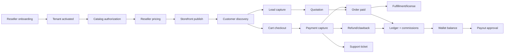

# Frenchies — End-to-End User Workflows

| Field | Value |
|---|---|
| Document | 15-user-workflows.md |
| Version | 1.0 |
| Status | Draft for Review |
| Date | 2026-11-20 |
| Owner | Product & Architecture Team |
| Related documents | `02-user-roles-and-permissions.md`, `03-functional-requirements.md`, `04-multi-tenancy-architecture.md`, `05-reseller-hierarchy.md`, `06-product-marketplace.md`, `07-billing-and-financial-architecture.md`, `08-affiliate-and-commission-system.md`, `09-fulfillment-and-licensing.md`, `10-white-label-cms.md`, `12-crm-and-support.md`, `16-ui-ux-specification.md`, `17-security-requirements.md`, `18-non-functional-requirements.md`, `19-testing-and-acceptance-criteria.md` |

## Table of Contents

1. Purpose & Scope
2. Workflow Conventions
3. Canonical Personas
4. Workflow Map
5. Authentication & Tenant Access
6. Reseller Onboarding & Approval
7. Sub-Reseller Creation
8. Staff Invitation & Role Assignment
9. Customer Discovery & Purchase
10. Payment, Order & Fulfillment
11. Quotation to Order
12. Subscription Purchase & Renewal
13. Refund & Clawback
14. Reseller Payout
15. Affiliate Journey
16. CRM Lead Journey
17. Support Ticket Journey
18. Storefront Branding & Domain Setup
19. Catalog, Pricing & Distribution
20. Product Fulfillment & License Activation
21. Tenant Suspension, Resume & Deactivation
22. AI-Assisted Handoff
23. Cross-Cutting Acceptance Criteria
24. Assumptions & Open Questions

---

## 1. Purpose & Scope

This document defines the end-to-end user journeys for every canonical persona in the
Frenchies platform. It joins requirements, UI screens, permissions, state changes,
notifications, audit records and failure handling into implementation-ready workflows.

The workflow IDs `FLOW-NN-NN` are owned by this document and are referenced by feature
requirements, UI specifications and test suites. Screen IDs are owned by
`16-ui-ux-specification.md`; permission slugs are owned by
`02-user-roles-and-permissions.md`; FR IDs are owned by
`03-functional-requirements.md` and domain documents.

### 1.1 In Scope

- Persona entry, navigation and completion paths
- Happy paths, validation failures, retries and terminal states
- Tenant and hierarchy boundaries
- Permission, audit and notification checkpoints
- Cross-module data and state transitions
- Manual and automated recovery paths

### 1.2 Out of Scope

This document does not redefine schemas, permission vocabulary, tax calculations,
gateway mechanics, commission algorithms or UI component behaviour. Those remain owned
by the referenced documents.

---

## 2. Workflow Conventions

### 2.1 Participant Vocabulary

| Term | Meaning |
|---|---|
| **Actor** | User who initiates or performs a step. |
| **System** | Frenchies platform, including jobs, webhooks and integrations. |
| **Principal** | Platform or reseller tenant responsible for the operation. |
| **Customer** | Buyer represented by `customer.buyer` or an unauthenticated storefront visitor. |
| **Subject** | Tenant, order, ticket, lead or other record being acted upon. |

### 2.2 Required Step Properties

Every workflow step must resolve the following conditions:

1. Resolve tenant context from the host, subdomain or authenticated tenant team.
2. Re-check the actor's team-scoped permission before every mutation.
3. Apply tenant and row ownership filters to reads.
4. Validate state and version before transitions.
5. Emit an audit event for security, admin, financial or lifecycle mutations.
6. Create notifications on tenant-facing state changes.
7. Return a stable success or error result and retain an idempotency key where applicable.

### 2.3 Standard Outcomes

| Outcome | Meaning |
|---|---|
| **Success** | Persisted state and all synchronous side effects completed. |
| **Partial success** | Core state completed but a non-blocking side effect requires retry. |
| **Retryable failure** | No illegal state transition occurred; the same operation may be retried safely. |
| **Terminal failure** | Operation cannot continue in the current state; recovery requires a new permitted action or manual exception. |
| **Blocked** | Actor, tenant or subject state does not permit the operation. |

### 2.4 State and Ownership Rules

- Public storefront flows may operate without authentication, but money totals and
  entitlements are always calculated server-side.
- Tenant suspension blocks operational mutations and storefront checkout.
- Cross-tenant access is limited to explicit grants or Super Admin scope.
- A reseller may act on direct and authorized descendants only where hierarchy rules
  grant that scope.
- Finance mutations require segregated permissions and dual action where approval is
  specified.
- Webhook and background-job effects must be idempotent.

---

## 3. Canonical Personas

| Persona | Canonical role slug | Primary workflow set |
|---|---|---|
| Super Admin | `platform.super_admin` | Platform governance, tenant lifecycle, global overrides |
| Platform Admin | `platform.admin` | Applications, catalog operations, marketing, support |
| Finance Admin | `platform.finance_admin` | Payments, reconciliation, refunds, commissions, payouts |
| Product Manager | `platform.product_manager` | Product and demo lifecycle, distribution terms |
| Support Manager | `platform.support_manager` | Support queues, SLAs, escalations, reports |
| Support Agent | `platform.support_agent` | Ticket resolution, notes, handoffs |
| Reseller | `reseller.owner` | Store launch, catalog, hierarchy, finance, customers |
| Sub-Reseller | `reseller.sub_reseller` | Own-tenant reseller operations beneath a parent |
| Reseller Employee | `reseller.employee` | Assigned catalog, CRM, orders or support operations |
| Sales Agent | `reseller.sales_agent` | Lead capture, qualification, quotations and conversion |
| Customer | `customer.buyer` | Discovery, purchase, portal, subscriptions and support |
| Affiliate | `affiliate.partner` | Links, conversions, commissions and payouts |

---

## 4. Workflow Map

| Flow ID | Workflow | Primary actor | MVP |
|---|---|---|---|
| FLOW-01-01 | Login, MFA and tenant session | All authenticated roles | P0 |
| FLOW-01-02 | Password reset | All roles | P0 |
| FLOW-01-03 | Invitation accept and role activation | Invited user | P0 |
| FLOW-02-01 | Reseller application and KYC | Applicant / Reseller | P0 |
| FLOW-02-02 | Reseller application review | Platform Admin | P0 |
| FLOW-02-03 | Reseller activation and first-login setup | Reseller | P0 |
| FLOW-03-01 | Sub-reseller creation and approval | Reseller / Sub-Reseller | P1 |
| FLOW-04-01 | Staff invitation and permissions | Reseller / Platform Admin | P0 |
| FLOW-05-01 | Product discovery and demo request | Customer | P0 |
| FLOW-05-02 | Cart and guest checkout | Customer | P0 |
| FLOW-05-03 | Quote acceptance and offline order | Sales Agent / Customer | P1 |
| FLOW-06-01 | Payment capture and order confirmation | Customer / Gateway | P0 |
| FLOW-06-02 | Automated fulfillment and license delivery | System | P0 |
| FLOW-06-03 | Manual fulfillment and status update | Reseller / Platform Admin | P1 |
| FLOW-07-01 | Subscription purchase | Customer | P1 |
| FLOW-07-02 | Renewal, grace, suspension and reactivation | Customer / System | P1 |
| FLOW-08-01 | Customer refund request | Customer / Reseller | P0 |
| FLOW-08-02 | Refund approval and gateway execution | Finance Admin | P0 |
| FLOW-09-01 | Commission release and wallet balance | System | P0 |
| FLOW-09-02 | Payout request and disbursement | Reseller / Affiliate / Finance Admin | P0 |
| FLOW-10-01 | Affiliate registration and link generation | Affiliate | P1 |
| FLOW-10-02 | Referral attribution and conversion | Customer / System | P1 |
| FLOW-11-01 | Lead capture and assignment | Sales Agent / System | P1 |
| FLOW-11-02 | Lead qualification, quotation and conversion | Sales Agent | P1 |
| FLOW-12-01 | Support ticket creation | Customer / System | P0 |
| FLOW-12-02 | Triage, escalation and resolution | Support Agent / Manager | P0 |
| FLOW-13-01 | Custom domain and branding setup | Reseller | P1 |
| FLOW-14-01 | Central catalog distribution request | Reseller | P0 |
| FLOW-14-02 | Reseller pricing and storefront publish | Reseller | P0 |
| FLOW-15-01 | License activation and entitlement enforcement | Customer / System | P0 |
| FLOW-16-01 | Tenant suspend, resume and deletion | Super Admin / Reseller | P0 |
| FLOW-17-01 | AI assistant or chatbot handoff | Customer / Reseller | P2 |

### 4.1 Workflow Dependency View

---

## 5. Authentication & Tenant Access

### FLOW-01-01 — Login, MFA and Tenant Session

**Actor:** Any authenticated persona

**Entry points:** Interface A `/admin/login`, Interface B `/dashboard/login`,
Interface C `UI-C-07`, and reseller/customer custom domains.

**Steps**

1. Actor opens the tenant or platform login page.
2. Actor submits email and password.
3. System resolves the tenant from host context and validates the account belongs to
   an active team.
4. System applies lockout, breach and rate-limit rules.
5. If MFA is required, the actor completes TOTP verification.
6. System creates the tenant-bound session and records `login_activities`.
7. System redirects to the persona dashboard while preserving the deepest authorized
   return URL.

**Success:** Active session, tenant context set, login activity written.

**Failure rules**

- Unknown credentials and unknown account do not reveal whether the account exists.
- Suspended tenant or user returns a tenant-specific blocked state.
- MFA failure remains on the challenge screen and is audited at policy thresholds.
- A Super Admin impersonation session cannot perform money mutations.

**Screen and requirement links:** UI-A-01, UI-B-01, UI-C-07, FR-AUTH-001–033,
FR-TENANT-001–022.

### FLOW-01-02 — Password Reset

1. Actor requests reset by email on the current tenant.
2. System validates the account in the resolved tenant and sends a non-disclosing
   confirmation.
3. Actor follows a single-use, expiring token.
4. System validates token, password policy and tenant state.
5. Password is changed; all existing sessions are invalidated when policy requires.
6. Actor is notified and redirected to login.

### FLOW-01-03 — Invitation Accept and Role Activation

1. System creates `user_invitations` with target role, team and expiry.
2. Invitee opens the link on an allowed host.
3. Invitee registers or signs in and accepts the invitation.
4. System assigns the role inside the team-scoped permission guard.
5. Invitation becomes accepted and is recorded in the audit log.
6. Invitee enters the role-specific dashboard or tenant onboarding checklist.

**Invalid states:** revoked, expired, wrong tenant, already accepted or unauthorized
role assignment all terminate with no role change.

---

## 6. Reseller Onboarding & Approval

### FLOW-02-01 — Reseller Application and KYC

**Actor:** Applicant / future Reseller

**Entry point:** Public application form or pre-created invitation.

**Steps**

1. Applicant submits business identity, contact, GST and KYC information.
2. System creates a tenant in `pending_approval` state and a pending reseller profile.
3. Uploaded KYC evidence is stored in private tenant-scoped object storage.
4. System validates required fields and file rules.
5. Applicant receives acknowledgement and application reference.
6. Platform Admin queue receives the application for review.

**Requirements:** FR-TENANT-001–022, FR-AUTH-002, FR-AUTH-027.

### FLOW-02-02 — Reseller Application Review

**Actor:** Platform Admin

**Entry point:** UI-A-04 Reseller Onboarding Queue or UI-A-03 Tenant Detail.

**Steps**

1. Reviewer opens the application and evidence bundle.
2. Reviewer checks legal, tax, identity and anti-abuse information.
3. Reviewer approves, rejects or requests changes.
4. Approval creates or confirms the reseller tenant team and owner role.
5. Rejection records reason and optional applicant notification.
6. A material change or approval is audit-logged.

**Approval result:** Tenant transitions `pending_approval → active`.

**Business blocks:** unresolved P0 KYC/compliance decisions must prevent go-live;
sanctions, duplicate or suspicious evidence is escalated.

### FLOW-02-03 — Reseller Activation and First-Login Setup

**Actor:** Reseller

**Entry point:** UI-B-12, UI-B-02 and UI-B-01 setup checklist.

**Steps**

1. Reseller signs in and completes MFA if required.
2. Reseller completes business profile and invoice identity.
3. Reseller chooses branding, name and optional custom domain.
4. Reseller requests central catalog distribution or receives pre-authorized products.
5. Reseller configures pricing and publishes the first storefront product.
6. Reseller creates staff, affiliate or sub-reseller accounts as needed.
7. Dashboard first-sale checklist marks completed items.

**Exit criteria:** tenant active, invoice identity valid, at least one authorized product
published, payment route configured and activation metrics recorded.

---

## 7. Sub-Reseller Creation

### FLOW-03-01 — Sub-Reseller Creation and Approval

**Actor:** Reseller or Sub-Reseller; approved by parent or Platform Admin as policy
defines.

**Entry point:** UI-B-04 Sub-Resellers Tree.

**Steps**

1. Parent opens hierarchy creation and submits the child business application.
2. System creates a child tenant referencing the parent closure relationship.
3. Child tenant is placed in `pending_approval`.
4. Authorized approver reviews the child or auto-approves according to policy.
5. Child owner receives an invitation and completes first login.
6. Distribution authorizations are inherited or granted only by explicit policy.
7. Parent and child dashboards show the relationship and scoped commissions.

**Isolation rules:** a child must not view sibling or parent-private financial rows;
upstream visibility is limited to hierarchy reports explicitly permitted.

**Failure:** cycle creation, parent outside active state and unauthorized hierarchy
depth changes are rejected.

---

## 8. Staff Invitation and Role Assignment

### FLOW-04-01 — Staff Invitation and Permissions

**Actor:** Reseller, Platform Admin or authorized tenant administrator.

**Entry point:** UI-B-13 or UI-A-18.

**Steps**

1. Actor selects `Invite user`.
2. System validates target email, role, team and allowed permission subset.
3. Actor assigns one canonical role or an allowed custom template.
4. System creates an expiring invitation and sends email.
5. Invitee accepts and receives team-scoped permissions.
6. Sensitive role changes and revocations are audited.

**Rules:** Reseller Employee may receive only permitted default slugs; Finance,
gateway and tenant-suspension capabilities cannot be granted.

---

## 9. Customer Discovery and Purchase

### FLOW-05-01 — Product Discovery and Demo Request

**Actor:** Customer or guest.

**Entry point:** UI-C-02 Product Listing, UI-C-03 Product Detail.

**Steps**

1. Visitor resolves the reseller storefront by host.
2. System filters catalog to authorized and published tenant products.
3. Visitor views product, variants, tax display, demos and terms.
4. Visitor requests a demo or submits a lead form.
5. System creates a tenant lead and optional demo attribution.
6. Sales Agent or assigned queue receives notification.

**Privacy:** Demo and lead capture must not reveal out-of-scope products or tenants.

### FLOW-05-02 — Cart and Guest Checkout

**Actor:** Customer or guest.

**Entry point:** UI-C-04 Cart and UI-C-05 Checkout.

**Steps**

1. Customer adds variant and quantity to cart.
2. Customer supplies contact and billing details.
3. System revalidates product availability, variants, tax, discounts and minimum selling
   price.
4. System creates an idempotent pending order and server-calculated totals.
5. Customer chooses a supported payment method.
6. System initiates gateway payment or a manual verification flow.
7. Customer is redirected to success, pending or failure state.

**Failure:** cart change after price validation restarts server recalculation; stale
gateway callbacks cannot apply an order effect twice.

### FLOW-05-03 — Quote Acceptance and Offline Order

**Actor:** Sales Agent and Customer.

**Entry point:** UI-B-08 Quotation.

**Steps**

1. Sales Agent creates a quotation from authorized catalog items.
2. System validates item prices against the distributor floor.
3. Agent sends a tenant-branded quotation and expiration notice.
4. Customer accepts or Agent records accepted terms.
5. System creates an offline order without inventing gateway success.
6. Finance or operations verifies the external payment.
7. Verified payment changes the order to paid and enters the normal fulfillment path.

**Requirement:** A quotation is not a paid order and must remain bounded by its
expiration and accepted snapshot.

---

## 10. Payment, Order and Fulfillment

### FLOW-06-01 — Payment Capture and Order Confirmation

**Actor:** Customer or gateway webhook.

**Steps**

1. Gateway returns a callback or signed webhook event.
2. System verifies signature and tenant/gateway context.
3. System deduplicates the event by gateway event ID and order reference.
4. System posts the payment and order transitions using the ledger idempotency rules.
5. System creates invoice or receipt documents only after capture succeeds.
6. System dispatches paid, fulfillment and commission jobs.
7. Customer is redirected to UI-C-06 with an order reference.

**No double effect:** replayed webhooks produce no new journal, invoice, notification or
commission row.

### FLOW-06-02 — Automated Fulfillment and License Delivery

**Actor:** System.

**Entry point:** UI-B-16 Fulfillment Jobs and UI-D-02 My Products & Services.

**Steps**

1. Paid order dispatches fulfillment adapters.
2. System resolves adapter, entitlement and delivery data.
3. Adapter creates a license, service entitlement or delivery record.
4. Success updates fulfillment state and sends delivery notification.
5. Failure enters retry or manual intervention queue.
6. Customer portal exposes activation details and recovery actions.

**Audit:** provider request IDs, retries and entitlement changes are recorded.

### FLOW-06-03 — Manual Fulfillment and Status Update

**Actor:** Reseller or Platform Admin.

**Steps**

1. Operator opens the fulfillment job.
2. Operator performs the external service action.
3. Operator records the result and reference in the job.
4. System validates state and updates the customer entitlement.
5. Customer receives fulfillment or failure notification.
6. SLA and audit timestamps are recorded.

---

## 11. Quotation to Order

FLOW-05-03 defines the quotation flow. The conversion boundary is:

1. Quotation snapshot stays immutable after acceptance.
2. A unique conversion reference prevents duplicate offline orders.
3. Price override, tax and MSP checks are revalidated at conversion.
4. Payment verification or gateway capture creates the normal paid-order state.
5. Order processing resumes at FLOW-06-01 or FLOW-06-02.

---

## 12. Subscription Purchase and Renewal

### FLOW-07-01 — Subscription Purchase

**Actor:** Customer.

**Entry point:** UI-D-06 Subscriptions.

**Steps**

1. Customer chooses a supported billing cycle.
2. System presents trial, price, first charge and entitlement snapshot.
3. Customer confirms checkout.
4. Successful capture creates a subscription and first subscription event.
5. Entitlement becomes active within the required latency.
6. Customer receives receipt and renewal details.

### FLOW-07-02 — Renewal, Grace, Suspension and Reactivation

**Actor:** System and Customer.

**Steps**

1. System schedules renewal from the immutable subscription period.
2. Retry or gateway mandate charging follows configured retry dates.
3. Successful renewal advances period and creates an invoice.
4. Failed renewal enters `past_due`, then `grace_period`, then suspension.
5. System sends reminders and exposes payment action to the customer.
6. Payment during grace restores `active`.
7. Suspension revokes customer or reseller entitlement and is reversed on
   reactivation.

**Idempotency:** renewal must be unique per subscription and period start.

---

## 13. Refund and Clawback

### FLOW-08-01 — Customer or Reseller Refund Request

**Actor:** Customer or Reseller.

**Entry point:** Customer portal or UI-B-06.

**Steps**

1. Requester chooses order and reason.
2. System validates policy window, paid amount and remaining refundable balance.
3. System creates a central refund case in `pending`.
4. Reseller submission excludes direct gateway execution.
5. Customer sees pending or rejection status without gateway secrets.
6. Finance queue receives the review item.

### FLOW-08-02 — Refund Approval and Gateway Execution

**Actor:** Finance Admin.

**Entry point:** UI-A-10 Refunds Management.

**Steps**

1. Finance Admin verifies evidence and refundable amount.
2. Finance Admin approves or rejects with reason.
3. Gateway refund is submitted exactly once using the refund idempotency key.
4. Successful completion reverses settlement, ledger and eligible commissions.
5. Refund status, invoices, credit notes and notifications are updated.
6. Commission clawbacks post once and cannot double apply on webhook replay.

**Segregation:** approval and gateway execution cannot be completed by the same user
unless an explicit exception is approved by Super Admin policy.

---

## 14. Reseller and Affiliate Payout

### FLOW-09-01 — Commission Release and Wallet Balance

**Actor:** System.

**Steps**

1. Paid order is held through the configured commission hold period.
2. System computes hierarchy commissions and beneficiary eligibility.
3. Commission approval and release post wallet balances exactly once.
4. Refund before release reverses pending amounts.
5. Refund after release creates clawback journal entries.
6. Reseller or Affiliate sees wallet and commission statement.

### FLOW-09-02 — Payout Request and Disbursement

**Actors:** Reseller or Affiliate requester; Finance Admin.

**Entry point:** UI-B-09 or UI-E-04.

**Steps**

1. Requester confirms available balance and payout details.
2. System validates minimum threshold and no duplicate pending payout.
3. Payout request enters `pending`.
4. Finance Admin approves, rejects or schedules disbursement.
5. Manual or gateway disbursement is recorded with external reference.
6. Wallet is debited only after successful or approved treatment defined by policy.
7. Requester receives status notification and statement.

**Negative balance:** payout is blocked or reduced according to OQ-012 until resolved.

---

## 15. Affiliate Journey

### FLOW-10-01 — Affiliate Registration and Link Generation

**Actor:** Affiliate.

**Entry point:** UI-E-01 Affiliate Dashboard.

**Steps**

1. Affiliate applies or accepts an invitation.
2. Tenant owner or Platform Admin approves the affiliate record.
3. Affiliate opens link and coupon tools.
4. System creates a tenant-scoped unique referral code and deep link.
5. Affiliate shares the approved marketing asset.

### FLOW-10-02 — Referral Attribution and Conversion

**Actor:** Customer and System.

**Steps**

1. Visitor opens the affiliate link or coupon.
2. System stores the attribution cookie within the configured window.
3. Visitor completes checkout or lead capture.
4. System applies last-touch or configured attribution model.
5. Self-referral is rejected and the event is logged.
6. Paid order creates commission or conversion analytics.
7. Refund or cancellation triggers the configured reversal.

**Requirement:** Affiliate cannot view customers outside their own attribution scope.

---

## 16. CRM Lead Journey

### FLOW-11-01 — Lead Capture and Assignment

**Actors:** Customer, Sales Agent or System.

**Entry point:** UI-C-08, demo request or UI-B-07.

**Steps**

1. System creates a tenant lead from contact form, demo, manual entry or API.
2. System deduplicates on tenant email or phone rules.
3. Lead enters `new` stage.
4. System applies manual, round-robin or territory assignment.
5. Assigned agent receives notification.

### FLOW-11-02 — Lead Qualification, Quotation and Conversion

**Actor:** Sales Agent.

**Entry point:** UI-B-07 Leads & Pipeline.

**Steps**

1. Agent adds outreach and next action.
2. Agent moves lead through `contacted`, `qualified`, `proposal` and
   `negotiation` with mandatory follow-up details.
3. Agent creates and sends a quotation.
4. Accepted terms convert to a customer and offline or gateway order.
5. Lost lead requires a reason and terminal timestamp.
6. Timeline and audit entries record every owner and stage mutation.

**State rule:** every non-terminal lead must retain `next_action` and
`follow_up_at`.

---

## 17. Support Ticket Journey

### FLOW-12-01 — Support Ticket Creation

**Actor:** Customer or System.

**Entry points:** UI-C-08, UI-D-07 or storefront chatbot.

**Steps**

1. Customer chooses issue category and provides required context.
2. System creates a tenant ticket with a visible reference.
3. Ticket receives SLA policy and priority.
4. System routes it to the matched reseller or central department.
5. Customer and owner receive acknowledgement.

**Privacy:** customer can see only own tickets and permitted messages.

### FLOW-12-02 — Triage, Escalation and Resolution

**Actors:** Support Agent and Support Manager.

**Entry points:** UI-F-01, UI-F-02 and UI-B-15.

**Steps**

1. Agent claims or receives assignment.
2. Agent reviews customer 360 context and prior messages.
3. Agent adds public reply or private note.
4. Agent requests customer information or resolves ticket.
5. Policy escalation moves the ticket to the next hierarchy or central queue.
6. Manager or Agent resolves and requests CSAT.
7. Customer accepts resolution or reopens within the configured window.

**SLA rules:** first response and resolution clocks use pause rules, business time and
escalation thresholds consistently across channels.

---

## 18. Storefront Branding and Domain Setup

### FLOW-13-01 — Custom Domain and Branding Setup

**Actor:** Reseller.

**Entry point:** UI-B-12 Domains & Branding.

**Steps**

1. Reseller enters brand identity and optional domain.
2. System displays required DNS verification records.
3. Reseller configures DNS externally.
4. System verifies ownership and initiates TLS provisioning.
5. System rejects conflicting or already-owned domains.
6. Verified domain becomes active and is recorded in the audit log.
7. Reseller configures storefront theme, legal pages and payment descriptors.

**Safety:** suspended or blocked tenants show maintenance or public suspension page
according to platform policy.

---

## 19. Catalog, Pricing and Distribution

### FLOW-14-01 — Central Catalog Distribution Request

**Actor:** Reseller.

**Entry point:** UI-B-03 Distribution Requests.

**Steps**

1. Reseller requests a central product or variant.
2. System validates availability and authorization policy.
3. Request enters approved, rejected or pending state.
4. Approver grants distribution with price, commission and content terms.
5. Reseller receives authorized catalog record.

### FLOW-14-02 — Reseller Pricing and Storefront Publish

**Actor:** Reseller or authorized Reseller Employee.

**Entry point:** UI-B-02 My Catalog & Pricing.

**Steps**

1. Reseller selects authorized product or variant.
2. System calculates maximum discount based on minimum selling price.
3. Reseller sets public price and tax display mode.
4. Reseller enables storefront publication and validates required copy/media.
5. Reseller previews the white-label storefront.
6. System publishes or leaves unpublished status and returns validation errors.
7. Catalog changes propagate to cart validation and existing subscription snapshots
   according to domain rules.

---

## 20. Product Fulfillment and License Activation

### FLOW-15-01 — License Activation and Entitlement Enforcement

**Actor:** Customer and System.

**Entry point:** UI-D-03 License Detail & Activation.

**Steps**

1. Paid entitlement creates a license record with activation limit.
2. Customer enters activation key or provider account.
3. System validates license status and remaining activations.
4. Activation succeeds and creates a customer-visible activation record.
5. Deactivation, expiry or refund revokes entitlement as policy defines.
6. Suspension or cancellation stops service access within the accepted SLA.

**Idempotency:** repeated activation requests return the existing activation if the
same customer and device identity are used.

---

## 21. Tenant Suspension, Resume and Deactivation

### FLOW-16-01 — Tenant Suspend, Resume and Deactivation

**Actors:** Super Admin or authorized hierarchy owner.

**Entry point:** UI-A-03 Tenant Detail or UI-A-02 Tenant Management.

**Steps**

1. Authorized actor opens lifecycle action.
2. System captures reason and effective scope.
3. Suspension applies to users, storefront, entitlements and downstream child state
   according to hierarchy policy.
4. Active sessions are invalidated and audited.
5. Public storefront enters maintenance or suspension state.
6. Pending refunds, payouts and paid entitlements remain controlled by Finance policy.
7. Resume restores the tenant and scoped users; reactivation is recorded.
8. Soft deletion removes access but preserves financial and audit data.

**Safety:** destructive lifecycle action requires typed confirmation and cannot be
performed with impersonation unless policy explicitly permits.

---

## 22. AI-Assisted Handoff

### FLOW-17-01 — AI Assistant or Chatbot Handoff

**Actors:** Customer or Reseller; System.

**Entry point:** Storefront chatbot or reseller dashboard assistant.

**Steps**

1. Visitor starts a tenant-scoped conversation.
2. AI uses only the resolved tenant catalog and authorized knowledge sources.
3. AI provides product or support information within safety limits.
4. For a lead or ticket, AI collects the minimum permitted fields.
5. AI creates a lead or support handoff with transcript reference.
6. Human queue receives the context and no cross-tenant data.
7. High-risk prompt or policy refusal ends safely with a support handoff.

**Post-MVP:** provider, billing, WhatsApp and n8n integrations begin in Phase 9 only
after MVP gate approval.

---

## 23. Cross-Cutting Acceptance Criteria

| AC ID | Acceptance criterion |
|---|---|
| AC-FLOW-001 | Every workflow mutation verifies tenant context and team-scoped permission before write. |
| AC-FLOW-002 | Out-of-scope resource access returns 403 or safe 404 consistently and is logged when sensitive. |
| AC-FLOW-003 | Every successful financial or lifecycle mutation emits an immutable audit event. |
| AC-FLOW-004 | Payment, refund, renewal, payout and webhook operations are replay-safe and idempotent. |
| AC-FLOW-005 | Every order and invoice total is calculated and revalidated server-side. |
| AC-FLOW-006 | Notification deep links resolve only for users authorized to view the subject. |
| AC-FLOW-007 | Failed asynchronous work is visible in an operational queue and retryable without duplicate effects. |
| AC-FLOW-008 | Public storefront and checkout flows use only authorized, published tenant catalog rows. |
| AC-FLOW-009 | Sensitive actions require confirmation and preserve before/after audit payloads. |
| AC-FLOW-010 | Resume, retry and reprocessing never weaken the original state-machine transition rules. |
| AC-FLOW-011 | Customer, affiliate and reseller views expose own-row data only. |
| AC-FLOW-012 | Workflow tests cover success, validation failure, permission denial, suspension, replay and stale state. |

### 23.1 Negative Scenario Matrix

| Scenario | Required result |
|---|---|
| Actor from tenant A opens tenant B order | 403 or safe 404; no tenant-B data in UI or response |
| Gateway webhook replayed twice | Exactly one payment effect and exactly one notification set |
| Refund callback replayed twice | Exactly one ledger reversal and exactly one commission clawback |
| Payout duplicate submission | Same payout reference; no second wallet debit |
| Renewal replayed in the same period | No duplicate charge or period extension |
| Suspended reseller enters checkout | Checkout blocked; maintenance state shown |
| Expired invitation accepted | No role assignment; clear expired result |
| Affiliated self-referral | Attribution rejected; order proceeds; event logged |
| Quote edited after acceptance | Accepted snapshot remains immutable; no silent price change |
| Reseller tries to execute refund | Refund case created only; gateway action denied |

---

## 24. Assumptions and Open Questions

### Local Assumptions

1. Reseller onboarding is gated by platform KYC and approval for MVP.
2. Offline payments are verified manually by an authorized Finance role.
3. The MVP supports email and in-app notifications; WhatsApp is post-MVP.
4. Affiliate payout and reseller payout share the same approval and disbursement
   controls.
5. Support ticket workflows include reseller-level first-line support and central
   escalation in MVP.
6. Renewal grace and suspension timings use policy defaults until OQ decisions are
   confirmed.

### References to Master Open Questions

| Question | Workflow impact |
|---|---|
| OQ-001 | Platform fee or margin treatment on seller orders |
| OQ-007 | Commission hold and refund-window coupling |
| OQ-008 | Payout threshold and payout methods |
| OQ-013 | Default hierarchy commission splits |
| OQ-014 | Product-type refund windows |
| OQ-016 | Coupon stacking and discount precedence |
| OQ-018 | Affiliate attribution window and model |
| OQ-020 | Custom-domain verification and TLS provider |
| OQ-027–32 | Onboarding, branding and compliance gates |
| OQ-034 | Support SLA targets and CSAT baseline |
| OQ-035 | Reseller approval SLA and review workflow |

This workflow document does not close master OQs. It records the impact and uses the
explicitly stated working assumptions until decisions are documented in
`22-open-questions-and-assumptions.md`.
