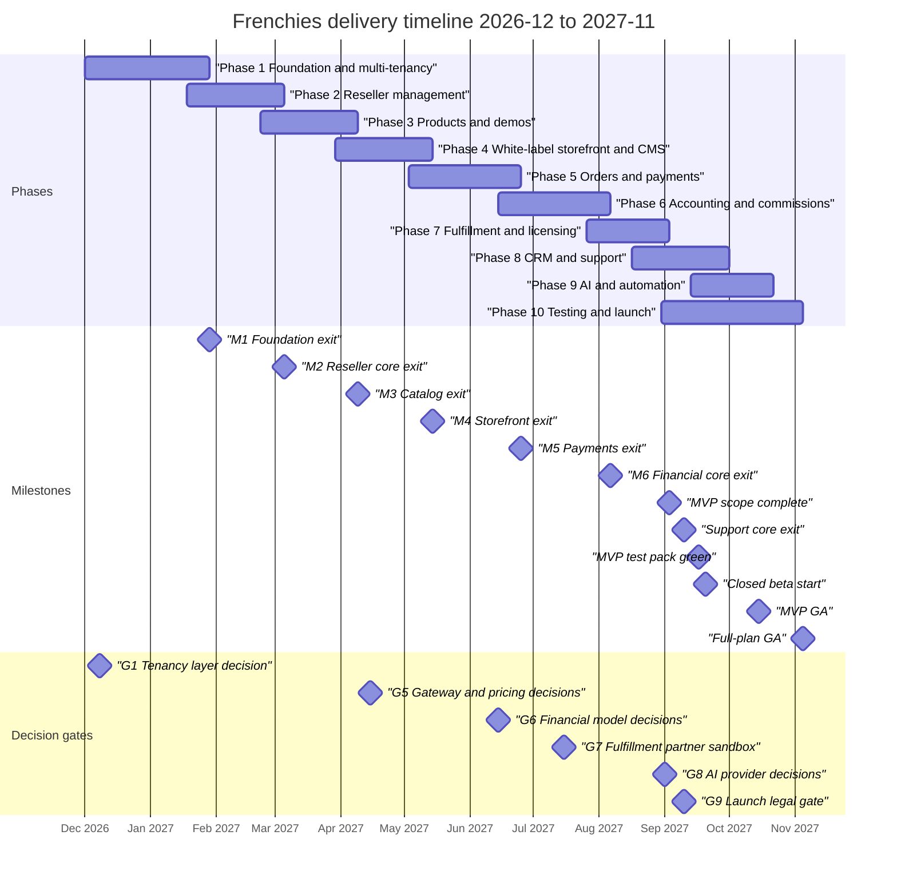
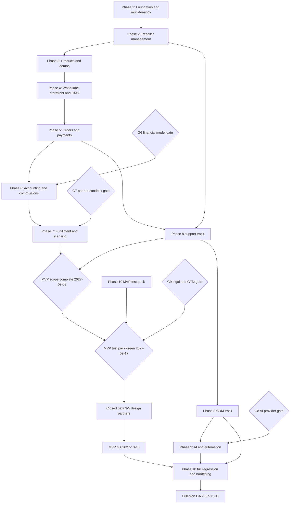

# Frenchies Development Roadmap

| Field | Value |
|---|---|
| Document | 20-development-roadmap.md |
| Version | 1.0 |
| Status | Draft for Review |
| Date | 2026-11-20 |
| Owner | Product & Architecture Team |
| Related documents | 01-business-requirements.md, 03-functional-requirements.md, 04-multi-tenancy-architecture.md, 05-reseller-hierarchy.md, 06-product-marketplace.md, 07-billing-and-financial-architecture.md, 08-affiliate-and-commission-system.md, 09-fulfillment-and-licensing.md, 10-white-label-cms.md, 11-ai-and-automation.md, 12-crm-and-support.md, 14-api-specification.md, 15-user-workflows.md, 16-ui-ux-specification.md, 17-security-requirements.md, 18-non-functional-requirements.md, 19-testing-and-acceptance-criteria.md, 21-risk-register.md, 22-open-questions-and-assumptions.md |

## Table of Contents

1. [Purpose & Scope](#1-purpose--scope)
2. [How to Read This Document](#2-how-to-read-this-document)
3. [Team, Capacity & Working Assumptions](#3-team-capacity--working-assumptions)
4. [Phase Definitions (Phases 1–10)](#4-phase-definitions-phases-110)
   - 4.1 Phase 1 — Foundation and multi-tenancy
   - 4.2 Phase 2 — Reseller management
   - 4.3 Phase 3 — Products and demos
   - 4.4 Phase 4 — White-label storefront and CMS
   - 4.5 Phase 5 — Orders and payments
   - 4.6 Phase 6 — Accounting and commissions
   - 4.7 Phase 7 — Fulfillment and licensing
   - 4.8 Phase 8 — CRM and support
   - 4.9 Phase 9 — AI and automation
   - 4.10 Phase 10 — Testing and launch
5. [Timeline & Team Plan](#5-timeline--team-plan)
6. [MVP Definition & Scope Boundary](#6-mvp-definition--scope-boundary)
7. [Post-MVP / Future Features](#7-post-mvp--future-features)
8. [Milestone & Dependency Graph](#8-milestone--dependency-graph)
9. [Release Strategy](#9-release-strategy)
10. [Decision Gates](#10-decision-gates)
11. [Effort Summary](#11-effort-summary)
12. [Assumptions & Open Questions](#12-assumptions--open-questions)
13. [Appendix / References](#13-appendix--references)

---

## 1. Purpose & Scope

This document decomposes the Frenchies PRD into a 10-phase implementation roadmap with
per-phase scope, dependencies, deliverables, task-level effort estimates, exit
acceptance criteria, linked risks, and testing gates. It is the scheduling and
scope-control companion to the functional specification set; it does not redefine
requirements (FRs), UI screens, tests, risks, or open questions — those live in their
own documents and are referenced by canonical ID (charter §8).

The roadmap covers the **full plan** (Phases 1–10). The **MVP boundary** (sellable
platform through payments, commissions, basic fulfillment/licensing) is defined in
Section 6 and follows charter §10.

**Out of scope for this document:** application code, migrations, configuration files,
detailed test cases (owned by `19-testing-and-acceptance-criteria.md`), risk treatment
detail (owned by `21-risk-register.md`).

## 2. How to Read This Document

- **Estimates** are in **person-days (pd)** of productive work per role (Backend =
  Laravel/PHP engineers; Frontend = Vue/Inertia/TypeScript engineers; QA = test
  engineering; DevOps = platform/infrastructure). Rounding to whole person-days.
  Program management (0.5 FTE) is **not** charged to phase estimates (see §3).
- Every phase section has the same eight blocks:
  **(a)** Objective · **(b)** Modules/FRs covered · **(c)** Dependencies ·
  **(d)** Deliverables · **(e)** Development tasks (estimate table) ·
  **(f)** Acceptance criteria (measurable phase exit gates) · **(g)** Risks
  (cross-reference `RISK-NNN` in `21-risk-register.md`) · **(h)** Testing requirements
  (suites from `19-testing-and-acceptance-criteria.md` that must pass).
- FR references use canonical prefixes only, e.g. `FR-TENANT-001…022` (owner:
  `03-functional-requirements.md`). UI references use `UI-<A..F>-NN` (owner:
  `16-ui-ux-specification.md`). OQ references use `OQ-NNN` (owner:
  `22-open-questions-and-assumptions.md`).
- Where this document states an assumption about capacity, sequencing, or external
  lead time, it is flagged **[ASSUMPTION]** and repeated in Section 12.
- Mermaid labels are quoted where they contain reserved punctuation; gantt task
  labels are quoted and contain no `:` or `,` inside the quotes.

## 3. Team, Capacity & Working Assumptions

**Team (fixed for this plan):** 2 Backend, 2 Frontend, 1 QA, 0.5 DevOps, 0.5 PM —
6 FTE total.

**[ASSUMPTION] Capacity model:**
- 20 working days per month per FTE (India public holidays excluded per month).
- Focus factor **0.85** for delivery roles → **17 productive person-days/FTE/month**
  (remaining time: meetings, code review, support of running environments).
- Delivery capacity over the plan window (2026-12-01 → 2027-11-05, 11.2 months):
  Backend 2×17×11.2 ≈ 380 pd · Frontend ≈ 380 pd · QA ≈ 190 pd · DevOps 0.5×17×11.2 ≈ 95 pd.
- **Total effort estimate: 844 person-days** (Section 11) ≈ **81% of delivery
  capacity**, leaving ~19% reserve for rework, defect fixes beyond phase QA, leave
  spikes, and production hypercare.
- PM (0.5 FTE ≈ 95 pd over the window) covers program coordination, OQ/decision-gate
  chasing, vendor/BSP/gateway onboarding follow-up, beta partner management, and
  release management — **excluded** from phase tables.
- **[ASSUMPTION]** Backend runs at ~96% and QA at ~94% of their effective capacity —
  this is the plan's tightest constraint (tracked as `RISK-020`; mitigation: FE
  assists with test automation authoring; DevOps absorbs CI/perf test ops).

**Working agreements:** 2-week sprints aligned to phase boundaries; Definition of Done
includes AC verification, migration reversibility note, and updated API contract in
`14-api-specification.md`; feature flags for anything that must ship dark (§9).

---

## 4. Phase Definitions (Phases 1–10)

### 4.1 Phase 1 — Foundation and multi-tenancy

**(a) Objective.** Replace the legacy skeleton with the target stack and establish the
tenancy/RBAC/audit foundations every later phase builds on: Laravel 12 → 13 on PHP 8.4,
Inertia 2 + Vue 3 + TypeScript + Tailwind CSS 4 replacing laravel/ui + Blade auth,
spatie/laravel-permission upgraded with `teams = tenant`, Sanctum/Horizon/Reverb
installed, shared-schema tenancy enforced end-to-end, and a working audit trail.

**(b) Modules / FRs covered.**

| Owning doc | FR prefixes / range | Coverage in this phase |
|---|---|---|
| `03-functional-requirements.md` | FR-AUTH-001…033 | P0/P1 core: login, sessions, password reset, invitations, tenant-scoped users |
| `03-functional-requirements.md` | FR-TENANT-001…022 | Foundation subset: tenant model, resolution, TenantContext, lifecycle states |
| `03-functional-requirements.md` | FR-ADMIN-001…022 | Audit logging (audit_logs), platform settings baseline, users/roles admin |
| `02-user-roles-and-permissions.md` | (12 canonical roles, teams) | Role/permission seed for all 12 roles, teams=tenant enforcement |
| `04-multi-tenancy-architecture.md` | §4–§7, §12 ACs | Tenant identification, enforcement layer, TenantContext, lifecycle |

**(c) Dependencies.**
- Prior-phase outputs: none (first phase).
- External: PHP 8.4 runtime available in CI/Docker base images; Redis available for
  local + staging; Reverb WebSocket port provisioned in staging.
- **OQ decisions needed:** `OQ-022` (tenancy layer purpose-built vs stancl/tenancy)
  must be closed **before** task T1.5 starts; `OQ-026` (Redis/Horizon/Reverb
  topology) before T1.8; `OQ-025` (email sender strategy) decision must start
  (provider selection) before Phase 2 T2.6.

**(d) Deliverables.**
- Migrations: upgrade baseline; `tenants`, `tenant_domains`, `tenant_settings`,
  `user_invitations`, `login_activities`, `audit_logs`; permission tables migrated to
  team-scoped rows.
- Middleware + `TenantContext` container + tenant global scope; subdomain and custom
  host resolution; tenant queue/cache/storage keying (per `04-multi-tenancy-architecture.md` §9).
- Endpoints (contracts per `14-api-specification.md`): auth login/logout/password
  reset, invitation accept, tenant-scoped user CRUD, role/permission assignment,
  audit log listing, tenant switch (platform staff).
- Screens (`16-ui-ux-specification.md`): login/forgot-password (replacing laravel/ui
  views), UI-A-01 shell, UI-A-16 (settings baseline), UI-A-17 (audit logs),
  UI-A-18 (users, roles & permissions), UI-B-01 app shell.
- Docs: environment/runbook (Docker, PHP 8.4, Horizon/Reverb startup), upgrade notes
  (Laravel 12→13 breaking-change log), tenancy code-review checklist feeding
  `17-security-requirements.md`.

**(e) Development tasks.**

| ID | Task | BE | FE | QA | DO | Total |
|---|---|---:|---:|---:|---:|---:|
| T1.1 | Laravel 12 → 13 in-place upgrade, PHP 8.4 runtime, dependency bump (spatie compat), CI + Docker image baseline | 5 | 0 | 2 | 3 | 10 |
| T1.2 | Remove laravel/ui + Blade auth (`Auth::routes()`, `/home`); install Inertia 2 + Vue 3 + TS + Tailwind 4 (Vite plugin, Ziggy, app entry, base layouts) | 3 | 9 | 2 | 2 | 16 |
| T1.3 | spatie/laravel-permission → ^7.0/^8.0 with `teams = tenant`; team-scoped role/permission migration; seed all 12 canonical roles + platform permission set | 5 | 0 | 3 | 0 | 8 |
| T1.4 | Laravel Sanctum: session + API token auth, login/logout/reset flows, `login_activities` capture, rate limiting | 5 | 7 | 1 | 0 | 13 |
| T1.5 | Tenancy core: `TenantContext`, tenant middleware, `tenant_id` global scope enforcement, subdomain + domain resolution, tenant lifecycle states | 11 | 0 | 2 | 0 | 13 |
| T1.6 | Base users & invitations: tenant-scoped user CRUD, `user_invitations` create/accept/revoke flows | 4 | 6 | 1 | 0 | 11 |
| T1.7 | Audit logging foundation: `audit_logs` writer (events + auth + admin actions) and UI-A-17 viewer | 3 | 5 | 1 | 0 | 9 |
| T1.8 | Redis + Horizon + Reverb install/config, queue workers, broadcast channel auth, health checks | 4 | 0 | 1 | 2 | 7 |
| T1.9 | Design tokens + app shells: Tailwind token layer (16 §2.9/§2.10), interface A/B shells, nav, table/form primitives | 2 | 9 | 1 | 0 | 12 |
| | **Phase 1 total** | **42** | **36** | **14** | **7** | **99** |

**(f) Acceptance criteria (phase exit).**
1. Application runs on PHP 8.4 / Laravel 13 with zero deprecation warnings in CI; CI
   green (build, pint, phpunit, vite build) on every push.
2. No laravel/ui or Blade auth views remain; login, reset, and invitation flows pass
   through Inertia pages; `Auth::routes()` removed from `routes/web.php`.
3. All 12 canonical roles seeded; role checks are tenant-scoped: a user in tenant A
   receives 403/404 (per `17-security-requirements.md` rules) for any tenant-B
   resource in ≥20 negative isolation tests.
4. Any Eloquent model exposing tenant rows has the tenant global scope; a code-review
   checklist audit finds 0 unscoped queries in the tenancy module.
5. `audit_logs` records ≥10 defined action types with actor, tenant, IP, and
   before/after payloads; UI-A-17 filters by actor/action/date and returns results
   within 500 ms at 100k rows (indexed).
6. Horizon shows queues processing; Reverb delivers a notification event to an
   authenticated dashboard session within 2 s in staging.
7. Open P0/P1 bugs: 0. Open P2 bugs ≤ 5 with owners.

**(g) Risks:** `RISK-014` (Laravel 13 early-adopter bugs), `RISK-015` (spatie v7/v8 +
teams migration), `RISK-016` (laravel/ui removal breaking routes), `RISK-001`
(cross-tenant data leakage), `RISK-035` (Reverb/realtime sizing), `RISK-020`
(key-person dependency) — details in `21-risk-register.md`.

**(h) Testing requirements:** suites in `19-testing-and-acceptance-criteria.md`
covering **auth/session**, **RBAC with teams**, **tenancy isolation**, and **audit**
must pass at 100% of their P0 cases; smoke E2E (login → dashboard → tenant switch)
green; upgrade regression suite (Laravel 12 baseline comparisons) green.

---

### 4.2 Phase 2 — Reseller management

**(a) Objective.** Deliver the full reseller lifecycle on top of the tenancy core:
registration → KYC intake → approval → tenant provisioning → hierarchy management
(closure table) → staff/roles → suspension, plus the notification framework and the
reseller subscription-plan scaffold that entitlement-gates later features.

**(b) Modules / FRs covered.**

| Owning doc | FR prefixes / range | Coverage in this phase |
|---|---|---|
| `03-functional-requirements.md` | FR-RESELLER-001…026 | Registration, approval, KYC intake, hierarchy, staff, suspension (P0/P1) |
| `03-functional-requirements.md` | FR-TENANT-001…022 (remainder) | Tenant lifecycle admin, suspension cascades, domain/branding data capture |
| `03-functional-requirements.md` | FR-NOTIFY-001…022 | Framework core: templates, email abstraction, in-app tray (per-module templates land with their phases) |
| `03-functional-requirements.md` | FR-SUBSCRIPTION-001…026 (part) | Plan definitions + entitlement gating scaffold; billing in Phase 5 |
| `05-reseller-hierarchy.md` | §2–§10, §11 ACs | Closure table, creation/invitation flows, visibility matrix, reparenting, suspension cascade |

**(c) Dependencies.**
- Prior phase: T1.3 (roles/teams), T1.5 (tenant provisioning), T1.6 (invitations),
  T1.7 (audit), T1.8 (queues for async email).
- External: transactional email provider sandbox (see `OQ-025`); WhatsApp not required
  (P1.5, scheduled in Phase 9).
- **OQ decisions needed:** `OQ-035` (reseller approval SLA/review workflow) before the
  approval queue is built; `OQ-027` (KYC requirements) — data-capture fields only in
  this phase, but field set must be fixed before T2.1 exits; `OQ-002`/`OQ-003`/
  `OQ-019` (plan tiers, trial, entitlement matrix) before T2.7.

**(d) Deliverables.**
- Migrations: `resellers`, `reseller_hierarchy` (closure: ancestor_id, descendant_id,
  depth), reseller KYC/branding columns on `tenants`/`resellers`, notification
  baseline (`notification_templates`, `notification_logs`), `subscription_plans`.
- Endpoints per `14-api-specification.md`: reseller registration, approval/reject,
  hierarchy read/write, invite sub-reseller, staff CRUD, plan/entitlement read,
  notification template admin.
- Screens: UI-A-02, UI-A-03, UI-A-04, UI-A-05, UI-A-14 (plan manager), UI-B-01
  (dashboard content), UI-B-04, UI-B-13, UI-A-18 (extended), notification tray (16 §2.3).
- Docs: reseller onboarding runbook (ops), hierarchy invariant list (feeds
  `05-reseller-hierarchy.md` AC execution).

**(e) Development tasks.**

| ID | Task | BE | FE | QA | DO | Total |
|---|---|---:|---:|---:|---:|---:|
| T2.1 | Reseller registration, approval queue, KYC intake form (FR-RESELLER-001…009; UI-A-04) | 6 | 5 | 2 | 0 | 13 |
| T2.2 | Reseller → tenant provisioning and tenant lifecycle admin (04 §7; UI-A-02/03) | 5 | 4 | 2 | 0 | 11 |
| T2.3 | Closure-table hierarchy engine: create, reparent, suspend cascade, visibility matrix (05 §3–§6) | 8 | 0 | 2 | 0 | 10 |
| T2.4 | Sub-reseller creation & invitation flows (UI-A-04, UI-B-04) | 4 | 4 | 2 | 0 | 10 |
| T2.5 | Staff & roles screens + custom role creation within curated permission subset (UI-B-13, UI-A-18) | 4 | 5 | 2 | 0 | 11 |
| T2.6 | Notification framework core: templates, email sending abstraction, in-app tray with Reverb push (FR-NOTIFY baseline) | 5 | 5 | 2 | 0 | 12 |
| T2.7 | Reseller subscription plans & entitlement gating scaffold (FR-SUBSCRIPTION-001…010; OQ-002/019) | 4 | 4 | 2 | 0 | 10 |
| T2.8 | Phase hardening: cross-tenant isolation + suspension-cascade regression, hierarchy UI polish (UI-A-05) | 1 | 3 | 1 | 0 | 5 |
| | **Phase 2 total** | **37** | **30** | **15** | **0** | **82** |

**(f) Acceptance criteria (phase exit).**
1. A complete registration→approval→tenant-provisioned path executes in staging with
   audit entries at each state transition; approval SLA timestamps recorded per
   `OQ-035` decision.
2. Hierarchy invariants pass 100% of `05-reseller-hierarchy.md` §11 ACs: no cycles,
   depth unlimited, closure table consistent after 100 simulated reparent operations.
3. Suspension cascade: suspending an ancestor suspends all descendants per spec;
   suspended tenants receive 403 at middleware level (tested for 3 tenant types).
4. Invitation emails deliver in staging (SPF/DKIM aligned per `OQ-025` decision);
   in-app tray shows ≥3 event types within 2 s via Reverb.
5. Entitlement gating: a reseller on Plan A sees exactly the menu/screen set defined
   in the `OQ-019` matrix — verified by role×plan UI tests.
6. Open P0/P1 bugs: 0.

**(g) Risks:** `RISK-008` (malicious reseller phishing — KYC/AUP intake begins here),
`RISK-001` (cross-tenant leakage in hierarchy queries), `RISK-038` (early reseller
churn — onboarding UX), `RISK-042` (email deliverability), `RISK-021` (scope creep on
reseller feature asks).

**(h) Testing requirements:** suites for **RBAC/teams**, **reseller lifecycle**,
**hierarchy closure invariants**, **notifications**, and **invitations** in
`19-testing-and-acceptance-criteria.md` must pass (100% P0, ≥95% P1 cases); regression
of Phase 1 isolation suite must stay green.

---

### 4.3 Phase 3 — Products and demos

**(a) Objective.** Build the catalog engine that both central and resellers sell from:
product content model, variants/packages/add-ons, pricing and floor protection,
distribution authorization (`tenant_products`), product versioning, marketplace
discovery, and the demo engine with attribution.

**(b) Modules / FRs covered.**

| Owning doc | FR prefixes / range | Coverage in this phase |
|---|---|---|
| `06-product-marketplace.md` | FR-PRODUCT-001…057 | P0/P1: content model, lifecycle/status, pricing, distribution, versioning, discovery |
| `06-product-marketplace.md` | FR-DEMO-001…015 | Demo tokens, demo product types, order/lead demo attribution |
| `03-functional-requirements.md` | FR-REPORT-001…022 (part) | Catalog-facing report queries only |
| `13-database-design.md` (deferred) | catalog tables | `categories`, `products`, `product_variants`, `product_media`, `product_packages`, `package_items`, `product_addons`, `product_addon_links`, `product_pricing`, `tenant_products`, `product_demos`, `product_versions`, `product_documents` |

**(c) Dependencies.**
- Prior phase: T1.5 (tenant scoping of catalog), T2.2 (tenants to own/authorize),
  T2.3 (hierarchy for distribution visibility).
- External: S3-compatible storage bucket + CDN for `product_media` (see `OQ-023`);
  seed content — the 15 canonical categories (06 Appendix A) and launch catalog
  copywriting (`RISK-039`) must be in progress by phase start.
- **OQ decisions needed:** `OQ-014` (refund windows per product type) not required
  until Phase 5 but product-type enum must be frozen here; `OQ-016` (coupon stacking)
  deferred to Phase 5; `OQ-017` (review moderation) gates the optional reviews scope —
  if unresolved at phase exit, reviews are **deferred post-MVP** (Section 7).

**(d) Deliverables.**
- Migrations: catalog tables listed above.
- Endpoints per `14-api-specification.md`: product CRUD, variant/package/addon
  endpoints, pricing + floor-protection rules, distribution authorize/revoke,
  demo token issue/verify, catalog search/filter.
- Screens: UI-A-06, UI-A-07, UI-A-08, UI-B-02, UI-B-03 (storefront rendering of
  catalog — UI-C-02/03 — is delivered in Phase 4).
- Docs: product-type/fulfillment-model matrix mapped to Phase 7 drivers; demo token
  security notes feeding `17-security-requirements.md`.

**(e) Development tasks.**

| ID | Task | BE | FE | QA | DO | Total |
|---|---|---:|---:|---:|---:|---:|
| T3.1 | Catalog data model & migrations (all catalog tables, indexes, FKs per 13) | 7 | 0 | 2 | 0 | 9 |
| T3.2 | Product CRUD, status lifecycle, versioning (FR-PRODUCT-001…030) | 5 | 6 | 2 | 0 | 13 |
| T3.3 | Distribution authorization + `tenant_products` overrides + floor protection (06 §6–§7) | 6 | 5 | 3 | 0 | 14 |
| T3.4 | `product_media` upload pipeline (S3, variants, virus-size limits) | 3 | 3 | 1 | 0 | 7 |
| T3.5 | Central catalog screens (UI-A-06/07/08) | 0 | 6 | 2 | 0 | 8 |
| T3.6 | Reseller catalog & pricing screens (UI-B-02/03) | 0 | 6 | 2 | 0 | 8 |
| T3.7 | Demo engine: demo tokens, demo credential handling, attribution columns (FR-DEMO-001…015) | 5 | 5 | 2 | 0 | 12 |
| T3.8 | Marketplace discovery: search, filters, 15 seed categories, catalog access rules (06 §11) | 4 | 3 | 1 | 0 | 8 |
| T3.9 | Phase QA: authorization regression (owner vs distributor vs guest), demo attribution tests | 2 | 0 | 2 | 0 | 4 |
| | **Phase 3 total** | **32** | **34** | **17** | **0** | **83** |

**(f) Acceptance criteria (phase exit).**
1. All FR-PRODUCT P0/P1 items for content, pricing, and distribution have passing ACs;
   a reseller can sell only products with an active `tenant_products` grant, at a
   price ≥ floor (verified by ≥12 negative price/authorization tests).
2. Product status lifecycle enforces allowed transitions only (06 §5); invalid
   transitions return documented errors.
3. Demo tokens are single-tenant, expiring, and never logged in plaintext; demo
   attribution appears on the lead/order record as specified (06 §10).
4. Catalog search returns p95 ≤ 400 ms for 50k products with tenant filter applied
   (indexes per `13-database-design.md`).
5. Open P0/P1 bugs: 0; catalog regression suite green.

**(g) Risks:** `RISK-033` (demo credential leakage), `RISK-001` (catalog crossing
tenant boundaries), `RISK-039` (insufficient launch catalog content), `RISK-031`
(third-party SDK/media library changes), `RISK-018` (index-less query performance).

**(h) Testing requirements:** suites for **catalog**, **distribution authorization**,
**demos**, and **media upload** in `19-testing-and-acceptance-criteria.md` must pass;
Phase 1–2 isolation and RBAC regressions remain green.

---

### 4.4 Phase 4 — White-label storefront and CMS

**(a) Objective.** Provision every reseller's white-label web presence: `*.frenchies.com`
subdomain plus verified custom domains with automated SSL, theme engine (color/logo/
favicon/font/banner), pre-defined block pages with draft/preview/publish, menus, media
library, SEO/legal pages, and the public storefront rendering of the Phase 3 catalog.

**(b) Modules / FRs covered.**

| Owning doc | FR prefixes / range | Coverage in this phase |
|---|---|---|
| `10-white-label-cms.md` | FR-CMS-001…059 | MVP scope: provisioning (§2), themes (§3), page types/publish (§5), menus (§6), media (§7), SEO (§8), injection policies (§9), white-label completeness (§11). **Drag-drop page builder (§4) = P2, post-MVP** |
| `06-product-marketplace.md` | (UI rendering of FR-PRODUCT) | Storefront display: listing, detail, demo section |
| `04-multi-tenancy-architecture.md` | §8 | Custom domain verification & SSL |

**(c) Dependencies.**
- Prior phase: T3.2/T3.3 (product read APIs), T1.5 (tenant-hosted routing), T2.7
  (entitlement gating for CMS features), T3.4 (media pipeline patterns).
- External: **Cloudflare** account with API token for DNS/SSL automation; S3 + CDN
  for storefront assets; domain-verification email channel.
- **OQ decisions needed:** `OQ-020` (SSL/DNS verification provider & flow) before
  T4.2; `OQ-023` (S3 topology: prefixes vs buckets) before T4.5; `OQ-015`
  (white-label depth in MVP) before T4.3 scope freeze.

**(d) Deliverables.**
- Migrations: `website_themes`, `website_pages` (+ revision storage support table per
  `13-database-design.md`), `website_menus`, `media_library`, `tenant_domains`
  verification columns.
- Endpoints per `14-api-specification.md`: domain add/verify/remove, theme
  get/put, page CRUD + publish, menu CRUD, media upload/list, public storefront
  render APIs (cached).
- Screens: UI-C-01, UI-C-02, UI-C-03, UI-C-10, UI-B-11 (CMS), UI-B-12 (domains &
  branding); storefront auth UI-C-07 is delivered with Phase 5 checkout.
- Docs: DNS setup guide (per-registrar), SSL renewal runbook, white-label QA
  checklist (from 10 §11).

**(e) Development tasks.**

| ID | Task | BE | FE | QA | DO | Total |
|---|---|---:|---:|---:|---:|---:|
| T4.1 | Storefront provisioning: subdomain issuance, `tenant_domains` states, host-based tenant resolution hardening | 6 | 0 | 2 | 2 | 10 |
| T4.2 | Custom domain flow: DNS instructions, Cloudflare API automation, verification states, SSL issuance & renewal (OQ-020) | 6 | 0 | 2 | 4 | 12 |
| T4.3 | Theme engine: colors/logo/favicon/font/banner, white-label variables (16 §2.10), per-tenant CSS isolation | 4 | 6 | 2 | 0 | 12 |
| T4.4 | Page model + draft/preview/publish workflow + revisions + pre-defined section blocks (10 §4–§5; builder P2) | 6 | 6 | 2 | 0 | 14 |
| T4.5 | Menus + media library (S3 prefixes per OQ-023, quota enforcement) | 4 | 4 | 2 | 0 | 10 |
| T4.6 | SEO basics (meta, sitemap, robots) + legal/policy page templates (UI-C-10) | 3 | 3 | 1 | 0 | 7 |
| T4.7 | Storefront rendering: home, product listing, product detail with demo section (UI-C-01/02/03), page cache | 4 | 9 | 2 | 0 | 15 |
| T4.8 | White-label completeness pass + responsive/accessibility checks (WCAG 2.2 AA baseline, 16 §2.11) + first perf baseline | 1 | 2 | 2 | 0 | 5 |
| | **Phase 4 total** | **34** | **30** | **15** | **6** | **85** |

**(f) Acceptance criteria (phase exit).**
1. A reseller on `*.frenchies.com` shows logo/colors/favicon/pages with zero Frenchies
   branding except legally required invoice/payment text (10 §11 checklist 100%).
2. Custom domain: verified domains reach the tenant storefront over HTTPS ≤ 15 min
   after correct DNS records (automated), with renewal monitoring; invalid DNS shows
   actionable error states.
3. Page publish flow: draft → preview → publish with revision history; unpublished
   changes are invisible publicly (≥10 workflow tests).
4. Storefront p95 TTFB ≤ 600 ms with cached HTML (measured in staging, NFR baseline
   recorded per `18-non-functional-requirements.md`).
5. Media uploads: type/size-validated, tenant-prefixed, inaccessible cross-tenant
   (signed URLs scoped) — 100% of media security tests.
6. Open P0/P1 bugs: 0.

**(g) Risks:** `RISK-026` (DNS/SSL provisioning delays), `RISK-027` (Cloudflare
dependency), `RISK-028` (S3 cost growth), `RISK-008` (white-label phishing surface —
acceptable-use + takedown hooks), `RISK-018` (uncached storefront query performance).

**(h) Testing requirements:** suites for **storefront rendering**, **CMS publish
workflow**, **custom domain/SSL**, **media security**, and **accessibility baseline**
in `19-testing-and-acceptance-criteria.md` must pass; cross-browser matrix (Chrome/
Firefox/Safari, 3 viewports) executed; Phase 1-3 regressions green.

---

### 4.5 Phase 5 — Orders and payments

**(a) Objective.** Make the platform sellable: carts, checkout, orders, customer
accounts, both payment gateways with idempotent webhooks, GST-aware invoicing (PDF),
coupons, subscription billing (renewals/grace/suspend), and gateway-level refunds —
collecting payments under the central merchant accounts per charter §4.

**(b) Modules / FRs covered.**

| Owning doc | FR prefixes / range | Coverage in this phase |
|---|---|---|
| `03-functional-requirements.md` | FR-ORDER-001…034 | Cart, checkout, order lifecycle, statuses, confirmations (P0/P1) |
| `03-functional-requirements.md` | FR-CUSTOMER-001…018 | Customer accounts, per-tenant customer CRUD, groups (P0/P1) |
| `03-functional-requirements.md` | FR-SUBSCRIPTION-001…026 (remainder) | Renewals, grace, suspend/unsuspend, plan changes, portal views |
| `03-functional-requirements.md` | FR-MARKETING-001…016 (part) | Coupon validation at checkout (coupon admin UI-B-18) |
| `07-billing-and-financial-architecture.md` | FR-PAYMENT-001…031, FR-BILLING-001…032 (part) | Razorpay + Cashfree, webhook idempotency, invoices/GST, refunds (gateway side) |
| `16-ui-ux-specification.md` | UI-C-04/05/06/07, UI-D-01/04/05/06/08/09 | Checkout & portal commerce screens |

**(c) Dependencies.**
- Prior phase: T4.7 (storefront), T3.3 (sellable grants), T2.7 (plan gating),
  T2.6 (order notification templates).
- External: **Razorpay + Cashfree sandbox credentials** (request in Phase 3 —
  external lead time), production merchant KYC completion (`RISK-044`); GST treatment
  input from `OQ-032`; live transactional email (`OQ-025`).
- **OQ decisions needed:** `OQ-014` (refund windows per product type), `OQ-016`
  (coupon stacking/precedence), `OQ-003` (trial policy), `OQ-002`/`OQ-019` (plan
  pricing for paywalls). `OQ-001` (platform fee model) is **not** required here —
  commissions/ledger land in Phase 6 — but must be closed before Phase 6 (Gate G6).

**(d) Deliverables.**
- Migrations: `carts`, `cart_items`, `coupons`, `orders`, `order_items`, `taxes`,
  `invoices`, `invoice_items`, `payments`, `payment_webhook_events`, `refunds`,
  `customers`, `customer_groups`, `customer_group_members`, `subscriptions`,
  `subscription_events`.
- Endpoints per `14-api-specification.md`: cart/checkout, order lifecycle, webhook
  receivers (both gateways), invoice PDF, coupon validate, subscription manage,
  customer auth + CRUD.
- Screens: UI-C-04, UI-C-05, UI-C-06, UI-C-07, UI-A-09, UI-A-10, UI-A-14 (wired to
  billing), UI-B-05, UI-B-06, UI-B-18, UI-B-19, UI-D-01, UI-D-04, UI-D-05, UI-D-06,
  UI-D-08, UI-D-09.
- Docs: gateway integration notes (signature verification, event catalog), GST
  invoicing rule sheet (place of supply, CGST/SGST/IGST), reconciliation runbook.

**(e) Development tasks.**

| ID | Task | BE | FE | QA | DO | Total |
|---|---|---:|---:|---:|---:|---:|
| T5.1 | Cart, checkout, order state machine with enumerated statuses (FR-ORDER-001…020) | 7 | 7 | 2 | 0 | 16 |
| T5.2 | Customer accounts & management: registration at checkout, portal auth, CRUD, groups (FR-CUSTOMER) | 5 | 6 | 2 | 0 | 13 |
| T5.3 | Razorpay: payment orders, signature verification, webhook receiver + `payment_webhook_events` idempotency (charter §7.10) | 7 | 4 | 2 | 0 | 13 |
| T5.4 | Cashfree integration behind shared gateway abstraction + failover/health | 4 | 0 | 3 | 0 | 7 |
| T5.5 | GST invoicing: tax resolution, gapless invoice numbering, dompdf PDF, invoice screens (UI-A-09 / B-19 / D-05) | 7 | 5 | 2 | 0 | 14 |
| T5.6 | Coupons & checkout discount precedence (FR-MARKETING; OQ-016) + UI-B-18 | 4 | 3 | 2 | 0 | 9 |
| T5.7 | Subscription billing: renewals, grace window, suspend/unsuspend, portal UI-D-06 | 6 | 5 | 2 | 0 | 13 |
| T5.8 | Gateway refunds + chargeback recording (ledger/clawback effects deferred to Phase 6) | 4 | 2 | 2 | 0 | 8 |
| T5.9 | Failure handling, retries, settlement import hooks, checkout hardening, first checkout perf pass | 5 | 2 | 2 | 1 | 10 |
| | **Phase 5 total** | **49** | **34** | **19** | **1** | **103** |

**(f) Acceptance criteria (phase exit).**
1. End-to-end purchase in staging on both gateways: cart → checkout → payment →
   webhook → `payments` row → order `paid` → invoice PDF in ≤ 60 s, with **zero**
   duplicate payment/credit rows under 50 replayed webhook deliveries (idempotency
   unique key per charter §7.10).
2. Order state machine rejects all invalid transitions (≥20 negative tests); every
   status enumerated per `03-functional-requirements.md`.
3. Invoice numbers are gapless and unique under 100 concurrent invoice generations;
   GST split correct for intra-state vs inter-state across ≥10 fixture cases
   including GSTIN validation.
4. Subscriptions: renewal → grace → suspend chain verified with time-freeze tests;
   no entitlement delivered to a suspended subscription.
5. Replaying any webhook 24 h later changes nothing; simulated gateway outage is
   detected by the polling reconciliation job within 15 min and backfills safely.
6. Open P0/P1 bugs: 0; checkout E2E suite green.

**(g) Risks:** `RISK-003` (webhook unreliability/downtime), `RISK-004` (replay/
duplicate payments), `RISK-044` (merchant onboarding delay), `RISK-009` (GST invoicing
errors), `RISK-025` (invoice-number concurrency), `RISK-005` (refund/chargeback abuse),
`RISK-042` (transactional email deliverability).

**(h) Testing requirements:** suites for **checkout & orders**, **payments/webhooks**
(incl. replay/fuzz), **invoicing/GST**, **subscriptions**, **coupons**, and
**customer accounts** in `19-testing-and-acceptance-criteria.md` must pass; payment
E2E runs nightly against **both** gateway sandboxes; Phase 1-4 regressions green.

---

### 4.6 Phase 6 — Accounting and commissions

**(a) Objective.** Implement the authoritative money layer: double-entry ledger,
wallet subledger with derived balances, hierarchical reseller commissions with hold
and clawback, the affiliate program (separate pool), manual payout workflow,
settlement reconciliation, and financial reports/statements.

**(b) Modules / FRs covered.**

| Owning doc | FR prefixes / range | Coverage in this phase |
|---|---|---|
| `07-billing-and-financial-architecture.md` | FR-WALLET-001…031 | Ledger accounts/entries/lines, wallets, manual payouts, reconciliation |
| `08-affiliate-and-commission-system.md` | FR-COMMISSION-001…030 | Capture-time computation, hold, idempotency, hierarchy splits, clawback, statements |
| `08-affiliate-and-commission-system.md` | FR-AFFILIATE-001…030 | Affiliates, links, clicks, attribution lifecycle, affiliate payouts |
| `03-functional-requirements.md` | FR-REPORT-001…022 (part), FR-ADMIN (overrides) | Financial reports; audited Super Admin financial overrides |
| `13-database-design.md` (deferred) | money tables | `wallets`, `wallet_transactions`, `journal_entries`, `journal_lines`, `payouts`, `commissions`, `affiliates`, `affiliate_links`, `affiliate_clicks`, `ledger_accounts`, `gateway_settlements` |

**(c) Dependencies.**
- Prior phase: T5.3/T5.4 (capture events), T5.5 (invoices as evidence), T5.8 (refund
  events), T1.7 (audit on financial actions).
- External: none new; Finance Admin availability for UAT of statements/payouts.
- **OQ decisions needed — hard Gate G6 (§10) before T6.1 starts:** `OQ-001`
  (platform fee model), `OQ-007` (hold period), `OQ-013` (hierarchy splits),
  `OQ-009` (rounding), `OQ-010` (chargeback policy), `OQ-011` (gateway fee treatment),
  `OQ-012` (negative-balance recovery), `OQ-018` (attribution window), `OQ-032`
  (GST/TDS on commissions); before T6.5: `OQ-008` (payout thresholds/methods),
  `OQ-036` (payout cadence).

**(d) Deliverables.**
- Migrations: money tables listed above with uniqueness constraints per charter §7.10.
- Endpoints per `14-api-specification.md`: journal/ledger reads, wallet statement,
  commission statements, payout request/approve/reject, affiliate CRUD + link
  generation + click beacon, settlement import/reconcile.
- Screens: UI-A-10 (refund ledger effects), UI-A-11, UI-A-12, UI-A-13, UI-B-09,
  UI-B-10, UI-B-14, UI-E-01…06, financial reports (FR-REPORT subset).
- Docs: reconciliation runbook (daily variance threshold ₹1 per 07), payout SOP
  (segregation of duties), executable fixtures from worked examples 07 §7 and 08 §9.

**(e) Development tasks.**

| ID | Task | BE | FE | QA | DO | Total |
|---|---|---:|---:|---:|---:|---:|
| T6.1 | Double-entry core: `ledger_accounts`, `journal_entries`/`journal_lines`, posting engine, balance invariants | 8 | 0 | 2 | 0 | 10 |
| T6.2 | Wallet subledger: `wallet_transactions`, derived balances, available/pending/commission states, nightly reconciliation job | 6 | 0 | 3 | 0 | 9 |
| T6.3 | Commission engine: compute at capture, hold period, idempotency keys, configurable hierarchy weights (OQ-013) | 8 | 0 | 2 | 0 | 10 |
| T6.4 | Refund clawback: pro-rata reversal across all beneficiaries, negative-balance recovery (OQ-012) | 4 | 0 | 3 | 0 | 7 |
| T6.5 | Payouts: request → Finance Admin approval → ledger posting → status machine (UI-A-11, UI-B-09) | 4 | 6 | 2 | 0 | 12 |
| T6.6 | Affiliates: registration, links, click tracking, attribution (OQ-018), affiliate dashboard (UI-E-01…06) | 5 | 8 | 2 | 0 | 15 |
| T6.7 | Ledger/wallet/commission/affiliate admin screens (UI-A-12/13, UI-B-10/14) | 3 | 6 | 2 | 0 | 11 |
| T6.8 | Settlement reconciliation: `gateway_settlements` import, variance alerts, chargeback evidence store (OQ-010/011) | 4 | 0 | 3 | 0 | 7 |
| T6.9 | Financial reports & commission statements (FR-REPORT financial subset) | 3 | 3 | 2 | 0 | 8 |
| T6.10 | Ledger invariant & rounding property suites (OQ-009), duplicate-webhook financial tests | 2 | 0 | 3 | 0 | 5 |
| | **Phase 6 total** | **47** | **23** | **24** | **0** | **94** |

**(f) Acceptance criteria (phase exit).**
1. Ledger invariant holds in 100% of tests: every `journal_entries` row's lines sum
   to zero per currency; posting is insert-only (reversals only), enforced by
   constraint + test.
2. Worked example 07 §7 (₹10,000 order → refund clawback) reproduces **to the paisa**
   in an automated test; 08 §9 combined reseller+affiliate example likewise.
3. Wallet balances always equal `SUM(credit) − SUM(debit)`; nightly reconciliation
   over a 7-day simulated ledger reports 0 variance above the ₹1 threshold.
4. Commission idempotency: 50 duplicate capture webhooks produce exactly one
   commission set per order item; hold release (default 7 days) and fulfillment-gated
   release verified with time freeze.
5. Payout workflow enforces segregation: requester ≠ approver (test matrix); approved
   payout posts ledger entries and reduces balance atomically.
6. Rounding property test: 10,000 randomized splits (depth 1–5) deviate ≤ ₹0.01 per
   order from configured weights (OQ-009 rule).
7. Open P0/P1 bugs: 0; Finance Admin UAT sign-off on statements.

**(g) Risks:** `RISK-002` (ledger drift/miscalculation), `RISK-006` (commission
fraud), `RISK-007` (affiliate fraud), `RISK-022` (manual payout errors/fraud),
`RISK-023` (rounding accumulation), `RISK-024` (double-spend/negative wallet),
`RISK-037` (chargeback evidence gaps), `RISK-005` (refund/chargeback abuse).

**(h) Testing requirements:** suites for **ledger/wallet invariants**, **commission
engine**, **affiliates & attribution**, **payouts**, **reconciliation**, and
**rounding properties** in `19-testing-and-acceptance-criteria.md` must pass at 100%
(P0+P1); duplicate/replay financial scenario suite green; Phase 1-5 regressions green.

---

### 4.7 Phase 7 — Fulfillment and licensing

**(a) Objective.** Deliver MVP-core fulfillment: provider/driver architecture with one
live API driver plus the manual task flow, fulfillment state machine with SLA
deadlines, responsibility-matrix routing, and the licensing module (key generation,
activations, customer-facing activation UX).

**(b) Modules / FRs covered.**

| Owning doc | FR prefixes / range | Coverage in this phase |
|---|---|---|
| `09-fulfillment-and-licensing.md` | FR-FULFILLMENT-001…038 | Provider architecture (§3), auto flow (§4), state machine (§5), SLA (§6), manual flow (§7), bundles/renewals (§8), responsibility matrix (§9) |
| `09-fulfillment-and-licensing.md` | FR-LICENSE-001…029 | Key generation, entitlements, activations/deactivations, portal UX |
| `13-database-design.md` (deferred) | fulfillment/licensing | `fulfillment_jobs`, `fulfillment_events`, `licenses`, `license_activations` |

**(c) Dependencies.**
- Prior phase: T5.1 (paid orders trigger fulfillment), T5.7 (renewals re-fulfill),
  T6.3 (fulfillment-gated commission release), T2.6 (fulfillment notifications).
- External: **fulfillment partner API credentials + sandbox** (Gate G7 — contract and
  sandbox before T7.1); license verification endpoint (platform-hosted unless partner
  provides one).
- **OQ decisions needed:** no new blocking OQ; `OQ-014` refund windows (from Gate G5)
  must already be decided because fulfillment-failure refunds depend on them; the
  Phase 3 fulfillment-model matrix must be frozen.

**(d) Deliverables.**
- Migrations: fulfillment/licensing tables listed above.
- Endpoints per `14-api-specification.md`: fulfillment job lifecycle, driver
  callbacks, manual task complete, license list/activate/deactivate/verify.
- Screens: UI-B-16 (fulfillment jobs), UI-B-17 (licenses), UI-D-02, UI-D-03.
- Docs: driver integration guide (adding driver #2), fulfillment SLA runbook, license
  key handling/redaction policy (`17-security-requirements.md`).

**(e) Development tasks.**

| ID | Task | BE | FE | QA | DO | Total |
|---|---|---:|---:|---:|---:|---:|
| T7.1 | Fulfillment provider architecture + driver interface + first API driver (partner sandbox) | 9 | 0 | 2 | 0 | 11 |
| T7.2 | Fulfillment state machine + `fulfillment_events` + SLA deadline tracking/alerts | 7 | 0 | 3 | 0 | 10 |
| T7.3 | Manual fulfillment flow + responsibility matrix routing (operator task queue) | 4 | 6 | 2 | 0 | 12 |
| T7.4 | Licensing: secure key generation (non-sequential), entitlements, activate/deactivate/verify API | 8 | 0 | 2 | 0 | 10 |
| T7.5 | Renewal & bundle fulfillment integration (multi-item orders, subscription renewals) | 4 | 0 | 2 | 0 | 6 |
| T7.6 | Screens: UI-B-16, UI-B-17, UI-D-02, UI-D-03 | 0 | 11 | 2 | 0 | 13 |
| T7.7 | Fulfillment notifications + audit + license-key leakage/redaction test pass | 2 | 2 | 3 | 0 | 7 |
| | **Phase 7 total** | **34** | **19** | **16** | **0** | **69** |

**(f) Acceptance criteria (phase exit — MVP fulfillment core).**
1. Paid auto-fulfillable order: webhook → `fulfillment_jobs` → driver invoked → success
   recorded → license issued where applicable → commission released — full chain E2E
   in ≤ 5 min, replay-safe.
2. State machine enforces all `09-fulfillment-and-licensing.md` §5 transitions; SLA
   breach raises alert + notification within 5 min of deadline.
3. Manual flow: matrix-assigned operator completes task with evidence; customer
   notified; 100% of §7 ACs pass.
4. Licenses: keys never appear in logs (redaction test scans 1k log lines, 0 hits),
   activation limits enforced, deactivation frees a slot and the portal reflects it
   ≤ 5 s.
5. Multi-item order with partial fulfillment: per-item states independent; commission
   release matches per-item fulfillment (charter §7.4) — verified.
6. Open P0/P1 bugs: 0.

**(g) Risks:** `RISK-034` (license key leakage/abuse), `RISK-019` (queue backlog on
order bursts delaying fulfillment), `RISK-031` (partner API breaking changes),
`RISK-002` (mis-gated commission release).

**(h) Testing requirements:** suites for **fulfillment flows (auto + manual)**,
**state machine/SLA**, **licensing & activations**, and **fulfillment-commission
coupling** in `19-testing-and-acceptance-criteria.md` must pass; driver failure/timeout
simulation green; Phase 1-6 regressions green.

---

### 4.8 Phase 8 — CRM and support

**(a) Objective.** Ship the revenue and service layer: lead capture through pipeline
and quotations to conversion, plus the multi-level support desk (departments, tickets
from portal/email/contact form, SLA clocks, assignment/escalation, CSAT, knowledge
base). The **support core slice (T8.4–T8.5, T8.6 queue/detail) is MVP-scoped** and
exits before closed beta; CRM completes post-MVP within the full plan.

**(b) Modules / FRs covered.**

| Owning doc | FR prefixes / range | Coverage in this phase |
|---|---|---|
| `12-crm-and-support.md` | FR-CRM-001…035 | Lead capture/record/pipeline/assignment, follow-ups, quotations, conversion/dedupe, sales reporting |
| `12-crm-and-support.md` | FR-SUPPORT-001…038 | Departments, ticket channels/fields, SLA policies, assignment, escalation, CSAT, KB, canned responses |
| `03-functional-requirements.md` | FR-NOTIFY-001…022 (part) | Ticket/SLA notification templates |
| `13-database-design.md` (deferred) | CRM/support tables | `leads`, `lead_activities`, `quotations`, `quotation_items`, `sla_policies`, `support_departments`, `support_tickets`, `ticket_messages`, `support_department_agents`, `csat_responses`, `kb_categories`, `kb_articles`, `canned_responses`, `support_calendars`, `lead_lost_reasons` |

**(c) Dependencies.**
- Prior phase: T2.6 (notification framework), T5.2 (customers for conversion),
  T3.7 (demo attribution on leads), T4.6 (public pages host the contact form and KB).
- External: shared inbox / inbound email parsing address for ticket creation (email
  provider per `OQ-025` must support inbound routing or an IMAP poller is used).
- **OQ decisions needed:** `OQ-034` (default SLA targets, CSAT baseline) before T8.5;
  `OQ-033` (WhatsApp) is **not** required — MVP channels are portal + email; WhatsApp
  support channel is post-MVP (Phase 9 / Section 7).

**(d) Deliverables.**
- Migrations: CRM/support tables listed above.
- Endpoints per `14-api-specification.md`: lead CRUD + pipeline moves, quotations,
  ticket create/reply/close, SLA policy admin, KB CRUD, CSAT submit.
- Screens: UI-B-07, UI-B-08, UI-B-15, UI-C-08 (contact → lead), UI-C-09 (public KB),
  UI-D-07, UI-F-01…07.
- Docs: SLA/escalation operations manual, support macros library, lead pipeline
  configuration guide.

**(e) Development tasks.**

| ID | Task | BE | FE | QA | DO | Total |
|---|---|---:|---:|---:|---:|---:|
| T8.1 | Lead capture (contact form UI-C-08, demo attribution) + lead record, pipeline, assignment | 5 | 6 | 2 | 0 | 13 |
| T8.2 | Follow-ups, activity timeline, quotations (UI-B-07/08) | 5 | 5 | 3 | 0 | 13 |
| T8.3 | Lead conversion & dedupe → customer/order attribution | 4 | 0 | 2 | 0 | 6 |
| T8.4 | Support core: departments, ticket creation (portal, email inbound, contact form), fields, attachments | 6 | 5 | 2 | 0 | 13 |
| T8.5 | SLA policies & clocks, round-robin assignment, escalation path matrix (12 §13/§15) | 5 | 0 | 3 | 0 | 8 |
| T8.6 | Agent dashboard: queue, ticket detail, internal notes & handoff (UI-F-01…05) | 0 | 10 | 2 | 0 | 12 |
| T8.7 | CSAT, knowledge base (UI-C-09, UI-F-04), canned responses, support reports (UI-F-06/07) | 3 | 6 | 2 | 0 | 11 |
| T8.8 | Reseller & portal support views (UI-B-15, UI-D-07) + phase QA regression | 0 | 2 | 2 | 0 | 4 |
| | **Phase 8 total** | **28** | **34** | **18** | **0** | **80** |

**(f) Acceptance criteria (phase exit).**
1. **MVP support slice (exit 2027-09-24):** ticket created from portal, email, and
   contact form all land in the same department queue with correct fields; agent
   replies notify the customer; assignment respects department grants — 100% of
   FR-SUPPORT P0 ACs pass.
2. SLA clocks start/pause per policy; breach warning at 80% and breach state at 100%
   (time-freeze tests); escalation matrix fires per 12 §15 for ≥5 scenarios.
3. Lead lifecycle (12 §9 diagram): capture → assign → follow-up → quote → convert,
   with dedupe rules; converted lead links customer + source order; lost reason
   recorded (OQ none — `lead_lost_reasons` seeded).
4. CSAT collected post-resolution ≥ 50% of closed test tickets; reports (UI-F-07)
   match ticket data within rounding tolerance — cross-checked by QA fixtures.
5. Open P0/P1 bugs: 0; Support Manager UAT sign-off.

**(g) Risks:** `RISK-042` (inbound/outbound email deliverability breaking ticket
creation), `RISK-020` (key-person coverage of support tooling), `RISK-043`
(schedule slip — Phase 8 straddles the MVP gate), `RISK-001` (PII visible across
tenants in tickets/leads — `UI-F-05` masking rules).

**(h) Testing requirements:** suites for **CRM pipeline**, **quotations**,
**support tickets & channels**, **SLA/escalation**, **CSAT/KB**, and **PII masking**
in `19-testing-and-acceptance-criteria.md` must pass; the MVP support subset must be
green by the beta gate (§5); Phase 1-7 regressions green.

---

### 4.9 Phase 9 — AI and automation

**(a) Objective.** Deliver the full-plan AI and automation layer: provider-abstraction
chatbot widget, reseller in-dashboard assistant, knowledge-source retrieval, AI admin
with safety and token caps, usage metering, n8n-driven workflows, and WhatsApp Cloud
API messaging. **Post-MVP** per charter §10 — begins only after the MVP gate.

**(b) Modules / FRs covered.**

| Owning doc | FR prefixes / range | Coverage in this phase |
|---|---|---|
| `11-ai-and-automation.md` | FR-AI-001…070 | Chatbot (§3–§4), assistant (§5), AI admin (§6), knowledge sources (§7), model policy (§8), safety (§9), usage caps (§10) |
| `15-user-workflows.md` | FLOW-NN (automation flows) | n8n-triggered workflows; WhatsApp as notification channel (FR-NOTIFY P1.5) |
| `03-functional-requirements.md` | FR-NOTIFY-001…022 (WhatsApp part) | Opt-in, template messaging, inbound replies |
| `13-database-design.md` (deferred) | AI tables | `ai_agents`, `ai_conversations`, `ai_messages`, `ai_usage_logs`, `ai_knowledge_sources`, `integration_connections` |

**(c) Dependencies.**
- Prior phase: T2.6 (notification/tray), T5.2/T6 (customers & billing for usage
  metering hooks), T8.7 (KB as knowledge source), T1.8 (queues for async inference).
- External: **OpenAI + Gemini API keys & billing** (decision `OQ-021`); **WhatsApp
  BSP/Meta Business verification + template approval** — start by **2027-03-01**
  (long lead time, `OQ-033`); **n8n instance** provisioned (hosting `OQ-024`).
- **OQ decisions needed:** `OQ-021` (default provider/model, who pays), `OQ-006`
  (AI usage-based billing model — metering built, billing P2), `OQ-024` (n8n
  hosting/responsibility), `OQ-033` (WhatsApp verification process). Gate G8 =
  2027-09-01 (§10).

**(d) Deliverables.**
- Migrations: AI tables listed above + integration connection rows.
- Endpoints per `14-api-specification.md`: chatbot session/message stream, assistant
  chat, knowledge ingestion jobs, AI admin config (agents, caps), usage log reads,
  n8n webhook triggers, WhatsApp send/receive webhooks.
- Screens: UI-A-15 (AI Admin), reseller assistant panel (11 §5, inside UI-B shell),
  embeddable chatbot widget (11 §3), AI conversation viewer.
- Docs: model/system-prompt layer configuration (11 Appendix A), AI safety runbook,
  cost dashboard notes, n8n workflow catalogue.

**(e) Development tasks.**

| ID | Task | BE | FE | QA | DO | Total |
|---|---|---:|---:|---:|---:|---:|
| T9.1 | Provider abstraction (OpenAI + Gemini), model policy, key vault/config (OQ-021) | 5 | 0 | 2 | 0 | 7 |
| T9.2 | Embeddable chatbot widget + conversation flow + tool calls (FR-AI chatbot set) | 5 | 7 | 2 | 0 | 14 |
| T9.3 | Reseller in-dashboard assistant (context = tenant data, scoped) | 5 | 3 | 2 | 0 | 10 |
| T9.4 | Knowledge sources: ingestion, chunking, retrieval (ai_knowledge_sources) | 4 | 0 | 2 | 0 | 6 |
| T9.5 | AI admin: agents, safety filters, token caps, `ai_usage_logs` viewer (UI-A-15) | 5 | 3 | 1 | 0 | 9 |
| T9.6 | Usage metering + billing hooks (meter now, usage billing P2 per OQ-006) | 3 | 0 | 2 | 0 | 5 |
| T9.7 | n8n integration: signed triggers, workflow catalogue, failure alerts (OQ-024) | 4 | 0 | 2 | 2 | 8 |
| T9.8 | WhatsApp Cloud API: BSP verification follow-through, templates, send/receive, opt-in (OQ-033) | 4 | 4 | 1 | 1 | 10 |
| T9.9 | AI cost controls: per-tenant budgets, kill switch, anomaly alerts + phase QA | 3 | 0 | 2 | 0 | 5 |
| | **Phase 9 total** | **38** | **17** | **16** | **3** | **74** |

**(f) Acceptance criteria (phase exit).**
1. Chatbot answers within token budget on a 20-turn scripted suite; 100% of 11 §9
   safety-refusal test prompts refused appropriately; no cross-tenant data in answers
   (10 automated leakage probes).
2. Provider failover: killing the primary provider mid-conversation falls back to the
   secondary within one retry (or degrades to a defined fallback message) — verified.
3. Budgets: per-tenant token budget hit → requests rejected with defined error;
   kill switch stops all inference ≤ 10 s; anomaly alert (e.g., 5× hourly spend) fires
   in staging.
4. WhatsApp: approved template messages deliver to opted-in test numbers; opt-out
   honored ≤ 1 call; inbound replies create notification records. Template rejection
   path shows actionable admin state.
5. n8n workflow failures alert and retry; no workflow can execute unscoped tenant
   operations (signed payloads + tenant binding test).
6. Open P0/P1 bugs: 0.

**(g) Risks:** `RISK-011` (AI cost runaway), `RISK-012` (provider outage/pricing),
`RISK-013` (AI content safety incident), `RISK-010` (WhatsApp template rejection/number
ban), `RISK-036` (n8n self-hosted reliability), `RISK-035` (Reverb/streaming scale).

**(h) Testing requirements:** suites for **AI chatbot/safety**, **assistant tenant
scoping**, **usage caps & budgets**, **WhatsApp messaging**, and **n8n triggers** in
`19-testing-and-acceptance-criteria.md` must pass; cost-control chaos tests (provider
kill, budget exhaustion) green; Phase 1-8 regressions green.

---

### 4.10 Phase 10 — Testing and launch

**(a) Objective.** Prove and ship: execute the complete test strategy (regression,
performance vs `18-non-functional-requirements.md`, security vs
`17-security-requirements.md`), run closed beta with 3–5 design-partner resellers,
stabilize, and execute the release (MVP GA inside the phase, full-plan GA at exit).

**(b) Modules / FRs covered.**

| Owning doc | FR prefixes / range | Coverage in this phase |
|---|---|---|
| `19-testing-and-acceptance-criteria.md` | TEST-NNN (all suites) | Full-suite execution, automation completion, UAT evidence |
| `18-non-functional-requirements.md` | NFR-NNN | Performance/load baselines, resilience, backup/DR drill |
| `17-security-requirements.md` | SEC-NNN | Security checklist audit, pen-test coordination, dependency/vuln scans |
| All FR modules | P0/P1 remainder | Defect burn-down to 0 open P0/P1 before each GA |

**(c) Dependencies.**
- Prior phase: **all** Phase 1-8 outputs (MVP test pack) + Phase 9 for full-plan GA.
- External: pen-test vendor engagement (book by 2027-08-15); design-partner resellers
  confirmed (`OQ-005` launch cohort); production infrastructure (Cloudflare, S3, Redis,
  SMTP) provisioned; App-Store-less delivery — web only, no store reviews.
- **OQ decisions needed:** `OQ-027`/`OQ-028`/`OQ-029`/`OQ-030`/`OQ-031` (legal/KYC/
  DPDP/AUP) closed before closed beta (Gate G9); `OQ-005` (cohort/pricing grandfathering),
  `OQ-034` (SLA commitments), `OQ-037` (uptime SLA), `OQ-038` (fraud monitoring owner).

**(d) Deliverables.**
- Test evidence pack: full-suite results per suite, coverage report, defect log with
  zero P0/P1, UAT sign-off sheets.
- Performance report vs NFR baselines (p95, throughput, queue latency, WS connections).
- Security report: SEC-NNN checklist, pen-test findings triaged, dependency scan
  clean, tenant-isolation red-team results.
- Launch artifacts: runbooks (deploy, rollback, incident), backup restore drill
  evidence, feature-flag inventory, go-live checklist, hypercare roster.
- Release notes for MVP GA and full-plan GA.

**(e) Development tasks.**

| ID | Task | BE | FE | QA | DO | Total |
|---|---|---:|---:|---:|---:|---:|
| T10.1 | Full regression across all suites + CI automation completion (nightly full run) | 3 | 0 | 7 | 2 | 12 |
| T10.2 | Performance/load testing vs NFR baselines + index/query audit remediation | 5 | 0 | 3 | 2 | 10 |
| T10.3 | Security testing: SEC-NNN audit, tenant-isolation red team, dependency scans, pen-test coordination | 3 | 0 | 3 | 2 | 8 |
| T10.4 | UAT with 3-5 design-partner resellers + feedback triage (OQ-005 cohort) | 3 | 3 | 3 | 0 | 9 |
| T10.5 | Bug bash + stabilization sprints (cross-role defect burn-down) | 5 | 7 | 5 | 0 | 17 |
| T10.6 | Launch ops: prod sizing, runbooks, monitoring/alerts, backup restore drill, flag rollout config | 2 | 0 | 0 | 8 | 10 |
| T10.7 | Go-live checklist, MVP GA + full-plan GA execution, week-1/2 hypercare | 1 | 3 | 3 | 2 | 9 |
| | **Phase 10 total** | **22** | **13** | **24** | **16** | **75** |

**(f) Acceptance criteria (phase exit — full-plan GA).**
1. **MVP test pack green (by 2027-09-17):** all suites covering Phase 1-7 core +
   support slice pass at 100% P0, ≥95% P1; zero P0/P1 defects open.
2. Performance: measured p95 latencies ≤ NFR targets (dashboard ≤ 1.5 s, storefront
   TTFB ≤ 600 ms, API ≤ 500 ms under 100 concurrent virtual users) with results stored
   as the baseline; no unexplained >10% regression vs Phase 4/5 baselines.
3. Security: SEC-NNN checklist 100% verified; pen-test High/Critical = 0 open, Medium
   ≤ 5 with fix dates; tenant-isolation red team: 0 cross-tenant reads across 40
   probes.
4. Resilience: backup restore drill restores a staging snapshot ≤ 60 min with RPO ≤
   15 min evidence; queue-failover and gateway-outage runbooks rehearsed.
5. Beta: 3-5 design-partner resellers complete at least one real sale end-to-end;
   ≥ 80% of beta-severity defects fixed within 2 business days; UAT sign-off recorded.
6. Go-live checklist 100% complete; rollback rehearsal executed once in staging.

**(g) Risks:** `RISK-029` (backup failure discovered at restore), `RISK-040`
(performance regression without baselines), `RISK-041` (cyber incident/ATO),
`RISK-038` (reseller churn right after launch), `RISK-039` (thin launch catalog),
`RISK-017` (single-DB scaling ceiling under real load), `RISK-043` (schedule slip),
`RISK-030` (DPDP/data residency non-compliance at launch).

**(h) Testing requirements:** **every suite** in
`19-testing-and-acceptance-criteria.md` executed end-to-end (full regression at least
2× pre-GA), plus dedicated NFR load run and security test window; Phase-local suites
from Phases 1-9 must all be green in the final run — any red suite blocks GA
(go/no-go at §9).

---

## 5. Timeline & Team Plan

**Start: 2026-12-01. Planned end (full-plan GA): 2027-11-05 (~11.2 months).**
Phases overlap where dependency-safe; every overlap is gated on the prior phase's
**core** (not full) exit — the gate is stated per row.

| Phase | Effort (pd) | Start | End | Overlap with previous | Overlap gate (must be true to start) |
|---|---:|---|---|---|---|
| Phase 1 — Foundation and multi-tenancy | 99 | 2026-12-01 | 2027-01-29 | — | — |
| Phase 2 — Reseller management | 82 | 2027-01-18 | 2027-03-05 | 2 weeks | T1.4 Sanctum + T1.5 tenancy core merged in dev (by 2027-01-15) |
| Phase 3 — Products and demos | 83 | 2027-02-22 | 2027-04-09 | 2 weeks | Reseller tenant provisioning (T2.2) + roles seed stable |
| Phase 4 — White-label storefront and CMS | 85 | 2027-03-29 | 2027-05-14 | 2 weeks | Product read APIs (T3.2/T3.3) available in dev |
| Phase 5 — Orders and payments | 103 | 2027-05-03 | 2027-06-25 | 2 weeks | Storefront render (T4.7) usable for checkout entry |
| Phase 6 — Accounting and commissions | 94 | 2027-06-14 | 2027-08-06 | 2 weeks | Payment capture schema + webhook events stable (T5.3); **Gate G6 OQs closed** |
| Phase 7 — Fulfillment and licensing | 69 | 2027-07-26 | 2027-09-03 | 2 weeks | Order paid → trigger contract stable (T5.1); **Gate G7 partner sandbox** |
| Phase 8 — CRM and support | 80 | 2027-08-16 | 2027-10-01 | 3 weeks with P7 | Support track only needs T2.6 + T5.2 (done); CRM track needs T5.2 |
| Phase 9 — AI and automation | 74 | 2027-09-13 | 2027-10-22 | 3 weeks with P8 | Post-MVP; **Gate G8 OQs closed**; P1-P5 stable for tenant-scoped AI |
| Phase 10 — Testing and launch | 75 | 2027-08-30 | 2027-11-05 | 8.5 weeks with P8/P9 | MVP test pack work starts at P7 core exit; full-plan GA at P10 exit |

**Key calendar facts**
- MVP scope completes **2027-09-03** (Phase 7 exit); MVP test pack green
  **2027-09-17**; closed beta starts **2027-09-20**; **MVP GA 2027-10-15**.
- Full-plan GA (incl. Phase 8 CRM complete + Phase 9 AI + Phase 10 hardening):
  **2027-11-05**.
- **[ASSUMPTION]** Overlaps total ~18 calendar weeks vs fully sequential execution;
  they are dependency-safe only if the stated overlap gates hold — if a gate slips,
  the later phase start slips (no compressed-quality fallback).

**Team allocation by phase (pd, from §4 tables):**

| Role | P1 | P2 | P3 | P4 | P5 | P6 | P7 | P8 | P9 | P10 | Total |
|---|---:|---:|---:|---:|---:|---:|---:|---:|---:|---:|---:|
| Backend (2 FTE) | 42 | 37 | 32 | 34 | 49 | 47 | 34 | 28 | 38 | 22 | 363 |
| Frontend (2 FTE) | 36 | 30 | 34 | 30 | 34 | 23 | 19 | 34 | 17 | 13 | 270 |
| QA (1 FTE) | 14 | 15 | 17 | 15 | 19 | 24 | 16 | 18 | 16 | 24 | 178 |
| DevOps (0.5 FTE) | 7 | 0 | 0 | 6 | 1 | 0 | 0 | 0 | 3 | 16 | 33 |
| **Phase total** | **99** | **82** | **83** | **85** | **103** | **94** | **69** | **80** | **74** | **75** | **844** |

- **[ASSUMPTION]** In overlap weeks, a role splits across two phases by task, not by
  person-hours mixing; DevOps effort concentrates in P1/P4 (environments), P10
  (launch ops), and on-call patching.
- **[ASSUMPTION]** Frontend carries ~30% unused capacity vs the 0.85 focus model —
  reserved for UX polish from beta feedback, design-system growth, and assisting QA
  automation; it is **not** headroom to pull future-phase scope forward without PM
  re-plan.

---

## 6. MVP Definition & Scope Boundary

**MVP = Phases 1–6 core + Phase 7 core** (charter §10): a sellable, white-labeled
reseller platform from registration through payment, GST invoicing, commissions,
wallets/manual payouts, basic fulfillment and licensing. The charter's MVP list also
includes **support tickets**; the roadmap therefore scopes the **support core slice of
Phase 8 (T8.4, T8.5, T8.6, T8.8)** into the MVP gate, while the **CRM slice (leads,
quotations, sales reporting) ships post-MVP within the full plan**. AI (Phase 9) and
the drag-drop page builder (Phase 4 P2 scope) are **post-MVP**.

**MVP feature checklist** (charter §10 → owning spec → phase):

| # | MVP feature | Source / FR | Phase | In MVP |
|---|---|---|---|---|
| 1 | Auth, users, sessions, invitations (12 roles) | FR-AUTH, `02` | P1 | Yes |
| 2 | Tenancy: subdomain + custom domain (basic), TenantContext, isolation | FR-TENANT, `04` | P1 (+P4 domains) | Yes |
| 3 | Reseller registration/approval/hierarchy (closure table) | FR-RESELLER, `05` | P2 | Yes |
| 4 | Base RBAC with teams, invitations, audit logs | FR-ADMIN, `02` | P1 | Yes |
| 5 | Notification core: email + in-app tray | FR-NOTIFY | P2 | Yes |
| 6 | Central catalog + distribution authorization + reseller price overrides | FR-PRODUCT, `06` | P3 | Yes |
| 7 | Basic product demos (tokens, attribution) | FR-DEMO, `06` | P3 | Yes |
| 8 | Simple white-label: theme colors/logo/favicon/subdomain | FR-CMS (subset), `10` | P4 | Yes |
| 9 | Custom domain (verify + SSL), menus, media, SEO/legal pages | FR-CMS (subset), `10` | P4 | Yes |
| 10 | Customers (per-tenant accounts, CRUD, groups) | FR-CUSTOMER, `03` | P5 | Yes |
| 11 | Cart & checkout | FR-ORDER, `03` | P5 | Yes |
| 12 | Razorpay + Cashfree (idempotent webhooks) | FR-PAYMENT, `07` | P5 | Yes |
| 13 | GST invoices (PDF, gapless numbering) | FR-BILLING, `07` | P5 | Yes |
| 14 | Subscriptions: plans, renewals, grace, suspend | FR-SUBSCRIPTION, `03` | P5 (+P2 scaffold) | Yes |
| 15 | Commissions: pending/available/hold, clawback, hierarchy split | FR-COMMISSION, `08` | P6 | Yes |
| 16 | Wallets (derived balances) + manual payouts with approval | FR-WALLET, `07` | P6 | Yes |
| 17 | Affiliate links/coupons + attribution (separate pool) | FR-AFFILIATE, `08` | P6 | Yes |
| 18 | Coupons at checkout (single-coupon MVP per `OQ-016` outcome) | FR-MARKETING, `03` | P5 | Yes |
| 19 | Basic fulfillment: manual tasks + license keys + one API driver | FR-FULFILLMENT, FR-LICENSE, `09` | P7 (core) | Yes |
| 20 | Support tickets (portal + email + contact form), SLA, escalation | FR-SUPPORT, `12` | P8 (core slice) | Yes |
| 21 | Core reports (orders, revenue, commission statements) | FR-REPORT, `03` | P5/P6 | Yes |
| 22 | Audit logs + security baseline (SEC-NNN P0) | FR-ADMIN, `17` | P1→P10 | Yes |
| 23 | Drag-drop page builder, blog/SEO extras | `10` §4, charter §10 | Post-MVP | **No** |
| 24 | WhatsApp campaigns, AI chatbot/assistant, usage-based AI billing | `11`, charter §10 | Post-MVP (P9) | **No** |
| 25 | CRM (leads/quotations/sales reporting) | FR-CRM, `12` | P8 (post-beta) | **No** (beta: support only) |

**MVP go/no-go gate (2027-09-17):** all rows 1–22 verified by their suites in
`19-testing-and-acceptance-criteria.md` at 100% P0 / ≥95% P1, zero open P0/P1
defects, Gate G9 legal items closed — else MVP GA moves right (decision by PM +
Super Admin, logged in §10 gate table).

---

## 7. Post-MVP / Future Features

Explicitly out of MVP, retained in the full plan or later waves (charter §10
priorities P2/P3):

| Priority | Feature | Owner spec | Scheduled |
|---|---|---|---|
| P2 | Drag-drop page builder (beyond pre-defined blocks) | `10-white-label-cms.md` §4 | Post-GA wave 1 (2027 Q4+) |
| P2 | Blog + SEO extras, theme marketplace | `10`, charter §10 | Post-GA |
| P2 | WhatsApp campaigns + support channel on WhatsApp | `11`, `15` | Post-MVP (T9.8 lays transactional base) |
| P2 | AI chatbot + assistant **general availability hardening**, usage-based AI billing (OQ-006) | `11` | Phase 9 delivers; billing P2 |
| P2 | n8n UI (self-serve workflow editor) | `15` | Post-GA |
| P2 | Advanced fraud detection (beyond `risk_blocklist` basics) | `17`, `22` OQ-038 | Post-GA |
| P2 | Automated gateway payouts | `07` FR-WALLET P2 | Post-GA |
| P2 | Product reviews moderation (OQ-017), coupon stacking (OQ-016) | `06`, `03` | When OQs close |
| P3 | Multi-currency + international tax (OQ-004) | `07`, `22` | Future program |
| P3 | Mobile apps (customer/reseller) | charter §10 | Future program |
| P3 | Multi-language (i18n beyond `en-IN`) | `16`, charter §10 | Future program |
| P3 | Dark mode, saved filter views/board views | `16` §2.5/§2.9 | Future program |

---

## 8. Milestone & Dependency Graph

Critical path: P1 → P2 → P3 → P4 → P5 → P6 → P7 → MVP test/beta → MVP GA.
P8 support track branches after P5 (dependency-safe); P9 is post-MVP; P10 spans the
beta and GA gates.

Dependency notes:
- Every arrow implies the overlap gate from §5 — a phase may start early only when
  its inbound contract (API/schema) is stable in dev, even if the prior phase is in QA.
- `G6` and `G7` are hard external/OQ gates: no build start on gated scope without the
  decision recorded in `22-open-questions-and-assumptions.md`.
- MVP GA requires `G9` (legal/GTM) — KYC, AUP, DPDP terms, and acceptable-use/
  anti-phishing controls (`OQ-027`, `OQ-029`, `OQ-031`) must be live, not drafted.

---

## 9. Release Strategy

**Environments:** `dev` (branch previews, Docker: MySQL 8, Redis, Horizon, Reverb) →
`staging` (prod-shaped: Cloudflare orange-cloud, S3, gateway **sandbox**, synthetic
tenants incl. a 3-level reseller hierarchy) → `beta` (production, access-restricted to
the design-partner cohort via flag) → `production` (GA).

**Pipeline:** PR gates = pint + phpunit (unit/feature) + vue-tsc + vite build + migration
reversibility lint; merge to `main` auto-deploys staging; nightly = full regression +
gateway-sandbox E2E; release = tagged RC, 24 h soak on staging, then promote.

**Feature flags:** DB-backed flags in `platform_settings` (+ env kill-switches) — no new
flag service (charter §3). Three levels: global (e.g., `ai_enabled`,
`whatsapp_enabled`), per-tenant (e.g., beta cohort storefront), and rate/limit knobs.
Rule: every Phase 9 feature and every beta-visible behavior ships dark first, flipped
per tenant. Flag inventory maintained as a release artifact.

**Closed beta:** 3–5 design-partner resellers selected per `OQ-005` (shape/price
grandfathering), onboarded with concierge setup (domain, theme, catalog import);
feedback through support tickets + weekly review; entry criteria = MVP test pack green
+ `G9` closed; **exit metrics**: ≥ 1 real sale per partner, ≥ 1 payout request processed,
≤ 2 open beta-severity defects, activation of storefront within 48 h of onboarding.

**Rollback policy:**
1. **First lever:** flag-off (≤ 1 min) for any feature-flagged defect.
2. **App rollback:** redeploy previous image within 15 min; releases must be
   backward-compatible with the current schema (expand-contract migrations; no destructive
   column drop in the release that first stops using it).
3. **Data repair:** financial/gateway data repaired by reconciliation + webhook replay
   jobs — **never** by direct DB edit (audit + ledger invariants per `07`).
4. **DB restore:** only for corruption, via pre-release snapshot (RPO ≤ 15 min),
   Finance Admin + Super Admin dual approval.
5. Every rollback gets a post-incident review within 48 h; severity ≥ High notifies the
   affected tenants through the status/notification channel.

**Go/no-go:** MVP GA and full-plan GA each use the §6/§10 gates — QA lead holds veto on
red suites; Finance Admin holds veto on financial invariants; Super Admin decides ship/
hold.

---

## 10. Decision Gates

Key OQs from `22-open-questions-and-assumptions.md` are scheduled as gates. A gate
miss = the blocked task starts as **speculative** (mechanism without policy values) or
the phase start slips — the PM logs the call in the gate register.

| Gate | Date | OQs / decisions | Owner | Blocks | If unresolved |
|---|---|---|---|---|---|
| G1 | 2026-12-08 | `OQ-022` tenancy layer (purpose-built vs stancl), `OQ-026` Redis/Horizon/Reverb topology | Super Admin (architecture) | T1.5, T1.8 | Tenancy build proceeds purpose-built (charter default); topology defaults to single-Redis MVP |
| G2 | 2027-01-15 | `OQ-025` email provider + per-tenant sender strategy | Platform Admin + Super Admin | T2.6 | Notifications ship with log-only mailer driver; risk `RISK-042` escalates |
| G3 | 2027-02-01 | `OQ-027` KYC field set (intake), `OQ-035` approval SLA/workflow | Super Admin via counsel + Platform Admin | T2.1 exit | Approval runs ad-hoc; KYC fields added later (rework ≤ 5 pd) |
| G4 | 2027-03-15 | `OQ-015` white-label depth, `OQ-020` SSL/DNS flow, `OQ-023` S3 topology | Platform engineering + Product Manager | T4.2, T4.5 | Custom domains slip post-MVP (subdomain-only beta); S3 defaults to per-tenant prefixes |
| G5 | 2027-04-15 | `OQ-002`, `OQ-003`, `OQ-019` (plans/trial/entitlements), `OQ-014` (refund windows), `OQ-016` (coupon stacking); **external:** Razorpay + Cashfree sandbox credentials | Super Admin + Product Manager + Finance Admin | Phase 5 start | Phase 5 slips week-for-week with the gate; sandbox request raised in Phase 3 to de-risk |
| G6 | 2027-06-14 | **Hard gate:** `OQ-001` platform fee, `OQ-007` hold period, `OQ-008` + `OQ-036` payouts, `OQ-009` rounding, `OQ-010` chargebacks, `OQ-011` gateway fees, `OQ-012` negative balance, `OQ-013` hierarchy splits, `OQ-018` attribution, `OQ-032` GST/TDS | Super Admin + Finance Admin | Phase 6 start | **No Phase 6 start** — commission/ledger policy must be fixed before the money layer is built |
| G7 | 2027-07-15 | External: fulfillment partner API contract + sandbox; plus `OQ-034` support SLA/CSAT targets (needed by T8.5) | Platform Admin + Support Manager | T7.1, T8.5 | Auto-fulfillment defers (manual flow only, MVP core still achievable); SLA defaults applied and flagged |
| G8 | 2027-09-01 | `OQ-021` AI provider/model + payer, `OQ-006` AI billing model, `OQ-024` n8n hosting, `OQ-033` WhatsApp process (**BSP submission in flight since 2027-03-01**) | Super Admin + Product Manager + Platform Admin | Phase 9 start | Phase 9 slips; WhatsApp segment (T9.8) most exposed (3–6 wk external lead time) |
| G9 | 2027-09-10 | **Launch legal/GTM:** `OQ-027` final KYC policy, `OQ-028` legal wording, `OQ-029` DPDP terms, `OQ-030` data residency, `OQ-031` AUP/anti-phishing, `OQ-005` beta cohort, `OQ-037` uptime SLA, `OQ-038` fraud monitoring owner | Super Admin via counsel + PM | Closed beta (2027-09-20) + MVP GA | Beta does not open; MVP GA moves right — no exceptions (drives `RISK-008`, `RISK-030`) |

No roadmap gate: `OQ-004` (multi-currency, P3), `OQ-017` (review moderation — deferred
post-MVP unless closed before Phase 3 exit).

---

## 11. Effort Summary

| Phase | Backend | Frontend | QA | DevOps | Phase total | Cumulative |
|---|---:|---:|---:|---:|---:|---:|
| Phase 1 — Foundation and multi-tenancy | 42 | 36 | 14 | 7 | **99** | 99 |
| Phase 2 — Reseller management | 37 | 30 | 15 | 0 | **82** | 181 |
| Phase 3 — Products and demos | 32 | 34 | 17 | 0 | **83** | 264 |
| Phase 4 — White-label storefront and CMS | 34 | 30 | 15 | 6 | **85** | 349 |
| Phase 5 — Orders and payments | 49 | 34 | 19 | 1 | **103** | 452 |
| Phase 6 — Accounting and commissions | 47 | 23 | 24 | 0 | **94** | 546 |
| Phase 7 — Fulfillment and licensing | 34 | 19 | 16 | 0 | **69** | 615 |
| Phase 8 — CRM and support | 28 | 34 | 18 | 0 | **80** | 695 |
| Phase 9 — AI and automation | 38 | 17 | 16 | 3 | **74** | 769 |
| Phase 10 — Testing and launch | 22 | 13 | 24 | 16 | **75** | 844 |
| **Total (person-days)** | **363** | **270** | **178** | **33** | **844** | — |

- **Total plan: 844 person-days** over 11.2 calendar months (2026-12-01 → 2027-11-05)
  ≈ **81% of modeled delivery capacity** (§3) → ~198 pd reserve for rework, beta-driven
  changes, and hypercare.
- MVP subset (P1–P7 core + P8 support core + MVP test pack ≈ P1–P7 totals + ~24 pd of
  P8 + ~30 pd of P10) ≈ **673 pd (80%)**; CRM + AI + launch hardening ≈ 171 pd (20%).
- **[ASSUMPTION]** Estimates ±20% at this PRD stage; variance beyond the reserve
  triggers re-scoping per §9 (flag-off/postpone P2 rows) rather than date erosion.

---

## 12. Assumptions & Open Questions

1. **[ASSUMPTION]** Capacity: 20 working days/month, focus factor 0.85 → 17 productive
   pd/FTE-month; PM (0.5 FTE) excluded from phase tables; Backend (96%) and QA (94%)
   run near capacity — see §3 and `RISK-020`.
2. **[ASSUMPTION]** Team of 2 BE / 2 FE / 1 QA / 0.5 DevOps / 0.5 PM is fully available
   from 2026-12-01; estimates assume mid/senior engineers familiar with Laravel + Vue.
3. **[ASSUMPTION]** External lead times: gateway sandbox 2–4 wks, merchant production
   KYC 2–6 wks, WhatsApp BSP verification + template approval 3–6 wks, fulfillment
   partner contract/sandbox 4–6 wks, pen-test booking 4 wks. Early requests are
   scheduled in Phases 3 and 7 for this reason.
4. **[ASSUMPTION]** Overlap starts are valid only under the §5 gates; slipping a gate
   moves the dependent phase start 1:1 (quality is not compressed to protect dates).
5. **Local scope decision (confirm with product owner):** the MVP gate includes the
   **support core slice of Phase 8** because charter §10 lists support tickets as MVP;
   this reconciles the shorthand "Phases 1–6 core + Phase 7 core".
6. **[ASSUMPTION]** WhatsApp is P1.5 (Phase 9, post-MVP) — MVP relies on email + in-app
   notifications only; confirm acceptable to the launch GTM (`OQ-033` process starts
   early anyway).
7. **Open question (local):** is a ~2.5-week closed beta (2027-09-20 → 10-15) sufficient
   for 3–5 partners, or should MVP GA slide to 2027-10-29? Decision at G9 review.
8. **Open question (local):** `OQ-017` (reviews) and stacked coupons (`OQ-016` outcome)
   must be resolved before their phase rows — if unresolved at Phase 3 exit, reviews
   defer to Section 7 post-MVP list automatically.
9. **[ASSUMPTION]** Doc `19-testing-and-acceptance-criteria.md` suite families referenced
   by name map 1:1 to TEST ranges defined there; if 19 renames suites, §4(h) references
   follow (IDs remain owned by 19).
10. **[ASSUMPTION]** Gantt shows gates G1, G5–G9 only (G2–G4 omitted for legibility);
    all nine gates are binding per §10.
11. **Open question (local):** holiday coverage (Dec 2026, Holi Mar 2027, Aug 2027
    Independence week) — reserve in §3 assumes ≤ 10 unplanned leave-days/FTE over the
    plan; revisit at the first quarterly re-plan.

---

## 13. Appendix / References

- Authoring charter: `frenchies-prd-charter.md` (§3 tech decisions, §8 ID ownership,
  §10 MVP scope, §11 writing rules).
- Scope sources: `03-functional-requirements.md`, `04-multi-tenancy-architecture.md`,
  `05-reseller-hierarchy.md`, `06-product-marketplace.md`,
  `07-billing-and-financial-architecture.md`, `08-affiliate-and-commission-system.md`,
  `09-fulfillment-and-licensing.md`, `10-white-label-cms.md`, `11-ai-and-automation.md`,
  `12-crm-and-support.md`.
- Execution references: `14-api-specification.md` (endpoints), `15-user-workflows.md`,
  `16-ui-ux-specification.md` (UI IDs), `17-security-requirements.md` (SEC-NNN),
  `18-non-functional-requirements.md` (NFR-NNN), `19-testing-and-acceptance-criteria.md`
  (suites), `21-risk-register.md` (RISK-NNN), `22-open-questions-and-assumptions.md`
  (OQ-NNN).
