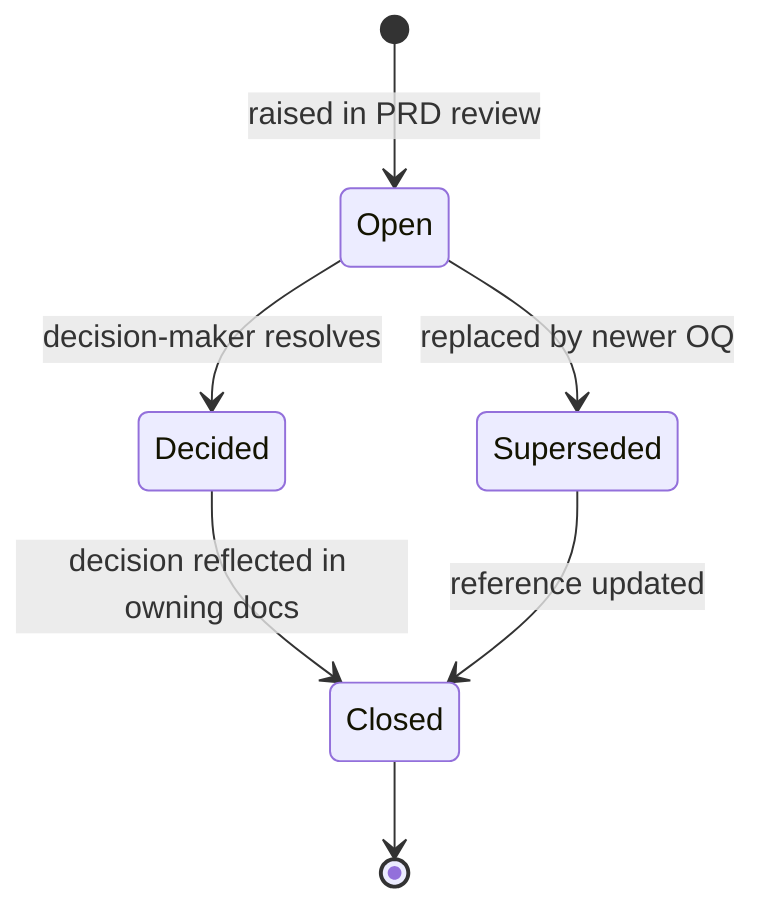

# Frenchies — Master Open Questions & Assumptions Register

| Field | Value |
|---|---|
| Document | 22-open-questions-and-assumptions.md |
| Version | 1.0 |
| Status | Draft for Review |
| Date | 2026-11-01 |
| Owner | Product & Architecture Team |
| Related documents | 00-product-overview.md, 01-business-requirements.md, 07-billing-and-financial-architecture.md, 08-affiliate-and-commission-system.md, 17-security-requirements.md, 20-deployment-and-operations.md, 21-implementation-roadmap.md, 23-master-prd.md |

## Table of Contents

1. [Purpose & Governance](#1-purpose--governance)
2. [Open Questions — Register Summary](#2-open-questions--register-summary)
3. [Open Questions — Detailed Entries](#3-open-questions--detailed-entries)
   - 3.1 [Business Model (OQ-001 – OQ-006)](#31-business-model-oq-001--oq-006)
   - 3.2 [Finance (OQ-007 – OQ-013)](#32-finance-oq-007--oq-013)
   - 3.3 [Product (OQ-014 – OQ-019)](#33-product-oq-014--oq-019)
   - 3.4 [Technical (OQ-020 – OQ-026)](#34-technical-oq-020--oq-026)
   - 3.5 [Legal / Compliance (OQ-027 – OQ-032)](#35-legal--compliance-oq-027--oq-032)
   - 3.6 [Operations (OQ-033 – OQ-038)](#36-operations-oq-033--oq-038)
4. [Assumptions Ledger (A-01 – A-25)](#4-assumptions-ledger-a-01--a-25)
5. [Decision Log Protocol](#5-decision-log-protocol)
6. [Assumptions & Open Questions (local)](#6-assumptions--open-questions-local)

---

## 1. Purpose & Governance

This document is the **single master register** of unresolved decisions (OQ-NN) and
accepted working assumptions (A-NN) for the Frenchies PRD. Per the authoring charter, OQ
IDs are defined only here; other PRD documents may reference OQ-NN/A-NN but must keep
their own "Assumptions & Open Questions" sections local and unnumbered beyond plain list
numbers.

**Lifecycle:**

**Rules:**

1. An OQ may only be moved from `Open` by its named owner/decision-maker; the PRD team
   proposes, the owner disposes.
2. On decision: (a) set Status = `Decided`, record decision + date in §5 Decision Log;
   (b) update every affected PRD document (requirements, schema, flows); (c) set
   Status = `Closed`.
3. Assumptions (A-NN) are accepted-as-true for planning; if invalidated, they are
   converted into an OQ, re-evaluated, and the A-row is marked `Invalidated` in §5.
4. Priorities use the charter scale: **P0** = must be decided before the dependent
   build phase starts; **P1** = must be decided before MVP GA; **P2** = before the
   dependent P2 feature ships; **P3** = advisory.

## 2. Open Questions — Register Summary

| ID | Title | Category | Priority | Owner / decision-maker | Status |
|---|---|---|---|---|---|
| OQ-001 | Platform fee / revenue model on reseller-sold orders | Business model | P0 | Super Admin (platform owner) + Finance Admin | Closed |
| OQ-002 | Reseller subscription plan tiers and pricing | Business model | P0 | Super Admin | Closed |
| OQ-003 | Free-trial policy for reseller subscriptions | Business model | P1 | Super Admin + Platform Admin | Open |
| OQ-004 | Multi-currency and international expansion timeline | Business model | P2 | Super Admin | Open |
| OQ-005 | Launch cohort shape and pricing grandfathering | Business model | P1 | Super Admin | Open |
| OQ-006 | AI usage-based billing model and markup | Business model | P2 | Super Admin + Product Manager | Open |
| OQ-007 | Default commission-hold period and refund-window coupling | Finance | P0 | Finance Admin + Super Admin | Closed |
| OQ-008 | Minimum payout thresholds and payout methods | Finance | P0 | Finance Admin | Closed |
| OQ-009 | Currency rounding and minor-unit rules | Finance | P1 | Finance Admin (with CA input) | Open |
| OQ-010 | Chargeback and dispute handling policy | Finance | P0 | Finance Admin + Super Admin | Closed |
| OQ-011 | Gateway fee treatment and float reconciliation | Finance | P1 | Finance Admin | Open |
| OQ-012 | Negative-balance recovery policy after refund clawback | Finance | P1 | Finance Admin + Super Admin | Open |
| OQ-013 | Default hierarchy commission splits and participation beyond depth 3 | Finance | P0 | Super Admin + Finance Admin | Closed |
| OQ-014 | Refund policy windows per product type | Product | P0 | Super Admin + Product Manager | Closed |
| OQ-015 | White-label depth required in MVP | Product | P1 | Product Manager + Super Admin | Open |
| OQ-016 | Coupon stacking and discount precedence rules | Product | P1 | Product Manager | Open |
| OQ-017 | Product review moderation policy | Product | P2 | Product Manager + Platform Admin | Open |
| OQ-018 | Affiliate attribution window and attribution model | Product | P1 | Product Manager + Finance Admin | Open |
| OQ-019 | Reseller subscription entitlement matrix (feature gating per plan) | Product | P1 | Super Admin + Product Manager | Open |
| OQ-020 | Custom-domain SSL/DNS verification provider and flow | Technical | P0 | Super Admin (platform engineering) | Closed |
| OQ-021 | Default AI provider/model policy and who pays AI tokens | Technical | P1 | Super Admin + Product Manager | Open |
| OQ-022 | Tenancy layer: purpose-built vs stancl/tenancy evaluation | Technical | P1 | Super Admin (architecture) | Closed |
| OQ-023 | S3 storage topology (prefixes vs per-tenant buckets) | Technical | P1 | Super Admin (platform engineering) | Open |
| OQ-024 | n8n hosting and responsibility boundary | Technical | P2 | Super Admin + Platform Admin | Open |
| OQ-025 | Email deliverability provider and per-tenant sender strategy | Technical | P1 | Platform Admin + Super Admin | Open |
| OQ-026 | Redis / Horizon / Reverb topology and MVP sizing | Technical | P2 | Super Admin (platform engineering) | Closed |
| OQ-027 | Reseller KYC requirements before go-live | Legal / Compliance | P0 | Super Admin via external counsel + Finance Admin | Closed |
| OQ-028 | Legal branding / white-label wording per jurisdiction | Legal / Compliance | P0 | Super Admin via external counsel | Closed |
| OQ-029 | DPDP Act role mapping and data-processing terms | Legal / Compliance | P0 | Super Admin via external counsel | Closed |
| OQ-030 | Data-residency and cross-border transfer requirements | Legal / Compliance | P1 | Super Admin via external counsel | Open |
| OQ-031 | Acceptable-use policy and anti-phishing enforcement specifics | Legal / Compliance | P0 | Super Admin via counsel + Platform Admin | Closed |
| OQ-032 | GST / TDS treatment of commissions, platform fees, payouts | Legal / Compliance | P1 | Finance Admin via CA/counsel | Open |
| OQ-033 | WhatsApp Business verification and template approval process | Operations | P1 | Platform Admin | Open |
| OQ-034 | Default support SLA targets and CSAT baseline | Operations | P1 | Support Manager + Super Admin | Open |
| OQ-035 | Reseller approval SLA and review workflow | Operations | P1 | Platform Admin | Open |
| OQ-036 | Manual payout operations capacity and batch cadence | Operations | P1 | Finance Admin | Open |
| OQ-037 | Uptime SLA commitment and service credits | Operations | P2 | Super Admin | Open |
| OQ-038 | Fraud/abuse monitoring ownership and escalation matrix | Operations | P2 | Super Admin (assign: Platform Admin + Finance Admin) | Open |

## 3. Open Questions — Detailed Entries

Each entry: Context → Why it matters → Options → Recommendation → Owner → Priority →
Status. Recommendations are PRD-team proposals, not decisions.

### 3.1 Business Model (OQ-001 – OQ-006)

#### OQ-001 — Platform fee / revenue model on reseller-sold orders

| Field | Value |
|---|---|
| Priority | P0 (blocks P&L model, pricing display, ledger revenue-leg design) |
| Owner / decision-maker | Super Admin (platform owner) with Finance Admin input |
| Status | Closed |

- **Context:** The charter fixes the commission machinery (pool splits, holds, clawbacks)
  but deliberately invents **no per-transaction platform cut**. Monetization currently
  lists product margins, subscription plans, incidental gateway float, and optional AI
  billing (`00-product-overview.md` §10).
- **Why it matters:** Determines platform P&L, reseller margin math shown at pricing time,
  ledger account design (platform revenue legs in `journal_lines`), and whether enabling a
  fee later requires schema/reporting changes. Every reseller sales conversation will ask
  "what do you take per order?"
- **Options:**
  - (a) No per-order fee — revenue = product margins + subscriptions (+AI later).
  - (b) Configurable platform fee % of order value, deducted before commission-pool
    calculation.
  - (c) Fee only where the platform is product owner (cost-plus spread) — implicit fee.
  - (d) Monetize settlement float (not recommended as a primary line).
- **Recommendation:** Build the **mechanism now, default the number to zero**: a
  `platform_settings` fee value (0% at GA), a dedicated ledger leg, and pricing displays
  that read the setting. Decide the actual model under (a) or (b) before GA; do not ship
  (d) as a revenue claim. This keeps OQ-001 from blocking any build phase while leaving
  the business decision explicit.
- **Depends on / affects:** OQ-002, OQ-011, OQ-013; `07-billing-and-financial-architecture.md`.

#### OQ-002 — Reseller subscription plan tiers and pricing

| Field | Value |
|---|---|
| Priority | P0 (blocks subscription seed data and onboarding UX) |
| Owner / decision-maker | Super Admin |
| Status | Closed |

- **Context:** `subscription_plans` / `subscriptions` are MVP tables; charter lists
  reseller subscription plans as a core monetization line but gives no tiers or INR prices.
- **Why it matters:** Drives activation (trial policy OQ-003), entitlement gating
  (OQ-019), revenue forecast M2.x, and the paywall screens in `16-ui-ux-specification.md`.
- **Options:**
  - (a) 3 tiers (e.g., Starter / Growth / Scale) with monthly INR prices.
  - (b) 2 tiers + à-la-carte add-ons (custom domain, extra seats sold separately).
  - (c) Freemium: free tier with hard limits, paid upgrade.
- **Recommendation:** 3 paid tiers + trial (OQ-003), with an annual billing option at
  ~2 months' discount; exact INR prices set from beta pricing interviews (OQ-005) before
  GA and seeded as `subscription_plans` rows — never hard-coded. Avoid a free tier in MVP:
  it dilutes activation metrics (M1.2) and support load at small scale.
- **Depends on / affects:** OQ-003, OQ-005, OQ-019; `03-functional-requirements.md` (FR-SUBSCRIPTION).

#### OQ-003 — Free-trial policy for reseller subscriptions

| Field | Value |
|---|---|
| Priority | P1 (must be set before beta onboarding) |
| Owner / decision-maker | Super Admin with Platform Admin input |
| Status | Open |

- **Context:** No trial/grace policy is fixed in the charter; renewal grace and suspend
  behavior are in scope (FR-SUBSCRIPTION) but the acquisition trial is not.
- **Why it matters:** Directly controls activation funnel, fraud surface (mass fake
  storefronts), and support load; interacts with subscription lapse rules.
- **Options:**
  - (a) No trial; paid from day one.
  - (b) 14-day full-feature trial, no payment method.
  - (c) 14-day trial with feature caps (e.g., ≤ 5 published SKUs, no custom domain).
  - (d) Card/UPI-mandate-required trial (harder in India; abandonment risk).
- **Recommendation:** Option (c) — 14 days, no payment method required, publication
  capped, storefront goes read-only (purchases of already-published items preserved) on
  expiry with a 7-day grace; abuse controls via KYC gate (OQ-027) rather than card locks.
- **Depends on / affects:** OQ-002, OQ-027; FR-SUBSCRIPTION, `15-user-workflows.md`.

#### OQ-004 — Multi-currency and international expansion timeline

| Field | Value |
|---|---|
| Priority | P2 (architecture impact only; no MVP build) |
| Owner / decision-maker | Super Admin |
| Status | Open |

- **Context:** Charter: India-first; multi-currency and international tax are P2/P3.
- **Why it matters:** Determines whether foreign-currency amounts, FX handling, and
  non-GST tax regimes enter any scope; also gates "international reseller" marketing
  claims.
- **Options:** (a) P3 (12+ months post-GA); (b) P2 (6–9 months post-GA); (c) India-only
  permanently (positioning decision).
- **Recommendation:** (a) P3. Enforce zero build cost today by keeping an explicit
  `currency` column on every monetary table from day one (already mandated, A-09) so the
  later change is logic + FX rates, not migration. No FX conversion in MVP checkout.
- **Depends on / affects:** OQ-009, OQ-030; `13-database-design.md`.

#### OQ-005 — Launch cohort shape and pricing grandfathering

| Field | Value |
|---|---|
| Priority | P1 (decide before beta invitations) |
| Owner / decision-maker | Super Admin |
| Status | Open |

- **Context:** M1.x targets assume reseller growth from GA; no beta design exists.
- **Why it matters:** Beta cohort quality determines first activation data; grandfathering
  protects early adopters from later repricing (a trust issue for a reseller network).
- **Options:** (a) invite-only beta (≈ 20 resellers, 6–8 weeks) then GA; (b) open GA
  immediately; (c) silent alpha with platform-created dummy tenants only.
- **Recommendation:** (a) with a measurable exit gate: beta graduates when the cohort
  reaches ≥ 40% 30-day activation (M1.2) and ≥ 2 documented pricing objections are
  resolved; beta pricing grandfathered for 12 months after GA.
- **Depends on / affects:** OQ-002, OQ-035; `21-implementation-roadmap.md`.

#### OQ-006 — AI usage-based billing model and markup

| Field | Value |
|---|---|
| Priority | P2 (AI module ships P2) |
| Owner / decision-maker | Super Admin with Product Manager input |
| Status | Open |

- **Context:** Optional AI usage-based billing is a monetization line; `ai_usage_logs`
  records metering from day one of the AI module.
- **Why it matters:** Token costs can invert margins if AI runs unmetered; resellers will
  ask what AI costs them.
- **Options:** (a) cost-plus markup (e.g., +20% on token cost); (b) bundled quota per
  plan with overage billing; (c) full pass-through at cost; (d) free (platform absorbs).
- **Recommendation:** Ship AI with (d)-style platform-paid hard monthly quotas first
  (ties to OQ-021), then switch to (b) per-plan quotas + overage at P2 GA of billing;
  store rates in `platform_settings` and usage in `ai_usage_logs` so metering is already
  production-tested before charging.
- **Depends on / affects:** OQ-021; `11-ai-and-automation.md`.

### 3.2 Finance (OQ-007 – OQ-013)

#### OQ-007 — Default commission-hold period and refund-window coupling

| Field | Value |
|---|---|
| Priority | P0 (blocks commission engine defaults) |
| Owner / decision-maker | Finance Admin with Super Admin sign-off |
| Status | Closed |

- **Context:** Charter §7.4: commissions accrue at capture as `pending`, become
  `available` after a configurable hold (**default 7 days, tied to refund window**) and
  after fulfillment success where required. The refund window itself is per product type
  (OQ-014) and not yet fixed.
- **Why it matters:** Hold length = reseller cash-flow experience (churn driver), platform
  clawback exposure, and wallet-state UX (`pending` vs `available` messaging).
- **Options:** (a) 3 days; (b) 7 days (charter default); (c) 14 days; (d) 30 days; each
  either globally fixed or per product type.
- **Recommendation:** (b) 7 days as the **platform default**, enforced as
  `hold_days ≥ refund_window_days` per product type (service products with 14-day
  refunds get 14-day holds; subscriptions hold only the first cycle's commission until
  after the refund window). Fulfillment-gated release unchanged.
- **Depends on / affects:** OQ-014, OQ-012; `08-affiliate-and-commission-system.md`.

#### OQ-008 — Minimum payout thresholds and payout methods

| Field | Value |
|---|---|
| Priority | P0 (blocks payout request UX and Finance Admin queue) |
| Owner / decision-maker | Finance Admin |
| Status | Closed |

- **Context:** Charter §7.8: manual payouts with a minimum threshold and bank/UPI
  details; no numbers fixed.
- **Why it matters:** Threshold too high → affiliate/reseller dissatisfaction; too low →
  ops cost per payout dominates (each manual payout costs staff time).
- **Options:** (a) min ₹500; (b) min ₹1,000; (c) min ₹5,000; methods: bank transfer
  (IMPS/NEFT) only, UPI only, or both; transfer-fee absorption: platform vs beneficiary.
- **Recommendation:** min **₹1,000** (configurable per plan later), methods **bank
  transfer + UPI** (both captured in `payouts`), platform absorbs standard transfer fees
  below ₹10,000 and passes through fees above; threshold and fee policy stored in
  `platform_settings`, surfaced before payout request submission.
- **Depends on / affects:** OQ-019, OQ-036; `07-billing-and-financial-architecture.md`.

#### OQ-009 — Currency rounding and minor-unit rules

| Field | Value |
|---|---|
| Priority | P1 (before first invoice is rendered) |
| Owner / decision-maker | Finance Admin with CA input |
| Status | Open |

- **Context:** Amounts are `DECIMAL(15,2)` (A-09); GST invoice amounts must match ledger
  postings to the paisa; commission splits of 50/30/20 create fractional divisions.
- **Why it matters:** A 1-paisa drift between invoice, ledger, and wallet breaks M3.1
  reconciliation and creates endless finance disputes.
- **Options:** (a) round half-up at each line item, invoice total = Σ rounded lines;
  (b) compute at full precision and round only at invoice total; (c) round at order total
  only and derive lines by residual allocation.
- **Recommendation:** (a) per-line half-up rounding to 2dp; commission shares rounded
  half-up per beneficiary with the **last beneficiary absorbing the residual paisa** so the
  split sums exactly to the pool; ledger postings use the same rounded values as the
  invoice. All rounding functions centralized in one domain service (documented in
  `07-billing-and-financial-architecture.md`).
- **Depends on / affects:** OQ-013, OQ-004; `13-database-design.md`.

#### OQ-010 — Chargeback and dispute handling policy

| Field | Value |
|---|---|
| Priority | P0 (gateway onboarding questionnaire requires a stance) |
| Owner / decision-maker | Finance Admin with Super Admin sign-off |
| Status | Closed |

- **Context:** All money is collected centrally (A-03), so chargebacks land on the
  platform's merchant accounts even though the selling reseller caused the sale.
- **Why it matters:** Chargeback ratio > gateway tolerance (≈0.1–1%) can freeze platform
  payouts entirely — an existential operational risk; also determines liability and
  clawback interactions (OQ-012).
- **Options:** (a) platform absorbs all chargeback losses; (b) selling reseller liable —
  claw back amount + fee from wallet; (c) shared: first ₹X per quarter absorbed, beyond
  that reseller liable; (d) reserve % of each order held for 30 days.
- **Recommendation:** (b) with platform pre-approval of high-risk categories (OQ-031),
  chargeback fee passed through, clawback recorded as negative ledger lines like refunds;
  manual evidence-pack workflow (gateway dashboard export + order artifacts) in MVP;
  revisit (d) only if measured chargeback rate approaches 0.05%. Track M2.5 weekly.
- **Depends on / affects:** OQ-012, OQ-031, OQ-038; `07-billing-and-financial-architecture.md`.

#### OQ-011 — Gateway fee treatment and float reconciliation

| Field | Value |
|---|---|
| Priority | P1 (before first reconciliation run in staging) |
| Owner / decision-maker | Finance Admin |
| Status | Open |

- **Context:** Razorpay/Cashfree charge per-transaction fees; settlements arrive T+1/T+2;
  charter lists "payment gateway float reconciliation" as a monetization-adjacent concern
  but fixes no treatment.
- **Why it matters:** Reseller margin statements must be unambiguous: is the commission
  pool computed on gross or net-of-fee? Who bears gateway fees? Daily variance alerts
  depend on the reconciliation model.
- **Options:** (a) gateway fee = platform cost, pools computed on gross order value;
  (b) fee passed through pro-rata to selling reseller (pools on net); (c) fee charged as
  a separate line at payout time.
- **Recommendation:** (a) — simplest reseller math, keeps the platform fee decision
  (OQ-001) separate; gateway fee gets its own ledger leg (already an AC in
  `01-business-requirements.md` §4.1); daily settlement-vs-ledger reconciliation job with
  variance alert threshold ₹1 (M3.1). Revisit under OQ-001 if unit economics demand (b).
- **Depends on / affects:** OQ-001; `07-billing-and-financial-architecture.md`, `13-database-design.md`.

#### OQ-012 — Negative-balance recovery policy after refund clawback

| Field | Value |
|---|---|
| Priority | P1 (before first post-payout refund scenario) |
| Owner / decision-maker | Finance Admin with Super Admin sign-off |
| Status | Open |

- **Context:** Charter §7.7: refund clawback reverses all commissions/credits; if already
  paid out, a negative balance / recoverable debit is created under a **configurable
  policy** (not yet configured).
- **Why it matters:** Directly defines real money recovery, reseller contractual
  expectations, and DPDP/contract language in onboarding terms.
- **Options:** (a) net against future earnings indefinitely, payouts blocked until
  positive; (b) invoice the reseller for the deficit with due date; (c) both: net first,
  invoice after N days; (d) absorb platform loss.
- **Recommendation:** (c) — auto-net against future wallet credits, block payout requests
  while negative, issue a demand note after 30 days, escalate manually after 60 days;
  never automatic legal action. Terms accepted at onboarding (KYC package, OQ-027).
- **Depends on / affects:** OQ-007, OQ-010; `08-affiliate-and-commission-system.md`.

#### OQ-013 — Default hierarchy commission splits and participation beyond depth 3

| Field | Value |
|---|---|
| Priority | P0 (blocks commission defaults and reseller pitch material) |
| Owner / decision-maker | Super Admin with Finance Admin input |
| Status | Closed |

- **Context:** Charter §7.5 gives the canonical **mechanism** (per-depth configurable
  splits; example: 20% total pool, 50%/30%/20% to seller C / parent B / grandparent A)
  and states the **exact default tiers are an OQ**. Hierarchy depth is unlimited (A-20),
  so a default rule for ancestors beyond depth 3 is also undefined.
- **Why it matters:** The split is the core reseller pitch ("what do I earn?") and the
  deepest part of ledger design; ambiguity here produces disputes that erode trust.
- **Options for defaults:** (a) 3-level default 50/30/20 with **0% participation beyond
  depth 3** (platform-configurable to extend); (b) same default, remainder split equally
  among all ancestors beyond depth 3; (c) flat equal split among all ancestors at any
  depth; (d) decreasing geometric shares per depth.
- **Recommendation:** (a) — default participation table covers depths 1–3
  (50/30/20 of the pool, single-level sale = 100% to seller), deeper ancestors recorded
  in `reseller_hierarchy` but earning 0% by default; the split table in
  `platform_settings` supports arbitrary depth so the platform can enable deeper sharing
  without code changes. Publish the table in reseller-facing terms. Business owner to
  confirm actual percentages (they are economics, not mechanism) before GA.
- **Depends on / affects:** OQ-001, OQ-009; `05-reseller-hierarchy.md`, `08-affiliate-and-commission-system.md`, `13-database-design.md`.

### 3.3 Product (OQ-014 – OQ-019)

#### OQ-014 — Refund policy windows per product type

| Field | Value |
|---|---|
| Priority | P0 (consumer-facing policy; gates invoice/footer display) |
| Owner / decision-maker | Super Admin with Product Manager input |
| Status | Closed |

- **Context:** Consumer Protection e-commerce norms require a stated refund policy;
  commission hold must be ≥ refund window (OQ-007); product types in catalog: digital
  goods, services, subscriptions, license products, packages.
- **Why it matters:** Refund window length drives M2.4 (refund rate), clawback frequency,
  and storefront trust copy; inconsistent windows create disputes.
- **Options:** (a) one unified window (e.g., 7 days) for everything; (b) per-type
  defaults with per-product override; (c) fully per-product at creation.
- **Recommendation:** (b), default table: **digital goods 7 days** from payment (void if
  fulfilled and consumed), **services 14 days from fulfillment completion**,
  **subscriptions pro-rata cancel within 7 days of a renewal charge**, **license products
  7 days if activations < threshold (default 1)**, **packages follow the strictest
  constituent window**. Platform-configurable; display auto-rendered on storefront footer
  and invoice.
- **Depends on / affects:** OQ-007; `06-product-marketplace.md`, `07-billing-and-financial-architecture.md`.

#### OQ-015 — White-label depth required in MVP

| Field | Value |
|---|---|
| Priority | P1 (scope lock before CMS build) |
| Owner / decision-maker | Product Manager with Super Admin sign-off |
| Status | Open |

- **Context:** MVP white-label = theme colors/logo/subdomain (charter §10); drag-drop
  builder is P2; legal floor = invoice "sold by" + payment descriptor (A-16).
- **Why it matters:** Reseller acquisition hinges on "looks like my brand"; scope creep
  here delays MVP, under-delivery kills the pitch.
- **Options:** (a) charter-minimum only; (b) minimum + custom domain (already in MVP
  scope) + branded invoice header + branded customer portal + branded transactional email
  sender name; (c) full (b) + custom email domain per tenant.
- **Recommendation:** (b) — all per-reseller surfaces (storefront, portal, invoice,
  in-app notifications) carry reseller identity; **email sender domain stays platform-owned**
  until OQ-025 resolves per-tenant sending (Reply-To and display name are reseller-branded
  from day one). Legal wording remains platform-controlled (OQ-028).
- **Depends on / affects:** OQ-025, OQ-028; `10-white-label-cms.md`.

#### OQ-016 — Coupon stacking and discount precedence

| Field | Value |
|---|---|
| Priority | P1 (before coupons ship in MVP) |
| Owner / decision-maker | Product Manager |
| Status | Open |

- **Context:** `coupons` are MVP (affiliates get coupon codes; resellers/platform run
  promos); stacking rules are unspecified.
- **Why it matters:** Stacking bugs are a classic revenue leak; precedence must be
  deterministic for ledger postings and quotation-to-order conversion (Sales Agent flow).
- **Options:** (a) no stacking — one coupon per order; (b) allow stack of one product
  coupon + one order-level coupon; (c) unlimited stacking with min-discount guard.
- **Recommendation:** (a) — exactly one coupon per order; affiliate coupon and
  non-affiliate coupons mutually exclusive; if a quotation carries a coupon it survives
  conversion with the same code; discount recorded as its own order line so ledger legs
  stay auditable.
- **Depends on / affects:** OQ-018; `07-billing-and-financial-architecture.md`, `12-crm-and-support.md`.

#### OQ-017 — Product review moderation

| Field | Value |
|---|---|
| Priority | P2 (reviews can ship post-GA if undecided) |
| Owner / decision-maker | Product Manager with Platform Admin input |
| Status | Open |

- **Context:** `product_reviews` is in the canonical schema; moderation policy undefined.
- **Why it matters:** Unmoderated reviews on a white-label platform become a defamation /
  spam vector; over-moderation kills trust.
- **Options:** (a) auto-publish verified-buyer reviews; (b) moderation queue (tenant
  moderates own products, platform moderates central products); (c) no reviews in MVP.
- **Recommendation:** (b) with verified-purchase-only reviews (author must have a paid
  order containing the product), platform-visible moderation log, per-product disable
  setting; censored-word filter as a P2 enhancement.
- **Depends on / affects:** OQ-031; `06-product-marketplace.md`.

#### OQ-018 — Affiliate attribution window and attribution model

| Field | Value |
|---|---|
| Priority | P1 (before affiliate links ship in MVP) |
| Owner / decision-maker | Product Manager with Finance Admin input |
| Status | Open |

- **Context:** `affiliate_links` / `affiliate_clicks` track referrals; commissions are a
  separate non-cascading pool (A-15). Attribution model/window unspecified.
- **Why it matters:** Attribution rules decide who gets paid when multiple touchpoints
  exist; changes post-hoc cause payment disputes.
- **Options:** (a) last-click, 30-day cookie; (b) last-click, 7-day cookie; (c)
  first-click; (d) coupon-code attribution only (cookieless).
- **Recommendation:** (a) last-click with a 30-day window on `affiliate_clicks`, plus
  **coupon-code fallback attribution** when no cookie exists (Indian mobile-web reality);
  if both exist, cookie click within window wins; attribution decision recorded on the
  `commissions` row for auditability.
- **Depends on / affects:** OQ-016; `08-affiliate-and-commission-system.md`.

#### OQ-019 — Reseller subscription entitlement matrix

| Field | Value |
|---|---|
| Priority | P1 (blocks plan seed data and paywall UX) |
| Owner / decision-maker | Super Admin with Product Manager input |
| Status | Open |

- **Context:** Plans gate entitlements (charter §1); which features are gated is not
  specified; OQ-002 fixes prices, this fixes what those prices buy.
- **Why it matters:** Entitlements must map to enforceable technical gates (seats,
  domains, SKUs) or the plan is decorative; wrong gates suppress activation (M1.2).
- **Options:** (a) gate 5 levers: custom domain, staff seats, catalog SKUs, support SLA
  tier, affiliate module; (b) gate only capacity (seats/storage), everything else open;
  (c) plans differ only by support level.
- **Recommendation:** (a), drafted as a matrix (tier × entitlement) reviewed with this
  OQ's decision; minimum viable gates: staff seats (e.g., 2/10/unlimited), custom domain
  (no/yes/yes), published SKU cap (25/200/unlimited), affiliate module (no/yes/yes),
  support SLA tier (standard/priority — ties OQ-034). All enforced server-side via
  subscription state checks; graceful degradation (never delete data) on downgrade.
- **Depends on / affects:** OQ-002, OQ-034; `03-functional-requirements.md` (FR-SUBSCRIPTION).

### 3.4 Technical (OQ-020 – OQ-026)

#### OQ-020 — Custom-domain SSL/DNS verification provider and flow

| Field | Value |
|---|---|
| Priority | P0 (blocks custom-domain build in MVP tenancy) |
| Owner / decision-maker | Super Admin (platform engineering) |
| Status | Closed |

- **Context:** MVP includes "basic custom domain"; charter infra names Cloudflare (DNS +
  proxy + edge SSL) and S3-compatible storage; exact validation/issuance flow unspecified.
- **Why it matters:** Incorrect flow = broken storefronts and failed TLS at launch; also
  determines `tenant_domains` status machine (pending_verification → active → suspended).
- **Options:**
  - (a) Customer adds a CNAME to their DNS pointing at the platform edge; HTTP token
    validates ownership; Cloudflare Universal SSL covers the proxied hostname.
  - (b) Customer transfers nameservers to a platform-managed Cloudflare zone (full zone).
  - (c) ACME DNS-01 automation requiring cloud-provider API tokens (Route53/Godaddy
    API) — broad provider matrix, high support cost.
- **Recommendation:** (a) as the MVP default (CNAME + HTTP token + Cloudflare proxied
  edge SSL), with (b) offered as an assisted upgrade for non-technical resellers; defer
  (c). Store verification state and expiry in `tenant_domains`; auto-renew handled at the
  edge; exact Cloudflare product flow documented in `04-multi-tenancy-architecture.md`
  and `20-deployment-and-operations.md`.
- **Depends on / affects:** A-13; `04-multi-tenancy-architecture.md`, `20-deployment-and-operations.md`.

#### OQ-021 — Default AI provider/model policy and who pays AI tokens

| Field | Value |
|---|---|
| Priority | P1 (before any AI feature reaches staging) |
| Owner / decision-maker | Super Admin with Product Manager input |
| Status | Open |

- **Context:** AI module is spec'd for P2 with OpenAI + Google Gemini integrations
  (A-19); Laravel 13's first-party AI SDK may be used as an implementation detail only.
  Token payer and default model policy are undefined.
- **Why it matters:** Unmetered AI on a multi-tenant platform is an uncapped cost line;
  model choice affects answer quality (support deflection M4.3) and PII exposure to
  providers (ties OQ-030).
- **Options for payer:** (a) platform pays, hard monthly quota, AI off by default per
  tenant; (b) per-plan quota, overage rebilled (needs OQ-006); (c) reseller BYOK.
- **Options for model:** (a) one platform default model for all tasks; (b) per-task-class
  defaults (low-cost tier for high-volume chat/summarization, higher-capability tier for
  catalog copy/complex answers) with per-agent override in `ai_agents`.
- **Recommendation:** Payer (a) at P2 launch with per-tenant enablement flags and
  platform-wide monthly cap in `platform_settings`; move to (b) when OQ-006 pricing
  exists. Model policy (b) with low-cost-tier defaults (e.g., Gemini-Flash-class /
  GPT-mini-class equivalents), configurable per `ai_agents` row. PII redaction before
  provider calls is mandatory (no raw customer PII in prompts — see `17-security-requirements.md`).
  BYOK rejected (key leakage risk).
- **Depends on / affects:** OQ-006, OQ-030; `11-ai-and-automation.md`.

#### OQ-022 — Tenancy layer: purpose-built vs stancl/tenancy evaluation

| Field | Value |
|---|---|
| Priority | P1 (decision required at start of Phase 1 tenancy build) |
| Owner / decision-maker | Super Admin (architecture) |
| Status | Closed |

- **Context:** Charter §3 recommends a purpose-built lightweight tenancy layer
  (middleware + global scopes + tenant context container) and allows stancl/tenancy to be
  evaluated as an alternative but not as the default.
- **Why it matters:** Package adoption changes domain-resolution strategy, migration
  assumptions, and the platform-staff cross-tenant access model; switching later is costly.
- **Options:** (a) purpose-built layer; (b) stancl/tenancy in shared-database mode with
  custom glue for cross-tenant staff access; (c) hybrid (stancl for resolution only).
- **Recommendation:** (a), with a timeboxed 3-day spike validating: tenant resolution by
  subdomain + custom domain, global-scope enforcement coverage across all canonical
  tables, and cross-tenant staff access without bypassing audit logging. Decision and
  spike results recorded in §5 before tenancy code is merged.
- **Depends on / affects:** A-04; `04-multi-tenancy-architecture.md`, `13-database-design.md`.

#### OQ-023 — S3 storage topology

| Field | Value |
|---|---|
| Priority | P1 (before media uploads ship) |
| Owner / decision-maker | Super Admin (platform engineering) |
| Status | Open |

- **Context:** Charter: S3-compatible object storage with per-tenant prefixes/buckets;
  the exact choice is open.
- **Why it matters:** Affects isolation guarantees (signed URL leakage), cost, lifecycle
  policies, and any future data-residency constraint (OQ-030).
- **Options:** (a) one bucket per environment + `tenants/{tenant_id}/…` prefixes;
  (b) bucket per tenant; (c) separate buckets by asset class (media vs documents).
- **Recommendation:** (a) for MVP (simplest ops/cost), with all object URLs generated
  through tenant-scoped signed access (never public per-tenant listing), lifecycle rule
  for orphaned cart uploads, and a documented migration path to (b) if OQ-030 or a
  customer contract requires hard separation.
- **Depends on / affects:** OQ-030; `04-multi-tenancy-architecture.md`, `10-white-label-cms.md`, `13-database-design.md`.

#### OQ-024 — n8n hosting and responsibility boundary

| Field | Value |
|---|---|
| Priority | P2 (n8n integration UI is post-MVP) |
| Owner / decision-maker | Super Admin with Platform Admin input |
| Status | Open |

- **Context:** n8n is listed as an integration; native outbound webhooks
  (`api_webhooks`, `webhook_deliveries`) are MVP; n8n UI is P2.
- **Why it matters:** Hosting choice determines who maintains workflows, credential
  storage, and tenant isolation for automation runs.
- **Options:** (a) n8n Cloud (managed, per-workflow cost, vendor dependency);
  (b) self-hosted container in the platform stack; (c) no n8n — webhooks + platform
  workflow engine only.
- **Recommendation:** (c) for MVP (webhooks cover reseller automation needs), then (b)
  self-hosted, platform-operated, credential vault per tenant, when the integration UI
  ships P2; (a) only if operational burden exceeds capacity. Resellers never self-host
  platform workflows.
- **Depends on / affects:** `11-ai-and-automation.md`, `14-api-specification.md`.

#### OQ-025 — Email deliverability provider and per-tenant sender strategy

| Field | Value |
|---|---|
| Priority | P1 (transactional email is MVP) |
| Owner / decision-maker | Platform Admin with Super Admin sign-off |
| Status | Open |

- **Context:** Notification emails (invoices, auth, alerts) are MVP; provider is
  abstracted (SMTP/transactional driver) but the concrete provider and sender-domain
  strategy are open; white-label depth interacts (OQ-015).
- **Why it matters:** Deliverability directly gates auth flows (login links, password
  resets) and invoice delivery; per-tenant domains improve white-label but add DNS
  verification and reputation isolation work.
- **Options:** (a) single provider, single platform sending domain, per-tenant display
  name + Reply-To; (b) per-tenant subdomain sending (e.g., `mail.{tenant}.frenchies.com`)
  from day one; (c) per-tenant full custom sending domains.
- **Recommendation:** (a) for MVP — provider shortlist (Postmark / Amazon SES / SendGrid
  class) chosen on India deliverability + pricing before GA, driver behind the existing
  abstraction; add (b) at P1.5 alongside WhatsApp (OQ-033) if brand-visibility complaints
  arise; (c) deferred with OQ-020 DNS tooling reuse. Bounce/complaint handling required
  regardless of choice.
- **Depends on / affects:** OQ-015, OQ-033; `03-functional-requirements.md` (FR-NOTIFY), `10-white-label-cms.md`.

#### OQ-026 — Redis / Horizon / Reverb topology and MVP sizing

| Field | Value |
|---|---|
| Priority | P2 (tuning; topology decided at infra build) |
| Owner / decision-maker | Super Admin (platform engineering) |
| Status | Closed |

- **Context:** One Redis layer serves cache, queues (Horizon), and Reverb pub/sub;
  MVP scale target is ≤ 100 reseller tenants (G1).
- **Why it matters:** Shared-instance contention (queue lag vs cache) is the classic
  single-Redis failure; sizing errors show up as checkout latency, not as obvious outages.
- **Options:** (a) single managed Redis, logical separation (key prefixes / logical DBs);
  (b) separate instances for cache vs queue vs broadcast from day one; (c) managed Redis
  for queue/broadcast + MySQL cache table fallback.
- **Recommendation:** (a) at MVP with per-subsystem key prefixes and Horizon dashboard
  monitored against NFR queue-lag targets (defined in `18-non-functional-requirements.md`);
  split to (b) when sustained queue latency exceeds target or Reverb connections exceed
  documented sizing — trigger recorded as an operational threshold, not a date.
- **Depends on / affects:** NFR-NNN in `18-non-functional-requirements.md`; `20-deployment-and-operations.md`.

### 3.5 Legal / Compliance (OQ-027 – OQ-032)

#### OQ-027 — Reseller KYC requirements before go-live

| Field | Value |
|---|---|
| Priority | P0 (onboarding flow cannot be finalized without it) |
| Owner / decision-maker | Super Admin via external counsel, with Finance Admin input |
| Status | Closed |

- **Context:** White-label abuse controls (doc 01 §5.5) require identity verification
  before storefront go-live; depth is undecided and interacts with payout approval
  (OQ-008) and AUP enforcement (OQ-031).
- **Why it matters:** Too light = gateway/compliance risk and phishing exposure; too heavy
  = activation funnel collapse (M1.2/M1.3).
- **Options:**
  - (a) Minimal: PAN + bank account proof + phone/email OTP.
  - (b) Standard: (a) + GSTIN (optional; declaration if unregistered) + business address
    + signed AUP/DPDP terms.
  - (c) Strict: (b) + business registration certificate + video KYC.
- **Recommendation:** (b) as the go-live gate (GSTIN optional for unregistered sellers
  with declaration), (a) acceptable to *create* a tenant but not to *publish* products or
  *receive payouts*; (c) reserved for high-risk categories flagged at OQ-031. Store KYC
  artifacts per tenant with access restricted to Platform Admin/Finance Admin and audit
  logging on every view.
- **Depends on / affects:** OQ-008, OQ-031, A-14; `17-security-requirements.md`, `15-user-workflows.md`.

#### OQ-028 — Legal branding / white-label wording per jurisdiction

| Field | Value |
|---|---|
| Priority | P0 (invoice template cannot be built without wording) |
| Owner / decision-maker | Super Admin via external counsel |
| Status | Closed |

- **Context:** White-label must hide platform branding **except** invoice "sold by" and
  payment descriptor (A-16); grievance contact, refund-policy link, and terms links also
  need legal wording — India-first (A-01) but templates should be jurisdiction-parameterized.
- **Why it matters:** Wrong wording risks gateway termination and consumer-protection
  action; over-branding breaks the white-label promise resellers buy.
- **Options:** (a) fixed platform wording everywhere; (b) jurisdiction-parameterized
  platform templates (non-editable by resellers), reseller logo/name inserted in defined
  slots; (c) reseller-supplied wording with platform approval queue.
- **Recommendation:** (b) — platform-owned wording templates keyed by jurisdiction (India
  MVP), rendered into invoices (`invoices`), storefront footer, checkout, payment-receipt
  emails, and support portal; reseller controls identity fields (legal name, GSTIN, logo)
  but not disclosure text. Wording set reviewed by counsel before GA; changes deployed via
  template versioning, not per-tenant edits.
- **Depends on / affects:** A-16, OQ-014; `10-white-label-cms.md`, `07-billing-and-financial-architecture.md`.

#### OQ-029 — DPDP Act role mapping and data-processing terms

| Field | Value |
|---|---|
| Priority | P0 (consent/notice UX and DPA template blocked on it) |
| Owner / decision-maker | Super Admin via external counsel |
| Status | Closed |

- **Context:** Doc 01 §5.2 states the working position: selling reseller = Data
  Fiduciary for its customers; platform = Processor for reseller-owned customer data and
  Fiduciary for platform account data. Counsel confirmation outstanding.
- **Why it matters:** Determines who answers data-principal requests, consent notice
  attribution, breach-notification responsibility, and whether onboarding needs a signed
  DPA.
- **Options:** (a) reseller-fiduciary / platform-processor split as above; (b) platform
  as fiduciary for all customer data (simpler UX, heavier obligations); (c) joint
  fiduciaries with contractual allocation.
- **Recommendation:** (a) with a platform-generated DPA accepted at reseller approval
  (MVP: checkbox acceptance recorded with timestamp), consent notices rendered per tenant
  branding, data-principal request workflow routed to owning tenant (platform executes
  technically), breach playbook with notification-content generation (runbook in
  `20-deployment-and-operations.md`). Counsel to confirm before GA — launch gate.
- **Depends on / affects:** OQ-027, OQ-030; `17-security-requirements.md`.

#### OQ-030 — Data-residency and cross-border transfer requirements

| Field | Value |
|---|---|
| Priority | P1 (infra region must be chosen before provisioning) |
| Owner / decision-maker | Super Admin via external counsel |
| Status | Open |

- **Context:** No residency requirement is currently asserted; AI providers (OQ-021),
  S3 (OQ-023), and future multi-currency (OQ-004) all touch cross-border data flow.
- **Why it matters:** Region choice made late means migrating production data; payment
  data rules (RBI) and DPDP transfer expectations constrain options.
- **Options:** (a) India regions for MySQL/Redis/S3 from day one; (b) default global
  regions (US/EU) with contractual safeguards; (c) region-per-tenant.
- **Recommendation:** (a) — India regions for all primary data stores at MVP; AI calls
  only after PII redaction with no-training contractual terms from providers; revisit
  (c) only alongside international expansion (OQ-004). Document region commitments in
  reseller terms.
- **Depends on / affects:** OQ-004, OQ-021, OQ-023; `20-deployment-and-operations.md`.

#### OQ-031 — Acceptable-use policy and anti-phishing enforcement specifics

| Field | Value |
|---|---|
| Priority | P0 (AUP text is part of onboarding acceptance) |
| Owner / decision-maker | Super Admin via counsel, with Platform Admin input |
| Status | Closed |

- **Context:** White-label storefronts can be abused for phishing/fraud (doc 01 §5.5);
  the enumerated prohibited list, detection triggers, and enforcement ladder need to be
  written into the product (not just legal terms).
- **Why it matters:** A single phishing storefront hosted on the platform can trigger
  gateway action against **all** tenants; enforcement without clear rules also creates
  wrongful-suspension disputes.
- **Options:** (a) enumerated prohibited-category list + pre-moderation for high-risk
  categories only; (b) pre-moderation of all new storefronts; (c) post-hoc
  report-and-act only.
- **Recommendation:** (a) — AUP enumerates: credential harvesting / phishing kits, scam
  pages, counterfeit goods, malware distribution, illegal content, trademark-infringing
  resale, unsolicited bulk messaging; new storefronts pass KYC (OQ-027) + automated
  content flags (template pages, risky keywords) with human review only when flagged;
  enforcement ladder warning → publication restriction → suspension → termination with
  payout hold; every action audit-logged with reason codes; abuse-report channel
  published in footer.
- **Depends on / affects:** OQ-027, OQ-038; `17-security-requirements.md`.

#### OQ-032 — GST / TDS treatment of commissions, platform fees, payouts

| Field | Value |
|---|---|
| Priority | P1 (before first payout run) |
| Owner / decision-maker | Finance Admin via chartered accountant/counsel |
| Status | Open |

- **Context:** Commissions and payouts are real money to resellers/affiliates; GST on
  platform services, TDS u/s 194H (commission) vs 194J (professional fees) applicability,
  and GSTIN requirements for beneficiaries are not settled.
- **Why it matters:** Wrong withholding produces penalties; schema must reserve fields
  (e.g., `payouts.tds_amount`, beneficiary GSTIN validation) before first payout.
- **Options:** (a) treat payouts as commission income → TDS 194H where applicable;
  (b) treat as service consideration → GST + possible 194J; (c) threshold-based exemption
  for small beneficiaries with declarations.
- **Recommendation:** CA to confirm working position — assumed for schema planning:
  TDS field reserved on `payouts` (nullable, default 0), beneficiary GSTIN/PAN captured
  at KYC (OQ-027), annual statement export for beneficiaries; product must not hard-code
  section numbers — thresholds/rates live in `platform_settings`. Record decision before
  first payout run.
- **Depends on / affects:** OQ-008, OQ-027; `13-database-design.md`, `07-billing-and-financial-architecture.md`.

### 3.6 Operations (OQ-033 – OQ-038)

#### OQ-033 — WhatsApp Business verification and template approval process

| Field | Value |
|---|---|
| Priority | P1 (lead time starts early; feature is P1.5) |
| Owner / decision-maker | Platform Admin |
| Status | Open |

- **Context:** WhatsApp Cloud API notifications are P1.5; Meta business verification and
  message-template approval have multi-week lead times; direct API vs BSP is undecided.
- **Why it matters:** A late start pushes P1.5 out; wrong integration path (BSP lock-in)
  raises per-message cost and complicates `notification_logs` mapping.
- **Options:** (a) direct Meta Cloud API; (b) via BSP (Gupshup/Twilio/Wati class);
  (c) skip WhatsApp indefinitely.
- **Recommendation:** (a) direct Cloud API — start Meta Business verification during
  Phase 1 (typical 1–3 weeks), pre-submit transactional templates (order paid, license
  issued, payout processed, ticket update, subscription expiring) for approval in the same
  window; keep email + in-app as the always-available channel; BSP as fallback only if
  verification stalls > 4 weeks. Template approval status tracked in
  `integration_connections`.
- **Depends on / affects:** C12, OQ-025; `03-functional-requirements.md` (FR-NOTIFY), `14-api-specification.md`.

#### OQ-034 — Default support SLA targets and CSAT baseline

| Field | Value |
|---|---|
| Priority | P1 (SLA policies seeded before first beta ticket) |
| Owner / decision-maker | Support Manager with Super Admin sign-off |
| Status | Open |

- **Context:** `sla_policies` is canonical; central support runs MVP; reseller-run
  support optional; no default targets fixed. Ticket SLA attainment is M4.1.
- **Why it matters:** SLA defaults set staffing needs, plan-tier differentiation
  (OQ-019), and the customer trust promise on storefronts.
- **Options:** (a) 9×5 IST with P1 4h / P2 8h / P3 24h first response; (b) 24×5 with
  P1 1h; (c) 24×7 with P1 30m (expensive).
- **Recommendation:** (a) at MVP — priority definitions: P1 = payment/fulfillment down,
  P2 = degraded feature, P3 = how-to; resolution targets 24h/48h/96h respectively;
  plan-based uplift (P1 1h) reserved for top tier (OQ-019). CSAT prompt on every ticket
  close; M4.2 baseline measured over first 500 tickets, then targets confirmed.
- **Depends on / affects:** OQ-019; `12-crm-and-support.md`.

#### OQ-035 — Reseller approval SLA and review workflow

| Field | Value |
|---|---|
| Priority | P1 (defines onboarding UX copy and staffing) |
| Owner / decision-maker | Platform Admin |
| Status | Open |

- **Context:** Onboarding-to-first-sale (doc 01 §4.2) includes manual review; the vision
  claims an own-brand business "in under one day" — review time is the critical path.
- **Why it matters:** M1.3 (TTFS) starts at approval; slow review is the top-of-funnel
  leak and undermines the vision claim.
- **Options:** (a) auto-approve with post-hoc KYC; (b) manual review ≤ 8 business hours
  (beta) / ≤ 24 hours at scale; (c) manual review ≤ 48 hours.
- **Recommendation:** (b), with enumerated rejection reasons, an appeal path re-reviewed
  within 24 hours, and an onboarding status UI so applicants see queue position; auto
  rejections for obvious cases (email/phone risk flags) only after fraud rules exist
  (OQ-038).
- **Depends on / affects:** OQ-005, OQ-027, OQ-038; `15-user-workflows.md`.

#### OQ-036 — Manual payout operations capacity and batch cadence

| Field | Value |
|---|---|
| Priority | P1 (finance staffing plan depends on it) |
| Owner / decision-maker | Finance Admin |
| Status | Open |

- **Context:** Payouts are manual in MVP (A-02); M3.3 requires ≥ 95% of approved payouts
  disbursed within 3 business days; batch cadence undecided.
- **Options:** (a) continuous (approve → pay same day); (b) daily batch on business days
  (cutoff 16:00 IST); (c) weekly batch.
- **Recommendation:** (b) — daily batch gives dual-control without same-day pressure;
  dual approval required above ₹50,000 per payout; the Finance Admin payout queue is
  built as an in-app workflow (no spreadsheets); estimate ≤ 1 FTE handles ≤ 100 tenants
  (business assumption 2, doc 01 §9); switch to automated gateway payouts (P3) when
  monthly manual payout count > 200.
- **Depends on / affects:** OQ-008, A-02; `07-billing-and-financial-architecture.md`.

#### OQ-037 — Uptime SLA commitment and service credits

| Field | Value |
|---|---|
| Priority | P2 (needed only when contract SLAs are sold) |
| Owner / decision-maker | Super Admin |
| Status | Open |

- **Context:** No contractual uptime SLA exists; NFR targets live in
  `18-non-functional-requirements.md`; resellers will request SLAs in enterprise deals.
- **Options:** (a) best effort, no contract SLA; (b) 99.5% monthly internal target with
  goodwill credits on top plan; (c) 99.9% contractual with credits.
- **Recommendation:** (a) at MVP with a published internal target of 99.5% (measured via
  synthetic checks); move to (b) after 2 months of post-GA SLO data; credits limited to
  subscription-day extensions (no cash refunds — keeps finance flows simple).
- **Depends on / affects:** OQ-019; `18-non-functional-requirements.md`.

#### OQ-038 — Fraud/abuse monitoring ownership and escalation matrix

| Field | Value |
|---|---|
| Priority | P2 (rule-based MVP alerts still required at launch) |
| Owner / decision-maker | Super Admin to assign (proposed: Platform Admin owns content abuse; Finance Admin owns payment fraud) |
| Status | Open |

- **Context:** Doc 01 §5.5 requires monitoring hooks (refund ratio, chargeback rate,
  velocity, storefront content abuse); no single accountable owner is named and the
  escalation matrix (who can suspend, who can hold funds) is unwritten.
- **Why it matters:** Unowned monitoring produces slow response to the exact risks that
  can terminate the platform's gateway relationships (OQ-010).
- **Options:** (a) single fraud owner; (b) split ownership (content vs payments) with a
  shared escalation matrix; (c) outsource to gateway fraud tools only.
- **Recommendation:** (b) — Platform Admin owns content/storefront abuse, Finance Admin
  owns payment anomalies, Super Admin arbitrates suspensions above ₹50,000 exposure;
  MVP rule alerts: refund ratio > 10% per tenant/30d, chargeback > 0.1%/month, first-week
  high-velocity orders, KYC-fresh storefront spike; weekly review cadence; full matrix in
  `20-deployment-and-operations.md`.
- **Depends on / affects:** OQ-010, OQ-031, OQ-035; `17-security-requirements.md`.

## 4. Assumptions Ledger (A-01 – A-25)

Accepted working assumptions (mostly fixed by the authoring charter). If invalidated,
convert to an OQ per §1 rule 3.

| ID | Assumption | Rationale | Impact if wrong |
|---|---|---|---|
| A-01 | India-first market: INR default currency, GST tax logic, Razorpay + Cashfree only in MVP. | Largest near-term reseller market; gateway maturity; charter §1. | Invoice/tax/payout logic rework for other jurisdictions; new gateway integrations; pricing redo — contained by explicit `currency` columns but costly in tax rules. |
| A-02 | Payouts are manual (bank/UPI by finance staff) in MVP; automated gateway payouts are future. | Low volume at ≤ 100 tenants; avoids payout-API compliance work; charter §7.8. | If growth outpaces staffing, M3.3 (95% ≤ 3 business days) fails and ops cost rises; automate earlier than planned. |
| A-03 | All payments collected centrally under the platform's merchant accounts; resellers never hold gateway credentials. | Reseller onboarding friction, chargeback control, single reconciliation point; charter §4. | Platform becomes merchant of record → heavier dispute/compliance burden (OQ-010, OQ-028); switching to reseller-owned accounts needs a marketplace-gateway model and re-architecture of `payments`. |
| A-04 | Shared MySQL 8 database with `tenant_id` row isolation (global scopes + middleware + tenant context container); NOT database-per-tenant. | Platform staff cross-tenant access, ops/cost simplicity; charter §3. | Weaker physical isolation (audit/regulatory pushback possible); migration to DB-per-tenant later is a major project — mitigated by uniform `tenant_id` everywhere. |
| A-05 | Default commission hold = 7 days, tied to the refund window, with fulfillment gating where applicable. | Charter §7.4; covers typical digital-goods refund window. | If refund windows are longer (OQ-014), holds must lengthen or post-payout clawbacks/negative balances rise (OQ-012). |
| A-06 | Commission splits are configurable per hierarchy depth; canonical example: 20% total pool, 50/30/20 across a 3-level chain. | Charter §7.5 — mechanism fixed, numbers are OQ-013. | None on mechanism; wrong default numbers cause reseller disputes — decide before GA. |
| A-07 | Double-entry ledger (`journal_entries`/`journal_lines`) is authoritative; wallet balances are derived projections, never hand-edited. | Auditability, reconciliation, dispute resolution; charter §7.1–7.2. | Deviating breaks M3.1–M3.4, refund clawback correctness, and finance trust — no credible alternative accepted. |
| A-08 | Commissions accrue only at webhook-verified capture and are idempotent per order+beneficiary+type+cycle. | No accrual before money is real; replay-safe; charter §7.4, §7.10. | Double-accrual or phantom commissions if idempotency slips — hard AC in `07-billing-and-financial-architecture.md`. |
| A-09 | All monetary amounts are `DECIMAL(15,2)` with an explicit `currency` column; no floats anywhere. | Financial correctness; future multi-currency readiness (OQ-004). | Rounding/precision defects (OQ-009) if violated; migrations painful if introduced late. |
| A-10 | Laravel 12 → 13 in-place upgrade is low-effort (low-breaking-changes release). | Laravel 13 release notes; charter §3. | Phase 1 slips if effort is larger; buffer and rollback plan required in `21-implementation-roadmap.md`. |
| A-11 | Bootstrap/laravel/ui Blade scaffolding is fully replaced by the Inertia starter (Vue 3 + TS + Tailwind 4) in Phase 1. | Target stack conflicts with current scaffolding; charter §2–3. | Accepted migration cost; any Blade-dependent custom code must be rewritten — inventory required at Phase 1 start. |
| A-12 | spatie/laravel-permission upgrades to ^7.0/^8.0 with teams feature, `teams = tenant`. | Laravel 13 compatibility + tenant-scoped roles; charter §3, §5. | Role-assignment model changes; permission catalogue (doc 02) must be re-checked; no business impact. |
| A-13 | Cloudflare provides DNS, proxy, and edge SSL for custom domains. | Charter infra list; mature free-tier edge. | Vendor dependency; alternative CDN/DNS swap is ops-only if `tenant_domains` stays provider-agnostic (OQ-020). |
| A-14 | Users are tenant-scoped; no account merging; a human in multiple tenants holds separate accounts. | Charter §4; simplicity; data minimization. | UX friction for multi-tenant humans; support identity lookups need platform-staff tools; SSO/merge is future work. |
| A-15 | Affiliate commissions form a separate pool, defined per affiliate, never cascading through the reseller hierarchy. | Charter §4, §7.6. | None — fixed rule; violating it corrupts commission economics. |
| A-16 | White-label hides platform branding except legally required invoice "sold by" and payment descriptor. | Charter §4. | If counsel requires more disclosures (OQ-028), white-label pitch weakens — wording must be confirmed before reseller contracts are signed. |
| A-17 | Modular monolith only — no microservices, Kafka, or extra infrastructure. | Team size, operational simplicity; charter §3. | Scale-out pressure later; domain folders are the defined seams for any future extraction. |
| A-18 | WhatsApp notifications are P1.5; email + in-app ship in MVP. | Meta verification lead time; charter §10. | Reseller expectations set by marketing must match roadmap; email deliverability becomes more critical (OQ-025). |
| A-19 | AI module is spec'd now, delivered P2, provider-integration-based (OpenAI + Google Gemini); Laravel first-party AI SDK is an implementation option only. | Charter §3, §10. | If AI slips further, M4.3 target moves; provider abstraction must exist from first AI commit. |
| A-20 | Reseller hierarchy is unlimited depth via closure table (`reseller_hierarchy`). | Charter §4. | Commission participation beyond depth 3 needs a default rule (OQ-013); reporting queries must be depth-agnostic. |
| A-21 | Both central platform and resellers create products; ownership ≠ distribution (`tenant_products` grants sell rights). | Charter §1, §4. | Catalog/pricing UX complexity (doc 06); simplifying to central-only supply would kill reseller differentiation. |
| A-22 | Customers are per-tenant (`customers.tenant_id`); customer accounts are per-tenant. | White-label isolation; charter §4. | Same human buying from two resellers holds two accounts (no merge, A-14) — acceptable, must be stated in UX copy. |
| A-23 | Both Razorpay and Cashfree are integrated in MVP. | Redundancy and market coverage; charter §10. | Dual webhook/reconciliation complexity (doc 14) accepted; single-gateway fallback exists if one integration slips. |
| A-24 | One human may hold accounts in multiple tenants as separate accounts (no merging, no SSO in MVP). | Charter §4. | Support and identity confusion possible; platform-staff cross-tenant lookup tooling required. |
| A-25 | GST invoicing logic (CGST/SGST/IGST by place of supply, inclusive/exclusive pricing, GSTIN fields) is correct given merchant-provided tax classifications (HSN/SAC rates). | Charter §7.9; jurisdiction specifics flagged as assumptions. | Wrong rates/classifications create tax liability for invoicing entities — CA review of the tax table is a launch gate (doc 01 §5.1). |

## 5. Decision Log Protocol

Decisions are recorded here (and summarized in `23-master-prd.md`) — one row per
resolved OQ/invalidated assumption:

| OQ/A ID | Decision (short) | Decided by | Date | Affected documents | Status |
|---|---|---|---|---|---|
| OQ-001 | Platform-fee mechanism built now in `platform_settings` (default 0%) with a dedicated ledger revenue leg; model (a)/(b) chosen before GA; float not a revenue claim. | Product owner (Super Admin + Finance Admin) | 2026-11-20 | `07`, `13`, `20`, `23` | Closed |
| OQ-002 | Three paid tiers + annual option (~2 months' discount); exact INR prices from beta interviews before GA, seeded in `subscription_plans`; no free tier in MVP. | Product owner (Super Admin) | 2026-11-20 | `03`, `16`, `20`, `23` | Closed |
| OQ-007 | 7-day default hold, enforced as `hold_days >= refund_window_days` per product type; subscriptions hold first cycle past refund window; fulfillment gating unchanged. | Product owner (Finance Admin + Super Admin) | 2026-11-20 | `08`, `06`, `07`, `13`, `20` | Closed |
| OQ-008 | Min payout ₹1,000 (configurable), bank transfer + UPI; platform absorbs standard fees < ₹10,000, passes through above; policy in `platform_settings` and surfaced pre-request. | Product owner (Finance Admin) | 2026-11-20 | `07`, `13`, `16`, `20` | Closed |
| OQ-010 | Selling reseller liable for chargebacks: amount + fee clawed back as negative ledger lines; platform pre-approves high-risk categories; manual evidence pack in MVP. | Product owner (Finance Admin + Super Admin) | 2026-11-20 | `07`, `08`, `17`, `20` | Closed |
| OQ-013 | Depths 1–3 default 50/30/20 of pool (single-level = 100% to seller); deeper ancestors 0% by default, recorded only; split table configurable to arbitrary depth. Percentages confirmed before GA. | Product owner (Super Admin + Finance Admin) | 2026-11-20 | `05`, `08`, `13`, `07`, `20` | Closed |
| OQ-014 | Per-type refund windows with per-product override: digital 7d from payment, services 14d from fulfillment, subscriptions 7d from renewal charge, licenses 7d if activations < 1, packages strictest constituent. Rendered on footer + invoice. | Product owner (Super Admin + Product Manager) | 2026-11-20 | `06`, `07`, `10`, `16`, `20` | Closed |
| OQ-020 | CNAME to platform edge + HTTP token ownership check + Cloudflare proxied edge SSL; nameserver transfer as assisted upgrade; ACME DNS-01 deferred; `tenant_domains` stays provider-agnostic. | Product owner (Super Admin / platform engineering) | 2026-11-20 | `04`, `10`, `13`, `20` | Closed |
| OQ-027 | Standard KYC (PAN + bank proof + OTP, optional GSTIN with declaration, address, signed AUP/DPDP terms) is the go-live gate; minimal KYC allows tenant creation only; strict KYC for high-risk. Artifacts restricted and audited. | Product owner (Super Admin via counsel + Finance Admin) | 2026-11-20 | `17`, `15`, `03`, `13`, `20` | Closed |
| OQ-028 | Jurisdiction-parameterized, platform-owned wording templates (India in MVP), non-editable by resellers; reseller identity fields in defined slots only; counsel review before GA; versioned templates. | Product owner (Super Admin via counsel) | 2026-11-20 | `10`, `07`, `16`, `20` | Closed |
| OQ-029 | Reseller = Data Fiduciary, platform = Processor for reseller customer data and Fiduciary for platform account data; platform DPA accepted at approval; consent notices per tenant; breach playbook. Counsel confirms before GA. | Product owner (Super Admin via counsel) | 2026-11-20 | `17`, `15`, `10`, `20` | Closed |
| OQ-031 | Enumerated prohibited categories + pre-moderation for high-risk only; KYC and automated content flags with human review when flagged; ladder warning → restriction → suspension → termination with payout hold; reason codes and audit. | Product owner (Super Admin via counsel + Platform Admin) | 2026-11-20 | `17`, `10`, `15`, `03`, `20` | Closed |
| OQ-022 | Purpose-built tenancy layer: `TenantContext` + middleware + global scopes; token-first host resolution; one audited bypass helper; explicit tenant context on jobs, cache and storage. Evidence: `docs/spikes/oq-022-tenancy-spike.md`. | Product owner (Super Admin / architecture) | 2026-11-20 | `04`, `13`, `20`, `23` | Closed |
| OQ-026 | Single managed Redis for MVP with logical key prefixes (`t:{id}:`, `g:`, `queue:`), one Horizon dashboard with `tenant:{id}` tags; split to separate instances on sustained queue-lag or Reverb connection thresholds. | Product owner (Super Admin / platform engineering) | 2026-11-20 | `18`, `20`, `23` | Closed |

> **Ratification note (2026-11-20).** All 12 P0 OQs were ratified using the §5.1 proposed
> defaults. Per §1 rule 2 the §2 summary rows and §3 detailed entries are now `Closed`,
> and the affected documents listed above have been updated. The following launch gates
> are retained and are **not** reopened OQs: exact INR plan prices (OQ-002), platform-fee
> model choice (OQ-001), commission percentages (OQ-013), and external counsel
> confirmation of wording/role mapping (OQ-027, OQ-028, OQ-029, OQ-031).

### 5.1 Proposed P0 decisions — ratification record

The 12 draft proposals prepared on 2026-11-20 were ratified by the product owner on
2026-11-20 and moved into the official decision log above. The detailed recommendation
text in §3 remains the authoritative rationale for each decision; the §5 rows carry the
ratified decision, ratifier, date, affected documents and final status.

Retained launch gates (not reopened OQs): exact INR prices and plan seed data (OQ-002);
platform-fee model choice with the mechanism already built at default 0% (OQ-001);
commission percentages confirmed by the business owner (OQ-013); external counsel
confirmation of KYC wording, legal branding, DPDP role mapping and AUP text
(OQ-027, OQ-028, OQ-029, OQ-031).

OQ-022 (tenancy layer) and OQ-026 (Redis topology) were also ratified on 2026-11-20
using the Sprint 0 spike recommendations, and are now `Closed` in §5 above and in §2/§3.
Evidence and implementation shape: `docs/spikes/oq-022-tenancy-spike.md`.

## 6. Assumptions & Open Questions (local)

Local notes; the register itself is §2–§4 of this document.

1. OQ-001…OQ-038 and A-01…A-25 are the complete ID ranges at v1.0; the next free IDs are
   OQ-039 and A-26. New OQs are appended within their category block and added to the §2
   summary table in the same change.
2. "Draft" recommendations in §3 are PRD-team proposals for discussion — they do not
   change any charter-fixed rule (e.g., the 7-day hold in A-05 remains the default until
   OQ-007 is decided).
3. P0 OQs (001, 002, 007, 008, 010, 013, 014, 020, 027, 028, 029, 031) gate their build
   phases per §1 rule 5; the phase mapping is finalized in `21-implementation-roadmap.md`.
4. Counsel/CA-dependent items (OQ-027, OQ-028, OQ-029, OQ-031, OQ-032) assume external
   advisors are engaged during Phase 1 — budget and engagement are not yet assigned.

## Appendix / References

- Authoring charter (internal): financial rules §7 (source of A-05…A-09), tenancy §3
  (A-04, A-17), MVP scope §10 (A-18, A-19).
- `01-business-requirements.md` — metrics tied to these OQs (M1.x ↔ OQ-002/003/035,
  M2.x ↔ OQ-010/014, M3.x ↔ OQ-007/008/011, M4.x ↔ OQ-034).
- `21-implementation-roadmap.md` — phase gates consuming P0 OQs.
- `23-master-prd.md` — consolidated decision log summary (lead-owned).
